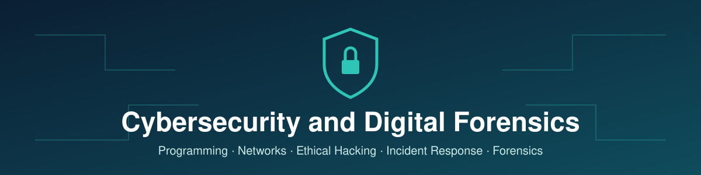
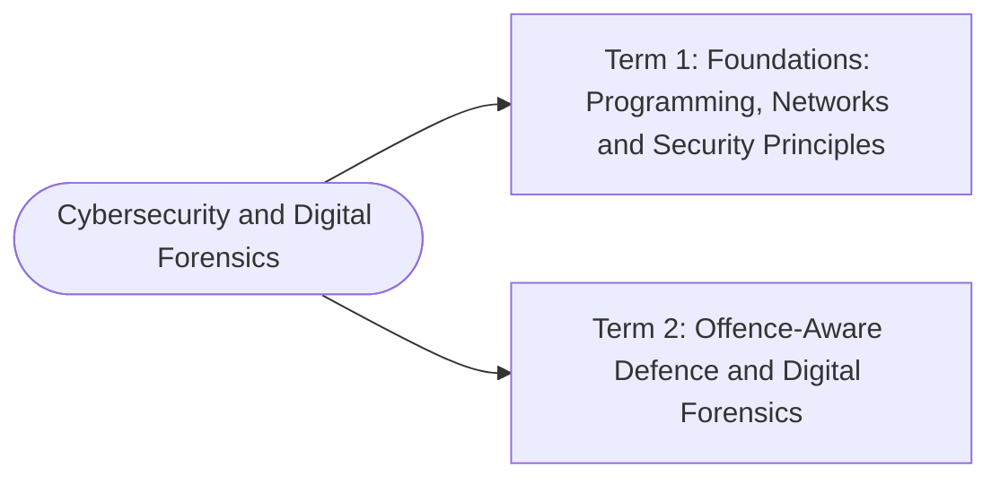

# Cybersecurity and Digital Forensics

Prepared by **Hamna Zahid Khan**, Junior Lecturer

## Overview

A hands-on course that starts with programming, web scripting and networking, then builds up to security frameworks, ethical hacking, threat hunting, incident response and digital forensics. Every session has notes, runnable code and exercises; every module ends with a practice test.

> 🚧 This course is being built module by module. Linked modules are ready; the rest are coming soon.

## Roadmap

## Contents

### [Term 1: Foundations: Programming, Networks & Security Principles](term-1/README.md)

1. [Programming in C](term-1/01-programming-in-c/README.md) · 9 sessions
2. [Client-Side Scripting with HTML5 & JavaScript](term-1/02-html5-and-javascript/README.md) · 10 sessions
3. [Technologies of Computer Networks](term-1/03-computer-networks/README.md) · 14 sessions
4. [Configuring Network Infrastructure](term-1/04-configuring-network-infrastructure/README.md) · 15 sessions
5. [Introduction to Cyber Security Frameworks](term-1/05-cyber-security-frameworks/README.md) · 4 sessions
6. Foundations of Ethical Hacking · *coming soon*
7. Data Security and Information Protection · *coming soon*
8. Cyber Laws and Regulations · *coming soon*

### Term 2: Offence-Aware Defence & Digital Forensics

1. Security Architecture and Hacking · *coming soon*
2. Windows, Unix and Linux Security · *coming soon*
3. Threat Hunting and Incident Response · *coming soon*
4. Computer Forensics and Cyber Crime Investigation · *coming soon*
5. Foundations and Techniques of Cryptography · *coming soon*
6. Data Acquisition, Duplication and Recovery · *coming soon*
7. Forensics Investigation · *coming soon*
8. Social Media Forensics · *coming soon*

## How to use this repository

- Work through each module's sessions in order; each session lists its time and prerequisites.
- Code lives in each module's `code/` folder. C examples build with `gcc file.c -o file -Wall`.
- Try the exercises and the practice test before opening the hidden answers.
- Security examples are for learning and defence in a lab you own or are authorised to use.

---

Prepared by Hamna Zahid Khan, Junior Lecturer · Cybersecurity and Digital Forensics
