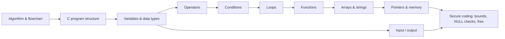

# Module 1: Programming in C

> [Cybersecurity and Digital Forensics](../../README.md) › [Term 1](../README.md) › **Module 1**

| ⬅ [Term 1 overview](../README.md) | [Next module](../02-html5-and-javascript/README.md) ➡ |
|:---|---:|

---

## 🎯 Module objectives

By the end of this module you will be able to:

- Write, compile and run C programs from an algorithm or flowchart.
- Choose the right data type and format specifier, and read input safely.
- Build logic with operators, conditions, loops and functions.
- Store and process data in arrays and strings without overflowing buffers.
- Use pointers and dynamic memory, and explain why memory bugs matter in security.

## 🗂 Sessions

| # | Session | Topic file |
|---|---|---|
| 1 | Basics of C, Algorithms & Flowcharts | [session-01-basics-of-c.md](session-01-basics-of-c.md) |
| 2 | Variables and Data Types | [session-02-variables-and-data-types.md](session-02-variables-and-data-types.md) |
| 3 | Input and Output in C | [session-03-input-and-output.md](session-03-input-and-output.md) |
| 4 | Operators and Expressions | [session-04-operators.md](session-04-operators.md) |
| 5 | Conditions and Decision Making | [session-05-conditions.md](session-05-conditions.md) |
| 6 | Loops | [session-06-loops.md](session-06-loops.md) |
| 7 | Functions | [session-07-functions.md](session-07-functions.md) |
| 8 | Arrays and Strings | [session-08-arrays.md](session-08-arrays.md) |
| 9 | Pointers and Memory | [session-09-pointers.md](session-09-pointers.md) |
| 📝 | Module practice test (20 MCQs + 3 scenarios) | [practice-test.md](practice-test.md) |

## 🧭 Concept map

## 📌 One-page cheat-sheet

| Topic | Remember |
|---|---|
| Build & run | `gcc prog.c -o prog -Wall` then `./prog` (Windows: `prog.exe`) |
| Skeleton | `#include <stdio.h>` · `int main(void) { ... return 0; }` |
| Types | `char` 1 B · `int` 4 B · `float` 4 B · `double` 8 B · check with `sizeof` |
| Format specifiers | `%d` int · `%f` float · `%lf` double (scanf) · `%c` char · `%s` string · `%p` pointer · `%x` hex |
| Input | `scanf("%d", &x)` needs `&`; for text prefer `fgets(buf, sizeof buf, stdin)` |
| Integer division | `7 / 2 == 3`; use `7 / 2.0` for `3.5`; `%` gives the remainder |
| Comparison vs assignment | `==` compares, `=` assigns: `if (x = 5)` is always true |
| Logical | `&&` and · `\|\|` or · `!` not (short-circuit) |
| Bitwise | `&` `\|` `^` `~` `<<` `>>`: masks, flags, permission bits |
| Decisions | `if / else if / else`; `switch` needs `break` to stop fall-through |
| Loops | `for` known count · `while` check first · `do...while` runs at least once |
| Loop control | `break` leaves the loop · `continue` skips to the next pass |
| Functions | Declare a prototype before `main`; C passes arguments **by value** |
| Arrays | Index `0` to `n-1`; C does **not** check bounds |
| Strings | `char s[10]` holds 9 chars + `'\0'`; use `strncpy`/`snprintf`, never `gets` |
| Pointers | `&x` address of · `*p` value at · `p + 1` moves by `sizeof(*p)` |
| Dynamic memory | `malloc` → check for `NULL` → use → `free` → set pointer to `NULL` |
| Security link | Unchecked bounds = buffer overflow; using freed memory = use-after-free |

---

Prepared by **Hamna Zahid Khan**, Junior Lecturer · Cybersecurity and Digital Forensics
