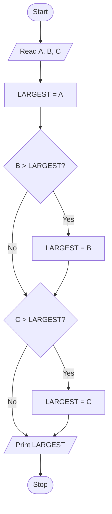
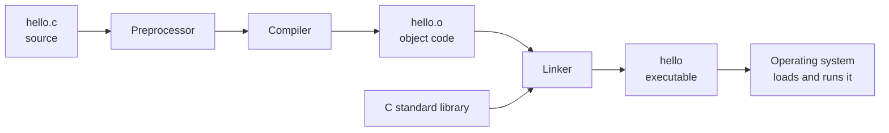
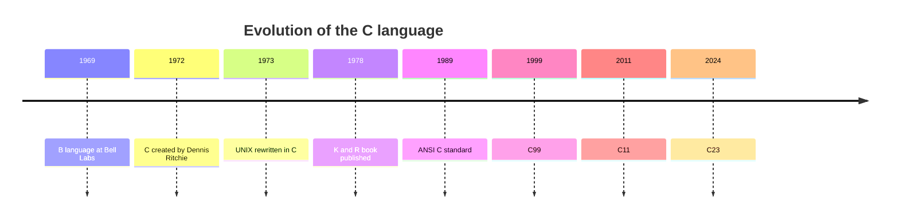
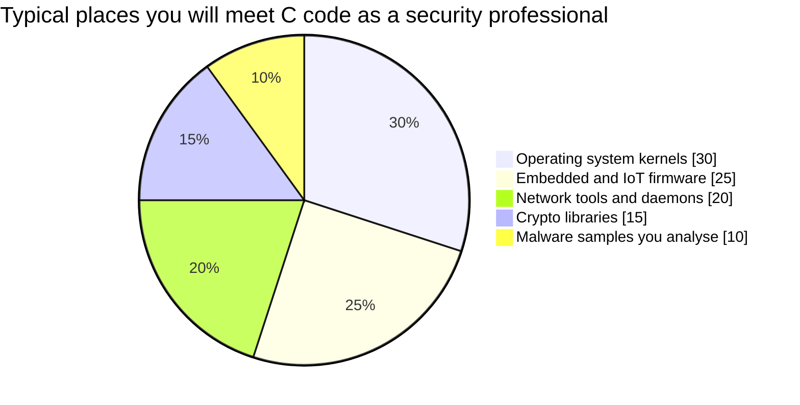

# Session 1: Basics of C, Algorithms & Flowcharts

> [Cybersecurity and Digital Forensics](../../README.md) › [Term 1](../README.md) › [Module 1: Programming in C](README.md) › **Session 1**

| ⏱ Estimated time | 📋 Prerequisites |
|---|---|
| 2 hours | Basic computer literacy (files, folders, a text editor) |

| ⬅ [Module overview](README.md) | [Next: Session 2](session-02-variables-and-data-types.md) ➡ |
|:---|---:|

---

## 🎯 Learning objectives

By the end of this session you will be able to:

- Tell the difference between a **command**, a **program** and **software**, with examples.
- Describe where C came from and why it is still used in security, operating systems and embedded devices.
- Identify every part of a minimal C program (`#include`, `main()`, braces, statements, `return`).
- Define an **algorithm** and write one for a simple problem.
- Draw a **flowchart** using the standard symbols and convert it into C.

## 📖 Concepts

### 1. Command vs program vs software

| Term | What it is | Example |
|---|---|---|
| **Command** | A single instruction given to the computer | `dir`, `ls`, `ping 8.8.8.8` |
| **Program** | An ordered set of instructions that solves one task | A C file that calculates GPA |
| **Software** | One or more programs plus data, docs and configuration that together deliver a product | Wireshark, VLC, Microsoft Word |

**Analogy:** a command is one sentence, a program is a recipe, and software is the whole cookbook with pictures, an index and a warranty card.

### 2. A short history of C

- **1969–1972:** Dennis Ritchie at Bell Labs develops C, building on the earlier languages **BCPL** and **B** (by Ken Thompson).
- **1973:** The UNIX kernel is rewritten in C – the first time an operating system was written mostly in a high-level language.
- **1978:** *The C Programming Language* by Kernighan & Ritchie ("K&R") becomes the informal standard.
- **1989/1990:** ANSI C / ISO C (C89/C90) – the first formal standard.
- **1999, 2011, 2018, 2024:** C99, C11, C17 and C23 add `//` comments, `bool`, fixed-width integers, threads and more.

### 3. Why C still matters (especially for cybersecurity)

- **Operating systems** – Linux, the Windows kernel and macOS cores are largely C. To understand privilege escalation or kernel logs you need to read C.
- **Embedded and IoT** – routers, cameras and medical devices run C firmware.
- **Speed and control** – C talks to memory directly through **pointers**, which makes it fast…
- …and **dangerous**: most classic vulnerabilities (buffer overflows, use-after-free, format-string bugs) are C programming mistakes. Defenders who understand C can spot and prevent them.
- **Tools** – many security tools (e.g. `tcpdump`, parts of OpenSSL) are written in C.

C is called a **middle-level language**: it has high-level constructs (functions, loops) but also low-level access (addresses, bits).

### 4. Structure of a C program

```c
#include <stdio.h>        // 1. Preprocessor directive: include a header file

int main(void)            // 2. main(): the entry point, returns an int
{                         // 3. Opening brace starts the function body
    printf("Hi\n");       // 4. Statement – ends with a semicolon
    return 0;             // 5. Exit status sent back to the OS
}                         // 6. Closing brace
```

| Part | Purpose |
|---|---|
| `#include <stdio.h>` | Copies declarations of standard input/output functions (`printf`, `scanf`) into your file before compiling |
| `int main(void)` | Every C program has exactly one `main`; execution begins here |
| `{ }` | A **block** – groups statements |
| `;` | **Statement terminator** – forgetting it is the #1 beginner error |
| Comments `/* */` and `//` | Ignored by the compiler; explain *why*, not *what* |
| `return 0;` | 0 = success; non-zero = an error code scripts can check |

### 5. From source code to running program

C is a **compiled** language. The compiler turns human-readable source code into machine code once; the result runs without the compiler.

1. **Edit** – write `hello.c`.
2. **Preprocess** – handle `#include` and `#define`.
3. **Compile** – translate to assembly/object code (`hello.o`).
4. **Link** – join your object code with library code (`printf` lives in the C library).
5. **Run** – the OS loads the executable into memory.

```bash
gcc hello.c -o hello     # compile and link
./hello                  # run (Linux/macOS);  hello.exe on Windows
```

### 6. Algorithms

An **algorithm** is a finite, ordered, unambiguous list of steps that solves a problem. A good algorithm has:

- **Input** – zero or more values given to it.
- **Output** – at least one result.
- **Definiteness** – every step is precise.
- **Finiteness** – it always stops.
- **Effectiveness** – every step can actually be carried out.

**Algorithm: find the largest of three numbers**

1. Start.
2. Read A, B, C.
3. Set LARGEST = A.
4. If B > LARGEST, set LARGEST = B.
5. If C > LARGEST, set LARGEST = C.
6. Print LARGEST.
7. Stop.

### 7. Flowcharts and their symbols

| Symbol | Shape | Meaning |
|---|---|---|
| Terminator | Rounded rectangle / oval | Start or Stop |
| Input/Output | Parallelogram | Read or print data |
| Process | Rectangle | Calculation or assignment |
| Decision | Diamond | Yes/No question – two exits |
| Flow line | Arrow | Order of execution |
| Connector | Small circle | Joins parts of a large chart |

**Rules:** one Start, at least one Stop, arrows never cross if you can avoid it, every decision has exactly two labelled exits.

## 🧭 Diagrams

**Flowchart – largest of three numbers**



**The build pipeline**



**Timeline of C**



## 💻 Worked examples

### Example 1 – Hello, Cyber Lab

📄 **`code/session-01_hello.c`**

```c
/* session-01_hello.c - the smallest useful C program */
#include <stdio.h>   /* gives us printf() */

int main(void)        /* execution always starts here */
{
    printf("Hello, Cyber Lab!\n");
    printf("C was created by Dennis Ritchie at Bell Labs in 1972.\n");
    return 0;         /* 0 tells the operating system: success */
}
```

**Output**

```text
Hello, Cyber Lab!
C was created by Dennis Ritchie at Bell Labs in 1972.
```
**What to notice:** `\n` is an **escape sequence** meaning "new line". Without it both sentences would print on one line.

### Example 2 – Algorithm → flowchart → code

The algorithm and flowchart above become this program. Compare each `if` with each diamond.

📄 **`code/session-01_largest.c`**

```c
/* session-01_largest.c - algorithm "find the largest of three numbers" turned into C */
#include <stdio.h>

int main(void)
{
    int a = 17, b = 42, c = 29;
    int largest = a;              /* step 1: assume the first is largest */

    if (b > largest) largest = b; /* step 2: compare with b */
    if (c > largest) largest = c; /* step 3: compare with c */

    printf("Numbers: %d, %d, %d\n", a, b, c);
    printf("Largest: %d\n", largest);
    return 0;
}
```

**Output**

```text
Numbers: 17, 42, 29
Largest: 42
```
### Example 3 – Reading a compiler error

Remove the semicolon after the first `printf` in Example 1 and compile. GCC prints something like:

```text
hello.c: In function 'main':
hello.c:6:36: error: expected ';' before 'printf'
```

Read it as **file : line : column : message**. The error is often reported on the line *after* the real mistake.

## 📊 Where C is used today



*(Illustrative proportions for discussion, not survey data.)*

| Language | Compiled/Interpreted | Memory control | Typical security use |
|---|---|---|---|
| C | Compiled | Manual (pointers) | Kernels, exploits analysis, firmware |
| Python | Interpreted | Automatic | Automation, forensics scripts |
| JavaScript | Interpreted/JIT | Automatic | Web apps, XSS analysis |

## 🧪 Lab / practice tasks

1. **Easy –** Install a compiler (GCC via MinGW on Windows, `build-essential` on Ubuntu, or an online compiler such as an IDE in the browser) and run Example 1.
2. **Easy –** Change the program to print your name, your department and today's date on three lines.
3. **Medium –** Write an algorithm and draw a flowchart that reads a temperature in Celsius and prints it in Fahrenheit (`F = C × 9/5 + 32`).
4. **Medium –** Draw a flowchart that decides whether a number is even or odd.
5. **Challenge –** Write an algorithm and flowchart for a login check: allow at most 3 password attempts, then print "Account locked". (We will code it after learning loops.)

<details>
<summary>💡 Hints</summary>

- Task 3: the flow is Start → Read C → F = C*9/5+32 → Print F → Stop. In C, write `9.0/5` so the division is not done in integers.
- Task 4: the decision is `N % 2 == 0?`.
- Task 5: you need a counter, a decision `password correct?`, and a second decision `attempts == 3?` with an arrow looping back.
</details>

## ✅ Quick quiz

1. Who created the C language?
   a) James Gosling b) Dennis Ritchie c) Guido van Rossum d) Bjarne Stroustrup
2. Which line is the entry point of every C program?
   a) `#include <stdio.h>` b) `printf()` c) `main()` d) `return 0;`
3. Which flowchart symbol represents a decision?
   a) Rectangle b) Parallelogram c) Diamond d) Oval
4. What does `#include <stdio.h>` do?
   a) Runs the program b) Inserts declarations for standard I/O functions c) Declares a variable d) Ends the program
5. Which property says an algorithm must always stop?
   a) Definiteness b) Effectiveness c) Finiteness d) Input

<details>
<summary>Show answers</summary>

1 – b · 2 – c · 3 – c · 4 – b · 5 – c
</details>

## 📝 Summary / cheat-sheet

- Command = one instruction; program = ordered instructions; software = programs + data + docs.
- C (1972, Bell Labs) is fast, portable and close to the hardware – the language of kernels and firmware.
- Skeleton: `#include <stdio.h>` → `int main(void) { ...; return 0; }`.
- Build steps: preprocess → compile → link → run.
- Algorithm = finite, definite, effective steps with input and output.
- Flowchart: oval (start/stop), parallelogram (I/O), rectangle (process), diamond (decision).

**Interview / viva questions**

1. Why is C called a middle-level language?
2. What is the difference between a compiler and an interpreter?
3. What happens if `main` returns 1 instead of 0?
4. Why do security analysts need to read C even if they mostly write Python?
5. Name three properties of a good algorithm.

---

| ⬅ [Module overview](README.md) | [Next: Session 2](session-02-variables-and-data-types.md) ➡ |
|:---|---:|

<sub>Prepared by **Hamna Zahid Khan**, Junior Lecturer · Cybersecurity and Digital Forensics</sub>
