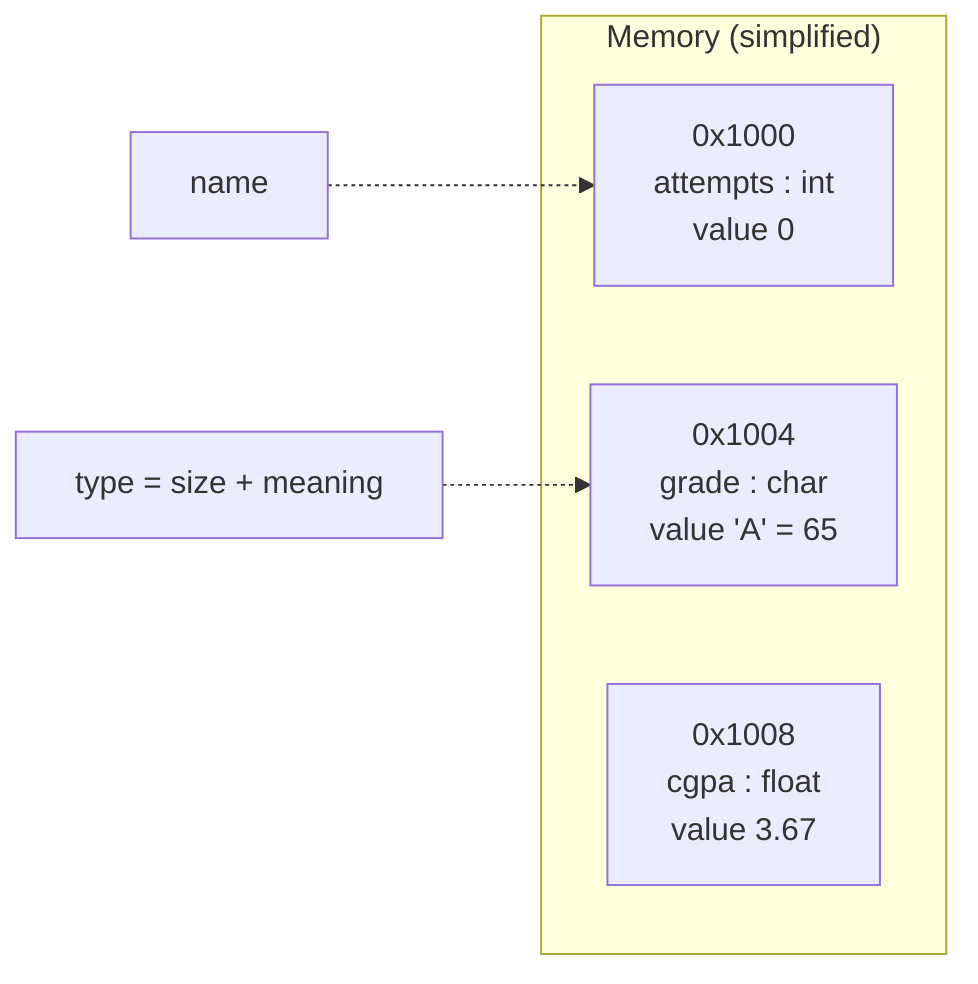
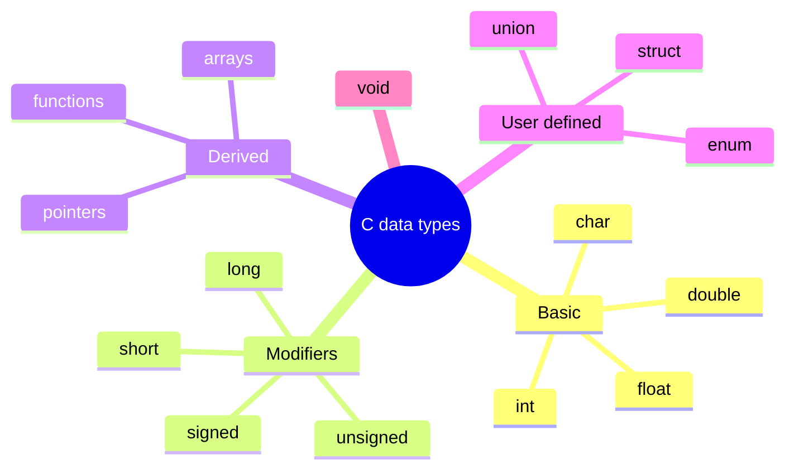
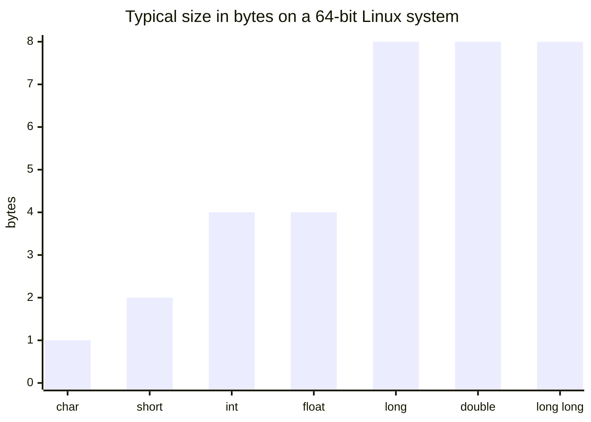

# Session 2: Variables and Data Types

> [Cybersecurity and Digital Forensics](../../README.md) › [Term 1](../README.md) › [Module 1: Programming in C](README.md) › **Session 2**

| ⏱ Estimated time | 📋 Prerequisites |
|---|---|
| 2 hours | Session 1 (structure of a C program, compiling and running) |

| ⬅ [Previous: Session 1](session-01-basics-of-c.md) | [Next: Session 3](session-03-input-and-output.md) ➡ |
|:---|---:|

---

## 🎯 Learning objectives

- Explain what a **variable** is and how it maps to memory.
- Differentiate between **variables** and **constants** (`const` and `#define`).
- Choose the right **data type** (`char`, `int`, `float`, `double`, and modifiers) for a value.
- Apply the **arithmetic operators** `+ - * / %` correctly, including integer division.
- Follow C naming rules and good naming style.

## 📖 Concepts

### 1. What is a variable?

A **variable** is a named box in memory that holds a value which can change while the program runs. When you write `int attempts = 0;` the compiler:

1. Reserves enough bytes for an `int` (usually 4).
2. Remembers that the name `attempts` refers to that location.
3. Stores the bit pattern for `0` there.

**Analogy:** RAM is a huge row of numbered lockers. A variable is a locker with a name tag. The data type says how big the locker is and how to interpret what is inside.

### 2. Declaring and initialising

```c
int count;           // declaration (value is garbage until assigned!)
int total = 0;       // declaration + initialisation
float a = 1.5f, b;   // several in one line
count = 10;          // assignment later
```

> ⚠️ **Security note:** reading an uninitialised variable gives unpredictable "garbage" that may contain old data from memory. Always initialise.

### 3. Naming rules (identifiers)

| Rule | Valid | Invalid |
|---|---|---|
| Letters, digits, underscore only | `login_count` | `login-count` |
| Cannot start with a digit | `port2` | `2port` |
| Not a keyword | `total` | `int`, `return` |
| Case-sensitive | `Total` ≠ `total` | – |

Style: use meaningful `snake_case` names (`failed_logins`, not `fl`). Constants are usually `UPPER_CASE`.

### 4. Constants

| Kind | Example | Notes |
|---|---|---|
| Integer literal | `42`, `0x1F` (hex), `017` (octal!) | A leading 0 means octal – a classic bug |
| Floating literal | `3.14`, `2.5e3`, `1.5f` | `f` suffix makes it `float` |
| Character literal | `'A'`, `'\n'` | Stored as its ASCII code (65, 10) |
| String literal | `"admin"` | Array of chars ending in `'\0'` |
| `const` variable | `const int PORT = 443;` | Typed, checked by compiler |
| `#define` macro | `#define PORT 443` | Text replacement before compiling |

### 5. Basic data types

| Type | Typical size | Range (typical) | Format | Use for |
|---|---|---|---|---|
| `char` | 1 byte | -128…127 or 0…255 | `%c` / `%d` | Single characters, raw bytes |
| `int` | 4 bytes | ≈ ±2.1 billion | `%d` | Counters, ports, IDs |
| `float` | 4 bytes | ~7 significant digits | `%f` | Approximate decimals |
| `double` | 8 bytes | ~15 significant digits | `%lf` (scanf) / `%f` (printf) | Precise decimals |
| `void` | – | no value | – | Functions returning nothing |

**Modifiers:** `short`, `long`, `long long`, `signed`, `unsigned`.

- `unsigned int` holds only non-negative values (0…≈4.29 billion) – good for sizes and counts.
- `long long` is at least 8 bytes.
- Sizes can differ between platforms; `sizeof(type)` tells you the truth on your machine.

### 6. Integer overflow – why types matter in security

An `unsigned char` holds 0–255. Adding 1 to 255 **wraps around** to 0. A signed overflow is *undefined behaviour*. Many real vulnerabilities start with a size calculation that overflowed, so a tiny buffer was allocated and then over-filled. Choosing the correct type and checking limits is a defensive habit.

### 7. Arithmetic operators

| Operator | Meaning | `17 op 5` |
|---|---|---|
| `+` | Addition | 22 |
| `-` | Subtraction | 12 |
| `*` | Multiplication | 85 |
| `/` | Division (integer if both ints) | 3 |
| `%` | Remainder (ints only) | 2 |

**Integer division** throws away the fraction: `7/2` is `3`. Make one operand a floating value (`7.0/2`) to get `3.5`.

## 🧭 Diagrams





## 💻 Worked examples

### Example 1 – Types, sizes and constants

📄 **`code/session-02_types.c`**

```c
/* session-02_types.c - variables, constants and the size of each data type */
#include <stdio.h>
#define MAX_LOGIN_ATTEMPTS 3      /* symbolic constant (preprocessor) */

int main(void)
{
    const float PI = 3.14159f;    /* typed constant: cannot be changed */
    int    attempts = 0;
    char   grade    = 'A';
    float  cgpa     = 3.67f;
    double balance  = 125000.75;

    printf("Type      Size(bytes)  Example\n");
    printf("char      %zu            %c\n", sizeof(char), grade);
    printf("int       %zu            %d\n", sizeof(int), attempts);
    printf("float     %zu            %.2f\n", sizeof(float), cgpa);
    printf("double    %zu            %.2f\n", sizeof(double), balance);
    printf("PI = %.5f, max attempts = %d\n", PI, MAX_LOGIN_ATTEMPTS);
    return 0;
}
```

**Output**

```text
Type      Size(bytes)  Example
char      1            A
int       4            0
float     4            3.67
double    8            125000.75
PI = 3.14159, max attempts = 3
```
`%zu` is the correct format for the result of `sizeof`. Your sizes may differ on a different platform – that is exactly why `sizeof` exists.

### Example 2 – Arithmetic and the integer-division trap

Converting a log duration in seconds into hours, minutes and seconds is a common forensic timeline task.

📄 **`code/session-02_arith.c`**

```c
/* session-02_arith.c - arithmetic operators and the integer-division trap */
#include <stdio.h>

int main(void)
{
    int total_seconds = 3725;
    int hours   = total_seconds / 3600;          /* integer division */
    int minutes = (total_seconds % 3600) / 60;   /* % gives the remainder */
    int seconds = total_seconds % 60;

    printf("%d seconds = %dh %dm %ds\n", total_seconds, hours, minutes, seconds);
    printf("7 / 2   = %d   (int / int drops the fraction)\n", 7 / 2);
    printf("7.0 / 2 = %.1f (one double operand keeps it)\n", 7.0 / 2);
    printf("-7 %% 3  = %d\n", -7 % 3);
    return 0;
}
```

**Output**

```text
3725 seconds = 1h 2m 5s
7 / 2   = 3   (int / int drops the fraction)
7.0 / 2 = 3.5 (one double operand keeps it)
-7 % 3  = -1
```
Trace for 3725 s: `3725/3600 = 1` hour; remainder `3725%3600 = 125`; `125/60 = 2` minutes; `3725%60 = 5` seconds.

### Example 3 – Overflow by hand

```c
unsigned char port_byte = 255;
port_byte = port_byte + 1;      // becomes 0, not 256
```

| Step | Binary (8 bits) | Decimal |
|---|---|---|
| Start | `1111 1111` | 255 |
| + 1 | `1 0000 0000` (9 bits) | 256 |
| Stored (low 8 bits kept) | `0000 0000` | **0** |

## 📊 Choosing a type – quick guide

| If the value is… | Use |
|---|---|
| A single letter or byte | `char` / `unsigned char` |
| A whole number that can be negative | `int` (or `long long` if huge) |
| A size, count or port number (never negative) | `unsigned int` |
| Money in a demo | `double` (real banking uses integer paisa/cents) |
| A fixed limit that never changes | `const` or `#define` |



## 🧪 Lab / practice tasks

1. **Easy –** Declare variables for a student's roll number, initial letter, and percentage. Print them with labels.
2. **Easy –** Print `sizeof` for `short`, `long` and `long double` on your machine.
3. **Medium –** Read nothing from the user; given `int bytes = 5368709;` print the size in KB, MB (use `double`) with 2 decimals.
4. **Medium –** Given a total of 1000 rupees and 7 students, print each share as an integer and the remainder.
5. **Challenge –** Demonstrate unsigned wrap-around: start an `unsigned char` at 250 and add 10. Predict the result before running, then explain it in a comment.

<details>
<summary>💡 Hints</summary>

- Task 3: `double kb = bytes / 1024.0;` – the `.0` is essential.
- Task 4: share = `1000 / 7` (142), remainder = `1000 % 7` (6).
- Task 5: 250 + 10 = 260; 260 − 256 = **4**.
</details>

## ✅ Quick quiz

1. What is the value of `17 % 5`? a) 3 b) 2 c) 3.4 d) 5
2. Which declaration is **invalid**? a) `int _count;` b) `int count2;` c) `int 2count;` d) `int Count;`
3. What does `7/2` evaluate to in C when both are `int`? a) 3.5 b) 4 c) 3 d) error
4. Which keyword creates a typed constant? a) `static` b) `const` c) `#define` d) `fixed`
5. Which format specifier prints a `char`? a) `%d` b) `%s` c) `%c` d) `%f`

<details>
<summary>Show answers</summary>

1 – b · 2 – c · 3 – c · 4 – b (`#define` is a preprocessor macro, not a typed constant) · 5 – c
</details>

## 📝 Summary / cheat-sheet

- Variable = named memory location; type decides size and meaning.
- Always initialise variables; uninitialised memory can leak old data.
- `const` is typed and checked; `#define` is plain text substitution.
- Core types: `char`(1), `int`(4), `float`(4), `double`(8) – confirm with `sizeof`.
- `int/int` truncates; use a `.0` literal or a cast for decimals.
- Unsigned overflow wraps around; signed overflow is undefined – both can become security bugs.

**Interview / viva questions**

1. What is the difference between declaration and initialisation?
2. Why might `int x = 010;` print 8?
3. When would you use `unsigned int` instead of `int`?
4. Explain integer overflow and one way it can lead to a vulnerability.
5. What is the difference between `'A'` and `"A"`?

---

| ⬅ [Previous: Session 1](session-01-basics-of-c.md) | [Next: Session 3](session-03-input-and-output.md) ➡ |
|:---|---:|

<sub>Prepared by **Hamna Zahid Khan**, Junior Lecturer · Cybersecurity and Digital Forensics</sub>
