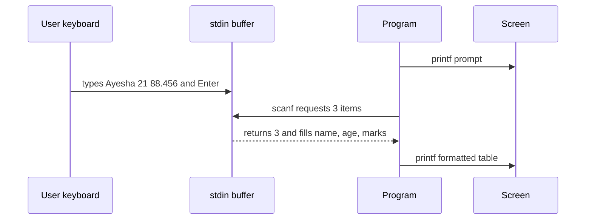
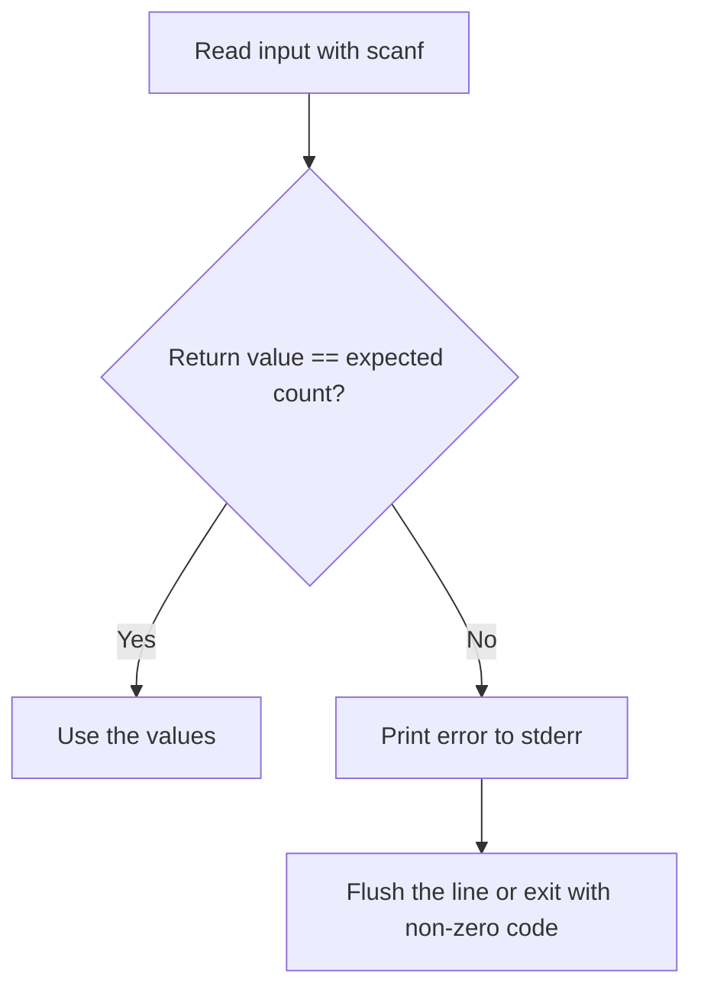

# Session 3: Input and Output in C

> [Cybersecurity and Digital Forensics](../../README.md) › [Term 1](../README.md) › [Module 1: Programming in C](README.md) › **Session 3**

| ⏱ Estimated time | 📋 Prerequisites |
|---|---|
| 2 hours | Session 2 (variables, data types, format specifiers) |

| ⬅ [Previous: Session 2](session-02-variables-and-data-types.md) | [Next: Session 4](session-04-operators.md) ➡ |
|:---|---:|

---

## 🎯 Learning objectives

- Use `printf()` with format specifiers, width, precision and alignment flags.
- Read typed input safely with `scanf()` and check its return value.
- Use character I/O functions `getchar()` and `putchar()`.
- Explain why unchecked input is a security risk and how to limit input length.

## 📖 Concepts

### 1. Streams

C programs talk to the outside world through **streams**:

| Stream | Default device | Functions |
|---|---|---|
| `stdin` | Keyboard | `scanf`, `getchar`, `fgets` |
| `stdout` | Screen | `printf`, `putchar`, `puts` |
| `stderr` | Screen (unbuffered) | `fprintf(stderr, ...)` for error messages |

All of them are declared in `<stdio.h>`.

### 2. `printf()` – formatted output

```c
printf("format string", value1, value2, ...);
```

The **format string** holds normal text plus **conversion specifiers** that start with `%`.

| Specifier | Prints | Example output |
|---|---|---|
| `%d` / `%i` | int | `42` |
| `%u` | unsigned int | `42` |
| `%f` | float/double | `3.140000` |
| `%.2f` | 2 decimal places | `3.14` |
| `%e` | scientific | `3.140000e+00` |
| `%c` | char | `A` |
| `%s` | string | `admin` |
| `%x` / `%X` | hexadecimal | `ff` / `FF` |
| `%o` | octal | `377` |
| `%p` | pointer address | `0x7ffd...` |
| `%%` | a literal percent sign | `%` |

**Width and flags:** `%8d` (right-aligned in 8 columns), `%-8d` (left-aligned), `%08d` (zero-padded), `%8.2f` (8 wide, 2 decimals).

**Escape sequences:** `\n` newline, `\t` tab, `\\` backslash, `\"` quote, `\a` beep, `\0` null character.

> ⚠️ **Format-string vulnerability:** never write `printf(user_input);`. If the user types `%x %x %x`, printf reads values off the stack and leaks memory. Always write `printf("%s", user_input);`.

### 3. `scanf()` – formatted input

```c
int age;
scanf("%d", &age);     // & = "address of" – scanf needs to know WHERE to store
```

- Every variable except strings (arrays) needs `&`.
- `scanf` **returns the number of items successfully read** – check it.
- For `double`, use `%lf` in `scanf` (but `%f` in `printf`).
- `%s` stops at whitespace and does **not** limit length by default. Use a width: `%29s` for a 30-byte array (one byte for `'\0'`). Unlimited `%s` is a classic **buffer overflow**.

### 4. Character I/O

| Function | Does | Returns |
|---|---|---|
| `getchar()` | Reads one character from stdin | The character as `int`, or `EOF` |
| `putchar(c)` | Writes one character to stdout | The character written |

`getchar()` returns `int` (not `char`) so that it can return the special value **EOF** (end-of-file, usually −1), which does not fit in the range of valid characters.

### 5. The input buffer

Keyboard input sits in a **buffer** until you press Enter. `scanf("%d")` leaves the `'\n'` behind, so a following `getchar()` immediately reads that newline. A common fix is to consume the rest of the line:

```c
int c; while ((c = getchar()) != '\n' && c != EOF) { }   // flush the line
```

### 6. Safer line input

`fgets(buf, sizeof buf, stdin)` reads a whole line but never more than `sizeof buf - 1` characters. It is the recommended way to read text in security-sensitive code.

## 🧭 Diagrams





## 💻 Worked examples

### Example 1 – A formatted student record

📄 **`code/session-03_io.c`**

```c
/* session-03_io.c - formatted input with scanf() and output with printf() */
#include <stdio.h>

int main(void)
{
    char name[30];
    int  age;
    float marks;

    printf("Enter name, age and marks: ");
    if (scanf("%29s %d %f", name, &age, &marks) != 3) {   /* always check! */
        printf("Invalid input\n");
        return 1;
    }
    printf("\n|%-10s|%5d|%8.2f|\n", name, age, marks);
    printf("|%10s|%-5d|%-8.1f|\n", name, age, marks);
    return 0;
}
```

**Input** (typed by the user):

```text
Ayesha 21 88.456
```

**Output**

```text
Enter name, age and marks: 
|Ayesha    |   21|   88.46|
|    Ayesha|21   |88.5    |
```
Read the format `|%-10s|%5d|%8.2f|`: the name is left-aligned in 10 columns, age right-aligned in 5, marks 8 wide with 2 decimals (88.456 rounds to 88.46).

### Example 2 – Masking a password with character I/O

A program should never print a secret back to the screen. This one counts characters and prints asterisks instead.

📄 **`code/session-03_chario.c`**

```c
/* session-03_chario.c - getchar()/putchar(): count and mask characters of a password */
#include <stdio.h>

int main(void)
{
    int ch, count = 0, digits = 0;
    printf("Type a password and press Enter: ");
    while ((ch = getchar()) != '\n' && ch != EOF) {
        count++;
        if (ch >= '0' && ch <= '9') digits++;
    }
    printf("\nMasked : ");
    for (int i = 0; i < count; i++) putchar('*');   /* never echo secrets */
    putchar('\n');
    printf("Length : %d, digits: %d\n", count, digits);
    return 0;
}
```

**Input** (typed by the user):

```text
lab2026pass
```

**Output**

```text
Type a password and press Enter: 
Masked : ***********
Length : 11, digits: 4
```
*(When typed at a real terminal the characters still echo as you type; truly hiding them needs OS-specific functions. The point here is never to print the secret yourself.)*

### Example 3 – The dangerous vs the safe way

```c
char name[10];
scanf("%s", name);      // ❌ user can type 100 chars -> overflow
scanf("%9s", name);     // ✅ at most 9 chars + '\0'
fgets(name, sizeof name, stdin);   // ✅ best for whole lines
```

## 📊 printf width/precision playground

| Code | Output (dots show spaces) |
|---|---|
| `printf("%5d", 42)` | `...42` |
| `printf("%-5d|", 42)` | `42...|` |
| `printf("%05d", 42)` | `00042` |
| `printf("%.3f", 3.14159)` | `3.142` |
| `printf("%8.1f", 3.14159)` | `.....3.1` |
| `printf("%x", 255)` | `ff` |
| `printf("%#x", 255)` | `0xff` |

## 🧪 Lab / practice tasks

1. **Easy –** Read two integers and print their sum, difference and product in a neat table.
2. **Easy –** Read a character and print its ASCII code with `%d` and its hex code with `%x`.
3. **Medium –** Read a temperature in Celsius (`double`) and print Fahrenheit with 1 decimal.
4. **Medium –** Using `getchar()` in a loop, count uppercase letters, lowercase letters and spaces in one line of input.
5. **Challenge –** Write a program that reads a username with `fgets`, removes the trailing newline, and refuses (prints an error) if it is longer than 12 characters.

<details>
<summary>💡 Hints</summary>

- Task 2: `char c; scanf(" %c", &c); printf("%d %x\n", c, c);` – the space before `%c` skips leftover whitespace.
- Task 3: use `%lf` in scanf.
- Task 5: after `fgets`, use `strcspn(buf, "\n")` from `<string.h>` to find and replace the newline with `'\0'`; then check `strlen`.
</details>

## ✅ Quick quiz

1. Which specifier reads a `double` with scanf? a) `%f` b) `%d` c) `%lf` d) `%e`
2. Why does `scanf("%d", &x)` need `&`? a) Style b) It passes the address so scanf can store the value c) It converts to int d) It is optional
3. What does `getchar()` return at end of input? a) `'\0'` b) `NULL` c) `EOF` d) `0`
4. Which line is vulnerable to a format-string attack? a) `printf("%s", s);` b) `printf(s);` c) `puts(s);` d) `fputs(s, stdout);`
5. What does `printf("%-6d|", 7)` print? a) `     7|` b) `7     |` c) `000007|` d) `7|`

<details>
<summary>Show answers</summary>

1 – c · 2 – b · 3 – c · 4 – b · 5 – b
</details>

## 📝 Summary / cheat-sheet

- `printf("fmt", args)`; `scanf("fmt", &vars)`; check scanf's return value.
- Width/precision: `%8.2f`, `%-10s`, `%05d`; `%%` for a percent sign.
- `getchar`/`putchar` handle one character; store `getchar()` in an `int` to detect `EOF`.
- Limit string input: `%29s` or `fgets(buf, sizeof buf, stdin)`.
- Never pass user data as the format string.

**Interview / viva questions**

1. What is a format-string vulnerability and how do you prevent it?
2. Why is `gets()` removed from modern C?
3. What does scanf return and why should you check it?
4. Explain why a `getchar()` after `scanf("%d")` seems to be "skipped".
5. What is the difference between `stdout` and `stderr`?

---

| ⬅ [Previous: Session 2](session-02-variables-and-data-types.md) | [Next: Session 4](session-04-operators.md) ➡ |
|:---|---:|

<sub>Prepared by **Hamna Zahid Khan**, Junior Lecturer · Cybersecurity and Digital Forensics</sub>
