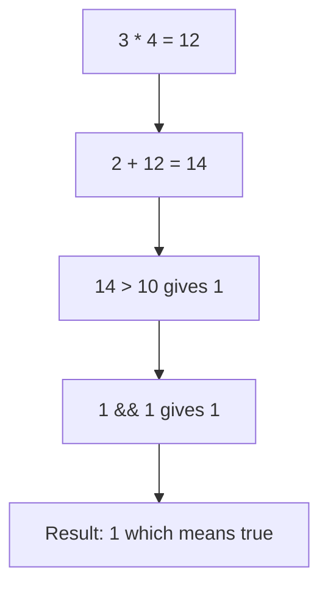
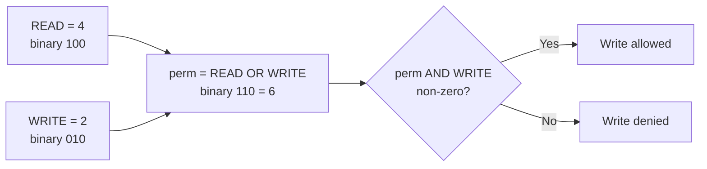

# Session 4: Operators and Expressions

> [Cybersecurity and Digital Forensics](../../README.md) › [Term 1](../README.md) › [Module 1: Programming in C](README.md) › **Session 4**

| ⏱ Estimated time | 📋 Prerequisites |
|---|---|
| 2 hours | Sessions 2–3 (variables, data types, printf/scanf) |

| ⬅ [Previous: Session 3](session-03-input-and-output.md) | [Next: Session 5](session-05-conditions.md) ➡ |
|:---|---:|

---

## 🎯 Learning objectives

- Use simple and compound **assignment** operators.
- Build **arithmetic expressions** and predict their value using **precedence** and **associativity**.
- Combine conditions with **relational** and **logical** operators, including short-circuit evaluation.
- Manipulate individual bits with **bitwise** operators – the basis of permissions, flags, masks and simple ciphers.
- Convert between types with **casts** and understand implicit conversion.

## 📖 Concepts

### 1. Assignment operators

| Operator | Example | Same as |
|---|---|---|
| `=` | `x = 5` | – |
| `+=` | `x += 3` | `x = x + 3` |
| `-=` | `x -= 3` | `x = x - 3` |
| `*=` | `x *= 3` | `x = x * 3` |
| `/=` | `x /= 3` | `x = x / 3` |
| `%=` | `x %= 3` | `x = x % 3` |
| `&=`, `|=`, `^=`, `<<=`, `>>=` | `flags |= 4` | `flags = flags | 4` |

Increment/decrement: `++i` (pre – change then use), `i++` (post – use then change). Never modify the same variable twice in one expression (e.g. `i = i++ + ++i;`) – the result is **undefined**.

### 2. Relational and logical operators

| Relational | Meaning | | Logical | Meaning |
|---|---|---|---|---|
| `==` | equal | | `&&` | AND – true if both true |
| `!=` | not equal | | `\|\|` | OR – true if either true |
| `<` `>` | less / greater | | `!` | NOT – flips true/false |
| `<=` `>=` | less-or-equal / greater-or-equal | | | |

In C, **false is 0** and **true is any non-zero** value; relational operators produce `1` or `0`.

**Short-circuit evaluation:** in `a && b`, if `a` is false, `b` is never evaluated; in `a || b`, if `a` is true, `b` is skipped. This lets you write safe guards like `if (ptr != NULL && ptr->len > 0)`.

> ⚠️ `if (x = 5)` assigns 5 and is always true. You meant `if (x == 5)`. Compile with `-Wall` to get a warning.

### 3. Bitwise operators

| Op | Name | Rule (per bit) | `12 op 10` (`1100`, `1010`) |
|---|---|---|---|
| `&` | AND | 1 if both 1 | `1000` = 8 |
| `\|` | OR | 1 if either 1 | `1110` = 14 |
| `^` | XOR | 1 if different | `0110` = 6 |
| `~` | NOT | flips every bit | `~12` = −13 (signed) |
| `<<` | left shift | moves bits left (×2 each) | `12 << 1` = 24 |
| `>>` | right shift | moves bits right (÷2 each) | `12 >> 2` = 3 |

**Security uses:**

- **Permission flags** – Linux file modes (`rwx` = 4+2+1) are bit flags.
- **Masks** – network masks: `ip & mask` gives the network address.
- **XOR** – `x ^ k ^ k == x`. XOR is the core operation in stream ciphers and one-time pads (simple XOR alone is *not* secure encryption).

Idioms: set a bit `v |= FLAG`, clear `v &= ~FLAG`, toggle `v ^= FLAG`, test `if (v & FLAG)`.

### 4. Type conversion and casts

- **Implicit (automatic) conversion:** in mixed expressions the smaller type is promoted: `int + double → double`.
- **Explicit cast:** `(type) expression`, e.g. `(float)total / n`.
- Converting a `double` to `int` **truncates** (3.99 → 3).
- Casting a large value to a smaller type can lose data – a frequent source of bugs.

### 5. Precedence and associativity (highest first, simplified)

| Level | Operators | Associativity |
|---|---|---|
| 1 | `()` `[]` `->` `.` postfix `++ --` | left → right |
| 2 | unary `! ~ ++ -- + -` cast `*` `&` `sizeof` | right → left |
| 3 | `* / %` | left → right |
| 4 | `+ -` | left → right |
| 5 | `<< >>` | left → right |
| 6 | `< <= > >=` | left → right |
| 7 | `== !=` | left → right |
| 8 | `&` | left → right |
| 9 | `^` | left → right |
| 10 | `\|` | left → right |
| 11 | `&&` | left → right |
| 12 | `\|\|` | left → right |
| 13 | `?:` | right → left |
| 14 | `= += -=` … | right → left |
| 15 | `,` | left → right |

**Tip:** when in doubt, add parentheses. Note that `&` is *lower* than `==`: `if (flags & 4 == 4)` means `flags & (4 == 4)` – a real bug. Write `if ((flags & 4) == 4)`.

## 🧭 Diagrams

**How `2 + 3 * 4 > 10 && 1` is evaluated**



**Bit flags as a class of permissions**



## 💻 Worked examples

### Example 1 – Assignment, logic, casts and precedence

📄 **`code/session-04_operators.c`**

```c
/* session-04_operators.c - relational, logical, assignment, cast and precedence */
#include <stdio.h>

int main(void)
{
    int x = 10;
    x += 5;  x *= 2;  x -= 4;  x /= 2;              /* compound assignment */
    printf("x after += *= -= /= : %d\n", x);

    int age = 20, has_id = 1;
    printf("age >= 18 && has_id : %d\n", age >= 18 && has_id);
    printf("!(age < 18)         : %d\n", !(age < 18));

    int total = 7, n = 2;
    printf("no cast  : %d\n", total / n);
    printf("with cast: %.2f\n", (float)total / n);

    printf("2 + 3 * 4   = %d\n", 2 + 3 * 4);       /* * before + */
    printf("(2 + 3) * 4 = %d\n", (2 + 3) * 4);
    int i = 5;
    printf("i++ gives %d, ", i++);
    printf("now i = %d, ", i);
    printf("++i gives %d\n", ++i);   /* one side effect per statement */
    return 0;
}
```

**Output**

```text
x after += *= -= /= : 13
age >= 18 && has_id : 1
!(age < 18)         : 1
no cast  : 3
with cast: 3.50
2 + 3 * 4   = 14
(2 + 3) * 4 = 20
i++ gives 5, now i = 6, ++i gives 7
```
Trace of `x`: 10 → `+=5` 15 → `*=2` 30 → `-=4` 26 → `/=2` 13.

### Example 2 – Bitwise permission flags

📄 **`code/session-04_bitwise.c`**

```c
/* session-04_bitwise.c - bitwise operators used as permission flags (like file modes) */
#include <stdio.h>

#define READ  4   /* 100 */
#define WRITE 2   /* 010 */
#define EXEC  1   /* 001 */

void show_bits(const char *label, unsigned v)
{
    printf("%-14s %u = ", label, v);
    for (int b = 2; b >= 0; b--) putchar((v >> b) & 1 ? '1' : '0');
    putchar('\n');
}

int main(void)
{
    unsigned perm = READ | WRITE;              /* set two flags        */
    show_bits("READ|WRITE", perm);
    printf("can write? %s\n", (perm & WRITE) ? "yes" : "no");
    perm &= ~WRITE;                            /* clear WRITE          */
    show_bits("clear WRITE", perm);
    perm ^= EXEC;                              /* toggle EXEC          */
    show_bits("toggle EXEC", perm);
    printf("5 << 1 = %d, 20 >> 2 = %d\n", 5 << 1, 20 >> 2);
    printf("XOR mask demo: 'A'(%d) ^ 32 = '%c'\n", 'A', 'A' ^ 32);
    return 0;
}
```

**Output**

```text
READ|WRITE     6 = 110
can write? yes
clear WRITE    4 = 100
toggle EXEC    5 = 101
5 << 1 = 10, 20 >> 2 = 5
XOR mask demo: 'A'(65) ^ 32 = 'a'
```
The last line shows a neat trick: uppercase and lowercase ASCII letters differ only in bit 5 (value 32), so XOR with 32 flips the case.

### Example 3 – Subnet calculation with `&`

```text
IP      192.168.10.77  -> last octet 77  = 0100 1101
Mask    255.255.255.192 -> last octet 192 = 1100 0000
AND                                         0100 0000 = 64
Network address = 192.168.10.64
```

You will use exactly this operation again in the networking modules.

## 📊 Truth tables

| A | B | `A && B` | `A \|\| B` | `!A` | `A ^ B` (bits) |
|---|---|---|---|---|---|
| 0 | 0 | 0 | 0 | 1 | 0 |
| 0 | 1 | 0 | 1 | 1 | 1 |
| 1 | 0 | 0 | 1 | 0 | 1 |
| 1 | 1 | 1 | 1 | 0 | 0 |

## 🧪 Lab / practice tasks

1. **Easy –** Evaluate by hand, then verify: `10 - 4 / 2 * 3`, `(10 - 4) / 2 * 3`, `10 % 4 + 2 * 3`.
2. **Easy –** Read an age and print `1` if it is between 18 and 60 inclusive, else `0`, using one logical expression.
3. **Medium –** Read an integer and print whether bit 3 is set using `&` and a shift.
4. **Medium –** Read the last octet of an IP and a prefix length (e.g. 26) and print the network's last octet using a mask built with shifts.
5. **Challenge –** Write a tiny XOR "scrambler": XOR each character of `"LAB"` with key `0x2A`, print the hex values, XOR again and show the original returns. Add a comment explaining why this is **not** real encryption.

<details>
<summary>💡 Hints</summary>

- Task 1: `10 - ((4/2)*3) = 4`; `(6/2)*3 = 9`; `2 + 6 = 8`.
- Task 3: `(n >> 3) & 1`.
- Task 4: mask octet = `(0xFF << (32 - prefix)) & 0xFF` when prefix is between 24 and 32.
- Task 5: the key is reused for every byte, so patterns leak and a known-plaintext reveals the key instantly.
</details>

## ✅ Quick quiz

1. Value of `5 + 3 * 2`? a) 16 b) 11 c) 13 d) 10
2. After `int a = 5; int b = a++;` what are a and b? a) 6, 6 b) 5, 5 c) 6, 5 d) 5, 6
3. `12 & 10` equals: a) 14 b) 8 c) 6 d) 2
4. Which expression safely checks a pointer before using it? a) `p->x > 0 && p` b) `p && p->x > 0` c) `p & p->x` d) `p || p->x`
5. `(int)7.9` gives: a) 8 b) 7 c) 7.9 d) error

<details>
<summary>Show answers</summary>

1 – b · 2 – c · 3 – b · 4 – b (short-circuit stops before dereferencing NULL) · 5 – b
</details>

## 📝 Summary / cheat-sheet

- Compound assignment `x op= y` means `x = x op y`.
- Relational ops return 1/0; `&&`/`||` short-circuit.
- Bit idioms: set `|=`, clear `&= ~`, toggle `^=`, test `&`.
- `ip & mask` = network address; `x ^ k ^ k = x`.
- Casts: `(float)a / b`; double→int truncates.
- `*` `/` `%` before `+` `-`; `&` binds weaker than `==` – use parentheses.

**Interview / viva questions**

1. Explain the difference between `&` and `&&`.
2. What is short-circuit evaluation and why is it useful?
3. How would you check whether the 5th bit of a number is set?
4. Why is `if (x = 0)` a bug?
5. Why is single-byte XOR not secure encryption?

---

| ⬅ [Previous: Session 3](session-03-input-and-output.md) | [Next: Session 5](session-05-conditions.md) ➡ |
|:---|---:|

<sub>Prepared by **Hamna Zahid Khan**, Junior Lecturer · Cybersecurity and Digital Forensics</sub>
