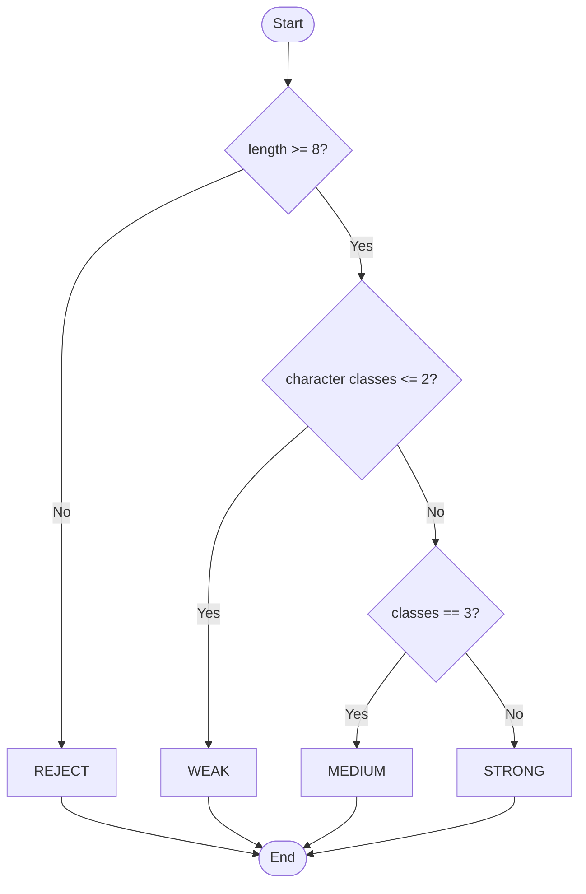
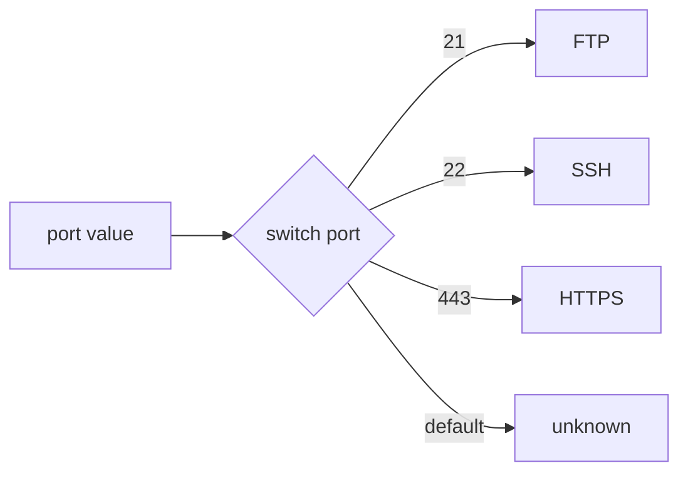

# Session 5: Conditions and Decision Making

> [Cybersecurity and Digital Forensics](../../README.md) › [Term 1](../README.md) › [Module 1: Programming in C](README.md) › **Session 5**

| ⏱ Estimated time | 📋 Prerequisites |
|---|---|
| 2 hours | Session 4 (relational and logical operators) |

| ⬅ [Previous: Session 4](session-04-operators.md) | [Next: Session 6](session-06-loops.md) ➡ |
|:---|---:|

---

## 🎯 Learning objectives

- Write decisions with `if`, `if–else`, the **multi-if** (else-if ladder) and **nested if**.
- Use the `switch` statement with `case`, `break` and `default`.
- Choose between an else-if ladder and `switch` for a given problem.
- Avoid the classic decision bugs: dangling else, missing `break`, `=` instead of `==`.
- Apply decisions to security rules such as password policies and port classification.

## 📖 Concepts

### 1. Why decisions?

Without decisions a program always does the same thing. Real software must react: *is the password long enough? is this IP on the block list? did the login fail three times?* Decision statements let the program choose a path at run time.

### 2. The `if` statement

```c
if (condition) {
    statements;        // run only when condition is non-zero (true)
}
```

Braces are optional for a single statement, but **always use them** – Apple's famous 2014 "goto fail" TLS bug happened because an extra unbraced line ran unconditionally and skipped certificate verification.

### 3. `if – else`

```c
if (attempts >= 3) {
    printf("Locked\n");
} else {
    printf("Try again\n");
}
```

The **ternary operator** is a compact if-else that produces a value: `char *status = (open) ? "OPEN" : "CLOSED";`

### 4. Multi-if (else-if ladder)

```c
if (score >= 90)      grade = 'A';
else if (score >= 80) grade = 'B';
else if (score >= 70) grade = 'C';
else                  grade = 'F';
```

Conditions are tested **top to bottom** and only the first true branch runs. Order matters: put the most specific test first.

### 5. Nested if

An `if` inside another `if`. Useful when a second question only makes sense after the first is answered (e.g. *only if the user is authenticated, check if they are an admin*).

**Dangling else:** an `else` always belongs to the nearest unmatched `if`. Braces remove ambiguity.

```c
if (a > 0)
    if (b > 0) printf("both positive");
else                     // looks like it belongs to a > 0 – it does NOT
    printf("a not positive");
```

### 6. The `switch` statement

```c
switch (expression) {          // must be an integer or char
    case CONST1: ...; break;
    case CONST2: ...; break;
    default:     ...;          // optional, runs when nothing matches
}
```

- `case` labels must be **constant integer expressions** – no ranges, no strings, no floats.
- Without `break`, execution **falls through** into the next case. Occasionally useful (grouping cases), often a bug.

| Use… | When |
|---|---|
| else-if ladder | Ranges (`score >= 80`), complex conditions, floats, strings via `strcmp` |
| `switch` | One integer/char value compared with many exact constants (menus, codes, ports) |

## 🧭 Diagrams





## 💻 Worked examples

### Example 1 – Password strength with an else-if ladder

📄 **`code/session-05_password.c`**

```c
/* session-05_password.c - if / else-if ladder: rate password strength */
#include <stdio.h>
#include <string.h>
#include <ctype.h>

int main(void)
{
    const char *samples[] = {"abc", "summer2026", "Summer2026", "S#mmer_2026!"};
    for (int s = 0; s < 4; s++) {
        const char *p = samples[s];
        int len = (int)strlen(p), upper = 0, lower = 0, digit = 0, symbol = 0;
        for (int i = 0; i < len; i++) {
            if (isupper((unsigned char)p[i]))      upper = 1;
            else if (islower((unsigned char)p[i])) lower = 1;
            else if (isdigit((unsigned char)p[i])) digit = 1;
            else                                   symbol = 1;
        }
        int score = upper + lower + digit + symbol;
        printf("%-14s len=%2d classes=%d -> ", p, len, score);
        if (len < 8)
            printf("REJECT (too short)\n");
        else if (score <= 2)
            printf("WEAK\n");
        else if (score == 3)
            printf("MEDIUM\n");
        else
            printf("STRONG\n");
    }
    return 0;
}
```

**Output**

```text
abc            len= 3 classes=1 -> REJECT (too short)
summer2026     len=10 classes=2 -> WEAK
Summer2026     len=10 classes=3 -> MEDIUM
S#mmer_2026!   len=12 classes=4 -> STRONG
```
`isupper`, `islower` and `isdigit` come from `<ctype.h>`. Casting to `unsigned char` avoids undefined behaviour for negative `char` values.

### Example 2 – Port classification with `switch` and nested `if`

📄 **`code/session-05_switch.c`**

```c
/* session-05_switch.c - switch: map a port number to a service, nested if for risk */
#include <stdio.h>

void describe(int port)
{
    printf("Port %-5d : ", port);
    switch (port) {
        case 21:  printf("FTP");    break;
        case 22:  printf("SSH");    break;
        case 23:  printf("Telnet"); break;
        case 80:  printf("HTTP");   break;
        case 443: printf("HTTPS");  break;
        case 3389:printf("RDP");    break;
        default:  printf("unknown");
    }
    /* nested if: classify risk only for well-known ports */
    if (port < 1024) {
        if (port == 21 || port == 23)
            printf("  [plaintext - avoid]\n");
        else
            printf("  [well-known]\n");
    } else {
        printf("  [registered/dynamic]\n");
    }
}

int main(void)
{
    int ports[] = {22, 23, 443, 3389, 8080};
    for (int i = 0; i < 5; i++) describe(ports[i]);
    return 0;
}
```

**Output**

```text
Port 22    : SSH  [well-known]
Port 23    : Telnet  [plaintext - avoid]
Port 443   : HTTPS  [well-known]
Port 3389  : RDP  [registered/dynamic]
Port 8080  : unknown  [registered/dynamic]
```
### Example 3 – Fall-through on purpose

```c
switch (day) {
    case 6:            // Saturday
    case 7:            // Sunday
        printf("Weekend: reduced SOC staffing\n");
        break;
    default:
        printf("Weekday: full staffing\n");
}
```

Cases 6 and 7 share one block because there is no `break` after `case 6:`.

## 📊 Decision statement comparison

| Statement | Branches | Condition type | Typical use |
|---|---|---|---|
| `if` | 1 | any expression | Optional action |
| `if–else` | 2 | any | Either/or |
| else-if ladder | many | any (ranges OK) | Grading, risk levels |
| nested if | many | any | Dependent checks |
| `switch` | many | exact integer constants | Menus, codes |
| `?:` | 2 (value) | any | Short assignments |

## 🧪 Lab / practice tasks

1. **Easy –** Read an integer and print whether it is positive, negative or zero.
2. **Easy –** Read a year and print whether it is a leap year (divisible by 4 and not by 100, or divisible by 400).
3. **Medium –** A simple calculator: read `a op b` (e.g. `12 * 4`) and use `switch` on `op`. Handle division by zero.
4. **Medium –** Read an HTTP status code and print its class: 1xx Informational, 2xx Success, 3xx Redirect, 4xx Client error, 5xx Server error.
5. **Challenge –** Firewall rule check: read a port and a protocol letter (`T` or `U`). Allow TCP 22, 80, 443 and UDP 53; deny everything else. Print `ALLOW` or `DENY` with the reason.

<details>
<summary>💡 Hints</summary>

- Task 2: `(y % 4 == 0 && y % 100 != 0) || (y % 400 == 0)`.
- Task 3: `scanf("%d %c %d", &a, &op, &b)`.
- Task 4: `switch (code / 100)` turns 404 into 4.
- Task 5: an outer `switch` on protocol and an inner `switch` (or if) on port.
</details>

## ✅ Quick quiz

1. In an else-if ladder, how many branches run at most? a) all true ones b) one c) two d) none
2. What happens when a `case` has no `break`? a) compile error b) the switch exits c) execution falls through to the next case d) default runs
3. Which type can **not** be used in `switch`? a) `int` b) `char` c) `float` d) `enum`
4. `if (x = 0) puts("zero");` prints: a) "zero" when x is 0 b) "zero" always c) never prints d) error
5. An `else` binds to: a) the first `if` b) the nearest unmatched `if` c) the outermost `if` d) any `if`

<details>
<summary>Show answers</summary>

1 – b · 2 – c · 3 – c · 4 – c (`x = 0` assigns 0, which is false) · 5 – b
</details>

## 📝 Summary / cheat-sheet

- `if`, `if–else`, else-if ladder, nested if, `switch`, `?:`.
- Always use braces; it prevents "goto fail"-style bugs.
- Order ladder conditions from most to least specific.
- `switch` only on integer constants; remember `break`; add `default`.
- Compile with warnings on (`-Wall -Wextra`) to catch `=` vs `==`.

**Interview / viva questions**

1. When would you prefer `switch` over an else-if ladder?
2. What is fall-through? Give one legitimate use.
3. Explain the dangling-else problem.
4. How did a missing pair of braces cause a real TLS vulnerability?
5. Rewrite `if (a > b) max = a; else max = b;` with the ternary operator.

---

| ⬅ [Previous: Session 4](session-04-operators.md) | [Next: Session 6](session-06-loops.md) ➡ |
|:---|---:|

<sub>Prepared by **Hamna Zahid Khan**, Junior Lecturer · Cybersecurity and Digital Forensics</sub>
