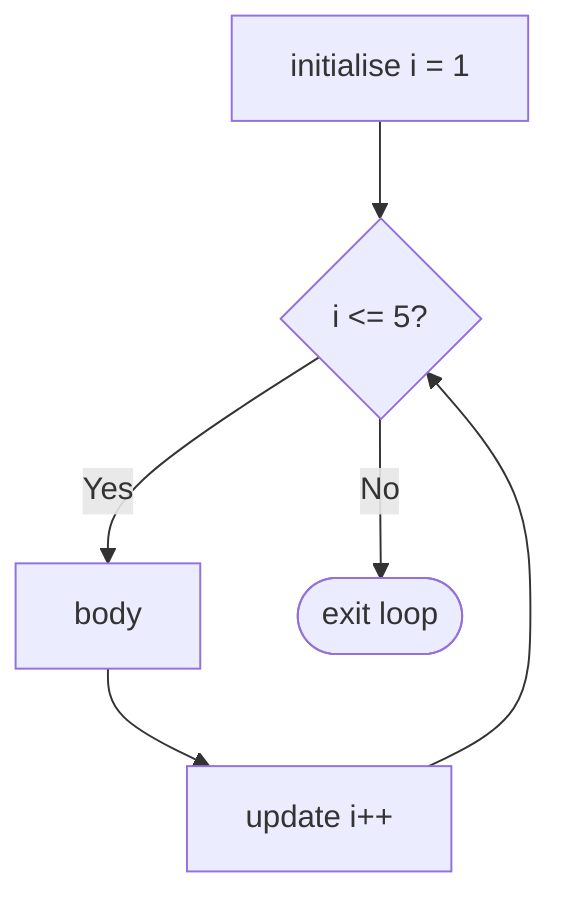
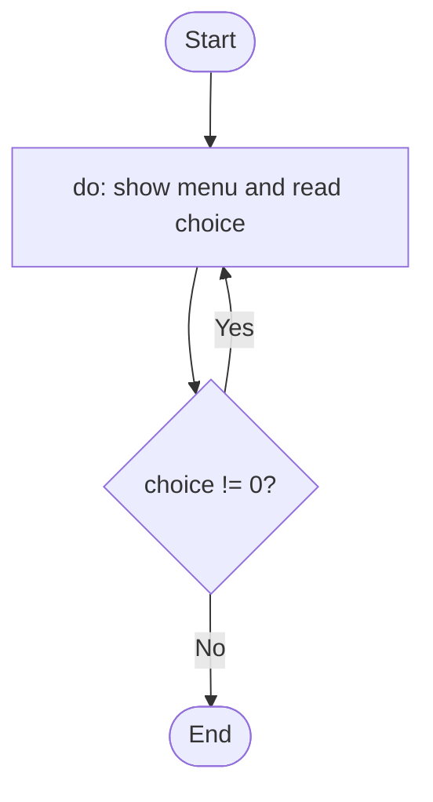
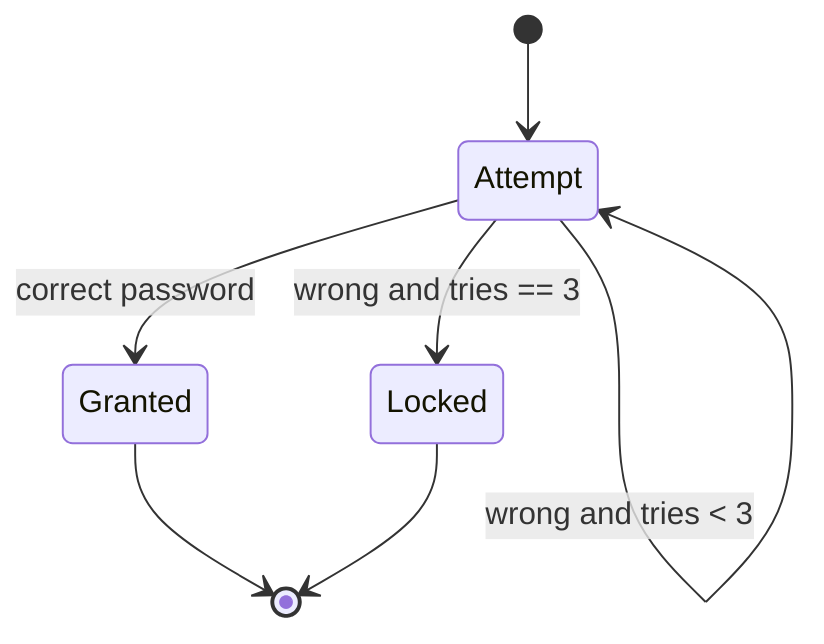
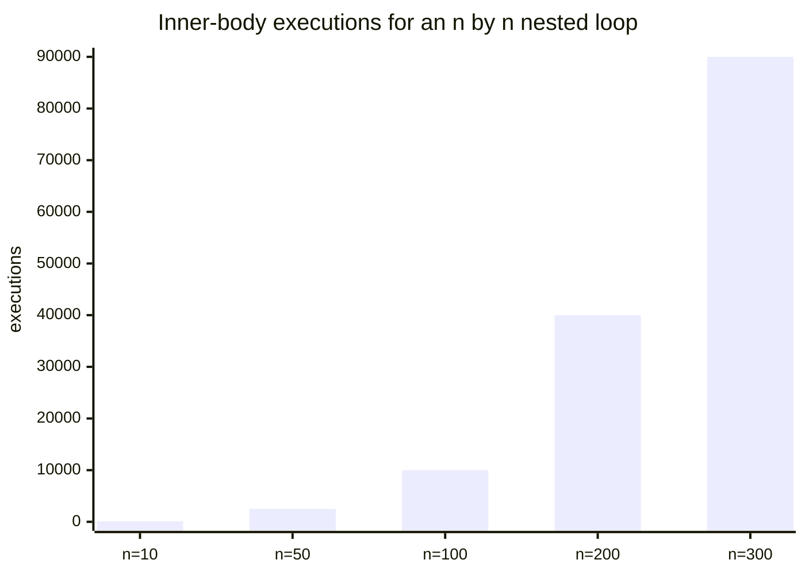

# Session 6: Loops

> [Cybersecurity and Digital Forensics](../../README.md) › [Term 1](../README.md) › [Module 1: Programming in C](README.md) › **Session 6**

| ⏱ Estimated time | 📋 Prerequisites |
|---|---|
| 2 hours | Session 5 (conditions) |

| ⬅ [Previous: Session 5](session-05-conditions.md) | [Next: Session 7](session-07-functions.md) ➡ |
|:---|---:|

---

## 🎯 Learning objectives

- Write `for`, `while` and `do-while` loops and pick the right one.
- Use the **comma operator** to manage two loop variables.
- Build **nested loops** for grids and tables.
- Control loops with `break` and `continue`, and stop a program with `exit()`.
- Recognise infinite loops and off-by-one errors.

## 📖 Concepts

### 1. Why loops?

Security work is repetitive: scan 1,000 log lines, try every port in a range, check each user in a list. A **loop** repeats a block of code while a condition stays true.

### 2. The `for` loop

```c
for (initialise; condition; update) {
    body;
}
```

1. **initialise** runs once.
2. **condition** is checked; if false, the loop ends.
3. **body** runs.
4. **update** runs, then back to step 2.

Best when you know how many times to repeat (counting loops).

### 3. The comma operator

The comma lets you put several expressions where one is expected; they run left to right and the value of the whole is the last one. In loops: `for (i = 0, j = n - 1; i < j; i++, j--)` – perfect for walking from both ends of an array (e.g. reversing a string).

### 4. The `while` loop

```c
while (condition) {
    body;
}
```

Checks the condition **before** each iteration – the body may run zero times. Best when you do not know the count in advance (read until end of file, wait until a value changes).

### 5. The `do-while` loop

```c
do {
    body;
} while (condition);      // note the semicolon
```

Checks **after** the body, so the body runs **at least once**. Ideal for menus and "ask again until valid" input.

| Loop | Test position | Minimum runs | Typical use |
|---|---|---|---|
| `for` | before | 0 | Known count, arrays |
| `while` | before | 0 | Unknown count, sentinel values |
| `do-while` | after | 1 | Menus, input validation |

### 6. Nested loops

A loop inside a loop. The inner loop completes all its iterations for **each** iteration of the outer loop. An outer loop of 3 and inner loop of 4 runs the inner body 12 times. Watch performance: nested loops over large data grow quickly (n × m).

### 7. `break`, `continue` and `exit()`

| Keyword | Effect |
|---|---|
| `break` | Leaves the **innermost** loop (or switch) immediately |
| `continue` | Skips the rest of this iteration and jumps to the next test/update |
| `exit(status)` | Ends the **whole program** (from `<stdlib.h>`); `0` = success, non-zero = error |

### 8. Common mistakes

- **Infinite loop:** forgetting to update the variable – `while (i < 10) { printf("%d", i); }`.
- **Off-by-one:** `for (i = 0; i <= 10; i++)` runs 11 times; with arrays of size 10 it reads past the end – a buffer over-read.
- **Stray semicolon:** `for (i = 0; i < 5; i++);` – the empty statement is the body.

## 🧭 Diagrams







## 💻 Worked examples

### Example 1 – All loop types in one program

📄 **`code/session-06_loops.c`**

```c
/* session-06_loops.c - for, while, do-while, comma operator and nested loops */
#include <stdio.h>

int main(void)
{
    /* for loop with the comma operator: two counters at once */
    printf("for + comma : ");
    for (int i = 1, j = 10; i <= 5; i++, j -= 2)
        printf("(%d,%d) ", i, j);
    printf("\n");

    /* while loop: halve a number until it reaches 1 (like binary search steps) */
    int n = 1000, steps = 0;
    while (n > 1) { n /= 2; steps++; }
    printf("while       : 1000 halves to 1 in %d steps\n", steps);

    /* do-while: body runs at least once (menus, retry prompts) */
    int k = 0;
    do { printf("do-while    : runs once even though k=%d\n", k); } while (k > 0);

    /* nested loops: a small multiplication grid */
    printf("nested grid :\n");
    for (int r = 1; r <= 3; r++) {
        for (int c = 1; c <= 4; c++) printf("%4d", r * c);
        printf("\n");
    }
    return 0;
}
```

**Output**

```text
for + comma : (1,10) (2,8) (3,6) (4,4) (5,2) 
while       : 1000 halves to 1 in 9 steps
do-while    : runs once even though k=0
nested grid :
   1   2   3   4
   2   4   6   8
   3   6   9  12
```
Trace of the `while`: 1000 → 500 → 250 → 125 → 62 → 31 → 15 → 7 → 3 → 1 = **9** halvings. This is why binary search on 1,000 items needs at most about 10 comparisons.

### Example 2 – A login lockout with `continue`, `break` and `exit()`

Inputs are simulated in an array so the program is repeatable in class.

📄 **`code/session-06_lockout.c`**

```c
/* session-06_lockout.c - login attempts with break/continue and exit() */
#include <stdio.h>
#include <string.h>
#include <stdlib.h>

int main(void)
{
    const char *correct = "Lab#2026";
    const char *typed[] = {"", "lab#2026", "Lab#2026"};  /* simulated user input */
    const int MAX = 3;

    for (int attempt = 1; attempt <= MAX; attempt++) {
        const char *pw = typed[attempt - 1];
        if (strlen(pw) == 0) {
            printf("Attempt %d: empty input ignored\n", attempt);
            continue;                       /* skip the rest of this iteration */
        }
        if (strcmp(pw, correct) == 0) {
            printf("Attempt %d: access granted\n", attempt);
            break;                          /* leave the loop immediately */
        }
        printf("Attempt %d: wrong password\n", attempt);
        if (attempt == MAX) {
            printf("Account locked\n");
            exit(1);                        /* end the whole program */
        }
    }
    printf("Welcome to the lab portal.\n");
    return 0;
}
```

**Output**

```text
Attempt 1: empty input ignored
Attempt 2: wrong password
Attempt 3: access granted
Welcome to the lab portal.
```
Try changing the third simulated password to `"wrong"` – the program prints *Account locked* and exits with status 1, so *Welcome* is never printed. On Linux, `echo $?` after running shows that exit status.

### Example 3 – Reversing a string with two indices

```c
char s[] = "FORENSICS";
for (int i = 0, j = (int)strlen(s) - 1; i < j; i++, j--) {
    char t = s[i]; s[i] = s[j]; s[j] = t;
}
printf("%s\n", s);    // SCISNEROF
```

## 📊 Loop growth



## 🧪 Lab / practice tasks

1. **Easy –** Print the even numbers from 2 to 40 using a `for` loop.
2. **Easy –** Read integers until the user enters `0` (`while`), then print their sum and count.
3. **Medium –** Print a right-angled triangle of `*` with 5 rows using nested loops.
4. **Medium –** A `do-while` menu: 1 = say hello, 2 = show time-in-seconds conversion, 0 = quit.
5. **Challenge –** "Port sweep simulator": loop over ports 20–30; skip (`continue`) port 25; print `open` for ports in a hard-coded list `{22, 23, 80}`, else `closed`; `break` if a port listed as "honeypot" (say 28) is reached. *(Simulation only – no real network traffic.)*

<details>
<summary>💡 Hints</summary>

- Task 2: `while (scanf("%d", &n) == 1 && n != 0) { sum += n; count++; }`
- Task 3: outer `r` from 1 to 5, inner `c` from 1 to `r`.
- Task 5: write a small helper loop that checks whether `port` is in the open list.
</details>

## ✅ Quick quiz

1. Which loop always executes its body at least once? a) for b) while c) do-while d) none
2. How many times does `for (i = 0; i < 5; i++)` run? a) 4 b) 5 c) 6 d) infinite
3. `continue` inside a `for` loop jumps to: a) the end of the program b) the update expression c) the first statement after the loop d) `main`
4. What does `exit(1)` signal? a) success b) an error status to the OS c) restart d) nothing
5. In `for (i = 0, j = 9; i < j; i++, j--)` what does the comma do? a) separates arguments b) evaluates both expressions in order c) compares i and j d) error

<details>
<summary>Show answers</summary>

1 – c · 2 – b · 3 – b · 4 – b · 5 – b
</details>

## 📝 Summary / cheat-sheet

- `for(init; test; update)` for counts; `while(test)` for unknown counts; `do{}while(test);` for at-least-once.
- Comma operator: `i++, j--` – two updates in one place.
- `break` = leave loop, `continue` = next iteration, `exit(n)` = end program.
- Beware infinite loops, off-by-one (`<=` vs `<`) and stray semicolons.

**Interview / viva questions**

1. Compare `while` and `do-while` with an example.
2. What is an off-by-one error and how can it become a security problem?
3. Does `break` exit all nested loops? How would you exit two levels?
4. When is `exit()` preferable to `return` from `main`?
5. Write a loop that counts the digits in an integer.

---

| ⬅ [Previous: Session 5](session-05-conditions.md) | [Next: Session 7](session-07-functions.md) ➡ |
|:---|---:|

<sub>Prepared by **Hamna Zahid Khan**, Junior Lecturer · Cybersecurity and Digital Forensics</sub>
