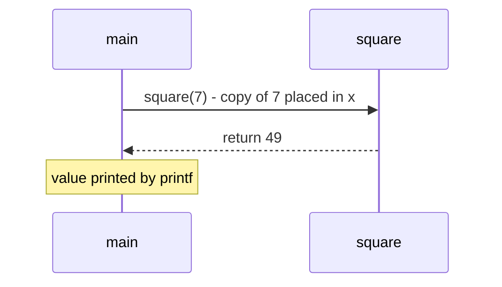
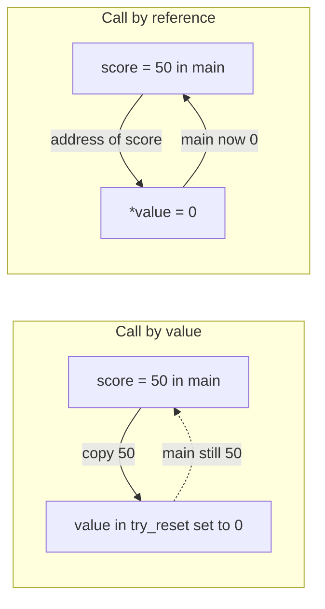
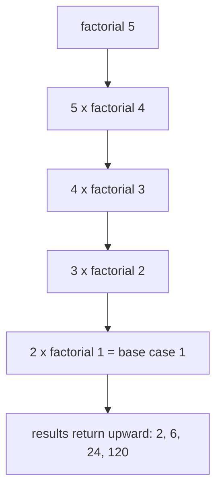

# Session 7: Functions

> [Cybersecurity and Digital Forensics](../../README.md) › [Term 1](../README.md) › [Module 1: Programming in C](README.md) › **Session 7**

| ⏱ Estimated time | 📋 Prerequisites |
|---|---|
| 2.5 hours | Sessions 5–6 (conditions and loops) |

| ⬅ [Previous: Session 6](session-06-loops.md) | [Next: Session 8](session-08-arrays.md) ➡ |
|:---|---:|

---

## 🎯 Learning objectives

- Explain why programs are split into **functions** and describe the parts of a function.
- Write function **declarations (prototypes)** and **definitions**, and call them.
- Distinguish **call by value** from **call by reference** (using pointers).
- Apply **scope rules** and **storage classes** (`auto`, `static`, `extern`, `register`).
- Organise code across **multiple files** and use **function pointers** and recursion.

## 📖 Concepts

### 1. Why functions?

A **function** is a named, reusable block of code that performs one task. Benefits:

- **Reuse** – write `is_valid_ip()` once, call it everywhere.
- **Readability** – `main` reads like a story: `read_logs(); detect_bruteforce(); print_report();`
- **Testing** – each function can be tested alone.
- **Security** – validation logic in one place is easier to review and fix.

`printf`, `scanf` and `strlen` are **library functions**; the ones you write are **user-defined functions**.

### 2. Structure of a function

```c
return_type name(parameter_list)     // header
{
    local declarations;              // body
    statements;
    return value;                    // omitted for void functions
}
```

| Part | Example | Meaning |
|---|---|---|
| Return type | `int` | Type of value sent back (`void` = nothing) |
| Name | `square` | Identifier used to call it |
| Parameters | `(int x)` | **Formal** parameters – local copies |
| Arguments | `square(7)` | **Actual** values passed at the call |
| `return` | `return x * x;` | Ends the function and sends a value back |

### 3. Declaration (prototype) vs definition

A **prototype** tells the compiler a function's name, return type and parameter types *before* it is used: `int square(int x);`. The **definition** contains the body. Prototypes normally live in header files (`.h`). Without one, the compiler cannot check that you passed the right number and type of arguments.

### 4. Call by value vs call by reference

| | Call by value | Call by reference |
|---|---|---|
| What is passed | A **copy** of the value | The **address** of the variable |
| Syntax | `f(x)` / `void f(int v)` | `f(&x)` / `void f(int *v)` |
| Can change caller's variable? | No | Yes, via `*v = ...` |
| Use when | Input only | Function must update or return several values |

C itself only has call by value; "by reference" is achieved by passing a pointer by value.

### 5. Types of variables and scope

| Kind | Declared | Visible | Lifetime |
|---|---|---|---|
| **Local** (automatic) | Inside a function/block | That block only | Created on entry, destroyed on exit |
| **Formal parameter** | In the header | That function | Same as local |
| **Global** | Outside all functions | Every function after it (in the file) | Whole program run |

If a local and a global share a name, the local **shadows** the global inside its block.

### 6. Storage classes

| Class | Effect |
|---|---|
| `auto` | Default for locals; stack storage |
| `register` | Hint to keep in a CPU register (compilers mostly ignore it); you cannot take its address |
| `static` (local) | Keeps its value between calls; initialised once |
| `static` (global/function) | Visible only inside its own source file – hides internal helpers |
| `extern` | Declares a variable defined in another file |

### 7. Functions in multi-file programs

```text
crypto_utils.h   ->  int checksum(const char *s);         // prototype
crypto_utils.c   ->  int checksum(const char *s) { ... }  // definition
main.c           ->  #include "crypto_utils.h"  ... checksum("abc");
build:  gcc main.c crypto_utils.c -o app
```

### 8. Recursion and function pointers

- **Recursion:** a function calling itself, with a **base case** to stop. `factorial(n) = n * factorial(n-1)`, base `factorial(1) = 1`. Missing base case → stack overflow.
- **Function pointer:** a variable that stores the address of a function: `int (*op)(int, int) = add; op(2, 3);`. Used for callbacks, dispatch tables and plug-in style designs (e.g. selecting a hash algorithm at run time).

## 🧭 Diagrams







## 💻 Worked examples

### Example 1 – Prototypes, value vs reference, scope and `static`

📄 **`code/session-07_functions.c`**

```c
/* session-07_functions.c - prototypes, call by value vs call by reference, scope */
#include <stdio.h>

int  square(int x);                 /* prototype (declaration) */
void try_reset(int value);
void reset(int *value);
void counter(void);

int global_hits = 0;                /* global: visible to every function below */

int main(void)
{
    printf("square(7) = %d\n", square(7));

    int score = 50;
    try_reset(score);
    printf("after try_reset (by value)    : %d\n", score);
    reset(&score);
    printf("after reset (by reference)    : %d\n", score);

    for (int i = 0; i < 3; i++) counter();
    printf("global_hits = %d\n", global_hits);
    return 0;
}

int square(int x) { return x * x; }          /* definition */

void try_reset(int value) { value = 0; }     /* changes only its own copy */

void reset(int *value) { *value = 0; }       /* changes the caller's variable */

void counter(void)
{
    static int calls = 0;   /* static local: keeps its value between calls */
    int temp = 0;           /* auto local: recreated each call */
    calls++; temp++; global_hits++;
    printf("counter(): calls=%d temp=%d\n", calls, temp);
}
```

**Output**

```text
square(7) = 49
after try_reset (by value)    : 50
after reset (by reference)    : 0
counter(): calls=1 temp=1
counter(): calls=2 temp=1
counter(): calls=3 temp=1
global_hits = 3
```
Notice `calls` grows 1, 2, 3 because it is `static`, while `temp` is reset to 1 each time.

### Example 2 – Recursion and a function-pointer dispatch table

📄 **`code/session-07_fnptr.c`**

```c
/* session-07_fnptr.c - recursion and function pointers (a tiny dispatch table) */
#include <stdio.h>

long factorial(int n) { return (n <= 1) ? 1 : n * factorial(n - 1); }

int add(int a, int b) { return a + b; }
int sub(int a, int b) { return a - b; }
int mul(int a, int b) { return a * b; }

int main(void)
{
    printf("5! = %ld\n", factorial(5));

    int (*ops[3])(int, int) = {add, sub, mul};   /* array of function pointers */
    const char *names[3] = {"add", "sub", "mul"};
    for (int i = 0; i < 3; i++)
        printf("%s(12, 4) = %d\n", names[i], ops[i](12, 4));
    return 0;
}
```

**Output**

```text
5! = 120
add(12, 4) = 16
sub(12, 4) = 8
mul(12, 4) = 48
```
## 📊 Stack frames during `factorial(4)`

| Depth | Call | Waiting to compute | Returns |
|---|---|---|---|
| 1 | `factorial(4)` | 4 × f(3) | 24 |
| 2 | `factorial(3)` | 3 × f(2) | 6 |
| 3 | `factorial(2)` | 2 × f(1) | 2 |
| 4 | `factorial(1)` | base case | 1 |

## 🧪 Lab / practice tasks

1. **Easy –** Write `int max3(int a, int b, int c)` and test it from `main`.
2. **Easy –** Write `int is_even(int n)` returning 1 or 0.
3. **Medium –** Write `void min_max(const int arr[], int n, int *min, int *max)` that returns two results through pointers.
4. **Medium –** Write a recursive `int sum_digits(int n)` (e.g. 1234 → 10).
5. **Challenge –** Split a program into `validate.h`, `validate.c` and `main.c`. `validate.c` should contain `int valid_port(int p)` (1–65535) and a `static` helper that `main.c` cannot call. Build with one gcc command.

<details>
<summary>💡 Hints</summary>

- Task 3: start with `*min = *max = arr[0];` then loop.
- Task 4: base case `if (n < 10) return n;` otherwise `return n % 10 + sum_digits(n / 10);`
- Task 5: try calling the static helper from `main.c` and read the linker error – that is the point.
</details>

## ✅ Quick quiz

1. A function that returns nothing has return type: a) `int` b) `null` c) `void` d) `empty`
2. Which call lets the function change the caller's `x`? a) `f(x)` b) `f(&x)` c) `f(*x)` d) `f(x&)`
3. A `static` local variable: a) is destroyed after each call b) keeps its value between calls c) is global to all files d) cannot be changed
4. What is a prototype? a) the function body b) a declaration giving name, return and parameter types c) a macro d) a library
5. What is required for recursion to terminate? a) a global variable b) a base case c) a loop d) a pointer

<details>
<summary>Show answers</summary>

1 – c · 2 – b · 3 – b · 4 – b · 5 – b
</details>

## 📝 Summary / cheat-sheet

- Function = header (`type name(params)`) + body; `return` sends one value back.
- Prototype before use; definitions can come later or live in another file.
- By value = copy (safe for inputs); by reference = pass `&var`, use `*p` inside.
- Scope: local (block), global (file); storage: `auto`, `static`, `extern`, `register`.
- Recursion needs a base case; function pointers enable callbacks and dispatch tables.

**Interview / viva questions**

1. Why is C said to support only call by value?
2. Explain the two meanings of `static` in C.
3. What happens if a recursive function has no base case?
4. What is the purpose of a header file?
5. Give one real use of function pointers.

---

| ⬅ [Previous: Session 6](session-06-loops.md) | [Next: Session 8](session-08-arrays.md) ➡ |
|:---|---:|

<sub>Prepared by **Hamna Zahid Khan**, Junior Lecturer · Cybersecurity and Digital Forensics</sub>
