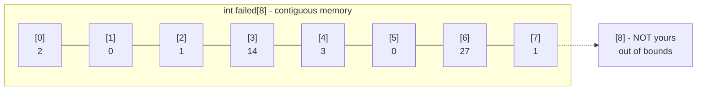
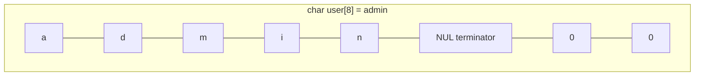

# Session 8: Arrays and Strings

> [Cybersecurity and Digital Forensics](../../README.md) › [Term 1](../README.md) › [Module 1: Programming in C](README.md) › **Session 8**

| ⏱ Estimated time | 📋 Prerequisites |
|---|---|
| 2 hours | Sessions 6–7 (loops and functions) |

| ⬅ [Previous: Session 7](session-07-functions.md) | [Next: Session 9](session-09-pointers.md) ➡ |
|:---|---:|

---

## 🎯 Learning objectives

- Define an **array** and explain **elements**, **indices** and contiguous storage.
- Declare, **initialise** and process arrays with loops.
- Work with **strings** as character arrays terminated by `'\0'`, using safe string functions.
- Declare and initialise **two-dimensional (and multidimensional) arrays**.
- Explain why out-of-bounds access causes buffer overflows and how to prevent it.

## 📖 Concepts

### 1. What is an array?

An **array** is a fixed-size collection of elements of the **same type**, stored **next to each other** in memory and accessed by an **index**.

```c
int failed[8];        // 8 ints, indices 0..7
failed[0] = 2;        // first element
failed[7] = 1;        // last element
```

- Indices start at **0**; the last index is `size - 1`.
- The size must be known (a constant) for ordinary arrays.
- C does **not** check bounds. `failed[8]` compiles and silently touches memory that is not yours.

### 2. Initialisation

```c
int a[5] = {1, 2, 3, 4, 5};   // full
int b[5] = {1, 2};            // rest become 0 -> {1,2,0,0,0}
int c[]  = {7, 8, 9};         // size inferred = 3
int d[5] = {0};               // all zeros
```

Number of elements: `sizeof a / sizeof a[0]` (works only where the array itself is in scope, not on a pointer parameter).

### 3. Array handling

Typical processing patterns with a `for` loop: **sum/average**, **min/max**, **search** (linear), **count matching**, **copy**, **reverse**. Passing an array to a function passes the address of its first element, so always pass the length too: `int total(const int arr[], int n)`.

### 4. Strings are character arrays

```c
char user[8] = "admin";     // stored as a d m i n \0 \0 \0
```

| Function (`<string.h>`) | Does | Safety note |
|---|---|---|
| `strlen(s)` | Length without `'\0'` | – |
| `strcpy(d, s)` | Copy | ❌ no size check |
| `strncpy(d, s, n)` | Copy at most n | may not add `'\0'` |
| `snprintf(d, size, "%s", s)` | Formatted bounded copy | ✅ always terminates |
| `strcat(d, s)` | Append | ❌ no size check |
| `strcmp(a, b)` | Compare: 0 if equal | – |
| `strchr`, `strstr` | Find char / substring | – |

> 🛡 **Buffer overflow:** copying `"administrator"` (13 chars + `'\0'`) into `char user[8]` with `strcpy` writes 6 bytes past the end, possibly overwriting other variables or a return address. This is the root of countless exploits. Use bounded functions and validate lengths.

### 5. Two-dimensional arrays

```c
int alerts[3][4];      // 3 rows x 4 columns
alerts[2][3] = 12;     // row 2, column 3
```

Stored in **row-major order**: all of row 0, then row 1, … Initialise with nested braces:

```c
int m[2][3] = { {1, 2, 3}, {4, 5, 6} };
```

Multidimensional arrays extend the idea: `int cube[2][3][4];` has 24 elements. When passing to functions, every dimension except the first must be given: `void show(int m[][4], int rows)`.

## 🧭 Diagrams





## 💻 Worked examples

### Example 1 – Spotting a brute-force burst in hourly failure counts

📄 **`code/session-08_arrays.c`**

```c
/* session-08_arrays.c - 1-D array statistics: failed logins per hour */
#include <stdio.h>

#define HOURS 8

int main(void)
{
    int failed[HOURS] = {2, 0, 1, 14, 3, 0, 27, 1};   /* initialiser list */
    int total = 0, max_i = 0;

    for (int i = 0; i < HOURS; i++) {
        total += failed[i];
        if (failed[i] > failed[max_i]) max_i = i;
    }
    double avg = (double)total / HOURS;
    printf("Total failures : %d\n", total);
    printf("Average/hour   : %.2f\n", avg);
    printf("Peak           : hour %d with %d failures\n", max_i, failed[max_i]);
    printf("Alerts (> 3x average):");
    for (int i = 0; i < HOURS; i++)
        if (failed[i] > 3 * avg) printf(" hour%d", i);
    printf("\nsizeof(failed) = %zu bytes, elements = %zu\n",
           sizeof failed, sizeof failed / sizeof failed[0]);
    return 0;
}
```

**Output**

```text
Total failures : 48
Average/hour   : 6.00
Peak           : hour 6 with 27 failures
Alerts (> 3x average): hour6
sizeof(failed) = 32 bytes, elements = 8
```
Average = 48 / 8 = 6.00; three times that is 18, so only hour 6 (27 failures) triggers an alert.

### Example 2 – Safe strings and a 2-D table

📄 **`code/session-08_strings2d.c`**

```c
/* session-08_strings2d.c - character arrays, string functions and a 2-D array */
#include <stdio.h>
#include <string.h>

int main(void)
{
    char user[16] = "analyst";
    char banner[32];
    snprintf(banner, sizeof banner, "Welcome, %s!", user);   /* bounded copy */
    printf("%s (length %zu, capacity %zu)\n", banner, strlen(banner), sizeof banner);

    /* 2-D array: 3 servers x 4 days of alert counts */
    int alerts[3][4] = { {1, 0, 2, 5}, {0, 0, 1, 0}, {7, 9, 4, 12} };
    const char *servers[3] = {"web01", "db01", "mail01"};
    printf("\n%-7s D1 D2 D3 D4 | total\n", "server");
    for (int r = 0; r < 3; r++) {
        int sum = 0;
        printf("%-7s", servers[r]);
        for (int c = 0; c < 4; c++) { printf("%3d", alerts[r][c]); sum += alerts[r][c]; }
        printf(" | %d\n", sum);
    }
    return 0;
}
```

**Output**

```text
Welcome, analyst! (length 17, capacity 32)

server  D1 D2 D3 D4 | total
web01    1  0  2  5 | 8
db01     0  0  1  0 | 1
mail01   7  9  4 12 | 32
```
### Example 3 – Linear search

```c
int find(const int arr[], int n, int key) {
    for (int i = 0; i < n; i++)
        if (arr[i] == key) return i;   // index found
    return -1;                         // not found
}
```

## 📊 Row-major layout of `int m[2][3]`

| Memory order | 0 | 1 | 2 | 3 | 4 | 5 |
|---|---|---|---|---|---|---|
| Element | m[0][0] | m[0][1] | m[0][2] | m[1][0] | m[1][1] | m[1][2] |
| Value | 1 | 2 | 3 | 4 | 5 | 6 |

Address of `m[i][j]` = base + (i × columns + j) × sizeof(int).

## 🧪 Lab / practice tasks

1. **Easy –** Read 5 integers into an array and print them in reverse order.
2. **Easy –** Count how many elements of `{3, 8, 3, 1, 3, 9}` equal 3.
3. **Medium –** Write `void to_upper(char s[])` that converts a string to uppercase in place.
4. **Medium –** Read a 3×3 matrix and print its transpose and the sum of its diagonal.
5. **Challenge –** Given an array of 10 source-IP last octets, print each distinct value with its frequency, sorted by frequency (highest first) – a mini "top talkers" report.

<details>
<summary>💡 Hints</summary>

- Task 3: loop until `s[i] != '\0'` and use `toupper`.
- Task 4: transpose prints `m[j][i]`; diagonal sum adds `m[i][i]`.
- Task 5: octets fit in 0–255, so a `int freq[256] = {0};` counting array is the simplest approach.
</details>

## ✅ Quick quiz

1. Index of the last element of `int x[10]`? a) 10 b) 9 c) 11 d) 0
2. `int b[5] = {4};` gives: a) all 4 b) `{4,0,0,0,0}` c) garbage d) error
3. Which function is the safest for copying into a fixed buffer? a) `strcpy` b) `strcat` c) `snprintf` d) `gets`
4. How many bytes does `char s[] = "LAB";` occupy? a) 3 b) 4 c) 1 d) 8
5. C arrays are stored in: a) column-major order b) row-major order c) random order d) linked nodes

<details>
<summary>Show answers</summary>

1 – b · 2 – b · 3 – c · 4 – b (3 letters + `'\0'`) · 5 – b
</details>

## 📝 Summary / cheat-sheet

- Array = same-type elements, contiguous, index 0…n−1, no bounds checking.
- `sizeof arr / sizeof arr[0]` = element count (not on pointers).
- Strings end with `'\0'`; buffer must be length + 1.
- Prefer `snprintf`/bounded copies over `strcpy`/`strcat`; never use `gets`.
- 2-D arrays are row-major; pass all but the first dimension to functions.

**Interview / viva questions**

1. What is a buffer overflow? Give a C example.
2. Why must you pass the array length to a function?
3. Difference between `char s[] = "hi";` and `char *s = "hi";`?
4. How is `m[i][j]` located in memory?
5. What is the role of the null terminator?

---

| ⬅ [Previous: Session 7](session-07-functions.md) | [Next: Session 9](session-09-pointers.md) ➡ |
|:---|---:|

<sub>Prepared by **Hamna Zahid Khan**, Junior Lecturer · Cybersecurity and Digital Forensics</sub>
