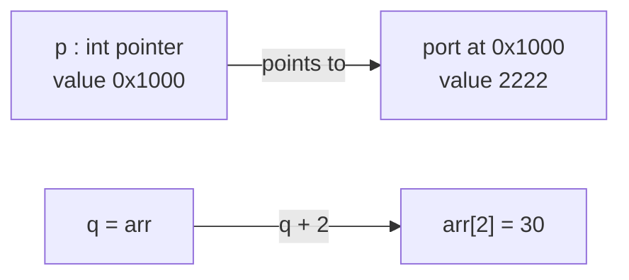
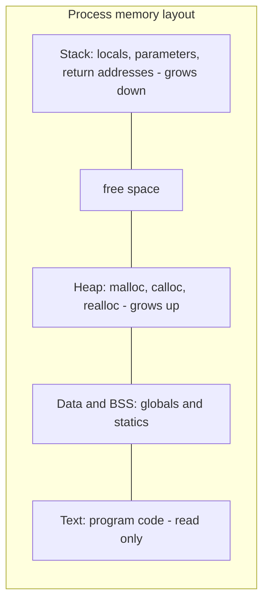
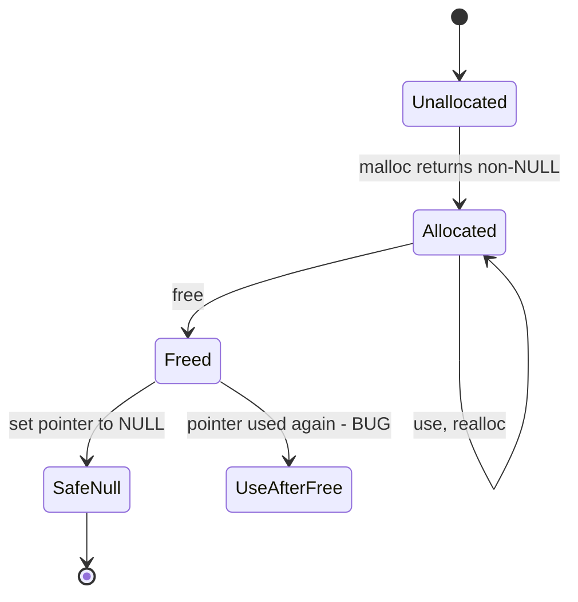

# Session 9: Pointers and Memory

> [Cybersecurity and Digital Forensics](../../README.md) › [Term 1](../README.md) › [Module 1: Programming in C](README.md) › **Session 9**

| ⏱ Estimated time | 📋 Prerequisites |
|---|---|
| 2.5 hours | Sessions 7–8 (functions, arrays) |

| ⬅ [Previous: Session 8](session-08-arrays.md) | [Module practice test](practice-test.md) ➡ |
|:---|---:|

---

## 🎯 Learning objectives

- Explain what a **pointer** is and where pointers are used.
- Use pointer operators `&` (address-of) and `*` (dereference), and assign values to pointers.
- Perform **pointer arithmetic** and **pointer comparisons**.
- Pass pointers to functions and relate pointers to **one- and two-dimensional arrays**.
- Allocate and release memory dynamically with `malloc`, `calloc`, `realloc` and `free`, avoiding leaks, dangling pointers and use-after-free.

## 📖 Concepts

### 1. What is a pointer?

A **pointer** is a variable whose value is a **memory address**. If a normal variable is a house, a pointer is a piece of paper with the house's street address written on it.

Where pointers are used:

- Letting functions modify caller variables (call by reference).
- Walking through arrays and strings efficiently.
- **Dynamic memory** – structures whose size is decided at run time.
- Data structures: linked lists, trees, hash tables.
- Talking to hardware and the operating system.

### 2. Declaring and using pointers

```c
int port = 22;
int *p;          // p can hold the address of an int
p = &port;       // & = address-of
printf("%d", *p);  // * = dereference: value at that address -> 22
*p = 2222;       // writes through the pointer: port is now 2222
```

| Expression | Meaning | Example value |
|---|---|---|
| `port` | the integer | 22 |
| `&port` | address of port | `0x7ffd1234` |
| `p` | address stored in p | `0x7ffd1234` |
| `*p` | value at that address | 22 |
| `&p` | address of the pointer itself | `0x7ffd1238` |

**NULL** (`p = NULL;`) means "points nowhere". Dereferencing NULL crashes the program; always check before use.

### 3. Pointer arithmetic

Adding 1 to a pointer moves it by **one element**, not one byte: for `int *q`, `q + 1` moves 4 bytes (if `sizeof(int)` is 4). Allowed operations:

| Operation | Allowed? | Meaning |
|---|---|---|
| `p + n`, `p - n`, `p++` | ✅ | Move n elements |
| `p2 - p1` | ✅ (same array) | Number of elements between them |
| `p1 == p2`, `p1 < p2` | ✅ (same array) | Compare positions |
| `p1 + p2`, `p * 2` | ❌ | Meaningless |

### 4. Pointers and arrays

The array name decays to a pointer to its first element: `arr == &arr[0]`. Therefore `arr[i]` is exactly `*(arr + i)`. For a 2-D array `int g[2][3]`, `g[i][j]` equals `*(*(g + i) + j)`.

Difference: an array name is not a variable – you cannot write `arr = something;` – while a pointer can be re-pointed.

### 5. Pointers as function arguments

```c
void swap(int *a, int *b) { int t = *a; *a = *b; *b = t; }
swap(&x, &y);
```

Use `const` to promise a function will not modify data: `size_t count_spaces(const char *s)`.

### 6. Dynamic memory allocation (`<stdlib.h>`)

| Function | Purpose |
|---|---|
| `malloc(bytes)` | Allocate uninitialised memory; returns `void *` or `NULL` |
| `calloc(n, size)` | Allocate n×size bytes set to zero |
| `realloc(p, bytes)` | Resize a block (may move it) |
| `free(p)` | Return memory to the heap |

Memory layout: **stack** (local variables, automatic), **heap** (malloc'd, lives until freed), **data/BSS** (globals), **text** (code).

### 7. Pointer bugs that become vulnerabilities

| Bug | What happens | Defence |
|---|---|---|
| NULL dereference | Crash / denial of service | Check `if (p != NULL)` |
| Memory leak | Memory never freed; long-running servers exhaust RAM | `free` every `malloc` |
| Dangling pointer / use-after-free | Using memory after `free`; attacker may control new contents | Set `p = NULL` after `free` |
| Double free | Corrupts heap metadata | Free once; NULL after free |
| Wild pointer | Uninitialised pointer points anywhere | Initialise to NULL |
| Out-of-bounds pointer arithmetic | Reads/writes neighbour data | Track lengths |

Tools such as **Valgrind** and compiler **AddressSanitizer** (`-fsanitize=address`) detect these during testing.

## 🧭 Diagrams







## 💻 Worked examples

### Example 1 – Addresses, dereferencing, arithmetic and swap

📄 **`code/session-09_pointers.c`**

```c
/* session-09_pointers.c - addresses, dereferencing, pointer arithmetic, arrays */
#include <stdio.h>

void swap(int *a, int *b) { int t = *a; *a = *b; *b = t; }

int main(void)
{
    int port = 22;
    int *p = &port;                         /* p holds the address of port */
    printf("port = %d, *p = %d\n", port, *p);
    *p = 2222;                              /* change port through the pointer */
    printf("after *p = 2222 -> port = %d\n", port);
    printf("p == &port ? %s\n", (p == &port) ? "yes" : "no");

    int arr[5] = {10, 20, 30, 40, 50};
    int *q = arr;                           /* array name decays to &arr[0] */
    printf("q[2] = %d, *(q + 2) = %d\n", q[2], *(q + 2));
    printf("bytes between &arr[3] and &arr[0] = %ld\n",
           (long)((char *)&arr[3] - (char *)&arr[0]));
    printf("elements between them = %ld\n", (long)(&arr[3] - &arr[0]));

    int a = 1, b = 2;
    swap(&a, &b);
    printf("after swap: a = %d, b = %d\n", a, b);

    int grid[2][3] = {{1, 2, 3}, {4, 5, 6}};
    printf("grid[1][2] = %d, *(*(grid + 1) + 2) = %d\n", grid[1][2], *(*(grid + 1) + 2));
    return 0;
}
```

**Output**

```text
port = 22, *p = 22
after *p = 2222 -> port = 2222
p == &port ? yes
q[2] = 30, *(q + 2) = 30
bytes between &arr[3] and &arr[0] = 12
elements between them = 3
after swap: a = 2, b = 1
grid[1][2] = 6, *(*(grid + 1) + 2) = 6
```
The byte distance between `&arr[3]` and `&arr[0]` is 12 (3 × 4 bytes), but pointer subtraction reports **3 elements**.

### Example 2 – Dynamic memory done properly

📄 **`code/session-09_malloc.c`**

```c
/* session-09_malloc.c - dynamic memory: malloc, check, use, free, NULL */
#include <stdio.h>
#include <stdlib.h>

int main(void)
{
    int n = 5;
    int *ids = malloc(n * sizeof *ids);       /* request memory from the heap */
    if (ids == NULL) {                        /* always check */
        fprintf(stderr, "out of memory\n");
        return 1;
    }
    for (int i = 0; i < n; i++) ids[i] = 1000 + i;

    int *bigger = realloc(ids, 2 * n * sizeof *ids);   /* grow the block */
    if (bigger == NULL) { free(ids); return 1; }
    ids = bigger;
    for (int i = n; i < 2 * n; i++) ids[i] = 1000 + i;

    printf("IDs:");
    for (int i = 0; i < 2 * n; i++) printf(" %d", ids[i]);
    printf("\n");

    free(ids);          /* give the memory back */
    ids = NULL;         /* avoid a dangling pointer (use-after-free) */
    printf("memory released, ids is now %s\n", ids == NULL ? "NULL" : "dangling");
    return 0;
}
```

**Output**

```text
IDs: 1000 1001 1002 1003 1004 1005 1006 1007 1008 1009
memory released, ids is now NULL
```
## 📊 `int *q = arr;` stepping through memory (4-byte int)

| Expression | Address (example) | Value |
|---|---|---|
| `q` | 0x1000 | – |
| `*q` | 0x1000 | 10 |
| `*(q+1)` | 0x1004 | 20 |
| `*(q+2)` | 0x1008 | 30 |
| `*(q+4)` | 0x1010 | 50 |
| `*(q+5)` | 0x1014 | ❌ out of bounds |

## 🧪 Lab / practice tasks

1. **Easy –** Declare a `double` and a pointer to it; change the value through the pointer and print both.
2. **Easy –** Print the elements of an array using only pointer arithmetic (no `[]`).
3. **Medium –** Write `int my_strlen(const char *s)` using a pointer that walks to `'\0'`.
4. **Medium –** Read `n` from the user, `malloc` an array of `n` ints, fill it with squares, print it and free it.
5. **Challenge –** Compile the following with `-fsanitize=address -g` and explain the report:
   `int *p = malloc(4*sizeof *p); free(p); p[0] = 1;`

<details>
<summary>💡 Hints</summary>

- Task 2: `for (int *p = arr; p < arr + n; p++) printf("%d ", *p);`
- Task 3: `const char *p = s; while (*p) p++; return (int)(p - s);`
- Task 5: AddressSanitizer reports **heap-use-after-free**, showing where the block was allocated and freed.
</details>

## ✅ Quick quiz

1. If `int x = 5; int *p = &x;` then `*p` is: a) the address of x b) 5 c) the address of p d) undefined
2. For `int *q` at 0x1000 (4-byte int), `q + 3` is: a) 0x1003 b) 0x100C c) 0x1030 d) 0x1004
3. `arr[i]` is equivalent to: a) `&arr + i` b) `*(arr + i)` c) `*arr + i` d) `arr * i`
4. What should you do right after `free(p)`? a) `free(p)` again b) `p = NULL` c) `*p = 0` d) nothing
5. Which function returns zero-initialised memory? a) malloc b) calloc c) realloc d) free

<details>
<summary>Show answers</summary>

1 – b · 2 – b · 3 – b · 4 – b · 5 – b
</details>

## 📝 Summary / cheat-sheet

- `&x` = address; `*p` = value at address; `NULL` = nowhere.
- `p + n` moves n elements; subtraction gives element distance (same array only).
- `arr[i] == *(arr + i)`; `g[i][j] == *(*(g + i) + j)`.
- Pass `&var` so functions can modify it; use `const T *` for read-only input.
- `malloc`/`calloc`/`realloc` → check NULL → use → `free` → set NULL.
- Leaks, use-after-free, double free and NULL dereference are real vulnerability classes; test with AddressSanitizer/Valgrind.

**Interview / viva questions**

1. What is the difference between `int *p` and `*p` in an expression?
2. Why does `q + 1` not add exactly 1 to the address?
3. Explain use-after-free and why attackers care about it.
4. What is the difference between stack and heap memory?
5. Why must `realloc`'s result be stored in a temporary pointer first?

---

| ⬅ [Previous: Session 8](session-08-arrays.md) | [Module practice test](practice-test.md) ➡ |
|:---|---:|

<sub>Prepared by **Hamna Zahid Khan**, Junior Lecturer · Cybersecurity and Digital Forensics</sub>
