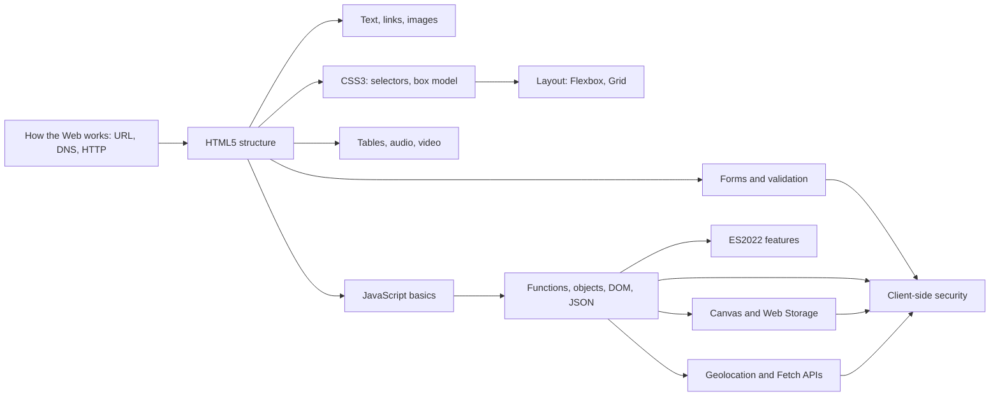

# Module 2: Client-Side Scripting with HTML5 & JavaScript

> [Cybersecurity and Digital Forensics](../../README.md) › [Term 1](../README.md) › **Module 2**

| ⬅ [Previous module](../01-programming-in-c/README.md) | [Next module](../03-computer-networks/README.md) ➡ |
|:---|---:|

---

## 🎯 Module objectives

By the end of this module you will be able to:

- Explain how the Web works: URLs, DNS, HTTP requests and responses, HTTPS and the client–server model.
- Write valid, semantic and accessible HTML5 pages with text, links, images, lists, tables, forms and media.
- Style and lay out pages with CSS3: selectors, specificity, the box model, Flexbox, Grid, media queries and animation.
- Program in JavaScript: types, operators, decisions, loops, functions, closures, objects, arrays, JSON and the DOM.
- Use modern ECMAScript (ES2022) features and the HTML5 Canvas, Web Storage, Geolocation and Fetch APIs.
- Recognise client-side security risks (XSS, tab-nabbing, trusting client validation, token theft, CORS mistakes) and apply the standard defences.

## 🗂 Sessions

| # | Session | Topic file |
|---|---|---|
| 1 | Introduction to the Web and HTML5 | [session-01-intro-web-and-html5.md](session-01-intro-web-and-html5.md) |
| 2 | Formatting Text, Hyperlinks and Anchors | [session-02-formatting-text-and-hyperlinks.md](session-02-formatting-text-and-hyperlinks.md) |
| 3 | Introduction to CSS3 | [session-03-introduction-to-css3.md](session-03-introduction-to-css3.md) |
| 4 | HTML Layout, Forms and Elements | [session-04-layout-forms-and-elements.md](session-04-layout-forms-and-elements.md) |
| 5 | HTML5 Tables, Audio and Video | [session-05-tables-audio-and-video.md](session-05-tables-audio-and-video.md) |
| 6 | JavaScript I: Language Basics | [session-06-javascript-part-1.md](session-06-javascript-part-1.md) |
| 7 | JavaScript II: Functions, Objects, DOM and JSON | [session-07-javascript-part-2.md](session-07-javascript-part-2.md) |
| 8 | ECMAScript 2022 and Its New Features | [session-08-ecmascript-2022.md](session-08-ecmascript-2022.md) |
| 9 | Canvas and Web Storage | [session-09-canvas-and-web-storage.md](session-09-canvas-and-web-storage.md) |
| 10 | HTML5 Geolocation and APIs | [session-10-geolocation-and-apis.md](session-10-geolocation-and-apis.md) |
| 📝 | Module practice test (20 MCQs + 3 scenarios) | [practice-test.md](practice-test.md) |

## ▶️ Running the examples

- Open any `.html` file from the `code/` folder in a browser (double-click it), then press `F12` to explore it in Developer Tools.
- Run any `.js` file with Node.js 18 or newer (Node 22 recommended): `node session-07_functions.js`. The examples use only built-in modules, so there is nothing to install.
- Geolocation needs a secure context: serve the folder with `npx serve` or `python -m http.server` and open it via `http://localhost`.

## 🧭 Concept map

## 📌 One-page cheat-sheet

| Topic | Remember |
|---|---|
| Skeleton | `<!DOCTYPE html>` · `<html lang="en">` · `<meta charset="UTF-8">` · `<title>` · `<body>` |
| URL | `scheme://host:port/path?query#fragment`; the fragment is never sent to the server |
| HTTP | `GET` read, `POST` send; 200 OK, 301/302 redirect, 401/403 auth, 404 not found, 500 error |
| Semantics | `header` `nav` `main` `section` `article` `aside` `footer`; one `h1` |
| Entities | `&lt;` `&gt;` `&amp;` `&quot;`: escaping is the core XSS defence |
| Links | `href="#id"`, relative `../`, `mailto:`; `target="_blank"` → `rel="noopener noreferrer"` |
| Images | Always `alt`; `figure` + `figcaption` |
| CSS rule | `selector { property: value; }`; external sheet via `<link rel="stylesheet">` |
| Specificity | (ids, classes/attrs/pseudo-classes, elements); inline > selectors; tie → later wins |
| Box model | content → padding → border → margin; `* { box-sizing: border-box; }` |
| Layout | Flexbox = one direction; Grid = rows and columns; `@media (max-width: 600px)` |
| Forms | `label for` ↔ `input id`; `name` is the key sent; `required`, `pattern`, `minlength`, `min`/`max` |
| Validation | Browser checks are convenience; **the server must re-validate everything** |
| Tables | `caption`, `thead`/`tbody`/`tfoot`, `th scope`, `colspan`, `rowspan`; not for layout |
| Media | `<video controls>` + several `<source type>` + `<track kind="captions">` + fallback |
| iframe | `sandbox`, `title`, `referrerpolicy="no-referrer"`, `loading="lazy"` |
| JS variables | `const` by default, `let` if it changes, avoid `var` |
| Equality | Always `===`; falsy: `false 0 "" null undefined NaN`; `??` keeps `0` and `""` |
| Loops | `for`, `while`, `do...while`, `for...of` (values), `for...in` (keys) |
| Functions | declaration (hoisted), expression, arrow (no own `this`); closures keep private state |
| Arrays | `map` `filter` `reduce` `find` `some` `every`; `sort((a, b) => a - b)` for numbers |
| DOM | `querySelector`, `createElement`, `append`, `remove`, `addEventListener`, `preventDefault` |
| Safe output | `textContent`, never `innerHTML` with user data; never `eval` |
| JSON | double-quoted keys; `JSON.parse` inside `try...catch` |
| ES2022 | `#private`, `static {}`, `#x in obj`, `.at(-1)`, `Object.hasOwn`, `Error(msg, { cause })`, RegExp `/d`, top-level `await` in modules |
| Canvas | `getContext("2d")`; origin top-left, y down; `fillRect`, `arc`, `fillText`, `requestAnimationFrame` |
| Web Storage | strings only; `localStorage` persists, `sessionStorage` per tab; never store tokens or secrets |
| Geolocation | `getCurrentPosition(ok, err, opts)`; errors 1/2/3; HTTPS + permission; round coordinates |
| Fetch | `await fetch(url)`; check `res.ok`; `AbortController` for timeouts |
| CORS | `Access-Control-Allow-Origin` opts in to cross-origin reads; secret API keys stay on the server |

---

Prepared by **Hamna Zahid Khan**, Junior Lecturer · Cybersecurity and Digital Forensics
