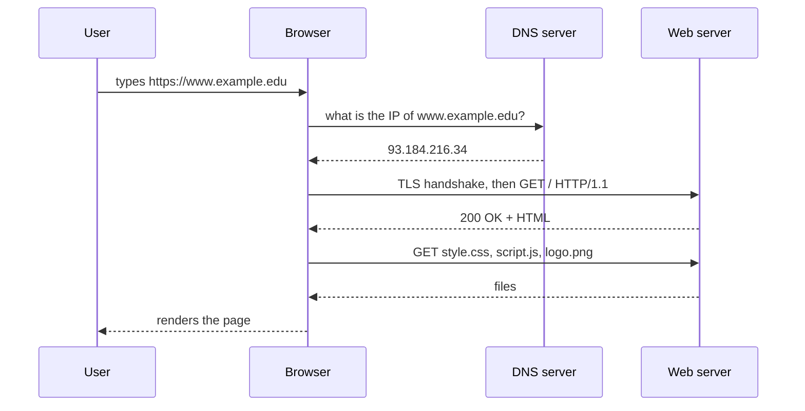
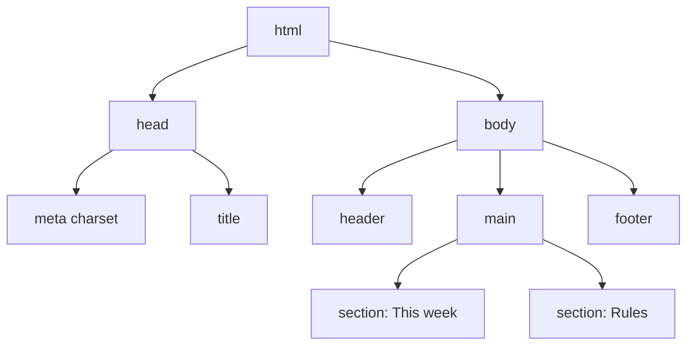
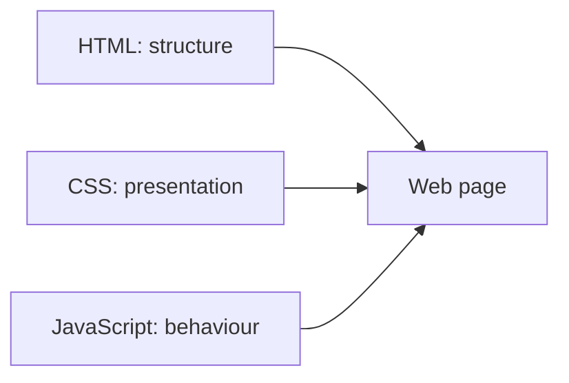

# Session 1: Introduction to the Web and HTML5

> [Cybersecurity and Digital Forensics](../../README.md) › [Term 1](../README.md) › [Module 2: Client-Side Scripting with HTML5 & JavaScript](README.md) › **Session 1**

| ⏱ Estimated time | 📋 Prerequisites |
|---|---|
| 2 hours | Basic computer literacy; Module 1 helps but is not required |

| ⬅ [Module overview](README.md) | [Next: Session 2](session-02-formatting-text-and-hyperlinks.md) ➡ |
|:---|---:|

---

## 🎯 Learning objectives

By the end of this session you will be able to:

- Explain how the **Internet** and the **World Wide Web** differ, and what happens when you type a URL.
- Describe the **client–server model** and read a simple **HTTP request and response**.
- Name the three layers of a web page: **HTML** (structure), **CSS** (presentation) and **JavaScript** (behaviour).
- Write a valid **HTML5 document** with `<!DOCTYPE html>`, `<html lang>`, `<head>`, `<meta charset>` and `<body>`.
- Use the main HTML5 **semantic elements** (`header`, `nav`, `main`, `section`, `article`, `aside`, `footer`).
- Explain why web basics matter for security testing and defence.

## 📖 Concepts

### 1. Internet vs World Wide Web

| Term | What it is | Example |
|---|---|---|
| **Internet** | The global network of networks that moves packets using TCP/IP | Fibre, routers, Wi-Fi, mobile data |
| **World Wide Web** | One service that runs *on* the Internet: linked documents fetched with HTTP/HTTPS | Websites, web apps |
| **Other Internet services** | Not the Web, but share the same network | Email (SMTP), file transfer (FTP/SFTP), remote login (SSH), DNS |

The Web was proposed by **Tim Berners-Lee** at CERN in **1989**; the first website went live in 1991. He created three building blocks that are still used: **HTML** (the document language), **HTTP** (the transfer protocol) and **URLs** (addresses).

### 2. Anatomy of a URL

```text
https://www.example.edu:443/labs/notes.html?week=3#rules
\___/   \_____________/ \_/ \_____________/ \____/ \___/
scheme       host       port      path       query  fragment
```

| Part | Meaning |
|---|---|
| **Scheme** | Protocol: `https` (encrypted) or `http` (plain text) |
| **Host** | Domain name, turned into an IP address by **DNS** |
| **Port** | Defaults: 80 for HTTP, 443 for HTTPS |
| **Path** | Which resource on the server |
| **Query** | `key=value` pairs sent to the server (visible in logs and history: never put passwords here) |
| **Fragment** | Jumps to an element inside the page; it is **not** sent to the server |

### 3. The client–server model and HTTP

A **client** (browser, `curl`, a mobile app) sends a **request**; a **server** (Apache, Nginx, IIS, Node.js) sends a **response**.

```text
GET /labs/notes.html HTTP/1.1          <- request line: method, path, version
Host: www.example.edu                  <- headers
User-Agent: Mozilla/5.0 ...

HTTP/1.1 200 OK                        <- status line
Content-Type: text/html; charset=utf-8
Content-Length: 512

<!DOCTYPE html> ...                    <- body
```

| Method | Purpose | Status code | Meaning |
|---|---|---|---|
| `GET` | Read a resource | `200` | OK |
| `POST` | Send data (forms, logins) | `301` / `302` | Redirect |
| `PUT` | Replace a resource | `403` | Forbidden |
| `DELETE` | Remove a resource | `404` | Not found |
| `HEAD` | Headers only | `500` | Server error |

**HTTPS** is HTTP inside **TLS**: the connection is encrypted and the server proves its identity with a certificate. Plain HTTP can be read and changed by anyone on the path (a café Wi-Fi, a compromised router).

### 4. Static vs dynamic pages, front end vs back end

- **Static page:** the same file is sent to everyone (`.html`, `.css`, images).
- **Dynamic page:** the server builds the response per request (PHP, Python, Node.js, Java) often using a database.
- **Front end (client side):** HTML, CSS and JavaScript running *in the browser*. The user controls this side completely, so it can never be trusted for security decisions.
- **Back end (server side):** code and data on the server. This is where authentication and validation must really happen.

### 5. The three layers of a web page

| Layer | Language | Job | Analogy |
|---|---|---|---|
| Structure | **HTML** | What the content *is*: headings, paragraphs, links, forms | Skeleton |
| Presentation | **CSS** | How it *looks*: colours, fonts, layout | Skin and clothes |
| Behaviour | **JavaScript** | What it *does*: reacts to clicks, fetches data | Muscles |

### 6. HTML versions in brief

| Year | Version | Notes |
|---|---|---|
| 1993 | HTML 1 | Basic text, links, images |
| 1997–1999 | HTML 3.2 / 4.01 | Tables, frames, style sheets |
| 2000 | XHTML 1.0 | Strict XML rules |
| 2014 | **HTML5** (W3C Recommendation) | Semantic tags, audio/video, canvas, forms, storage, APIs |
| Today | **HTML Living Standard** (WHATWG) | Updated continuously; "HTML5" is the common name |

### 7. Structure of an HTML5 document

```html
<!DOCTYPE html>                <!-- tells the browser: standards mode -->
<html lang="en">               <!-- root element; lang helps screen readers and search -->
<head>                         <!-- information ABOUT the page, not shown -->
  <meta charset="UTF-8">       <!-- character encoding: always first -->
  <meta name="viewport" content="width=device-width, initial-scale=1.0">
  <title>Page title</title>    <!-- shown on the tab and in bookmarks -->
</head>
<body>                         <!-- everything the user sees -->
  <h1>Hello</h1>
</body>
</html>
```

**Elements, tags and attributes:** `<a href="x.html">Notes</a>` is one **element**; `<a>` is the opening **tag**, `</a>` the closing tag, `href="x.html"` an **attribute** (name + value) and `Notes` the **content**. **Void elements** have no closing tag: `<meta>`, `<br>`, ``, `<input>`, `<hr>`, `<link>`.

**Nesting rule:** close tags in reverse order of opening: `<p><strong>Hi</strong></p>`, never `<p><strong>Hi</p></strong>`.

### 8. Semantic elements

| Element | Use for |
|---|---|
| `<header>` | Introductory content or a site banner |
| `<nav>` | Main navigation links |
| `<main>` | The unique main content (one per page) |
| `<section>` | A themed group of content with a heading |
| `<article>` | Self-contained content (a blog post, an advisory) |
| `<aside>` | Side content (tips, related links) |
| `<footer>` | Closing info: copyright, contact |
| `<div>` / `<span>` | Generic block / inline box when nothing semantic fits |

Semantic tags help screen readers, search engines and *you* when reading someone else's page during a test.

### 9. Why this matters in cybersecurity

- **View source** (`Ctrl+U`) and **Developer Tools** (`F12`) are the first tools of a web tester: hidden fields, comments and script files often leak information.
- Many top web vulnerabilities (XSS, CSRF, clickjacking) live in the browser layer you are learning now.
- Defenders read HTTP headers and status codes in logs every day.

## 🧭 Diagrams







## 💻 Worked examples

### Example 1 – A complete HTML5 page

Save this as `index.html` and double-click it to open it in a browser. Then press `Ctrl+U` to view its source and `F12` to open the Elements panel.

📄 **`code/session-01_page.html`**

```html
<!DOCTYPE html>
<html lang="en">
<head>
  <meta charset="UTF-8">
  <meta name="viewport" content="width=device-width, initial-scale=1.0">
  <title>Cyber Lab Notice Board</title>
</head>
<body>
  <header>
    <h1>Cyber Lab Notice Board</h1>
  </header>
  <main>
    <section>
      <h2>This week</h2>
      <p>Lab 3 covers <strong>password hygiene</strong>. Bring your laptop.</p>
    </section>
    <section>
      <h2>Rules</h2>
      <p>Only scan machines you are authorised to test.</p>
    </section>
  </main>
  <footer>
    <p>&copy; 2026 Cyber Lab</p>
  </footer>
</body>
</html>
```
### Example 2 – Inspecting a page from a script

A tester often needs to check many pages quickly. This Node.js script reads the page above and reports its doctype, language, encoding, tag counts and heading outline. Run it with `node session-01_inspect.js` from the `code/` folder.

📄 **`code/session-01_inspect.js`**

```javascript
// Inspect an HTML file without a browser: doctype, language, charset and outline.
const fs = require("fs");
const html = fs.readFileSync("session-01_page.html", "utf8");

console.log("Doctype present :", /^<!DOCTYPE html>/i.test(html.trim()));
console.log("lang attribute  :", (html.match(/<html[^>]*lang="([^"]+)"/i) || [])[1]);
console.log("charset         :", (html.match(/<meta charset="([^"]+)"/i) || [])[1]);
console.log("title           :", (html.match(/<title>(.*?)<\/title>/i) || [])[1]);

// Count every opening tag
const counts = {};
for (const m of html.matchAll(/<([a-z][a-z0-9]*)\b/gi)) {
  const tag = m[1].toLowerCase();
  counts[tag] = (counts[tag] || 0) + 1;
}
console.log("\nTag counts:");
for (const [tag, n] of Object.entries(counts).sort()) console.log(`  ${tag.padEnd(8)} ${n}`);

// Heading outline
console.log("\nDocument outline:");
for (const m of html.matchAll(/<h([1-6])>(.*?)<\/h\1>/gi)) {
  console.log("  " + "  ".repeat(Number(m[1]) - 1) + `h${m[1]}: ${m[2]}`);
}
```

**Output**

```text
Doctype present : true
lang attribute  : en
charset         : UTF-8
title           : Cyber Lab Notice Board

Tag counts:
  body     1
  footer   1
  h1       1
  h2       2
  head     1
  header   1
  html     1
  main     1
  meta     2
  p        3
  section  2
  strong   1
  title    1

Document outline:
  h1: Cyber Lab Notice Board
    h2: This week
    h2: Rules
```
### Example 3 – One HTTP request and response, live

This script starts a tiny web server on your own machine (`127.0.0.1`) and then requests two paths from it. Read the request line, the headers, the status codes and the body.

📄 **`code/session-01_http.js`**

```javascript
// A tiny web server and a client in one script: watch one HTTP request/response.
const http = require("http");

const server = http.createServer((req, res) => {
  console.log(`SERVER got  : ${req.method} ${req.url} HTTP/${req.httpVersion}`);
  console.log(`SERVER saw  : Host=${req.headers.host.replace(/:\d+$/, ":<port>")}, User-Agent=${req.headers["user-agent"]}`);
  if (req.url === "/") {
    res.writeHead(200, { "Content-Type": "text/html; charset=utf-8", "X-Content-Type-Options": "nosniff" });
    res.end("<!DOCTYPE html><title>Hi</title><h1>Hello from the lab server</h1>");
  } else {
    res.writeHead(404, { "Content-Type": "text/plain" });
    res.end("Not found");
  }
});

server.listen(0, "127.0.0.1", async () => {
  const base = `http://127.0.0.1:${server.address().port}`;
  for (const path of ["/", "/admin"]) {
    const r = await fetch(base + path, { headers: { "User-Agent": "CyberLabClient/1.0" } });
    console.log(`CLIENT got  : ${r.status} ${r.statusText}`);
    console.log(`CLIENT type : ${r.headers.get("content-type")}`);
    console.log(`CLIENT body : ${await r.text()}\n`);
  }
  server.close();
});
```

**Output**

```text
SERVER got  : GET / HTTP/1.1
SERVER saw  : Host=127.0.0.1:<port>, User-Agent=CyberLabClient/1.0
CLIENT got  : 200 OK
CLIENT type : text/html; charset=utf-8
CLIENT body : <!DOCTYPE html><title>Hi</title><h1>Hello from the lab server</h1>

SERVER got  : GET /admin HTTP/1.1
SERVER saw  : Host=127.0.0.1:<port>, User-Agent=CyberLabClient/1.0
CLIENT got  : 404 Not Found
CLIENT type : text/plain
CLIENT body : Not found
```
Notice: the server sends `X-Content-Type-Options: nosniff`, a **security header** that stops the browser guessing file types. `/admin` returns `404` because no route exists.

## 📊 Browser developer tools you will use all course

| Panel | Shortcut / where | What you learn |
|---|---|---|
| Elements | `F12` → Elements | The live DOM, hidden fields, applied CSS |
| Console | `F12` → Console | JavaScript errors; run JS directly |
| Network | `F12` → Network | Every request, status code, header and cookie |
| Application / Storage | `F12` → Application | Cookies, localStorage, sessionStorage |
| View source | `Ctrl+U` | The original HTML before scripts change it |

## 🧪 Lab / practice tasks

1. **Easy –** Create `profile.html` with a correct HTML5 skeleton, your name in an `<h1>` and two paragraphs about your interests.
2. **Easy –** Label each part of `https://portal.uni.edu.pk:8443/results?id=204#grades` (scheme, host, port, path, query, fragment).
3. **Medium –** Rebuild Example 1 for a "Cyber Club" page using `header`, `nav`, `main` with two `article` elements, an `aside` and a `footer`.
4. **Medium –** Open any public website, press `F12` → Network, reload, and record five requests: method, status code and `Content-Type`.
5. **Challenge –** Change `session-01_http.js` so `/about` returns a small HTML page and every response adds the header `X-Frame-Options: DENY`. Explain in one sentence what that header protects against.

<details>
<summary>💡 Hints</summary>

- Task 2: the fragment `#grades` is never sent to the server.
- Task 4: in the Network panel, click a row and open the **Headers** tab.
- Task 5: add an `else if (req.url === "/about")` branch; `X-Frame-Options` stops other sites loading your page in an `<iframe>` (clickjacking).
</details>

## ✅ Quick quiz

1. Which is a service that runs on the Internet? a) TCP/IP b) the World Wide Web c) a router d) fibre
2. What does `<!DOCTYPE html>` do? a) adds a title b) switches the browser to standards mode for HTML5 c) loads CSS d) encrypts the page
3. Which part of a URL is never sent to the server? a) path b) query c) fragment d) host
4. Status code `404` means: a) OK b) redirect c) not found d) server error
5. Which element should hold the unique main content of a page? a) `<section>` b) `<div>` c) `<main>` d) `<body>`

<details>
<summary>Show answers</summary>

1 – b · 2 – b · 3 – c · 4 – c · 5 – c
</details>

## 📝 Summary / cheat-sheet

- Internet = network; Web = documents and apps over HTTP/HTTPS on that network.
- URL = scheme://host:port/path?query#fragment; DNS turns the host into an IP.
- HTTP: request (method, path, headers) → response (status code, headers, body). HTTPS adds TLS encryption.
- Page = HTML (structure) + CSS (look) + JavaScript (behaviour).
- Skeleton: `<!DOCTYPE html>`, `<html lang>`, `<head>` with `<meta charset="UTF-8">` and `<title>`, then `<body>`.
- Prefer semantic tags (`header`, `nav`, `main`, `section`, `article`, `aside`, `footer`) over plain `div`s.
- Client-side code is fully controlled by the user: real security checks belong on the server.

**Interview / viva questions**

1. What is the difference between the Internet and the Web?
2. Walk through what happens when you type a URL and press Enter.
3. What is the difference between `GET` and `POST`, and why should passwords never go in a query string?
4. Why must `<meta charset>` appear early in the `<head>`?
5. Why are semantic elements better than using `<div>` for everything?

---

| ⬅ [Module overview](README.md) | [Next: Session 2](session-02-formatting-text-and-hyperlinks.md) ➡ |
|:---|---:|

<sub>Prepared by **Hamna Zahid Khan**, Junior Lecturer · Cybersecurity and Digital Forensics</sub>
