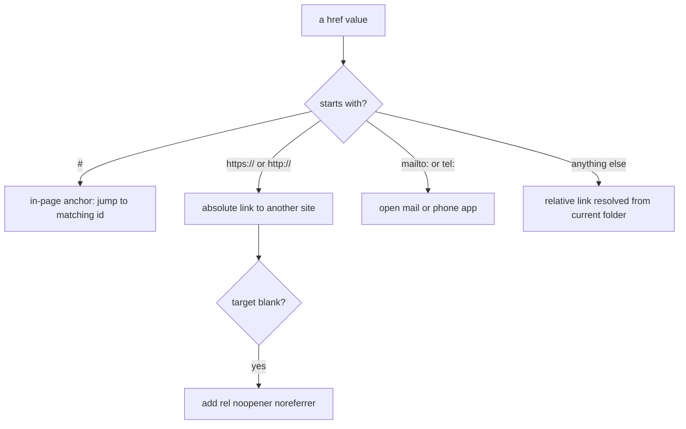
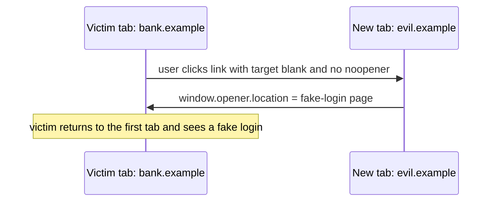

# Session 2: Formatting Text, Hyperlinks and Anchors

> [Cybersecurity and Digital Forensics](../../README.md) › [Term 1](../README.md) › [Module 2: Client-Side Scripting with HTML5 & JavaScript](README.md) › **Session 2**

| ⏱ Estimated time | 📋 Prerequisites |
|---|---|
| 2 hours | Session 1 (HTML5 document structure) |

| ⬅ [Previous: Session 1](session-01-intro-web-and-html5.md) | [Next: Session 3](session-03-introduction-to-css3.md) ➡ |
|:---|---:|

---

## 🎯 Learning objectives

- Use **headings**, **paragraphs**, line breaks and horizontal rules correctly.
- Apply **text-level elements**: `strong`, `em`, `mark`, `code`, `kbd`, `pre`, `sub`, `sup`, `del`, `ins`, `blockquote`, `abbr`.
- Build **ordered**, **unordered** and **description** lists, including nested lists.
- Create **hyperlinks** with absolute, relative, email, phone and **in-page anchor** targets.
- Add **images** with meaningful `alt` text.
- Apply link security: `rel="noopener noreferrer"`, HTTPS and recognising deceptive links.

## 📖 Concepts

### 1. Headings and paragraphs

- `<h1>` to `<h6>`: six heading levels. Use **one `<h1>`** per page and do not skip levels (h2 → h4) just for size; size is CSS's job.
- `<p>`: a paragraph. Browsers collapse extra spaces and newlines in HTML into one space.
- `<br>`: a line break *inside* a block (addresses, poems). Do not use it for spacing.
- `<hr>`: a thematic break between topics.
- **Comments:** `<!-- note -->` are not displayed but **are sent to every visitor**. Never leave passwords, internal IPs or TODOs about security in comments: testers read them.

### 2. Formatting (text-level) elements

| Element | Meaning | Rendered as |
|---|---|---|
| `<strong>` | Strong importance | **bold** |
| `<b>` | Stylistically bold, no extra importance | bold |
| `<em>` | Stress emphasis | *italic* |
| `<i>` | Alternate voice, technical term | italic |
| `<mark>` | Highlighted / relevant | yellow background |
| `<small>` | Side comments, fine print | smaller text |
| `<del>` / `<ins>` | Removed / inserted text | ~~strike~~ / underline |
| `<sub>` / `<sup>` | Subscript / superscript | H₂O, 2¹⁰ |
| `<code>` | A fragment of code | monospace |
| `<kbd>` | Keyboard input | monospace key |
| `<samp>` | Sample program output | monospace |
| `<pre>` | Preformatted: keeps spaces and newlines | monospace block |
| `<abbr title="...">` | Abbreviation with expansion | dotted underline |
| `<blockquote cite="url">` | Long quotation from another source | indented block |
| `<q>` | Short inline quotation | "quoted" |

Prefer the **semantic** element (`strong`, `em`) when meaning matters; screen readers can announce it.

### 3. Character entities

Some characters have special meaning in HTML and must be **escaped** to appear as text:

| Character | Entity | Why |
|---|---|---|
| `<` | `&lt;` | Would start a tag |
| `>` | `&gt;` | Would end a tag |
| `&` | `&amp;` | Would start an entity |
| `"` | `&quot;` | Would end an attribute value |
| © | `&copy;` | Not on the keyboard |
| non-breaking space | `&nbsp;` | Keeps two words together |

Escaping is also the main defence against **cross-site scripting (XSS)**: user input shown on a page must have `<` turned into `&lt;` so it is displayed, not executed.

### 4. Lists

```html
<ul>                       <!-- unordered: bullets -->
  <li>Wireshark</li>
  <li>Nmap
    <ul><li>-sS SYN scan</li></ul>   <!-- nested list goes INSIDE the li -->
  </li>
</ul>
<ol type="1" start="3">    <!-- ordered: 3, 4, ... ; type can be 1, A, a, I, i -->
  <li>Identify</li><li>Contain</li>
</ol>
<dl>                       <!-- description list: term + definition -->
  <dt>Phishing</dt><dd>Tricking users into revealing secrets.</dd>
</dl>
```

### 5. Hyperlinks and anchors

The anchor element `<a>` with the `href` attribute creates a link.

| Link type | Example `href` | Notes |
|---|---|---|
| Absolute | `https://owasp.org/` | Full URL to another site |
| Relative | `notes/nmap.html`, `../index.html` | Relative to the current file; `..` goes up one folder |
| Root-relative | `/labs/week3.html` | From the site root |
| In-page anchor | `#tools` | Jumps to the element with `id="tools"` |
| Other page + anchor | `faq.html#passwords` | Opens a page at a section |
| Email | `mailto:lab@example.edu?subject=Help` | Opens the mail app |
| Phone | `tel:+922100000000` | Dials on mobile |
| Download | `<a href="report.pdf" download>` | Saves instead of opening |

Useful attributes: `target="_blank"` (new tab), `title` (tooltip), `rel` (relationship), `download`.

**IDs must be unique** in a page; an anchor to a missing ID silently does nothing.

### 6. Images

```html

<figure>
  
  <figcaption>Figure 1: failed logins by hour</figcaption>
</figure>
```

- `alt` describes the image for screen readers and when the image fails to load. Decorative images use `alt=""`.
- `width`/`height` reserve space so the page does not jump while loading.
- An image can be a link: `<a href="big.png"></a>`.

### 7. Link security

| Risk | What happens | Defence |
|---|---|---|
| **Reverse tab-nabbing** | A page opened with `target="_blank"` gets `window.opener` and can redirect *your* tab to a fake login | Add `rel="noopener noreferrer"` (modern browsers default to noopener, but be explicit) |
| **Plain HTTP links** | Content can be read or altered in transit | Use `https://` |
| **Deceptive link text** | `<a href="http://evil.example">https://bank.com</a>` shows one URL but goes to another | Hover to read the real target in the status bar; train users |
| **Look-alike domains** | `paypa1.com`, `rnicrosoft.com` | Check the domain carefully; use bookmarks |
| **Referrer leaks** | The full URL (with tokens) is sent to the next site | `rel="noreferrer"` or a `Referrer-Policy` header |

## 🧭 Diagrams





## 💻 Worked examples

### Example 1 – Formatting, lists, anchors and links in one page

📄 **`code/session-02_links.html`**

```html
<!DOCTYPE html>
<html lang="en">
<head><meta charset="UTF-8"><title>Security Reading List</title></head>
<body>
  <nav>
    <a href="#tools">Tools</a> | <a href="#reading">Reading</a> | <a href="#contact">Contact</a>
  </nav>

  <h1 id="top">Security Reading List</h1>
  <p>Keep notes in <em>your own words</em>. <mark>Never</mark> paste real passwords into notes.</p>
  <p>Hash of the file: <code>e3b0c44298fc1c14</code> &nbsp; Press <kbd>Ctrl</kbd> + <kbd>C</kbd> to copy.</p>
  <p>H<sub>2</sub>O and 2<sup>10</sup> = 1024. <del>Telnet</del> <ins>SSH</ins> for remote login.</p>

  <h2 id="tools">Tools</h2>
  <ul>
    <li><a href="https://www.wireshark.org/" target="_blank" rel="noopener noreferrer">Wireshark</a></li>
    <li><a href="http://example.com/old-scanner" target="_blank">Old scanner page</a></li>
    <li><a href="notes/nmap.html">My Nmap notes</a> (relative link)</li>
  </ul>

  <h2 id="reading">Reading</h2>
  <ol>
    <li><a href="https://owasp.org/www-project-top-ten/" title="OWASP Top 10">OWASP Top 10</a></li>
    <li><a href="#glossary">Glossary</a></li>
  </ol>
  <blockquote cite="https://owasp.org/">Security is a process, not a product.</blockquote>
  <pre>
  nmap -sV 192.168.56.10
  </pre>

  <h2 id="contact">Contact</h2>
  <p><a href="mailto:lab@example.edu?subject=Lab%20question">Email the lab</a> ·
     <a href="tel:+922100000000">Call the lab</a> · <a href="#top">Back to top</a></p>
</body>
</html>
```
Open it in a browser and click the navigation links: they jump to the matching `id`. The "Glossary" link does nothing because no element has `id="glossary"`.

### Example 2 – An automatic link audit

Before a page goes live (or during a security review) you can check every link. This script classifies each `href`, finds broken in-page anchors, and flags `target="_blank"` without `noopener` and plain `http://` links.

📄 **`code/session-02_linkaudit.js`**

```javascript
// Audit every hyperlink in a page: type, broken in-page anchors, unsafe target=_blank, plain http.
const fs = require("fs");
const html = fs.readFileSync("session-02_links.html", "utf8");

const ids = new Set([...html.matchAll(/\sid="([^"]+)"/g)].map(m => m[1]));
const links = [...html.matchAll(/<a\s+([^>]*)>(.*?)<\/a>/gi)].map(m => {
  const attr = name => (m[1].match(new RegExp(`${name}="([^"]*)"`)) || [])[1];
  return { text: m[2], href: attr("href"), target: attr("target"), rel: attr("rel") || "" };
});

function kind(href) {
  if (href.startsWith("#")) return "in-page";
  if (href.startsWith("mailto:")) return "email";
  if (href.startsWith("tel:")) return "phone";
  if (/^https?:\/\//.test(href)) return "absolute";
  return "relative";
}

let warnings = 0;
console.log("Text".padEnd(18), "Type".padEnd(9), "Href");
for (const l of links) {
  console.log(l.text.padEnd(18), kind(l.href).padEnd(9), l.href);
  if (kind(l.href) === "in-page" && !ids.has(l.href.slice(1))) {
    console.log("   ! broken anchor: no element has id=" + l.href.slice(1)); warnings++;
  }
  if (l.target === "_blank" && !l.rel.includes("noopener")) {
    console.log("   ! target=_blank without rel=noopener (tab-nabbing risk)"); warnings++;
  }
  if (l.href.startsWith("http://")) {
    console.log("   ! plain http: traffic can be read or changed in transit"); warnings++;
  }
}
console.log(`\n${links.length} links checked, ${warnings} warnings`);
```

**Output**

```text
Text               Type      Href
Tools              in-page   #tools
Reading            in-page   #reading
Contact            in-page   #contact
Wireshark          absolute  https://www.wireshark.org/
Old scanner page   absolute  http://example.com/old-scanner
   ! target=_blank without rel=noopener (tab-nabbing risk)
   ! plain http: traffic can be read or changed in transit
My Nmap notes      relative  notes/nmap.html
OWASP Top 10       absolute  https://owasp.org/www-project-top-ten/
Glossary           in-page   #glossary
   ! broken anchor: no element has id=glossary
Email the lab      email     mailto:lab@example.edu?subject=Lab%20question
Call the lab       phone     tel:+922100000000
Back to top        in-page   #top

11 links checked, 3 warnings
```
Three real problems found in a small page. Fixing them is quick: add `rel="noopener noreferrer"`, switch to `https://`, and add `id="glossary"` to a heading (or remove the link).

## 📊 Relative path practice

Suppose the current file is `site/labs/week3.html`.

| `href` | Resolves to |
|---|---|
| `notes.html` | `site/labs/notes.html` |
| `img/net.png` | `site/labs/img/net.png` |
| `../index.html` | `site/index.html` |
| `../../readme.html` | one level above `site/` |
| `/about.html` | `about.html` at the **server root** |

## 🧪 Lab / practice tasks

1. **Easy –** Write a page "Top 5 Security Habits" using an `<ol>`, with one word in each item in `<strong>` and one keyboard shortcut in `<kbd>`.
2. **Easy –** Show this text exactly on a page: `if (a < b && b > c)`. Which entities do you need?
3. **Medium –** Build a one-page glossary with a `<dl>` of 6 terms and a navigation bar at the top that jumps to each term with in-page anchors, plus a "Back to top" link after each.
4. **Medium –** Add a `<figure>` with an image of a network diagram, proper `alt` text and a `<figcaption>`.
5. **Challenge –** Extend `session-02_linkaudit.js` to also flag `` tags with no `alt` attribute and links whose visible text looks like a URL but differs from the `href`.

<details>
<summary>💡 Hints</summary>

- Task 2: `&lt;` for `<`, `&amp;&amp;` for `&&`, `&gt;` for `>`.
- Task 3: give each `<dt>` an `id`, e.g. `<dt id="phishing">`.
- Task 5: match `/]*\balt=)[^>]*>/gi`; for deceptive text, check if `text` starts with `http` and `text !== href`.
</details>

## ✅ Quick quiz

1. How many `<h1>` elements should a page normally have? a) none b) one c) one per section d) six
2. Which shows `<script>` as visible text? a) `<script>` b) `&lt;script&gt;` c) `"script"` d) `<pre>script</pre>`
3. `href="#tools"` links to: a) a file named tools b) the element with `id="tools"` c) the class tools d) a new tab
4. What does `rel="noopener"` prevent? a) slow loading b) the new tab controlling the original tab through `window.opener` c) broken images d) caching
5. The `alt` attribute on `` is used for: a) the tooltip only b) a text alternative for screen readers and failed loads c) the file name d) image size

<details>
<summary>Show answers</summary>

1 – b · 2 – b · 3 – b · 4 – b · 5 – b
</details>

## 📝 Summary / cheat-sheet

- Headings `h1`–`h6` in order, one `h1`; `p` for paragraphs; `br` only inside a block.
- Semantic emphasis: `strong`, `em`; code-ish: `code`, `kbd`, `pre`, `samp`; edits: `del`, `ins`.
- Escape `<`, `>`, `&`, `"` as entities; escaping user input is the core XSS defence.
- Lists: `ul`, `ol` (`type`, `start`), `dl` with `dt`/`dd`; nest lists inside an `li`.
- Links: absolute, relative (`../`), `#id`, `mailto:`, `tel:`, `download`.
- `img` always has `alt`; use `figure` + `figcaption` for captioned images.
- `target="_blank"` → add `rel="noopener noreferrer"`; prefer HTTPS; hover links to see the real target.
- HTML comments are public: never put secrets in them.

**Interview / viva questions**

1. What is the difference between `<strong>` and `<b>`?
2. Explain absolute and relative URLs with an example of `../`.
3. What is reverse tab-nabbing and how do you prevent it?
4. Why is escaping `<` and `>` important for security?
5. Why are HTML comments a risk on a production site?

---

| ⬅ [Previous: Session 1](session-01-intro-web-and-html5.md) | [Next: Session 3](session-03-introduction-to-css3.md) ➡ |
|:---|---:|

<sub>Prepared by **Hamna Zahid Khan**, Junior Lecturer · Cybersecurity and Digital Forensics</sub>
