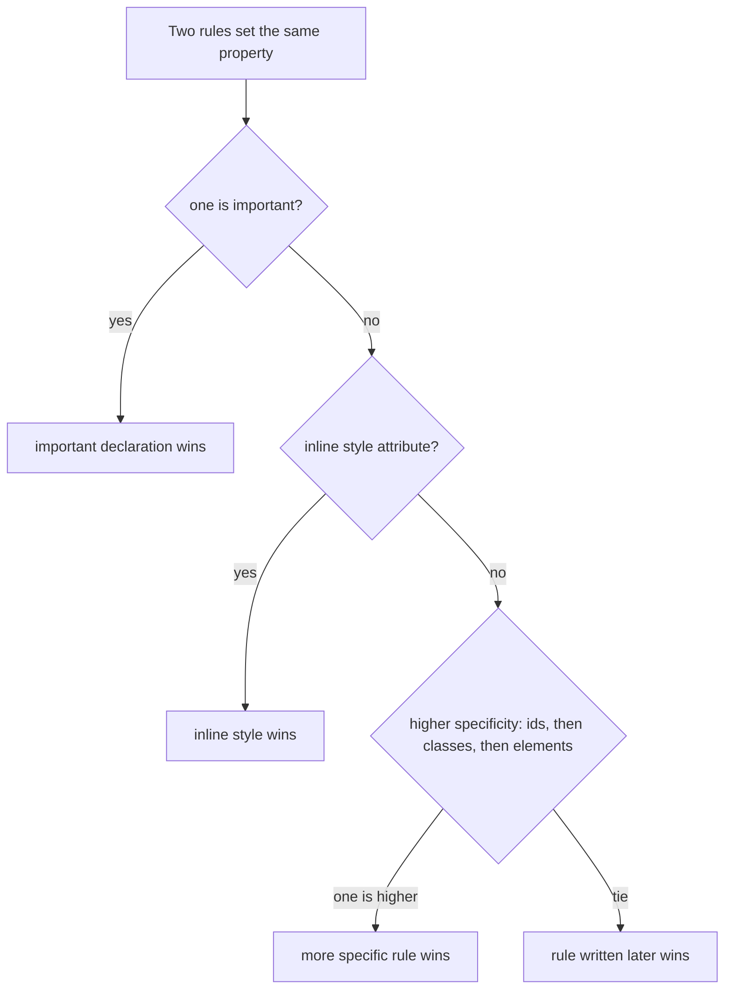
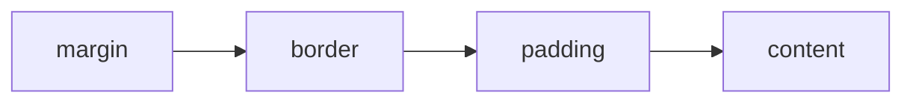

# Session 3: Introduction to CSS3

> [Cybersecurity and Digital Forensics](../../README.md) › [Term 1](../README.md) › [Module 2: Client-Side Scripting with HTML5 & JavaScript](README.md) › **Session 3**

| ⏱ Estimated time | 📋 Prerequisites |
|---|---|
| 2.5 hours | Sessions 1–2 (HTML structure, text and links) |

| ⬅ [Previous: Session 2](session-02-formatting-text-and-hyperlinks.md) | [Next: Session 4](session-04-layout-forms-and-elements.md) ➡ |
|:---|---:|

---

## 🎯 Learning objectives

- Explain what **CSS** is and why presentation is kept separate from structure.
- Attach CSS three ways: **inline**, **internal** (`<style>`) and **external** (`<link>`), and know which wins.
- Write rules with **selectors**: element, class, id, attribute, descendant, child, pseudo-class and pseudo-element.
- Calculate **specificity** and apply the **cascade** and **inheritance**.
- Use the **box model**, colours, units, fonts, backgrounds and borders.
- Use CSS3 features: **custom properties**, **media queries**, **transitions** and **animations**.

## 📖 Concepts

### 1. What CSS does

**CSS (Cascading Style Sheets)** describes how HTML elements look: colour, size, spacing, layout and motion. One external style sheet can restyle a whole site. **CSS3** split the language into modules (Selectors, Colours, Backgrounds and Borders, Media Queries, Flexbox, Grid, Animations) that evolve separately.

### 2. Anatomy of a rule

```css
selector   { property: value; property: value; }
h1         { color: navy; text-align: center; }
/* comments look like this */
```

A **declaration** is `property: value;`. A **rule** is a selector plus a block of declarations.

### 3. Three ways to add CSS

| Method | Example | Use for |
|---|---|---|
| Inline | `<p style="color: red;">` | Quick tests; hard to maintain |
| Internal | `<style> p { color: red; } </style>` in `<head>` | One-page demos |
| External | `<link rel="stylesheet" href="site.css">` | Real sites: cached, reusable |

### 4. Selectors

| Selector | Example | Matches |
|---|---|---|
| Universal | `*` | Every element |
| Element (type) | `p` | All `<p>` |
| Class | `.card` | Elements with `class="card"` (reusable) |
| ID | `#summary` | The one element with `id="summary"` |
| Multiple classes | `.card.critical` | Elements with both classes |
| Grouping | `h1, h2` | All `h1` and all `h2` |
| Descendant | `nav a` | `a` anywhere inside `nav` |
| Child | `ul > li` | `li` directly inside `ul` |
| Adjacent sibling | `h2 + p` | The first `p` right after an `h2` |
| Attribute | `input[type="password"]` | Password inputs |
| Pseudo-class | `a:hover`, `li:nth-child(odd)`, `input:invalid`, `:focus` | A state or position |
| Pseudo-element | `p::first-line`, `.badge::before` | A part of an element or generated content |

### 5. Cascade, specificity and inheritance

When two rules set the same property on the same element, the browser decides by:

1. **Importance:** `!important` beats normal declarations (use rarely).
2. **Origin:** author styles beat browser defaults.
3. **Specificity:** a three-part score **(ids, classes/attributes/pseudo-classes, elements/pseudo-elements)**, compared left to right. Inline `style=""` beats any selector.
4. **Order:** if specificity ties, the **later** rule wins.

**Inheritance:** some properties (`color`, `font-family`, `line-height`) pass from parent to child; others (`border`, `margin`, `padding`, `width`) do not.

### 6. The box model

Every element is a rectangular box:

```text
+---------------- margin ----------------+
|  +------------- border -------------+  |
|  |  +---------- padding ---------+  |  |
|  |  |          content           |  |  |
|  |  +----------------------------+  |  |
|  +----------------------------------+  |
+----------------------------------------+
```

- `box-sizing: content-box` (default): `width` is the content only; padding and border are added on top.
- `box-sizing: border-box`: `width` includes padding and border. Most sites set `* { box-sizing: border-box; }`.
- **Block** elements (`div`, `p`, `h1`) start on a new line and fill the width; **inline** elements (`span`, `a`, `strong`) flow inside text; `display: inline-block` mixes both.

### 7. Values and units

| Kind | Examples |
|---|---|
| Colour | `red`, `#c0392b`, `#c03`, `rgb(192 57 43)`, `rgba(0,0,0,0.15)`, `hsl(6 63% 46%)` |
| Absolute length | `px` (screen pixel), `pt`, `cm` |
| Relative length | `em` (parent font size), `rem` (root font size), `%`, `vw`/`vh` (viewport) |
| Font | `font-family: system-ui, sans-serif; font-size: 1rem; font-weight: 700;` |
| Text | `text-align`, `text-decoration`, `text-transform`, `letter-spacing`, `line-height` |
| Background | `background-color`, `background-image: url(bg.png)`, `linear-gradient(...)` |
| Border | `border: 2px solid #ccc; border-radius: 8px;` |
| Shadow | `box-shadow: 0 2px 6px rgba(0,0,0,.15); text-shadow: ...` |

### 8. CSS3 features

- **Custom properties (variables):** `:root { --danger: #c0392b; }` then `color: var(--danger);`. Change the theme in one place.
- **Media queries:** `@media (max-width: 600px) { ... }` apply rules only on small screens: the basis of **responsive design**.
- **Transitions:** `transition: background 0.3s ease;` animate between two states (e.g. on `:hover`).
- **Animations:** define `@keyframes name { from {...} to {...} }` and apply `animation: name 1s infinite alternate;`.
- **Transforms:** `transform: rotate(5deg) scale(1.1) translateX(10px);`.

### 9. CSS and security

- **Clickjacking UI tricks:** CSS `opacity: 0` and `position: absolute` can hide a real button under a fake one. Servers defend with `X-Frame-Options` or CSP `frame-ancestors`.
- **CSS injection:** if user input lands inside a `<style>` block, attribute selectors like `input[value^="a"]` plus `background: url(...)` can leak data. Never put untrusted input into CSS.
- **Content Security Policy** (`style-src`) can forbid inline styles, which is one reason external style sheets are preferred.
- Hiding something with `display: none` does **not** protect it: it is still in the HTML source.

## 🧭 Diagrams





## 💻 Worked examples

### Example 1 – A styled alert dashboard

This page uses an internal style sheet with variables, the box model, pseudo-classes, a pseudo-element, a media query and a keyframe animation. Open it and narrow the browser window below 600 px to watch the cards resize.

📄 **`code/session-03_styles.html`**

```html
<!DOCTYPE html>
<html lang="en">
<head>
  <meta charset="UTF-8">
  <title>Alert Dashboard</title>
  <link rel="stylesheet" href="theme.css">          <!-- external (not shipped) -->
  <style>                                            /* internal style sheet */
    :root { --danger: #c0392b; --ok: #27ae60; --gap: 1rem; }
    * { box-sizing: border-box; }
    body { font-family: system-ui, sans-serif; margin: 0; background: #f4f6f8; color: #222; }
    h1 { text-align: center; letter-spacing: 1px; }
    .card {
      width: 300px; padding: var(--gap); margin: var(--gap) auto;
      border: 2px solid #ccc; border-radius: 8px; background: #fff;
      box-shadow: 0 2px 6px rgba(0, 0, 0, 0.15);
    }
    .card.critical { border-color: var(--danger); }
    #summary { font-weight: bold; }
    a:hover { text-decoration: underline; }
    li:nth-child(odd) { background: #eef; }
    .badge::before { content: "⚠ "; }
    @media (max-width: 600px) { .card { width: 100%; } }
    @keyframes pulse { from { opacity: 1; } to { opacity: 0.4; } }
    .critical .badge { animation: pulse 1s infinite alternate; color: var(--danger); }
  </style>
</head>
<body>
  <h1>SOC Alert Dashboard</h1>
  <p id="summary">2 open alerts</p>
  <div class="card critical"><span class="badge">Critical</span> Brute force on SSH</div>
  <div class="card"><span class="badge">Low</span> New device joined Wi-Fi</div>
  <p style="color: gray;">Inline style: highest priority after !important.</p>
  <ul><li>Alert 1</li><li>Alert 2</li><li>Alert 3</li></ul>
</body>
</html>
```
### Example 2 – Calculating specificity and the box model

This script scores selectors from Example 1, picks the winning `border-color` for the critical card, and shows how `box-sizing` changes the real width.

📄 **`code/session-03_specificity.js`**

```javascript
// Compute CSS specificity (ids, classes/attributes/pseudo-classes, elements) and pick the winner.
function specificity(sel) {
  const el = (sel.match(/::[a-z-]+/g) || []).length;    // pseudo-elements count as elements
  const s = sel.replace(/::[a-z-]+/g, "");
  const ids = (s.match(/#[\w-]+/g) || []).length;
  const cls = (s.match(/\.[\w-]+|\[[^\]]+\]|:[\w-]+(\([^)]*\))?/g) || []).length;
  const elements = (s.replace(/#[\w-]+|\.[\w-]+|\[[^\]]+\]|:[\w-]+(\([^)]*\))?/g, " ")
                      .match(/(^|[\s>+~])([a-z][\w-]*)/gi) || []).length;
  return [ids, cls, elements + el];
}

const selectors = ["p", "li:nth-child(odd)", ".card", ".card.critical", "#summary",
                   "div.card.critical", ".critical .badge", "a:hover", ".badge::before", "body main section p"];
console.log("Selector".padEnd(22), "(id, class, element)");
for (const s of selectors) console.log(s.padEnd(22), `(${specificity(s).join(", ")})`);

// Which rule wins for <div class="card critical"> border-color?
const rules = [
  { sel: ".card", value: "#ccc", order: 1 },
  { sel: ".card.critical", value: "var(--danger)", order: 2 },
  { sel: "div", value: "black", order: 3 },
];
const cmp = (a, b) => {
  const x = specificity(a.sel), y = specificity(b.sel);
  for (let i = 0; i < 3; i++) if (x[i] !== y[i]) return y[i] - x[i];
  return b.order - a.order;  // same specificity: later rule wins
};
const winner = [...rules].sort(cmp)[0];
console.log(`\nborder-color for <div class="card critical"> -> ${winner.value} (from "${winner.sel}")`);

// Box model: total width with content-box vs border-box
const width = 300, padding = 16, border = 2;
console.log(`content-box total width: ${width + 2 * padding + 2 * border}px`);
console.log(`border-box  total width: ${width}px (content shrinks to ${width - 2 * padding - 2 * border}px)`);
```

**Output**

```text
Selector               (id, class, element)
p                      (0, 0, 1)
li:nth-child(odd)      (0, 1, 1)
.card                  (0, 1, 0)
.card.critical         (0, 2, 0)
#summary               (1, 0, 0)
div.card.critical      (0, 2, 1)
.critical .badge       (0, 2, 0)
a:hover                (0, 1, 1)
.badge::before         (0, 1, 1)
body main section p    (0, 0, 4)

border-color for <div class="card critical"> -> var(--danger) (from ".card.critical")
content-box total width: 336px
border-box  total width: 300px (content shrinks to 264px)
```
Note `.card.critical` (0,2,0) beats `.card` (0,1,0), and `div` (0,0,1) loses even though it is written last: specificity is checked **before** order.

## 📊 Common properties reference

| Property | Sample value | Effect |
|---|---|---|
| `color` | `#222` | Text colour |
| `background` | `#f4f6f8` | Background colour or image |
| `font-family` | `system-ui, sans-serif` | Font stack with fallback |
| `margin` | `1rem auto` | Outer space; `auto` centres a block |
| `padding` | `8px 16px` | Inner space (top/bottom, left/right) |
| `border-radius` | `8px` | Rounded corners |
| `display` | `block`, `inline`, `none`, `flex`, `grid` | Box type |
| `opacity` | `0.5` | Transparency |
| `cursor` | `pointer` | Mouse pointer shape |

## 🧪 Lab / practice tasks

1. **Easy –** Move the `<style>` block of Example 1 into `dashboard.css` and link it with `<link rel="stylesheet">`.
2. **Easy –** Write rules so every password input has a red border and every link turns green on hover.
3. **Medium –** Calculate the specificity of `nav ul li a:hover`, `#menu .item`, `input[type="text"]:focus`. Check your answers by adding them to `session-03_specificity.js`.
4. **Medium –** Add a dark theme: define `--bg` and `--fg` variables and a `@media (prefers-color-scheme: dark)` block that swaps them.
5. **Challenge –** Build a "status light" `<span>` that pulses red using `@keyframes`, and a button whose background fades over 0.3 s on hover using `transition`.

<details>
<summary>💡 Hints</summary>

- Task 3: (0,1,4), (1,1,0), (0,2,1) – the attribute selector and `:focus` each count as a class.
- Task 4: `body { background: var(--bg); color: var(--fg); }` then redefine the variables inside the media query.
- Task 5: `transition` goes on the normal state, not on `:hover`.
</details>

## ✅ Quick quiz

1. Which selector matches `<p class="note">`? a) `#note` b) `.note` c) `note` d) `*note`
2. Which has the highest specificity? a) `div p` b) `.box p` c) `#main` d) `p:hover`
3. With `box-sizing: border-box`, `width: 200px; padding: 10px; border: 5px` gives a total width of: a) 230px b) 200px c) 215px d) 170px
4. Which CSS3 feature applies rules only on small screens? a) `@keyframes` b) `@media` c) `@import` d) `var()`
5. Which property is inherited by default? a) `border` b) `margin` c) `color` d) `width`

<details>
<summary>Show answers</summary>

1 – b · 2 – c · 3 – b · 4 – b · 5 – c
</details>

## 📝 Summary / cheat-sheet

- Rule = `selector { property: value; }`; external style sheets for real sites.
- Selectors: `p`, `.class`, `#id`, `a b`, `a > b`, `[attr]`, `:hover`, `::before`.
- Specificity (ids, classes, elements); inline beats selectors; `!important` beats all; tie → later wins.
- Box model: content → padding → border → margin; use `box-sizing: border-box`.
- Units: `px`, `em`, `rem`, `%`, `vw/vh`; colours: names, hex, `rgb()`, `hsl()`.
- CSS3: `--vars` with `var()`, `@media`, `transition`, `@keyframes` + `animation`, `transform`.
- `display: none` hides from view, not from the source; never inject untrusted input into CSS.

**Interview / viva questions**

1. Explain the cascade in your own words.
2. How is specificity calculated? Give an example where order does not matter.
3. What is the difference between `content-box` and `border-box`?
4. What is responsive design, and which CSS3 feature enables it?
5. Can CSS be used in an attack? Give one example.

---

| ⬅ [Previous: Session 2](session-02-formatting-text-and-hyperlinks.md) | [Next: Session 4](session-04-layout-forms-and-elements.md) ➡ |
|:---|---:|

<sub>Prepared by **Hamna Zahid Khan**, Junior Lecturer · Cybersecurity and Digital Forensics</sub>
