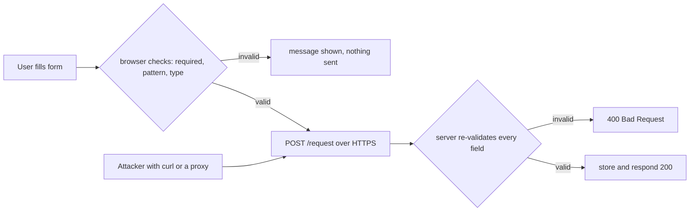
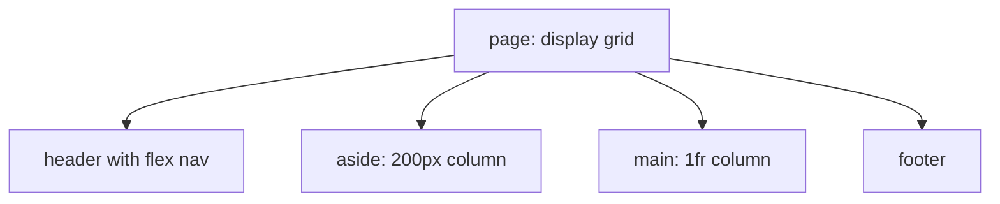

# Session 4: HTML Layout, Forms and Elements

> [Cybersecurity and Digital Forensics](../../README.md) › [Term 1](../README.md) › [Module 2: Client-Side Scripting with HTML5 & JavaScript](README.md) › **Session 4**

| ⏱ Estimated time | 📋 Prerequisites |
|---|---|
| 2.5 hours | Session 3 (CSS selectors and the box model) |

| ⬅ [Previous: Session 3](session-03-introduction-to-css3.md) | [Next: Session 5](session-05-tables-audio-and-video.md) ➡ |
|:---|---:|

---

## 🎯 Learning objectives

- Lay out a page with semantic regions and choose between **block**, **inline**, **positioning**, **Flexbox** and **Grid**.
- Use `position` (`static`, `relative`, `absolute`, `fixed`, `sticky`) and `z-index` correctly.
- Build accessible **forms** with `form`, `label`, `fieldset`, `legend` and the main `input` types.
- Apply HTML5 **built-in validation**: `required`, `minlength`, `maxlength`, `pattern`, `min`, `max`, `type="email"`.
- Explain `action`, `method="get"` vs `method="post"`, and hidden fields.
- Explain why **client-side validation is not security** and what the server must re-check.

## 📖 Concepts

### 1. Page layout regions

A typical page: `header` (logo, `nav`) → `main` (with `section`/`article`) beside an `aside` → `footer`. Semantic regions make layout CSS simpler and help assistive technology jump between areas.

### 2. Layout techniques

| Technique | Key properties | Best for |
|---|---|---|
| Normal flow | block vs inline | Simple documents |
| Positioning | `position`, `top/left`, `z-index` | Badges, overlays, sticky headers |
| **Flexbox** (1-D) | `display: flex; justify-content; align-items; gap; flex-wrap` | A row of nav links, toolbars, centring |
| **Grid** (2-D) | `display: grid; grid-template-columns; grid-template-areas; gap` | Whole page layouts, dashboards |
| Floats (old) | `float: left; clear: both` | Wrapping text round an image (legacy layouts) |

**Position values**

| Value | Behaviour |
|---|---|
| `static` | Default: normal flow |
| `relative` | Shifted from its normal spot; becomes a reference for absolute children |
| `absolute` | Removed from flow; placed relative to the nearest positioned ancestor |
| `fixed` | Stays put relative to the viewport while scrolling |
| `sticky` | Normal until a scroll threshold, then sticks (e.g. `top: 0`) |

`z-index` sets stacking order for positioned elements: higher is in front.

```css
nav ul { display: flex; gap: 1rem; justify-content: space-between; }
.layout { display: grid; grid-template-columns: 200px 1fr; gap: 1rem; }
@media (max-width: 600px) { .layout { grid-template-columns: 1fr; } }
```

### 3. The form element

```html
<form action="/request" method="post" autocomplete="off">
  ... controls ...
</form>
```

| Attribute | Meaning |
|---|---|
| `action` | URL that receives the data |
| `method="get"` | Data goes in the URL query string: visible, bookmarked, logged. Use for searches |
| `method="post"` | Data goes in the request body. Use for logins and changes (still needs HTTPS) |
| `enctype="multipart/form-data"` | Required for file uploads |
| `autocomplete` | Lets the browser fill or not fill values |
| `novalidate` | Turns off built-in validation (useful to test the server) |

Each control needs a `name`: that is the key sent to the server (`name=Ayesha&year=2`).

### 4. Labels and grouping

- `<label for="email">` connects to `<input id="email">`: clicking the label focuses the field and screen readers read it.
- `<fieldset>` groups related controls; `<legend>` names the group.

### 5. Input types and other controls

| Control | Use |
|---|---|
| `text`, `password`, `email`, `url`, `tel`, `search` | Text variants; mobile keyboards adapt |
| `number`, `range` | Numbers with `min`, `max`, `step` |
| `date`, `time`, `datetime-local`, `month`, `week` | Date pickers |
| `color`, `file` | Colour picker, file upload (`accept=".pdf"`, `multiple`) |
| `checkbox` | Independent on/off options |
| `radio` | One choice from a group sharing the same `name` |
| `hidden` | Value sent but not shown (still visible in source and editable!) |
| `submit`, `reset`, `button` | Buttons (`<button type="submit">` is preferred) |
| `<select>` + `<option>` / `<optgroup>` | Drop-down list (`multiple` allows several) |
| `<textarea rows cols>` | Multi-line text |
| `<datalist>` | Suggestions for a text input |
| `<output>`, `<progress>`, `<meter>` | Results, task progress, a gauge |

### 6. Built-in (constraint) validation

| Attribute | Example | Rule |
|---|---|---|
| `required` | `<input required>` | Must not be empty |
| `minlength` / `maxlength` | `minlength="12"` | Length limits |
| `pattern` | `pattern="[0-9]{5}"` | Must match a regular expression (whole value) |
| `min` / `max` / `step` | `min="1" max="4"` | Number/date range |
| `type="email"` / `"url"` | | Format check |
| `placeholder` | `placeholder="you@uni.edu.pk"` | A hint, **not** a label |

CSS can react with `:valid`, `:invalid`, `:required`, `:focus`.

### 7. Client-side validation is not security

Everything in the browser is under the user's control. An attacker can:

- remove `required` or `maxlength` in DevTools,
- change a `hidden` field (`price=1`, `role=admin`),
- skip the page completely and send the request with `curl` or a proxy such as Burp Suite.

So the **server must re-validate every field**, reject unknown fields, use allow-lists, and protect forms that change state with an **anti-CSRF token**. Passwords need `type="password"`, HTTPS, `autocomplete="new-password"` on sign-up, and server-side hashing.

## 🧭 Diagrams





## 💻 Worked examples

### Example 1 – A lab account request page

Grid for the page, Flexbox for the nav, two fieldsets, every main control type and built-in validation. Open it and press **Request access** with empty fields to see the browser's messages; invalid inputs get a red border via `input:invalid`.

📄 **`code/session-04_form.html`**

```html
<!DOCTYPE html>
<html lang="en">
<head>
  <meta charset="UTF-8">
  <title>Lab Account Request</title>
  <style>
    .layout { display: grid; grid-template-columns: 200px 1fr; gap: 1rem; }
    nav ul { display: flex; gap: 1rem; list-style: none; padding: 0; }
    input:invalid { border: 2px solid #c0392b; }
  </style>
</head>
<body>
  <header><h1>Cyber Lab</h1>
    <nav><ul><li><a href="#">Home</a></li><li><a href="#">Request access</a></li></ul></nav>
  </header>
  <div class="layout">
    <aside>Accounts are reviewed within 24 hours.</aside>
    <main>
      <form action="/request" method="post" autocomplete="off">
        <fieldset>
          <legend>Your details</legend>
          <label for="name">Full name</label>
          <input id="name" name="name" type="text" required minlength="3" maxlength="40">

          <label for="email">University email</label>
          <input id="email" name="email" type="email" required placeholder="you@uni.edu.pk">

          <label for="sid">Student ID</label>
          <input id="sid" name="sid" type="text" required pattern="[0-9]{5}" title="5 digits">

          <label for="pw">Password</label>
          <input id="pw" name="pw" type="password" required minlength="12" autocomplete="new-password">

          <label for="year">Year</label>
          <input id="year" name="year" type="number" min="1" max="4" value="1">
        </fieldset>
        <fieldset>
          <legend>Lab</legend>
          <label><input type="radio" name="lab" value="network" checked> Network lab</label>
          <label><input type="radio" name="lab" value="forensics"> Forensics lab</label>
          <label for="os">Preferred OS</label>
          <select id="os" name="os">
            <option>Kali Linux</option><option>Ubuntu</option><option>Windows</option>
          </select>
          <label for="why">Why do you need access?</label>
          <textarea id="why" name="why" rows="3" maxlength="200"></textarea>
          <label><input type="checkbox" name="aup" required> I accept the acceptable-use policy</label>
        </fieldset>
        <input type="hidden" name="csrf" value="token-from-server">
        <button type="submit">Request access</button> <button type="reset">Clear</button>
      </form>
    </main>
  </div>
  <footer>Cyber Lab, Karachi</footer>
</body>
</html>
```
### Example 2 – The server must check again

The same rules as the form, written as server-side validation. The third submission imitates an attacker who bypassed the page and sent the request directly, adding an extra `role=admin` field.

📄 **`code/session-04_validate.js`**

```javascript
// The same rules the form declares (required, minlength, pattern, type=email, min/max),
// re-checked on the server. Browser validation is for convenience; it is NOT security.
const rules = {
  name:  { required: true, minlength: 3, maxlength: 40 },
  email: { required: true, type: "email" },
  sid:   { required: true, pattern: /^[0-9]{5}$/ },
  pw:    { required: true, minlength: 12 },
  year:  { type: "number", min: 1, max: 4 },
  aup:   { required: true },
};

function validate(data) {
  const errors = [];
  for (const [field, r] of Object.entries(rules)) {
    const v = (data[field] ?? "").toString().trim();
    if (r.required && v === "") { errors.push(`${field}: required`); continue; }
    if (v === "") continue;
    if (r.minlength && v.length < r.minlength) errors.push(`${field}: at least ${r.minlength} characters`);
    if (r.maxlength && v.length > r.maxlength) errors.push(`${field}: at most ${r.maxlength} characters`);
    if (r.pattern && !r.pattern.test(v)) errors.push(`${field}: wrong format`);
    if (r.type === "email" && !/^[^\s@]+@[^\s@]+\.[^\s@]+$/.test(v)) errors.push(`${field}: not an email`);
    if (r.type === "number") {
      const n = Number(v);
      if (!Number.isInteger(n) || n < r.min || n > r.max) errors.push(`${field}: must be ${r.min}-${r.max}`);
    }
  }
  const unknown = Object.keys(data).filter(k => !(k in rules) && !["lab", "os", "why", "csrf"].includes(k));
  if (unknown.length) errors.push(`unexpected fields: ${unknown.join(", ")}`);
  return errors;
}

const submissions = {
  "good student": { name: "Ayesha Khan", email: "ayesha@uni.edu.pk", sid: "20431", pw: "correct-horse-battery", year: "2", aup: "on" },
  "empty form":   {},
  "bypassed UI (sent with curl)": { name: "x", email: "not-an-email", sid: "1' OR '1'='1", pw: "123", year: "9", aup: "on", role: "admin" },
};
for (const [label, data] of Object.entries(submissions)) {
  const e = validate(data);
  console.log(`${label}: ${e.length ? "REJECTED" : "ACCEPTED"}`);
  e.forEach(msg => console.log("   - " + msg));
}
```

**Output**

```text
good student: ACCEPTED
empty form: REJECTED
   - name: required
   - email: required
   - sid: required
   - pw: required
   - aup: required
bypassed UI (sent with curl): REJECTED
   - name: at least 3 characters
   - email: not an email
   - sid: wrong format
   - pw: at least 12 characters
   - year: must be 1-4
   - unexpected fields: role
```
The browser would have stopped most of these, but only the server's check counts. Also note `unexpected fields: role`: rejecting unknown fields blocks **mass assignment** attacks.

## 📊 GET vs POST

| | GET | POST |
|---|---|---|
| Where data goes | URL query string | Request body |
| Visible in history/logs | Yes | No (body not logged by default) |
| Bookmarkable | Yes | No |
| Size limit | Practical URL limits (~2–8 KB) | Large |
| Use for | Search, filters | Logins, uploads, changes |
| Encrypted by HTTPS | Yes (but still in server logs) | Yes |

## 🧪 Lab / practice tasks

1. **Easy –** Build a contact form with name, email, subject `<select>`, message `<textarea>` and a submit button. Every control must have a `<label>`.
2. **Easy –** Add `required`, `maxlength="500"` on the message and `type="email"` on email. Test the browser messages.
3. **Medium –** Lay out a dashboard with CSS Grid: header across the top, a 220px sidebar, main content, footer. Make it a single column below 700px.
4. **Medium –** In DevTools, delete `required` from a field in Example 1 and submit. What does this prove?
5. **Challenge –** Add a `phone` field to `session-04_validate.js` that accepts only `03XX-XXXXXXX`, and make the validator reject any value containing `<` or `>` in `why`.

<details>
<summary>💡 Hints</summary>

- Task 3: `grid-template-areas: "head head" "side main" "foot foot";`
- Task 4: it proves the browser check is optional for the user, so the server must check.
- Task 5: `pattern: /^03\d{2}-\d{7}$/`.
</details>

## ✅ Quick quiz

1. Which layout system is two-dimensional? a) Flexbox b) Grid c) Float d) Inline
2. An element with `position: absolute` is placed relative to: a) the viewport always b) its nearest positioned ancestor c) the next sibling d) the body only
3. Which method should a login form use? a) GET b) POST c) HEAD d) either is equally safe
4. Radio buttons in one group must share the same: a) `id` b) `value` c) `name` d) `class`
5. Why must the server validate input even if the form uses `required` and `pattern`? a) browsers are slow b) attackers can bypass the browser entirely c) HTML5 has no validation d) to save bandwidth

<details>
<summary>Show answers</summary>

1 – b · 2 – b · 3 – b · 4 – c · 5 – b
</details>

## 📝 Summary / cheat-sheet

- Layout: Flexbox for rows/columns of items, Grid for page areas, `position` for overlays and sticky bars.
- `form` with `action` + `method`; every control needs `name`; `label for` ↔ `input id`.
- Group with `fieldset` + `legend`; choose the right `type` for mobile keyboards and checks.
- Validation attributes: `required`, `minlength`, `maxlength`, `pattern`, `min`, `max`, `step`.
- GET for searches, POST for changes; always HTTPS.
- Hidden fields and browser checks are editable: re-validate, allow-list fields, use CSRF tokens on the server.

**Interview / viva questions**

1. When would you use Flexbox and when Grid?
2. Explain `relative`, `absolute`, `fixed` and `sticky`.
3. Why is a placeholder not a replacement for a label?
4. What is the difference between GET and POST, from a security view?
5. What is mass assignment, and how does rejecting unknown fields help?

---

| ⬅ [Previous: Session 3](session-03-introduction-to-css3.md) | [Next: Session 5](session-05-tables-audio-and-video.md) ➡ |
|:---|---:|

<sub>Prepared by **Hamna Zahid Khan**, Junior Lecturer · Cybersecurity and Digital Forensics</sub>
