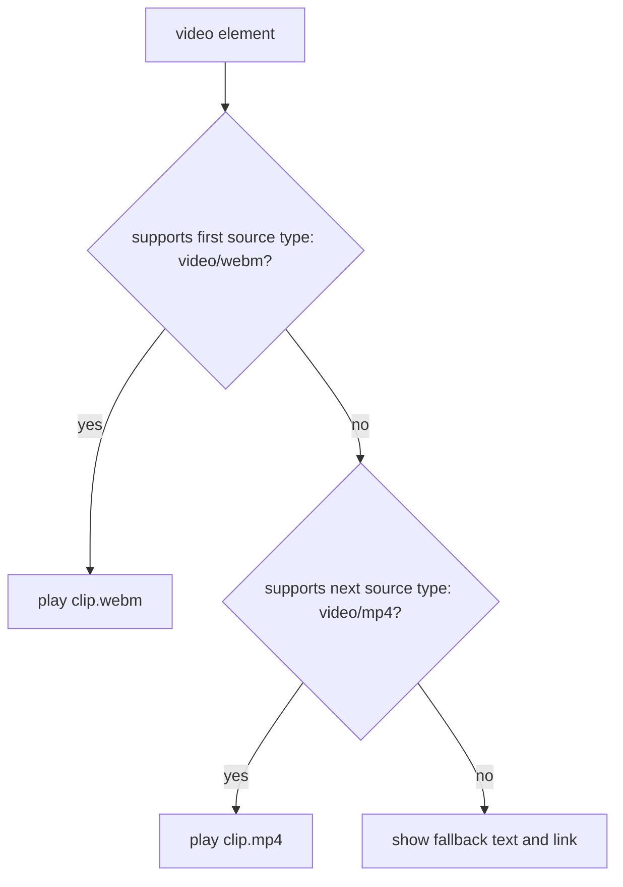
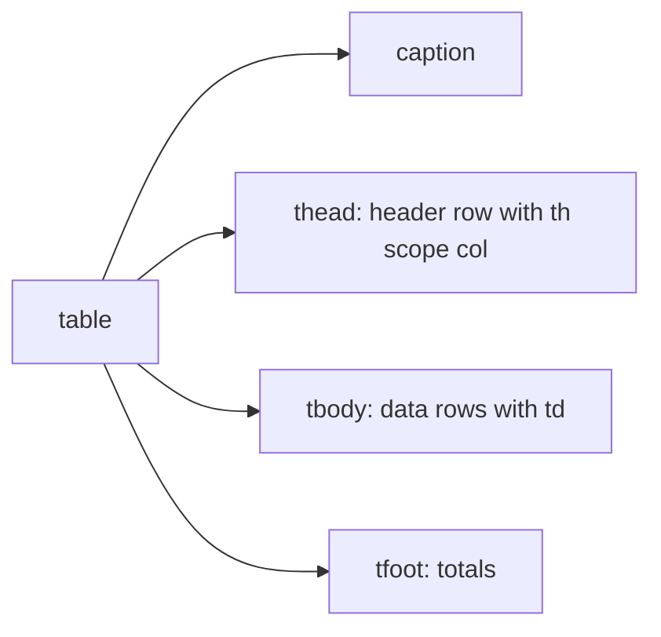

# Session 5: HTML5 Tables, Audio and Video

> [Cybersecurity and Digital Forensics](../../README.md) › [Term 1](../README.md) › [Module 2: Client-Side Scripting with HTML5 & JavaScript](README.md) › **Session 5**

| ⏱ Estimated time | 📋 Prerequisites |
|---|---|
| 2 hours | Sessions 2–4 (text, CSS and forms) |

| ⬅ [Previous: Session 4](session-04-layout-forms-and-elements.md) | [Next: Session 6](session-06-javascript-part-1.md) ➡ |
|:---|---:|

---

## 🎯 Learning objectives

- Build accessible **tables** with `caption`, `thead`, `tbody`, `tfoot`, `th scope`, `colspan` and `rowspan`.
- Style tables with CSS (`border-collapse`, zebra rows) and know when **not** to use tables.
- Generate a table from data safely by **escaping** values (XSS prevention).
- Add **audio** and **video** with `<audio>`, `<video>`, `<source>` and `<track>`, including fallbacks and captions.
- Explain media **formats** and **codecs** and how a browser picks a `<source>`.
- Embed external content with `<iframe>` safely using `sandbox`, `title` and `referrerpolicy`.

## 📖 Concepts

### 1. Table structure

| Element | Role |
|---|---|
| `<table>` | The whole table |
| `<caption>` | Title of the table (first child) – read aloud by screen readers |
| `<thead>`, `<tbody>`, `<tfoot>` | Header rows, data rows, summary rows |
| `<tr>` | Table row |
| `<th>` | Header cell; `scope="col"` or `scope="row"` says what it labels |
| `<td>` | Data cell |
| `<colgroup>` / `<col>` | Style whole columns (width, background) |

**Spanning cells**

- `colspan="2"`: a cell stretches across two columns.
- `rowspan="2"`: a cell stretches down two rows; the next row then has one fewer cell.

```html
<tr><td rowspan="2">Monday</td><td>Phishing</td><td>Medium</td></tr>
<tr><td>USB stick</td><td>Low</td></tr>   <!-- only 2 cells: Monday spans down -->
```

### 2. Styling tables

```css
table { border-collapse: collapse; width: 100%; }   /* single lines between cells */
th, td { border: 1px solid #999; padding: 6px 10px; text-align: left; }
tbody tr:nth-child(even) { background: #f2f2f2; } /* zebra striping */
```

Old attributes such as `border="1"`, `cellpadding` and `bgcolor` are obsolete in HTML5: use CSS.

### 3. When to use a table

Use tables for **tabular data**: logs, port lists, timetables, results. **Do not** use tables for page layout (the 1990s technique) – it confuses screen readers and is hard to make responsive. Use CSS Grid/Flexbox for layout.

### 4. Generating tables from data, safely

Dashboards often build HTML tables from data (log entries, user names). If a value contains HTML and is inserted unescaped, the browser runs it: **stored or reflected XSS**. Always:

- escape `& < > " '` when building HTML strings, or
- in the browser, set `cell.textContent = value` instead of `innerHTML`.

### 5. HTML5 audio and video

Before HTML5, media needed plugins such as Flash (now removed from all browsers). HTML5 made media native.

```html
<video controls width="480" poster="poster.jpg" preload="metadata">
  <source src="clip.webm" type="video/webm">
  <source src="clip.mp4"  type="video/mp4">
  <track src="clip.en.vtt" kind="captions" srclang="en" label="English">
  Fallback text and a download link.
</video>
```

| Attribute | Effect |
|---|---|
| `controls` | Show play/pause/volume UI |
| `autoplay` | Start automatically (browsers block it unless also `muted`) |
| `muted` | Start without sound |
| `loop` | Repeat |
| `poster` | Image before playback (video only) |
| `preload` | `none`, `metadata` or `auto` – how much to load in advance |
| `width` / `height` | Display size (video) |
| `playsinline` | Play inside the page on phones |

**How the browser chooses:** it reads `<source>` elements in order and plays the **first** whose `type` it supports. If none match, it shows the fallback content.

### 6. Formats and codecs

| Container | Typical codecs | Notes |
|---|---|---|
| MP4 (`video/mp4`) | H.264 video, AAC audio | Plays almost everywhere |
| WebM (`video/webm`) | VP9 / AV1 video, Opus audio | Open, royalty-free, smaller |
| Ogg (`audio/ogg`) | Vorbis / Opus | Open audio format |
| MP3 (`audio/mpeg`) | MP3 | Universal audio |
| WAV (`audio/wav`) | PCM | Uncompressed, large |

### 7. Captions and accessibility

`<track>` adds timed text in **WebVTT** (`.vtt`) format. `kind` can be `captions`, `subtitles`, `descriptions` or `chapters`.

```text
WEBVTT

00:00:01.000 --> 00:00:04.000
Never click links in unexpected emails.
```

Captions help deaf users, people in noisy labs and non-native speakers, and make videos searchable.

### 8. Media and embedding security

- **`<iframe>`** loads another page inside yours. Add `sandbox` (blocks scripts, forms, pop-ups and top navigation unless you allow them, e.g. `sandbox="allow-scripts"`), a `title`, `loading="lazy"` and `referrerpolicy="no-referrer"`.
- Never combine `allow-scripts` and `allow-same-origin` for untrusted content: the frame could remove its own sandbox.
- **Autoplay** with sound is blocked by browsers; malicious ads used it for scareware.
- **Uploaded media** must be checked on the server: file type by content, not just extension; size limits; store outside the web root.
- Media **metadata** (EXIF in photos, creation dates, GPS) can leak information – a forensics source and a privacy risk.

## 🧭 Diagrams





## 💻 Worked examples

### Example 1 – An incident table plus video, audio and a sandboxed iframe

The table uses `caption`, `colgroup`, `thead`/`tbody`/`tfoot`, `scope`, `rowspan` and `colspan`. The media elements offer two formats each, captions and fallback text. (The media files are placeholders; add your own `.mp4`/`.webm` to play them.)

📄 **`code/session-05_media.html`**

```html
<!DOCTYPE html>
<html lang="en">
<head>
  <meta charset="UTF-8">
  <title>Incident Log and Training Media</title>
  <style>
    table { border-collapse: collapse; width: 100%; }
    th, td { border: 1px solid #999; padding: 6px 10px; text-align: left; }
    thead { background: #223; color: #fff; }
    tbody tr:nth-child(even) { background: #f2f2f2; }
  </style>
</head>
<body>
  <table>
    <caption>Incidents reported this week</caption>
    <colgroup><col style="width: 15%"><col><col style="width: 15%"></colgroup>
    <thead>
      <tr><th scope="col">Day</th><th scope="col">Incident</th><th scope="col">Severity</th></tr>
    </thead>
    <tbody>
      <tr><td rowspan="2">Monday</td><td>Phishing email reported</td><td>Medium</td></tr>
      <tr><td>USB stick found in lab</td><td>Low</td></tr>
      <tr><td>Tuesday</td><td colspan="2">No incidents</td></tr>
    </tbody>
    <tfoot>
      <tr><th scope="row">Total</th><td colspan="2">2 incidents</td></tr>
    </tfoot>
  </table>

  <h2>Training video</h2>
  <video controls width="480" poster="phishing-poster.jpg" preload="metadata">
    <source src="phishing-awareness.webm" type="video/webm">
    <source src="phishing-awareness.mp4" type="video/mp4">
    <track src="phishing-awareness.en.vtt" kind="captions" srclang="en" label="English">
    Your browser does not support HTML5 video. <a href="phishing-awareness.mp4">Download it</a>.
  </video>

  <h2>Podcast</h2>
  <audio controls>
    <source src="episode-12.ogg" type="audio/ogg">
    <source src="episode-12.mp3" type="audio/mpeg">
    Your browser does not support HTML5 audio.
  </audio>

  <h2>Embedded map (sandboxed)</h2>
  <iframe src="https://example.com/map" width="400" height="200" title="Campus map"
          sandbox="allow-scripts" loading="lazy" referrerpolicy="no-referrer"></iframe>
</body>
</html>
```
### Example 2 – Building a table from data, unsafely and safely

A dashboard builds a table of login attempts. One "username" is actually an XSS payload. The script shows the dangerous row, the escaped table, a summary value, and how a browser chooses between media sources.

📄 **`code/session-05_table.js`**

```javascript
// Build an HTML table from data. Escape every value, or a "name" becomes a script (XSS).
const escapeHtml = s => String(s).replace(/[&<>"']/g, c =>
  ({ "&": "&amp;", "<": "&lt;", ">": "&gt;", '"': "&quot;", "'": "&#39;" }[c]));

const logins = [
  { user: "ayesha", ip: "10.0.0.15", status: "success" },
  { user: "bilal", ip: "10.0.0.22", status: "failed" },
  { user: "", ip: "203.0.113.9", status: "failed" },
];

function toTable(rows, safe) {
  const cell = v => (safe ? escapeHtml(v) : v);
  const cols = Object.keys(rows[0]);
  const head = "  <thead><tr>" + cols.map(c => `<th scope="col">${c}</th>`).join("") + "</tr></thead>";
  const body = rows.map(r => "    <tr>" + cols.map(c => `<td>${cell(r[c])}</td>`).join("") + "</tr>").join("\n");
  return `<table>\n  <caption>Login attempts</caption>\n${head}\n  <tbody>\n${body}\n  </tbody>\n</table>`;
}

console.log("UNSAFE (string concatenation):");
console.log(toTable(logins, false).split("\n").slice(-3, -2)[0]);
console.log("\nSAFE (escaped):");
console.log(toTable(logins, true));

const failed = logins.filter(r => r.status === "failed").length;
console.log(`\nSummary row: ${failed} of ${logins.length} attempts failed`);

// Choosing media formats: which <source> would a browser pick?
const sources = [{ src: "talk.webm", type: "video/webm" }, { src: "talk.mp4", type: "video/mp4" }];
for (const supported of [["video/mp4"], ["video/webm", "video/mp4"], []]) {
  const pick = sources.find(s => supported.includes(s.type));
  console.log(`browser supports [${supported.join(", ")}] -> ${pick ? pick.src : "fallback text shown"}`);
}
```

**Output**

```text
UNSAFE (string concatenation):
    <tr><td></td><td>203.0.113.9</td><td>failed</td></tr>

SAFE (escaped):
<table>
  <caption>Login attempts</caption>
  <thead><tr><th scope="col">user</th><th scope="col">ip</th><th scope="col">status</th></tr></thead>
  <tbody>
    <tr><td>ayesha</td><td>10.0.0.15</td><td>success</td></tr>
    <tr><td>bilal</td><td>10.0.0.22</td><td>failed</td></tr>
    <tr><td>&lt;img src=x onerror=alert(1)&gt;</td><td>203.0.113.9</td><td>failed</td></tr>
  </tbody>
</table>

Summary row: 2 of 3 attempts failed
browser supports [video/mp4] -> talk.mp4
browser supports [video/webm, video/mp4] -> talk.webm
browser supports [] -> fallback text shown
```
In a browser, the unsafe row would create an `` whose `onerror` runs JavaScript. The escaped version displays the text harmlessly.

## 📊 Table attributes then and now

| Old attribute | HTML5 / CSS replacement |
|---|---|
| `border="1"` | `border: 1px solid` |
| `cellpadding="6"` | `padding: 6px` on `td, th` |
| `cellspacing="0"` | `border-collapse: collapse` |
| `align="center"` | `margin: auto` or `text-align` |
| `bgcolor="#eee"` | `background: #eee` |
| `width="100%"` | `width: 100%` in CSS |

## 🧪 Lab / practice tasks

1. **Easy –** Make a weekly lab timetable table (days × time slots) with a `caption` and `th scope` on headers.
2. **Easy –** Style it with `border-collapse`, padding and zebra rows.
3. **Medium –** Add a lunch break that spans all days with `rowspan` or `colspan`, and a `tfoot` with total lab hours.
4. **Medium –** Add a `<video>` with WebM and MP4 sources, a poster and a `.vtt` caption file you write yourself (three cues).
5. **Challenge –** Change `session-05_table.js` to read the login records from a JSON file and add a `<tfoot>` row with the count of failed attempts, still escaping every value.

<details>
<summary>💡 Hints</summary>

- Task 3: if Monday–Friday are columns, the lunch row is one `<td colspan="5">`.
- Task 4: the VTT file must start with the line `WEBVTT`.
- Task 5: `JSON.parse(fs.readFileSync("logins.json", "utf8"))`.
</details>

## ✅ Quick quiz

1. Which element gives a table an accessible title? a) `<title>` b) `<th>` c) `<caption>` d) `<thead>`
2. A cell that stretches across three columns uses: a) `rowspan="3"` b) `colspan="3"` c) `span="3"` d) `cols="3"`
3. With several `<source>` elements, the browser plays: a) the last one b) the largest c) the first supported one d) all of them
4. `<track kind="captions">` files use which format? a) SRT only b) WebVTT c) JSON d) XML
5. Which attribute restricts what an embedded page in an `<iframe>` can do? a) `secure` b) `sandbox` c) `restrict` d) `allow-none`

<details>
<summary>Show answers</summary>

1 – c · 2 – b · 3 – c · 4 – b · 5 – b
</details>

## 📝 Summary / cheat-sheet

- Table = `caption` + `thead`/`tbody`/`tfoot` + `tr` + `th scope` / `td`; span with `colspan`/`rowspan`.
- Style with CSS (`border-collapse`, `padding`, `nth-child`), not old attributes; never use tables for layout.
- Escape data before inserting into HTML, or use `textContent`.
- `<video>`/`<audio>` with `controls`, multiple `<source type>`, fallback text, `<track>` captions.
- MP4/H.264 is the most compatible; WebM is open and efficient.
- `<iframe sandbox title referrerpolicy loading="lazy">` for third-party content; validate uploaded media on the server.

**Interview / viva questions**

1. Why should tables not be used for page layout?
2. What do `scope="col"` and `scope="row"` do?
3. How does the browser decide which video source to play?
4. What is the purpose of the `sandbox` attribute on an iframe?
5. How could a table on an admin dashboard become an XSS vector?

---

| ⬅ [Previous: Session 4](session-04-layout-forms-and-elements.md) | [Next: Session 6](session-06-javascript-part-1.md) ➡ |
|:---|---:|

<sub>Prepared by **Hamna Zahid Khan**, Junior Lecturer · Cybersecurity and Digital Forensics</sub>
