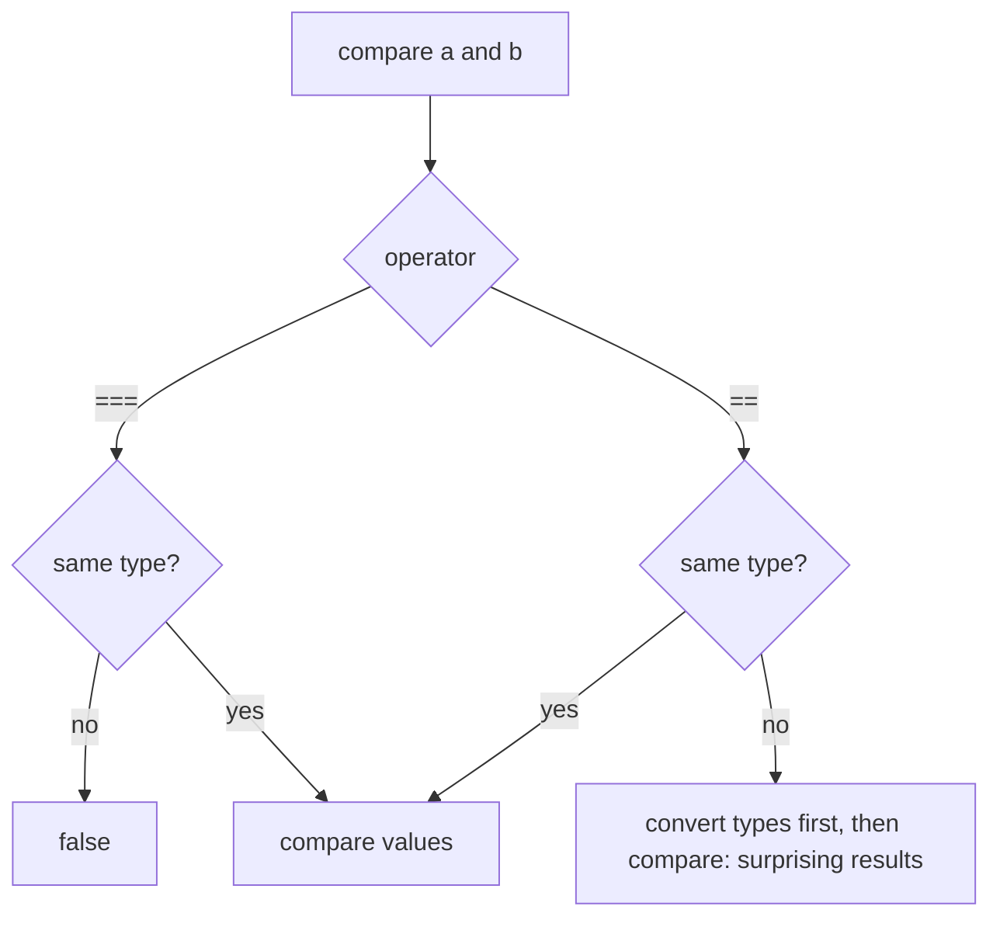
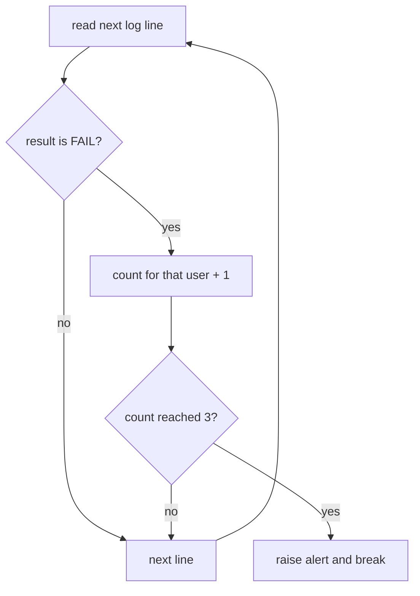

# Session 6: JavaScript I: Language Basics

> [Cybersecurity and Digital Forensics](../../README.md) › [Term 1](../README.md) › [Module 2: Client-Side Scripting with HTML5 & JavaScript](README.md) › **Session 6**

| ⏱ Estimated time | 📋 Prerequisites |
|---|---|
| 2.5 hours | Sessions 1–5; Module 1 (C conditions and loops) helps |

| ⬅ [Previous: Session 5](session-05-tables-audio-and-video.md) | [Next: Session 7](session-07-javascript-part-2.md) ➡ |
|:---|---:|

---

## 🎯 Learning objectives

- Explain what **JavaScript** is, where it runs (browser and **Node.js**) and how to add it to a page.
- Declare variables with `let` and `const` (and know why `var` is avoided).
- Identify JavaScript's **data types** and use `typeof`.
- Use arithmetic, comparison, logical and assignment **operators**, and explain **type coercion**, `==` vs `===`, truthy/falsy, `||` vs `??`.
- Write **decisions** (`if`, `else if`, `switch`, ternary) and **loops** (`for`, `while`, `do...while`, `for...of`, `for...in`) with `break`/`continue`.
- Apply these basics to small security tasks such as counting failed logins.

## 📖 Concepts

### 1. What is JavaScript?

- Created by **Brendan Eich** at Netscape in **1995** (in about 10 days); standardised as **ECMAScript** by Ecma International (ECMA-262). Despite the name, it is unrelated to Java.
- **Interpreted / JIT-compiled**, **dynamically typed** (a variable can hold any type), runs in every browser and on servers via **Node.js** (V8 engine).
- In security: browser exploits, XSS payloads, malicious browser extensions and many tools (and lots of malware droppers) are JavaScript, so testers must read it fluently.

### 2. Adding JavaScript to a page

```html
<script>console.log("inline script");</script>      <!-- internal -->
<script src="app.js" defer></script>                  <!-- external: preferred -->
<button onclick="alert('hi')">Old style</button>      <!-- inline handler: avoid -->
```

- `defer` runs the script after the HTML is parsed (in order); `async` runs it as soon as it downloads.
- Inline handlers and inline scripts are blocked by a strict **Content Security Policy**, which is a strong XSS defence. Prefer external files and `addEventListener`.

**Output and debugging:** `console.log()` (DevTools Console), `alert()`, `document.getElementById("x").textContent = ...`. Run plain `.js` files with `node file.js`.

### 3. Variables

| Keyword | Scope | Reassign? | Notes |
|---|---|---|---|
| `const` | Block `{}` | No | Default choice. The binding is constant; an object it points to can still change |
| `let` | Block `{}` | Yes | For counters and values that change |
| `var` | Function | Yes | Old; hoisted and leaks out of blocks – avoid |

Names: letters, digits, `_`, `$`; cannot start with a digit; case-sensitive; use `camelCase` (`failedCount`).

### 4. Data types

| Type | Example | `typeof` |
|---|---|---|
| Number (64-bit float) | `42`, `3.14`, `NaN`, `Infinity` | `"number"` |
| BigInt | `10n` | `"bigint"` |
| String | `"ssh"`, `'x'`, `` `hi ${name}` `` | `"string"` |
| Boolean | `true`, `false` | `"boolean"` |
| Undefined | declared, no value | `"undefined"` |
| Null | intentionally empty | `"object"` (a famous historical bug) |
| Symbol | `Symbol("id")` | `"symbol"` |
| Object (incl. arrays, functions) | `{port: 22}`, `[1,2]` | `"object"` / `"function"` |

The first seven are **primitives** (copied by value); objects are copied **by reference**.

### 5. Operators

| Kind | Operators |
|---|---|
| Arithmetic | `+ - * / % **`, `++ --` |
| Assignment | `= += -= *= /= %= **=`, `??= \|\|= &&=` |
| Comparison | `== != === !== < > <= >=` |
| Logical | `&&` and, `\|\|` or, `!` not, nullish `??` |
| String | `+` concatenation, template literals `` `${x}` `` |
| Ternary | `cond ? a : b` |
| Type | `typeof`, `instanceof` |
| Bitwise | `&` `\|` `^` `~` `<<` `>>` `>>>` (32-bit integers) |

### 6. Type coercion: where bugs (and bypasses) hide

- `"5" + 3` → `"53"` (`+` with a string concatenates); `"5" - 3` → `2` (other maths converts to number).
- `==` converts types before comparing (`0 == ""` is `true`); **`===` compares type and value**. Always use `===` – loose comparison has caused real authentication bypasses.
- **Falsy values:** `false`, `0`, `-0`, `0n`, `""`, `null`, `undefined`, `NaN`. Everything else is truthy, including `"0"`, `"false"` and `[]`.
- `a || b` returns `b` when `a` is any falsy value; `a ?? b` only when `a` is `null` or `undefined` – important when `0` or `""` are valid.
- Floating point: `0.1 + 0.2 !== 0.3`. Compare with a tolerance or use integers (cents, milliseconds).

### 7. Decisions

```js
if (fails >= 5) { lock(); }
else if (fails >= 3) { captcha(); }
else { allow(); }

const label = fails > 0 ? "suspicious" : "clean";   // ternary

switch (method) {          // uses === matching
  case "GET": case "HEAD": readOnly(); break;
  case "POST": write(); break;
  default: reject();
}
```

### 8. Loops

| Loop | Use when | Example |
|---|---|---|
| `for` | Known count / index needed | `for (let i = 0; i < n; i++)` |
| `while` | Repeat while a condition holds | `while (queue.length)` |
| `do...while` | Body must run at least once | menus, retry prompts |
| `for...of` | Values of an array/string/Map | `for (const line of log)` |
| `for...in` | Keys of an object | `for (const key in config)` |

`break` exits the loop; `continue` skips to the next iteration. Watch out for infinite loops – in a browser they freeze the tab.

## 🧭 Diagrams





## 💻 Worked examples

### Example 1 – Types, operators and coercion

Run with `node session-06_basics.js`. Every surprising result here has caused a real bug somewhere.

📄 **`code/session-06_basics.js`**

```javascript
// JavaScript I: variables, types, operators and type coercion.
const course = "Cyber Lab";      // cannot be reassigned
let attempts = 0;                // can change
attempts += 1;

const values = [42, 3.14, "42", true, null, undefined, { port: 22 }, [1, 2], () => 1, 10n];
console.log("typeof each value:");
for (const v of values) console.log(`  ${String(typeof v === "bigint" ? v + "n" : JSON.stringify(v) ?? v).padEnd(12)} -> ${typeof v}`);

console.log("\nArithmetic and strings:");
console.log("  7 / 2      =", 7 / 2);
console.log("  7 % 2      =", 7 % 2);
console.log("  2 ** 10    =", 2 ** 10);
console.log('  "5" + 3    =', "5" + 3, " (string concatenation)");
console.log('  "5" - 3    =', "5" - 3, "   (numeric conversion)");
console.log("  0.1 + 0.2  =", 0.1 + 0.2);
console.log('  Number("x")=', Number("x"));

console.log("\nLoose == vs strict ===:");
const show = v => (typeof v === "string" ? `"${v}"` : String(v));
for (const [a, b] of [[0, "0"], [0, ""], [null, undefined], ["1", 1], [NaN, NaN]]) {
  console.log(`  ${(show(a) + " == " + show(b)).padEnd(20)} -> ${String(a == b).padEnd(5)}  === -> ${a === b}`);
}

console.log("\nTruthy / falsy:");
for (const v of [0, "", "0", [], null, "false", NaN]) console.log(`  ${(Array.isArray(v) ? "[]" : show(v)).padEnd(8)} is ${v ? "truthy" : "falsy"}`);

console.log("\nLogical operators:");
const username = "";
console.log("  username || 'guest'  ->", username || "guest");
console.log("  username ?? 'guest'  ->", JSON.stringify(username ?? "guest"), "(?? only replaces null/undefined)");
console.log(`  Template literal     -> Welcome to ${course}, attempt ${attempts}`);
```

**Output**

```text
typeof each value:
  42           -> number
  3.14         -> number
  "42"         -> string
  true         -> boolean
  null         -> object
  undefined    -> undefined
  {"port":22}  -> object
  [1,2]        -> object
  () => 1      -> function
  10n          -> bigint

Arithmetic and strings:
  7 / 2      = 3.5
  7 % 2      = 1
  2 ** 10    = 1024
  "5" + 3    = 53  (string concatenation)
  "5" - 3    = 2    (numeric conversion)
  0.1 + 0.2  = 0.30000000000000004
  Number("x")= NaN

Loose == vs strict ===:
  0 == "0"             -> true   === -> false
  0 == ""              -> true   === -> false
  null == undefined    -> true   === -> false
  "1" == 1             -> true   === -> false
  NaN == NaN           -> false  === -> false

Truthy / falsy:
  0        is falsy
  ""       is falsy
  "0"      is truthy
  []       is truthy
  null     is falsy
  "false"  is truthy
  NaN      is falsy

Logical operators:
  username || 'guest'  -> guest
  username ?? 'guest'  -> "" (?? only replaces null/undefined)
  Template literal     -> Welcome to Cyber Lab, attempt 1
```
### Example 2 – Decisions and loops on a login log

A small log of logins is processed with `for...of`, `switch`, `while` + `break`, `for` + `continue` and `do...while`. This is the same logic a basic intrusion detection rule uses.

📄 **`code/session-06_control.js`**

```javascript
// JavaScript I: decisions and loops on a small login log.
const log = [
  "08:01 ayesha OK", "08:03 bilal FAIL", "08:03 bilal FAIL", "08:04 bilal FAIL",
  "08:05 bilal FAIL", "08:09 sara OK", "08:10 root FAIL", "08:11 bilal FAIL",
];

// for...of + if/else: count failures per user
const fails = {};
for (const line of log) {
  const [time, user, result] = line.split(" ");
  if (result === "FAIL") fails[user] = (fails[user] || 0) + 1;
}
console.log("Failures per user:", fails);

// switch: classify severity
function severity(count) {
  switch (true) {
    case count >= 5: return "HIGH - lock the account";
    case count >= 3: return "MEDIUM - require CAPTCHA";
    default:         return "LOW";
  }
}
for (const [user, n] of Object.entries(fails)) console.log(`  ${user.padEnd(6)} ${n} -> ${severity(n)}`);

// while + break: stop at the first moment any user reaches 3 failures
let i = 0;
const running = {};
while (i < log.length) {
  const [time, user, result] = log[i].split(" ");
  if (result === "FAIL") {
    running[user] = (running[user] || 0) + 1;
    if (running[user] === 3) {
      console.log(`\nAlert at ${time}: ${user} reached 3 failures (line ${i + 1})`);
      break;
    }
  }
  i++;
}

// classic for + continue: print only successful logins
console.log("\nSuccessful logins:");
for (let j = 0; j < log.length; j++) {
  if (!log[j].endsWith("OK")) continue;
  console.log("  " + log[j]);
}

// do...while: password strength loop over candidate passwords
const candidates = ["12345", "password1", "Lab#2026-secure"];
let k = 0, pw;
do {
  pw = candidates[k++];
  const strong = pw.length >= 12 && /[A-Z]/.test(pw) && /[0-9]/.test(pw) && /[^A-Za-z0-9]/.test(pw);
  console.log(`\nTry "${pw}": ${strong ? "strong, accepted" : "weak, try again"}`);
  if (strong) break;
} while (k < candidates.length);
```

**Output**

```text
Failures per user: { bilal: 5, root: 1 }
  bilal  5 -> HIGH - lock the account
  root   1 -> LOW

Alert at 08:04: bilal reached 3 failures (line 4)

Successful logins:
  08:01 ayesha OK
  08:09 sara OK

Try "12345": weak, try again

Try "password1": weak, try again

Try "Lab#2026-secure": strong, accepted
```
## 📊 C vs JavaScript at a glance

| | C (Module 1) | JavaScript |
|---|---|---|
| Typing | Static (`int x`) | Dynamic (`let x`) |
| Runs | Compiled to machine code | Interpreted/JIT in a browser or Node.js |
| Memory | Manual (`malloc`/`free`) | Garbage collected |
| Strings | `char[]` + `'\0'` | Built-in immutable `String` |
| Equality | `==` | Use `===` |
| Typical bugs | Buffer overflow, use-after-free | Type coercion, XSS, prototype pollution |

## 🧪 Lab / practice tasks

1. **Easy –** Predict, then check in Node: `"10" + 1`, `"10" - 1`, `true + 1`, `[] == false`, `null ?? 5`, `0 || 5`, `0 ?? 5`.
2. **Easy –** Write a script that prints the multiplication table of 7 using a `for` loop.
3. **Medium –** Given `const ports = [21, 22, 23, 80, 443, 3389];`, print each with a label using `switch`: 21 FTP, 22 SSH, 23 Telnet (insecure!), 80 HTTP, 443 HTTPS, default "other".
4. **Medium –** Write a password checker that reports which rules a password fails: length ≥ 12, an uppercase letter, a digit, a symbol.
5. **Challenge –** Extend `session-06_control.js` to detect when one user fails 3 times **within 2 minutes** (use the `HH:MM` times) instead of in total.

<details>
<summary>💡 Hints</summary>

- Task 1: `"11"`, `9`, `2`, `true`, `5`, `5`, `0`.
- Task 4: use `/[A-Z]/.test(pw)`, `/\d/`, `/[^A-Za-z0-9]/`.
- Task 5: convert `"08:03"` to minutes with `h * 60 + m`; keep an array of recent failure times per user.
</details>

## ✅ Quick quiz

1. Which keyword should you use by default for a variable that never gets reassigned? a) `var` b) `let` c) `const` d) `static`
2. `typeof null` returns: a) `"null"` b) `"undefined"` c) `"object"` d) `"number"`
3. `"7" + 3` evaluates to: a) `10` b) `"73"` c) `NaN` d) error
4. Which is truthy? a) `0` b) `""` c) `"0"` d) `null`
5. `0 ?? 100` evaluates to: a) `100` b) `0` c) `null` d) `true`

<details>
<summary>Show answers</summary>

1 – c · 2 – c · 3 – b · 4 – c · 5 – b
</details>

## 📝 Summary / cheat-sheet

- JavaScript = ECMAScript; runs in browsers and Node.js; add with `<script src defer>`.
- `const` by default, `let` when it changes, avoid `var`.
- Types: number, bigint, string, boolean, undefined, null, symbol, object; check with `typeof`.
- `+` with a string concatenates; always use `===`; know the falsy list; `??` keeps `0` and `""`.
- Decisions: `if/else if/else`, `switch` + `break`, ternary.
- Loops: `for`, `while`, `do...while`, `for...of` (values), `for...in` (keys); `break` / `continue`.

**Interview / viva questions**

1. What is the difference between JavaScript and ECMAScript?
2. Compare `var`, `let` and `const`.
3. Why is `==` dangerous? Give an example.
4. What is the difference between `||` and `??`?
5. Why do strict Content Security Policies block inline scripts?

---

| ⬅ [Previous: Session 5](session-05-tables-audio-and-video.md) | [Next: Session 7](session-07-javascript-part-2.md) ➡ |
|:---|---:|

<sub>Prepared by **Hamna Zahid Khan**, Junior Lecturer · Cybersecurity and Digital Forensics</sub>
