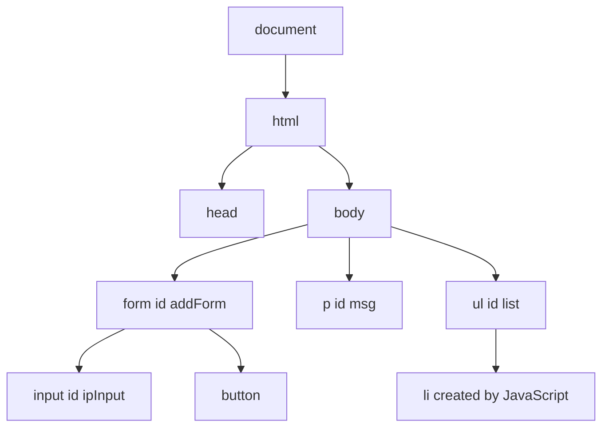
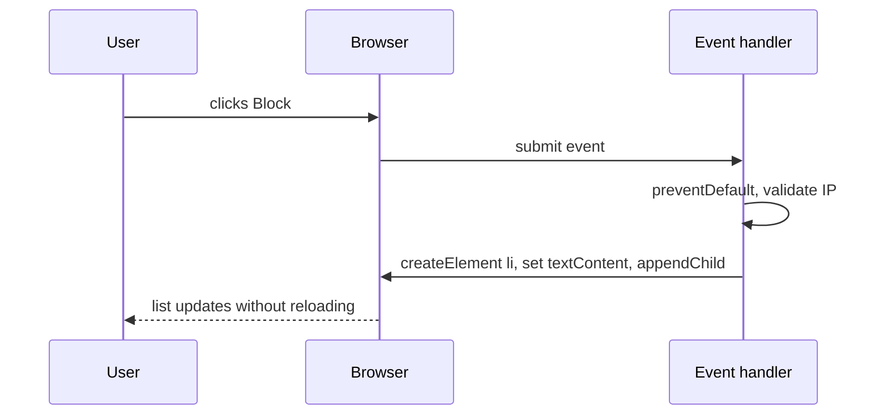
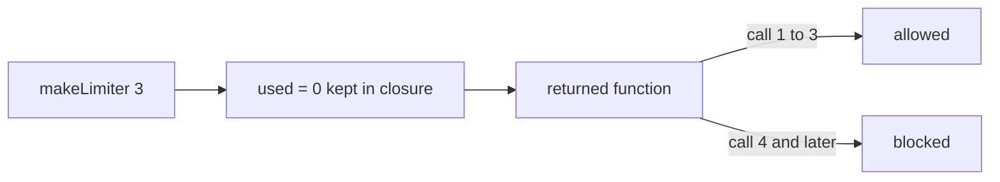

# Session 7: JavaScript II: Functions, Objects, DOM and JSON

> [Cybersecurity and Digital Forensics](../../README.md) › [Term 1](../README.md) › [Module 2: Client-Side Scripting with HTML5 & JavaScript](README.md) › **Session 7**

| ⏱ Estimated time | 📋 Prerequisites |
|---|---|
| 3 hours | Session 6 (JavaScript basics) |

| ⬅ [Previous: Session 6](session-06-javascript-part-1.md) | [Next: Session 8](session-08-ecmascript-2022.md) ➡ |
|:---|---:|

---

## 🎯 Learning objectives

- Define functions as **declarations**, **expressions** and **arrow functions**; use default and rest parameters.
- Explain **scope**, **hoisting** and **closures**, and use a closure to keep private state.
- Create and use **objects** (properties, methods, `this`, destructuring, spread) and **arrays** with `map`, `filter`, `reduce`, `find`, `sort`.
- Explain the **DOM** tree and select, create, change and remove elements.
- Handle **events** with `addEventListener`, including `preventDefault`.
- Convert data with **JSON** (`stringify`, `parse`) and parse untrusted JSON safely.
- Choose `textContent` over `innerHTML` to avoid DOM-based XSS.

## 📖 Concepts

### 1. Functions

```js
function add(a, b) { return a + b; }        // declaration: hoisted, usable before this line
const mul = function (a, b) { return a * b; };  // expression
const sq = x => x * x;                       // arrow: short; no own `this`
function scan(host, port = 80, ...extra) {}  // default and rest parameters
```

- Functions are **first-class values**: store them in variables, pass them as arguments (**callbacks**), return them.
- A function without `return` returns `undefined`.

### 2. Scope, hoisting and closures

- **Global scope**, **function scope** and **block scope** (`let`/`const` inside `{}`).
- **Hoisting:** function declarations and `var` names are moved to the top of their scope; `let`/`const` exist in a "temporal dead zone" until their line runs.
- **Closure:** an inner function remembers the variables of the function that created it, even after that function returned. Used for private state, counters, rate limiters and module patterns.

### 3. Objects

```js
const device = {
  hostname: "lab-ws-07",
  "open ports": [22, 80],            // quotes for unusual keys
  describe() { return this.hostname; }
};
device.ip = "192.168.56.107";        // add
device["open ports"].push(443);      // bracket notation
delete device.ip;                    // remove
const { hostname } = device;          // destructuring
const copy = { ...device, os: "Linux" }; // spread (shallow copy)
Object.keys(device); Object.entries(device);
```

`this` inside a method refers to the object the method was called on. Arrow functions do **not** have their own `this`, so avoid arrows for object methods.

### 4. Arrays and higher-order methods

| Method | Returns | Example |
|---|---|---|
| `push`/`pop`, `shift`/`unshift` | changes array | add/remove at end/start |
| `map(fn)` | new array of results | `alerts.map(a => a.id)` |
| `filter(fn)` | new array of matches | `alerts.filter(a => a.sev >= 7)` |
| `reduce(fn, init)` | single value | sum, count, group |
| `find(fn)` / `findIndex(fn)` | first match / its index | first alert from an IP |
| `some` / `every` | boolean | any critical? all patched? |
| `sort(cmp)` | sorts **in place** | `(a, b) => b.sev - a.sev` |
| `includes`, `indexOf`, `join`, `slice`, `splice` | various | |

`sort()` without a compare function sorts as **strings**: `[10, 9, 1].sort()` → `[1, 10, 9]`.

### 5. The DOM (Document Object Model)

The browser turns HTML into a **tree of objects**. JavaScript reads and changes that tree; the page updates.

| Task | Code |
|---|---|
| Select one | `document.getElementById("list")`, `document.querySelector("#ipInput")` |
| Select many | `document.querySelectorAll("li")` (NodeList) |
| Read/change text | `el.textContent = "safe text"` |
| Change HTML | `el.innerHTML = "<b>..</b>"` (**dangerous with user data**) |
| Attributes | `el.getAttribute("href")`, `el.setAttribute("aria-live", "polite")` |
| Classes / style | `el.classList.add("critical")`, `el.style.color = "red"` |
| Create / insert | `document.createElement("li")`, `parent.appendChild(li)`, `parent.append(...)` |
| Remove | `el.remove()` |
| Form values | `input.value` |

### 6. Events

```js
button.addEventListener("click", (event) => { ... });
form.addEventListener("submit", (event) => { event.preventDefault(); ... });
```

Common events: `click`, `submit`, `input`, `change`, `keydown`, `mouseover`, `load`, `DOMContentLoaded`. The **event object** carries details (`event.target`, `event.key`). Events **bubble** up from the clicked element to its parents, which allows **event delegation** (one listener on a list instead of one per item).

### 7. JSON

**JSON (JavaScript Object Notation)** is the standard text format for APIs, config files and logs.

- Keys must be **double-quoted** strings; values: string, number, boolean, `null`, array, object. No functions, comments, `undefined` or trailing commas.
- `JSON.stringify(obj)` → text; `JSON.stringify(obj, null, 2)` pretty-prints; a second-argument array keeps only those keys.
- `JSON.parse(text)` → object; it **throws** `SyntaxError` on bad input, so wrap untrusted input in `try...catch`.
- **Never** use `eval()` to parse JSON: it runs code.

### 8. Security notes

| Risk | Example | Defence |
|---|---|---|
| **DOM XSS** | `msg.innerHTML = "Hello " + location.hash` | Use `textContent`; sanitise if HTML is truly needed |
| **`eval` and `new Function`** | `eval(userInput)` | Never run strings as code |
| **Prototype pollution** | Merging untrusted JSON with keys like `__proto__` into objects | Validate keys; use `Object.create(null)` or `Map` |
| **Trusting client logic** | Price or role checked only in JS | Re-check on the server |

## 🧭 Diagrams







## 💻 Worked examples

### Example 1 – Functions, closures, objects, arrays and JSON

📄 **`code/session-07_functions.js`**

```javascript
// JavaScript II: functions, closures, objects, arrays and JSON.

// 1. Three ways to define a function
function add(a, b) { return a + b; }                 // declaration (hoisted)
const multiply = function (a, b) { return a * b; };  // expression
const square = x => x * x;                           // arrow
console.log("add, multiply, square:", add(2, 3), multiply(4, 5), square(9));

// 2. Default and rest parameters
function scan(host, ...ports) {
  const list = ports.length ? ports : [80, 443];
  return `${host}: ${list.join(", ")}`;
}
console.log("scan:", scan("10.0.0.5"), "|", scan("10.0.0.6", 22, 3389));

// 3. Closure: a rate limiter that remembers its own counter
function makeLimiter(max) {
  let used = 0;                       // private: only the inner function sees it
  return () => (++used <= max ? `allowed (${used}/${max})` : "blocked");
}
const loginLimiter = makeLimiter(3);
for (let i = 1; i <= 5; i++) console.log(`  request ${i}: ${loginLimiter()}`);

// 4. Objects, methods and this
const device = {
  hostname: "lab-ws-07",
  ip: "192.168.56.107",
  openPorts: [22, 80],
  describe() { return `${this.hostname} (${this.ip}) ports ${this.openPorts.join("/")}`; },
};
console.log("\nobject:", device.describe());
const { hostname, ip } = device;                     // destructuring
console.log("destructured:", hostname, ip);
const hardened = { ...device, openPorts: [22] };     // spread copy
console.log("copy:", hardened.describe(), "| original still:", device.openPorts);

// 5. Array higher-order functions
const alerts = [
  { id: 1, sev: 9, src: "10.0.0.9" }, { id: 2, sev: 3, src: "10.0.0.4" },
  { id: 3, sev: 7, src: "10.0.0.9" }, { id: 4, sev: 5, src: "10.0.0.2" },
];
console.log("\nhigh severity ids :", alerts.filter(a => a.sev >= 7).map(a => a.id));
console.log("average severity  :", alerts.reduce((s, a) => s + a.sev, 0) / alerts.length);
console.log("first from .9     :", alerts.find(a => a.src === "10.0.0.9").id);
console.log("sorted by severity:", [...alerts].sort((a, b) => b.sev - a.sev).map(a => a.sev));

// 6. JSON round trip and safe parsing
const json = JSON.stringify(device, ["hostname", "ip", "openPorts"]);
console.log("\nJSON.stringify ->", json);
console.log("JSON.parse     ->", JSON.parse(json).openPorts[1]);
function safeParse(text) {
  try { return JSON.parse(text); }
  catch (e) { return { error: e.name }; }
}
console.log("bad JSON       ->", safeParse("{ip: '1.2.3.4'}"));
```

**Output**

```text
add, multiply, square: 5 20 81
scan: 10.0.0.5: 80, 443 | 10.0.0.6: 22, 3389
  request 1: allowed (1/3)
  request 2: allowed (2/3)
  request 3: allowed (3/3)
  request 4: blocked
  request 5: blocked

object: lab-ws-07 (192.168.56.107) ports 22/80
destructured: lab-ws-07 192.168.56.107
copy: lab-ws-07 (192.168.56.107) ports 22 | original still: [ 22, 80 ]

high severity ids : [ 1, 3 ]
average severity  : 6
first from .9     : 1
sorted by severity: [ 9, 7, 5, 3 ]

JSON.stringify -> {"hostname":"lab-ws-07","ip":"192.168.56.107","openPorts":[22,80]}
JSON.parse     -> 80
bad JSON       -> { error: 'SyntaxError' }
```
Look at the closure: `used` cannot be reached from outside, so nothing can reset the limiter except creating a new one. The spread copy left the original `openPorts` unchanged.

### Example 2 – DOM and events: an IP blocklist manager

Open this file in a browser. Type an IP and press **Block**; try `hello` and `<b>x</b>` too – the message shows them as text because the code uses `textContent`, never `innerHTML`.

📄 **`code/session-07_dom.html`**

```html
<!DOCTYPE html>
<html lang="en">
<head><meta charset="UTF-8"><title>Blocklist Manager</title></head>
<body>
  <h1>IP Blocklist</h1>
  <form id="addForm">
    <input id="ipInput" placeholder="e.g. 203.0.113.9" required>
    <button type="submit">Block</button>
  </form>
  <p id="msg" aria-live="polite"></p>
  <ul id="list"></ul>

  <script>
    const form = document.getElementById("addForm");
    const input = document.querySelector("#ipInput");
    const list = document.getElementById("list");
    const msg = document.getElementById("msg");
    const ipv4 = /^(25[0-5]|2[0-4]\d|1?\d?\d)(\.(25[0-5]|2[0-4]\d|1?\d?\d)){3}$/;

    form.addEventListener("submit", (event) => {
      event.preventDefault();                 // stop the page reloading
      const ip = input.value.trim();
      if (!ipv4.test(ip)) {
        msg.textContent = `"${ip}" is not a valid IPv4 address`;  // textContent: never runs HTML
        return;
      }
      const li = document.createElement("li");
      li.textContent = ip + " ";
      const del = document.createElement("button");
      del.textContent = "Remove";
      del.addEventListener("click", () => li.remove());
      li.appendChild(del);
      list.appendChild(li);
      msg.textContent = `${ip} blocked (${list.children.length} total)`;
      input.value = "";
    });
  </script>
</body>
</html>
```
## 📊 `innerHTML` vs `textContent`

| Input typed by a user | `el.innerHTML = input` | `el.textContent = input` |
|---|---|---|
| `Ayesha` | Ayesha | Ayesha |
| `<b>bold</b>` | **bold** (HTML parsed) | `<b>bold</b>` (shown literally) |
| `` | Broken image **and script runs** | Shown as text, harmless |

## 🧪 Lab / practice tasks

1. **Easy –** Write `isPrivateIP(ip)` returning `true` for `10.x.x.x`, `192.168.x.x` and `172.16–31.x.x`.
2. **Easy –** Given an array of port numbers, use `filter` and `map` to produce `["22/tcp", "443/tcp"]` for ports under 1024.
3. **Medium –** Use `reduce` to count alerts per source IP from the `alerts` array in Example 1, producing `{ "10.0.0.9": 2, ... }`.
4. **Medium –** Extend the blocklist page so it rejects duplicates and shows the total count in the `<h1>`.
5. **Challenge –** Save the blocklist as JSON in a `<textarea>` ("Export") and load it back ("Import") with safe `JSON.parse` inside `try...catch`, validating that every item is an IPv4 address.

<details>
<summary>💡 Hints</summary>

- Task 1: split on `"."` and convert with `Number`; check the second octet for 172.
- Task 3: `alerts.reduce((acc, a) => { acc[a.src] = (acc[a.src] || 0) + 1; return acc; }, {})`.
- Task 4: keep a `Set` of blocked IPs and check `set.has(ip)`.
</details>

## ✅ Quick quiz

1. Which function form is hoisted and can be called before its line? a) arrow function b) function expression c) function declaration d) none
2. A closure is: a) a function that closes the browser b) a function that remembers variables from the scope where it was created c) a sealed object d) a loop
3. `[10, 9, 1].sort()` returns: a) `[1, 9, 10]` b) `[10, 9, 1]` c) `[1, 10, 9]` d) error
4. Which is safest for showing user input on a page? a) `innerHTML` b) `document.write` c) `textContent` d) `eval`
5. `JSON.parse("{ip: '1.2.3.4'}")`: a) returns an object b) returns a string c) throws a SyntaxError d) returns null

<details>
<summary>Show answers</summary>

1 – c · 2 – b · 3 – c · 4 – c · 5 – c
</details>

## 📝 Summary / cheat-sheet

- Functions: declaration (hoisted), expression, arrow (no own `this`); defaults `p = 1`, rest `...args`.
- Closures keep private state; `let`/`const` are block-scoped.
- Objects: dot/bracket access, methods with `this`, destructuring `{a} = obj`, spread `{...obj}`.
- Arrays: `map`, `filter`, `reduce`, `find`, `some`, `every`; `sort` needs a compare function for numbers.
- DOM: `querySelector`, `createElement`, `appendChild`, `remove`, `classList`; events with `addEventListener`, `preventDefault`.
- JSON: double quotes only; `stringify` / `parse` in `try...catch`; never `eval`.
- Show user data with `textContent`, not `innerHTML`.

**Interview / viva questions**

1. Explain a closure with a real use case.
2. What is the difference between `map` and `forEach`? Between `filter` and `find`?
3. What is the DOM, and how is it different from the HTML source?
4. What is event bubbling and how does event delegation use it?
5. Why is `innerHTML` with user input dangerous?

---

| ⬅ [Previous: Session 6](session-06-javascript-part-1.md) | [Next: Session 8](session-08-ecmascript-2022.md) ➡ |
|:---|---:|

<sub>Prepared by **Hamna Zahid Khan**, Junior Lecturer · Cybersecurity and Digital Forensics</sub>
