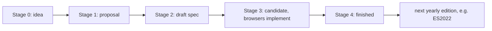
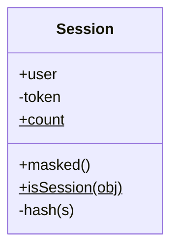

# Session 8: ECMAScript 2022 and Its New Features

> [Cybersecurity and Digital Forensics](../../README.md) › [Term 1](../README.md) › [Module 2: Client-Side Scripting with HTML5 & JavaScript](README.md) › **Session 8**

| ⏱ Estimated time | 📋 Prerequisites |
|---|---|
| 2.5 hours | Sessions 6–7 (JavaScript basics, functions and objects) |

| ⬅ [Previous: Session 7](session-07-javascript-part-2.md) | [Next: Session 9](session-09-canvas-and-web-storage.md) ➡ |
|:---|---:|

---

## 🎯 Learning objectives

- Explain how **ECMAScript** versions are produced (TC39, yearly editions, stages) and check feature support.
- Recap the modern syntax every current codebase uses: classes, modules, promises, `async`/`await`, optional chaining `?.`, nullish `??`.
- Use the **ES2022** features: public and **private class fields and methods** (`#`), **static fields** and **static blocks**, **ergonomic brand checks** (`#x in obj`), **`.at()`**, **`Object.hasOwn()`**, **error `cause`**, **RegExp match indices** (`/d`) and **top-level `await`**.
- Recognise features added after ES2022 (`findLast`, `toSorted`, `Object.groupBy`).
- Explain how private fields and `Object.hasOwn` improve code safety.

## 📖 Concepts

### 1. How JavaScript evolves

- **TC39** (Ecma Technical Committee 39) designs the language. Proposals move through **stages 0–4**; stage 4 features join the next yearly edition.
- **ES2015 (ES6)** was the big modernisation: `let`/`const`, arrow functions, classes, modules, promises, template literals, destructuring.
- Since then there is **one edition per year**: ES2016, ES2017 (`async`/`await`), ... **ES2022** (13th edition, June 2022), ES2023, ES2024...
- Check support on **caniuse.com** or MDN's compatibility tables; tools like **Babel** transpile new syntax for old browsers.

### 2. Modern features you must already know (ES2015–ES2021)

| Feature | Example | Version |
|---|---|---|
| Classes | `class Scanner { constructor(h) { this.h = h; } }` | ES2015 |
| Modules | `export function x() {}` / `import { x } from "./x.js"` | ES2015 |
| Promises | `fetch(url).then(r => r.json())` | ES2015 |
| `async` / `await` | `const r = await fetch(url);` | ES2017 |
| Object spread | `{ ...cfg, debug: false }` | ES2018 |
| Optional chaining | `report.vuln?.cve?.id` | ES2020 |
| Nullish coalescing | `os ?? "unknown"` | ES2020 |
| BigInt | `2n ** 64n` | ES2020 |
| `Promise.allSettled` | wait for all, keep failures | ES2020 |
| Logical assignment | `x ??= 1`, `y \|\|= []` | ES2021 |
| Numeric separators | `1_000_000` | ES2021 |

### 3. Classes in brief

```js
class Scanner {
  constructor(host) { this.host = host; }   // runs on `new`
  scan() { return `scanning ${this.host}`; } // method on the prototype
  static version() { return "1.0"; }         // called on the class: Scanner.version()
}
class PortScanner extends Scanner {           // inheritance
  scan() { return super.scan() + " ports 1-1024"; }
}
```

### 4. ES2022: class fields

```js
class Session {
  user;                 // public instance field (declared up front)
  #token;               // PRIVATE field: only code inside the class can read it
  static count = 0;     // static field: one value shared by the class
  static { /* static initialisation block: runs once when the class is defined */ }
  #hash(s) { ... }      // private method
  get masked() { ... }  // getter (older feature, often used with private fields)
}
```

- Private names start with `#`. Accessing `obj.#token` outside the class is a **SyntaxError** at parse time – stronger than the old `_token` naming convention, which was only a polite request.
- Private fields do not appear in `JSON.stringify`, `Object.keys` or `for...in`. Good for tokens, keys and internal state.
- **Ergonomic brand check:** `#token in obj` tells you whether `obj` was really created by this class, without a `try...catch`.

> Private fields hide data from *other code*, not from the *user*: anyone can still read everything in DevTools or the source. Secrets that must stay secret belong on the server.

### 5. ES2022: `.at()`

`array.at(-1)` returns the last element; `.at(-2)` the second last. Works on arrays, strings and typed arrays. Replaces `arr[arr.length - 1]`.

### 6. ES2022: `Object.hasOwn(obj, key)`

A safe replacement for `obj.hasOwnProperty(key)`:

- works on objects created with `Object.create(null)` (which have no `hasOwnProperty` method),
- cannot be fooled by an object that defines its own `hasOwnProperty` key.

Checking **own** properties matters when handling untrusted JSON, a common source of **prototype pollution** bugs.

### 7. ES2022: error `cause`

```js
throw new Error("Could not load firewall policy", { cause: err });
```

The original low-level error is kept in `e.cause`, so logs and incident responders see the full chain instead of a vague message.

### 8. ES2022: RegExp match indices (`/d`)

Adding the `d` flag makes `exec()` return `indices`: the start and end positions of the whole match and each capture group. Handy for highlighting IPs or usernames inside log lines.

### 9. ES2022: top-level `await`

In an **ES module** (`<script type="module">` or a `.mjs` file) you can use `await` at the top level without wrapping it in an `async` function:

```js
// config.mjs
const res = await fetch("/api/config");
export const config = await res.json();
```

In a classic script (like the `.js` examples here, run as CommonJS by Node) you still wrap it: `(async () => { await ... })();`.

### 10. After ES2022 (you will see these too)

| Feature | Example | Version |
|---|---|---|
| `findLast` / `findLastIndex` | `sev.findLast(n => n > 5)` | ES2023 |
| Change-by-copy | `toSorted`, `toReversed`, `with` | ES2023 |
| `Object.groupBy` | `Object.groupBy(list, fn)` | ES2024 |

## 🧭 Diagrams





## 💻 Worked examples

### Example 1 – Every ES2022 feature in one script

Run with `node session-08_es2022.js` (Node 16.11+ supports all of it).

📄 **`code/session-08_es2022.js`**

```javascript
// ECMAScript 2022 features, each shown with real output.

// 1. Class fields, private #fields and #methods, static fields and a static block
class Session {
  static count = 0;                 // static public field
  static #secretPrefix;             // static private field
  static { Session.#secretPrefix = "sid_"; }   // static initialisation block

  user;                             // public instance field
  #token;                           // private instance field
  #createdAt = 1700000000;

  constructor(user) {
    this.user = user;
    this.#token = Session.#secretPrefix + Math.abs(this.#hash(user)).toString(16);
    Session.count++;
  }
  #hash(s) { let h = 0; for (const c of s) h = (h * 31 + c.charCodeAt(0)) | 0; return h; }
  get masked() { return this.#token.slice(0, 6) + "****"; }
  static isSession(obj) { return #token in obj; }    // ergonomic brand check
}

const s1 = new Session("ayesha"), s2 = new Session("bilal");
console.log("users        :", s1.user, s2.user, "| Session.count =", Session.count);
console.log("masked token :", s1.masked);
console.log("JSON view    :", JSON.stringify(s1), "(private fields are not exposed)");
console.log("#token in obj:", Session.isSession(s1), Session.isSession({ user: "fake" }));
try { eval("s1.#token"); } catch (e) { console.log("outside access:", e.name); }

// 2. Array.prototype.at() / String.prototype.at()
const logins = ["08:01", "08:05", "08:30", "09:12"];
console.log("\nat(0), at(-1)     :", logins.at(0), logins.at(-1));
console.log('"ROOT".at(-2)     :', "ROOT".at(-2));

// 3. Object.hasOwn() instead of hasOwnProperty
const cfg = JSON.parse('{"debug": false, "__proto__": {"isAdmin": true}}');
console.log("\ncfg.isAdmin       :", cfg.isAdmin, "(JSON.parse made __proto__ a plain own key)");
console.log("hasOwn(cfg,'__proto__'):", Object.hasOwn(cfg, "__proto__"));
console.log("hasOwn(cfg,'debug'):", Object.hasOwn(cfg, "debug"));
const bare = Object.create(null); bare.k = 1;
console.log("hasOwn on null-proto object:", Object.hasOwn(bare, "k"));

// 4. Error cause: wrap a low-level error without losing it
function loadPolicy(text) {
  try { return JSON.parse(text); }
  catch (err) { throw new Error("Could not load firewall policy", { cause: err }); }
}
try { loadPolicy("{bad"); }
catch (e) { console.log("\nerror :", e.message); console.log("cause :", e.cause.name); }

// 5. RegExp match indices with the /d flag
const line = "Failed password for root from 203.0.113.9 port 22";
const m = /from (?<ip>\d+\.\d+\.\d+\.\d+)/d.exec(line);
console.log("\nip found          :", m.groups.ip, "at indices", m.indices.groups.ip);

// 6. Top-level await is for ES modules (.mjs or type="module"); in a script use an async function
(async () => {
  const delay = (ms, v) => new Promise(r => setTimeout(() => r(v), ms));
  const result = await delay(10, "scan finished");
  console.log("\nawait            :", result);
})();
```

**Output**

```text
users        : ayesha bilal | Session.count = 2
masked token : sid_53****
JSON view    : {"user":"ayesha"} (private fields are not exposed)
#token in obj: true false
outside access: SyntaxError

at(0), at(-1)     : 08:01 09:12
"ROOT".at(-2)     : O

cfg.isAdmin       : undefined (JSON.parse made __proto__ a plain own key)
hasOwn(cfg,'__proto__'): true
hasOwn(cfg,'debug'): true
hasOwn on null-proto object: true

error : Could not load firewall policy
cause : SyntaxError

ip found          : 203.0.113.9 at indices [ 30, 41 ]

await            : scan finished
```
Points to notice: `JSON.stringify(s1)` shows only `user`; trying `s1.#token` from outside fails at parse time; the regex reports exactly where the IP starts and ends in the log line.

### Example 2 – Modern syntax you will use daily, plus newer additions

📄 **`code/session-08_modern.js`**

```javascript
// Modern syntax used every day since ES2015-ES2021, plus later additions you will meet.
const report = { host: "web01", scan: { ports: [22, 443], os: null } };

// Optional chaining ?. and nullish coalescing ??
console.log("os            :", report.scan?.os ?? "unknown");
console.log("missing path  :", report.vuln?.cve?.id ?? "none recorded");

// Logical assignment (ES2021)
report.scan.os ??= "Linux";
report.tags ||= ["dmz"];
console.log("after ??= ||= :", report.scan.os, report.tags);

// Numeric separators (ES2021) and BigInt (ES2020)
const bytes = 1_073_741_824;
console.log("1 GiB         :", bytes, "bytes");
console.log("2n ** 64n     :", (2n ** 64n).toString(), "(IPv6 needs 128-bit numbers)");

// Promise.allSettled vs Promise.all
const check = (host, ok) => new Promise((res, rej) => setTimeout(() => ok ? res(`${host} up`) : rej(new Error(`${host} down`)), 5));
(async () => {
  const results = await Promise.allSettled([check("10.0.0.1", true), check("10.0.0.2", false), check("10.0.0.3", true)]);
  console.log("\nallSettled    :");
  results.forEach(r => console.log("  ", r.status.padEnd(9), r.value ?? r.reason.message));
  try { await Promise.all([check("a", true), check("b", false)]); }
  catch (e) { console.log("Promise.all   : rejected on first failure ->", e.message); }

  // Later additions you will see in current browsers and Node 22
  const sev = [3, 9, 5, 7];
  console.log("\nfindLast >5   :", sev.findLast(n => n > 5), "(ES2023)");
  console.log("toSorted      :", sev.toSorted((a, b) => a - b), "original:", sev, "(ES2023)");
  const grouped = Object.groupBy(sev, n => (n >= 7 ? "high" : "low"));
  console.log("Object.groupBy:", JSON.stringify(grouped), "(ES2024)");
})();
```

**Output**

```text
os            : unknown
missing path  : none recorded
after ??= ||= : Linux [ 'dmz' ]
1 GiB         : 1073741824 bytes
2n ** 64n     : 18446744073709551616 (IPv6 needs 128-bit numbers)

allSettled    :
   fulfilled 10.0.0.1 up
   rejected  10.0.0.2 down
   fulfilled 10.0.0.3 up
Promise.all   : rejected on first failure -> b down

findLast >5   : 7 (ES2023)
toSorted      : [ 3, 5, 7, 9 ] original: [ 3, 9, 5, 7 ] (ES2023)
Object.groupBy: {"low":[3,5],"high":[9,7]} (ES2024)
```
`Promise.allSettled` is the right choice for checking many hosts: one host being down does not hide the results for the others, unlike `Promise.all`.

## 📊 Old way vs modern way

| Task | Old | Modern |
|---|---|---|
| Last element | `a[a.length - 1]` | `a.at(-1)` (ES2022) |
| Own property check | `obj.hasOwnProperty(k)` | `Object.hasOwn(obj, k)` (ES2022) |
| Private data | `this._token` (convention only) | `this.#token` (enforced, ES2022) |
| Wrap an error | lose the original or concatenate messages | `new Error(msg, { cause })` (ES2022) |
| Default if missing | `x !== undefined && x !== null ? x : d` | `x ?? d` (ES2020) |
| Deep property | `a && a.b && a.b.c` | `a?.b?.c` (ES2020) |
| Sorted copy | `[...a].sort()` | `a.toSorted()` (ES2023) |

## 🧪 Lab / practice tasks

1. **Easy –** Use `.at()` to print the first and last entries of an array of log timestamps and the last character of a filename.
2. **Easy –** Rewrite `if (report && report.scan && report.scan.os) os = report.scan.os; else os = "unknown";` with `?.` and `??`.
3. **Medium –** Write a `class Vault` with a private `#secrets` Map, methods `set(name, value)` and `has(name)`, and a getter `size`. Show that `JSON.stringify(vault)` reveals nothing.
4. **Medium –** Write `loadConfig(text)` that throws `new Error("Bad config", { cause })` on invalid JSON, and print both the message and `cause.message`.
5. **Challenge –** Using the `/d` flag, write a function that takes a log line and returns it with every IPv4 address wrapped in `[ ]`, using the indices rather than `replace`.

<details>
<summary>💡 Hints</summary>

- Task 2: `const os = report?.scan?.os ?? "unknown";`
- Task 3: `#secrets = new Map();` as a class field; `get size() { return this.#secrets.size; }`.
- Task 5: use a global regex with `/gd` and loop over `matchAll`; build the new string from the end backwards so earlier indices stay valid.
</details>

## ✅ Quick quiz

1. Which committee standardises ECMAScript? a) W3C b) TC39 c) IETF d) WHATWG
2. In ES2022, a field written `#token` is: a) a comment b) a public field c) a private field d) a CSS id
3. `["a", "b", "c"].at(-1)` returns: a) `"a"` b) `"c"` c) `undefined` d) error
4. Why prefer `Object.hasOwn(obj, k)` over `obj.hasOwnProperty(k)`? a) it is faster to type only b) it works on null-prototype objects and cannot be overridden c) it checks the prototype chain d) it is required by JSON
5. Top-level `await` works in: a) any script b) only ES modules c) only Node.js d) only inside loops

<details>
<summary>Show answers</summary>

1 – b · 2 – c · 3 – b · 4 – b · 5 – b
</details>

## 📝 Summary / cheat-sheet

- TC39 stages 0–4 → one ECMAScript edition per year; ES2015 was the big jump; ES2022 is the 13th edition.
- Daily modern syntax: `class`, modules, promises, `async/await`, `?.`, `??`, `??=`, `1_000`.
- ES2022: `#private` fields/methods, `static` fields and `static {}` blocks, `#x in obj`, `.at()`, `Object.hasOwn()`, `Error(msg, { cause })`, RegExp `/d` indices, top-level `await` in modules.
- After: `findLast`, `toSorted`, `Object.groupBy`.
- Private fields protect against other code, not against the user: server-side secrets stay on the server.

**Interview / viva questions**

1. What is the difference between ES6 and ES2022?
2. How are `#private` fields different from the `_underscore` convention?
3. Why is `Object.hasOwn` safer when working with parsed JSON?
4. What problem does the error `cause` option solve?
5. When can you use top-level `await`, and why not in a classic script?

---

| ⬅ [Previous: Session 7](session-07-javascript-part-2.md) | [Next: Session 9](session-09-canvas-and-web-storage.md) ➡ |
|:---|---:|

<sub>Prepared by **Hamna Zahid Khan**, Junior Lecturer · Cybersecurity and Digital Forensics</sub>
