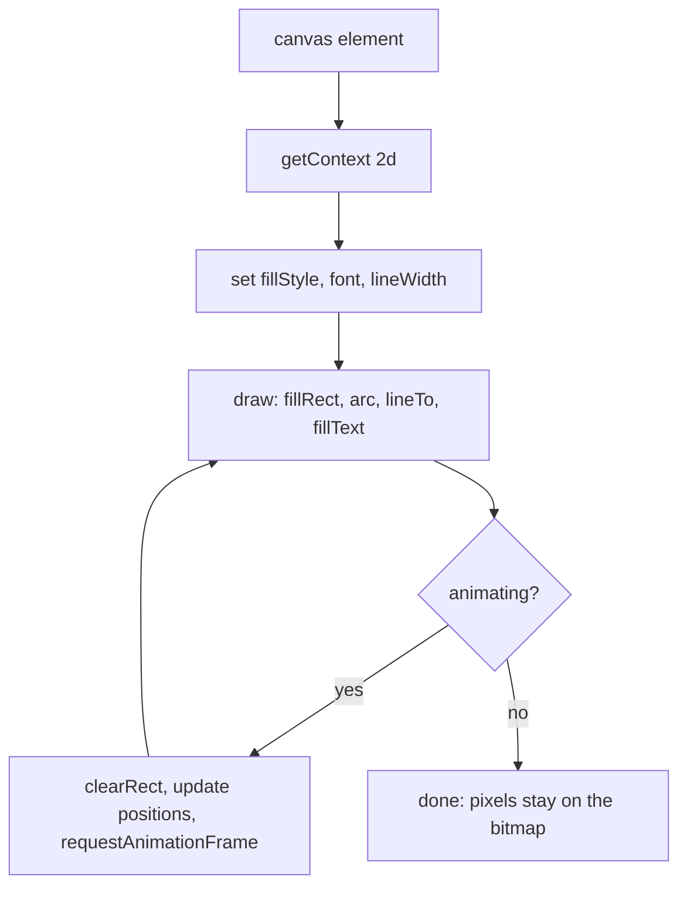
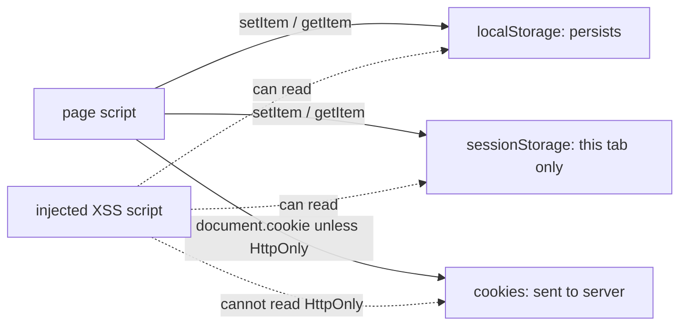

# Session 9: Canvas and Web Storage

> [Cybersecurity and Digital Forensics](../../README.md) › [Term 1](../README.md) › [Module 2: Client-Side Scripting with HTML5 & JavaScript](README.md) › **Session 9**

| ⏱ Estimated time | 📋 Prerequisites |
|---|---|
| 2.5 hours | Sessions 6–8 (JavaScript, DOM and objects) |

| ⬅ [Previous: Session 8](session-08-ecmascript-2022.md) | [Next: Session 10](session-10-geolocation-and-apis.md) ➡ |
|:---|---:|

---

## 🎯 Learning objectives

- Add a `<canvas>` to a page and get its **2D rendering context**.
- Use the canvas **coordinate system** and draw rectangles, paths, arcs, text and images.
- Apply colours, gradients, line styles and simple **animation** with `requestAnimationFrame`.
- Explain **Web Storage**: `localStorage` vs `sessionStorage` vs cookies, and use `setItem`, `getItem`, `removeItem`, `clear`, `key`, `length`.
- Store objects with **JSON**, handle quota errors and listen for the `storage` event.
- Explain the security risks of storage (XSS token theft) and what canvas **fingerprinting** is.

## 📖 Concepts

### 1. The canvas element

```html
<canvas id="chart" width="420" height="220">Fallback text for old browsers</canvas>
<script>
  const canvas = document.getElementById("chart");
  const ctx = canvas.getContext("2d");      // the drawing API
</script>
```

- `<canvas>` is a **bitmap**: once drawn, shapes are just pixels (no DOM elements to click). For accessibility, add `role="img"` and `aria-label`, or provide the data in a table too.
- Set size with the `width`/`height` **attributes**. Resizing with CSS stretches the pixels and blurs the drawing.
- Compare **SVG**: vector shapes that *are* DOM elements, scale without blurring, and suit icons and diagrams; canvas suits many moving pixels (games, charts with thousands of points, image editing).

### 2. Coordinates

The origin `(0, 0)` is the **top-left** corner; `x` grows to the right and `y` grows **downward**. A bar of height `h` standing on a baseline at `y = 190` starts at `y = 190 - h`.

### 3. Drawing API

| Task | Methods / properties |
|---|---|
| Rectangles | `fillRect(x, y, w, h)`, `strokeRect(...)`, `clearRect(...)` |
| Colours | `ctx.fillStyle = "#c0392b"`, `ctx.strokeStyle`, `ctx.globalAlpha` |
| Lines | `beginPath()`, `moveTo(x, y)`, `lineTo(x, y)`, `stroke()`, `ctx.lineWidth` |
| Shapes | `arc(x, y, r, startAngle, endAngle)` (radians), `closePath()`, `fill()` |
| Text | `ctx.font = "12px sans-serif"`, `fillText(text, x, y)`, `textAlign` |
| Gradients | `const g = ctx.createLinearGradient(x0, y0, x1, y1); g.addColorStop(0, "red");` |
| Images | `ctx.drawImage(img, x, y, w, h)` |
| State | `save()`, `restore()`, `translate()`, `rotate()`, `scale()` |
| Pixels | `getImageData()`, `putImageData()`, `canvas.toDataURL("image/png")` |

### 4. Animation

```js
let x = 0;
function frame() {
  ctx.clearRect(0, 0, canvas.width, canvas.height);  // wipe
  ctx.fillRect(x, 50, 20, 20);                        // draw
  x = (x + 2) % canvas.width;                         // update
  requestAnimationFrame(frame);                       // ask for the next frame (~60 fps)
}
requestAnimationFrame(frame);
```

`requestAnimationFrame` pauses when the tab is hidden and syncs with the screen refresh, unlike `setInterval`.

### 5. Web Storage

Web Storage lets a site keep **key–value strings** in the browser, per **origin** (scheme + host + port).

| | `localStorage` | `sessionStorage` | Cookies |
|---|---|---|---|
| Lifetime | Until deleted | Until the tab closes | Until expiry date / session |
| Scope | All tabs of the origin | One tab | Origin (and path/domain rules) |
| Size | ~5 MB per origin | ~5 MB per origin | ~4 KB each |
| Sent to the server? | No | No | **Yes, with every request** |
| Readable by JavaScript? | Yes | Yes | Yes, unless **`HttpOnly`** |

**API (same for both):**

```js
localStorage.setItem("theme", "dark");
localStorage.getItem("theme");           // "dark"  (null if missing)
localStorage.removeItem("theme");
localStorage.clear();
localStorage.length; localStorage.key(0);
```

- Values are **always strings**. Store objects with `JSON.stringify` and read them with `JSON.parse`.
- Writing too much throws a **`QuotaExceededError`**; wrap writes in `try...catch`.
- The **`storage` event** fires in *other* tabs of the same origin when `localStorage` changes – useful to sync a logout across tabs.
- For large or structured data use **IndexedDB**.

### 6. Security and privacy

| Issue | Explanation | Defence |
|---|---|---|
| **Token theft through XSS** | Any script on the page – including an injected one – can read all of Web Storage | Keep session tokens in `HttpOnly; Secure; SameSite` cookies; fix XSS; use CSP |
| **No encryption** | Storage is plain text on disk; anyone with the device or a forensic image can read it | Do not store passwords, personal data or keys |
| **Shared computers** | `localStorage` survives logout and browser restarts | Clear sensitive keys on logout |
| **Forensics value** | Browser storage files are evidence: visited apps, settings, cached data | Investigators examine them; attackers try to wipe them |
| **Canvas fingerprinting** | Drawing hidden text and reading pixels back gives a value that differs slightly per GPU/driver/fonts, used to track users without cookies | Browsers add noise or ask permission; privacy extensions block it |
| **Tainted canvas** | Drawing a cross-origin image without CORS "taints" the canvas; reading pixels then throws a security error | This is the same-origin policy protecting other sites' images |

## 🧭 Diagrams





## 💻 Worked examples

### Example 1 – A bar chart on canvas with a remembered theme

Open this page, switch to **Dark**, then reload: the theme is restored from `localStorage`. Open a new tab with the same file: the visit counter starts again because `sessionStorage` belongs to one tab.

📄 **`code/session-09_canvas.html`**

```html
<!DOCTYPE html>
<html lang="en">
<head><meta charset="UTF-8"><title>Failed Logins Chart</title></head>
<body>
  <h1>Failed logins per hour</h1>
  <canvas id="chart" width="420" height="220" role="img" aria-label="Bar chart of failed logins">
    Your browser does not support canvas.
  </canvas>
  <p>Theme: <button id="dark">Dark</button> <button id="light">Light</button> · Visits: <span id="visits"></span></p>

  <script>
    const data = [{ h: "08", n: 4 }, { h: "09", n: 12 }, { h: "10", n: 30 }, { h: "11", n: 7 }, { h: "12", n: 2 }];
    const canvas = document.getElementById("chart");
    const ctx = canvas.getContext("2d");

    function draw(theme) {
      ctx.fillStyle = theme === "dark" ? "#111" : "#fff";
      ctx.fillRect(0, 0, canvas.width, canvas.height);          // background
      const max = Math.max(...data.map(d => d.n)), base = 190, barW = 50, gap = 30;
      data.forEach((d, i) => {
        const x = 40 + i * (barW + gap), h = Math.round((d.n / max) * 160);
        ctx.fillStyle = d.n >= 20 ? "#c0392b" : "#2e86de";
        ctx.fillRect(x, base - h, barW, h);                       // bar
        ctx.fillStyle = theme === "dark" ? "#eee" : "#222";
        ctx.font = "12px sans-serif";
        ctx.fillText(d.h + ":00", x + 8, base + 15);              // label
        ctx.fillText(d.n, x + 18, base - h - 5);                  // value
      });
      ctx.beginPath(); ctx.moveTo(30, base); ctx.lineTo(410, base); ctx.stroke();   // axis
    }

    // Web Storage: remember the theme (localStorage) and count visits this tab (sessionStorage)
    const theme = localStorage.getItem("theme") || "light";
    draw(theme);
    document.getElementById("dark").onclick = () => { localStorage.setItem("theme", "dark"); draw("dark"); };
    document.getElementById("light").onclick = () => { localStorage.setItem("theme", "light"); draw("light"); };
    const visits = Number(sessionStorage.getItem("visits") || 0) + 1;
    sessionStorage.setItem("visits", visits);
    document.getElementById("visits").textContent = visits;
  </script>
</body>
</html>
```
### Example 2 – The chart's coordinates

The same maths as the page, printed: every `fillRect` call, with the y-flip worked out, plus a quick text preview.

📄 **`code/session-09_chart.js`**

```javascript
// The maths behind the canvas bar chart: every fillRect call the page makes, plus a text preview.
const data = [{ h: "08", n: 4 }, { h: "09", n: 12 }, { h: "10", n: 30 }, { h: "11", n: 7 }, { h: "12", n: 2 }];
const max = Math.max(...data.map(d => d.n)), base = 190, barW = 50, gap = 30;

console.log("Canvas origin (0,0) is the TOP-LEFT corner; y grows downward.\n");
console.log("hour  count  fillRect(x, y, w, h)        colour");
for (const [i, d] of data.entries()) {
  const x = 40 + i * (barW + gap), h = Math.round((d.n / max) * 160);
  const colour = d.n >= 20 ? "#c0392b (red)" : "#2e86de (blue)";
  console.log(`${d.h}:00 ${String(d.n).padStart(5)}  fillRect(${x}, ${base - h}, ${barW}, ${h})`.padEnd(42) + colour);
}

console.log("\nText preview (each # = 2 logins):");
for (const d of data) console.log(`${d.h}:00 | ${"#".repeat(Math.round(d.n / 2)).padEnd(15)} ${d.n}`);
```

**Output**

```text
Canvas origin (0,0) is the TOP-LEFT corner; y grows downward.

hour  count  fillRect(x, y, w, h)        colour
08:00     4  fillRect(40, 169, 50, 21)    #2e86de (blue)
09:00    12  fillRect(120, 126, 50, 64)   #2e86de (blue)
10:00    30  fillRect(200, 30, 50, 160)   #c0392b (red)
11:00     7  fillRect(280, 153, 50, 37)   #2e86de (blue)
12:00     2  fillRect(360, 179, 50, 11)   #2e86de (blue)

Text preview (each # = 2 logins):
08:00 | ##              4
09:00 | ######          12
10:00 | ############### 30
11:00 | ####            7
12:00 | #               2
```
The tallest bar (30 logins at 10:00) starts at `y = 30` because the canvas measures from the top.

### Example 3 – How Web Storage behaves

Node.js has no browser storage, so this script models the Web Storage API exactly (strings only, `null` for missing keys, quota errors) and then plays the role of an injected script looking for secrets.

📄 **`code/session-09_storage.js`**

```javascript
// A faithful model of the Web Storage API (localStorage / sessionStorage) so it runs in Node.
class WebStorage {
  #data = new Map();
  #quota;
  constructor(quotaChars = 5_000_000) { this.#quota = quotaChars; }
  get length() { return this.#data.size; }
  key(i) { return [...this.#data.keys()][i] ?? null; }
  getItem(k) { return this.#data.has(String(k)) ? this.#data.get(String(k)) : null; }
  setItem(k, v) {
    const used = [...this.#data].reduce((s, [a, b]) => s + a.length + b.length, 0);
    if (used + String(k).length + String(v).length > this.#quota) throw new Error("QuotaExceededError");
    this.#data.set(String(k), String(v));      // everything is stored as a string
  }
  removeItem(k) { this.#data.delete(String(k)); }
  clear() { this.#data.clear(); }
}

const localStorage = new WebStorage();
localStorage.setItem("theme", "dark");
localStorage.setItem("visits", 3);
localStorage.setItem("prefs", { lang: "en" });       // mistake: object without JSON
console.log("theme  :", localStorage.getItem("theme"));
console.log("visits :", localStorage.getItem("visits"), "->", typeof localStorage.getItem("visits"));
console.log("prefs  :", localStorage.getItem("prefs"), "<- object was turned into a useless string");

localStorage.setItem("prefs", JSON.stringify({ lang: "en", fontSize: 14 }));
console.log("prefs  :", JSON.parse(localStorage.getItem("prefs")).fontSize, "<- JSON round trip works");
console.log("missing:", localStorage.getItem("nope"));

console.log("\nAll keys:");
for (let i = 0; i < localStorage.length; i++) console.log("  ", localStorage.key(i), "=", localStorage.getItem(localStorage.key(i)));

const tiny = new WebStorage(20);
try { tiny.setItem("log", "x".repeat(50)); } catch (e) { console.log("\nquota  :", e.message); }

// Security check: what an injected script could steal from storage
localStorage.setItem("authToken", "eyJhbGciOi...secret");
const exposed = [];
for (let i = 0; i < localStorage.length; i++) {
  const k = localStorage.key(i);
  if (/token|password|secret|session/i.test(k)) exposed.push(k);
}
console.log("\nKeys any XSS payload could read:", exposed.join(", ") || "none");
console.log("Advice: keep session tokens in HttpOnly cookies, not in Web Storage.");
localStorage.removeItem("authToken");
console.log("After removeItem, keys left:", localStorage.length);
```

**Output**

```text
theme  : dark
visits : 3 -> string
prefs  : [object Object] <- object was turned into a useless string
prefs  : 14 <- JSON round trip works
missing: null

All keys:
   theme = dark
   visits = 3
   prefs = {"lang":"en","fontSize":14}

quota  : QuotaExceededError

Keys any XSS payload could read: authToken
Advice: keep session tokens in HttpOnly cookies, not in Web Storage.
After removeItem, keys left: 3
```
Note the classic mistake: storing an object directly gives the useless string `[object Object]`.

## 📊 Where to keep what

| Data | Best place | Why |
|---|---|---|
| Theme, language, layout | `localStorage` | Harmless, should persist |
| Wizard progress in one tab | `sessionStorage` | Ends with the tab |
| Session / auth token | `HttpOnly; Secure; SameSite` cookie | Not readable by scripts |
| Large offline data | IndexedDB | Structured, big, async |
| Passwords, card numbers | Nowhere in the browser | Server only, properly protected |

## 🧪 Lab / practice tasks

1. **Easy –** Draw a "traffic light" on a canvas: a dark rectangle and three circles (red, amber, green) with `arc`.
2. **Easy –** Save a username in `localStorage` from a form and greet the user by name on reload; add a "Forget me" button that calls `removeItem`.
3. **Medium –** Add a gradient background and axis labels to the bar chart in Example 1, and draw the data values as a line graph instead of bars.
4. **Medium –** Animate a "radar sweep" line rotating around the centre of a canvas with `requestAnimationFrame`, `save`, `translate` and `rotate`.
5. **Challenge –** Store a list of to-do items as JSON in `localStorage`, render them, and use the `storage` event so a second open tab updates automatically.

<details>
<summary>💡 Hints</summary>

- Task 1: `ctx.beginPath(); ctx.arc(x, y, 20, 0, Math.PI * 2); ctx.fill();` for each light.
- Task 4: keep an `angle` variable; each frame `ctx.save(); ctx.translate(cx, cy); ctx.rotate(angle); ... ctx.restore();`.
- Task 5: `window.addEventListener("storage", e => { if (e.key === "todos") render(); });`
</details>

## ✅ Quick quiz

1. On a canvas, where is the point `(0, 0)`? a) centre b) bottom-left c) top-left d) top-right
2. Which method returns the drawing API? a) `canvas.draw()` b) `canvas.getContext("2d")` c) `document.canvas()` d) `new Canvas()`
3. Data in `sessionStorage` is removed when: a) the browser updates b) the tab is closed c) the page reloads d) never
4. `localStorage.setItem("n", 5); typeof localStorage.getItem("n")` is: a) `"number"` b) `"string"` c) `"object"` d) `"undefined"`
5. Why should session tokens not be kept in `localStorage`? a) it is too small b) any XSS script can read it c) it is sent to every site d) it expires too fast

<details>
<summary>Show answers</summary>

1 – c · 2 – b · 3 – b · 4 – b · 5 – b
</details>

## 📝 Summary / cheat-sheet

- `<canvas width height>` + `getContext("2d")`; origin top-left, y downward.
- Draw: `fillRect`, `strokeRect`, `clearRect`, paths (`beginPath`, `moveTo`, `lineTo`, `arc`, `fill`, `stroke`), `fillText`, `drawImage`; style with `fillStyle`, `strokeStyle`, `lineWidth`, gradients.
- Animate with `requestAnimationFrame`; canvas is pixels, SVG is DOM vectors.
- Web Storage: per origin, strings only, ~5 MB; `localStorage` persists, `sessionStorage` per tab; JSON for objects.
- Never store secrets in Web Storage; tokens in `HttpOnly` cookies; fix XSS first.
- Canvas can fingerprint devices; cross-origin images taint the canvas.

**Interview / viva questions**

1. When would you choose canvas over SVG?
2. Compare `localStorage`, `sessionStorage` and cookies.
3. Why is storing a JWT in `localStorage` considered risky?
4. What is canvas fingerprinting?
5. What is a "tainted" canvas and which security rule causes it?

---

| ⬅ [Previous: Session 8](session-08-ecmascript-2022.md) | [Next: Session 10](session-10-geolocation-and-apis.md) ➡ |
|:---|---:|

<sub>Prepared by **Hamna Zahid Khan**, Junior Lecturer · Cybersecurity and Digital Forensics</sub>
