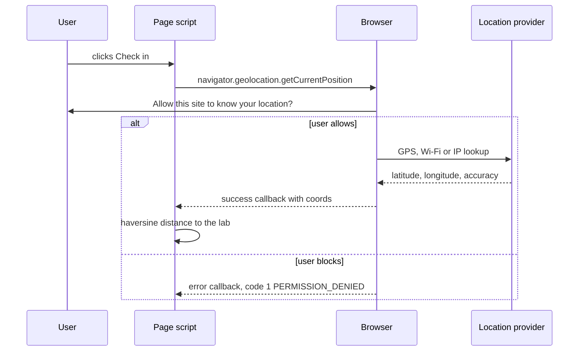
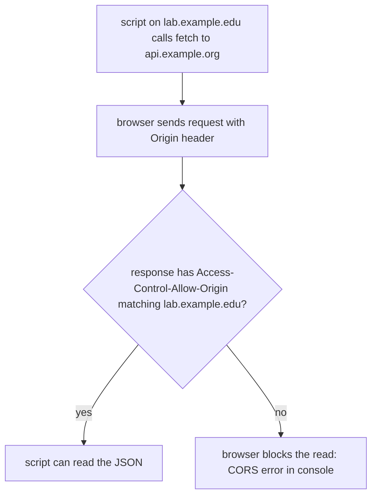

# Session 10: HTML5 Geolocation and APIs

> [Cybersecurity and Digital Forensics](../../README.md) › [Term 1](../README.md) › [Module 2: Client-Side Scripting with HTML5 & JavaScript](README.md) › **Session 10**

| ⏱ Estimated time | 📋 Prerequisites |
|---|---|
| 2.5 hours | Sessions 7–9 (DOM, events, JSON, async code) |

| ⬅ [Previous: Session 9](session-09-canvas-and-web-storage.md) | [Module practice test](practice-test.md) ➡ |
|:---|---:|

---

## 🎯 Learning objectives

- Use the **Geolocation API**: `getCurrentPosition`, `watchPosition`, `clearWatch`, the `coords` object and options.
- Handle every **error code** (permission denied, position unavailable, timeout).
- Explain how location is determined (GPS, Wi-Fi, cell towers, IP) and why HTTPS and permission are required.
- Calculate distances with the **haversine** formula and reduce precision to protect privacy.
- Call a **REST API** with `fetch` and `async`/`await`, handling status codes, timeouts (`AbortController`) and JSON.
- Explain the **same-origin policy**, **CORS**, and safe handling of API keys.
- Name other useful browser APIs and their permission and security model.

## 📖 Concepts

### 1. What is an API?

An **API (Application Programming Interface)** is a defined way for one piece of software to use another.

- **Browser (Web) APIs** are built into the browser: DOM, Canvas, Web Storage, Geolocation, Fetch, Notifications, Clipboard, and more.
- **Web service APIs** live on servers and are called over HTTP, usually returning JSON (weather, maps, threat-intelligence feeds such as IP reputation services).

### 2. The Geolocation API

```js
if ("geolocation" in navigator) {
  navigator.geolocation.getCurrentPosition(success, error, {
    enableHighAccuracy: false,   // true = try GPS: slower, more battery
    timeout: 10000,              // ms before error code 3
    maximumAge: 60000            // accept a cached position up to 60 s old
  });
}
function success(pos) {
  const { latitude, longitude, accuracy } = pos.coords;   // accuracy in metres
}
```

| Method | Purpose |
|---|---|
| `getCurrentPosition(ok, err, opts)` | One reading |
| `watchPosition(ok, err, opts)` | Repeated readings as the device moves; returns an id |
| `clearWatch(id)` | Stop watching |

`coords` also may include `altitude`, `heading` and `speed` (often `null` on laptops).

**Errors** (`err.code`):

| Code | Constant | Typical cause |
|---|---|---|
| 1 | `PERMISSION_DENIED` | User clicked Block, or the page is not HTTPS |
| 2 | `POSITION_UNAVAILABLE` | No GPS/Wi-Fi/network fix |
| 3 | `TIMEOUT` | No result within `timeout` |

### 3. How the device finds its location

| Source | Typical accuracy | Notes |
|---|---|---|
| GPS / GNSS | 5–20 m | Outdoors, phones |
| Wi-Fi positioning | 20–100 m | Nearby access points matched to a database |
| Cell towers | 100 m – several km | Phones |
| IP address | city level or worse | What laptops on wired networks often get |

### 4. Rules browsers enforce

- Works only in a **secure context** (HTTPS or `localhost`).
- The user must **grant permission**; the browser shows a prompt and remembers the choice per site.
- Should be requested **in response to a user action** (a button), not on page load.
- Iframes need explicit permission from the parent (`allow="geolocation"`) and sites can disable it with a **Permissions-Policy** header.

### 5. Distance and privacy

The **haversine formula** gives the great-circle distance between two latitude/longitude points, enough for "is the student within 500 m of the lab?".

Location is **personal data** (it reveals home, work, routine and religion or health visits). Good practice:

- collect only when needed and say why,
- send a **result** ("present: true") rather than raw coordinates when possible,
- **round** coordinates: 2 decimal places ≈ 1.1 km, 3 ≈ 110 m,
- delete promptly and follow data-protection law (covered in the GDPR module).

For investigators, photos' **EXIF GPS tags**, phone location history and app logs are valuable evidence.

### 6. Calling web APIs with fetch

```js
async function getJSON(url) {
  const res = await fetch(url, { headers: { Accept: "application/json" } });
  if (!res.ok) throw new Error(`HTTP ${res.status}`);   // fetch does NOT throw on 404/500
  return res.json();
}
```

- `fetch` returns a **promise**; it rejects only on network failure. Always check `res.ok` / `res.status`.
- Send data with `method: "POST"`, `headers: { "Content-Type": "application/json" }`, `body: JSON.stringify(data)`.
- Cancel slow requests with **`AbortController`** (`controller.abort()` → `AbortError`).
- Query strings: build them with `new URLSearchParams({ severity: "high" })` so values are encoded safely.

### 7. Same-origin policy and CORS

- The **same-origin policy** stops a script from `https://a.com` reading responses from `https://b.com`. An origin is **scheme + host + port**.
- **CORS (Cross-Origin Resource Sharing)** lets a server opt in: the response header `Access-Control-Allow-Origin: https://lab.example.edu` allows that origin to read it.
- `Access-Control-Allow-Origin: *` with credentials is not allowed, and reflecting any origin back is a common **misconfiguration** that leaks data.
- Non-simple requests (e.g. `PUT`, custom headers) trigger a **preflight** `OPTIONS` request first.

### 8. API keys and other secrets

- Anything in front-end JavaScript is public. A secret API key in a script **will** be found (view source, DevTools, GitHub search).
- Keep secret keys on your server and call the third-party API from there (a **proxy**); restrict browser-side keys by domain and quota.
- Validate and **escape** data returned by APIs before putting it on the page – a compromised API can deliver XSS.

### 9. Other HTML5 APIs worth knowing

| API | Use | Permission? |
|---|---|---|
| Notifications | System pop-ups | Yes |
| Clipboard (`navigator.clipboard`) | Copy/paste | Read needs permission |
| Drag and Drop / File API | Read user-chosen files locally | User picks the file |
| Web Workers | Run JS in a background thread | No |
| WebSockets | Two-way real-time connection | No (but check `Origin` on the server) |
| `navigator.mediaDevices.getUserMedia` | Camera / microphone | Yes |
| Service Workers | Offline caching, push | HTTPS only |

## 🧭 Diagrams





## 💻 Worked examples

### Example 1 – A privacy-friendly lab check-in page

The page asks for location only when the button is pressed, computes the distance in the browser, and sends only `present: true/false` to the server. Open it over `https://` or `http://localhost` (a plain file or HTTP site is not a secure context).

📄 **`code/session-10_geo.html`**

```html
<!DOCTYPE html>
<html lang="en">
<head><meta charset="UTF-8"><title>Lab Check-in</title></head>
<body>
  <h1>Lab check-in</h1>
  <p>We only check that you are near the lab. Your exact position is never stored.</p>
  <button id="checkin">Check in</button>
  <p id="out" aria-live="polite"></p>

  <script>
    const LAB = { lat: 24.8607, lon: 67.0011 };     // example point in Karachi
    const out = document.getElementById("out");

    function distanceKm(a, b) {                       // haversine formula
      const R = 6371, rad = d => d * Math.PI / 180;
      const dLat = rad(b.lat - a.lat), dLon = rad(b.lon - a.lon);
      const h = Math.sin(dLat / 2) ** 2 + Math.cos(rad(a.lat)) * Math.cos(rad(b.lat)) * Math.sin(dLon / 2) ** 2;
      return 2 * R * Math.asin(Math.sqrt(h));
    }

    document.getElementById("checkin").addEventListener("click", () => {
      if (!("geolocation" in navigator)) { out.textContent = "Geolocation not supported."; return; }
      navigator.geolocation.getCurrentPosition(
        (pos) => {
          const me = { lat: pos.coords.latitude, lon: pos.coords.longitude };
          const d = distanceKm(me, LAB);
          out.textContent = d <= 0.5 ? "Checked in ✔" : `You are ${d.toFixed(1)} km away from the lab.`;
          // Send only the yes/no result to the server, not the coordinates
          fetch("/api/checkin", { method: "POST", headers: { "Content-Type": "application/json" },
                                  body: JSON.stringify({ present: d <= 0.5 }) });
        },
        (err) => {
          const why = { 1: "permission denied", 2: "position unavailable", 3: "timed out" }[err.code];
          out.textContent = "Could not get location: " + why;
        },
        { enableHighAccuracy: false, timeout: 10000, maximumAge: 60000 }
      );
    });
  </script>
</body>
</html>
```
### Example 2 – Every geolocation outcome, and coordinate rounding

Node.js has no GPS, so this script uses a mock with the same callback shape as `navigator.geolocation`, then shows how much precision each rounding level keeps.

📄 **`code/session-10_geo.js`**

```javascript
// Geolocation logic with a mock navigator.geolocation, so success and every error code can be seen.
const LAB = { lat: 24.8607, lon: 67.0011 };            // example point in Karachi

function distanceKm(a, b) {                              // haversine great-circle distance
  const R = 6371, rad = d => d * Math.PI / 180;
  const dLat = rad(b.lat - a.lat), dLon = rad(b.lon - a.lon);
  const h = Math.sin(dLat / 2) ** 2 + Math.cos(rad(a.lat)) * Math.cos(rad(b.lat)) * Math.sin(dLon / 2) ** 2;
  return 2 * R * Math.asin(Math.sqrt(h));
}

// Mock that behaves like the browser API: async, success callback or error callback
function mockGeolocation(scenario) {
  return {
    getCurrentPosition(success, error, options) {
      setTimeout(() => {
        if (scenario.code) error({ code: scenario.code, message: scenario.msg });
        else success({ coords: { latitude: scenario.lat, longitude: scenario.lon, accuracy: scenario.acc }, timestamp: 0 });
      }, 1);
    },
  };
}

const scenarios = [
  { name: "student in the lab", lat: 24.8611, lon: 67.0015, acc: 15 },
  { name: "student at the airport", lat: 24.9065, lon: 67.1608, acc: 30 },
  { name: "user clicked Block", code: 1, msg: "User denied Geolocation" },
  { name: "no GPS/Wi-Fi fix", code: 2, msg: "Position unavailable" },
  { name: "took too long", code: 3, msg: "Timeout expired" },
];
const reasons = { 1: "PERMISSION_DENIED", 2: "POSITION_UNAVAILABLE", 3: "TIMEOUT" };

(async () => {
  for (const sc of scenarios) {
    await new Promise(done => {
      mockGeolocation(sc).getCurrentPosition(
        pos => {
          const me = { lat: pos.coords.latitude, lon: pos.coords.longitude };
          const d = distanceKm(me, LAB);
          console.log(`${sc.name.padEnd(24)} ${d.toFixed(2).padStart(6)} km  accuracy ±${pos.coords.accuracy} m  -> ${d <= 0.5 ? "checked in" : "too far"}`);
          done();
        },
        err => { console.log(`${sc.name.padEnd(24)} error ${err.code} ${reasons[err.code]}`); done(); },
        { timeout: 10000 }
      );
    });
  }
  // Privacy: reduce precision before storing or sharing
  const exact = { lat: 24.861143, lon: 67.001522 };
  for (const places of [6, 3, 2, 1]) {
    console.log(`round to ${places} dp: ${exact.lat.toFixed(places)}, ${exact.lon.toFixed(places)}  (~${(111000 / 10 ** places).toFixed(places > 3 ? 2 : 0)} m precision)`);
  }
})();
```

**Output**

```text
student in the lab         0.06 km  accuracy ±15 m  -> checked in
student at the airport    16.90 km  accuracy ±30 m  -> too far
user clicked Block       error 1 PERMISSION_DENIED
no GPS/Wi-Fi fix         error 2 POSITION_UNAVAILABLE
took too long            error 3 TIMEOUT
round to 6 dp: 24.861143, 67.001522  (~0.11 m precision)
round to 3 dp: 24.861, 67.002  (~111 m precision)
round to 2 dp: 24.86, 67.00  (~1110 m precision)
round to 1 dp: 24.9, 67.0  (~11100 m precision)
```
### Example 3 – Calling a JSON API: success, filters, errors and timeouts

The script runs a small advisory API on `127.0.0.1` and calls it with `fetch`. Notice the CORS header, the `401` and `404` handled as normal responses, and the slow endpoint cancelled by `AbortController`.

📄 **`code/session-10_api.js`**

```javascript
// Calling a JSON REST API with fetch: a tiny local API server, CORS headers, errors and timeouts.
const http = require("http");

const advisories = [
  { id: "ADV-1", title: "Update the lab router firmware", severity: "high" },
  { id: "ADV-2", title: "Rotate shared Wi-Fi password", severity: "medium" },
];

const server = http.createServer((req, res) => {
  const send = (code, body, extra = {}) => {
    res.writeHead(code, { "Content-Type": "application/json",
      "Access-Control-Allow-Origin": "https://lab.example.edu", ...extra });   // CORS: who may read this
    res.end(JSON.stringify(body));
  };
  const url = new URL(req.url, "http://localhost");
  if (url.pathname === "/api/advisories") {
    const sev = url.searchParams.get("severity");
    return send(200, sev ? advisories.filter(a => a.severity === sev) : advisories);
  }
  if (url.pathname === "/api/slow") return setTimeout(() => send(200, { ok: true }), 500);
  if (url.pathname === "/api/admin") return send(401, { error: "API key required" });
  send(404, { error: "no such endpoint" });
});

async function getJSON(url, ms = 200) {
  const ctrl = new AbortController();
  const timer = setTimeout(() => ctrl.abort(), ms);
  try {
    const res = await fetch(url, { signal: ctrl.signal, headers: { Accept: "application/json" } });
    const body = await res.json();
    if (!res.ok) return `HTTP ${res.status}: ${body.error}`;
    return { cors: res.headers.get("access-control-allow-origin"), body };
  } catch (e) {
    return e.name === "AbortError" ? `timed out after ${ms} ms` : `network error: ${e.message}`;
  } finally { clearTimeout(timer); }
}

server.listen(0, "127.0.0.1", async () => {
  const base = `http://127.0.0.1:${server.address().port}`;
  const all = await getJSON(base + "/api/advisories");
  console.log("GET /api/advisories");
  console.log("  CORS allow-origin:", all.cors);
  all.body.forEach(a => console.log(`  ${a.id}  ${a.severity.padEnd(6)}  ${a.title}`));
  const high = await getJSON(base + "/api/advisories?severity=high");
  console.log("GET ?severity=high ->", high.body.map(a => a.id).join(", "));
  console.log("GET /api/admin     ->", await getJSON(base + "/api/admin"));
  console.log("GET /api/missing   ->", await getJSON(base + "/api/missing"));
  console.log("GET /api/slow      ->", await getJSON(base + "/api/slow"));
  server.close();
  setTimeout(() => process.exit(0), 600);
});
```

**Output**

```text
GET /api/advisories
  CORS allow-origin: https://lab.example.edu
  ADV-1  high    Update the lab router firmware
  ADV-2  medium  Rotate shared Wi-Fi password
GET ?severity=high -> ADV-1
GET /api/admin     -> HTTP 401: API key required
GET /api/missing   -> HTTP 404: no such endpoint
GET /api/slow      -> timed out after 200 ms
```
## 📊 HTTP status codes your API code should handle

| Code | Meaning | What the client should do |
|---|---|---|
| 200 / 201 | OK / created | Use the data |
| 204 | No content | Nothing to parse |
| 400 | Bad request | Show validation message |
| 401 | Not authenticated | Ask the user to log in |
| 403 | Forbidden | Do not retry; user lacks rights |
| 404 | Not found | Show "not found" |
| 429 | Too many requests | Back off and retry later (`Retry-After`) |
| 500 / 503 | Server error / unavailable | Retry with backoff, then show an error |

## 🧪 Lab / practice tasks

1. **Easy –** Make a page with a button that shows your latitude, longitude and accuracy, and a friendly message for each error code.
2. **Easy –** Use the `distanceKm` function to calculate the distance between two cities of your choice; check it against an online map.
3. **Medium –** Use `watchPosition` to show a live counter of how many readings arrived and the latest accuracy; add a **Stop** button that calls `clearWatch`.
4. **Medium –** Add an endpoint `/api/advisories/ADV-1` to `session-10_api.js` that returns one advisory, and a `404` for unknown ids. Fetch both.
5. **Challenge –** Add an `X-API-Key` check to the server in `session-10_api.js`: requests without the right key get `401`. Then explain why putting that key in browser JavaScript would defeat the point, and sketch the server-side proxy you would use instead.

<details>
<summary>💡 Hints</summary>

- Task 1: test errors by blocking location in the site settings (padlock icon).
- Task 3: `const id = navigator.geolocation.watchPosition(...)`; store `id` for `clearWatch(id)`.
- Task 5: read `req.headers["x-api-key"]` on the server; in the client pass `headers: { "X-API-Key": "..." }`.
</details>

## ✅ Quick quiz

1. Which method gives a single location reading? a) `watchPosition` b) `getCurrentPosition` c) `getLocation` d) `navigator.gps()`
2. Error code 1 from the Geolocation API means: a) timeout b) position unavailable c) permission denied d) success
3. Geolocation works only in: a) Chrome b) a secure context (HTTPS or localhost) c) mobile apps d) iframes
4. When the server returns `404`, the `fetch` promise: a) rejects b) resolves, so you must check `res.ok` c) never settles d) throws a SyntaxError
5. Which header lets another origin read an API response? a) `Content-Type` b) `Access-Control-Allow-Origin` c) `X-Frame-Options` d) `Referer`

<details>
<summary>Show answers</summary>

1 – b · 2 – c · 3 – b · 4 – b · 5 – b
</details>

## 📝 Summary / cheat-sheet

- `navigator.geolocation.getCurrentPosition(ok, err, { enableHighAccuracy, timeout, maximumAge })`; `watchPosition` / `clearWatch`.
- Errors: 1 permission denied, 2 unavailable, 3 timeout. Needs HTTPS and user permission, ideally after a click.
- Location sources: GPS > Wi-Fi > cell > IP; check `coords.accuracy`.
- Location is personal data: minimise, round, send results not raw coordinates.
- `fetch` + `await`; check `res.ok`; `AbortController` for timeouts; `URLSearchParams` for queries.
- Same-origin policy blocks cross-site reads; CORS headers opt in; never ship secret API keys to the browser.

**Interview / viva questions**

1. Why does the Geolocation API require HTTPS and user permission?
2. How would you build a location check-in that respects privacy?
3. Why does `fetch` not throw on a `500` response, and how do you handle it?
4. Explain the same-origin policy and how CORS relaxes it.
5. Where should a third-party API key live, and why?

---

| ⬅ [Previous: Session 9](session-09-canvas-and-web-storage.md) | [Module practice test](practice-test.md) ➡ |
|:---|---:|

<sub>Prepared by **Hamna Zahid Khan**, Junior Lecturer · Cybersecurity and Digital Forensics</sub>
