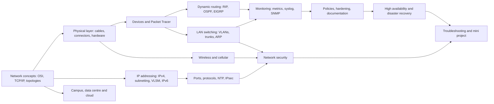

# Module 3: Technologies of Computer Networks

> [Cybersecurity and Digital Forensics](../../README.md) › [Term 1](../README.md) › **Module 3**

| ⬅ [Previous module](../02-html5-and-javascript/README.md) | [Term 1 overview](../README.md) ➡ |
|:---|---:|

---

## 🎯 Module objectives

By the end of this module you will be able to:

- Explain layered network architecture (OSI and TCP/IP), network types and topologies, and find single points of failure.
- Select and test network cabling (copper, fibre, T568A/B) and identify network hardware.
- Plan IPv4 addressing with subnetting and VLSM, and explain the essentials of IPv6.
- Recognise common ports, protocols and services, NTP and the components of IPsec.
- Compare campus and data-centre designs, cloud models and storage networks (NAS, SAN).
- Describe network devices, use Cisco Packet Tracer, and configure RIP, OSPF and EIGRP.
- Configure VLANs and trunks, explain ARP, and defend against ARP spoofing.
- Plan secure wireless networks and compare cellular and antenna technologies.
- Monitor networks with performance metrics, syslog and SNMP.
- Write policies, harden devices, maintain documentation, and design for high availability and disaster recovery.
- Apply network security principles and tools, and troubleshoot networks methodically.

## 🗂 Sessions

| # | Session | Topic file |
|---|---|---|
| 1 | Basic Concepts of a Network | [session-01-basic-network-concepts.md](session-01-basic-network-concepts.md) |
| 2 | Network Cables, Connectors and Wiring Standards | [session-02-cables-connectors-wiring.md](session-02-cables-connectors-wiring.md) |
| 3 | IP Addressing | [session-03-ip-addressing.md](session-03-ip-addressing.md) |
| 4 | Common Ports, Protocols and Services | [session-04-ports-protocols-services.md](session-04-ports-protocols-services.md) |
| 5 | Corporate, Data Centre Network and Cloud Architecture | [session-05-datacentre-and-cloud.md](session-05-datacentre-and-cloud.md) |
| 6 | Network Devices, Components and Packet Tracer | [session-06-network-devices-packet-tracer.md](session-06-network-devices-packet-tracer.md) |
| 7 | Dynamic Routing: RIP, OSPF and EIGRP | [session-07-dynamic-routing.md](session-07-dynamic-routing.md) |
| 8 | LAN Switching Technologies | [session-08-lan-switching.md](session-08-lan-switching.md) |
| 9 | Wireless Technologies | [session-09-wireless-technologies.md](session-09-wireless-technologies.md) |
| 10 | Network Availability and Monitoring | [session-10-network-availability.md](session-10-network-availability.md) |
| 11 | Policies and Procedures | [session-11-policies-and-procedures.md](session-11-policies-and-procedures.md) |
| 12 | High Availability and Disaster Recovery | [session-12-high-availability-dr.md](session-12-high-availability-dr.md) |
| 13 | Network Security | [session-13-network-security.md](session-13-network-security.md) |
| 14 | Network Troubleshooting | [session-14-network-troubleshooting.md](session-14-network-troubleshooting.md) |
| 📝 | Module practice test (20 MCQs + 3 scenarios) | [practice-test.md](practice-test.md) |

## ▶️ Running the examples

- Every Python example lives in [`code/`](code/README.md) and uses only the standard library: run it with Python 3.10 or newer, e.g. `python session-03_subnet_calc.py`.
- Each session with Python code also has an executed Jupyter notebook in `code/` with an **Open in Colab** badge, so you can run everything in the browser.
- Networking examples that use sockets talk only to `127.0.0.1` (your own machine). Log and packet examples use recorded lab data, not live traffic.
- `.ios` files are Cisco IOS configurations to type into **Cisco Packet Tracer** (free with a Cisco Networking Academy account).
- **Ethics:** test only systems you own or have written permission to test.

## 🧭 Concept map

## 🧩 Mini project

**Campus Branch Network Planner** – [`code/mini_project_netplan.py`](code/mini_project_netplan.py), walked through in [Session 14](session-14-network-troubleshooting.md). Given departments and head-counts it allocates VLSM subnets, assigns VLANs and gateways, sizes switches and access points, and writes an inter-VLAN ACL policy. Extend it as described in the Session 14 lab (new department, generated router configuration).

## 📌 One-page cheat-sheet

| Topic | Remember |
|---|---|
| OSI | 7 Application · 6 Presentation · 5 Session · 4 Transport (segment) · 3 Network (packet) · 2 Data link (frame) · 1 Physical (bits) |
| TCP/IP | Application · Transport · Internet · Network access |
| Topologies | Star n − 1 links (centre = SPOF) · ring n · full mesh n(n − 1)/2 · tree · hybrid |
| Network types | PAN < LAN < CAN < MAN < WAN; intranet / extranet / internet; client-server vs P2P |
| Copper | Cat5e 1G · Cat6 1G (10G ≤ 55 m) · Cat6a 10G · Cat8 40G/30 m · 100 m channel = 90 + 10 |
| Fibre | Multimode (aqua, ≤ ~400 m at 10G) · single-mode (yellow, km) · LC / SC / ST / MPO · SFP |
| T568B | W-O, O, W-G, Bl, W-Bl, G, W-Br, Br · same both ends = straight · A + B = crossover · reversed = rollover |
| Subnetting | Network = IP AND mask · hosts = 2^h − 2 · block = 256 − mask octet · VLSM largest first |
| Special IPv4 | 10/8, 172.16/12, 192.168/16 private · 127/8 loopback · 169.254/16 APIPA (DHCP failed) |
| IPv6 | 128-bit hex · one `::` · /64 LANs · fe80::/10 link-local · fc00::/7 ULA · 2000::/3 global · no broadcast · NDP · SLAAC |
| Ports | 20/21 FTP · 22 SSH · 23 Telnet · 25 SMTP · 53 DNS · 67/68 DHCP · 69 TFTP · 80 HTTP · 123 NTP · 161/162 SNMP · 389 LDAP · 443 HTTPS · 445 SMB · 514 syslog · 3389 RDP |
| TCP vs UDP | TCP: handshake, reliable · UDP: connectionless, fast (DNS, DHCP, NTP, VoIP) |
| NTP | Stratum 0 = reference clock · offset = ((t2 − t1) + (t3 − t4)) / 2 · correct time = trustworthy logs |
| IPsec | AH integrity · ESP encryption · IKE keys (UDP 500/4500) · transport vs tunnel mode |
| Data centre | Spine-leaf: every leaf to every spine, 2 hops, ECMP · oversubscription = down ÷ up |
| Cloud | IaaS / PaaS / SaaS · public / private / hybrid / community · shared responsibility |
| Storage | DAS · NAS (file: SMB/NFS) · SAN (block: FC, FCoE, iSCSI 3260) · RAID ≠ backup |
| Devices | Hub L1 · switch L2 (MAC table) · router L3 (routing table) · firewall, IDS/IPS, proxy, load balancer |
| Route choice | Longest prefix → administrative distance (connected 0, static 1, EIGRP 90, OSPF 110, RIP 120) → metric |
| RIP | Hop count ≤ 15 · v2 224.0.0.9 · split horizon, poisoning, hold-down |
| OSPF | Link state · cost = ref BW ÷ BW · area 0 · neighbours FULL · DR/BDR · wildcard masks |
| EIGRP | DUAL · bandwidth + delay · successor + feasible successor · AS must match |
| VLANs | Access = 1 VLAN untagged · trunk = 802.1Q tags (4 bytes, 12-bit ID) · unused native VLAN · `nonegotiate` |
| ARP | IP → MAC · request broadcast, reply unicast · spoofing → DHCP snooping + DAI |
| Wi-Fi | 2.4 GHz channels 1/6/11 · WEP ✗ · WPA2-AES with long PSK · WPA3-SAE + PMF · Enterprise = 802.1X + RADIUS |
| Cellular / antennas | 2G → 5G (slicing, low latency) · omni, patch, sector, Yagi, dish · dBi, EIRP |
| Monitoring | Latency, jitter, loss, utilisation · syslog PRI = facility × 8 + severity (0 Emergency … 7 Debug) · SNMPv3 · NetFlow |
| Policies | Policy → standard → procedure · change management with rollback · AUP · offboarding · baselines |
| Hardening | `enable secret` · SSH v2 only · VTY ACL + timeout · HTTP off · no SNMP `public` · unused ports shut · NTP + syslog |
| HA / DR | A = MTBF ÷ (MTBF + MTTR) · series × · parallel 1 − Π(1 − A) · RPO / RTO / MTD · full / incremental / differential · 3-2-1-1-0 · hot / warm / cold |
| Security | CIA · AAA · least privilege · defence in depth · zero trust · ACL first match + implicit deny · IDS vs IPS · DMZ · NAC |
| Troubleshooting | Identify → theory → test → plan → implement → verify → document · bottom-up / top-down / divide-and-conquer |

## 📝 Assessment

Finish with the [module practice test](practice-test.md): 20 multiple-choice questions and 3 scenario questions, answers hidden.

---

Prepared by **Hamna Zahid Khan**, Junior Lecturer · Cybersecurity and Digital Forensics
