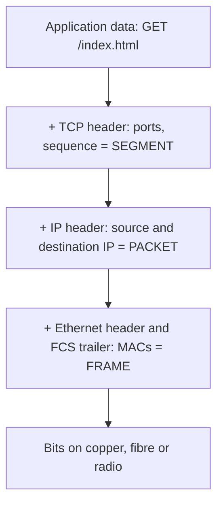
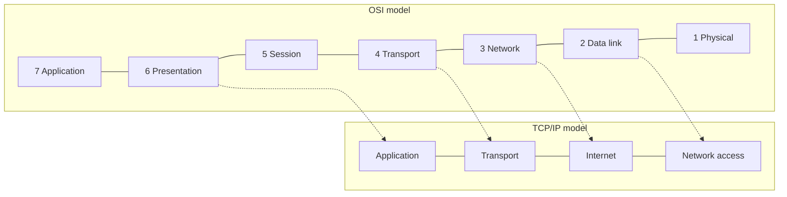
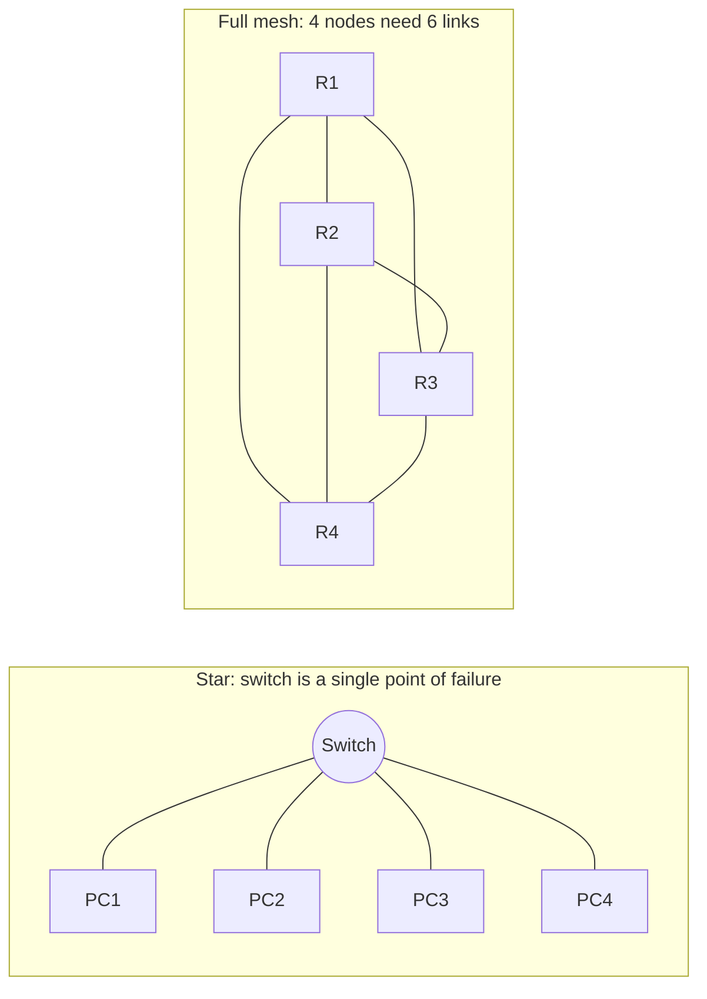
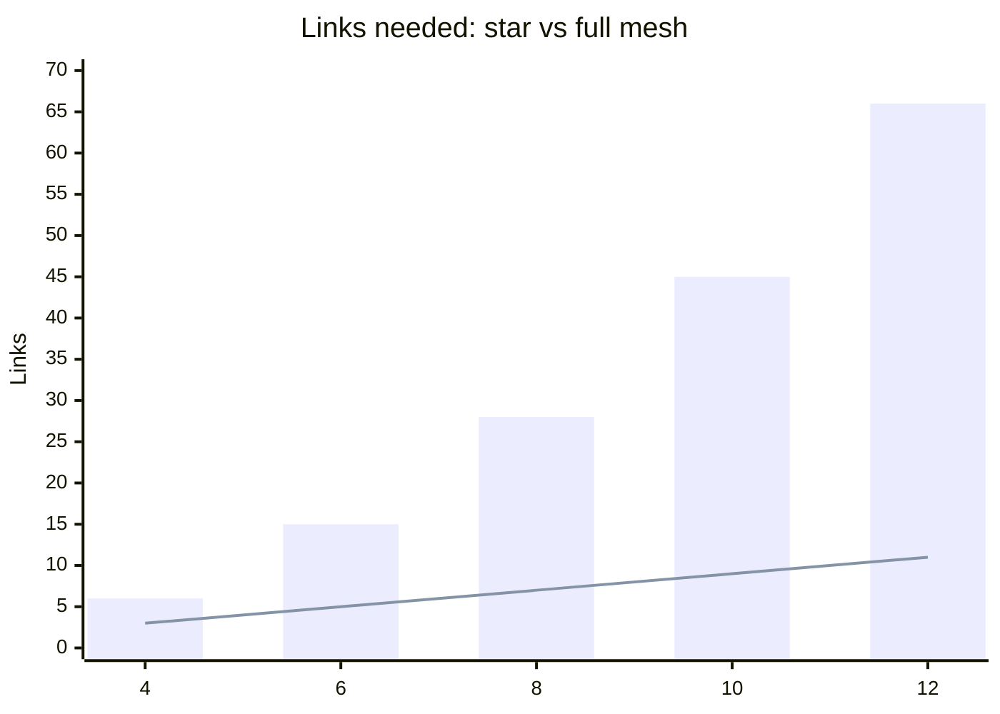

# Session 1: Basic Concepts of a Network

> [Cybersecurity and Digital Forensics](../../README.md) › [Term 1](../README.md) › [Module 3: Technologies of Computer Networks](README.md) › **Session 1**

| ⏱ Estimated time | 📋 Prerequisites |
|---|---|
| 3 hours | Basic computer use; Module 2 Session 1 (how the Web works) helps |

| ⬅ [Module overview](README.md) | [Next: Session 2](session-02-cables-connectors-wiring.md) ➡ |
|:---|---:|

[](https://colab.research.google.com/github/Hamnakhan123/Cybersecurity-and-Digital-Forensics/blob/main/term-1/03-computer-networks/code/session-01-basic-network-concepts.ipynb) &nbsp;Run every Python example of this session in the notebook [`code/session-01-basic-network-concepts.ipynb`](code/session-01-basic-network-concepts.ipynb).

---

## 🎯 Learning objectives

By the end of this session you will be able to:

- Define a **computer network** and name its building blocks (nodes, links, protocols, services).
- Explain **layered network architecture** using the **OSI** and **TCP/IP** models, and describe **encapsulation**.
- Identify the **types of networks** by size (PAN, LAN, CAN, MAN, WAN), by role (client-server vs peer-to-peer) and by ownership (intranet, extranet, internet).
- Compare the **physical and logical topologies** (bus, star, ring, mesh, tree, hybrid) and find a topology's **single point of failure**.
- Explain why a security professional must understand all of this before defending a network.

## 📖 Concepts

### 1. What is a network?

A **computer network** is two or more devices connected so they can share data and resources. A home Wi-Fi with a phone and a printer is a network; so is the internet, which is a network of networks.

> **Analogy – the postal system.** Houses are **nodes** (devices), roads are **links** (cables or radio), the rules for writing an address on an envelope are **protocols**, and the post office counter that accepts parcels is a **service** (web, e-mail, file sharing).

| Building block | Meaning | Examples |
|---|---|---|
| **Node / host** | Any device that sends or receives data | PC, phone, server, printer, IP camera |
| **Intermediary device** | Moves data between hosts | Switch, router, access point, firewall |
| **Medium / link** | The path the signal travels | Copper cable, fibre, radio (Wi-Fi, 5G) |
| **Protocol** | Agreed rules for talking | Ethernet, IP, TCP, HTTP, DNS |
| **Service** | Something useful offered over the network | Web site, e-mail, file share, VoIP |

**Why networks?** Sharing resources (one printer for 30 people), communication (e-mail, chat, video calls), central storage and backup, centralised security management, and remote access.

### 2. Layered architecture: why layers?

Sending a web page involves electrical signals, addressing, routing across countries, reliable delivery and finally the web content itself. Solving all of that in one huge program would be impossible to maintain. Networks split the job into **layers**: each layer does one job, uses the layer below and serves the layer above.

> **Analogy – sending a gift abroad.** You write a card (application), put it in a gift box (presentation), the courier attaches a tracking number (transport), an address label (network), loads it on a particular truck (data link), and the truck drives on the road (physical). Each worker only cares about their own step.

Benefits: vendors can build interoperable products, one layer can change (Wi-Fi instead of cable) without changing the others, and troubleshooting becomes systematic ("is it a Layer 1 problem?").

### 3. The OSI reference model (7 layers)

| # | Layer | Job | PDU name | Devices / protocols | Typical attack / defence |
|---|---|---|---|---|---|
| 7 | **Application** | Network services for the user's apps | Data | HTTP, DNS, SMTP, FTP, SSH | Phishing, injection / WAF |
| 6 | **Presentation** | Format, encode, compress, encrypt | Data | TLS, JPEG, ASCII, UTF-8 | Weak ciphers / strong TLS |
| 5 | **Session** | Open, manage, close conversations | Data | RPC, NetBIOS, session tokens | Session hijack / secure cookies |
| 4 | **Transport** | End-to-end delivery, ports, reliability | **Segment** (TCP) / Datagram (UDP) | TCP, UDP | SYN flood / SYN cookies |
| 3 | **Network** | Logical addressing and routing | **Packet** | IP, ICMP, routers | IP spoofing / ACLs |
| 2 | **Data link** | Local delivery using MAC addresses | **Frame** | Ethernet, Wi-Fi, switches | ARP spoofing / DAI, port security |
| 1 | **Physical** | Bits as signals: voltage, light, radio | **Bits** | Cables, hubs, repeaters, NICs | Wire-tapping / locked rooms |

**Memory trick (top to bottom):** **A**ll **P**eople **S**eem **T**o **N**eed **D**ata **P**rocessing.
**Bottom to top:** **P**lease **D**o **N**ot **T**hrow **S**ausage **P**izza **A**way.

### 4. The TCP/IP model (what the internet actually uses)

| TCP/IP layer | Maps to OSI | Examples |
|---|---|---|
| Application | 7, 6, 5 | HTTP, HTTPS, DNS, DHCP, SSH, SMTP |
| Transport | 4 | TCP, UDP |
| Internet | 3 | IPv4, IPv6, ICMP |
| Network access (link) | 2, 1 | Ethernet, Wi-Fi, fibre |

OSI is the **teaching and troubleshooting** vocabulary ("a Layer 2 problem"); TCP/IP is the **working** protocol suite.

### 5. Encapsulation and de-encapsulation

On the way **down** the sender's stack, every layer adds its own **header** (Layer 2 also adds a **trailer**, the FCS checksum). On the way **up** the receiver's stack, each layer reads and removes its header. Only peers talk to each other: the receiver's TCP reads what the sender's TCP wrote.

- **Overhead:** headers are not your data. Small messages carry proportionally large overhead (you will see 1000 % in the example below).
- **Security view:** firewalls read Layer 3/4 headers (IP, port); deep packet inspection reads Layer 7; encryption at Layer 6/7 (TLS) hides the payload but not the IP header.

### 6. Types of networks

**By size / geography**

| Type | Range | Example | Typical technology |
|---|---|---|---|
| **PAN** – Personal Area Network | ~10 m | Phone + earbuds + smartwatch | Bluetooth, USB |
| **LAN** – Local Area Network | One building | Computer lab, home Wi-Fi | Ethernet, Wi-Fi |
| **CAN** – Campus Area Network | Several buildings | University campus | Fibre between buildings |
| **MAN** – Metropolitan Area Network | A city | City-wide cable/fibre ring | Metro Ethernet, fibre |
| **WAN** – Wide Area Network | Countries / world | Bank branches nationwide, the internet | MPLS, leased lines, SD-WAN, VPN |
| **WLAN / SAN / VPN** | Special purpose | Wireless LAN, storage network, encrypted tunnel | Wi-Fi, Fibre Channel, IPsec |

**By role**

| | Client-server | Peer-to-peer (P2P) |
|---|---|---|
| Who provides services | Dedicated servers | Every computer can share |
| Management | Central (accounts, backups, security) | Each user manages their own |
| Scale | Hundreds to millions of users | Best under ~10 devices |
| Cost | Higher (servers, admins) | Low |
| Security | Strong central control | Weak: every device is a door |
| Example | University login, web sites | Home file sharing, BitTorrent |

**By ownership / audience:** **Internet** (public), **intranet** (private, employees only), **extranet** (part of the intranet opened to partners or suppliers).

### 7. Topologies

The **physical topology** is how cables are actually laid; the **logical topology** is how data flows. A star of cables connected to an old hub behaves logically like a bus.

| Topology | Picture | Links for *n* devices | Strength | Weakness |
|---|---|---|---|---|
| **Bus** | All on one backbone cable | 1 backbone | Cheap, simple | Backbone break = network down; collisions |
| **Star** | All to a central switch | n − 1 | Easy to add/troubleshoot; a cable fault affects one PC | Central switch is a **single point of failure (SPOF)** |
| **Ring** | Each to two neighbours | n | Orderly access | One break can stop the ring (dual rings fix this) |
| **Full mesh** | Everyone to everyone | n(n − 1)/2 | Maximum redundancy | Very expensive cabling |
| **Partial mesh** | Critical nodes doubly linked | between | Redundancy where it matters | Design effort |
| **Tree (hierarchical)** | Stars connected in levels | n − 1 | Scales; matches buildings/floors | Upper levels are SPOFs |
| **Hybrid** | Mix, e.g. star-of-stars + mesh core | varies | Real-world flexibility | More complex |

> **Analogy – roads in a city.** Star = all roads lead to one roundabout (jam there and nothing moves). Mesh = a grid of streets (many detours). Bus = one main road with houses on it (roadworks block everyone).

Modern LANs are **extended stars** (switches in each wiring closet, connected to a core); data-centre and WAN cores use **partial mesh** for redundancy.

## 🧭 Diagrams

**Encapsulation down the sender's stack**



**OSI vs TCP/IP**



**Star vs mesh**



## 🪜 Step-by-step walkthrough: what happens when you open a web page

1. You type `https://portal.example.edu` → the browser (Layer 7) asks **DNS** for the IP address.
2. TLS (Layer 6) prepares to encrypt; the browser opens a session (Layer 5).
3. TCP (Layer 4) picks a random **source port** (e.g. 50123) and the **destination port 443**, and performs the three-way handshake.
4. IP (Layer 3) adds source IP (your PC) and destination IP (the server). If the server is on another network, the packet goes to the **default gateway** (router).
5. Ethernet (Layer 2) uses **ARP** to find the gateway's MAC address, adds MAC header + FCS.
6. The NIC (Layer 1) sends bits as electrical pulses / light / radio.
7. Each router on the path strips the frame, reads the IP header, chooses the next hop and builds a **new frame** for the next link. The IP header stays (except TTL decreasing by 1).
8. The server de-encapsulates upward and the web application finally sees the request.

## 💻 Worked examples

### Example 1 (basic) – Encapsulation simulation

The script wraps a short message in one header per OSI layer, then unwraps it. Watch the size grow.

📄 **`code/session-01_encapsulation.py`**

```python
"""Session 1 - Encapsulation through the TCP/IP and OSI layers (simulation).

Shows how application data gains a header at each layer on the way DOWN the
sending stack, and loses it again on the way UP the receiving stack.
Nothing is sent on a real network: it is a teaching model only.
Run:  python session-01_encapsulation.py
"""

# Each layer: (OSI number, OSI name, PDU name, header added by that layer)
LAYERS = [
    (7, "Application",  "Data",    "HTTP: GET /index.html"),
    (6, "Presentation", "Data",    "TLS: encrypted record"),
    (5, "Session",      "Data",    "Session id=42"),
    (4, "Transport",    "Segment", "TCP: src=50123 dst=443 seq=1"),
    (3, "Network",      "Packet",  "IP: 10.0.0.5 -> 93.184.216.34 TTL=64"),
    (2, "Data Link",    "Frame",   "ETH: aa:aa:aa:00:00:01 -> bb:bb:bb:00:00:fe"),
    (1, "Physical",     "Bits",    "signal on the wire"),
]


def encapsulate(payload: str) -> list[str]:
    """Wrap the payload in one header per layer, top (7) to bottom (1)."""
    stack = [payload]
    unit = payload
    for num, name, pdu, header in LAYERS:
        if num == 1:                       # physical layer turns the frame into bits
            size = len(unit)
            unit = f"010110... (the {size}-character frame sent as signals)"
        else:
            unit = f"[{header}] {unit}"
            size = len(unit)
        stack.append(unit)
        print(f"L{num} {name:<12} PDU={pdu:<8} size={size:>3}  {unit[:60]}")
    return stack


def decapsulate(stack: list[str]) -> str:
    """Receiver reads from the bottom up, removing one header per layer."""
    print("\nReceiver strips headers bottom-up:")
    for (num, name, pdu, header), unit in zip(reversed(LAYERS), reversed(stack[1:])):
        print(f"L{num} {name:<12} reads its header -> passes {pdu.lower()} up")
    return stack[0]


if __name__ == "__main__":
    data = "Hello, lab server!"
    print("Sender encapsulates top-down:")
    s = encapsulate(data)
    delivered = decapsulate(s)
    overhead = len(s[-2]) - len(data)
    print(f"\nDelivered to the application: {delivered!r}")
    print(f"Header overhead before the wire: {overhead} characters "
          f"for {len(data)} characters of real data ({overhead / len(data):.0%})")
```

**Output**

```text
Sender encapsulates top-down:
L7 Application  PDU=Data     size= 42  [HTTP: GET /index.html] Hello, lab server!
L6 Presentation PDU=Data     size= 66  [TLS: encrypted record] [HTTP: GET /index.html] Hello, lab s
L5 Session      PDU=Data     size= 82  [Session id=42] [TLS: encrypted record] [HTTP: GET /index.ht
L4 Transport    PDU=Segment  size=113  [TCP: src=50123 dst=443 seq=1] [Session id=42] [TLS: encrypt
L3 Network      PDU=Packet   size=152  [IP: 10.0.0.5 -> 93.184.216.34 TTL=64] [TCP: src=50123 dst=4
L2 Data Link    PDU=Frame    size=198  [ETH: aa:aa:aa:00:00:01 -> bb:bb:bb:00:00:fe] [IP: 10.0.0.5 
L1 Physical     PDU=Bits     size=198  010110... (the 198-character frame sent as signals)

Receiver strips headers bottom-up:
L1 Physical     reads its header -> passes bits up
L2 Data Link    reads its header -> passes frame up
L3 Network      reads its header -> passes packet up
L4 Transport    reads its header -> passes segment up
L5 Session      reads its header -> passes data up
L6 Presentation reads its header -> passes data up
L7 Application  reads its header -> passes data up

Delivered to the application: 'Hello, lab server!'
Header overhead before the wire: 180 characters for 18 characters of real data (1000%)
```
**What to notice:** 18 characters of real data needed 180 characters of headers in this toy model. Real overhead is smaller (Ethernet + IPv4 + TCP ≈ 58 bytes), but the lesson is the same: tiny packets waste bandwidth, which is why protocols batch data.

### Example 2 (intermediate → advanced) – Topology cost and single points of failure

The script builds bus, star, ring, tree and full-mesh networks of 6 devices, counts links and removes each device in turn to see whether the rest stay connected (a breadth-first search).

📄 **`code/session-01_topology.py`**

```python
"""Session 1 - Compare network topologies by cable count and fault tolerance.

For each topology we build the list of links between N devices, then ask:
  * how many cables / links are needed?
  * if any ONE device fails, do the remaining devices stay connected?
That second question finds the single points of failure (SPOF).
Run:  python session-01_topology.py
"""
from itertools import combinations


def build(topology: str, n: int) -> set[tuple[int, int]]:
    """Return the set of links (a, b) for n devices numbered 0..n-1."""
    if topology == "star":            # device 0 is the central switch
        return {(0, i) for i in range(1, n)}
    if topology == "ring":
        return {tuple(sorted((i, (i + 1) % n))) for i in range(n)}
    if topology == "full mesh":
        return set(combinations(range(n), 2))
    if topology == "bus":             # model the shared cable as node 0 (backbone)
        return {(0, i) for i in range(1, n)}
    if topology == "tree":            # binary tree: parent of i is (i-1)//2
        return {((i - 1) // 2, i) for i in range(1, n)}
    raise ValueError(topology)


def connected(nodes: set[int], links: set[tuple[int, int]]) -> bool:
    """Breadth-first search: can every node reach every other node?"""
    if not nodes:
        return True
    start = next(iter(nodes))
    seen, queue = {start}, [start]
    while queue:
        cur = queue.pop(0)
        for a, b in links:
            for x, y in ((a, b), (b, a)):
                if x == cur and y in nodes and y not in seen:
                    seen.add(y)
                    queue.append(y)
    return seen == nodes


def single_points_of_failure(n: int, links) -> list[int]:
    """Nodes whose failure splits the rest of the network."""
    spof = []
    for victim in range(n):
        rest = set(range(n)) - {victim}
        rest_links = {l for l in links if victim not in l}
        if not connected(rest, rest_links):
            spof.append(victim)
    return spof


if __name__ == "__main__":
    N = 6
    print(f"{'Topology':<10} {'Links':>5}  {'Formula':<12} Single points of failure")
    formulas = {"star": "n-1", "ring": "n", "full mesh": "n(n-1)/2",
                "bus": "1 backbone", "tree": "n-1"}
    for topo in ["bus", "star", "ring", "tree", "full mesh"]:
        links = build(topo, N)
        spof = single_points_of_failure(N, links)
        label = "none" if not spof else ", ".join(f"node {s}" for s in spof)
        print(f"{topo:<10} {len(links):>5}  {formulas[topo]:<12} {label}")

    print("\nFull-mesh cost grows fast:")
    for n in (4, 10, 50, 100):
        print(f"  {n:>3} sites -> {n * (n - 1) // 2:>5} links")
```

**Output**

```text
Topology   Links  Formula      Single points of failure
bus            5  1 backbone   node 0
star           5  n-1          node 0
ring           6  n            none
tree           5  n-1          node 0, node 1, node 2
full mesh     15  n(n-1)/2     none

Full-mesh cost grows fast:
    4 sites ->     6 links
   10 sites ->    45 links
   50 sites ->  1225 links
  100 sites ->  4950 links
```
**Reading the result:** star and tree are cheap (5 links) but have SPOFs; ring and full mesh survive any single device failure, but full mesh cost explodes (100 sites → 4 950 links). That is why real WANs use **partial mesh**: double links only for critical sites.

## 📊 Chart: links needed as the network grows (n devices)



*Bars = full mesh n(n − 1)/2, line = star n − 1.*

## 🏢 Real-life problem with full solution

**Scenario.** A private school has 3 floors: an admin office (8 PCs + 1 printer), a computer lab (30 PCs) and a library (6 PCs + Wi-Fi for 40 phones). Two years ago a single switch in the admin office failed and the whole school lost internet for a day. The principal asks you: *"Which type of network and topology should we have, and how do we avoid that outage again?"*

**Solution.**

1. **Type:** one **LAN** (one building) in a **client-server** design: a file/print server and central user accounts give control and backups; P2P would make each PC its own security risk.
2. **Topology:** an **extended star (tree)**: one access switch per floor (lab: 48-port switch; admin: 24-port; library: 24-port with a PoE port for the access point), each connected to a **core switch** in the server room.
3. **Remove the SPOF:** give the core **two** switches and connect every floor switch to both (a partial mesh at the core). If one core fails, traffic uses the other. Add a UPS for the core and the internet router.
4. **Cabling:** Cat6 to desks (≤ 90 m permanent link), fibre between floors if the riser exceeds 100 m (Session 2).
5. **Security bonus:** separate the lab, admin and guest Wi-Fi into different VLANs later (Session 8), so a student cannot reach the admin office PCs.

Result: one failed floor switch affects one floor; one failed core switch affects nobody.

## ⚠️ Common mistakes

| Mistake | Why it is wrong | Correct idea |
|---|---|---|
| "OSI is what my computer runs." | OSI is a reference model | Real stacks are TCP/IP; OSI is the vocabulary |
| Mixing up PDU names | Each layer's unit has a name | Segment (4), packet (3), frame (2), bits (1) |
| "A star has no single point of failure because each cable is separate." | The centre device is shared | The central switch is the SPOF |
| "Routers change the IP addresses on the way." | Routers rewrite **frames**, not IPs (unless NAT) | MACs change hop by hop; IPs stay end to end |
| Calling every network a LAN | Size and ownership matter | PAN/LAN/CAN/MAN/WAN; intranet vs extranet |
| Physical = logical topology | A hub-based star behaves like a bus | Separate *how it is wired* from *how data flows* |

## ✅ Best practices

- Design hierarchically (access → distribution/core) so the network can grow floor by floor.
- Remove single points of failure in the core and for critical services; accept them at the edge (one desk).
- Document the topology (diagram + IP plan) on day one and keep it updated.
- Troubleshoot **bottom-up** (cable → link → IP → port → application) using the OSI layers.
- Think like a defender at every layer: lock wiring closets (L1), secure switches (L2), filter at routers (L3/L4), encrypt and patch applications (L6/L7).

## 🧪 Lab / practice tasks

1. **Easy –** Draw the 7 OSI layers and write one protocol and one device for each.
2. **Easy –** Classify: smartwatch to phone; one office floor; Karachi-to-Lahore bank branches; a university's 5 buildings; a supplier portal into a company's intranet.
3. **Medium –** Run `session-01_topology.py` with `N = 10`. Record the links for each topology and explain the SPOFs.
4. **Medium –** On your own PC run `ipconfig /all` (Windows) or `ip a` (Linux/macOS). Identify the MAC address (Layer 2), IP address and default gateway (Layer 3).
5. **Challenge –** Add a `"partial mesh"` topology to the script: a ring plus links from node 0 to every other node. How many links? Does it have SPOFs?

<details>
<summary>💡 Hints</summary>

- Task 2: PAN, LAN, WAN, CAN, extranet.
- Task 3: full mesh with 10 nodes = 45 links.
- Task 5: build `ring | {(0, i) for i in range(2, n - 1)}`.
</details>

<details>
<summary>✅ Solutions</summary>

**Task 1:** 7 Application – HTTP/browser; 6 Presentation – TLS; 5 Session – RPC; 4 Transport – TCP/firewall ports; 3 Network – IP/router; 2 Data link – Ethernet/switch; 1 Physical – cable/hub.

**Task 3 (N = 10):** bus 9, star 9, ring 10, tree 9, full mesh 45. SPOFs: bus/star – node 0; tree – the inner (parent) nodes 0–3; ring and mesh – none.

**Task 5:**

```python
if topology == "partial mesh":
    ring = {tuple(sorted((i, (i + 1) % n))) for i in range(n)}
    return ring | {(0, i) for i in range(2, n - 1)}
```

For n = 6: 6 ring links + 3 extra = 9 links, no single point of failure – almost the resilience of a full mesh (15 links) for 60 % of the cabling.
</details>

## ✅ Quick quiz

1. At which OSI layer do routers make forwarding decisions? a) 1 b) 2 c) 3 d) 4
2. The PDU at the Transport layer (TCP) is called a: a) frame b) packet c) segment d) bit
3. How many links does a full mesh of 8 devices need? a) 8 b) 16 c) 28 d) 56
4. A company lets its suppliers log in to part of its internal network. This is an: a) intranet b) extranet c) internet d) PAN
5. Which topology's central device is a single point of failure? a) star b) full mesh c) dual ring d) partial mesh

<details>
<summary>Show answers</summary>

1 – c · 2 – c · 3 – c (8 × 7 / 2) · 4 – b · 5 – a
</details>

## 📝 Summary / cheat-sheet

- Network = nodes + links + protocols + services.
- **OSI (7):** Application, Presentation, Session, Transport, Network, Data link, Physical. **TCP/IP (4):** Application, Transport, Internet, Network access.
- **Encapsulation:** data → segment → packet → frame → bits; each layer adds a header; peers read their own header.
- **Network types:** PAN < LAN < CAN < MAN < WAN; client-server vs P2P; internet / intranet / extranet.
- **Topologies:** bus, star (n − 1), ring (n), mesh (n(n − 1)/2), tree, hybrid. Look for the **single point of failure**.
- Security maps onto layers; troubleshooting goes bottom-up.

**Interview / viva questions**

1. Why are networks designed in layers? Give two advantages.
2. Explain encapsulation using the journey of a web request.
3. What is the difference between the OSI and TCP/IP models?
4. Compare client-server and peer-to-peer networks from a security point of view.
5. What is a single point of failure? How would you remove it from a star network?
6. Why do MAC addresses change at each hop but IP addresses do not?

---

| ⬅ [Module overview](README.md) | [Next: Session 2](session-02-cables-connectors-wiring.md) ➡ |
|:---|---:|

<sub>Prepared by **Hamna Zahid Khan**, Junior Lecturer · Cybersecurity and Digital Forensics</sub>
