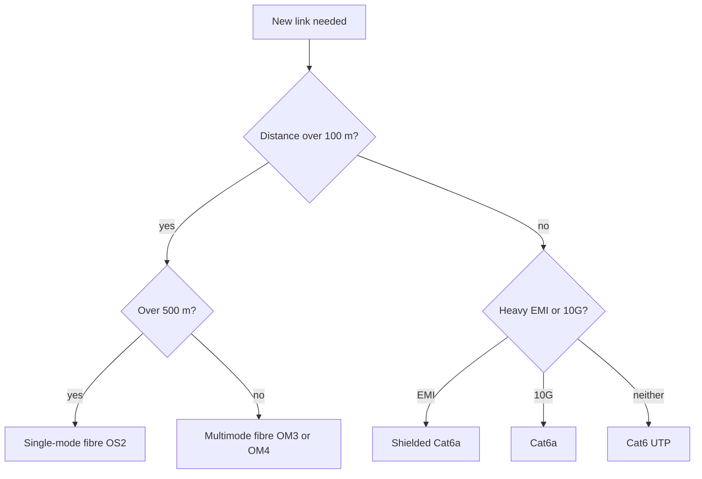
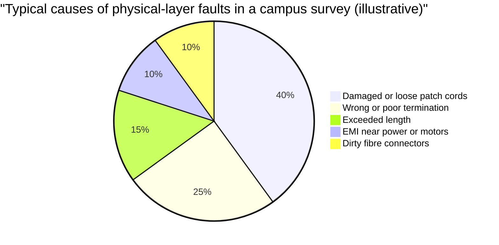

# Session 2: Network Cables, Connectors and Wiring Standards

> [Cybersecurity and Digital Forensics](../../README.md) › [Term 1](../README.md) › [Module 3: Technologies of Computer Networks](README.md) › **Session 2**

| ⏱ Estimated time | 📋 Prerequisites |
|---|---|
| 3 hours | Session 1 (OSI layers and topologies) |

| ⬅ [Previous: Session 1](session-01-basic-network-concepts.md) | [Next: Session 3](session-03-ip-addressing.md) ➡ |
|:---|---:|

[](https://colab.research.google.com/github/Hamnakhan123/Cybersecurity-and-Digital-Forensics/blob/main/term-1/03-computer-networks/code/session-02-cables-connectors-wiring.ipynb) &nbsp;Run every Python example of this session in the notebook [`code/session-02-cables-connectors-wiring.ipynb`](code/session-02-cables-connectors-wiring.ipynb).

---

## 🎯 Learning objectives

- Identify the properties of **copper (twisted-pair, coaxial)** and **fibre-optic** cables: bandwidth, distance, interference, cost.
- Read cable **categories** (Cat5e, Cat6, Cat6a, Cat8) and fibre types (**multimode** OM3/OM4, **single-mode** OS2).
- Explain the **T568A** and **T568B** wiring standards and build/test **straight-through**, **crossover** and **rollover** cables.
- Recognise common **connectors** (RJ-45, RJ-11, LC, SC, ST, F-type, SFP/SFP+ transceivers).
- Identify **network hardware** in a structured-cabling system: NICs, patch panels, keystone jacks, wall plates, racks, media converters, punch-down blocks.
- Apply physical-layer security: protect cabling and wiring closets from tapping and tampering.

## 📖 Concepts

### 1. Why the cable matters

Layer 1 is the foundation. A perfect router configuration still fails over a bad cable. Studies of help-desk tickets consistently show that a large share of "the network is down" calls are physical problems: unplugged, damaged or wrongly terminated cables.

> **Analogy – water pipes.** Bandwidth is the pipe's width, distance limits are like pressure loss in a long pipe, and electromagnetic interference (EMI) is like dirt leaking into a pipe with cracks. Fibre is a sealed glass pipe that dirt cannot enter.

**Key properties of any medium**

| Property | Meaning |
|---|---|
| **Bandwidth / data rate** | Maximum bits per second (Mbps, Gbps) |
| **Maximum distance** | How far before the signal **attenuates** (weakens) too much |
| **EMI / crosstalk resistance** | How well it ignores motors, fluorescent lights, neighbouring wires |
| **Security** | How easily it can be tapped (copper radiates; fibre hardly does) |
| **Cost and handling** | Price, bend radius, ease of termination |
| **Fire rating** | **PVC** for normal spaces; **plenum** (low smoke) inside air-handling ceilings |

### 2. Twisted-pair copper

Eight wires in **four twisted pairs**. The twisting cancels interference: noise hits both wires of a pair equally and is subtracted out.

- **UTP** (unshielded) – cheap, common in offices.
- **STP / FTP / S/FTP** (shielded) – foil or braid around pairs; for factories, hospitals, data centres. Shield must be grounded.

| Category | Max speed | Bandwidth | Max length | Typical use |
|---|---|---|---|---|
| Cat5e | 1 Gbps | 100 MHz | 100 m | Older offices, homes |
| Cat6 | 1 Gbps (10 Gbps ≤ 55 m) | 250 MHz | 100 m | Most new offices |
| Cat6a | 10 Gbps | 500 MHz | 100 m | Wi-Fi 6/7 access points, servers |
| Cat7 / 7a | 10 Gbps+ (non-RJ45 connectors) | 600–1000 MHz | 100 m | Rare; not a TIA standard |
| Cat8 | 25 / 40 Gbps | 2000 MHz | 30 m | Inside data-centre rows |

The **100 m rule:** a structured-cabling channel is 90 m of fixed **permanent link** (wall to wiring closet) + up to 10 m of **patch cords**.

**PoE (Power over Ethernet):** the same cable carries power to IP phones, cameras and access points (802.3af 15.4 W, 802.3at 30 W, 802.3bt up to 90 W).

### 3. Coaxial cable

A centre conductor, insulation, a braided shield and a jacket. Used today mainly for **cable TV/internet** (RG-6, F-type connector) and CCTV (RG-59, BNC). Old Ethernet (10BASE2/10BASE5 "thinnet/thicknet") used coax in a **bus** topology.

### 4. Fibre optic

Data travels as **light pulses** in a glass core. Immune to EMI, very hard to tap without detection, long distances, very high speed.

| | Multimode (MMF) | Single-mode (SMF) |
|---|---|---|
| Core | 50 or 62.5 µm (wide) | ~9 µm (very narrow) |
| Light source | LED / VCSEL (850 nm) | Laser (1310 / 1550 nm) |
| Distance | Up to ~300–550 m at 10 Gbps | 10 km to 100+ km |
| Jacket colour (convention) | Aqua (OM3/OM4), violet (OM4/OM5) | Yellow |
| Cost | Cheaper optics | More expensive optics |
| Use | Inside buildings, data centres | Between buildings, campus, ISP, WAN |

**Connectors:** **LC** (small, the modern standard), **SC** (square push-pull), **ST** (round bayonet, older), **MPO/MTP** (12–24 fibres for 40/100G). **SFP / SFP+ / QSFP** modules plug into switches and turn an electrical port into a fibre (or copper) port. A **media converter** joins copper to fibre.

Fibre polish: **UPC** (blue connector) vs **APC** (green, angled). Never mix them.

### 5. Wiring standards: T568A and T568B

Both define which colour goes to which of the 8 pins of an RJ-45 plug. Only pairs **orange and green** swap places.

| Pin | T568A | T568B | 100BASE-TX use |
|---|---|---|---|
| 1 | white/green | white/orange | Transmit + |
| 2 | green | orange | Transmit − |
| 3 | white/orange | white/green | Receive + |
| 4 | blue | blue | (Gigabit / PoE) |
| 5 | white/blue | white/blue | (Gigabit / PoE) |
| 6 | orange | green | Receive − |
| 7 | white/brown | white/brown | (Gigabit / PoE) |
| 8 | brown | brown | (Gigabit / PoE) |

**Cable types**

| Cable | Ends | Connects | Notes |
|---|---|---|---|
| **Straight-through** | Same standard both ends (B–B) | Unlike devices: PC → switch, switch → router | The normal patch cable |
| **Crossover** | A at one end, B at the other | Like devices: switch → switch, PC → PC | Modern ports with **Auto-MDIX** detect and fix this automatically |
| **Rollover (console)** | Pin 1 ↔ 8, 2 ↔ 7 … | PC serial/USB → router/switch **console** port | Used for first-time configuration |

> **Golden rule:** pick one standard (usually **T568B**) for a whole building and never mix within a run.

### 6. Structured-cabling hardware

| Item | What it does |
|---|---|
| **NIC** (network interface card) | Puts the device on the network; has the MAC address |
| **Wall plate + keystone jack** | Where the desk patch cord plugs in |
| **Horizontal cable** | Solid-core cable inside the wall to the wiring closet |
| **Patch panel** | Rack-mounted rows of ports where horizontal cables are **punched down** |
| **Patch cord** | Short stranded cable from patch panel to switch |
| **Punch-down tool / 110 block** | Terminates wires into IDC slots |
| **Rack (19-inch), cable managers** | Hold and organise the gear; measured in **U** (1.75 in) |
| **IDF / MDF** | Intermediate (per floor) and Main distribution frame (building core / demarc) |
| **Demarc** | Point where the ISP's responsibility ends |
| **Tools** | Crimper, cable stripper, **cable tester**, **toner and probe**, **TDR/OTDR**, fibre light meter |

### 7. Physical security of cabling

- Lock **IDF/MDF** rooms and racks; log who enters.
- Disable or shut **unused wall ports** (Session 11) so a visitor cannot plug in.
- Copper can be tapped or emit signals; **fibre** is preferred for sensitive backbones.
- Label every cable at both ends and keep documentation; an unknown cable in a rack is a security finding.

## 🧭 Diagrams

**Structured cabling from desk to core**


**Choosing a medium**



## 🪜 Step-by-step: making a straight-through T568B patch cable

1. Cut the cable to length; slide on the boot if you use one.
2. Strip ~3 cm of jacket with a stripper (do not nick the inner wires).
3. Untwist the pairs and arrange them in T568B order: white/orange, orange, white/green, blue, white/blue, green, white/brown, brown.
4. Flatten and trim the wires to ~1.2 cm, keeping the order. Keep untwisting **minimal** (≤ 13 mm) to preserve performance.
5. Push the wires into the RJ-45 plug (clip facing down) until each touches the end; the jacket must be inside the plug for strain relief.
6. Crimp firmly. Repeat on the other end with the **same** standard.
7. Test with a cable tester: all 8 lights should go 1–1, 2–2 … 8–8.

## 💻 Worked examples

### Example 1 (basic → advanced) – A software wire-map tester

The script compares the colour order at both ends of a cable and classifies it the way a handheld tester does, including faults.

📄 **`code/session-02_wiremap.py`**

```python
"""Session 2 - T568A / T568B pin maps and a simulated cable wire-map tester.

A real cable tester sends a signal down each of the 8 wires and reports where it
arrives. Here we describe a cable as "end A standard" + "end B standard" (or a
custom pin map with faults) and classify it like a tester would.
Run:  python session-02_wiremap.py
"""

T568A = ["white/green", "green", "white/orange", "blue",
         "white/blue", "orange", "white/brown", "brown"]
T568B = ["white/orange", "orange", "white/green", "blue",
         "white/blue", "green", "white/brown", "brown"]


def pin_map(end_a: list[str], end_b: list[str]) -> list[int | None]:
    """For each pin 1-8 on end A, which pin on end B carries the same wire colour?"""
    result = []
    for colour in end_a:
        result.append(end_b.index(colour) + 1 if colour in end_b else None)
    return result


def classify(mapping: list[int | None]) -> str:
    straight = list(range(1, 9))
    crossover = [3, 6, 1, 4, 5, 2, 7, 8]       # 1<->3 and 2<->6 swapped
    rollover = list(range(8, 0, -1))           # console cable: 1<->8, 2<->7 ...
    if None in mapping:
        return "OPEN: pin(s) " + ", ".join(str(i + 1) for i, m in enumerate(mapping) if m is None)
    if mapping == straight:
        return "straight-through (PC to switch)"
    if mapping == crossover:
        return "crossover (switch to switch, PC to PC on old gear)"
    if mapping == rollover:
        return "rollover (console cable)"
    # pairs 1-2, 3-6, 4-5, 7-8 must stay together or the twist is lost
    pairs = [(1, 2), (3, 6), (4, 5), (7, 8)]
    for a, b in pairs:
        if {mapping[a - 1], mapping[b - 1]} not in [{a, b}, {1, 2}, {3, 6}, {4, 5}, {7, 8}]:
            return f"SPLIT PAIR or mis-wire around pins {a}/{b}"
    return "REVERSED/CROSSED pair: " + str(mapping)


if __name__ == "__main__":
    print("Pin  T568A           T568B")
    for i, (a, b) in enumerate(zip(T568A, T568B), 1):
        mark = "  <- differs" if a != b else ""
        print(f" {i}   {a:<15} {b:<15}{mark}")

    print("\nTesting cables:")
    tests = {
        "B to B": (T568B, T568B),
        "A to A": (T568A, T568A),
        "A to B": (T568A, T568B),
        "B to reversed B": (T568B, list(reversed(T568B))),
    }
    broken = T568B.copy()
    broken[5] = "cut"                         # green conductor broken at pin 6
    tests["B with cut green wire"] = (T568B, broken)
    swapped = T568B.copy()
    swapped[2], swapped[3] = swapped[3], swapped[2]   # installer swapped pins 3 and 4
    tests["B with pins 3/4 swapped"] = (T568B, swapped)

    for name, (a, b) in tests.items():
        m = pin_map(a, b)
        print(f"  {name:<24} map={m}  -> {classify(m)}")
```

**Output**

```text
Pin  T568A           T568B
 1   white/green     white/orange     <- differs
 2   green           orange           <- differs
 3   white/orange    white/green      <- differs
 4   blue            blue           
 5   white/blue      white/blue     
 6   orange          green            <- differs
 7   white/brown     white/brown    
 8   brown           brown          

Testing cables:
  B to B                   map=[1, 2, 3, 4, 5, 6, 7, 8]  -> straight-through (PC to switch)
  A to A                   map=[1, 2, 3, 4, 5, 6, 7, 8]  -> straight-through (PC to switch)
  A to B                   map=[3, 6, 1, 4, 5, 2, 7, 8]  -> crossover (switch to switch, PC to PC on old gear)
  B to reversed B          map=[8, 7, 6, 5, 4, 3, 2, 1]  -> rollover (console cable)
  B with cut green wire    map=[1, 2, 3, 4, 5, None, 7, 8]  -> OPEN: pin(s) 6
  B with pins 3/4 swapped  map=[1, 2, 4, 3, 5, 6, 7, 8]  -> SPLIT PAIR or mis-wire around pins 3/6
```
**Reading the output:** A-to-B gives the crossover map `3, 6, 1, 4, 5, 2, 7, 8`. A cut conductor shows as **open**; swapping the wrong wires breaks the twist of a pair (**split pair**), which often passes a basic continuity test but produces errors at speed.

### Example 2 (intermediate) – Choosing a cable for each job

📄 **`code/session-02_cable_selector.py`**

```python
"""Session 2 - Choose a cable type for a link from distance, speed and environment.

The table holds typical *standard* limits (not vendor marketing maximums).
Run:  python session-02_cable_selector.py
"""

# name, max metres, max Gbps, immune to EMI?, relative cost (1 = cheapest)
CABLES = [
    ("Cat5e UTP",              100,   1, False, 1),
    ("Cat6 UTP",               100,  10, False, 2),   # 10G only up to ~55 m
    ("Cat6a STP",              100,  10, False, 3),
    ("Cat8 STP",                30,  40, False, 5),
    ("Multimode fibre OM3",    300,  10, True,  4),
    ("Multimode fibre OM4",    400,  10, True,  5),
    ("Single-mode fibre OS2", 10000, 100, True,  6),
]


def choose(distance_m: float, speed_gbps: float, high_emi: bool) -> list[str]:
    """Return suitable cables, cheapest first, with a reason for each rejection."""
    ok = []
    for name, max_m, max_g, emi_immune, cost in CABLES:
        limit_m = max_m
        if name == "Cat6 UTP" and speed_gbps > 1:
            limit_m = 55                                  # Cat6 at 10G
        if distance_m > limit_m or speed_gbps > max_g:
            continue
        if high_emi and not emi_immune and "STP" not in name:
            continue                                      # unshielded copper near motors = errors
        ok.append((cost, name))
    return [n for _, n in sorted(ok)]


if __name__ == "__main__":
    jobs = [
        ("Office desk to wall jack", 40, 1, False),
        ("Server rack to rack, 10G", 25, 10, False),
        ("Floor 1 to floor 5 riser, 10G", 180, 10, False),
        ("Factory floor next to motors", 70, 1, True),
        ("Campus building A to B", 2200, 10, False),
        ("Desk to switch 140 m away", 140, 1, False),
    ]
    for desc, d, s, emi in jobs:
        picks = choose(d, s, emi)
        best = picks[0] if picks else "NO single cable: add a switch or use fibre"
        print(f"{desc:<32} {d:>5} m {s:>3} Gbps EMI={'yes' if emi else 'no ':<3} -> {best}")
```

**Output**

```text
Office desk to wall jack            40 m   1 Gbps EMI=no  -> Cat5e UTP
Server rack to rack, 10G            25 m  10 Gbps EMI=no  -> Cat6 UTP
Floor 1 to floor 5 riser, 10G      180 m  10 Gbps EMI=no  -> Multimode fibre OM3
Factory floor next to motors        70 m   1 Gbps EMI=yes -> Cat6a STP
Campus building A to B            2200 m  10 Gbps EMI=no  -> Single-mode fibre OS2
Desk to switch 140 m away          140 m   1 Gbps EMI=no  -> Multimode fibre OM3
```
**Why the last line says fibre:** 140 m exceeds the 100 m copper channel. Two correct answers exist: run multimode fibre, or place a switch in the middle (each copper segment ≤ 100 m).

## 📊 Copper vs fibre at a glance

| | Cat6 UTP | Cat6a STP | OM4 multimode | OS2 single-mode |
|---|---|---|---|---|
| Max length at 10 Gbps | 55 m | 100 m | 400 m | 10 km+ |
| EMI immune | ✗ | partly | ✓ | ✓ |
| Hard to tap | ✗ | ✗ | ✓ | ✓ |
| Carries PoE | ✓ | ✓ | ✗ | ✗ |
| Relative cost of link | 💲 | 💲💲 | 💲💲💲 | 💲💲💲💲 |



*Illustrative teaching figures to show where to look first, not a published statistic.*

## 🏢 Real-life problem with full solution

**Scenario.** A textile factory in an industrial area wants to connect (a) 20 office PCs, (b) 6 machine-monitoring PCs mounted beside large electric looms, (c) a warehouse 450 m away, and (d) 8 IP cameras that have no power socket nearby. The previous contractor used Cat5e everywhere; the loom PCs drop their connection several times a day.

**Solution.**

| Link | Choice | Reason |
|---|---|---|
| Office PCs | Cat6 UTP, T568B, ≤ 90 m permanent links to a patch panel | Cheap, 1 Gbps, future 10G at short runs |
| Loom PCs | **Cat6a shielded (S/FTP)** with grounded shielded jacks, cables routed away from power lines | The looms' motors cause EMI: UTP picks it up → CRC errors and drops |
| Warehouse | **Multimode OM4** fibre is enough for 450 m at 1 Gbps (or single-mode OS2 for future 10G+), LC connectors, SFP modules in both switches | Copper limit is 100 m; fibre also avoids ground-potential differences between buildings |
| IP cameras | Cat6 + **PoE+** switch (802.3at) | One cable gives data and power; no electrician needed per camera |
| Wiring closet | Locked rack, labelled patch panel, unused ports shut down | Physical security and easy troubleshooting |

**Verification:** certify each copper run with a cable certifier, test fibre loss with a light meter, then check switch interface counters for CRC errors after one week (should be zero).

## ⚠️ Common mistakes

- Mixing T568A and T568B on one cable by accident (creates a crossover).
- Untwisting pairs too far at the plug → crosstalk and failures at Gigabit speeds.
- Using **stranded** patch cable for long in-wall runs (higher attenuation) or **solid** cable for patch cords (breaks when flexed).
- Running UTP alongside power cables or fluorescent ballasts.
- Looking into a fibre end that might be live: lasers can damage eyes. Use a power meter, never your eye.
- Bending fibre beyond its minimum radius, or plugging APC (green) into UPC (blue).
- Ignoring plenum rules in air-handling ceilings (fire code).

## ✅ Best practices

- Standardise on **T568B**, Cat6/Cat6a for horizontal runs, fibre for backbones.
- Respect the **90 m + 10 m** channel and bend-radius rules; use cable managers.
- **Label both ends**, keep a cable schedule (port ↔ jack ↔ room) and photograph racks.
- **Certify**, don't just "continuity test", new installations.
- Clean fibre connectors before every connection; cap unused ports.
- Lock wiring closets and disable unused switch ports.

## 🧪 Lab / practice tasks

1. **Easy –** List the T568B colour order from memory. Which pins change in T568A?
2. **Easy –** Which cable: PC → switch; switch → switch (old, no Auto-MDIX); laptop → router console; building A → building B 800 m.
3. **Medium –** Packet Tracer: connect two PCs directly with a straight-through cable, then with a crossover. Which link comes up? (Packet Tracer shows red/green link lights.)
4. **Medium –** Modify `session-02_wiremap.py` to detect a **reversed pair** (pins 1 and 2 swapped) and print `REVERSED PAIR 1/2`.
5. **Challenge –** Extend `session-02_cable_selector.py` with a `poe=True` requirement that rejects fibre, and a budget limit.

<details>
<summary>💡 Hints</summary>

- Task 2: think "like devices = crossover, unlike = straight-through", console = rollover.
- Task 4: a reversed pair has `mapping[0] == 2 and mapping[1] == 1`.
- Task 5: add a `poe` parameter and skip names containing `"fibre"` when it is `True`.
</details>

<details>
<summary>✅ Solutions</summary>

**Task 1:** white/orange, orange, white/green, blue, white/blue, green, white/brown, brown. T568A swaps the orange and green pairs: pins 1↔3 and 2↔6.

**Task 2:** straight-through; crossover; rollover (console); single-mode fibre (multimode may reach ~550 m at 1 Gbps on OM4, but 800 m needs single-mode).

**Task 3:** Packet Tracer PCs require a crossover between two PCs (PC ports have no Auto-MDIX in the simulation), so only the crossover link turns green.

**Task 4:**

```python
def classify(mapping):
    if mapping[0] == 2 and mapping[1] == 1:
        return "REVERSED PAIR 1/2"
    ...  # existing checks
```

**Task 5:**

```python
def choose(distance_m, speed_gbps, high_emi, poe=False, max_cost=10):
    ...
    if poe and "fibre" in name:
        continue
    if cost > max_cost:
        continue
```
</details>

## ✅ Quick quiz

1. What is the maximum length of a standard twisted-pair Ethernet channel? a) 55 m b) 100 m c) 185 m d) 500 m
2. Which cable connects a PC to a router's console port? a) straight-through b) crossover c) rollover d) coaxial
3. Which fibre is used for links of many kilometres? a) OM3 b) OM4 c) single-mode d) plastic optical
4. T568A and T568B differ by swapping which pairs? a) blue and brown b) orange and green c) green and blue d) brown and orange
5. Which is the strongest reason to use fibre between two buildings? a) carries PoE b) cheaper optics c) immune to EMI and ground differences, long reach d) easier to terminate

<details>
<summary>Show answers</summary>

1 – b · 2 – c · 3 – c · 4 – b · 5 – c
</details>

## 📝 Summary / cheat-sheet

- Copper twisted pair: Cat5e (1G), Cat6 (1G; 10G ≤ 55 m), Cat6a (10G, 100 m), Cat8 (40G, 30 m). UTP vs STP.
- Coax: RG-6 (cable TV/internet, F-type), RG-59 (CCTV, BNC).
- Fibre: multimode (aqua, short, cheaper) vs single-mode (yellow, km, laser). LC/SC/ST/MPO; SFP modules.
- T568B: W-O, O, W-G, Bl, W-Bl, G, W-Br, Br. Straight = same both ends; crossover = A + B; rollover = reversed.
- Structured cabling: wall plate → 90 m horizontal → patch panel → patch cord → switch; IDF per floor, MDF core, demarc to ISP.
- Physical security: lock closets, shut unused ports, prefer fibre for sensitive backbones.

**Interview / viva questions**

1. Why are the wires in a UTP cable twisted?
2. When would you choose shielded twisted pair over UTP?
3. Compare multimode and single-mode fibre.
4. What is Auto-MDIX and why are crossover cables rarely needed today?
5. Describe the components between a desk PC and the access switch in structured cabling.
6. Why is fibre considered more secure than copper?

---

| ⬅ [Previous: Session 1](session-01-basic-network-concepts.md) | [Next: Session 3](session-03-ip-addressing.md) ➡ |
|:---|---:|

<sub>Prepared by **Hamna Zahid Khan**, Junior Lecturer · Cybersecurity and Digital Forensics</sub>
