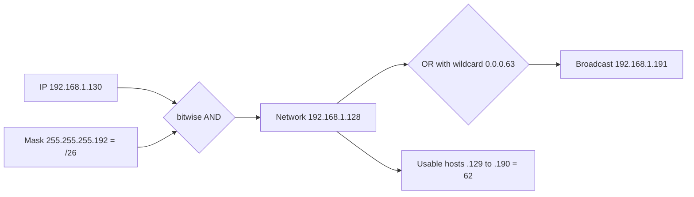
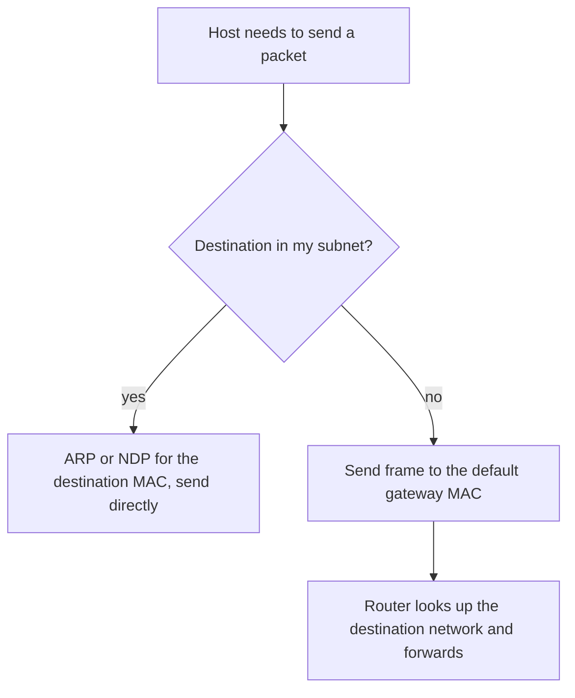
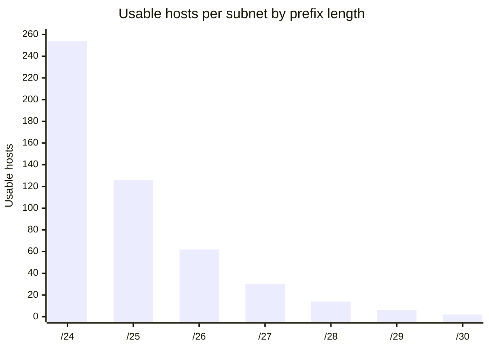

# Session 3: IP Addressing

> [Cybersecurity and Digital Forensics](../../README.md) › [Term 1](../README.md) › [Module 3: Technologies of Computer Networks](README.md) › **Session 3**

| ⏱ Estimated time | 📋 Prerequisites |
|---|---|
| 3.5 hours | Sessions 1–2; binary numbers and bitwise AND/OR from Module 1 Session 4 |

| ⬅ [Previous: Session 2](session-02-cables-connectors-wiring.md) | [Next: Session 4](session-04-ports-protocols-services.md) ➡ |
|:---|---:|

[](https://colab.research.google.com/github/Hamnakhan123/Cybersecurity-and-Digital-Forensics/blob/main/term-1/03-computer-networks/code/session-03-ip-addressing.ipynb) &nbsp;Run every Python example of this session in the notebook [`code/session-03-ip-addressing.ipynb`](code/session-03-ip-addressing.ipynb).

---

## 🎯 Learning objectives

- Describe the structure of an **IPv4 address**: 32 bits, four octets, network part and host part.
- Convert between **dotted decimal and binary**, and use the **subnet mask** / **CIDR prefix**.
- Calculate **network address, broadcast address, usable host range and host count** for any subnet.
- Explain **classful addressing**, **private (RFC 1918)**, **loopback**, **APIPA** and special addresses, plus **NAT**, **DHCP** and the **default gateway**.
- **Subnet** a network into equal parts and plan **VLSM** subnets of different sizes.
- Describe important **IPv6** concepts: 128-bit hex notation, compression rules, address types, SLAAC/EUI-64, dual stack and tunnelling.

## 📖 Concepts

### 1. What an IP address is

An **IP address** is a logical Layer 3 address that identifies a device's interface **and** the network it is on. A MAC address (Layer 2) is like a person's national ID card number: unique but it says nothing about where they live. An IP address is like a postal address: **city + street (network part)** and **house number (host part)**. Routers only look at the network part to move a packet closer.

### 2. IPv4 format

- **32 bits**, written as four 8-bit **octets** in decimal: `192.168.10.77`.
- Each octet is 0–255. Place values: `128 64 32 16 8 4 2 1`.

**Worked conversion:** 192 = 128 + 64 → `11000000`; 168 = 128 + 32 + 8 → `10101000`; 10 → `00001010`; 77 = 64 + 8 + 4 + 1 → `01001101`.
So `192.168.10.77` = `11000000.10101000.00001010.01001101`.

### 3. Subnet mask and CIDR

The **subnet mask** has 1s for network bits and 0s for host bits. `255.255.255.0` = 24 ones = **/24** (CIDR notation, *Classless Inter-Domain Routing*).

| Prefix | Mask | Hosts per subnet | Block size (last octet) |
|---|---|---|---|
| /24 | 255.255.255.0 | 254 | 256 |
| /25 | 255.255.255.128 | 126 | 128 |
| /26 | 255.255.255.192 | 62 | 64 |
| /27 | 255.255.255.224 | 30 | 32 |
| /28 | 255.255.255.240 | 14 | 16 |
| /29 | 255.255.255.248 | 6 | 8 |
| /30 | 255.255.255.252 | 2 | 4 (point-to-point links) |
| /16 | 255.255.0.0 | 65 534 | – |
| /8 | 255.0.0.0 | 16 777 214 | – |

**Usable hosts = 2^(host bits) − 2** (network address and broadcast address cannot be given to hosts).
The **wildcard mask** (used in ACLs and OSPF) is the inverse: /24 → `0.0.0.255`.

### 4. The three key calculations

1. **Network address** = IP **AND** mask (all host bits 0).
2. **Broadcast address** = network **OR** inverted mask (all host bits 1).
3. **Usable range** = network + 1 … broadcast − 1.

**Fast "block size" method:** block = 256 − interesting mask octet. For `192.168.1.130/26`: mask octet 192 → block 64 → subnets start at 0, 64, **128**, 192. 130 lies in the 128 block → network `192.168.1.128`, broadcast `192.168.1.191`, hosts `.129`–`.190`.

### 5. Classful addressing (historic but still examined)

| Class | First octet | Default mask | Purpose |
|---|---|---|---|
| A | 1–126 | /8 | Very large networks |
| B | 128–191 | /16 | Medium |
| C | 192–223 | /24 | Small |
| D | 224–239 | – | **Multicast** |
| E | 240–255 | – | Experimental |

127.x.x.x is reserved for **loopback**. CIDR replaced classes in 1993 so that any prefix length can be used.

### 6. Special and private addresses

| Range | Name | Notes |
|---|---|---|
| 10.0.0.0/8, 172.16.0.0/12, 192.168.0.0/16 | **Private (RFC 1918)** | Free to use inside organisations; not routed on the internet |
| 127.0.0.0/8 | **Loopback** | `127.0.0.1` = this machine |
| 169.254.0.0/16 | **APIPA / link-local** | Self-assigned when DHCP fails: a troubleshooting clue |
| 100.64.0.0/10 | Carrier-grade NAT | Used inside ISPs |
| 192.0.2.0/24, 198.51.100.0/24, 203.0.113.0/24 | Documentation | Safe for examples (used throughout this course) |
| 0.0.0.0 | "this host" / default route | |
| 255.255.255.255 | Limited broadcast | |

**NAT / PAT:** a router translates many private addresses to one public address, keeping track by port number. It saves IPv4 addresses and hides internal addressing (a side benefit, not a firewall).

**DHCP** gives a host its IP, mask, **default gateway** (router for other networks) and DNS servers automatically (the **DORA** exchange: Discover, Offer, Request, Acknowledge).

### 7. Unicast, broadcast, multicast

- **Unicast:** one to one.
- **Broadcast:** one to all in the subnet (ARP requests, DHCP Discover). Routers do **not** forward broadcasts, so a subnet = a **broadcast domain**.
- **Multicast:** one to a subscribed group (video streams, routing protocols such as OSPF 224.0.0.5).

### 8. Subnetting and VLSM

**Subnetting** borrows host bits to make more, smaller networks. Benefits: less broadcast traffic, better security (separate staff, students, servers) and tidy routing.

- Borrowing *n* bits gives **2ⁿ subnets**.
- **VLSM** (variable-length subnet masking): give each segment a mask that fits its size. Always allocate the **largest first** to avoid overlap.

> **Analogy – slicing a cake.** Equal subnetting cuts a cake into equal slices. VLSM cuts a big slice for the big table and small slices for the small tables, so nothing is wasted.

### 9. IPv6 essentials

IPv4's 4.3 billion addresses ran out (regional registries exhausted their pools between 2011 and 2019). **IPv6** uses **128 bits**: 8 groups of 4 hex digits.

**Compression rules**
1. Drop leading zeros in each group: `0db8` → `db8`.
2. Replace **one** longest run of all-zero groups with `::` (only once per address).

`2001:0db8:0000:0000:0000:ff00:0042:8329` → `2001:db8::ff00:42:8329`

| Type | Prefix | IPv4 equivalent |
|---|---|---|
| **Global unicast** | 2000::/3 | Public address |
| **Unique local** | fc00::/7 (fd…) | Private RFC 1918 |
| **Link-local** | fe80::/10 | APIPA – but always present, used by routing and neighbour discovery |
| **Loopback** | ::1 | 127.0.0.1 |
| **Multicast** | ff00::/8 | (IPv6 has **no broadcast**) |
| Unspecified | :: | 0.0.0.0 |

- The usual LAN size is a **/64**: 64-bit network prefix + 64-bit **interface ID**.
- **SLAAC** lets a host create its own address from the router's prefix; the interface ID can come from the MAC (**EUI-64**: insert `FFFE` in the middle and flip the 7th bit) or be random (**privacy extensions**, preferred today).
- **NDP** (Neighbour Discovery, ICMPv6) replaces ARP. **DHCPv6** is optional.
- **Transition:** **dual stack** (run both), **tunnelling** (6in4, IPv6 over IPv4), **NAT64/DNS64** translation.
- **Security note:** many networks run IPv6 without monitoring it. Attackers can use rogue router advertisements; defenders enable **RA Guard** and log IPv6 just like IPv4.

## 🧭 Diagrams





## 🪜 Step-by-step: subnetting 192.168.50.0/24 into 4 equal subnets

1. Subnets needed: 4 → borrow **2 bits** (2² = 4). New prefix **/26**.
2. Mask: `255.255.255.192`; block size 256 − 192 = **64**.
3. Subnet starts: .0, .64, .128, .192.
4. For each: network = start, broadcast = next start − 1, hosts in between.
5. Hosts per subnet = 2⁶ − 2 = **62**.
6. Check with the script below (the last section of Example 1).

## 💻 Worked examples

### Example 1 (basic → advanced) – Subnet calculator by hand, verified by a library

Every result is computed with bitwise AND/OR on a 32-bit integer **and** checked against Python's `ipaddress` module.

📄 **`code/session-03_subnet_calc.py`**

```python
"""Session 3 - IPv4 subnet calculator, done by hand with bits AND checked
against Python's standard `ipaddress` module.

Run:  python session-03_subnet_calc.py
"""
import ipaddress


def ip_to_int(ip: str) -> int:
    a, b, c, d = (int(x) for x in ip.split("."))
    return (a << 24) | (b << 16) | (c << 8) | d


def int_to_ip(n: int) -> str:
    return ".".join(str((n >> s) & 0xFF) for s in (24, 16, 8, 0))


def ip_class(ip: str) -> str:
    first = int(ip.split(".")[0])
    if first < 128: return "A"
    if first < 192: return "B"
    if first < 224: return "C"
    if first < 240: return "D (multicast)"
    return "E (experimental)"


def manual(cidr: str) -> dict:
    """Compute subnet facts using only AND / OR / NOT on 32-bit integers."""
    ip, prefix = cidr.split("/")
    prefix = int(prefix)
    mask = (0xFFFFFFFF << (32 - prefix)) & 0xFFFFFFFF
    net = ip_to_int(ip) & mask                 # AND keeps the network bits
    bcast = net | (~mask & 0xFFFFFFFF)         # OR sets all host bits to 1
    hosts = max(2 ** (32 - prefix) - 2, 0) if prefix < 31 else 2 ** (32 - prefix)
    return {
        "mask": int_to_ip(mask),
        "mask_bits": f"{mask:032b}",
        "wildcard": int_to_ip(~mask & 0xFFFFFFFF),
        "network": int_to_ip(net),
        "broadcast": int_to_ip(bcast),
        "first": int_to_ip(net + 1) if prefix < 31 else int_to_ip(net),
        "last": int_to_ip(bcast - 1) if prefix < 31 else int_to_ip(bcast),
        "hosts": hosts,
    }


def report(cidr: str) -> None:
    m = manual(cidr)
    lib = ipaddress.ip_interface(cidr).network       # independent check
    assert m["network"] == str(lib.network_address)
    assert m["broadcast"] == str(lib.broadcast_address)
    ip = cidr.split("/")[0]
    addr = ipaddress.ip_address(ip)
    rfc1918 = [ipaddress.ip_network(n) for n in ("10.0.0.0/8", "172.16.0.0/12", "192.168.0.0/16")]
    docs = [ipaddress.ip_network(n) for n in ("192.0.2.0/24", "198.51.100.0/24", "203.0.113.0/24")]
    if any(addr in n for n in rfc1918): kind = "private (RFC 1918)"
    elif addr.is_loopback: kind = "loopback"
    elif any(addr in n for n in docs): kind = "documentation range (never routed)"
    else: kind = "public"
    print(f"\n{cidr}   class {ip_class(ip)}, {kind}")
    print(f"  mask      {m['mask']:<16} {m['mask_bits'][:8]}.{m['mask_bits'][8:16]}."
          f"{m['mask_bits'][16:24]}.{m['mask_bits'][24:]}")
    print(f"  wildcard  {m['wildcard']}")
    print(f"  network   {m['network']:<16} broadcast {m['broadcast']}")
    print(f"  hosts     {m['first']} - {m['last']}  ({m['hosts']} usable)")


def split(cidr: str, new_prefix: int) -> None:
    net = ipaddress.ip_network(cidr)
    subs = list(net.subnets(new_prefix=new_prefix))
    print(f"\nSplitting {cidr} into /{new_prefix}: {len(subs)} subnets "
          f"of {subs[0].num_addresses - 2} hosts each")
    for s in subs:
        h = list(s.hosts())
        print(f"  {str(s):<18} hosts {h[0]} - {h[-1]}  broadcast {s.broadcast_address}")


if __name__ == "__main__":
    for c in ["192.168.10.77/24", "172.16.45.200/20", "10.1.2.3/8", "192.168.1.130/26",
              "203.0.113.9/30", "127.0.0.1/8"]:
        report(c)
    split("192.168.50.0/24", 26)
    print("\nAll manual results matched the ipaddress module.")
```

**Output**

```text

192.168.10.77/24   class C, private (RFC 1918)
  mask      255.255.255.0    11111111.11111111.11111111.00000000
  wildcard  0.0.0.255
  network   192.168.10.0     broadcast 192.168.10.255
  hosts     192.168.10.1 - 192.168.10.254  (254 usable)

172.16.45.200/20   class B, private (RFC 1918)
  mask      255.255.240.0    11111111.11111111.11110000.00000000
  wildcard  0.0.15.255
  network   172.16.32.0      broadcast 172.16.47.255
  hosts     172.16.32.1 - 172.16.47.254  (4094 usable)

10.1.2.3/8   class A, private (RFC 1918)
  mask      255.0.0.0        11111111.00000000.00000000.00000000
  wildcard  0.255.255.255
  network   10.0.0.0         broadcast 10.255.255.255
  hosts     10.0.0.1 - 10.255.255.254  (16777214 usable)

192.168.1.130/26   class C, private (RFC 1918)
  mask      255.255.255.192  11111111.11111111.11111111.11000000
  wildcard  0.0.0.63
  network   192.168.1.128    broadcast 192.168.1.191
  hosts     192.168.1.129 - 192.168.1.190  (62 usable)

203.0.113.9/30   class C, documentation range (never routed)
  mask      255.255.255.252  11111111.11111111.11111111.11111100
  wildcard  0.0.0.3
  network   203.0.113.8      broadcast 203.0.113.11
  hosts     203.0.113.9 - 203.0.113.10  (2 usable)

127.0.0.1/8   class A, loopback
  mask      255.0.0.0        11111111.00000000.00000000.00000000
  wildcard  0.255.255.255
  network   127.0.0.0        broadcast 127.255.255.255
  hosts     127.0.0.1 - 127.255.255.254  (16777214 usable)

Splitting 192.168.50.0/24 into /26: 4 subnets of 62 hosts each
  192.168.50.0/26    hosts 192.168.50.1 - 192.168.50.62  broadcast 192.168.50.63
  192.168.50.64/26   hosts 192.168.50.65 - 192.168.50.126  broadcast 192.168.50.127
  192.168.50.128/26  hosts 192.168.50.129 - 192.168.50.190  broadcast 192.168.50.191
  192.168.50.192/26  hosts 192.168.50.193 - 192.168.50.254  broadcast 192.168.50.255

All manual results matched the ipaddress module.
```
### Example 2 (advanced) – IPv6 compression, types and EUI-64

📄 **`code/session-03_ipv6.py`**

```python
"""Session 3 - IPv6 essentials: compress/expand, address types and EUI-64.

Run:  python session-03_ipv6.py
"""
import ipaddress


def eui64_interface_id(mac: str) -> str:
    """Build the 64-bit interface ID from a 48-bit MAC (modified EUI-64).
    1. split the MAC in half and insert FF:FE in the middle
    2. flip bit 7 (the universal/local bit) of the first byte
    """
    b = [int(x, 16) for x in mac.split(":")]
    b = b[:3] + [0xFF, 0xFE] + b[3:]
    b[0] ^= 0x02
    groups = [f"{b[i]:02x}{b[i + 1]:02x}" for i in range(0, 8, 2)]
    return ":".join(groups)


def classify(addr: str) -> str:
    a = ipaddress.ip_address(addr)
    if a.is_loopback: return "loopback (::1)"
    if a.is_link_local: return "link-local (fe80::/10, never routed)"
    if a.is_multicast: return "multicast (ff00::/8)"
    if a in ipaddress.ip_network("fc00::/7"): return "unique local (fc00::/7, like private IPv4)"
    if a in ipaddress.ip_network("2001:db8::/32"): return "documentation (2001:db8::/32)"
    if a in ipaddress.ip_network("2000::/3"): return "global unicast (2000::/3)"
    if a.is_unspecified: return "unspecified (::)"
    return "other"


if __name__ == "__main__":
    print("Compress / expand:")
    for full in ["2001:0db8:0000:0000:0000:ff00:0042:8329",
                 "fe80:0000:0000:0000:0202:b3ff:fe1e:8329",
                 "0000:0000:0000:0000:0000:0000:0000:0001"]:
        a = ipaddress.IPv6Address(full)
        print(f"  {a.exploded}  ->  {a.compressed}")

    print("\nAddress types:")
    for x in ["::1", "fe80::1", "ff02::1", "fd12:3456:789a::10",
              "2001:db8:acad:1::5", "2606:4700:4700::1111", "::"]:
        print(f"  {x:<24} {classify(x)}")

    mac = "00:1a:2b:3c:4d:5e"
    iid = eui64_interface_id(mac)
    prefix = ipaddress.IPv6Network("2001:db8:acad:10::/64")
    full = ipaddress.IPv6Address(f"2001:db8:acad:10:{iid}")
    print(f"\nEUI-64 from MAC {mac}: interface ID {iid}")
    print(f"  SLAAC address in {prefix}: {full}")
    print(f"  link-local address:            {ipaddress.IPv6Address('fe80::' + iid)}")

    print(f"\nA single /64 holds {prefix.num_addresses:,} addresses")
    print(f"IPv4 has only        {2**32:,} in total")
```

**Output**

```text
Compress / expand:
  2001:0db8:0000:0000:0000:ff00:0042:8329  ->  2001:db8::ff00:42:8329
  fe80:0000:0000:0000:0202:b3ff:fe1e:8329  ->  fe80::202:b3ff:fe1e:8329
  0000:0000:0000:0000:0000:0000:0000:0001  ->  ::1

Address types:
  ::1                      loopback (::1)
  fe80::1                  link-local (fe80::/10, never routed)
  ff02::1                  multicast (ff00::/8)
  fd12:3456:789a::10       unique local (fc00::/7, like private IPv4)
  2001:db8:acad:1::5       documentation (2001:db8::/32)
  2606:4700:4700::1111     global unicast (2000::/3)
  ::                       unspecified (::)

EUI-64 from MAC 00:1a:2b:3c:4d:5e: interface ID 021a:2bff:fe3c:4d5e
  SLAAC address in 2001:db8:acad:10::/64: 2001:db8:acad:10:21a:2bff:fe3c:4d5e
  link-local address:            fe80::21a:2bff:fe3c:4d5e

A single /64 holds 18,446,744,073,709,551,616 addresses
IPv4 has only        4,294,967,296 in total
```
## 📊 Chart: how quickly hosts per subnet shrink



| | IPv4 | IPv6 |
|---|---|---|
| Size | 32 bits | 128 bits |
| Notation | Dotted decimal | Hexadecimal, colon-separated |
| Total addresses | ~4.3 × 10⁹ | ~3.4 × 10³⁸ |
| Broadcast | Yes | No (multicast instead) |
| Address resolution | ARP | NDP (ICMPv6) |
| Auto-configuration | DHCP / APIPA | SLAAC, DHCPv6 |
| Header checksum | Yes | No (faster routing) |
| IPsec | Optional add-on | Designed in (support originally mandatory) |

## 🏢 Real-life problem with full solution (VLSM)

**Scenario.** A college has been given `172.20.8.0/22` (1 024 addresses). It needs: Staff 300 hosts, Students 200, Wi-Fi guests 100, Servers 25, plus 2 router links. Design non-overlapping subnets with the least waste.

**Solution – largest first:**

| Segment | Hosts | Needed size | Prefix | Subnet | Usable range | Broadcast |
|---|---|---|---|---|---|---|
| Staff | 300 | 512 | /23 | 172.20.8.0/23 | .8.1 – .9.254 | 172.20.9.255 |
| Students | 200 | 256 | /24 | 172.20.10.0/24 | .10.1 – .10.254 | 172.20.10.255 |
| Guests | 100 | 128 | /25 | 172.20.11.0/25 | .11.1 – .11.126 | 172.20.11.127 |
| Servers | 25 | 32 | /27 | 172.20.11.128/27 | .11.129 – .11.158 | 172.20.11.159 |
| Link 1 | 2 | 4 | /30 | 172.20.11.160/30 | .161 – .162 | .163 |
| Link 2 | 2 | 4 | /30 | 172.20.11.164/30 | .165 – .166 | .167 |

Free for growth: `172.20.11.168/29`, `.176/28`, `.192/26`. Check: hosts needed + 2 must fit in 2^(host bits) (300 + 2 ≤ 512 ✓, 200 + 2 ≤ 256 ✓, 100 + 2 ≤ 128 ✓, 25 + 2 ≤ 32 ✓). The gateway (usually the first usable address) is counted in the "+ 2" margin above together with spare.

The module's mini project ([`code/mini_project_netplan.py`](code/mini_project_netplan.py)) automates exactly this.

## ⚠️ Common mistakes

- Forgetting the **−2** (network and broadcast) when counting hosts.
- Assigning the network or broadcast address to a host.
- Using **two `::`** in one IPv6 address (ambiguous, invalid).
- Allocating VLSM **smallest first** → overlapping subnets.
- Thinking NAT is a firewall: it hides addresses but does not inspect traffic.
- Wrong **default gateway** (different subnet from the host): local traffic works, everything else fails.
- Ignoring IPv6 on a "IPv4-only" network: it is usually enabled on every modern OS.

## ✅ Best practices

- Use **private** ranges internally, document every subnet in an **IP address management (IPAM)** sheet.
- Give the gateway a predictable address (first or last usable) on every subnet.
- Leave room for growth; plan on bit boundaries so subnets can be **summarised** later.
- Separate users, servers, management and guests into different subnets/VLANs.
- For IPv6, use /64 on LANs, enable privacy addresses on clients, and RA Guard on switches.

## 🧪 Lab / practice tasks

1. **Easy –** Convert `172.16.45.200` to binary. What class is it? Is it private?
2. **Easy –** For `10.10.10.200/27` find the network, broadcast, first and last host.
3. **Medium –** Split `192.168.100.0/24` into 8 equal subnets. List them.
4. **Medium –** Compress `fe80:0000:0000:0000:0a00:27ff:fe4e:66a1` and expand `2001:db8:0:1::5`.
5. **Challenge –** VLSM for `192.168.1.0/24`: LAN A 100 hosts, LAN B 50, LAN C 20, 3 point-to-point links. Verify with Python `ipaddress`.

<details>
<summary>💡 Hints</summary>

- Task 2: /27 → block 32 → subnets at .192 and .224 (200 is in .192).
- Task 3: 8 subnets → borrow 3 bits → /27.
- Task 5: biggest first: /25, /26, /27, then /30s.
</details>

<details>
<summary>✅ Solutions</summary>

**Task 1:** `10101100.00010000.00101101.11001000`; class B; private (172.16.0.0/12).

**Task 2:** network 10.10.10.192, broadcast 10.10.10.223, hosts .193 – .222 (30 usable).

**Task 3:** .0, .32, .64, .96, .128, .160, .192, .224 – each /27 with 30 hosts.

**Task 4:** `fe80::a00:27ff:fe4e:66a1`; `2001:0db8:0000:0001:0000:0000:0000:0005`.

**Task 5:**

| Segment | Subnet | Hosts |
|---|---|---|
| LAN A | 192.168.1.0/25 | .1 – .126 |
| LAN B | 192.168.1.128/26 | .129 – .190 |
| LAN C | 192.168.1.192/27 | .193 – .222 |
| Link 1 | 192.168.1.224/30 | .225 – .226 |
| Link 2 | 192.168.1.228/30 | .229 – .230 |
| Link 3 | 192.168.1.232/30 | .233 – .234 |

```python
import ipaddress
nets = ["192.168.1.0/25", "192.168.1.128/26", "192.168.1.192/27",
        "192.168.1.224/30", "192.168.1.228/30", "192.168.1.232/30"]
n = [ipaddress.ip_network(x) for x in nets]
print(any(a.overlaps(b) for i, a in enumerate(n) for b in n[i + 1:]))   # False
```
</details>

## ✅ Quick quiz

1. How many usable hosts does a /28 provide? a) 16 b) 14 c) 30 d) 6
2. Which address is private? a) 172.32.1.1 b) 11.0.0.1 c) 192.168.0.254 d) 8.8.8.8
3. A PC shows `169.254.33.10`. What is the most likely problem? a) DNS b) DHCP not reachable c) wrong gateway d) duplicate IP
4. The broadcast address of `192.168.5.70/26` is: a) .63 b) .127 c) .64 d) .255
5. Which IPv6 address type is equivalent to IPv4 private addresses? a) fe80::/10 b) fc00::/7 c) 2000::/3 d) ff00::/8

<details>
<summary>Show answers</summary>

1 – b · 2 – c · 3 – b · 4 – b (block .64–.127) · 5 – b
</details>

## 📝 Summary / cheat-sheet

- IPv4 = 32 bits, 4 octets; network part + host part decided by the mask / prefix.
- Network = IP AND mask; broadcast = all host bits 1; hosts = 2^h − 2; block = 256 − mask octet.
- Private: 10/8, 172.16/12, 192.168/16; loopback 127/8; APIPA 169.254/16.
- Classes A/B/C/D/E are historic; CIDR is what is used.
- VLSM: largest first, no overlaps, document in IPAM.
- IPv6 = 128 bits hex; one `::` only; /64 LANs; link-local fe80::, ULA fc00::/7, global 2000::/3; no broadcast; NDP; SLAAC/EUI-64; dual stack.

**Interview / viva questions**

1. Explain how a host decides whether the destination is local or must go to the gateway.
2. Why are two addresses subtracted when counting hosts?
3. What problem does VLSM solve?
4. What is NAT/PAT and why is it not a security control by itself?
5. Give three differences between IPv4 and IPv6.
6. What is a rogue router advertisement and how is it prevented?

---

| ⬅ [Previous: Session 2](session-02-cables-connectors-wiring.md) | [Next: Session 4](session-04-ports-protocols-services.md) ➡ |
|:---|---:|

<sub>Prepared by **Hamna Zahid Khan**, Junior Lecturer · Cybersecurity and Digital Forensics</sub>
