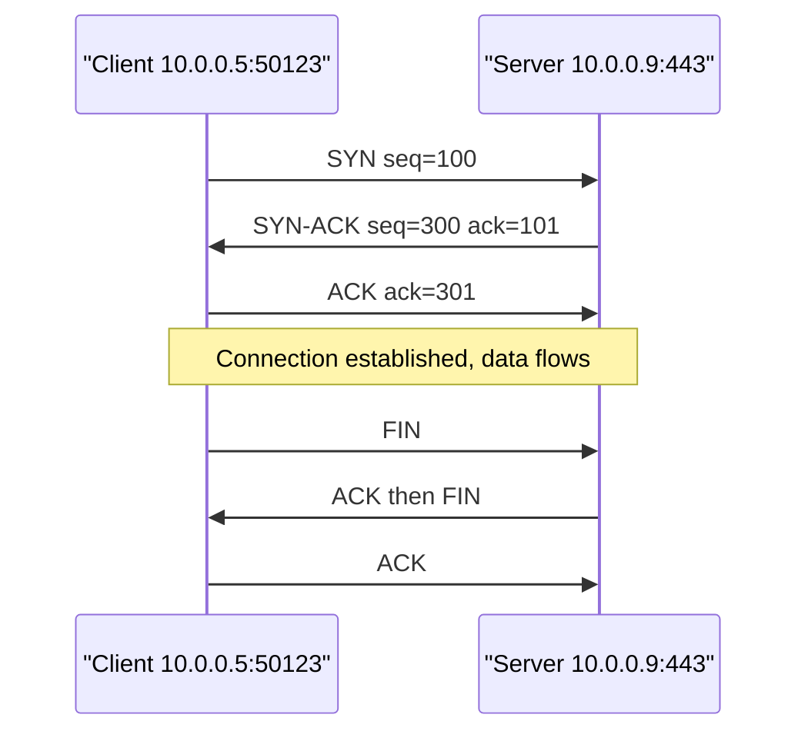
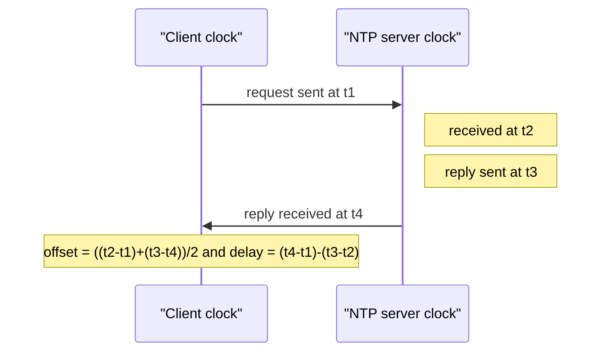
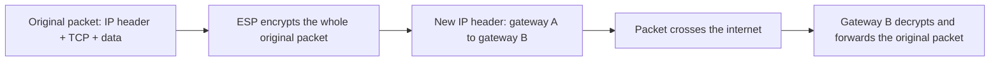
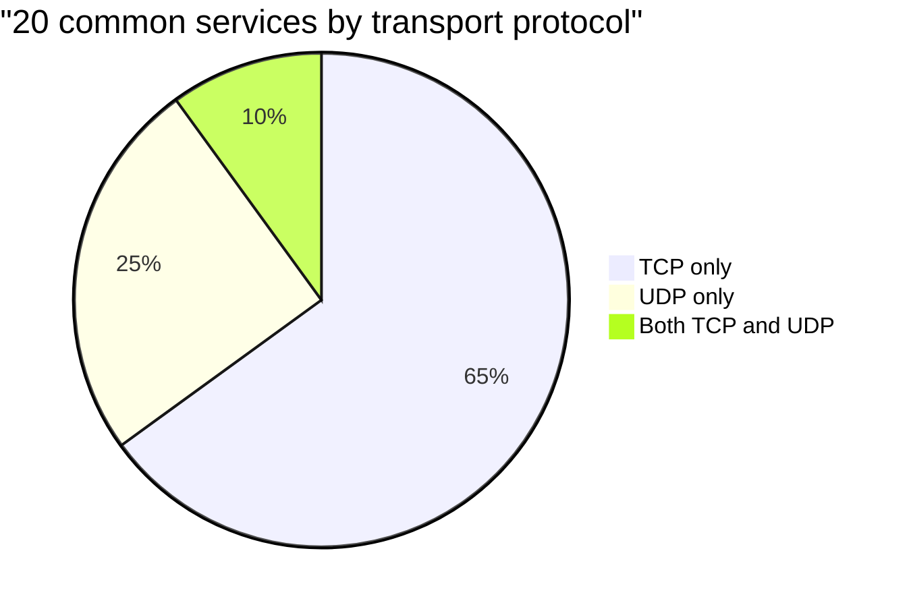

# Session 4: Common Ports, Protocols and Services

> [Cybersecurity and Digital Forensics](../../README.md) › [Term 1](../README.md) › [Module 3: Technologies of Computer Networks](README.md) › **Session 4**

| ⏱ Estimated time | 📋 Prerequisites |
|---|---|
| 3 hours | Sessions 1–3 (layers, IP addresses) |

| ⬅ [Previous: Session 3](session-03-ip-addressing.md) | [Next: Session 5](session-05-datacentre-and-cloud.md) ➡ |
|:---|---:|

[](https://colab.research.google.com/github/Hamnakhan123/Cybersecurity-and-Digital-Forensics/blob/main/term-1/03-computer-networks/code/session-04-ports-protocols-services.ipynb) &nbsp;Run every Python example of this session in the notebook [`code/session-04-ports-protocols-services.ipynb`](code/session-04-ports-protocols-services.ipynb).

---

## 🎯 Learning objectives

- Explain what a **port** is and how **IP address + protocol + port** (a **socket**) identifies a service.
- Compare **TCP** and **UDP** (handshake, reliability, speed, header) and know which services use which.
- Recall the **common well-known ports** and the secure replacement for each insecure protocol.
- Explain how **NTP** synchronises clocks (stratum, offset, delay) and why time is critical for security logs.
- Identify the components of **IPsec**: AH, ESP, IKE, Security Associations, transport vs tunnel mode.
- Audit the open ports of your own lab host and decide which should be closed.

## 📖 Concepts

### 1. Ports and sockets

An IP address gets a packet to the right **computer**; a **port number** (16 bits, 0–65535) gets it to the right **program** on that computer.

> **Analogy – an office building.** The IP address is the building's street address; the port is the office number inside (reception at 80, the secure vault at 443, the maintenance door at 22). A **socket** is "building + office + whether you came by registered post (TCP) or postcard (UDP)".

| Range | Name | Who uses it |
|---|---|---|
| 0 – 1023 | **Well-known** | Standard server services (needs admin/root to listen) |
| 1024 – 49151 | **Registered** | Vendor applications (MySQL 3306, RDP 3389) |
| 49152 – 65535 | **Dynamic / ephemeral** | Temporary client source ports |

A connection is identified by the **5-tuple**: protocol, source IP, source port, destination IP, destination port. Firewalls and logs use exactly this.

### 2. TCP vs UDP

| | **TCP** | **UDP** |
|---|---|---|
| Connection | Yes: **3-way handshake** SYN → SYN-ACK → ACK | None: just send |
| Reliability | Acknowledgements, retransmission, ordering | Best effort, no retransmission |
| Flow/congestion control | Yes (windowing) | No |
| Header | 20–60 bytes | 8 bytes |
| Speed / latency | Slower to start | Fast, low overhead |
| Used by | Web, e-mail, SSH, file transfer, databases | DNS queries, DHCP, NTP, SNMP, VoIP, video, games, syslog |
| Closing | FIN / ACK (or RST to abort) | – |

> **Analogy:** TCP is a phone call (you dial, the other side answers, you confirm you heard each other). UDP is shouting announcements over a loudspeaker: quick, but nobody confirms.

**Security notes:** a **SYN flood** abuses the handshake by never sending the final ACK (defence: SYN cookies, rate limits). UDP services can be abused for **amplification** DDoS (small spoofed request → big reply), so open DNS resolvers and NTP `monlist` were locked down worldwide.

### 3. The ports you must know

| Port | Protocol | Transport | Purpose | Secure alternative / note |
|---|---|---|---|---|
| 20/21 | FTP | TCP | File transfer | **SFTP (22)** or FTPS (990) |
| 22 | SSH / SFTP / SCP | TCP | Encrypted remote shell & file copy | Use keys, disable root login |
| 23 | Telnet | TCP | Remote shell in **cleartext** | Replace with SSH |
| 25 | SMTP | TCP | Mail between servers | 587 submission with STARTTLS |
| 53 | DNS | UDP/TCP | Name → IP | DNSSEC, DoH/DoT for privacy |
| 67/68 | DHCP | UDP | Automatic IP configuration | DHCP snooping |
| 69 | TFTP | UDP | Simple file transfer (configs, firmware) | Lab/management VLAN only |
| 80 | HTTP | TCP | Web | **HTTPS 443** |
| 110 | POP3 | TCP | Mail download | **POP3S 995** |
| 123 | NTP | UDP | Time sync | NTP authentication |
| 143 | IMAP | TCP | Mail access | **IMAPS 993** |
| 161/162 | SNMP | UDP | Device monitoring / traps | **SNMPv3** |
| 389 | LDAP | TCP/UDP | Directory | **LDAPS 636** |
| 443 | HTTPS | TCP (and UDP for HTTP/3 QUIC) | Secure web | TLS 1.2+ |
| 445 | SMB | TCP | Windows file sharing | Never expose to the internet |
| 514 | Syslog | UDP | Log forwarding | TLS syslog 6514 |
| 1433 / 3306 / 5432 | MS SQL / MySQL / PostgreSQL | TCP | Databases | Restrict to app servers |
| 3389 | RDP | TCP | Remote desktop | Behind VPN + MFA |
| 5060/5061 | SIP | TCP/UDP | VoIP signalling | 5061 = SIP over TLS |

### 4. Network Time Protocol (NTP)

Every device clock drifts. NTP (UDP 123) keeps clocks within milliseconds.

- **Stratum:** 0 = reference clock (atomic, GPS); 1 = server directly attached; 2 = synced from stratum 1; … 15 max, 16 = unsynchronised.
- The client records four timestamps (t1 send, t2 server receive, t3 server send, t4 client receive) and computes:
  - **offset** = ((t2 − t1) + (t3 − t4)) / 2 – how far its clock is off
  - **delay** = (t4 − t1) − (t3 − t2) – round-trip network time
- It assumes the path is **symmetric**; asymmetric paths cause small errors (you will see 275 ms instead of 250 ms below).

**Why security cares:** incident response depends on putting events from firewalls, servers and switches into one **timeline**. If clocks disagree, you cannot tell whether a login happened before or after an alert. Certificates, Kerberos logins (5-minute tolerance) and MFA codes also fail with wrong time. Best practice: two or three internal NTP servers syncing from trusted sources, all devices pointing at them, authentication enabled.

### 5. IPsec: securing IP itself

**IPsec** is a suite that protects IP packets: confidentiality, integrity, authentication and anti-replay. It is the basis of most **site-to-site VPNs**.

| Component | Role |
|---|---|
| **AH** – Authentication Header (IP protocol 51) | Integrity + authentication of the whole packet, **no encryption**; breaks with NAT |
| **ESP** – Encapsulating Security Payload (IP protocol 50) | **Encryption** + integrity + authentication; used almost always |
| **IKE** (IKEv1/IKEv2, UDP 500, and 4500 with NAT-T) | Negotiates algorithms and keys, authenticates peers (pre-shared key or certificates) |
| **SA** – Security Association | One-way agreement (algorithms, keys, lifetime) identified by an **SPI** |
| **Transport mode** | Protects the payload only; original IP header kept (host to host) |
| **Tunnel mode** | Encrypts the **whole original packet** and adds a new IP header (gateway to gateway VPN) |

**IKEv2 in two phases:** (1) `IKE_SA_INIT` – agree on crypto, Diffie-Hellman key exchange; (2) `IKE_AUTH` – authenticate peers and create the first **Child SA** for ESP traffic. Modern choices: AES-GCM, SHA-256+, DH group 19/20 or higher; avoid DES, 3DES, MD5, DH group 2.

## 🧭 Diagrams

**TCP three-way handshake and teardown**



**NTP four timestamps**



**IPsec tunnel mode**



## 🪜 Step-by-step: what happens when you SSH into a lab server

1. Your SSH client asks the OS for a socket; the OS picks an **ephemeral** source port, e.g. 51544.
2. TCP handshake to `10.1.5.20:22`.
3. SSH negotiates algorithms and does a key exchange (like IKE for IPsec).
4. The server proves its identity with its **host key** (you are asked to trust the fingerprint the first time).
5. You authenticate (key or password); the encrypted session begins.
6. The firewall log shows the 5-tuple `TCP 10.1.9.15:51544 → 10.1.5.20:22 ALLOW`.

## 💻 Worked examples

### Example 1 (basic) – Port ranges and a port audit

📄 **`code/session-04_ports.py`**

```python
"""Session 4 - Well-known ports: lookup, range classification and a
risk note for each service (what a defender should check).

Run:  python session-04_ports.py
"""

SERVICES = {
    20: ("FTP data", "TCP", "cleartext; prefer SFTP/FTPS"),
    21: ("FTP control", "TCP", "cleartext logins; prefer SFTP"),
    22: ("SSH / SFTP / SCP", "TCP", "use keys, disable root login"),
    23: ("Telnet", "TCP", "cleartext: replace with SSH"),
    25: ("SMTP", "TCP", "block outbound from PCs to stop spam bots"),
    53: ("DNS", "TCP/UDP", "UDP queries, TCP zone transfers: restrict AXFR"),
    67: ("DHCP server", "UDP", "enable DHCP snooping on switches"),
    68: ("DHCP client", "UDP", ""),
    69: ("TFTP", "UDP", "no authentication; lab/config use only"),
    80: ("HTTP", "TCP", "redirect to HTTPS"),
    110: ("POP3", "TCP", "use POP3S 995"),
    123: ("NTP", "UDP", "accurate time is essential for logs"),
    143: ("IMAP", "TCP", "use IMAPS 993"),
    161: ("SNMP", "UDP", "use SNMPv3; change 'public' community"),
    162: ("SNMP trap", "UDP", ""),
    389: ("LDAP", "TCP/UDP", "use LDAPS 636"),
    443: ("HTTPS", "TCP", "keep TLS 1.2+ only"),
    445: ("SMB", "TCP", "never expose to the internet"),
    514: ("Syslog", "UDP", "consider TLS syslog 6514"),
    636: ("LDAPS", "TCP", ""),
    993: ("IMAPS", "TCP", ""),
    995: ("POP3S", "TCP", ""),
    1433: ("MS SQL Server", "TCP", "never expose to the internet"),
    3306: ("MySQL", "TCP", "bind to localhost/app subnet"),
    3389: ("RDP", "TCP", "put behind VPN + MFA"),
    5060: ("SIP", "TCP/UDP", "VoIP signalling"),
}


def port_range(p: int) -> str:
    if 0 <= p <= 1023: return "well-known"
    if p <= 49151: return "registered"
    if p <= 65535: return "dynamic/ephemeral"
    return "invalid"


def audit(open_ports: list[int]) -> None:
    """Review a list of open ports found on one of YOUR lab hosts."""
    risky = {21, 23, 69, 445, 1433, 3306, 3389, 161}
    for p in sorted(open_ports):
        name, proto, note = SERVICES.get(p, ("unknown", "?", "identify the process using it"))
        flag = "REVIEW" if p in risky else "ok"
        print(f"  {p:>5}/{proto:<7} {name:<16} {port_range(p):<17} {flag:<6} {note}")


if __name__ == "__main__":
    print("Port ranges:")
    for p in (22, 443, 8080, 3389, 50000, 70000):
        print(f"  {p:>5} -> {port_range(p)}")
    print("\nAudit of lab server 'web01' (ports reported by the admin's own inventory):")
    audit([22, 80, 443, 3306, 23, 8080])
    secure_pairs = [(80, 443), (21, 22), (23, 22), (110, 995), (143, 993), (389, 636)]
    print("\nInsecure -> secure replacements:")
    for old, new in secure_pairs:
        print(f"  {SERVICES[old][0]:<12} {old:>4}  ->  {SERVICES[new][0]:<16} {new}")
```

**Output**

```text
Port ranges:
     22 -> well-known
    443 -> well-known
   8080 -> registered
   3389 -> registered
  50000 -> dynamic/ephemeral
  70000 -> invalid

Audit of lab server 'web01' (ports reported by the admin's own inventory):
     22/TCP     SSH / SFTP / SCP well-known        ok     use keys, disable root login
     23/TCP     Telnet           well-known        REVIEW cleartext: replace with SSH
     80/TCP     HTTP             well-known        ok     redirect to HTTPS
    443/TCP     HTTPS            well-known        ok     keep TLS 1.2+ only
   3306/TCP     MySQL            registered        REVIEW bind to localhost/app subnet
   8080/?       unknown          registered        ok     identify the process using it

Insecure -> secure replacements:
  HTTP           80  ->  HTTPS            443
  FTP control    21  ->  SSH / SFTP / SCP 22
  Telnet         23  ->  SSH / SFTP / SCP 22
  POP3          110  ->  POP3S            995
  IMAP          143  ->  IMAPS            993
  LDAP          389  ->  LDAPS            636
```
### Example 2 (intermediate) – TCP and UDP sockets on localhost

The script starts a TCP echo service and a UDP time service **on your own loopback interface**, talks to them, and shows how a closed port answers with "connection refused". The source port number you see will differ on every run (it is ephemeral).

📄 **`code/session-04_local_service.py`**

```python
"""Session 4 - Sockets on localhost: how a port, a protocol and a service fit
together. Starts a tiny TCP echo service and a UDP time service on 127.0.0.1,
talks to them as a client, then checks which of a few local ports are open.

Lab-safe: everything stays on the loopback interface of your own machine.
Run:  python session-04_local_service.py
"""
import socket
import threading
import time

HOST = "127.0.0.1"


def tcp_echo_server(sock: socket.socket) -> None:
    conn, addr = sock.accept()                  # 3-way handshake already done
    with conn:
        data = conn.recv(1024)
        conn.sendall(b"ECHO: " + data)


def udp_time_server(sock: socket.socket) -> None:
    data, addr = sock.recvfrom(1024)            # no connection, just a datagram
    sock.sendto(b"TIME 12:00:00", addr)


def is_open(port: int) -> bool:
    """TCP connect check, the same thing a firewall test does. Local only."""
    with socket.socket(socket.AF_INET, socket.SOCK_STREAM) as s:
        s.settimeout(0.3)
        return s.connect_ex((HOST, port)) == 0


if __name__ == "__main__":
    # --- TCP: connection-oriented, reliable, ordered ---
    tcp = socket.socket(socket.AF_INET, socket.SOCK_STREAM)
    tcp.setsockopt(socket.SOL_SOCKET, socket.SO_REUSEADDR, 1)
    tcp.bind((HOST, 0))                          # 0 = let the OS pick a free port
    tcp.listen(1)
    tcp_port = tcp.getsockname()[1]
    threading.Thread(target=tcp_echo_server, args=(tcp,), daemon=True).start()

    with socket.create_connection((HOST, tcp_port)) as c:
        local = c.getsockname()[1]
        c.sendall(b"hello over TCP")
        reply = c.recv(1024).decode()
    print(f"TCP  client port {local} is {'ephemeral' if local > 1023 else 'low'}; "
          f"server port is in the dynamic range")
    print(f"TCP  reply: {reply}")

    # --- UDP: connectionless, best-effort ---
    udp = socket.socket(socket.AF_INET, socket.SOCK_DGRAM)
    udp.bind((HOST, 0))
    udp_port = udp.getsockname()[1]
    threading.Thread(target=udp_time_server, args=(udp,), daemon=True).start()
    with socket.socket(socket.AF_INET, socket.SOCK_DGRAM) as u:
        u.settimeout(1)
        u.sendto(b"what time?", (HOST, udp_port))
        print(f"UDP  reply: {u.recvfrom(1024)[0].decode()}")

    # --- Which local ports are listening? Start one more listener to compare ---
    extra = socket.socket(); extra.bind((HOST, 0)); extra.listen(1)
    listening = extra.getsockname()[1]
    time.sleep(0.1)
    closed = listening + 1 if listening < 65535 else listening - 1
    for p in (listening, closed):
        print(f"Port {'<listening port>' if p == listening else '<next port>'}: "
              f"{'OPEN' if is_open(p) else 'closed (connection refused)'}")
    extra.close(); tcp.close(); udp.close()
```

**Output**

```text
TCP  client port 43758 is ephemeral; server port is in the dynamic range
TCP  reply: ECHO: hello over TCP
UDP  reply: TIME 12:00:00
Port <listening port>: OPEN
Port <next port>: closed (connection refused)
```
### Example 3 (advanced) – NTP offset maths and log correlation

📄 **`code/session-04_ntp_offset.py`**

```python
"""Session 4 - How NTP works out the clock offset and the round-trip delay
from four timestamps, and why log timestamps go wrong when clocks drift.

t1 = client sends request    (client clock)
t2 = server receives it      (server clock)
t3 = server sends reply      (server clock)
t4 = client receives reply   (client clock)
offset = ((t2 - t1) + (t3 - t4)) / 2
delay  = (t4 - t1) - (t3 - t2)
Run:  python session-04_ntp_offset.py
"""


def ntp(t1, t2, t3, t4):
    offset = ((t2 - t1) + (t3 - t4)) / 2
    delay = (t4 - t1) - (t3 - t2)
    return offset, delay


if __name__ == "__main__":
    # Times in milliseconds. The client clock is really 250 ms BEHIND the server.
    samples = [
        ("LAN server",        1000.0, 1255.0, 1256.0, 1012.0),
        ("Internet server",   2000.0, 2290.0, 2291.0, 2081.0),
        ("Asymmetric path",   3000.0, 3310.0, 3311.0, 3071.0),
    ]
    print(f"{'Source':<18}{'offset ms':>10}{'delay ms':>10}")
    for name, t1, t2, t3, t4 in samples:
        o, d = ntp(t1, t2, t3, t4)
        print(f"{name:<18}{o:>10.1f}{d:>10.1f}")
    print("\nStratum: 0 = atomic/GPS clock, 1 = server wired to it, 2 = syncs from stratum 1 ...")

    # Why it matters: two devices log the same attack, one clock is 4 minutes slow.
    print("\nCorrelating firewall and server logs (server clock 240 s slow):")
    fw = [("09:15:02", "firewall: allowed 198.51.100.7 -> web01:443")]
    srv = [("09:11:05", "web01: admin login from 198.51.100.7")]
    def sec(t): h, m, s = map(int, t.split(":")); return h * 3600 + m * 60 + s
    for t, msg in fw + srv:
        print(f"  raw {t}  {msg}")
    corrected = sec(srv[0][0]) + 240
    print(f"  corrected server time = {corrected // 3600:02d}:{corrected % 3600 // 60:02d}:{corrected % 60:02d}"
          f" -> login happened 3 s AFTER the firewall allowed the connection")
```

**Output**

```text
Source             offset ms  delay ms
LAN server             249.5      11.0
Internet server        250.0      80.0
Asymmetric path        275.0      70.0

Stratum: 0 = atomic/GPS clock, 1 = server wired to it, 2 = syncs from stratum 1 ...

Correlating firewall and server logs (server clock 240 s slow):
  raw 09:15:02  firewall: allowed 198.51.100.7 -> web01:443
  raw 09:11:05  web01: admin login from 198.51.100.7
  corrected server time = 09:15:05 -> login happened 3 s AFTER the firewall allowed the connection
```
**Lesson:** without the clock correction, an analyst would think the admin login happened four minutes **before** the firewall allowed the connection, which is impossible and might send the investigation in the wrong direction.

## 📊 Chart: which transport do common services use?



*Counted from the table in section 3 (TCP: FTP, SSH, Telnet, SMTP, HTTP, POP3, IMAP, HTTPS, SMB, MS SQL, MySQL, RDP, LDAPS · UDP: DHCP, TFTP, NTP, SNMP, Syslog · both: DNS, SIP).*

## 🏢 Real-life problem with full solution

**Scenario.** A small accounting firm's server `fs01` was found (by the firm's own IT inventory) listening on: 21, 22, 23, 80, 139, 445, 3306, 3389. Staff connect from the office LAN and two people work from home. The owner asks: *"Which of these should stay, and what should change?"*

**Solution.**

| Port | Service | Decision | Action |
|---|---|---|---|
| 21 | FTP | **Close** | Move file transfers to SFTP over SSH |
| 22 | SSH/SFTP | Keep (LAN + VPN only) | Keys only, no root login, firewall to admin subnet |
| 23 | Telnet | **Close** | Cleartext passwords; uninstall the service |
| 80 | HTTP | Keep only as redirect | Redirect all to 443; install a TLS certificate |
| 139/445 | NetBIOS/SMB | Keep on LAN only | Block at the internet edge; disable SMBv1 |
| 3306 | MySQL | **Restrict** | Bind to localhost (the app is on the same server) |
| 3389 | RDP | **Remove from internet** | Home users connect via **VPN (IPsec or TLS) + MFA**, then RDP |

Verification: re-check the listening ports on the server after the change (`ss -tulpn` on Linux or `netstat -ano` on Windows) and test from outside that only the VPN port answers.

## ⚠️ Common mistakes

- Thinking "UDP is unreliable so it is useless": DNS, VoIP and video depend on its low latency.
- Blocking only TCP 53: large DNS answers and zone transfers use TCP too; queries use UDP.
- Exposing RDP, SMB or databases directly to the internet.
- Believing a non-standard port ("SSH on 2222") is security; it only reduces noise.
- Forgetting NTP: logs with wrong time are nearly useless in an investigation.
- Choosing AH for a VPN through NAT, or using outdated IPsec algorithms (DES, MD5, DH group 2).

## ✅ Best practices

- Run the **minimum** services; close everything else (host firewall + network firewall).
- Prefer encrypted protocols: SSH, HTTPS, SFTP, IMAPS, LDAPS, SNMPv3.
- Keep an inventory of expected open ports per server and compare it regularly.
- Use internal NTP servers, authenticated, with all devices in one time zone setting (or UTC) for logs.
- Use IPsec with IKEv2, ESP, AES-GCM, strong DH groups and certificate authentication for site-to-site links.

## 🧪 Lab / practice tasks

1. **Easy –** Without notes, give the port and transport for: SSH, DNS, HTTPS, RDP, NTP, SNMP, SMTP, LDAPS.
2. **Easy –** On your own PC, list listening ports (`netstat -ano` on Windows, `ss -tulpn` on Linux). Identify three.
3. **Medium –** Change `session-04_local_service.py` so the TCP server replies in upper-case and handles **three** clients in a loop.
4. **Medium –** Using `session-04_ntp_offset.py`, compute offset and delay for t1=5000, t2=4810, t3=4811, t4=5030. Is the client ahead or behind?
5. **Challenge –** Write `audit_compare(expected, found)` that prints ports that are **unexpectedly open** and **expected but missing**.

<details>
<summary>💡 Hints</summary>

- Task 3: wrap `accept()` in `for _ in range(3):`.
- Task 4: negative offset → the client is ahead of the server.
- Task 5: use Python sets: `found - expected` and `expected - found`.
</details>

<details>
<summary>✅ Solutions</summary>

**Task 1:** SSH 22/TCP, DNS 53/UDP+TCP, HTTPS 443/TCP, RDP 3389/TCP, NTP 123/UDP, SNMP 161/UDP, SMTP 25/TCP, LDAPS 636/TCP.

**Task 3:**

```python
def tcp_echo_server(sock):
    for _ in range(3):
        conn, _ = sock.accept()
        with conn:
            conn.sendall(conn.recv(1024).upper())
```

**Task 4:** offset = ((4810 − 5000) + (4811 − 5030)) / 2 = (−190 − 219) / 2 = **−204.5 ms** (client is ~204 ms **ahead**); delay = (5030 − 5000) − (4811 − 4810) = **29 ms**.

**Task 5:**

```python
def audit_compare(expected, found):
    for p in sorted(set(found) - set(expected)):
        print(f"UNEXPECTED open port {p}: investigate and close")
    for p in sorted(set(expected) - set(found)):
        print(f"Expected port {p} is not listening: service down?")

audit_compare(expected=[22, 443], found=[22, 443, 3306, 23])
```
</details>

## ✅ Quick quiz

1. Which port does RDP use by default? a) 22 b) 3389 c) 445 d) 3306
2. Which protocol does **not** use a handshake? a) TCP b) SSH c) UDP d) HTTPS
3. An NTP server directly connected to a GPS clock is stratum: a) 0 b) 1 c) 2 d) 16
4. Which IPsec protocol provides encryption? a) AH b) ESP c) IKE d) SPI
5. The secure replacement for Telnet is: a) FTP b) SNMPv2 c) SSH d) TFTP

<details>
<summary>Show answers</summary>

1 – b · 2 – c · 3 – b · 4 – b · 5 – c
</details>

## 📝 Summary / cheat-sheet

- Socket = IP + transport + port; connection = 5-tuple. Ranges: 0–1023, 1024–49151, 49152–65535.
- TCP: handshake, reliable, ordered; UDP: connectionless, fast, 8-byte header.
- Know: 20/21 FTP, 22 SSH, 23 Telnet, 25 SMTP, 53 DNS, 67/68 DHCP, 69 TFTP, 80 HTTP, 110 POP3, 123 NTP, 143 IMAP, 161/162 SNMP, 389 LDAP, 443 HTTPS, 445 SMB, 514 syslog, 636 LDAPS, 993 IMAPS, 995 POP3S, 3306 MySQL, 3389 RDP.
- NTP: stratum, offset, delay; correct time = trustworthy logs.
- IPsec: AH (integrity), ESP (encryption), IKE (keys), SA/SPI, transport vs tunnel mode.

**Interview / viva questions**

1. Explain the TCP three-way handshake and how a SYN flood abuses it.
2. Why does DNS use both UDP and TCP?
3. Which ports should never be exposed to the internet, and why?
4. Why is NTP important for incident response?
5. Compare AH and ESP. Why does AH fail through NAT?
6. What is the difference between IPsec transport and tunnel modes?

---

| ⬅ [Previous: Session 3](session-03-ip-addressing.md) | [Next: Session 5](session-05-datacentre-and-cloud.md) ➡ |
|:---|---:|

<sub>Prepared by **Hamna Zahid Khan**, Junior Lecturer · Cybersecurity and Digital Forensics</sub>
