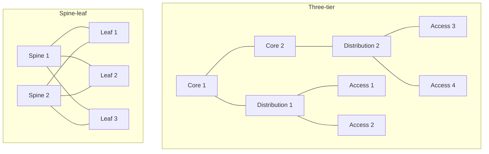
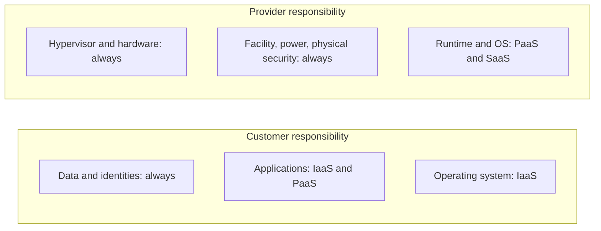
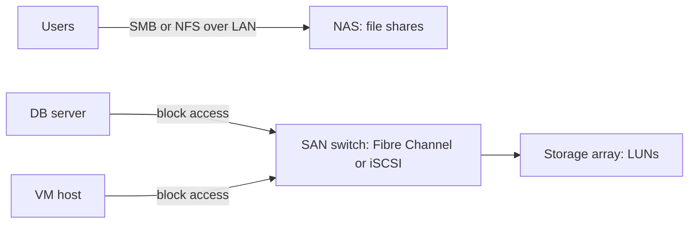
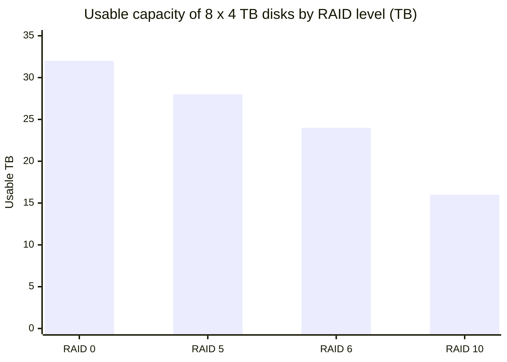

# Session 5: Corporate, Data Centre Network and Cloud Architecture

> [Cybersecurity and Digital Forensics](../../README.md) › [Term 1](../README.md) › [Module 3: Technologies of Computer Networks](README.md) › **Session 5**

| ⏱ Estimated time | 📋 Prerequisites |
|---|---|
| 3 hours | Sessions 1–4 |

| ⬅ [Previous: Session 4](session-04-ports-protocols-services.md) | [Next: Session 6](session-06-network-devices-packet-tracer.md) ➡ |
|:---|---:|

[](https://colab.research.google.com/github/Hamnakhan123/Cybersecurity-and-Digital-Forensics/blob/main/term-1/03-computer-networks/code/session-05-datacentre-and-cloud.ipynb) &nbsp;Run every Python example of this session in the notebook [`code/session-05-datacentre-and-cloud.ipynb`](code/session-05-datacentre-and-cloud.ipynb).

---

## 🎯 Learning objectives

- Differentiate a **corporate (campus) network** from a **data-centre network**, and the **three-tier** design from **spine-leaf**.
- Explain north-south vs east-west traffic, oversubscription and why data centres moved to spine-leaf.
- Identify the **cloud service models** (IaaS, PaaS, SaaS) and **deployment models** (public, private, hybrid, community, multi-cloud), and the **shared responsibility model**.
- Explain **storage options**: DAS, NAS and **SAN** (Fibre Channel, FCoE, iSCSI), plus RAID levels.
- Describe virtualisation, **SDN**, and data-centre security zones.
- Compare on-premises and cloud costs with a simple model.

## 📖 Concepts

### 1. Corporate (campus) network vs data-centre network

| | Corporate / campus network | Data-centre network |
|---|---|---|
| Who connects | Users: PCs, phones, printers, Wi-Fi | Servers, storage, virtual machines, containers |
| Main traffic | **North-south** (users ↔ internet / servers) | **East-west** (server ↔ server: apps, databases, backups) |
| Speeds | 1 Gbps to desks, 10 Gbps uplinks | 10/25/100/400 Gbps |
| Design | Hierarchical: access → distribution → core | **Spine-leaf** fabric |
| Priority | Coverage, mobility, user security | Throughput, low latency, uptime, scale |

> **Analogy – a city vs a factory.** The campus is a city: many people moving in and out on local roads. The data centre is a factory floor where machines constantly hand parts to each other; it needs wide, short, predictable conveyor belts.

### 2. The three-tier hierarchical model

1. **Access layer** – where end devices plug in (port security, PoE, VLANs).
2. **Distribution (aggregation) layer** – routing between VLANs, policy/ACLs, redundancy.
3. **Core layer** – very fast backbone switching between buildings / blocks; no complex policies.

Small sites use a **collapsed core** (distribution + core in one pair of switches).

### 3. Spine-leaf (Clos) fabric

- Every **leaf** switch (top-of-rack) connects to **every spine** switch; spines never connect to each other; leaves never connect to each other.
- Any server reaches any other server in **exactly two switch hops** (leaf → spine → leaf): predictable latency.
- **ECMP** (equal-cost multipath) spreads traffic across all spines; losing one spine only reduces bandwidth.
- To grow bandwidth, add a spine; to add servers, add a leaf.
- **Oversubscription** = server-facing bandwidth ÷ uplink bandwidth per leaf. 1:1 is non-blocking; 3:1 is typical for general workloads.

### 4. Virtualisation and SDN

- A **hypervisor** (type 1: ESXi, Hyper-V, KVM; type 2: VirtualBox, VMware Workstation) runs many **virtual machines** on one server. A **virtual switch** connects them.
- **Containers** (Docker, Kubernetes) share the host kernel: lighter than VMs.
- **SDN** (software-defined networking) separates the **control plane** (decides where traffic goes, in a central controller) from the **data plane** (switches forward). Overlays such as **VXLAN** stretch Layer 2 segments over a Layer 3 fabric (24-bit ID → 16 million segments vs 4 094 VLANs).
- **Micro-segmentation**: firewall policy per workload, which stops an attacker moving east-west.

### 5. Cloud computing

NIST's five essential characteristics: **on-demand self-service, broad network access, resource pooling, rapid elasticity, measured service** (pay per use).

**Service models**

| Model | You manage | Provider manages | Examples (generic) |
|---|---|---|---|
| **IaaS** | OS, apps, data, network config | Hardware, virtualisation, facility | Virtual machines, block storage, virtual networks |
| **PaaS** | Apps and data | OS, runtime, scaling | Managed databases, app hosting platforms |
| **SaaS** | Your data and user accounts | Everything else | Web e-mail, office suites, CRM |
| (FaaS / serverless) | Function code | Servers, scaling | Event-driven functions |

> **Analogy – pizza.** On-premises = make pizza at home; IaaS = rent a kitchen; PaaS = order delivery and serve it yourself; SaaS = eat at the restaurant.

**Deployment models:** **public** (shared provider infrastructure), **private** (dedicated to one organisation, on-site or hosted), **hybrid** (private + public connected, e.g. burst to cloud), **community** (shared by organisations with common needs, e.g. government), **multi-cloud** (several public providers).

**Shared responsibility:** the provider secures **"of the cloud"** (buildings, hardware, hypervisor); the customer secures **"in the cloud"** (identities, data, configuration, patching of their VMs). Most cloud breaches are **customer misconfigurations**: public storage buckets, weak IAM, exposed management ports.

**Cloud networking terms:** VPC/VNet (your private network in the cloud), subnets, security groups (stateful instance firewalls), NAT gateway, load balancer, VPN gateway or dedicated private link to on-premises.

### 6. Storage: DAS, NAS, SAN

| | **DAS** (direct-attached) | **NAS** (network-attached) | **SAN** (storage area network) |
|---|---|---|---|
| Access level | Block, one server | **File** (SMB, NFS) over the LAN | **Block** over a dedicated network |
| Network | None (SATA/SAS/USB) | Ethernet/IP | Fibre Channel, FCoE or iSCSI |
| Looks like to OS | Local disk | Network share `\\nas\files` | Local disk (LUN) |
| Use | Single server, desktop | File sharing, home directories | Databases, VM clusters |
| Cost | Low | Medium | High |

**SAN technologies**
- **Fibre Channel (FC)**: dedicated lossless network (8/16/32/64 Gbps), FC switches, HBAs, addressing by **WWN**; **zoning** controls which hosts see which storage.
- **FCoE**: Fibre Channel frames inside lossless Ethernet.
- **iSCSI**: SCSI commands over TCP/IP (port 3260); cheaper, uses normal Ethernet; separate VLAN + CHAP authentication.
- **LUN** (logical unit number) = a slice of storage presented to a host; **LUN masking** restricts it.

**RAID** combines disks for speed and/or fault tolerance (RAID is **not** a backup): RAID 0 striping, 1 mirroring, 5 single parity, 6 double parity, 10 mirrored stripes.

### 7. Data-centre security zones

- Physical: perimeter, mantraps, badges + biometrics, CCTV, hot/cold aisle containment, fire suppression.
- Logical: separate zones (DMZ, application, database, management/out-of-band), firewalls between zones, micro-segmentation, encrypted storage, strict admin access through **jump hosts**.

## 🧭 Diagrams

**Three-tier vs spine-leaf**



**Shared responsibility by service model**



**SAN vs NAS**



## 🪜 Step-by-step: moving a web application to IaaS safely

1. Create a VPC with **public** subnet (load balancer only) and **private** subnets (app, database).
2. Security groups: internet → LB 443; LB → app 8443; app → DB 5432; nothing else.
3. No public IPs on app or DB servers; admins connect via VPN or a bastion host with MFA.
4. Encrypt storage and backups; enable provider logging (API audit trail, flow logs) to the central SIEM.
5. Use infrastructure-as-code so the configuration is reviewed like software.

## 💻 Worked examples

### Example 1 (basic → intermediate) – Sizing a spine-leaf fabric

📄 **`code/session-05_spine_leaf.py`**

```python
"""Session 5 - Size a data-centre network: three-tier vs spine-leaf.

Computes link counts, hop counts between servers and the oversubscription
ratio (server-facing bandwidth : uplink bandwidth) on each leaf switch.
Run:  python session-05_spine_leaf.py
"""


def spine_leaf(spines, leaves, servers_per_leaf, server_gbps, uplink_gbps):
    links = spines * leaves                      # every leaf connects to every spine
    down = servers_per_leaf * server_gbps        # traffic the servers can push into a leaf
    up = spines * uplink_gbps                    # capacity from that leaf to the fabric
    return {
        "servers": leaves * servers_per_leaf,
        "fabric_links": links,
        "max_hops": "leaf -> spine -> leaf (always 2 switch hops)",
        "oversub": down / up,
    }


def three_tier(core, aggregation, access, servers_per_access):
    # access -> 2 aggregation, aggregation -> every core
    links = access * 2 + aggregation * core
    return {"servers": access * servers_per_access, "links": links,
            "max_hops": "access -> agg -> core -> agg -> access (up to 4 switch hops)"}


if __name__ == "__main__":
    print("Spine-leaf designs (servers at 25 Gbps, uplinks at 100 Gbps):")
    print(f"{'spines':>6} {'leaves':>6} {'servers':>8} {'links':>6} {'oversub':>8}  verdict")
    for spines, leaves, per_leaf in [(2, 8, 48), (4, 8, 48), (4, 16, 32), (6, 20, 24)]:
        r = spine_leaf(spines, leaves, per_leaf, 25, 100)
        ratio = r["oversub"]
        verdict = "non-blocking" if ratio <= 1 else "ok for most apps" if ratio <= 3 else "too oversubscribed"
        print(f"{spines:>6} {leaves:>6} {r['servers']:>8} {r['fabric_links']:>6} {ratio:>7.1f}:1  {verdict}")
    print("\nPath length:", spine_leaf(4, 8, 48, 25, 100)["max_hops"])

    t = three_tier(core=2, aggregation=4, access=16, servers_per_access=24)
    print(f"\nThree-tier: {t['servers']} servers, {t['links']} uplinks, {t['max_hops']}")
    print("Add capacity: spine-leaf -> add a spine (all leaves gain bandwidth); "
          "three-tier -> bigger core boxes")
```

**Output**

```text
Spine-leaf designs (servers at 25 Gbps, uplinks at 100 Gbps):
spines leaves  servers  links  oversub  verdict
     2      8      384     16     6.0:1  too oversubscribed
     4      8      384     32     3.0:1  ok for most apps
     4     16      512     64     2.0:1  ok for most apps
     6     20      480    120     1.0:1  non-blocking

Path length: leaf -> spine -> leaf (always 2 switch hops)

Three-tier: 384 servers, 40 uplinks, access -> agg -> core -> agg -> access (up to 4 switch hops)
Add capacity: spine-leaf -> add a spine (all leaves gain bandwidth); three-tier -> bigger core boxes
```
**Interpretation:** two spines give a 6:1 oversubscription (storage replication would choke); four spines reach 3:1; six spines with fewer servers per leaf give a non-blocking 1:1 fabric.

### Example 2 (advanced) – RAID capacity and on-prem vs cloud cost

📄 **`code/session-05_storage_cloud.py`**

```python
"""Session 5 - Storage and cloud maths: RAID usable capacity, SAN vs NAS vs DAS,
and a simple on-premises vs public-cloud cost comparison over 3 years.

All prices are made-up teaching numbers, not quotes from any provider.
Run:  python session-05_storage_cloud.py
"""


def raid_usable(level: str, disks: int, size_tb: float) -> tuple[float, str]:
    if level == "RAID 0":
        return disks * size_tb, "no failures tolerated"
    if level == "RAID 1":
        return size_tb, f"{disks - 1} disk(s) may fail (mirror)"
    if level == "RAID 5":
        return (disks - 1) * size_tb, "1 disk may fail (parity)"
    if level == "RAID 6":
        return (disks - 2) * size_tb, "2 disks may fail (double parity)"
    if level == "RAID 10":
        return disks / 2 * size_tb, "1 disk per mirror pair may fail"
    raise ValueError(level)


def three_year_cost(tb: float):
    # on-premises: buy hardware once + power/admin each month
    onprem = 18000 + 36 * (250 + 400)
    # cloud: pay per TB-month + a compute instance, no upfront cost
    cloud = 36 * (tb * 23 + 700)
    return onprem, cloud


if __name__ == "__main__":
    print("8 x 4 TB disks:")
    for lvl in ["RAID 0", "RAID 1", "RAID 5", "RAID 6", "RAID 10"]:
        disks = 2 if lvl == "RAID 1" else 8
        usable, tol = raid_usable(lvl, disks, 4)
        raw = disks * 4
        print(f"  {lvl:<8} disks={disks}  usable {usable:>5.1f} TB of {raw:>2} TB "
              f"({usable / raw:>4.0%})  {tol}")

    print("\nOn-prem vs cloud for a small analytics system (teaching numbers, USD):")
    for tb in (5, 20, 60):
        on, cl = three_year_cost(tb)
        cheaper = "cloud" if cl < on else "on-prem"
        print(f"  {tb:>3} TB: on-prem ${on:>7,}  cloud ${cl:>9,.0f}  -> {cheaper} is cheaper")
```

**Output**

```text
8 x 4 TB disks:
  RAID 0   disks=8  usable  32.0 TB of 32 TB (100%)  no failures tolerated
  RAID 1   disks=2  usable   4.0 TB of  8 TB ( 50%)  1 disk(s) may fail (mirror)
  RAID 5   disks=8  usable  28.0 TB of 32 TB ( 88%)  1 disk may fail (parity)
  RAID 6   disks=8  usable  24.0 TB of 32 TB ( 75%)  2 disks may fail (double parity)
  RAID 10  disks=8  usable  16.0 TB of 32 TB ( 50%)  1 disk per mirror pair may fail

On-prem vs cloud for a small analytics system (teaching numbers, USD):
    5 TB: on-prem $ 41,400  cloud $   29,340  -> cloud is cheaper
   20 TB: on-prem $ 41,400  cloud $   41,760  -> on-prem is cheaper
   60 TB: on-prem $ 41,400  cloud $   74,880  -> on-prem is cheaper
```
**Interpretation:** cloud wins for small or variable workloads (no upfront purchase); a large, steady workload can be cheaper on-premises. Real decisions also weigh staff skills, compliance, data location and egress (download) charges.

## 📊 Chart



| Model | Capital cost | Scaling | Control | Typical fit |
|---|---|---|---|---|
| On-premises | High upfront | Slow (buy hardware) | Full | Steady, regulated workloads |
| Public cloud | None upfront | Minutes | Configuration only | Variable or new workloads |
| Hybrid | Medium | Burst to cloud | Mixed | Most enterprises |

## 🏢 Real-life problem with full solution

**Scenario.** An online retailer runs everything on 6 old servers in an office cupboard. Black-Friday sales crash the site every year; backups are a USB disk on the same shelf. Management wants a plan.

**Solution.**

1. **Hybrid design:** keep the accounting system (steady, sensitive) on-premises in a small private rack; move the **web shop** to **IaaS/PaaS** in a public cloud so it can **auto-scale** during sales.
2. **Network:** cloud VPC with public LB subnet and private app/DB subnets; a **site-to-site IPsec VPN** links office and cloud.
3. **Storage:** office files on a **NAS** with RAID 6 (survives two disk failures); databases on a managed cloud DB (PaaS) with automated backups.
4. **Backups:** follow **3-2-1** (3 copies, 2 media, 1 off-site): nightly NAS snapshot + cloud backup copy.
5. **Security:** shared-responsibility checklist – MFA on cloud admin accounts, no public storage buckets, flow logs and audit logs to a SIEM, encryption at rest.
6. **Result:** the shop scales during sales, the cupboard is no longer a single point of failure, and data survives a fire in the office.

## ⚠️ Common mistakes

- Thinking "the cloud provider handles security": identities, data and configuration are always yours.
- Treating RAID as backup: deletion, ransomware and fire destroy RAID arrays too.
- Connecting leaf switches to each other or spines to spines in a spine-leaf fabric.
- Putting iSCSI storage traffic on the user VLAN without authentication.
- Ignoring cloud **egress** fees and data-residency laws in cost and legal planning.

## ✅ Best practices

- Spine-leaf for new data centres; three-tier/collapsed core for campuses.
- Separate management networks (out-of-band) for data-centre devices.
- Zone and mask SANs; dedicated VLAN + CHAP for iSCSI.
- Apply least privilege in cloud IAM; enable logging everywhere; review configurations automatically.
- RAID for availability **and** backups for recovery (3-2-1, one copy offline/immutable).

## 🧪 Lab / practice tasks

1. **Easy –** Classify as IaaS, PaaS or SaaS: web e-mail; a rented virtual Linux server; a managed database service; an online office suite.
2. **Easy –** Give one example of north-south and one of east-west traffic.
3. **Medium –** Using `session-05_spine_leaf.py`, find the smallest number of spines that gives ≤ 2:1 oversubscription with 48 servers per leaf at 25 Gbps and 100 Gbps uplinks.
4. **Medium –** Compute usable capacity for 12 × 8 TB disks in RAID 5, 6 and 10.
5. **Challenge –** Add an **egress cost** (e.g. $0.09 per GB, 2 TB per month downloaded) to the cloud cost function and re-run the comparison.

<details>
<summary>💡 Hints</summary>

- Task 3: oversubscription = 48 × 25 / (spines × 100) ≤ 2.
- Task 4: RAID 5 = n − 1 disks, RAID 6 = n − 2, RAID 10 = n / 2.
- Task 5: add `36 * 2000 * 0.09` to the cloud total.
</details>

<details>
<summary>✅ Solutions</summary>

**Task 1:** SaaS, IaaS, PaaS, SaaS.

**Task 2:** north-south – a student opening the university portal from home; east-west – the web server querying the database server.

**Task 3:** 1200 / (s × 100) ≤ 2 → s ≥ 6 → **6 spines**.

**Task 4:** RAID 5 = 88 TB, RAID 6 = 80 TB, RAID 10 = 48 TB.

**Task 5:**

```python
def three_year_cost(tb, egress_tb_per_month=2, price_per_gb=0.09):
    onprem = 18000 + 36 * (250 + 400)
    cloud = 36 * (tb * 23 + 700) + 36 * egress_tb_per_month * 1000 * price_per_gb
    return onprem, cloud
```

Egress adds 36 × 2000 × 0.09 = **$6,480**, so at 5 TB cloud is now $35,820 – still cheaper than $41,400, but at 20 TB the gap widens to ~$6,800 in favour of on-premises.
</details>

## ✅ Quick quiz

1. In a spine-leaf fabric, how many switch hops are there between any two servers on different leaves? a) 1 b) 2 c) 3 d) it varies
2. Which storage type provides **file-level** access over the LAN? a) SAN b) DAS c) NAS d) FC
3. In IaaS, who patches the guest operating system? a) provider b) customer c) both d) nobody
4. Which protocol carries SCSI commands over TCP/IP? a) FCoE b) NFS c) iSCSI d) SMB
5. A company runs payroll on-premises and its website in a public cloud, connected by VPN. This is: a) private b) community c) hybrid d) SaaS

<details>
<summary>Show answers</summary>

1 – b · 2 – c · 3 – b · 4 – c · 5 – c
</details>

## 📝 Summary / cheat-sheet

- Campus = users, north-south, three-tier (access/distribution/core). Data centre = servers, east-west, spine-leaf (2 hops, ECMP).
- Oversubscription = downlink ÷ uplink per leaf.
- Virtualisation: hypervisors, vSwitches, containers; SDN separates control and data planes; VXLAN overlays.
- Cloud: IaaS/PaaS/SaaS; public/private/hybrid/community/multi-cloud; shared responsibility.
- Storage: DAS (local), NAS (file, SMB/NFS), SAN (block; FC, FCoE, iSCSI; LUNs, zoning). RAID ≠ backup.

**Interview / viva questions**

1. Why did data centres move from three-tier to spine-leaf?
2. Explain the shared responsibility model with an IaaS example.
3. Compare NAS and SAN.
4. What is oversubscription and when is it acceptable?
5. Name three common cloud misconfigurations and how to prevent them.
6. What is SDN and what benefit does micro-segmentation bring to security?

---

| ⬅ [Previous: Session 4](session-04-ports-protocols-services.md) | [Next: Session 6](session-06-network-devices-packet-tracer.md) ➡ |
|:---|---:|

<sub>Prepared by **Hamna Zahid Khan**, Junior Lecturer · Cybersecurity and Digital Forensics</sub>
