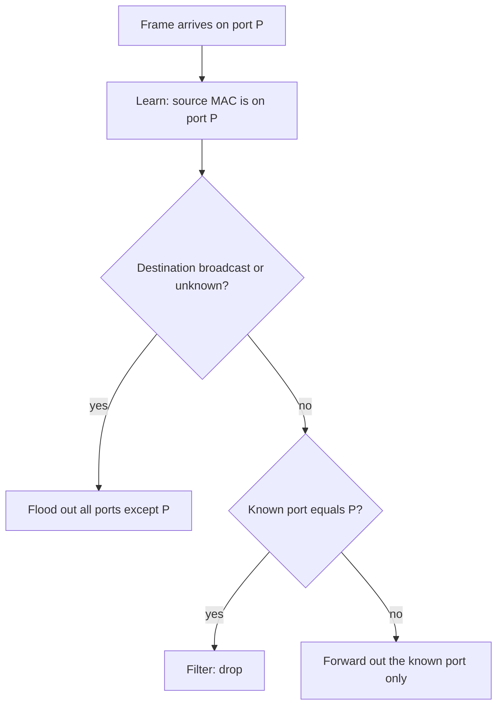
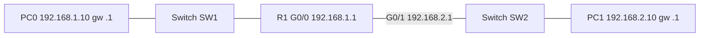
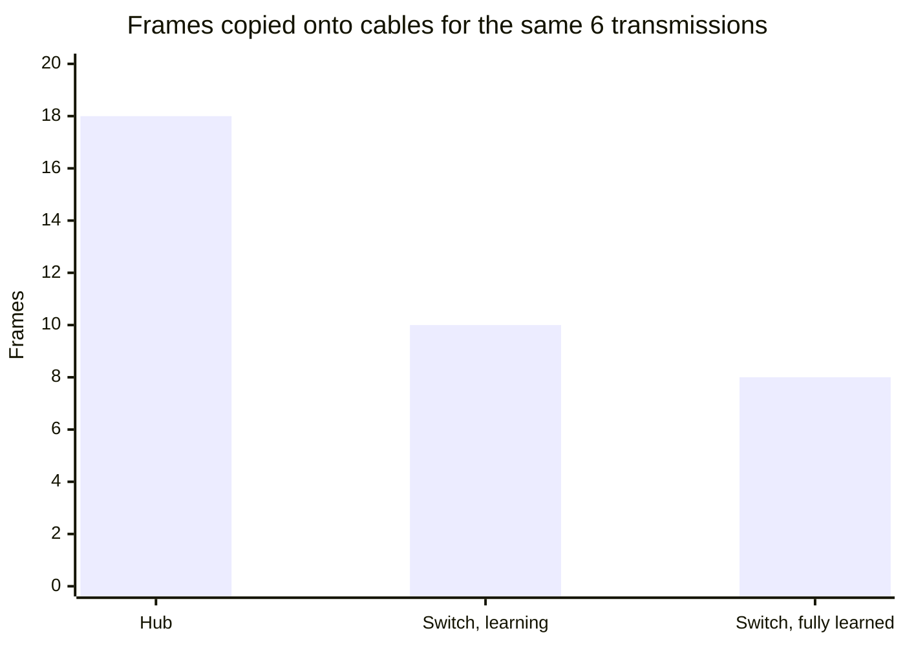

# Session 6: Network Devices, Components and Packet Tracer

> [Cybersecurity and Digital Forensics](../../README.md) › [Term 1](../README.md) › [Module 3: Technologies of Computer Networks](README.md) › **Session 6**

| ⏱ Estimated time | 📋 Prerequisites |
|---|---|
| 3.5 hours | Sessions 1–5; Cisco Packet Tracer installed (free with a Cisco Networking Academy account) |

| ⬅ [Previous: Session 5](session-05-datacentre-and-cloud.md) | [Next: Session 7](session-07-dynamic-routing.md) ➡ |
|:---|---:|

[](https://colab.research.google.com/github/Hamnakhan123/Cybersecurity-and-Digital-Forensics/blob/main/term-1/03-computer-networks/code/session-06-network-devices-packet-tracer.ipynb) &nbsp;Run every Python example of this session in the notebook [`code/session-06-network-devices-packet-tracer.ipynb`](code/session-06-network-devices-packet-tracer.ipynb).

---

## 🎯 Learning objectives

- Describe the purpose and OSI layer of common **network devices**: NIC, repeater, hub, bridge, switch, router, multilayer switch, access point, wireless LAN controller, modem, firewall, IDS/IPS, proxy, load balancer, VPN concentrator.
- Explain how a **switch learns MAC addresses** and why it replaced the hub (collision and broadcast domains).
- Explain how a **router** chooses a route: longest-prefix match, administrative distance, metric.
- **Install Cisco Packet Tracer**, build a small topology, and navigate the Cisco IOS command modes.
- Configure basic router interfaces and a first **RIP** routing setup (fully explained in Session 7).

## 📖 Concepts

### 1. Devices by OSI layer

| Device | Layer | What it does | Security relevance |
|---|---|---|---|
| **NIC** | 1–2 | Connects a host; has a burned-in MAC | MAC can be spoofed in software |
| **Repeater** | 1 | Regenerates a signal to extend distance | – |
| **Hub** | 1 | Repeats every bit to every port; one **collision domain** | Anyone can sniff everyone (obsolete) |
| **Bridge** | 2 | Joins two segments, filters by MAC | Ancestor of the switch |
| **Switch** | 2 | Forwards frames to the right port using a **MAC table** | Port security, VLANs, DAI |
| **Multilayer (L3) switch** | 2–3 | Switch that also routes between VLANs at wire speed | Inter-VLAN ACLs |
| **Router** | 3 | Forwards packets between networks using a **routing table**; breaks broadcast domains | ACLs, NAT, VPN |
| **Access point (AP)** | 1–2 | Bridges Wi-Fi clients to the wired LAN | WPA3, rogue AP detection |
| **Wireless LAN controller** | 2–7 | Centrally manages many lightweight APs | Central policy |
| **Modem** | 1 | Converts digital to the line signal (DSL, cable, fibre ONT) | ISP demarc |
| **Firewall** | 3–7 | Permits/denies traffic by rules; stateful, next-gen | Core perimeter control |
| **IDS / IPS** | 3–7 | Detects (IDS) or blocks (IPS) malicious traffic patterns | Session 13 |
| **Proxy / content filter** | 7 | Makes requests on behalf of clients; caches and filters | URL filtering, logging |
| **Load balancer** | 4–7 | Spreads requests across servers; health checks | TLS offload, WAF features |
| **VPN concentrator** | 3 | Terminates many VPN tunnels | Remote access |

### 2. Collision and broadcast domains

- A **collision domain** is where two devices sending at once would collide. Hub = 1 big collision domain. **Each switch port** is its own collision domain (and full-duplex removes collisions altogether).
- A **broadcast domain** is everything that receives a broadcast. Switches **forward** broadcasts; **routers stop them**. Each VLAN is its own broadcast domain.

> **Analogy:** A hub is a classroom where everyone hears everything. A switch is a building of private offices with a receptionist who knows which office each person is in. A router is the gate between two different buildings.

### 3. How a switch forwards a frame

1. **Learn:** record *source MAC → incoming port* in the MAC (CAM) table.
2. **Look up** the destination MAC.
3. **Forward** out the one known port, or **flood** out all ports (except the incoming one) if unknown or broadcast.
4. **Filter:** if destination is on the same port it came in, drop it.
5. Entries **age out** (default 300 s).

**Attack to know:** *MAC flooding* fills the table with fake MACs so the switch floods like a hub. Defence: **port security** (limit MACs per port).

### 4. How a router forwards a packet

1. Strip the Layer 2 frame; check the destination IP.
2. Find all matching routes; choose the **longest prefix** (most specific).
3. If two sources offer the same prefix, prefer the lower **administrative distance** (trust in the source).
4. If still tied, prefer the lower **metric** (cost within one protocol).
5. Decrease **TTL** by 1 (drop at 0 – prevents loops); build a new frame for the next hop.

| Route source | Administrative distance (Cisco) |
|---|---|
| Connected interface | 0 |
| Static route | 1 |
| EIGRP (internal) | 90 |
| OSPF | 110 |
| RIP | 120 |
| External EIGRP | 170 |
| Unknown / untrusted | 255 (never used) |

### 5. Cisco Packet Tracer

A free network simulator from Cisco for learning. It simulates routers, switches, PCs, servers, IoT and Wi-Fi, lets you type real IOS commands, and has a **Simulation mode** that shows each packet step by step.

**Install:** sign up (free) at the Cisco Networking Academy (skillsforall / netacad), take the free "Getting Started with Cisco Packet Tracer" course, download for Windows/Linux/macOS, log in at first launch.

**Interface tour:** device type selection (bottom-left), device list, connection tool (lightning bolt: "automatically choose connection type" or specific cables), Realtime / **Simulation** toggle (bottom-right), Physical/Config/**CLI**/Desktop tabs on each device.

### 6. Cisco IOS command modes

| Prompt | Mode | How to enter | Used for |
|---|---|---|---|
| `Router>` | User EXEC | Log in | Basic `ping`, `show` |
| `Router#` | Privileged EXEC | `enable` | All `show`, `copy`, `debug`, `reload` |
| `Router(config)#` | Global configuration | `configure terminal` | Hostname, passwords, routing |
| `Router(config-if)#` | Interface configuration | `interface g0/0` | IP addresses, `no shutdown` |
| `Router(config-router)#` | Routing protocol | `router rip` | Networks, versions |
| `Router(config-line)#` | Line | `line vty 0 4` / `line console 0` | Remote/console access |

Shortcuts: `?` for help, **Tab** to complete, `do show ...` from config mode, `exit` one level back, `end` straight to privileged mode. **running-config** lives in RAM; **startup-config** in NVRAM – save with `copy running-config startup-config` (or `write memory`).

## 🧭 Diagrams

**Switch forwarding decision**



**Lab topology for this session**



## 🪜 Step-by-step: your first Packet Tracer lab

1. Drag in a **2911 router**, two **2960 switches** and two **PCs**.
2. Connect PC0 → SW1 (FastEthernet), SW1 → R1 G0/0, R1 G0/1 → SW2, SW2 → PC1 with **copper straight-through** cables.
3. Router CLI: apply the configuration below (`session-06_basic_router.ios`). The router link lights turn green only after `no shutdown`.
4. PC0 → Desktop → IP Configuration: `192.168.1.10 / 255.255.255.0`, gateway `192.168.1.1`. PC1: `192.168.2.10`, gateway `192.168.2.1`.
5. PC0 → Command Prompt: `ping 192.168.2.10`. The first ping may time out while ARP resolves.
6. Switch to **Simulation** mode, filter ARP and ICMP, and step through the ping: watch the switch flood the ARP request and the router build a new frame.

The configuration below is shown, not run here – type it into the router's CLI tab:

📄 **`code/session-06_basic_router.ios`**

```text
! Session 6 - First configuration of a router in Cisco Packet Tracer (lab only)
! Topology: PC0 -- Gi0/0 [R1] Gi0/1 -- PC1
enable                                   ! user EXEC (>)  -> privileged EXEC (#)
configure terminal                       ! -> global configuration (config)#
 hostname R1
 enable secret Lab#Secret2026            ! hashed password for privileged mode
 no ip domain-lookup                     ! typo commands do not hang on DNS lookups
 banner motd #Authorised lab use only#
 interface GigabitEthernet0/0
  description LAN-A
  ip address 192.168.1.1 255.255.255.0
  no shutdown                            ! router interfaces are OFF by default
 exit
 interface GigabitEthernet0/1
  description LAN-B
  ip address 192.168.2.1 255.255.255.0
  no shutdown
 exit
end
copy running-config startup-config       ! save, or the config is lost on reboot
show ip interface brief                  ! verify: Status up, Protocol up
show ip route                            ! C = connected, L = local
```
**Expected verification output (from a Packet Tracer 2911):**

```text
R1#show ip interface brief
Interface              IP-Address      OK? Method Status                Protocol
GigabitEthernet0/0     192.168.1.1     YES manual up                    up
GigabitEthernet0/1     192.168.2.1     YES manual up                    up
GigabitEthernet0/2     unassigned      YES unset  administratively down down
Vlan1                  unassigned      YES unset  administratively down down
```

**First look at RIP** (detail in Session 7): with a second router R2 on the far side, add on each router:

```text
router rip
 version 2
 no auto-summary
 network 192.168.1.0
 network 10.0.0.0
```

and check `show ip route` for lines starting with **R** (learned by RIP).

## 💻 Worked examples

### Example 1 (basic) – Hub vs switch, simulated

📄 **`code/session-06_switch_vs_hub.py`**

```python
"""Session 6 - Why switches replaced hubs: simulate MAC-address learning.

A hub repeats every frame out of every port. A switch learns which MAC lives on
which port from the SOURCE address of each frame, then forwards only to the
right port (flooding only while it does not know the destination yet).
Run:  python session-06_switch_vs_hub.py
"""

BROADCAST = "ff:ff:ff:ff:ff:ff"


class Hub:
    def __init__(self, ports): self.ports = ports
    def receive(self, in_port, src, dst):
        return [p for p in range(1, self.ports + 1) if p != in_port]


class Switch:
    def __init__(self, ports):
        self.ports = ports
        self.cam = {}                       # MAC address table: mac -> port

    def receive(self, in_port, src, dst):
        self.cam[src] = in_port             # 1. learn from the source address
        if dst != BROADCAST and dst in self.cam:
            out = self.cam[dst]             # 2. known unicast -> one port
            return [] if out == in_port else [out]
        return [p for p in range(1, self.ports + 1) if p != in_port]   # 3. flood


if __name__ == "__main__":
    pcs = {"A": ("aa:00:00:00:00:0a", 1), "B": ("aa:00:00:00:00:0b", 2),
           "C": ("aa:00:00:00:00:0c", 3), "D": ("aa:00:00:00:00:0d", 4)}
    traffic = [("A", "B"), ("B", "A"), ("C", "A"), ("A", "C"), ("D", "BCAST"), ("A", "B")]
    for dev in (Hub(4), Switch(4)):
        total = 0
        print(f"\n{type(dev).__name__}:")
        for s, d in traffic:
            src, port = pcs[s]
            dst = BROADCAST if d == "BCAST" else pcs[d][0]
            outs = dev.receive(port, src, dst)
            total += len(outs)
            print(f"  {s} -> {d:<5} in port {port}  sent out ports {outs}")
        print(f"  frames copied onto cables: {total}")
        if isinstance(dev, Switch):
            print("  learned MAC table:", {m[-2:]: p for m, p in dev.cam.items()})
```

**Output**

```text

Hub:
  A -> B     in port 1  sent out ports [2, 3, 4]
  B -> A     in port 2  sent out ports [1, 3, 4]
  C -> A     in port 3  sent out ports [1, 2, 4]
  A -> C     in port 1  sent out ports [2, 3, 4]
  D -> BCAST in port 4  sent out ports [1, 2, 3]
  A -> B     in port 1  sent out ports [2, 3, 4]
  frames copied onto cables: 18

Switch:
  A -> B     in port 1  sent out ports [2, 3, 4]
  B -> A     in port 2  sent out ports [1]
  C -> A     in port 3  sent out ports [1]
  A -> C     in port 1  sent out ports [3]
  D -> BCAST in port 4  sent out ports [1, 2, 3]
  A -> B     in port 1  sent out ports [2]
  frames copied onto cables: 10
  learned MAC table: {'0a': 1, '0b': 2, '0c': 3, '0d': 4}
```
**Reading the output:** the hub copied 18 frames onto cables; the switch only 10, because after learning it sends each unicast frame out of a single port. Fewer copies = more bandwidth and much less eavesdropping.

### Example 2 (intermediate → advanced) – Router route selection

📄 **`code/session-06_routing_table.py`**

```python
"""Session 6 - How a router picks a route: longest-prefix match, then
administrative distance, then metric.

Run:  python session-06_routing_table.py
"""
import ipaddress

# (prefix, next hop / interface, source, administrative distance, metric)
TABLE = [
    ("0.0.0.0/0",      "203.0.113.1 (ISP)",  "static", 1,   0),
    ("10.0.0.0/8",     "10.255.0.2",         "OSPF",   110, 30),
    ("10.1.0.0/16",    "10.255.0.6",         "OSPF",   110, 20),
    ("10.1.5.0/24",    "Gi0/1 (connected)",  "connected", 0, 0),
    ("10.1.5.0/24",    "10.255.0.9",         "RIP",    120, 2),
    ("172.16.0.0/12",  "10.255.0.2",         "EIGRP",  90,  28160),
    ("172.16.8.0/22",  "10.255.0.6",         "RIP",    120, 3),
]


def lookup(dst: str):
    ip = ipaddress.ip_address(dst)
    matches = [r for r in TABLE if ip in ipaddress.ip_network(r[0])]
    longest = max(ipaddress.ip_network(r[0]).prefixlen for r in matches)
    candidates = [r for r in matches if ipaddress.ip_network(r[0]).prefixlen == longest]
    best = min(candidates, key=lambda r: (r[3], r[4]))      # lower AD, then lower metric
    return best, matches


if __name__ == "__main__":
    print("Routing table:")
    for p, nh, src, ad, m in TABLE:
        print(f"  {p:<16} via {nh:<20} {src:<9} [AD {ad}/metric {m}]")
    for dst in ["10.1.5.20", "10.1.9.9", "10.200.1.1", "172.16.9.4", "172.20.1.1", "8.8.8.8"]:
        best, matches = lookup(dst)
        print(f"\n{dst}: {len(matches)} matching routes -> use {best[0]} via {best[1]} [{best[2]}]")
```

**Output**

```text
Routing table:
  0.0.0.0/0        via 203.0.113.1 (ISP)    static    [AD 1/metric 0]
  10.0.0.0/8       via 10.255.0.2           OSPF      [AD 110/metric 30]
  10.1.0.0/16      via 10.255.0.6           OSPF      [AD 110/metric 20]
  10.1.5.0/24      via Gi0/1 (connected)    connected [AD 0/metric 0]
  10.1.5.0/24      via 10.255.0.9           RIP       [AD 120/metric 2]
  172.16.0.0/12    via 10.255.0.2           EIGRP     [AD 90/metric 28160]
  172.16.8.0/22    via 10.255.0.6           RIP       [AD 120/metric 3]

10.1.5.20: 5 matching routes -> use 10.1.5.0/24 via Gi0/1 (connected) [connected]

10.1.9.9: 3 matching routes -> use 10.1.0.0/16 via 10.255.0.6 [OSPF]

10.200.1.1: 2 matching routes -> use 10.0.0.0/8 via 10.255.0.2 [OSPF]

172.16.9.4: 3 matching routes -> use 172.16.8.0/22 via 10.255.0.6 [RIP]

172.20.1.1: 2 matching routes -> use 172.16.0.0/12 via 10.255.0.2 [EIGRP]

8.8.8.8: 1 matching routes -> use 0.0.0.0/0 via 203.0.113.1 (ISP) [static]
```
**Why:** for `10.1.5.20` five routes match; the /24 is the longest; both a connected and a RIP route offer it, and connected (AD 0) wins. For `172.16.9.4` the RIP /22 beats the EIGRP /12 even though EIGRP has a better AD, because **prefix length is checked first**.

## 📊 Chart



*"Fully learned" = the same traffic if the table were already populated: 5 unicasts × 1 + 1 broadcast × 3 = 8.*

## 🏢 Real-life problem with full solution

**Scenario.** A clinic has 15 PCs on two old **hubs** chained together, plus a consumer router. Staff complain of slowness; an audit notes that any PC could capture other PCs' traffic, including the patient database logins.

**Solution.**

1. Replace both hubs with one **managed 24-port switch** → each port is its own collision domain, full-duplex, and unicast traffic is no longer visible to other ports.
2. Enable **port security** (max 2 MACs per port) and shut unused ports.
3. Create two VLANs (reception, clinical) – Session 8 – and route between them on the router with an ACL so reception cannot reach the database server directly.
4. Replace the consumer router with a small business router/firewall that supports VLANs, VPN and logging.
5. Verify with Packet Tracer first: build the old and new designs and use Simulation mode to show management how the switch stops frames from reaching every PC.

## ⚠️ Common mistakes

- Forgetting `no shutdown` on router interfaces (they start administratively down).
- Setting a PC's default gateway to an address on a different subnet.
- Thinking a switch stops broadcasts (only routers / VLAN boundaries do).
- Not saving `running-config` → configuration lost on reload.
- Confusing **administrative distance** (between sources) with **metric** (within one protocol).
- Using hubs or unmanaged switches where security matters.

## ✅ Best practices

- Use managed switches; enable port security, disable unused ports, set descriptions.
- Give every interface a `description`; set `hostname`, `enable secret`, a banner and `no ip domain-lookup`.
- Verify after every change (`show ip interface brief`, `show ip route`, `ping`), then save.
- Prototype designs in Packet Tracer before touching production.
- Keep configuration backups (TFTP/SCP) and change records.

## 🧪 Lab / practice tasks

1. **Easy –** Name the device: joins networks and stops broadcasts; forwards frames using MACs; repeats bits to all ports; decides allow/deny by rules.
2. **Easy –** How many collision and broadcast domains: 1 router with 2 interfaces, each to a 12-port switch (no VLANs)?
3. **Medium –** Build the session topology in Packet Tracer and capture the first ping in Simulation mode. Write down every ARP and ICMP event.
4. **Medium –** Add a route `("10.1.5.128/25", "10.255.0.10", "static", 1, 0)` to `session-06_routing_table.py`. Which route does `10.1.5.200` use now? Why?
5. **Challenge –** Add **MAC aging** to the `Switch` class: entries older than N frames are removed. Show that a moved PC is relearned.

<details>
<summary>💡 Hints</summary>

- Task 2: count switch ports in use for collision domains; each router interface is a broadcast domain.
- Task 4: longest-prefix match comes before AD.
- Task 5: store `mac -> (port, timestamp)`; increase a counter on every `receive()`.
</details>

<details>
<summary>✅ Solutions</summary>

**Task 1:** router, switch, hub, firewall.

**Task 2:** broadcast domains = **2** (one per router interface). Collision domains = one per switch port in use (plus the router links), e.g. 12 + 12 = **24** if every port is used.

**Task 4:** `10.1.5.200` now matches a **/25**, longer than the connected /24, so it goes via `10.255.0.10` – even though connected has AD 0. (In real life this would usually be a design error.)

**Task 5:**

```python
class AgingSwitch(Switch):
    def __init__(self, ports, max_age=3):
        super().__init__(ports); self.t = 0; self.age = {}; self.max_age = max_age
    def receive(self, in_port, src, dst):
        self.t += 1
        for mac in [m for m, ts in self.age.items() if self.t - ts > self.max_age]:
            self.cam.pop(mac, None); self.age.pop(mac)
        self.age[src] = self.t
        return super().receive(in_port, src, dst)
```
</details>

## ✅ Quick quiz

1. Which device operates at Layer 1 and forwards everything to every port? a) switch b) hub c) router d) bridge
2. A router receives routes to `10.0.0.0/8` (OSPF) and `10.1.0.0/16` (RIP). For `10.1.2.3` it uses: a) OSPF route b) RIP route c) both d) default route
3. Which IOS command saves the configuration? a) `save config` b) `copy running-config startup-config` c) `write terminal` d) `reload`
4. What is the administrative distance of a static route? a) 0 b) 1 c) 110 d) 120
5. Which device separates broadcast domains? a) hub b) repeater c) switch (single VLAN) d) router

<details>
<summary>Show answers</summary>

1 – b · 2 – b (longest prefix) · 3 – b · 4 – b · 5 – d
</details>

## 📝 Summary / cheat-sheet

- L1: hub, repeater, modem; L2: switch, bridge, AP; L3: router, L3 switch; L3–L7: firewall, IDS/IPS, proxy, load balancer.
- Switch: learn source → look up destination → forward / flood / filter; ages entries.
- Router: longest prefix → administrative distance → metric; TTL − 1; new frame per hop.
- AD: connected 0, static 1, EIGRP 90, OSPF 110, RIP 120.
- IOS modes: `>` → `enable` → `#` → `conf t` → `(config)#` → `interface` / `router` / `line`.
- Packet Tracer: build, configure via CLI, verify, use Simulation mode.

**Interview / viva questions**

1. Why did switches replace hubs? Give a performance and a security reason.
2. What is the difference between a collision domain and a broadcast domain?
3. Explain longest-prefix match with an example.
4. What is administrative distance and why is it needed?
5. What is MAC flooding and how does port security stop it?
6. What is the difference between running-config and startup-config?

---

| ⬅ [Previous: Session 5](session-05-datacentre-and-cloud.md) | [Next: Session 7](session-07-dynamic-routing.md) ➡ |
|:---|---:|

<sub>Prepared by **Hamna Zahid Khan**, Junior Lecturer · Cybersecurity and Digital Forensics</sub>
