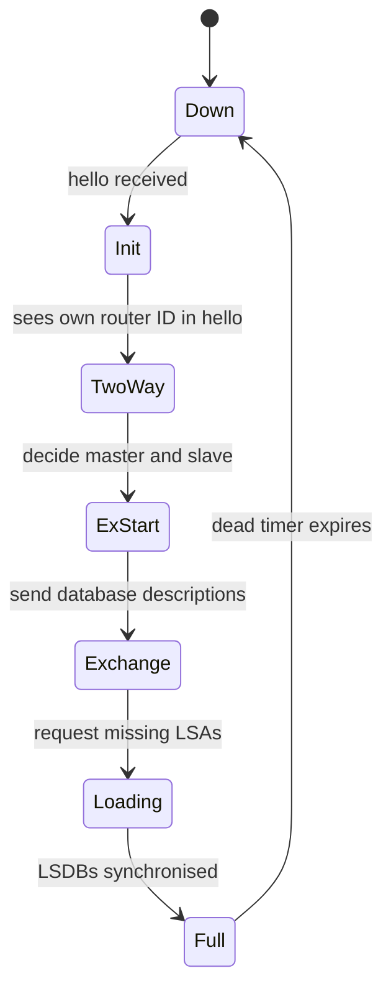
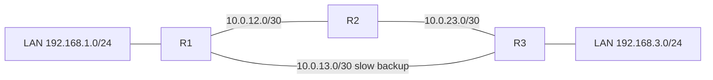
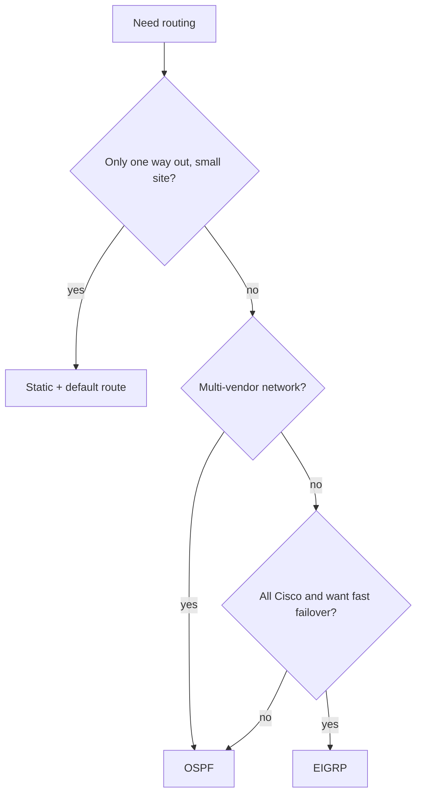
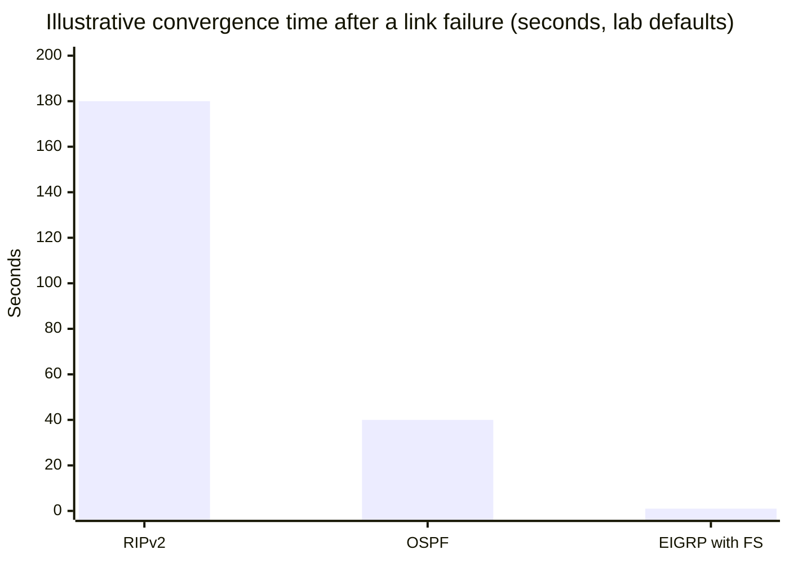

# Session 7: Dynamic Routing: RIP, OSPF and EIGRP

> [Cybersecurity and Digital Forensics](../../README.md) › [Term 1](../README.md) › [Module 3: Technologies of Computer Networks](README.md) › **Session 7**

| ⏱ Estimated time | 📋 Prerequisites |
|---|---|
| 3.5 hours | Session 6 (router basics, administrative distance, Packet Tracer) |

| ⬅ [Previous: Session 6](session-06-network-devices-packet-tracer.md) | [Next: Session 8](session-08-lan-switching.md) ➡ |
|:---|---:|

[](https://colab.research.google.com/github/Hamnakhan123/Cybersecurity-and-Digital-Forensics/blob/main/term-1/03-computer-networks/code/session-07-dynamic-routing.ipynb) &nbsp;Run every Python example of this session in the notebook [`code/session-07-dynamic-routing.ipynb`](code/session-07-dynamic-routing.ipynb).

---

## 🎯 Learning objectives

- Compare **static** and **dynamic** routing, and **distance-vector**, **link-state** and **advanced distance-vector** protocols.
- Explain **RIP** (v1, v2, RIPng): hop-count metric, timers, loop prevention (split horizon, route poisoning, hold-down).
- Explain **OSPF**: areas, router ID, neighbours and adjacencies, LSAs, the SPF (Dijkstra) algorithm, cost, DR/BDR; and configure single-area OSPF.
- Explain and configure **EIGRP**: DUAL, composite metric, successor and feasible successor.
- Verify and troubleshoot routing with `show ip route`, `show ip protocols` and neighbour commands; secure routing protocols with authentication and passive interfaces.

## 📖 Concepts

### 1. Static vs dynamic routing

| | Static | Dynamic |
|---|---|---|
| Configured by | Admin, route by route | Routers exchange information automatically |
| Adapts to failures | No (unless floating static backup) | Yes, re-converges |
| CPU/bandwidth overhead | None | Some |
| Scale | Small or stub networks | Medium to very large |
| Security | No protocol to attack | Must authenticate neighbours |
| Example | `ip route 0.0.0.0 0.0.0.0 203.0.113.1` | RIP, OSPF, EIGRP, BGP |

**Convergence** = the time until all routers agree on the new best paths after a change. Faster convergence = shorter outages.

### 2. Families of routing protocols

| | Distance vector | Link state | Advanced distance vector (hybrid) |
|---|---|---|---|
| Knows | Distance + direction (next hop) from neighbours | The complete map of its area | Neighbours' distances + backup paths |
| Analogy | Asking road signs: "Lahore 1 200 km →" | Having the whole country's road map | Road signs plus remembering a safe detour |
| Updates | Periodic full tables (RIP) | Triggered LSAs on change | Partial, triggered |
| Algorithm | Bellman-Ford | Dijkstra SPF | DUAL |
| Examples | RIPv1, RIPv2 | OSPF, IS-IS | EIGRP |

Interior gateway protocols (**IGP**: RIP, OSPF, EIGRP, IS-IS) run **inside** one organisation; **BGP** (an EGP, path-vector) connects organisations across the internet.

### 3. RIP – Routing Information Protocol

- Metric = **hop count**, maximum **15**; **16 = unreachable**. So RIP suits only small networks and ignores link speed (a 2-hop 10 Mbps path beats a 3-hop 10 Gbps path).
- Sends the full table every **30 s** (UDP 520). Timers: invalid 180 s, hold-down 180 s, flush 240 s.
- **RIPv1:** classful (no subnet mask in updates), broadcast, no authentication.
- **RIPv2:** **classless** (sends masks → VLSM works), multicast **224.0.0.9**, MD5 authentication, `no auto-summary`.
- **RIPng:** for IPv6 (UDP 521).

**Loop-prevention tools**
- **Split horizon** – never advertise a route back out the interface you learned it on.
- **Route poisoning** – advertise a failed route with metric 16 straight away.
- **Poison reverse** – reply to a poisoned route with metric 16.
- **Hold-down timer** – ignore worse news about a recently failed route for a while.
- **Triggered updates** – send changes immediately instead of waiting 30 s.
- Without them you get **count to infinity**: two routers keep raising each other's metric for a dead network.

### 4. OSPF – Open Shortest Path First

- Open standard, link state, IP protocol 89, multicast **224.0.0.5** (all OSPF routers) and **224.0.0.6** (DR/BDR).
- **Cost** = reference bandwidth ÷ interface bandwidth. Default reference 100 Mbps makes FastEthernet, Gigabit and 10G **all cost 1**, so set `auto-cost reference-bandwidth` higher (same on every router).
- **Router ID**: manually set, else highest loopback IP, else highest active interface IP.
- **Neighbour states:** Down → Init → 2-Way → ExStart → Exchange → Loading → **Full**. Hello 10 s / dead 40 s on Ethernet; hello/dead timers, area, subnet, authentication and MTU must match.
- On multi-access networks a **DR** (designated router) and **BDR** are elected (highest priority, then highest router ID) to reduce adjacencies.
- **Areas:** area 0 is the **backbone**; other areas connect to it through **ABRs**. Areas keep LSDBs small and contain instability.
- **LSAs** describe links; every router in an area has an identical **LSDB** and runs **Dijkstra** to build its shortest-path tree.
- Configuration uses **wildcard masks**: `network 10.0.12.0 0.0.0.3 area 0`.

### 5. EIGRP – Enhanced Interior Gateway Routing Protocol

- Originally Cisco-proprietary (published as RFC 7868 in 2016), IP protocol 88, multicast **224.0.0.10**.
- Composite metric uses mainly **bandwidth** (slowest link on the path) and **delay** (sum); load and reliability are off by default.
- **DUAL** (Diffusing Update Algorithm) keeps:
  - **Successor** – the best route (in the routing table).
  - **Feasible successor** – a loop-free backup that meets the **feasibility condition** (its reported distance < current feasible distance). Failover to it is almost instant.
- Must match **AS number** and K-values between neighbours. Supports unequal-cost load balancing (`variance`).

### 6. Securing routing protocols

A rogue router that injects routes can redirect traffic (a man-in-the-middle) or black-hole it.
- Use **passive-interface** on user-facing interfaces (no hellos to PCs).
- Enable **authentication** (RIPv2 MD5, OSPF MD5/SHA, EIGRP MD5/SHA) between routers.
- Filter what can be advertised (distribute lists, prefix lists).
- Log neighbour changes and alert on unexpected adjacencies.

## 🧭 Diagrams

**OSPF neighbour states**



**Lab topology (Session 7 routing lab)**



**Choosing an IGP**



## 🪜 Step-by-step: configure and verify OSPF on the lab

1. On every router: `router ospf 1`, set a unique `router-id` (1.1.1.1, 2.2.2.2, 3.3.3.3).
2. `auto-cost reference-bandwidth 100000` on all routers.
3. Advertise each connected network with the right wildcard and `area 0`.
4. `passive-interface` toward the LANs.
5. Verify neighbours: `show ip ospf neighbor` → state **FULL**.
6. Verify routes: `show ip route ospf` → lines starting with **O**, `[110/cost]`.
7. Test failover: shut the R1–R2 link and watch traffic move to the R1–R3 link (`traceroute`).

Full configuration for RIPv2, OSPF and EIGRP (shown, not run – type it on R1 and adapt addresses for R2 and R3):

📄 **`code/session-07_dynamic_routing.ios`**

```text
! Session 7 - RIPv2, OSPF and EIGRP on router R1 (Cisco Packet Tracer lab)
! R1 LANs: 192.168.1.0/24 ; link to R2: 10.0.12.0/30
! Configure ONE protocol at a time in the lab and compare the routing tables.

! ---------- RIP version 2 (distance vector, metric = hop count, max 15) ----------
router rip
 version 2
 no auto-summary                    ! send real subnet masks (classless)
 network 192.168.1.0
 network 10.0.0.0
 passive-interface GigabitEthernet0/0   ! no updates out to the user LAN
exit
! verify: show ip route rip   |  show ip protocols  |  debug ip rip

! ---------- OSPF (link state, cost = reference bandwidth / bandwidth) ----------
router ospf 1
 router-id 1.1.1.1
 auto-cost reference-bandwidth 100000   ! 100 Gbps reference, set the same on ALL routers
 network 192.168.1.0 0.0.0.255 area 0   ! wildcard mask = inverse of subnet mask
 network 10.0.12.0 0.0.0.3 area 0
 passive-interface GigabitEthernet0/0
exit
! verify: show ip ospf neighbor (state FULL)  |  show ip route ospf  |  show ip ospf interface brief

! ---------- EIGRP (advanced distance vector, DUAL, bandwidth + delay) ----------
router eigrp 100                        ! AS number must match on neighbours
 eigrp router-id 1.1.1.1
 no auto-summary
 network 192.168.1.0 0.0.0.255
 network 10.0.12.0 0.0.0.3
 passive-interface GigabitEthernet0/0
exit
! verify: show ip eigrp neighbors  |  show ip eigrp topology (successor / feasible successor)
```
**Expected output excerpt after OSPF converges (R1):**

```text
R1#show ip ospf neighbor
Neighbor ID     Pri   State           Dead Time   Address         Interface
2.2.2.2           1   FULL/DR         00:00:35    10.0.12.2       GigabitEthernet0/1
3.3.3.3           1   FULL/DR         00:00:31    10.0.13.2       GigabitEthernet0/2

R1#show ip route ospf
O     192.168.3.0/24 [110/300] via 10.0.12.2, 00:01:12, GigabitEthernet0/1
```

## 💻 Worked examples

### Example 1 (intermediate) – RIP as Bellman-Ford, including a link failure

📄 **`code/session-07_rip_bellman_ford.py`**

```python
"""Session 7 - Distance-vector routing (RIP) simulated with Bellman-Ford.

Each router only knows its neighbours. Every round, each router sends its
whole table to its neighbours and keeps any route that is shorter (hop count).
RIP: metric = hops, maximum 15, 16 = unreachable.
Run:  python session-07_rip_bellman_ford.py
"""

LINKS = {("R1", "R2"), ("R2", "R3"), ("R3", "R4"), ("R1", "R5"), ("R5", "R4")}
NETWORKS = {"R1": "10.1.0.0/24", "R2": "10.2.0.0/24", "R3": "10.3.0.0/24",
            "R4": "10.4.0.0/24", "R5": "10.5.0.0/24"}
INFINITY = 16


def neighbours(r, links):
    return [b if a == r else a for a, b in links if r in (a, b)]


def converge(links, tables=None, label=""):
    routers = sorted(NETWORKS)
    if tables is None:   # start: each router knows only its own network, 0 hops
        tables = {r: {NETWORKS[r]: (0, "connected")} for r in routers}
    for rnd in range(1, 20):
        changed = False
        snapshot = {r: dict(t) for r, t in tables.items()}      # updates sent at the same time
        for r in routers:
            for n in neighbours(r, links):
                for net, (hops, _) in snapshot[n].items():
                    new = min(hops + 1, INFINITY)
                    cur = tables[r].get(net, (INFINITY, None))
                    if new < cur[0] or (cur[1] == n and new != cur[0]):
                        tables[r][net] = (new, n)
                        changed = True
        if not changed:
            print(f"{label}converged after {rnd - 1} update round(s)")
            return tables
    return tables


def show(tables, router):
    for net, (hops, via) in sorted(tables[router].items()):
        state = "unreachable" if hops >= INFINITY else f"{hops} hop(s) via {via}"
        print(f"   {router}: {net:<13} {state}")


if __name__ == "__main__":
    t = converge(LINKS, label="Initial topology: ")
    show(t, "R1")
    print("\nLink R1-R5 fails. R1 forgets routes learned through R5, then reconverges:")
    t["R1"] = {n: v for n, v in t["R1"].items() if v[1] != "R5"}
    t["R5"] = {n: v for n, v in t["R5"].items() if v[1] != "R1"}
    t = converge(LINKS - {("R1", "R5")}, t, label="After failure: ")
    show(t, "R1")
```

**Output**

```text
Initial topology: converged after 2 update round(s)
   R1: 10.1.0.0/24   0 hop(s) via connected
   R1: 10.2.0.0/24   1 hop(s) via R2
   R1: 10.3.0.0/24   2 hop(s) via R2
   R1: 10.4.0.0/24   2 hop(s) via R5
   R1: 10.5.0.0/24   1 hop(s) via R5

Link R1-R5 fails. R1 forgets routes learned through R5, then reconverges:
After failure: converged after 3 update round(s)
   R1: 10.1.0.0/24   0 hop(s) via connected
   R1: 10.2.0.0/24   1 hop(s) via R2
   R1: 10.3.0.0/24   2 hop(s) via R2
   R1: 10.4.0.0/24   3 hop(s) via R2
   R1: 10.5.0.0/24   4 hop(s) via R2
```
**Observe:** each router only learns from neighbours, one hop per round. After the R1–R5 link fails, R1 reaches 10.5.0.0 the long way round (4 hops). With 16 or more hops a network would be unreachable for RIP.

### Example 2 (advanced) – OSPF cost and Dijkstra, and why the reference bandwidth matters

📄 **`code/session-07_ospf_dijkstra.py`**

```python
"""Session 7 - Link-state routing (OSPF) simulated with Dijkstra's algorithm.

OSPF cost = reference bandwidth / interface bandwidth (default reference 100 Mbps,
so set it higher on modern networks or every link >= 100 Mbps costs 1).
Every router has the full map (LSDB) and computes the shortest-path tree itself.
Run:  python session-07_ospf_dijkstra.py
"""
import heapq

# router A, router B, link bandwidth in Mbps
LINKS = [("R1", "R2", 1000), ("R2", "R4", 1000), ("R1", "R3", 100),
         ("R3", "R4", 100), ("R1", "R4", 100), ("R4", "R5", 10000)]


def cost(bw_mbps, ref_mbps):
    return max(1, ref_mbps // bw_mbps)


def graph(ref):
    g = {}
    for a, b, bw in LINKS:
        c = cost(bw, ref)
        g.setdefault(a, []).append((b, c))
        g.setdefault(b, []).append((a, c))
    return g


def dijkstra(g, src):
    dist, prev = {src: 0}, {}
    pq = [(0, src)]
    while pq:
        d, u = heapq.heappop(pq)
        if d > dist[u]:
            continue
        for v, w in g[u]:
            if d + w < dist.get(v, float("inf")):
                dist[v], prev[v] = d + w, u
                heapq.heappush(pq, (d + w, v))
    return dist, prev


def path(prev, src, dst):
    p = [dst]
    while p[-1] != src:
        p.append(prev[p[-1]])
    return " -> ".join(reversed(p))


if __name__ == "__main__":
    for ref in (100, 100000):
        g = graph(ref)
        print(f"\nReference bandwidth {ref} Mbps; link costs:")
        for a, b, bw in LINKS:
            print(f"   {a}-{b} {bw:>6} Mbps cost {cost(bw, ref)}")
        dist, prev = dijkstra(g, "R1")
        print("   Shortest paths from R1:")
        for r in sorted(dist):
            if r != "R1":
                print(f"     to {r}: cost {dist[r]:>4}  path {path(prev, 'R1', r)}")
```

**Output**

```text

Reference bandwidth 100 Mbps; link costs:
   R1-R2   1000 Mbps cost 1
   R2-R4   1000 Mbps cost 1
   R1-R3    100 Mbps cost 1
   R3-R4    100 Mbps cost 1
   R1-R4    100 Mbps cost 1
   R4-R5  10000 Mbps cost 1
   Shortest paths from R1:
     to R2: cost    1  path R1 -> R2
     to R3: cost    1  path R1 -> R3
     to R4: cost    1  path R1 -> R4
     to R5: cost    2  path R1 -> R4 -> R5

Reference bandwidth 100000 Mbps; link costs:
   R1-R2   1000 Mbps cost 100
   R2-R4   1000 Mbps cost 100
   R1-R3    100 Mbps cost 1000
   R3-R4    100 Mbps cost 1000
   R1-R4    100 Mbps cost 1000
   R4-R5  10000 Mbps cost 10
   Shortest paths from R1:
     to R2: cost  100  path R1 -> R2
     to R3: cost 1000  path R1 -> R3
     to R4: cost  200  path R1 -> R2 -> R4
     to R5: cost  210  path R1 -> R2 -> R4 -> R5
```
**Observe:** with the default 100 Mbps reference, a 100 Mbps direct link to R4 costs the same as a 1 Gbps link, so OSPF picks the **slow direct link**. With a 100 Gbps reference, costs reflect real speed and R1 reaches R4 via R2 over Gigabit links.

## 📊 Comparison

| Feature | RIPv2 | OSPFv2 | EIGRP |
|---|---|---|---|
| Type | Distance vector | Link state | Advanced distance vector |
| Metric | Hop count (max 15) | Cost (bandwidth) | Bandwidth + delay |
| Algorithm | Bellman-Ford | Dijkstra SPF | DUAL |
| AD | 120 | 110 | 90 (internal) |
| Updates | Every 30 s, full table | Triggered LSAs, refresh every 30 min | Triggered, partial |
| Multicast | 224.0.0.9 | 224.0.0.5 / .6 | 224.0.0.10 |
| Convergence | Slow | Fast | Very fast (feasible successor) |
| Scale | Small | Large (areas) | Large |
| Vendor | Open | Open | Cisco origin, RFC 7868 |



*Rough lab-default figures: RIP waits for timers (up to the 180 s invalid/hold-down), OSPF detects a dead neighbour within 40 s (faster with BFD or link-down events), EIGRP with a feasible successor switches almost instantly.*

## 🏢 Real-life problem with full solution

**Scenario.** A company has a head office and four branches. Today every router has 10–15 static routes; when one WAN link failed last month, two branches were cut off for 3 hours until an engineer edited routes by hand. The routers are from two different vendors.

**Solution.**

1. **Choose OSPF** – multi-vendor support rules out EIGRP; RIP's hop limit and slow convergence make it unsuitable.
2. **Design:** single **area 0** (only 5 routers); router IDs from loopbacks (1.1.1.1 …); `auto-cost reference-bandwidth 100000` everywhere.
3. **Redundancy:** add a cheap internet VPN between each branch and head office as a second path, with a higher OSPF cost so it is used only when the main link fails.
4. **Security:** `passive-interface default` then `no passive-interface` only on WAN links; OSPF **SHA authentication** on every adjacency.
5. **Default route:** head office originates it (`default-information originate`) so branches need no static routes.
6. **Verification:** all neighbours FULL; shut the main link at one branch → traffic moves to the VPN within ~40 s; logs show adjacency change.

## ⚠️ Common mistakes

- Using RIPv1 or forgetting `no auto-summary` → discontiguous subnets break.
- Mismatched OSPF hello/dead timers, area IDs, subnet masks or MTU → neighbours stuck in Init/ExStart.
- Wrong wildcard masks (`0.0.0.255` written as `255.255.255.0`).
- Leaving the 100 Mbps reference bandwidth on modern networks.
- Different EIGRP AS numbers on neighbours.
- Advertising user LANs without `passive-interface` (lets a rogue device form an adjacency).

## ✅ Best practices

- Static + default route for stub sites; OSPF for multi-vendor; EIGRP in all-Cisco networks when you need fast failover.
- Set router IDs manually; use loopback interfaces.
- Authenticate routing protocols; passive by default.
- Document metrics/costs and expected paths; test failover regularly.
- Summarise routes at area borders to keep tables small.

## 🧪 Lab / practice tasks

1. **Easy –** What is RIP's maximum hop count, and what does a metric of 16 mean?
2. **Easy –** Calculate OSPF cost for 10 Mbps, 100 Mbps, 1 Gbps and 10 Gbps with reference 100 Mbps and with 100 000 Mbps.
3. **Medium –** Build the Session 7 topology in Packet Tracer with RIPv2, then replace it with OSPF. Record `show ip route` each time and compare the codes and ADs.
4. **Medium –** In `session-07_rip_bellman_ford.py`, add router R6 linked only to R4. How many hops does R1 need to reach R6's network?
5. **Challenge –** Add **split horizon** to the RIP simulation (do not accept a route from the neighbour you would send it back to) and show that the count-to-infinity problem disappears when a stub network fails.

<details>
<summary>💡 Hints</summary>

- Task 2: cost = max(1, reference ÷ bandwidth).
- Task 4: add `("R4", "R6")` to `LINKS` and `"R6": "10.6.0.0/24"` to `NETWORKS`.
- Task 5: when router `r` reads neighbour `n`'s table, skip entries whose next hop is `r`.
</details>

<details>
<summary>✅ Solutions</summary>

**Task 1:** 15 hops; 16 = unreachable (infinity).

**Task 2:** reference 100: 10, 1, 1, 1. Reference 100 000: 10 000, 1 000, 100, 10.

**Task 3:** RIP routes show `R ... [120/hops]`; OSPF routes show `O ... [110/cost]`. OSPF chooses the faster path; RIP chooses the fewest hops.

**Task 4:** R1 → R5 → R4 → R6 = **3 hops** (initial topology).

**Task 5:**

```python
for net, (hops, via) in snapshot[n].items():
    if via == r:          # split horizon: n learned this from r, so ignore it
        continue
    ...
```

With split horizon, when a stub network behind R4 fails, R3 no longer hears R4's own route echoed back by R2/R5, so the route is removed instead of the metric slowly rising to 16.
</details>

## ✅ Quick quiz

1. Which protocol uses Dijkstra's algorithm? a) RIP b) OSPF c) EIGRP d) BGP
2. Which multicast address does RIPv2 use? a) 224.0.0.5 b) 224.0.0.9 c) 224.0.0.10 d) 255.255.255.255
3. An EIGRP backup route that is guaranteed loop-free is the: a) successor b) feasible successor c) DR d) ABR
4. OSPF neighbours are stuck in Init. A likely cause is: a) different router IDs b) mismatched hello/dead timers c) different hostnames d) passive interface on a LAN
5. What is the OSPF backbone area? a) area 1 b) area 0 c) area 255 d) any area

<details>
<summary>Show answers</summary>

1 – b · 2 – b · 3 – b · 4 – b · 5 – b
</details>

## 📝 Summary / cheat-sheet

- Static: simple, no adaptation; dynamic: automatic, needs security.
- RIP: hops ≤ 15, 30 s updates, v2 classless + multicast 224.0.0.9, split horizon/poisoning/hold-down.
- OSPF: link state, cost = ref BW ÷ BW, area 0 backbone, neighbours → FULL, DR/BDR, wildcard masks.
- EIGRP: DUAL, bandwidth + delay, successor + feasible successor, AS must match.
- AD: EIGRP 90 < OSPF 110 < RIP 120. Verify with `show ip route`, `show ip protocols`, neighbour commands.
- Secure: passive interfaces + authentication.

**Interview / viva questions**

1. Compare distance-vector and link-state routing.
2. Why is RIP unsuitable for large networks?
3. Explain OSPF cost and why the reference bandwidth should be changed.
4. What is a feasible successor and why does it make EIGRP converge quickly?
5. List three reasons two OSPF routers may fail to become neighbours.
6. How can a rogue router abuse a routing protocol, and how do you prevent it?

---

| ⬅ [Previous: Session 6](session-06-network-devices-packet-tracer.md) | [Next: Session 8](session-08-lan-switching.md) ➡ |
|:---|---:|

<sub>Prepared by **Hamna Zahid Khan**, Junior Lecturer · Cybersecurity and Digital Forensics</sub>
