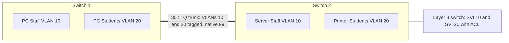
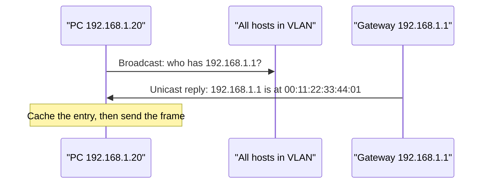
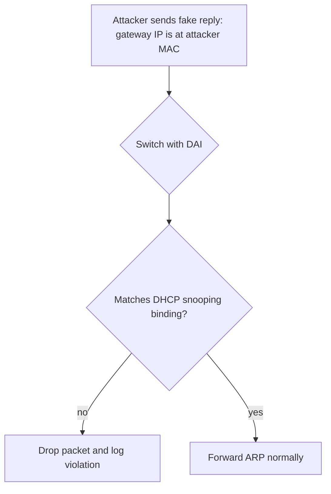
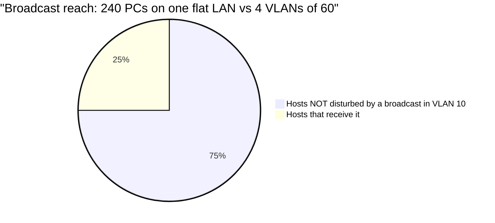

# Session 8: LAN Switching Technologies

> [Cybersecurity and Digital Forensics](../../README.md) › [Term 1](../README.md) › [Module 3: Technologies of Computer Networks](README.md) › **Session 8**

| ⏱ Estimated time | 📋 Prerequisites |
|---|---|
| 3.5 hours | Sessions 3 and 6 (IP addressing, switches) |

| ⬅ [Previous: Session 7](session-07-dynamic-routing.md) | [Next: Session 9](session-09-wireless-technologies.md) ➡ |
|:---|---:|

[](https://colab.research.google.com/github/Hamnakhan123/Cybersecurity-and-Digital-Forensics/blob/main/term-1/03-computer-networks/code/session-08-lan-switching.ipynb) &nbsp;Run every Python example of this session in the notebook [`code/session-08-lan-switching.ipynb`](code/session-08-lan-switching.ipynb).

---

## 🎯 Learning objectives

- Explain what a **VLAN** is and why networks are segmented.
- Configure **access ports**, **trunk ports** (IEEE **802.1Q**), the **native VLAN** and the allowed-VLAN list.
- Differentiate **static (port-based)** and **dynamic (MAC/identity-based)** VLAN membership; describe DTP and VTP risks.
- Describe **inter-VLAN routing** options (router-on-a-stick, Layer 3 switch SVIs).
- Explain the **Address Resolution Protocol (ARP)**, the ARP cache, gratuitous ARP and **ARP spoofing**, and defend with DHCP snooping and Dynamic ARP Inspection.
- Introduce LAN-switching helpers: **STP** loop prevention, port security, and port mirroring.

## 📖 Concepts

### 1. Why VLANs?

A **VLAN (virtual LAN)** splits one physical switch into several logical switches. Each VLAN is a separate **broadcast domain** and normally a separate **IP subnet**.

> **Analogy – one office building, separate departments.** Everyone shares the same building (switch), but each department has its own locked floor (VLAN). To visit another floor you must go through reception (a router or Layer 3 switch) where rules are checked.

**Benefits:** smaller broadcast domains (performance), **security** (students cannot reach staff servers without passing an ACL), flexibility (group users by role not by desk), and easier management (voice VLAN for phones, management VLAN for devices).

**VLAN ranges:** 1 = default (do not use for users), 2–1001 normal, 1002–1005 legacy, 1006–4094 extended. 0 and 4095 are reserved.

### 2. Access and trunk ports

| | Access port | Trunk port |
|---|---|---|
| Carries | One data VLAN (+ optional voice VLAN) | Many VLANs |
| Tagged? | No – end devices see normal frames | Yes – **802.1Q tag** identifies the VLAN |
| Connects | PCs, printers, phones | Switch ↔ switch, switch ↔ router, switch ↔ hypervisor |
| Key commands | `switchport mode access`, `switchport access vlan 10` | `switchport mode trunk`, `switchport trunk allowed vlan 10,20` |

**802.1Q tag** (4 bytes, inserted after the source MAC): TPID `0x8100` + **PCP** (3-bit priority for QoS, e.g. 5 for voice) + **DEI** (1 bit) + **VID** (12-bit VLAN ID → 4 094 VLANs).

**Native VLAN:** frames on this VLAN cross the trunk **untagged**. It must match on both ends. Set it to an **unused** VLAN (e.g. 99) to block **VLAN hopping by double tagging**.

### 3. Static vs dynamic VLANs

| | Static (port-based) | Dynamic |
|---|---|---|
| Membership decided by | The port the device plugs into | The device's MAC, user login or certificate (via a policy server, e.g. 802.1X + RADIUS) |
| Admin effort | Reconfigure when people move desks | Follows the user automatically |
| Security | Anyone plugging into the port joins the VLAN | Unknown devices can land in a guest/quarantine VLAN |
| Common use | Most networks | Large campuses, NAC deployments |

**Protocols to know (and their risks):**
- **DTP** (Dynamic Trunking Protocol) auto-negotiates trunks. An attacker can pretend to be a switch and get a trunk → **switch spoofing**. Defence: `switchport nonegotiate`, set modes explicitly.
- **VTP** (VLAN Trunking Protocol) copies VLAN lists between switches. A switch with a higher revision number can wipe VLANs network-wide. Defence: VTP transparent/off or v3 with a password.

### 4. Inter-VLAN routing

- **Router-on-a-stick:** one router interface with **sub-interfaces** (`g0/0.10`, `g0/0.20`), each with `encapsulation dot1Q <vlan>` and the VLAN's gateway IP. Cheap, but one link carries all inter-VLAN traffic.
- **Layer 3 switch:** **SVIs** (`interface vlan 10`) act as gateways and `ip routing` routes at wire speed. Standard in modern campuses.
- Apply **ACLs** at this point to control which VLANs may talk.

### 5. ARP – Address Resolution Protocol

To send a frame on the local network, a host needs the destination's **MAC**. ARP maps **IPv4 → MAC**.

1. Check the **ARP cache** (`arp -a`).
2. If missing, broadcast **ARP Request**: "Who has 192.168.1.1? Tell 192.168.1.20".
3. The owner replies by unicast **ARP Reply**: "192.168.1.1 is at 00:11:22:33:44:01".
4. Store it in the cache (Windows ~ tens of seconds to minutes, Cisco 4 hours).

- For a **remote** destination the host ARPs for its **default gateway**, not the remote host.
- **Gratuitous ARP**: an unsolicited announcement of one's own IP/MAC (after boot or failover) – also detects duplicate IPs.
- **Proxy ARP**: a router answers on behalf of another network (usually disabled).
- **RARP** (old): MAC → IP, replaced by DHCP. IPv6 uses **NDP** instead of ARP.

**ARP spoofing / poisoning:** ARP has **no authentication**, so any device on the LAN can send fake replies ("I am the gateway") and become a man-in-the-middle. Defences:
- **DHCP snooping** – trusted ports only may answer DHCP; builds an IP–MAC–port binding table.
- **Dynamic ARP Inspection (DAI)** – drops ARP packets that do not match that table.
- Static ARP entries for critical hosts; encryption (TLS, VPN) so intercepted traffic is useless; monitoring for MAC changes (the script below).

### 6. Other LAN-switching features

- **STP (802.1D), RSTP (802.1w), MSTP:** block redundant links to stop **broadcast storms**; elect a root bridge; PortFast + **BPDU Guard** on access ports. (Deep dive in Module 4.)
- **Port security:** limit or pin MAC addresses per port; violation modes protect / restrict / shutdown.
- **Port mirroring (SPAN):** copy a port's traffic to a monitoring port for an IDS or analyser.
- **Link aggregation (LACP / EtherChannel):** bundle links for bandwidth and redundancy.

## 🧭 Diagrams

**VLANs across a trunk**



**ARP request and reply**



**ARP spoofing and DAI**



## 🪜 Step-by-step: VLANs and a trunk in Packet Tracer

1. Two 2960 switches, connected Gi0/1 ↔ Gi0/1. Four PCs: PC1 and PC3 in VLAN 10 (192.168.10.0/24), PC2 and PC4 in VLAN 20 (192.168.20.0/24).
2. On both switches create VLANs 10, 20, 99 and assign access ports.
3. Configure Gi0/1 as a trunk, native VLAN 99, allowed 10 and 20, `nonegotiate`.
4. Ping PC1 → PC3 (same VLAN, across the trunk): ✓. PC1 → PC2: ✗ (different VLAN, no router yet).
5. Add a Layer 3 switch or router-on-a-stick with gateways .1 in each VLAN; now PC1 → PC2 works.
6. Verify: `show vlan brief`, `show interfaces trunk`, `show mac address-table`.

📄 **`code/session-08_vlan_trunk.ios`**

```text
! Session 8 - VLANs, access ports, a trunk and Dynamic ARP Inspection on switch SW1
vlan 10
 name STAFF
vlan 20
 name VOICE
vlan 99
 name NATIVE-UNUSED
exit
interface range FastEthernet0/1 - 12
 switchport mode access
 switchport access vlan 10
 switchport voice vlan 20
 switchport nonegotiate                  ! no DTP: an attacker cannot negotiate a trunk
 spanning-tree portfast
exit
interface GigabitEthernet0/1             ! uplink to the distribution switch
 switchport mode trunk
 switchport trunk native vlan 99         ! unused native VLAN stops VLAN hopping by double tagging
 switchport trunk allowed vlan 10,20
 switchport nonegotiate
exit
interface range FastEthernet0/13 - 24    ! unused ports: shut and park them
 switchport access vlan 999
 shutdown
exit
! Defend ARP: DHCP snooping builds the IP-MAC binding table, DAI checks ARP against it
ip dhcp snooping
ip dhcp snooping vlan 10
ip arp inspection vlan 10
interface GigabitEthernet0/1
 ip dhcp snooping trust
 ip arp inspection trust
exit
! verify: show vlan brief | show interfaces trunk | show ip arp inspection | show mac address-table
```
**Expected `show interfaces trunk` (excerpt):**

```text
Port        Mode         Encapsulation  Status        Native vlan
Gi0/1       on           802.1q         trunking      99

Port        Vlans allowed on trunk
Gi0/1       10,20
```

## 💻 Worked examples

### Example 1 (intermediate) – Building and parsing 802.1Q tags

📄 **`code/session-08_dot1q.py`**

```python
"""Session 8 - Build and read an IEEE 802.1Q (VLAN) tagged Ethernet header.

A trunk link carries frames for many VLANs. The 4-byte tag sits between the
source MAC and the EtherType: TPID 0x8100 + 3-bit priority + 1-bit DEI + 12-bit VLAN ID.
Only bytes in memory are built here; nothing is sent.
Run:  python session-08_dot1q.py
"""
import struct


def mac_bytes(mac):
    return bytes(int(x, 16) for x in mac.split(":"))


def build_frame(dst, src, vlan=None, prio=0, ethertype=0x0800, payload=b"IPv4..."):
    hdr = mac_bytes(dst) + mac_bytes(src)
    if vlan is not None:
        if not 1 <= vlan <= 4094:
            raise ValueError("VLAN ID must be 1-4094 (0 and 4095 are reserved)")
        tci = (prio << 13) | (0 << 12) | vlan
        hdr += struct.pack("!HH", 0x8100, tci)
    return hdr + struct.pack("!H", ethertype) + payload


def parse(frame):
    dst = ":".join(f"{b:02x}" for b in frame[0:6])
    src = ":".join(f"{b:02x}" for b in frame[6:12])
    (tpid,) = struct.unpack("!H", frame[12:14])
    if tpid == 0x8100:
        (tci,) = struct.unpack("!H", frame[14:16])
        (etype,) = struct.unpack("!H", frame[16:18])
        return dict(dst=dst, src=src, tagged=True, prio=tci >> 13, vlan=tci & 0x0FFF, etype=hex(etype))
    return dict(dst=dst, src=src, tagged=False, vlan="native/access", etype=hex(tpid))


if __name__ == "__main__":
    pc = "aa:bb:cc:00:00:10"; gw = "aa:bb:cc:00:00:01"
    untagged = build_frame(gw, pc)
    voice = build_frame(gw, pc, vlan=20, prio=5)
    data = build_frame(gw, pc, vlan=10)
    for name, f in [("access port (untagged)", untagged), ("trunk, VLAN 10 data", data),
                    ("trunk, VLAN 20 voice", voice)]:
        print(f"{name:<24} {len(f):>2} bytes  hex: {f[:18].hex(' ')}")
        print(f"{'':<24} parsed -> {parse(f)}")
    print("\nTag adds", len(data) - len(untagged), "bytes; 12-bit VLAN ID gives", 2 ** 12 - 2, "usable VLANs")
    try:
        build_frame(gw, pc, vlan=5000)
    except ValueError as e:
        print("Rejected:", e)
```

**Output**

```text
access port (untagged)   21 bytes  hex: aa bb cc 00 00 01 aa bb cc 00 00 10 08 00 49 50 76 34
                         parsed -> {'dst': 'aa:bb:cc:00:00:01', 'src': 'aa:bb:cc:00:00:10', 'tagged': False, 'vlan': 'native/access', 'etype': '0x800'}
trunk, VLAN 10 data      25 bytes  hex: aa bb cc 00 00 01 aa bb cc 00 00 10 81 00 00 0a 08 00
                         parsed -> {'dst': 'aa:bb:cc:00:00:01', 'src': 'aa:bb:cc:00:00:10', 'tagged': True, 'prio': 0, 'vlan': 10, 'etype': '0x800'}
trunk, VLAN 20 voice     25 bytes  hex: aa bb cc 00 00 01 aa bb cc 00 00 10 81 00 a0 14 08 00
                         parsed -> {'dst': 'aa:bb:cc:00:00:01', 'src': 'aa:bb:cc:00:00:10', 'tagged': True, 'prio': 5, 'vlan': 20, 'etype': '0x800'}

Tag adds 4 bytes; 12-bit VLAN ID gives 4094 usable VLANs
Rejected: VLAN ID must be 1-4094 (0 and 4095 are reserved)
```
**Look at the hex:** after the two MAC addresses, the tagged frames contain `81 00` (TPID) and then `00 0a` (VLAN 10) or `a0 14` (priority 5 = `101` in the top 3 bits, VLAN 20 = `0x014`).

### Example 2 (advanced) – Detecting ARP spoofing in a capture

📄 **`code/session-08_arp_watch.py`**

```python
"""Session 8 - ARP cache behaviour and a defensive ARP-spoofing detector.

ARP maps an IPv4 address to a MAC address on the local network. Because ARP
has no authentication, an attacker on the LAN can send fake replies. A monitor
(like the classic `arpwatch` tool) flags when an IP suddenly changes MAC.
The events below are a recorded lab capture, not live traffic.
Run:  python session-08_arp_watch.py
"""

EVENTS = [  # (time, type, sender IP, sender MAC)
    ("10:00:01", "reply",  "192.168.1.1",  "00:11:22:33:44:01"),   # gateway
    ("10:00:03", "reply",  "192.168.1.20", "00:11:22:33:44:20"),
    ("10:00:09", "reply",  "192.168.1.30", "00:11:22:33:44:30"),
    ("10:05:00", "garp",   "192.168.1.20", "00:11:22:33:44:20"),   # normal refresh
    ("10:07:12", "reply",  "192.168.1.1",  "de:ad:be:ef:00:66"),   # gateway IP, new MAC!
    ("10:07:13", "reply",  "192.168.1.30", "de:ad:be:ef:00:66"),   # same MAC claims a 2nd IP
    ("10:07:14", "reply",  "192.168.1.1",  "de:ad:be:ef:00:66"),
]
CRITICAL = {"192.168.1.1": "default gateway"}


def watch(events):
    table, alerts, mac_to_ips, seen = {}, [], {}, set()
    for t, kind, ip, mac in events:
        old = table.get(ip)
        if old and old != mac:
            sev = "CRITICAL" if ip in CRITICAL else "WARNING"
            alerts.append(f"{t} {sev}: {ip} changed {old} -> {mac}")
        table[ip] = mac
        mac_to_ips.setdefault(mac, set()).add(ip)
        key = (mac, frozenset(mac_to_ips[mac]))
        if len(mac_to_ips[mac]) > 1 and key not in seen:
            seen.add(key)
            alerts.append(f"{t} WARNING: MAC {mac} now claims {sorted(mac_to_ips[mac])}")
    return table, alerts


if __name__ == "__main__":
    table, alerts = watch(EVENTS)
    print("Final ARP cache (what victims now believe):")
    for ip, mac in table.items():
        print(f"  {ip:<14} -> {mac}")
    print("\nAlerts:")
    for a in alerts:
        print(" ", a)
    print("\nDefences: Dynamic ARP Inspection + DHCP snooping on switches, "
          "static ARP for the gateway on critical hosts, encrypt traffic (TLS/VPN).")
```

**Output**

```text
Final ARP cache (what victims now believe):
  192.168.1.1    -> de:ad:be:ef:00:66
  192.168.1.20   -> 00:11:22:33:44:20
  192.168.1.30   -> de:ad:be:ef:00:66

Alerts:
  10:07:12 CRITICAL: 192.168.1.1 changed 00:11:22:33:44:01 -> de:ad:be:ef:00:66
  10:07:13 WARNING: 192.168.1.30 changed 00:11:22:33:44:30 -> de:ad:be:ef:00:66
  10:07:13 WARNING: MAC de:ad:be:ef:00:66 now claims ['192.168.1.1', '192.168.1.30']

Defences: Dynamic ARP Inspection + DHCP snooping on switches, static ARP for the gateway on critical hosts, encrypt traffic (TLS/VPN).
```
**Interpretation:** at 10:07:12 the gateway's IP moved to a new MAC, and the same MAC then claimed a second IP – the classic signature of a man-in-the-middle. In production, DAI would have dropped those replies before any host's cache was poisoned.

## 📊 Chart



| Membership | How assigned | Moves with the user | Typical use |
|---|---|---|---|
| Static | Per switch port | No | Most offices, labs |
| Dynamic (MAC-based) | Policy server by MAC | Yes | Printers, IoT |
| Dynamic (802.1X) | User/device authentication | Yes | Enterprise NAC, guest isolation |

## 🏢 Real-life problem with full solution

**Scenario.** A university lab floor has 120 student PCs, 10 staff PCs, 4 IP cameras and 6 IP phones all in VLAN 1 on three switches. A student ran a free ARP-spoofing tool "for fun" and captured a lecturer's unencrypted web login.

**Solution.**

| Step | Action |
|---|---|
| 1. Segment | VLAN 10 Staff, 20 Students, 30 Cameras, 40 Voice, 99 native (unused), 999 parking for unused ports |
| 2. Trunks | Explicit trunks between switches, `allowed vlan 10,20,30,40`, native 99, `nonegotiate` |
| 3. Access ports | `switchport mode access`, PortFast + BPDU Guard, port security max 2 MACs |
| 4. ARP defence | DHCP snooping on all user VLANs, trust only uplinks; **DAI** on VLANs 10 and 20 |
| 5. Routing | Layer 3 switch SVIs as gateways; ACL: Students → Staff denied, Cameras reachable only from the security server |
| 6. Encryption | Force HTTPS on all internal web portals |
| 7. Policy | Acceptable-use policy reminder; spoofing tools are prohibited outside the isolated security lab |

Verification: from a student PC, an ARP-spoofing attempt in the **isolated training lab** is logged and dropped (`show ip arp inspection statistics`); `ping` to staff PCs fails; staff can still use servers.

## ⚠️ Common mistakes

- Leaving users in **VLAN 1** and using VLAN 1 as the native VLAN.
- Native VLAN mismatch between trunk ends (CDP warns; traffic leaks between VLANs).
- Forgetting to allow a new VLAN on the trunk (`switchport trunk allowed vlan add 30`).
- Leaving ports in DTP `dynamic auto/desirable` mode.
- Thinking VLANs alone are a firewall – inter-VLAN routing without ACLs lets everything through.
- Enabling DAI without DHCP snooping (or static ARP ACLs) → every ARP dropped.

## ✅ Best practices

- One VLAN = one subnet = one purpose; document VLAN IDs, names and subnets.
- Unused native VLAN; explicit trunk/access modes; `nonegotiate`; prune allowed VLANs.
- Park unused ports in a dead VLAN and shut them.
- DHCP snooping + DAI + port security on access layers; BPDU Guard on edge ports.
- Filter inter-VLAN traffic with ACLs; monitor with SPAN to an IDS.

## 🧪 Lab / practice tasks

1. **Easy –** On your PC run `arp -a`. Which entry is your default gateway?
2. **Easy –** Write the commands to put Fa0/5 into VLAN 30 as an access port.
3. **Medium –** Build the two-switch VLAN lab in Packet Tracer; prove same-VLAN pings work across the trunk and cross-VLAN pings fail.
4. **Medium –** Change `session-08_dot1q.py` to tag a frame for VLAN 4094 with priority 7. What are the two TCI bytes in hex?
5. **Challenge –** Extend `session-08_arp_watch.py` to raise an alert when more than 3 ARP replies arrive from the same MAC within 2 seconds (an ARP flood).

<details>
<summary>💡 Hints</summary>

- Task 2: `interface fa0/5`, `switchport mode access`, `switchport access vlan 30`.
- Task 4: TCI = (7 << 13) | 4094.
- Task 5: keep a list of timestamps per MAC; convert `HH:MM:SS` to seconds.
</details>

<details>
<summary>✅ Solutions</summary>

**Task 1:** the entry whose IP equals the "Default Gateway" shown by `ipconfig`/`ip route`; it is usually type *dynamic*.

**Task 2:**

```text
interface FastEthernet0/5
 switchport mode access
 switchport access vlan 30
 switchport nonegotiate
```

**Task 3:** PC1 ↔ PC3 succeed (both VLAN 10); PC1 ↔ PC2 fail (different broadcast domains, no gateway).

**Task 4:** (7 << 13) | 4094 = 0xE000 | 0x0FFE = **0xEFFE** → bytes `ef fe`.

**Task 5:**

```python
def sec(t): h, m, s = map(int, t.split(":")); return h * 3600 + m * 60 + s
recent = {}
for t, kind, ip, mac in EVENTS:
    times = [x for x in recent.get(mac, []) if sec(t) - x <= 2] + [sec(t)]
    recent[mac] = times
    if len(times) > 3:
        print(f"{t} ARP FLOOD from {mac}: {len(times)} replies in 2 s")
```
</details>

## ✅ Quick quiz

1. How many bytes does an 802.1Q tag add to a frame? a) 2 b) 4 c) 8 d) 12
2. Frames on the native VLAN cross a trunk: a) tagged b) untagged c) encrypted d) dropped
3. ARP maps: a) MAC → IP b) IP → MAC c) name → IP d) port → service
4. Which feature drops ARP replies that do not match the DHCP binding table? a) port security b) BPDU Guard c) Dynamic ARP Inspection d) VTP
5. An attacker negotiates a trunk with a switch port using DTP. This is called: a) MAC flooding b) switch spoofing c) ARP poisoning d) DHCP starvation

<details>
<summary>Show answers</summary>

1 – b · 2 – b · 3 – b · 4 – c · 5 – b
</details>

## 📝 Summary / cheat-sheet

- VLAN = separate broadcast domain = separate subnet. Access port = one VLAN untagged; trunk = many VLANs tagged with 802.1Q (TPID 0x8100, PCP, DEI, 12-bit VID).
- Native VLAN untagged → set to unused VLAN, match both ends. `nonegotiate` to stop DTP.
- Static VLAN by port; dynamic by MAC / 802.1X.
- Inter-VLAN routing: router-on-a-stick (sub-interfaces) or L3 switch SVIs + ACLs.
- ARP: request broadcast, reply unicast, cache; gratuitous ARP; spoofing → DHCP snooping + DAI + encryption.
- Also: STP/BPDU Guard, port security, SPAN, LACP.

**Interview / viva questions**

1. Why do VLANs improve both performance and security?
2. What is the native VLAN and how is it abused in double-tagging attacks?
3. Compare router-on-a-stick and Layer 3 switch inter-VLAN routing.
4. Explain ARP step by step for a destination on another subnet.
5. How do DHCP snooping and DAI work together?
6. What is the difference between static and dynamic VLAN membership?

---

| ⬅ [Previous: Session 7](session-07-dynamic-routing.md) | [Next: Session 9](session-09-wireless-technologies.md) ➡ |
|:---|---:|

<sub>Prepared by **Hamna Zahid Khan**, Junior Lecturer · Cybersecurity and Digital Forensics</sub>
