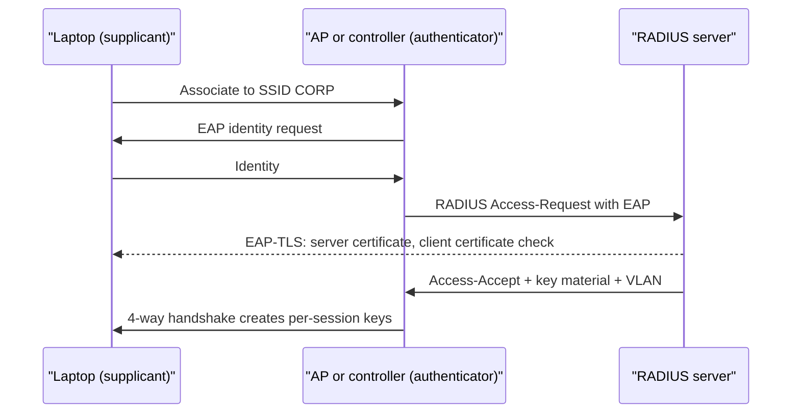
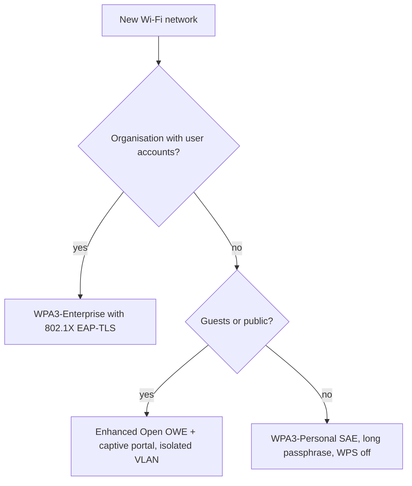
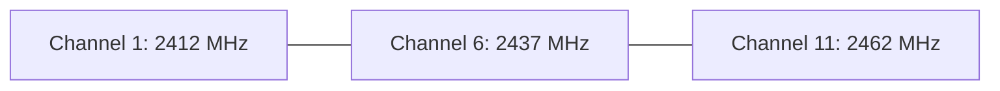
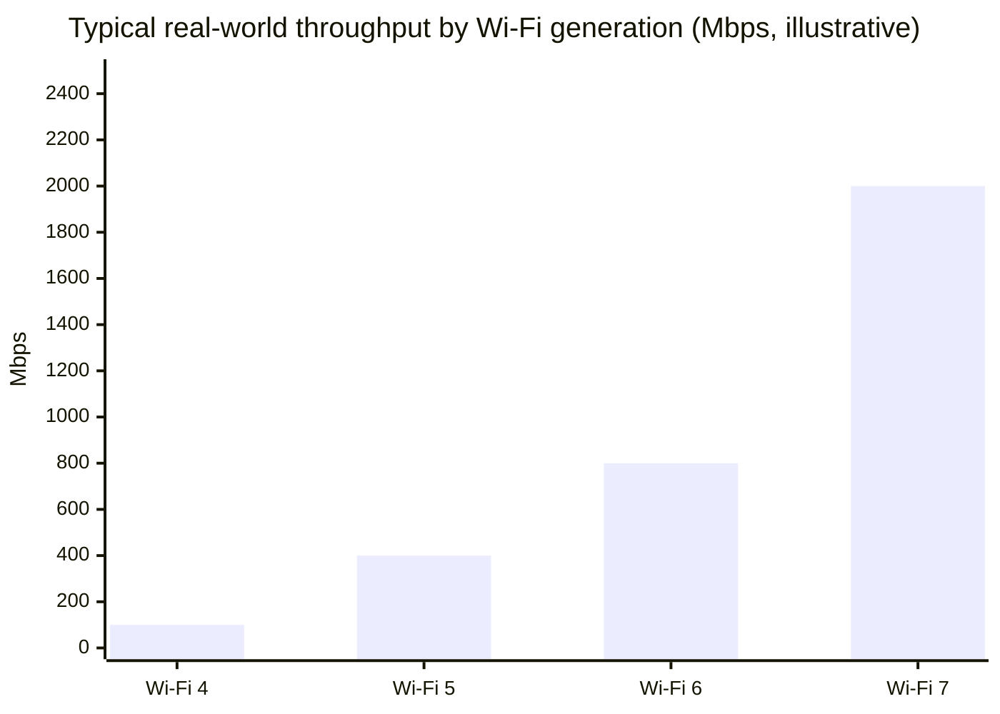

# Session 9: Wireless Technologies

> [Cybersecurity and Digital Forensics](../../README.md) › [Term 1](../README.md) › [Module 3: Technologies of Computer Networks](README.md) › **Session 9**

| ⏱ Estimated time | 📋 Prerequisites |
|---|---|
| 3 hours | Sessions 1, 2 and 8 |

| ⬅ [Previous: Session 8](session-08-lan-switching.md) | [Next: Session 10](session-10-network-availability.md) ➡ |
|:---|---:|

[](https://colab.research.google.com/github/Hamnakhan123/Cybersecurity-and-Digital-Forensics/blob/main/term-1/03-computer-networks/code/session-09-wireless-technologies.ipynb) &nbsp;Run every Python example of this session in the notebook [`code/session-09-wireless-technologies.ipynb`](code/session-09-wireless-technologies.ipynb).

---

## 🎯 Learning objectives

- Explain how Wi-Fi works: **802.11 standards**, frequency bands (2.4, 5, 6 GHz), channels, channel width and interference.
- Describe Wi-Fi components and modes: AP, controller, SSID/BSSID, infrastructure vs ad hoc, mesh.
- Describe the different **wireless encryption and authentication** methods: WEP, WPA, WPA2 (TKIP/AES-CCMP), **WPA3 (SAE)**, Personal vs **Enterprise (802.1X/EAP)**.
- Differentiate the **cellular generations** (2G–5G) and other wireless technologies (Bluetooth, NFC, RFID, Zigbee, satellite).
- Describe **antenna types** (omnidirectional, directional, Yagi, patch, parabolic), gain and polarisation, and do a simple link budget.
- Recognise wireless threats (rogue AP, evil twin, deauthentication, weak PSKs) and their defences.

## 📖 Concepts

### 1. Wi-Fi basics

**Wi-Fi** is the brand for IEEE **802.11** wireless LANs. Devices share the air (a half-duplex medium) and use **CSMA/CA** (listen first, avoid collisions) because a radio cannot hear while it transmits.

| Generation | Standard | Year | Bands | Max (theoretical) | Notes |
|---|---|---|---|---|---|
| – | 802.11b | 1999 | 2.4 GHz | 11 Mbps | DSSS |
| – | 802.11a | 1999 | 5 GHz | 54 Mbps | OFDM |
| – | 802.11g | 2003 | 2.4 GHz | 54 Mbps | |
| Wi-Fi 4 | 802.11n | 2009 | 2.4 / 5 | 600 Mbps | **MIMO**, 40 MHz channels |
| Wi-Fi 5 | 802.11ac | 2013 | 5 | ~3.5–6.9 Gbps | MU-MIMO (downlink), 80/160 MHz |
| Wi-Fi 6 / 6E | 802.11ax | 2019 / 2020 | 2.4 / 5 / **6** | 9.6 Gbps | **OFDMA**, target wake time, WPA3 required for 6E |
| Wi-Fi 7 | 802.11be | 2024 | 2.4 / 5 / 6 | ~46 Gbps | 320 MHz channels, multi-link operation |

**Bands**
- **2.4 GHz** – longer range, penetrates walls better, only **3 non-overlapping channels (1, 6, 11)**, crowded (microwaves, Bluetooth).
- **5 GHz** – many more channels, faster, shorter range; some channels need **DFS** (radar avoidance).
- **6 GHz** – very wide clean spectrum, shortest range, Wi-Fi 6E/7 only.

**Terms:** **SSID** (network name), **BSSID** (the AP radio's MAC), **ESS** (several APs with one SSID for roaming), **beacon** (AP advertisement), **RSSI** (received signal strength, dBm – closer to 0 is stronger), **SNR** (signal minus noise, want > 25 dB).

**Modes:** **infrastructure** (clients ↔ AP, normal), **ad hoc / IBSS** (device ↔ device), **mesh** (APs relay to each other wirelessly). **Autonomous (fat) APs** are configured one by one; **lightweight APs** are managed by a **wireless LAN controller (WLC)** or cloud controller.

### 2. Wireless security: from WEP to WPA3

| Method | Year | Encryption | Status |
|---|---|---|---|
| Open | – | None | Only with a captive portal + per-user VPN/HTTPS; Enhanced Open (OWE) adds encryption without a password |
| **WEP** | 1997 | RC4, 24-bit IV | **Broken** – keys recoverable in minutes; never use |
| **WPA** | 2003 | TKIP (RC4-based stopgap) | Deprecated |
| **WPA2** | 2004 | **AES-CCMP** | Still common; Personal mode vulnerable to offline guessing of weak passphrases; KRACK (2017) patched |
| **WPA3** | 2018 | AES-CCMP/GCMP, **SAE** handshake, **PMF mandatory** | Current best; SAE resists offline dictionary attacks and gives forward secrecy |

**Personal vs Enterprise**
- **Personal (PSK / SAE):** one shared passphrase for everyone. Simple; but if one person leaves you must change it for all.
- **Enterprise (802.1X):** each user/device authenticates with its own credentials or certificate to a **RADIUS** server using **EAP** (EAP-TLS with certificates is the strongest; PEAP-MSCHAPv2 uses passwords inside a TLS tunnel). Per-user keys, per-user VLANs, easy revocation.

**WPA2-Personal key derivation:** `PMK = PBKDF2-HMAC-SHA1(passphrase, SSID, 4096 iterations, 256 bits)`. Anyone who records a four-way handshake can test guesses **offline**; only a long random passphrase protects it. The example below shows the maths **defensively**: how long a strong passphrase survives.

### 3. Wireless threats and defences

| Threat | What happens | Defence |
|---|---|---|
| **Rogue AP** | Someone plugs an unauthorised AP into the wired LAN | Wireless IDS/IPS (WIPS), 802.1X on switch ports |
| **Evil twin** | Fake AP with the same SSID lures users | 802.1X with certificate validation, user awareness, WIPS |
| **Deauthentication flood** | Forged management frames disconnect clients | **802.11w Protected Management Frames** (mandatory in WPA3) |
| **Weak PSK guessing** | Offline guessing of captured handshake | Long passphrases, WPA3-SAE, Enterprise mode |
| **WPS PIN attack** | 8-digit PIN brute-forced | **Disable WPS** |
| **Eavesdropping on open Wi-Fi** | Traffic read in the air | WPA3/OWE, VPN, HTTPS |
| **Jamming** | RF noise blocks the channel | Spectrum analysis, wired fallback for critical systems |

### 4. Cellular technologies

| Generation | Key technologies | Typical speed | Highlights |
|---|---|---|---|
| **2G** | GSM, GPRS, EDGE | Up to ~200 kbps (EDGE) | Digital voice, SMS; weak encryption (A5/1) |
| **3G** | UMTS, HSPA+, CDMA2000 | 2–42 Mbps | Mobile internet; mutual authentication |
| **4G** | **LTE**, LTE-Advanced | 20–300+ Mbps (real-world tens of Mbps) | All-IP, VoLTE |
| **5G** | 5G NR (sub-6 GHz and mmWave) | 100 Mbps – several Gbps | Low latency (~10 ms or less), massive IoT, **network slicing**, private 5G |

**Cellular vs Wi-Fi:** cellular = licensed spectrum, wide-area mobility, operator-managed, SIM-based authentication; Wi-Fi = unlicensed spectrum, local, owner-managed. Businesses use cellular for **WAN backup** (4G/5G router) and IoT.

**Other wireless technologies:** **Bluetooth / BLE** (PAN, ~10 m, pairing security), **NFC** (~4 cm, payments), **RFID** (tags, access cards – can be cloned if unencrypted), **Zigbee / Z-Wave** (low-power smart home mesh), **LoRaWAN** (km-range, tiny data), **satellite** (remote sites; LEO constellations reduced latency to tens of ms).

### 5. Antennas

| Type | Pattern | Typical gain | Use |
|---|---|---|---|
| **Omnidirectional** (dipole, ceiling AP) | 360° doughnut | 2–6 dBi | Offices, classrooms |
| **Patch / panel** | ~60–90° | 6–12 dBi | Covering a hall or one side of a building |
| **Sector** | 60–120° | 12–18 dBi | Outdoor, campus, cell towers |
| **Yagi** | Narrow beam | 10–18 dBi | Point-to-point to a nearby building |
| **Parabolic dish / grid** | Very narrow | 20–30+ dBi | Long point-to-point bridges (km) |

- **dBi** = gain compared with an ideal isotropic antenna; gain does not add power, it **focuses** it.
- **Polarisation** (vertical/horizontal) should match at both ends.
- **MIMO** uses several antennas to send multiple spatial streams.
- **EIRP** = transmitter power + antenna gain − cable loss; regulators cap it.
- **Free-space path loss** grows with distance and frequency: 5 GHz loses ~7 dB more than 2.4 GHz over the same distance.

> **Analogy – a torch.** An omnidirectional antenna is a bare bulb lighting the whole room; a Yagi or dish is a focused torch beam that reaches far but only in one direction.

## 🧭 Diagrams

**WPA2/WPA3-Enterprise (802.1X) authentication**



**Choosing wireless security**



**2.4 GHz non-overlapping channels**



## 🪜 Step-by-step: securing a small office access point

1. Change the default admin password; update firmware.
2. Choose **WPA3-Personal** (or WPA2/WPA3 transition mode if old devices exist); passphrase of 4+ random words or 16+ random characters.
3. **Disable WPS** and remote administration from the internet.
4. Enable **PMF** (802.11w).
5. Create a **guest SSID** on its own VLAN with client isolation.
6. Set channels manually: 2.4 GHz on 1/6/11 (20 MHz width), 5 GHz on non-DFS channels if radar events are common.
7. Place APs centrally on the ceiling; reduce transmit power so the signal doesn't leak far outside.
8. Log to syslog (Session 10) and check the client list for unknown devices.

## 💻 Worked examples

### Example 1 (intermediate) – Channel overlap and signal planning

📄 **`code/session-09_wifi_planner.py`**

```python
"""Session 9 - Wi-Fi planning maths: 2.4 GHz channel overlap, free-space path
loss and a simple link budget for an access point.

FSPL(dB) = 20 log10(d_km) + 20 log10(f_MHz) + 32.44
Received power = Tx power + Tx antenna gain + Rx antenna gain - FSPL - wall losses
Run:  python session-09_wifi_planner.py
"""
import math


def channel_centre_24(ch):           # 2.4 GHz channels are 5 MHz apart
    return 2407 + 5 * ch


def overlaps(c1, c2, width=22):        # classic 802.11b/g channel is 22 MHz wide
    return abs(channel_centre_24(c1) - channel_centre_24(c2)) < width


def fspl(d_m, f_mhz):
    return 20 * math.log10(d_m / 1000) + 20 * math.log10(f_mhz) + 32.44


def rssi(d_m, f_mhz, tx_dbm=20, gain_tx=3, gain_rx=0, walls=0, wall_db=5):
    return tx_dbm + gain_tx + gain_rx - fspl(d_m, f_mhz) - walls * wall_db


def quality(dbm):
    if dbm >= -60: return "excellent"
    if dbm >= -67: return "good (VoIP OK)"
    if dbm >= -75: return "fair (browsing)"
    return "poor"


if __name__ == "__main__":
    print("2.4 GHz channels that do NOT overlap with channel 1:",
          [c for c in range(1, 14) if not overlaps(1, c)][:3], "-> use 1, 6, 11")
    print("Channel 3 overlaps channel 1?", overlaps(1, 3), "| channel 6?", overlaps(1, 6))

    print("\nSignal at distance from a 20 dBm AP with a 3 dBi antenna:")
    print(f"{'distance':>8} {'walls':>5} {'2.4 GHz':>9} {'5 GHz':>9}  5 GHz quality")
    for d, w in [(5, 0), (15, 1), (25, 2), (40, 2), (60, 3)]:
        a, b = rssi(d, 2437, walls=w), rssi(d, 5500, walls=w)
        print(f"{d:>6} m {w:>5} {a:>7.1f}dBm {b:>7.1f}dBm  {quality(b)}")
    print("\n5 GHz loses about", round(fspl(10, 5500) - fspl(10, 2437), 1),
          "dB more than 2.4 GHz at the same distance (shorter range, more channels).")
```

**Output**

```text
2.4 GHz channels that do NOT overlap with channel 1: [6, 7, 8] -> use 1, 6, 11
Channel 3 overlaps channel 1? True | channel 6? False

Signal at distance from a 20 dBm AP with a 3 dBi antenna:
distance walls   2.4 GHz     5 GHz  5 GHz quality
     5 m     0   -31.2dBm   -38.2dBm  excellent
    15 m     1   -45.7dBm   -52.8dBm  excellent
    25 m     2   -55.1dBm   -62.2dBm  good (VoIP OK)
    40 m     2   -59.2dBm   -66.3dBm  good (VoIP OK)
    60 m     3   -67.7dBm   -74.8dBm  fair (browsing)

5 GHz loses about 7.1 dB more than 2.4 GHz at the same distance (shorter range, more channels).
```
**Interpretation:** at 40 m through two walls the 5 GHz signal (−66 dBm) is still good enough for voice; at 60 m through three walls it drops to "fair". Add an AP rather than raising power.

### Example 2 (advanced, defensive) – Why WPA2-Personal needs long passphrases

The script derives real WPA2 Pairwise Master Keys with PBKDF2 and estimates worst-case guessing time for different passphrase styles, using an assumed attacker speed of one million guesses per second.

📄 **`code/session-09_wpa2_psk.py`**

```python
"""Session 9 - Why WPA2-Personal needs a long passphrase.

WPA2-PSK turns the passphrase into a 256-bit Pairwise Master Key with
PBKDF2-HMAC-SHA1(passphrase, SSID, 4096 iterations, 32 bytes).
The SSID is the salt, so the same password on a different network gives a
different key. Anyone who records a handshake can try guesses OFFLINE, so the
only defence for PSK networks is a long, random passphrase (or WPA3-SAE).
Run:  python session-09_wpa2_psk.py
"""
import hashlib


def pmk(passphrase: str, ssid: str) -> bytes:
    return hashlib.pbkdf2_hmac("sha1", passphrase.encode(), ssid.encode(), 4096, 32)


if __name__ == "__main__":
    print("PMK for 'CampusLab2026!' on SSID 'LAB-WIFI':")
    print(" ", pmk("CampusLab2026!", "LAB-WIFI").hex())
    print("Same passphrase, SSID 'HOME-WIFI':")
    print(" ", pmk("CampusLab2026!", "HOME-WIFI").hex(), "(different: SSID is the salt)")

    # Each guess costs 4096 x 2 SHA-1 operations. Assume an attacker's GPU manages
    # about one million guesses per second (order-of-magnitude teaching figure).
    gpu = 1_000_000
    print()
    print(f"{'passphrase style':<34}{'combinations':>14}  worst-case time on 1 GPU")
    styles = [("8 lowercase letters", 26 ** 8), ("8 chars, upper+lower+digits", 62 ** 8),
              ("10 chars, 94 printable symbols", 94 ** 10), ("4 random dictionary words (7776)", 7776 ** 4),
              ("6 random dictionary words", 7776 ** 6)]
    for name, space in styles:
        secs = space / gpu
        if secs < 86400: t = f"{secs / 3600:,.1f} hours"
        elif secs < 3.15e7: t = f"{secs / 86400:,.1f} days"
        elif secs < 3.15e7 * 1000: t = f"{secs / 3.15e7:,.1f} years"
        else: t = f"{secs / 3.15e7:.1e} years"
        print(f"{name:<34}{space:>14.2e}  {t}")
```

**Output**

```text
PMK for 'CampusLab2026!' on SSID 'LAB-WIFI':
  602f02ceb0f8d67af471def10a6b8cee6a9fd518c68f2cf1b62edef93ea7af78
Same passphrase, SSID 'HOME-WIFI':
  95d3e85ef7ebc0c449cb63cde980a80b6465f8e9348a7686f9e7d789b4ac8a91 (different: SSID is the salt)

passphrase style                    combinations  worst-case time on 1 GPU
8 lowercase letters                     2.09e+11  2.4 days
8 chars, upper+lower+digits             2.18e+14  6.9 years
10 chars, 94 printable symbols          5.39e+19  1.7e+06 years
4 random dictionary words (7776)        3.66e+15  116.1 years
6 random dictionary words               2.21e+23  7.0e+09 years
```
**Conclusion:** an 8-letter lowercase passphrase falls in days; six random words would take billions of years. WPA3-SAE removes the offline-guessing problem altogether.

## 📊 Chart



*Illustrative single-client figures in good conditions; real throughput depends on distance, channel width, interference and client capability.*

| Band | Range | Non-overlapping 20 MHz channels (approx.) | Interference | Best for |
|---|---|---|---|---|
| 2.4 GHz | Longest | 3 | High | IoT, coverage at the edges |
| 5 GHz | Medium | ~20–25 (region dependent) | Medium | Most clients, video |
| 6 GHz | Shortest | Up to 59 | Low | High-density, newest devices |

## 🏢 Real-life problem with full solution

**Scenario.** A hotel offers one SSID "Hotel-Guest" with WPA2 password `hotel123` printed in every room. Staff laptops use the same network. Guests complain of slow Wi-Fi; a security review found staff laptops visible to guests, and a pentester (hired by the hotel) set up an evil twin that several guests joined.

**Solution.**

| Problem | Fix |
|---|---|
| Staff and guests share one network | Two SSIDs: **Hotel-Staff** (WPA3-Enterprise, 802.1X with certificates, staff VLAN) and **Hotel-Guest** (OWE or WPA3-Personal + captive portal, guest VLAN, **client isolation**, internet only) |
| Weak shared password | Staff: per-user certificates; guests: password rotated per stay via the portal |
| Evil twin | WIPS on the controller detects APs advertising the hotel SSIDs; staff devices validate the RADIUS certificate so they never connect to a fake AP |
| Deauth attacks | PMF (mandatory with WPA3) |
| Slow Wi-Fi | Site survey; move clients to 5/6 GHz with band steering; 2.4 GHz only on 1/6/11 at 20 MHz; more APs at lower power instead of a few loud ones |
| Bandwidth hogs | Per-client rate limit on the guest SSID |

## ⚠️ Common mistakes

- Using WEP/TKIP "for compatibility", or leaving WPS on.
- Short dictionary-word PSKs and never changing them when staff leave.
- 40 MHz channels on 2.4 GHz (overlap everything) or channels other than 1/6/11.
- Turning AP power to maximum (more interference, clients can't hear back – "asymmetric link").
- Not validating the server certificate in 802.1X (users become evil-twin victims).
- Assuming hidden SSIDs or MAC filtering are security (both are trivially bypassed).

## ✅ Best practices

- WPA3 (Enterprise where possible), PMF on, WPS off, separate guest VLAN with isolation.
- Site survey before and after deployment; channel and power planning.
- Central controller, WIPS, logging and firmware updates.
- Use cellular (4G/5G) as WAN backup; protect IoT on its own SSID/VLAN.
- Match antenna type to the coverage shape; respect EIRP limits.

## 🧪 Lab / practice tasks

1. **Easy –** List the non-overlapping 2.4 GHz channels and explain why 3 overlaps 1.
2. **Easy –** Order from weakest to strongest: WPA2-PSK, WEP, WPA3-SAE, WPA-TKIP, WPA3-Enterprise.
3. **Medium –** Packet Tracer: add a wireless router, configure SSID `LAB-SECURE` with WPA2-PSK AES, connect a laptop with a wireless NIC, then change the passphrase and observe the client disconnect.
4. **Medium –** Using `session-09_wifi_planner.py`, at what distance (no walls) does 5 GHz signal fall below −67 dBm?
5. **Challenge –** Add a 6 GHz column (5975 MHz) to the planner and a column for a 12 dBi patch antenna instead of 3 dBi.

<details>
<summary>💡 Hints</summary>

- Task 1: centres are 5 MHz apart, but each channel is ~22 MHz wide.
- Task 4: loop `d` from 10 to 200 and print when `rssi(d, 5500) < -67`.
- Task 5: call `rssi(d, 5975)` and `rssi(d, 5500, gain_tx=12)`.
</details>

<details>
<summary>✅ Solutions</summary>

**Task 1:** 1, 6, 11. Channel 3's centre (2422 MHz) is only 10 MHz from channel 1 (2412 MHz), much less than the ~22 MHz width.

**Task 2:** WEP < WPA-TKIP < WPA2-PSK < WPA3-SAE < WPA3-Enterprise.

**Task 3:** Packet Tracer: Wireless router → GUI → Wireless → SSID; Wireless Security → WPA2 Personal, AES, passphrase; laptop → PC Wireless app → connect. After changing the passphrase the laptop drops until it is re-entered.

**Task 4:**

```python
for d in range(10, 300, 5):
    if rssi(d, 5500) < -67:
        print(d); break
```

Prints **140** m (free space, no walls). Each wall (5 dB) shortens this considerably.

**Task 5:**

```python
print(f"{rssi(d, 5975, walls=w):>7.1f}", f"{rssi(d, 5500, gain_tx=12, walls=w):>7.1f}")
```

6 GHz is ~0.7 dB weaker than 5.5 GHz at the same distance; the 12 dBi patch adds 9 dB **in its beam direction only**.
</details>

## ✅ Quick quiz

1. Which Wi-Fi security is broken and must never be used? a) WPA3 b) WEP c) WPA2-Enterprise d) OWE
2. WPA3-Personal replaces the PSK handshake with: a) TKIP b) SAE c) WPS d) LEAP
3. Which antenna would you use for a 2 km building-to-building link? a) omnidirectional dipole b) parabolic dish c) ceiling AP d) patch inside a room
4. Which cellular generation introduced network slicing? a) 2G b) 3G c) 4G d) 5G
5. Which protects against deauthentication attacks? a) hidden SSID b) MAC filtering c) 802.11w PMF d) WPS

<details>
<summary>Show answers</summary>

1 – b · 2 – b · 3 – b · 4 – d · 5 – c
</details>

## 📝 Summary / cheat-sheet

- 802.11 n/ac/ax/be = Wi-Fi 4/5/6/7; 2.4 GHz (range, 1/6/11), 5 GHz (speed), 6 GHz (clean, short).
- Security: WEP ✗, WPA-TKIP ✗, WPA2-AES ok with long PSK, **WPA3-SAE + PMF** best; Enterprise = 802.1X + RADIUS + EAP-TLS.
- Threats: rogue AP, evil twin, deauth, weak PSK, WPS → WIPS, PMF, certificates, WPS off.
- Cellular: 2G GSM → 3G UMTS → 4G LTE → 5G NR (low latency, slicing).
- Antennas: omni, patch, sector, Yagi, dish; dBi, EIRP, polarisation; FSPL rises with frequency and distance.

**Interview / viva questions**

1. Why are only channels 1, 6 and 11 recommended on 2.4 GHz?
2. Compare WPA2-Personal, WPA3-Personal and WPA3-Enterprise.
3. What is an evil-twin attack and how does 802.1X with certificate validation stop it?
4. When would you choose a directional antenna?
5. Compare 4G and 5G for an IoT deployment.
6. Why are hidden SSIDs and MAC filtering not real security?

---

| ⬅ [Previous: Session 8](session-08-lan-switching.md) | [Next: Session 10](session-10-network-availability.md) ➡ |
|:---|---:|

<sub>Prepared by **Hamna Zahid Khan**, Junior Lecturer · Cybersecurity and Digital Forensics</sub>
