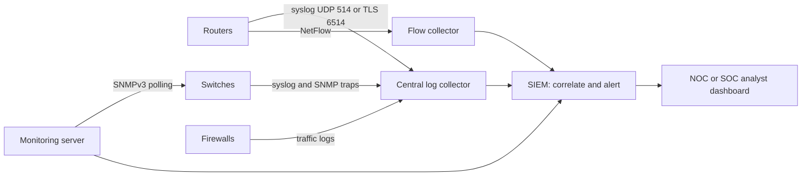
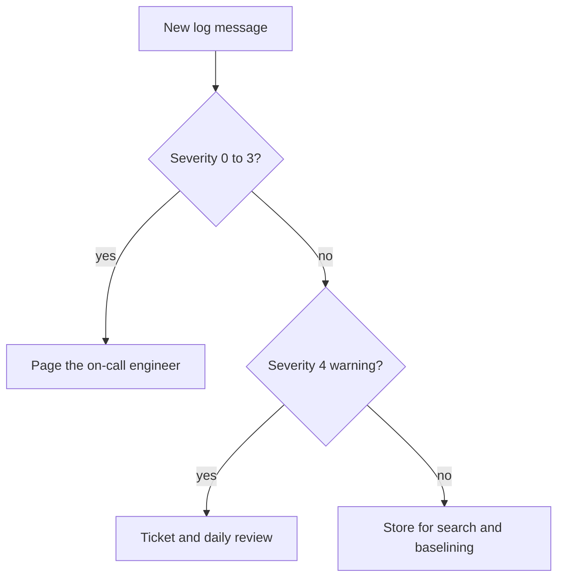
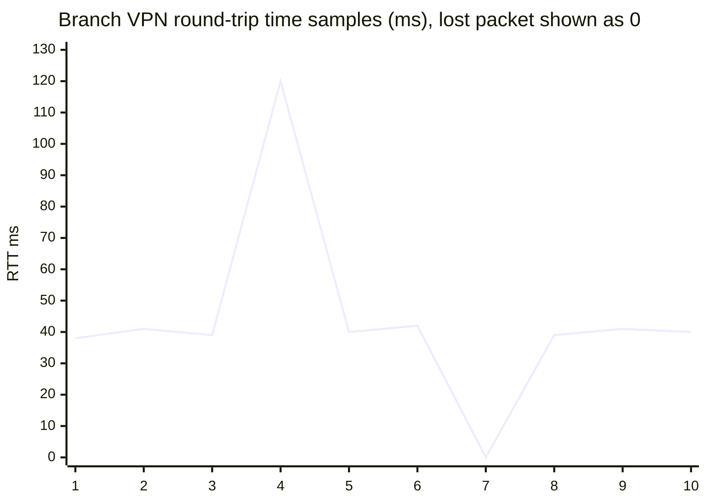

# Session 10: Network Availability and Monitoring

> [Cybersecurity and Digital Forensics](../../README.md) › [Term 1](../README.md) › [Module 3: Technologies of Computer Networks](README.md) › **Session 10**

| ⏱ Estimated time | 📋 Prerequisites |
|---|---|
| 3 hours | Sessions 4 (ports, NTP) and 6 (devices) |

| ⬅ [Previous: Session 9](session-09-wireless-technologies.md) | [Next: Session 11](session-11-policies-and-procedures.md) ➡ |
|:---|---:|

[](https://colab.research.google.com/github/Hamnakhan123/Cybersecurity-and-Digital-Forensics/blob/main/term-1/03-computer-networks/code/session-10-network-availability.ipynb) &nbsp;Run every Python example of this session in the notebook [`code/session-10-network-availability.ipynb`](code/session-10-network-availability.ipynb).

---

## 🎯 Learning objectives

- Describe the **performance metrics** of a network: bandwidth, throughput, latency, jitter, packet loss, error rate, utilisation, availability.
- Explain **SLAs** and the meaning of "nines".
- Describe **network device logs**: syslog format, **facility and severity levels**, traffic/flow logs, audit logs, interface statistics and SNMP.
- **Configure syslog** on Cisco devices and a central collector; understand log retention and integrity.
- Explain monitoring tools: SNMP (v1/v2c/v3), NetFlow/sFlow/IPFIX, baselines, thresholds and alerts, SIEM.
- Build a small syslog collector and analyser in Python on localhost.

## 📖 Concepts

### 1. Why monitor?

You cannot defend, fix or plan what you cannot see. Monitoring answers three questions: **Is it up?** (availability) **Is it fast enough?** (performance) **Is something wrong or malicious?** (events and security).

> **Analogy – a hospital patient monitor.** Heart rate, blood pressure and oxygen are constantly measured against normal ranges; an alarm sounds when a value crosses a threshold; the nurse's notes (logs) record what happened and when. A network operations centre (NOC) does the same for a network.

### 2. Performance metrics

| Metric | Meaning | Measured with | Good value (typical) |
|---|---|---|---|
| **Bandwidth** | Maximum capacity of a link | Link speed | e.g. 1 Gbps |
| **Throughput** | Data actually delivered per second | iperf, interface counters | Close to bandwidth on an idle link |
| **Latency (delay)** | Time for a packet to travel (often round-trip, RTT) | ping, traceroute | LAN < 1 ms; voice < 150 ms one-way |
| **Jitter** | Variation in latency between packets | ping series, RTP stats | Voice/video < 30 ms |
| **Packet loss** | % of packets that never arrive | ping, interface drops | < 1 % (voice); ideally 0 |
| **Error rate** | CRC / input errors on interfaces | `show interfaces` | 0; rising = cable or duplex problem |
| **Utilisation** | Throughput ÷ bandwidth | SNMP counters | Alert at 70–80 % sustained |
| **Availability** | % of time the service works | Uptime monitoring | 99.9 %+ for business systems |

**Utilisation from counters:** `(bytes_now − bytes_before) × 8 ÷ seconds ÷ link_bps`.

### 3. SLAs and "nines"

A **Service Level Agreement** promises availability, response times and penalties.

| Availability | Downtime per year | Downtime per month |
|---|---|---|
| 99 % ("two nines") | 3.65 days | ~7.3 hours |
| 99.9 % | 8.76 hours | ~43.8 minutes |
| 99.99 % | 52.6 minutes | ~4.4 minutes |
| 99.999 % ("five nines") | 5.26 minutes | ~26 seconds |

Other SLA terms: **MTTR** (mean time to repair), **MTBF** (mean time between failures) – used in Session 12.

### 4. Network device logs

| Log type | Contents | Example use |
|---|---|---|
| **System / event logs** | Interface up/down, reboots, errors, config changes | Outage investigation |
| **Security / audit logs** | Logins, failed logins, privilege changes, commands run | Detect brute force, insider misuse |
| **Traffic / firewall logs** | Allowed/denied connections (5-tuple) | Detect scans, policy violations |
| **Flow records** (NetFlow, sFlow, IPFIX) | Who talked to whom, how much, how long | Bandwidth hogs, data exfiltration |
| **Interface statistics** | Packets, bytes, errors, discards, collisions | Performance, cable faults |
| **SNMP traps** | Device-initiated alerts (link down, high CPU) | Real-time alerting |

### 5. Syslog

**Syslog** is the standard for sending log messages to a central server: UDP **514** (fast, unreliable), TCP 514/601, or **TLS 6514** (reliable and encrypted).

**Message parts (RFC 3164 style):** `<PRI>TIMESTAMP HOSTNAME MESSAGE`, where **PRI = facility × 8 + severity**.

| Code | Severity | Mnemonic | Cisco example |
|---|---|---|---|
| 0 | **Emergency** | Every | System unusable |
| 1 | **Alert** | Awesome | Immediate action needed |
| 2 | **Critical** | Cisco | Memory allocation failure |
| 3 | **Error** | Engineer | Interface down |
| 4 | **Warning** | Will | Config change, ACL deny |
| 5 | **Notice** | Need | Interface up, normal but significant |
| 6 | **Informational** | Ice-cream | ACL hit, routine info |
| 7 | **Debug** | Daily | Debug output (only when troubleshooting) |

*Mnemonic: "Every Awesome Cisco Engineer Will Need Ice-cream Daily".*
**Lower number = more severe.** `logging trap warnings` sends levels 0–4.

**Facilities** identify the source type: `kern` 0, `user` 1, `auth` 4, `authpriv` 10, `local0`–`local7` 16–23 (network devices commonly use local7 = 23).

Cisco message format: `%FACILITY-SEVERITY-MNEMONIC: description`, e.g. `%LINK-3-UPDOWN: Interface Gi1/0/7, changed state to down`.

### 6. Monitoring protocols and tools

- **SNMP** (UDP 161 polling, 162 traps): manager polls **agents** for values in the **MIB** identified by **OIDs**. **v1/v2c** use plaintext "community strings" (`public`/`private` defaults are dangerous); **SNMPv3** adds authentication and encryption – use it.
- **NetFlow / IPFIX / sFlow:** flow summaries from routers/switches to a collector.
- **Packet capture** (Wireshark, tcpdump) via SPAN/mirror ports for deep analysis.
- **Baselines:** record normal behaviour (e.g. 35 % utilisation at 10:00) so anomalies stand out.
- **SIEM** (security information and event management): collects logs from everything, normalises, correlates and alerts.
- **Log management rules:** synchronised time (NTP), central storage, retention policy (often 90 days hot, 1 year archive – check local law/regulation), access control and integrity (forwarding off the device so attackers cannot erase local logs).

## 🧭 Diagrams

**Monitoring pipeline**



**Severity decision**



## 🪜 Step-by-step: configure syslog on a Cisco device (Packet Tracer)

1. Add a **Server** in Packet Tracer, give it `10.1.0.50`, Services → SYSLOG → **On**.
2. On the router, set time and timestamps, then point logging to the server:

📄 **`code/session-10_logging.ios`**

```text
! Session 10 - Send device logs to a central syslog server and keep time accurate
service timestamps log datetime msec localtime show-timezone
clock timezone PKT 5
ntp server 10.1.0.1                      ! every device must agree on the time
logging host 10.1.0.50                   ! central syslog collector (UDP 514)
logging trap warnings                    ! send severity 0-4 to the server
logging buffered 64000 informational     ! keep a local copy in RAM
logging source-interface Loopback0
snmp-server group MONITOR v3 priv
snmp-server user nms MONITOR v3 auth sha Auth#Pass2026 priv aes 128 Priv#Pass2026
! verify: show logging | show ntp status | show clock
```
3. Generate events: `interface g0/1`, `shutdown`, `no shutdown`.
4. On the server's SYSLOG tab you see the `%LINK-5-CHANGED` and `%LINEPROTO-5-UPDOWN` messages with timestamps.
5. Verify on the router: `show logging` (shows trap level, destination and buffer contents).

## 💻 Worked examples

### Example 1 (intermediate) – A syslog collector and analyser on localhost

The script runs a UDP collector on `127.0.0.1`, lets simulated devices send messages to it, decodes PRI into facility/severity and pulls out security patterns.

📄 **`code/session-10_syslog_monitor.py`**

```python
"""Session 10 - A tiny syslog collector on localhost plus a log analyser.

1. Starts a UDP syslog listener on 127.0.0.1 (random high port, not 514,
   so no admin rights are needed).
2. "Devices" send RFC 3164-style messages: <PRI>timestamp host message,
   where PRI = facility * 8 + severity.
3. The collector decodes facility/severity and summarises what needs attention.
Run:  python session-10_syslog_monitor.py
"""
import re
import socket
import threading
import time
from collections import Counter

SEVERITY = ["Emergency", "Alert", "Critical", "Error", "Warning", "Notice", "Informational", "Debug"]
FACILITY = {0: "kern", 1: "user", 4: "auth", 10: "authpriv", 16: "local0", 23: "local7"}

MESSAGES = [  # (facility, severity, host, text)
    (23, 5, "core-sw1", "%LINK-5-CHANGED: Interface Gi1/0/24, changed state to up"),
    (23, 3, "core-sw1", "%LINK-3-UPDOWN: Interface Gi1/0/7, changed state to down"),
    (4, 4, "fw1", "Deny tcp src outside:198.51.100.7/51022 dst inside:10.1.5.20/3389"),
    (4, 4, "fw1", "Deny tcp src outside:198.51.100.7/51023 dst inside:10.1.5.21/3389"),
    (10, 5, "web01", "sshd: Failed password for admin from 10.1.9.50"),
    (10, 5, "web01", "sshd: Failed password for admin from 10.1.9.50"),
    (10, 6, "web01", "sshd: Accepted publickey for deploy from 10.1.9.10"),
    (23, 2, "edge-r1", "%SYS-2-MALLOCFAIL: Memory allocation failed"),
    (16, 6, "app01", "health check OK in 42 ms"),
]

received = []


def collector(sock, expected):
    while len(received) < expected:
        data, _ = sock.recvfrom(2048)
        received.append(data.decode())


def parse(line):
    m = re.match(r"<(\d+)>(\w{3} +\d+ [\d:]+) (\S+) (.*)", line)
    pri = int(m.group(1))
    return {"facility": FACILITY.get(pri // 8, pri // 8), "severity": pri % 8,
            "time": m.group(2), "host": m.group(3), "msg": m.group(4)}


if __name__ == "__main__":
    srv = socket.socket(socket.AF_INET, socket.SOCK_DGRAM)
    srv.bind(("127.0.0.1", 0))
    port = srv.getsockname()[1]
    th = threading.Thread(target=collector, args=(srv, len(MESSAGES)), daemon=True)
    th.start()

    with socket.socket(socket.AF_INET, socket.SOCK_DGRAM) as dev:
        for i, (fac, sev, host, text) in enumerate(MESSAGES):
            line = f"<{fac * 8 + sev}>Oct 26 09:{10 + i:02d}:00 {host} {text}"
            dev.sendto(line.encode(), ("127.0.0.1", port))
            time.sleep(0.01)
    th.join(timeout=2)

    events = [parse(l) for l in received]
    print(f"Collected {len(events)} messages. First raw line: {received[0]}")
    print("\nBy severity:")
    for sev, n in sorted(Counter(e["severity"] for e in events).items()):
        print(f"  {sev} {SEVERITY[sev]:<14} {'#' * n} {n}")
    print("\nNeeds attention now (severity 0-3):")
    for e in events:
        if e["severity"] <= 3:
            print(f"  {e['time']} {e['host']:<8} {SEVERITY[e['severity']]:<9} {e['msg']}")
    fails = Counter(re.search(r"from (\S+)", e["msg"]).group(1) for e in events if "Failed password" in e["msg"])
    denies = Counter(re.search(r"outside:([\d.]+)", e["msg"]).group(1) for e in events if e["msg"].startswith("Deny"))
    print("\nSecurity patterns:", dict(fails), "failed SSH;", dict(denies), "blocked RDP attempts")
```

**Output**

```text
Collected 9 messages. First raw line: <189>Oct 26 09:10:00 core-sw1 %LINK-5-CHANGED: Interface Gi1/0/24, changed state to up

By severity:
  2 Critical       # 1
  3 Error          # 1
  4 Warning        ## 2
  5 Notice         ### 3
  6 Informational  ## 2

Needs attention now (severity 0-3):
  Oct 26 09:11:00 core-sw1 Error     %LINK-3-UPDOWN: Interface Gi1/0/7, changed state to down
  Oct 26 09:17:00 edge-r1  Critical  %SYS-2-MALLOCFAIL: Memory allocation failed

Security patterns: {'10.1.9.50': 2} failed SSH; {'198.51.100.7': 2} blocked RDP attempts
```
**Decode the first line:** PRI 189 = 23 × 8 + 5 → facility local7, severity 5 (Notice).

### Example 2 (intermediate → advanced) – Latency, jitter, loss, utilisation, nines

📄 **`code/session-10_metrics.py`**

```python
"""Session 10 - Network performance metrics from ping-style samples:
latency, jitter, packet loss, throughput/utilisation and the meaning of "nines".

The RTT samples are a recorded lab capture (None = lost packet).
Run:  python session-10_metrics.py
"""
import statistics

SAMPLES = {
    "LAN to file server":  [0.6, 0.5, 0.7, 0.6, 0.5, 0.6, 0.8, 0.6, 0.5, 0.6],
    "Branch over VPN":     [38, 41, 39, 120, 40, 42, None, 39, 41, 40],
    "Congested Wi-Fi":     [12, 85, 30, None, 140, 22, None, 95, 18, None],
}


def metrics(rtts):
    got = [r for r in rtts if r is not None]
    loss = 100 * (len(rtts) - len(got)) / len(rtts)
    jitter = statistics.mean(abs(a - b) for a, b in zip(got, got[1:]))   # mean delay variation
    return statistics.mean(got), min(got), max(got), jitter, loss


def voip_ok(avg, jitter, loss):
    return avg < 150 and jitter < 30 and loss < 1


if __name__ == "__main__":
    print(f"{'Link':<20}{'avg ms':>8}{'min':>6}{'max':>6}{'jitter':>8}{'loss':>7}  VoIP?")
    for name, s in SAMPLES.items():
        avg, lo, hi, j, loss = metrics(s)
        print(f"{name:<20}{avg:>8.1f}{lo:>6}{hi:>6}{j:>8.1f}{loss:>6.0f}%  {'yes' if voip_ok(avg, j, loss) else 'no'}")

    print("\nUtilisation of a 1 Gbps uplink from interface counters (5-minute interval):")
    bytes_before, bytes_after, secs = 8_250_000_000, 39_750_000_000, 300
    bps = (bytes_after - bytes_before) * 8 / secs
    print(f"  {bps / 1e6:,.0f} Mbps = {bps / 1e9:.0%} utilisation (alert threshold 70%)")

    print("\nAvailability 'nines' -> allowed downtime per year:")
    for a in (99, 99.9, 99.99, 99.999):
        mins = (1 - a / 100) * 365 * 24 * 60
        print(f"  {a:>7}%  {mins / 60:>7.2f} hours  ({mins:,.1f} minutes)")
```

**Output**

```text
Link                  avg ms   min   max  jitter   loss  VoIP?
LAN to file server       0.6   0.5   0.8     0.1     0%  yes
Branch over VPN         48.9    38   120    21.8    10%  no
Congested Wi-Fi         57.4    12   140    84.3    30%  no

Utilisation of a 1 Gbps uplink from interface counters (5-minute interval):
  840 Mbps = 84% utilisation (alert threshold 70%)

Availability 'nines' -> allowed downtime per year:
       99%    87.60 hours  (5,256.0 minutes)
     99.9%     8.76 hours  (525.6 minutes)
    99.99%     0.88 hours  (52.6 minutes)
   99.999%     0.09 hours  (5.3 minutes)
```
**Interpretation:** the VPN link's average looks fine but 10 % loss and a 120 ms spike make it unsuitable for VoIP. The uplink at 84 % sustained utilisation needs an upgrade or QoS.

## 📊 Chart



| Severity | Typical action | Who |
|---|---|---|
| 0–2 | Immediate page, incident | On-call engineer |
| 3 | Same-day fix | NOC |
| 4 | Review daily, tune rules | NOC / SOC |
| 5–6 | Store, use for baselines and investigations | Automated |
| 7 | Only temporarily while debugging | Engineer |

## 🏢 Real-life problem with full solution

**Scenario.** Users at a branch say "the system is slow every morning". The company has no monitoring: each router keeps a small log buffer that is overwritten every few hours, and device clocks differ by minutes.

**Solution.**

1. **Time first:** configure NTP on every device (same internal servers) and timestamps with milliseconds.
2. **Central logging:** `logging host` to a collector, `logging trap warnings`, local buffer for informational; forward to the SIEM.
3. **SNMPv3 polling** every 5 minutes for interface counters, CPU and memory; remove community `public`.
4. **NetFlow** on the branch router to see which applications use bandwidth.
5. **Baseline** one week.
6. **Finding:** at 08:55–09:20 the branch uplink hits 95 % utilisation; NetFlow shows an automatic OS update download from 40 PCs, and syslog shows interface output drops at the same time.
7. **Fix:** schedule updates overnight / use a local update cache; add QoS to prioritise the business app; set an alert at 75 % utilisation.
8. **Result:** morning latency drops from ~250 ms to ~40 ms; alerts now fire before users notice.

## ⚠️ Common mistakes

- Logging only to the device's local buffer (lost on reboot, erasable by an attacker).
- Clocks not synchronised → impossible to correlate events.
- Leaving `debug` logging on in production (CPU overload).
- Using SNMP v1/v2c with default communities.
- Collecting everything but never reviewing it (no alerts, no baselines).
- Confusing bandwidth (capacity) with throughput (actual delivered data).

## ✅ Best practices

- NTP everywhere; central syslog (TLS where possible); SNMPv3; NetFlow at key points.
- Define baselines and thresholds; alert on severity 0–3 and on security patterns.
- Protect logs: separate log server, restricted access, integrity (hashing or WORM storage), retention policy.
- Use dashboards for the NOC and correlated alerts for the SOC.
- Review and tune alerts regularly to avoid alert fatigue.

## 🧪 Lab / practice tasks

1. **Easy –** Decode PRI values 34, 165 and 191 into facility and severity.
2. **Easy –** A 100 Mbps link moved 3 000 000 000 bytes in 10 minutes. What was the average utilisation?
3. **Medium –** In Packet Tracer, configure syslog to a server and generate 3 different events; screenshot the server log.
4. **Medium –** Extend `session-10_syslog_monitor.py` to print the **top talker host** (most messages).
5. **Challenge –** Add a rule that raises an alert when the same source IP has ≥ 3 failed SSH logins **and** at least one firewall deny within the log.

<details>
<summary>💡 Hints</summary>

- Task 1: facility = PRI // 8, severity = PRI % 8.
- Task 2: 3 × 10⁹ × 8 ÷ 600 s = bits per second.
- Task 4: `Counter(e["host"] for e in events).most_common(1)`.
</details>

<details>
<summary>✅ Solutions</summary>

**Task 1:** 34 → facility 4 (auth), severity 2 (Critical). 165 → facility 20 (local4), severity 5 (Notice). 191 → facility 23 (local7), severity 7 (Debug).

**Task 2:** 3 × 10⁹ × 8 / 600 = 40 Mbps → **40 %** of 100 Mbps.

**Task 4:**

```python
host, n = Counter(e["host"] for e in events).most_common(1)[0]
print(f"Top talker: {host} with {n} messages")
```

With the sample data this prints `Top talker: web01 with 3 messages` (core-sw1 and fw1 sent 2 each).

**Task 5:**

```python
import re
denied_ips = {re.search(r"outside:([\d.]+)", e["msg"]).group(1) for e in events if e["msg"].startswith("Deny")}
for ip, n in fails.items():
    if n >= 3 and ip in denied_ips:
        print(f"ALERT: {ip} brute force plus firewall denies")
```

(With the sample data no IP meets both conditions: failures come from 10.1.9.50, denies from 198.51.100.7 – a good example of correlation rules returning nothing when activity is unrelated.)
</details>

## ✅ Quick quiz

1. Which syslog severity is "Error"? a) 1 b) 3 c) 4 d) 6
2. `logging trap warnings` sends which levels? a) 4 only b) 4–7 c) 0–4 d) 0–7
3. Variation in packet delay is called: a) latency b) throughput c) jitter d) loss
4. 99.99 % availability allows about how much downtime per year? a) 5 minutes b) 53 minutes c) 8.8 hours d) 3.6 days
5. Which SNMP version provides encryption? a) v1 b) v2c c) v3 d) none

<details>
<summary>Show answers</summary>

1 – b · 2 – c · 3 – c · 4 – b · 5 – c
</details>

## 📝 Summary / cheat-sheet

- Metrics: bandwidth, throughput, latency, jitter, loss, errors, utilisation, availability.
- Nines: 99.9 % ≈ 8.8 h/yr, 99.99 % ≈ 53 min/yr, 99.999 % ≈ 5 min/yr.
- Syslog: UDP 514 / TLS 6514; PRI = facility × 8 + severity; 0 Emergency … 7 Debug (lower = worse).
- Cisco: `logging host`, `logging trap`, `service timestamps`, `ntp server`, `show logging`.
- SNMPv3 not v1/v2c; NetFlow for who-talks-to-whom; SIEM correlates; baselines + thresholds.

**Interview / viva questions**

1. Explain the difference between bandwidth, throughput and latency.
2. How is the syslog PRI value calculated? Decode PRI 13.
3. Why must logs be sent off the device to a central server?
4. Compare SNMPv2c and SNMPv3.
5. What is a baseline and why do you need one before setting alerts?
6. How do NTP and logging work together in an investigation?

---

| ⬅ [Previous: Session 9](session-09-wireless-technologies.md) | [Next: Session 11](session-11-policies-and-procedures.md) ➡ |
|:---|---:|

<sub>Prepared by **Hamna Zahid Khan**, Junior Lecturer · Cybersecurity and Digital Forensics</sub>
