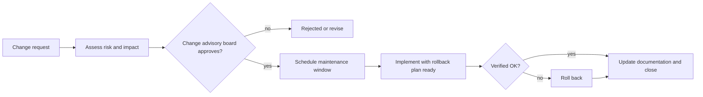
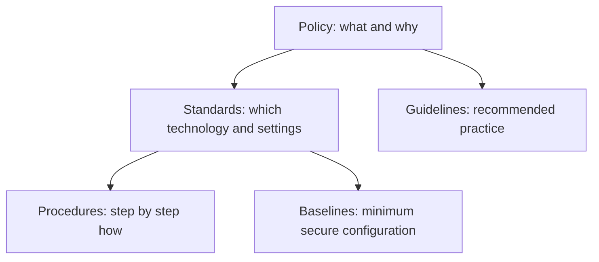
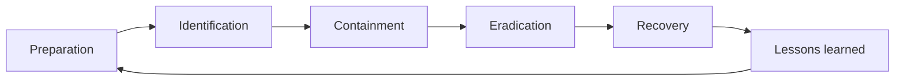
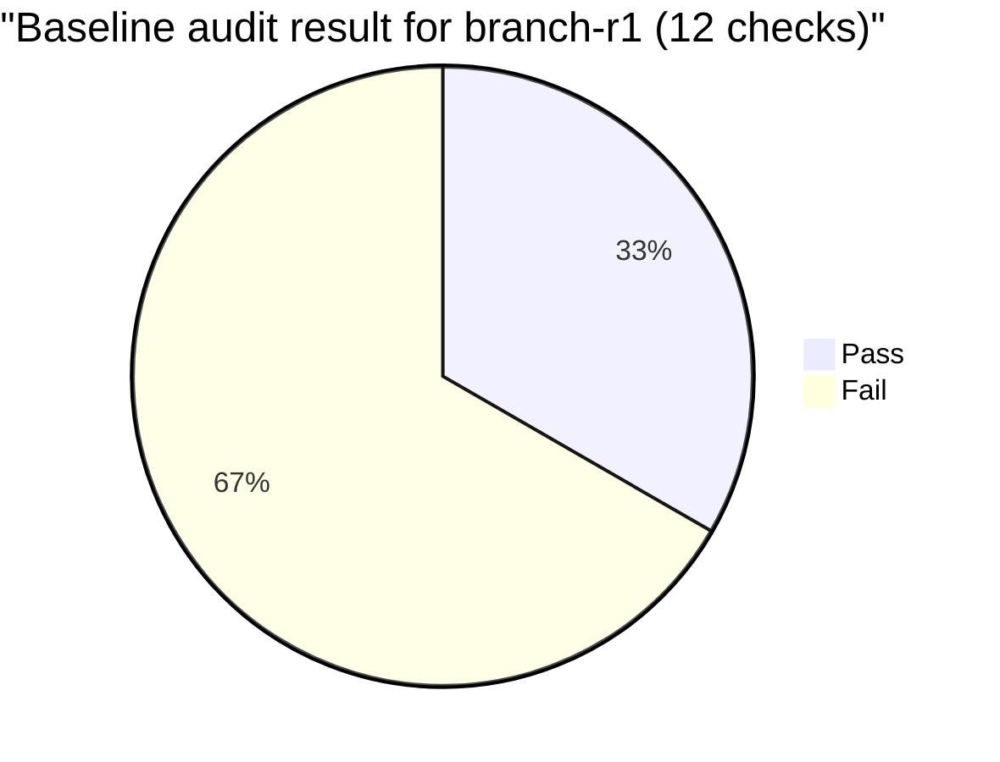

# Session 11: Policies and Procedures

> [Cybersecurity and Digital Forensics](../../README.md) › [Term 1](../README.md) › [Module 3: Technologies of Computer Networks](README.md) › **Session 11**

| ⏱ Estimated time | 📋 Prerequisites |
|---|---|
| 3 hours | Sessions 6, 8 and 10 |

| ⬅ [Previous: Session 10](session-10-network-availability.md) | [Next: Session 12](session-12-high-availability-dr.md) ➡ |
|:---|---:|

[](https://colab.research.google.com/github/Hamnakhan123/Cybersecurity-and-Digital-Forensics/blob/main/term-1/03-computer-networks/code/session-11-policies-and-procedures.ipynb) &nbsp;Run every Python example of this session in the notebook [`code/session-11-policies-and-procedures.ipynb`](code/session-11-policies-and-procedures.ipynb).

---

## 🎯 Learning objectives

- Explain the **plans and procedures** an organisation needs to run a network: change management, incident response, disaster recovery, business continuity, system life cycle, standard operating procedures.
- Describe common **security policies**: acceptable use (AUP), password, BYOD, remote access, onboarding/offboarding, data loss prevention, privileged access.
- Describe **device and host hardening**: secure management, disabling unused services and ports, patching, least privilege, secure protocols.
- Describe the **common documentation** of a network: physical and logical diagrams, IP plan (IPAM), rack diagrams, wiring/cable schedules, baselines, inventories, SLAs, MOUs, NDAs.
- Audit a device configuration against a hardening baseline with code.

## 📖 Concepts

### 1. Why policies and procedures?

Technology alone does not make a network secure or reliable. People change configurations, plug in devices and click links. **Policies** say *what* must be done and *why*; **standards** say *which* specific technology or setting; **procedures** say *how*, step by step; **guidelines** are recommendations.

> **Analogy – a hospital.** The policy says "patients must be identified before treatment"; the standard says "use the wristband barcode"; the procedure says "scan wristband, read name aloud, check the chart"; the guideline suggests "ask the patient to confirm their date of birth".

| Document | Answers | Example |
|---|---|---|
| **Policy** | What and why (mandatory, high level) | "All remote access must use MFA." |
| **Standard** | Which (mandatory, specific) | "VPN uses IKEv2, AES-256-GCM." |
| **Procedure / SOP** | How, step by step | "Steps to create a VPN account." |
| **Guideline** | Recommended practice | "Prefer passphrases of four random words." |
| **Baseline** | Minimum secure configuration | The hardening checklist below |

### 2. Plans and procedures

| Plan / procedure | Purpose | Key contents |
|---|---|---|
| **Change management** | Prevent outages from uncontrolled changes | Request → risk/impact assessment → approval (CAB) → scheduled window → implement → verify → document; **rollback plan**; emergency change process |
| **Incident response plan (IRP)** | Handle security incidents consistently | Preparation, identification, containment, eradication, recovery, lessons learned; roles, contact lists, escalation |
| **Disaster recovery plan (DRP)** | Restore IT after a major failure | RTO/RPO, backups, alternate site, restore order (Session 12) |
| **Business continuity plan (BCP)** | Keep the *business* running | Critical functions, manual workarounds, communication |
| **System life cycle** | Manage assets from purchase to disposal | Procurement, deployment, maintenance, **end of life**, secure disposal (wipe/destroy media) |
| **Standard operating procedures** | Repeatable daily tasks | Backups, user creation, patching |
| **Onboarding / offboarding** | Give and remove access on time | Accounts, equipment, training; disable accounts **on the last day** |

### 3. Common security policies

| Policy | Key points |
|---|---|
| **Acceptable Use Policy (AUP)** | What users may/may not do on company systems; monitoring notice; consequences. Users sign it. |
| **Password policy** | Minimum length (12+), block-listed common passwords, MFA, no forced periodic change unless compromise (modern NIST SP 800-63B guidance), lockout/throttling |
| **Remote access policy** | VPN + MFA, company-managed devices, no split tunnelling for sensitive work |
| **BYOD policy** | Personal devices only via MDM, separate work profile, guest network otherwise |
| **Privileged access** | Separate admin accounts, least privilege, logging of admin commands, jump hosts |
| **Data classification & DLP** | Public / internal / confidential / restricted; handling rules; DLP tools |
| **Security awareness** | Training, phishing simulations |
| **Third-party / vendor** | NDAs, security requirements, access reviews |

**Agreements:** **SLA** (service level), **MOU/MOA** (memorandum of understanding/agreement – intent between parties), **NDA** (confidentiality), **MSA** (master service agreement), **SOW** (statement of work).

### 4. Hardening network devices and hosts

**Hardening** = reducing the **attack surface**: remove what you don't need, secure what you keep.

**Network device baseline**

| Area | Control |
|---|---|
| Credentials | Change defaults; `enable secret` (strong hash, e.g. scrypt), no `enable password`; local accounts + AAA (RADIUS/TACACS+) |
| Management access | **SSH v2 only**, no Telnet; restrict VTY with an ACL to the admin subnet; idle timeout; login throttling |
| Services | Disable HTTP server, CDP/LLDP on external ports, unused protocols |
| SNMP | v3 only; remove `public`/`private` |
| Ports | Shut unused interfaces, park in unused VLAN; port security, BPDU Guard, DHCP snooping, DAI |
| Logging & time | NTP, central syslog, timestamps, login banners (legal notice) |
| Firmware | Supported versions, patched; verify image hashes |
| Configuration | Backed up, version-controlled, compared to baseline |
| Physical | Locked racks, console port protection |

**Host hardening:** patch OS and apps, remove unused software/services, host firewall, anti-malware/EDR, disk encryption, least-privilege users, secure configuration benchmarks (e.g. CIS Benchmarks), disable autorun, application allow-listing for critical systems.

### 5. Common documentation

| Document | What it shows | Why it matters |
|---|---|---|
| **Physical network diagram** | Devices, racks, cables, rooms | Finding equipment, cabling work |
| **Logical network diagram** | Subnets, VLANs, routing, security zones | Design, troubleshooting, security review |
| **IP address plan (IPAM)** | Subnets, gateways, DHCP scopes, static IPs | Avoid conflicts, plan growth |
| **Rack diagram / elevation** | What is in each U of each rack | Capacity, power, maintenance |
| **Wiring / cable schedule** | Jack ↔ patch panel ↔ switch port | Fast moves/adds/changes |
| **Asset inventory** | Hardware, serials, firmware, owners, warranty, EOL | Patching, life cycle, audits |
| **Configuration baselines & backups** | Approved configs | Recovery and drift detection |
| **Performance baselines** | Normal utilisation/latency | Detect anomalies |
| **Change log** | Who changed what, when, why | Troubleshooting, accountability |
| **Floor plans / heat maps** | AP locations, Wi-Fi coverage | Wireless planning |

> Documentation is evidence: during an incident or audit it proves what *should* be there, so you can spot what should *not*.

## 🧭 Diagrams

**Change management workflow**



**Policy hierarchy**



**Incident response life cycle**



## 🪜 Step-by-step: offboarding a network administrator (procedure)

1. HR notifies IT of the leaving date (ticket created).
2. On the last day: disable the person's directory, VPN and RADIUS/TACACS+ accounts; remove from admin groups.
3. Change any **shared** credentials they knew (local emergency accounts, Wi-Fi PSKs, SNMP strings).
4. Collect laptop, tokens and badges; revoke certificates.
5. Review recent changes and logs for unusual activity.
6. Transfer ownership of documents/scripts; update the contact lists in the IRP.
7. Record completion in the ticket; audit after 7 days.

## 💻 Worked examples

### Example 1 (intermediate) – Auditing a device against the hardening baseline

The input is this (fictional) lab configuration:

📄 **`code/session-11_router.cfg`**

```text
! Lab device: branch-r1 (fictional configuration for the audit exercise)
hostname branch-r1
enable password Cisco123
service timestamps log datetime msec
ip ssh version 2
banner motd ^Authorised access only. Activity is logged.^
ip http server
snmp-server community public RO
logging host 10.1.0.50
ntp server 10.1.0.1
!
interface GigabitEthernet0/0
 description WAN uplink
 ip address 203.0.113.2 255.255.255.252
!
interface GigabitEthernet0/1
 description LAN
 ip address 10.1.5.1 255.255.255.0
!
interface GigabitEthernet0/2
 description UNUSED
!
interface GigabitEthernet0/3
 description UNUSED
 shutdown
!
line vty 0 4
 exec-timeout 0 0
 transport input ssh telnet
 login local
!
end
```
📄 **`code/session-11_policy_audit.py`**

```python
"""Session 11 - Audit a switch/router configuration against a hardening policy.

Reads a saved configuration (session-11_router.cfg, a made-up lab device) and
checks it against the organisation's baseline. This is what configuration
compliance tools do every night.
Run:  python session-11_policy_audit.py
"""
import re

CHECKS = [  # (id, description, regex that MUST be present or must be absent, must_exist)
    ("H1", "Passwords stored with strong secret (not 'enable password')", r"^enable (algorithm-type \S+ )?secret", True),
    ("H2", "No plain 'enable password' line", r"^enable password", False),
    ("H3", "Password encryption service on", r"^service password-encryption", True),
    ("H4", "SSH version 2 only", r"^ip ssh version 2", True),
    ("H5", "Telnet not allowed on VTY lines", r"transport input .*telnet", False),
    ("H6", "Login banner present", r"^banner (motd|login)", True),
    ("H7", "HTTP server disabled", r"^no ip http server", True),
    ("H8", "SNMP default community 'public' not used", r"^snmp-server community public", False),
    ("H9", "Logging to a central syslog server", r"^logging host \S+", True),
    ("H10", "NTP configured", r"^ntp server \S+", True),
    ("H11", "Idle sessions time out (exec-timeout not 0 0)", r"exec-timeout 0 0", False),
    ("H12", "Unused interfaces shut down", None, True),
]


def unused_up(cfg):
    """Interfaces described as UNUSED that are not shut down."""
    bad = []
    for block in re.split(r"\n(?=interface )", cfg):
        if block.startswith("interface") and "UNUSED" in block and "shutdown" not in block:
            bad.append(block.splitlines()[0].split()[1])
    return bad


def audit(cfg):
    results = []
    for cid, desc, rx, must in CHECKS:
        if cid == "H12":
            bad = unused_up(cfg)
            results.append((cid, desc, not bad, ", ".join(bad)))
            continue
        found = re.search(rx, cfg, re.M) is not None
        results.append((cid, desc, found == must, ""))
    return results


if __name__ == "__main__":
    try:
        cfg = open("session-11_router.cfg").read()
    except FileNotFoundError:          # e.g. running on Colab: fetch the sample from the repo
        import urllib.request
        url = ("https://raw.githubusercontent.com/Hamnakhan123/Cybersecurity-and-Digital-Forensics/"
               "main/term-1/03-computer-networks/code/session-11_router.cfg")
        cfg = urllib.request.urlopen(url).read().decode()
    res = audit(cfg)
    for cid, desc, ok, extra in res:
        print(f"{'PASS' if ok else 'FAIL'}  {cid:<4} {desc}{'  -> ' + extra if extra else ''}")
    score = sum(r[2] for r in res)
    print(f"\nCompliance: {score}/{len(res)} = {score / len(res):.0%}")
```

**Output**

```text
FAIL  H1   Passwords stored with strong secret (not 'enable password')
FAIL  H2   No plain 'enable password' line
FAIL  H3   Password encryption service on
PASS  H4   SSH version 2 only
FAIL  H5   Telnet not allowed on VTY lines
PASS  H6   Login banner present
FAIL  H7   HTTP server disabled
FAIL  H8   SNMP default community 'public' not used
PASS  H9   Logging to a central syslog server
PASS  H10  NTP configured
FAIL  H11  Idle sessions time out (exec-timeout not 0 0)
FAIL  H12  Unused interfaces shut down  -> GigabitEthernet0/2

Compliance: 4/12 = 33%
```
**Remediation** – the configuration that fixes every failure (shown, apply in the lab):

📄 **`code/session-11_hardened.ios`**

```text
! Session 11 - The audited device after remediation (compare with session-11_router.cfg)
no enable password
enable algorithm-type scrypt secret Str0ng#Enable2026
service password-encryption
no ip http server
no ip http secure-server
no snmp-server community public
ip ssh version 2
login block-for 120 attempts 5 within 60     ! slow down password guessing
interface GigabitEthernet0/2
 description UNUSED
 shutdown
line vty 0 4
 exec-timeout 10 0
 transport input ssh
 login local
 access-class 10 in                          ! only the admin subnet may SSH
access-list 10 permit 10.1.9.0 0.0.0.255
```
### Example 2 (intermediate) – Enforcing a password policy

📄 **`code/session-11_password_policy.py`**

```python
"""Session 11 - Check passwords against an acceptable-use / password policy
and estimate their strength. Modern guidance (e.g. NIST SP 800-63B) favours
length and a block-list over forced complexity and frequent changes.
Run:  python session-11_password_policy.py
"""
import math
import string

BLOCKLIST = {"password", "123456", "qwerty", "admin", "welcome", "cisco", "letmein"}
POLICY = {"min_length": 12, "max_length": 64}


def entropy_bits(pw):
    pool = 0
    if any(c in string.ascii_lowercase for c in pw): pool += 26
    if any(c in string.ascii_uppercase for c in pw): pool += 26
    if any(c in string.digits for c in pw): pool += 10
    if any(c in string.punctuation or c == " " for c in pw): pool += 33
    return len(pw) * math.log2(pool) if pool else 0


def check(pw, username):
    problems = []
    if len(pw) < POLICY["min_length"]: problems.append(f"shorter than {POLICY['min_length']}")
    if len(pw) > POLICY["max_length"]: problems.append("too long")
    low = pw.lower()
    if any(b in low for b in BLOCKLIST): problems.append("contains a block-listed word")
    if username.lower() in low: problems.append("contains the username")
    if len(set(pw)) <= 3: problems.append("too repetitive")
    return problems


if __name__ == "__main__":
    tests = [("hamna", "Cisco123"), ("hamna", "P@ssw0rd2026!"), ("ali", "ali-network-2026"),
             ("sara", "aaaaaaaaaaaaaaa"), ("lab", "river tulip lantern seventy"), ("lab", "x7#Qp!2vR9$m")]
    for user, pw in tests:
        p = check(pw, user)
        verdict = "ACCEPT" if not p else "REJECT: " + "; ".join(p)
        print(f"{pw!r:<32} ~{entropy_bits(pw):>5.0f} bits  {verdict}")
```

**Output**

```text
'Cisco123'                       ~   48 bits  REJECT: shorter than 12; contains a block-listed word
'P@ssw0rd2026!'                  ~   85 bits  ACCEPT
'ali-network-2026'               ~   98 bits  REJECT: contains the username
'aaaaaaaaaaaaaaa'                ~   71 bits  REJECT: too repetitive
'river tulip lantern seventy'    ~  159 bits  ACCEPT
'x7#Qp!2vR9$m'                   ~   79 bits  ACCEPT
```
**Note:** `P@ssw0rd2026!` passes these simple rules but is a predictable pattern; real systems also check against breached-password lists. Long random passphrases (`river tulip lantern seventy`) are both strong and memorable.

## 📊 Chart



| Hardening area | Before | After remediation |
|---|---|---|
| Privileged password | Plain `enable password` | Strong-hash `enable secret` |
| Remote management | Telnet + SSH, no timeout | SSH only, 10 min timeout, ACL |
| Web interface | On | Off |
| SNMP | v2c `public` | Removed (use v3) |
| Unused ports | One left enabled | All shut |
| Score | 33 % (4/12) | 12/12 once the remediation lines are merged into the running configuration |

## 🏢 Real-life problem with full solution

**Scenario.** A growing software company (60 staff) has no written policies. Last quarter: an engineer changed a firewall rule on Friday evening and took the website down for the weekend; an ex-employee still had VPN access two months after leaving; nobody could find which switch port a meeting room jack used.

**Solution – a minimum policy and documentation set:**

| Problem | Document / control | Key rule |
|---|---|---|
| Unplanned outage | **Change management procedure** | All production changes ticketed, peer-reviewed, scheduled in a window with a rollback plan; emergency changes reviewed next day |
| Ex-employee access | **Offboarding procedure** + quarterly **access review** | Accounts disabled on the last day; managers re-approve access every quarter |
| Unknown jacks | **Cable schedule + physical diagram** | Every jack labelled; schedule updated in every change |
| General misuse | **AUP**, signed at onboarding | Monitoring notice, prohibited activities |
| Weak passwords | **Password policy** + MFA | 12+ characters, block list, MFA on VPN and admin |
| Device drift | **Hardening baseline** + nightly config backup and audit script | Alerts when a config deviates from the baseline |
| Incidents | **IRP** with roles and contacts | Tested with a tabletop exercise twice a year |

## ⚠️ Common mistakes

- Writing policies nobody reads or signs; never reviewing them (review at least yearly).
- Policies that conflict with reality ("no USB drives" while staff need them) → people bypass them.
- No rollback plan in change requests.
- Forgetting **shared** credentials during offboarding.
- Documentation updated once at installation and never again.
- Hardening only the perimeter while internal devices keep Telnet and default SNMP.

## ✅ Best practices

- Policy → standard → procedure hierarchy, owned by named people, reviewed yearly.
- Automate: config backups, compliance audits, account de-provisioning.
- Least privilege and separate admin accounts with MFA.
- Use recognised benchmarks (e.g. CIS Benchmarks, vendor hardening guides) as your baseline.
- Keep documentation in one place, version-controlled, linked to the change log.

## 🧪 Lab / practice tasks

1. **Easy –** Classify as policy, standard, procedure or guideline: "Use WPA3-Enterprise"; "Steps to reset a user's password"; "All data must be backed up"; "Prefer passphrases".
2. **Easy –** List six items you would shut down or disable on a new router.
3. **Medium –** Add a check `H13` to `session-11_policy_audit.py`: `login block-for` must be present.
4. **Medium –** Write a one-page **AUP** for a university computer lab (6–10 rules).
5. **Challenge –** Make the audit script read **several** `.cfg` files in a folder and print a compliance table (device × check).

<details>
<summary>💡 Hints</summary>

- Task 3: add `("H13", "Login throttling configured", r"^login block-for", True)` to `CHECKS`.
- Task 5: `glob.glob("*.cfg")`, then call `audit()` for each file.
</details>

<details>
<summary>✅ Solutions</summary>

**Task 1:** standard; procedure; policy; guideline.

**Task 2:** unused interfaces, HTTP/HTTPS server (if not needed), Telnet on VTY, SNMP v1/v2c communities, CDP/LLDP on internet-facing ports, IP source routing / proxy ARP, default/plain passwords.

**Task 3:**

```python
CHECKS.append(("H13", "Login throttling configured", r"^login block-for", True))
```

The original config fails H13; `session-11_hardened.ios` passes it.

**Task 4 (sample AUP):** systems are for coursework only; use only your own account; never share passwords; no installing software; no attempts to bypass security or scan the network outside the isolated security lab; no offensive or illegal content; activity is logged and monitored; report suspected incidents to the lab supervisor; breaches lead to disciplinary action.

**Task 5:**

```python
import glob
files = sorted(glob.glob("*.cfg"))
print("check " + " ".join(f[:12] for f in files))
results = {f: audit(open(f).read()) for f in files}
for i, (cid, *_rest) in enumerate(CHECKS):
    print(f"{cid:<5} " + " ".join(("PASS" if results[f][i][2] else "FAIL").ljust(12) for f in files))
```
</details>

## ✅ Quick quiz

1. A document that lists the step-by-step instructions for a task is a: a) policy b) procedure c) guideline d) MOU
2. Which is the best first action when an employee leaves? a) delete their files b) disable their accounts on the last day c) wait for the quarterly review d) reset the router
3. Which management protocol should be used on a hardened router? a) Telnet b) HTTP c) SSH v2 d) SNMPv1
4. Which document shows subnets, VLANs and routing rather than cable locations? a) physical diagram b) logical diagram c) rack diagram d) cable schedule
5. What must every change request include besides the implementation steps? a) a rollback plan b) a new IP plan c) a firewall replacement d) an NDA

<details>
<summary>Show answers</summary>

1 – b · 2 – b · 3 – c · 4 – b · 5 – a
</details>

## 📝 Summary / cheat-sheet

- Policy (what/why) → standard (which) → procedure (how) → guideline (advice); baselines = minimum config.
- Plans: change management (CAB, window, rollback), IRP, DRP, BCP, life cycle, onboarding/offboarding.
- Policies: AUP, password (length + block list + MFA), remote access, BYOD, privileged access, data classification.
- Hardening: defaults changed, SSH only, ACL on VTY, timeouts, services off, SNMPv3, unused ports shut, NTP + syslog, patched firmware.
- Documentation: physical/logical diagrams, IPAM, rack, cable schedule, inventory, baselines, change log; agreements SLA/MOU/NDA.

**Interview / viva questions**

1. What is the difference between a policy, a standard and a procedure?
2. Describe a change management process. Why is a rollback plan essential?
3. List ten items in a router hardening baseline.
4. Why is offboarding a security process, not just an HR process?
5. What is the difference between a physical and a logical network diagram?
6. How would you detect configuration drift automatically?

---

| ⬅ [Previous: Session 10](session-10-network-availability.md) | [Next: Session 12](session-12-high-availability-dr.md) ➡ |
|:---|---:|

<sub>Prepared by **Hamna Zahid Khan**, Junior Lecturer · Cybersecurity and Digital Forensics</sub>
