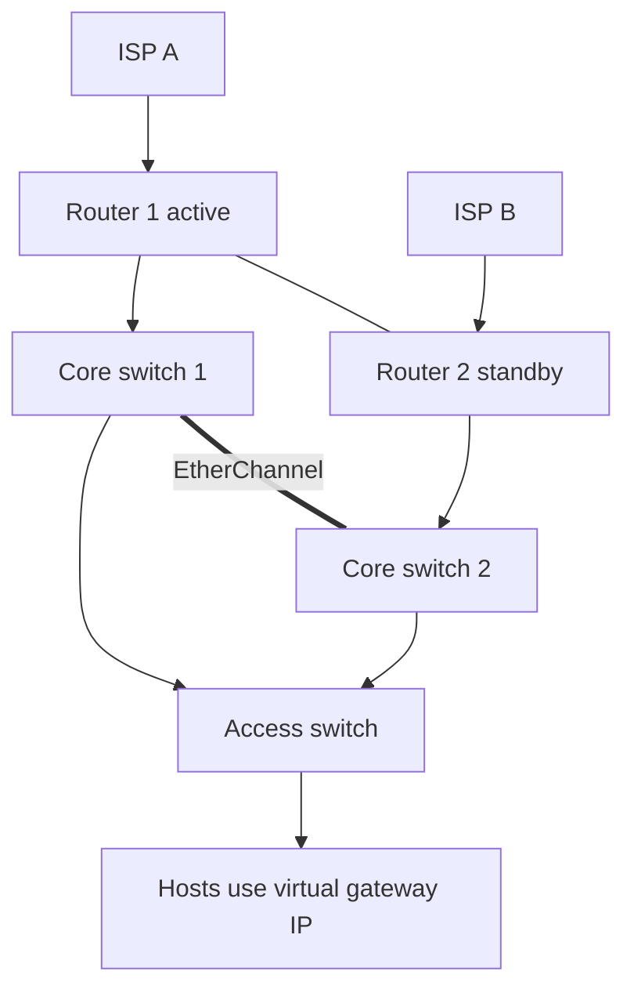
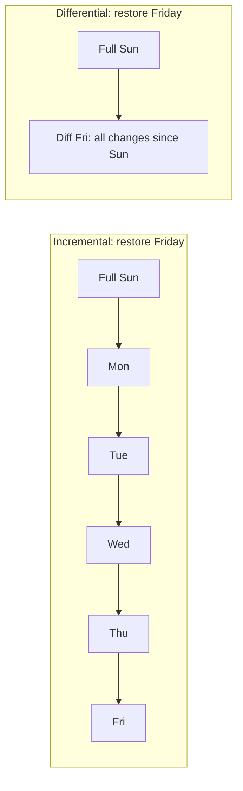
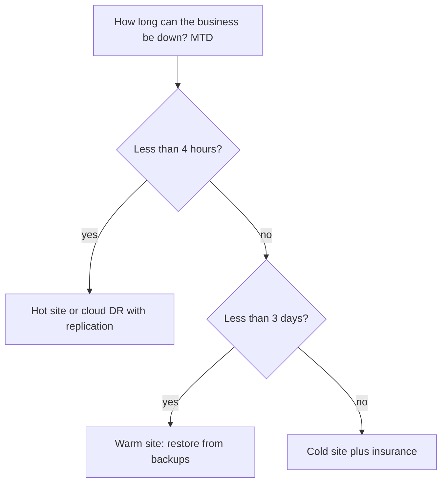
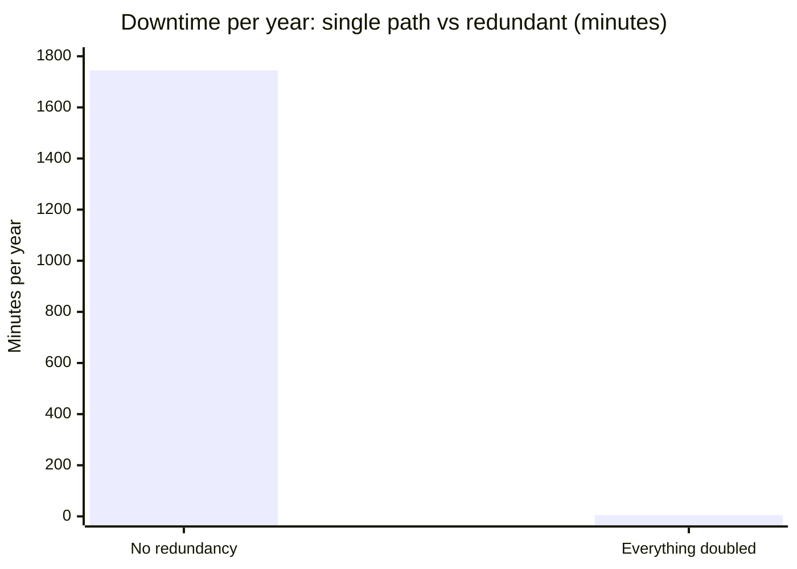

# Session 12: High Availability and Disaster Recovery

> [Cybersecurity and Digital Forensics](../../README.md) › [Term 1](../README.md) › [Module 3: Technologies of Computer Networks](README.md) › **Session 12**

| ⏱ Estimated time | 📋 Prerequisites |
|---|---|
| 3 hours | Sessions 5, 10 and 11 |

| ⬅ [Previous: Session 11](session-11-policies-and-procedures.md) | [Next: Session 13](session-13-network-security.md) ➡ |
|:---|---:|

[](https://colab.research.google.com/github/Hamnakhan123/Cybersecurity-and-Digital-Forensics/blob/main/term-1/03-computer-networks/code/session-12-high-availability-dr.ipynb) &nbsp;Run every Python example of this session in the notebook [`code/session-12-high-availability-dr.ipynb`](code/session-12-high-availability-dr.ipynb).

---

## 🎯 Learning objectives

- Define **high availability (HA)**, **fault tolerance**, **redundancy** and **resilience**, and calculate availability with **MTBF**, **MTTR**, series and parallel systems.
- Identify **redundancy hardware and technologies**: redundant power supplies, UPS, generators, PDUs, RAID, NIC teaming, link aggregation, multiple ISPs, clustering, load balancers, first-hop redundancy protocols (HSRP, VRRP, GLBP).
- Differentiate **active-active** and **active-passive** designs.
- Explain **disaster recovery**: RPO, RTO, MTD, backup types (full, incremental, differential, snapshots), the 3-2-1 rule, testing.
- Explain various **facilities and recovery sites**: hot, warm, cold, cloud site; environmental controls.

## 📖 Concepts

### 1. Key terms

| Term | Meaning |
|---|---|
| **Availability** | % of time a service is usable (Session 10's nines) |
| **High availability** | Design that keeps downtime very low by removing single points of failure |
| **Fault tolerance** | The system continues **without interruption** when a component fails (e.g. RAID 1, dual power supplies) |
| **Redundancy** | Extra components that can take over |
| **Resilience** | The ability to absorb and recover from failures and attacks |
| **MTBF** | Mean time between failures (reliability of a component) |
| **MTTR** | Mean time to repair/restore |
| **MTTF** | Mean time to failure (for non-repairable parts) |

**Availability formula:** `A = MTBF / (MTBF + MTTR)`.

- **Series** (every part needed, e.g. power → ISP → router → switch): `A = A1 × A2 × …` – availability **drops** with every part.
- **Parallel** (any one is enough, e.g. two ISPs): `A = 1 − (1 − A1)(1 − A2)…` – availability **rises**.

> **Analogy – a chain vs ropes.** Components in series are links in a chain: one weak link breaks it. Redundant components in parallel are several ropes holding the same weight: one can snap and the load still hangs.

### 2. Redundancy hardware and technologies

| Layer | Technology | What it protects against |
|---|---|---|
| Power | **Dual power supplies**, **UPS** (batteries, minutes), **generator** (hours/days), dual **PDUs** on separate circuits | Power cuts, PSU failure |
| Storage | **RAID** 1/5/6/10, hot spares, replicated SAN | Disk failure |
| Server NICs | **NIC teaming / bonding** | NIC, cable or switch-port failure |
| Links | **Link aggregation (LACP / EtherChannel)**, redundant uplinks with STP/RSTP | Single cable failure |
| Gateways | **FHRP**: HSRP, VRRP, GLBP (virtual IP shared by two routers) | Default gateway failure |
| Internet | **Multiple ISPs**, diverse paths (different conduits), SD-WAN, 4G/5G backup | ISP outage, fibre cut |
| Servers | **Clustering**, **load balancers** with health checks, virtual machine HA | Server failure |
| Sites | Secondary data centre / cloud region | Site disaster |

**First-hop redundancy protocols**

| | HSRP | VRRP | GLBP |
|---|---|---|---|
| Standard | Cisco | Open (RFC 5798) | Cisco |
| Roles | Active + standby | Master + backup | AVG + up to 4 AVFs |
| Load balancing | Per group only | Per group only | Yes, by MAC (active-active) |
| Virtual MAC | 0000.0c07.acXX (v1) | 0000.5e00.01XX | 0007.b400.XXYY |

Hosts use one **virtual IP** as their default gateway; if the active router fails, the standby takes over the virtual IP/MAC within seconds. (Configuration in Module 4.)

### 3. Active-active vs active-passive

| | **Active-active** | **Active-passive** |
|---|---|---|
| Normal operation | All nodes handle traffic | One node works, the other waits |
| Capacity use | Full (but each must handle all load if partner fails) | 50 % idle |
| Failover | Usually instant (load moves) | Short switchover (seconds) |
| Complexity | Higher (state synchronisation, split-brain risk) | Simpler |
| Examples | GLBP, load-balanced web farm, ECMP | HSRP/VRRP, firewall HA pair, database primary/replica |

**Careful:** in active-active each node must keep utilisation **below 50 %**, otherwise the survivor is overloaded after a failure.

### 4. Disaster recovery (DR)

**Objectives**
- **RPO – Recovery Point Objective:** how much data you can afford to lose (time since last good copy). Hourly snapshots → RPO 1 h.
- **RTO – Recovery Time Objective:** how long until the service is restored.
- **MTD – Maximum Tolerable Downtime:** after this, the business suffers serious damage. RTO must be < MTD.
- **WRT – Work Recovery Time:** time to verify data and resume work after systems are back.

**Backup types**

| Type | Backs up | Backup speed | Restore needs | Archive bit |
|---|---|---|---|---|
| **Full** | Everything | Slowest | Just the full | Cleared |
| **Incremental** | Changes since the **last backup of any kind** | Fastest | Full + **every** incremental | Cleared |
| **Differential** | Changes since the **last full** | Grows each day | Full + **latest** differential | Not cleared |
| **Snapshot** | Point-in-time image (VM/storage) | Seconds | The snapshot | – |
| **Replication** | Continuous copy to another site | Continuous | Failover | – |

**3-2-1 rule:** at least **3** copies, on **2** different media, **1** off-site. Modern versions add **1 offline/immutable** copy (ransomware can't encrypt it) and **0** errors (tested restores) → "3-2-1-1-0".

**Testing DR:** checklist review → **tabletop exercise** (talk through a scenario) → walkthrough → **simulation** → **parallel test** (bring up DR alongside production) → full **cutover/failover test**.

### 5. Facilities and recovery sites

| Site | Ready | Cost | Recovery time |
|---|---|---|---|
| **Hot site** | Fully equipped, data replicated, can take over almost immediately | 💲💲💲💲 | Minutes–hours |
| **Warm site** | Hardware and network ready, data must be restored | 💲💲 | Hours–days |
| **Cold site** | Space, power, cooling only | 💲 | Days–weeks |
| **Cloud / DRaaS** | Pre-configured images in a cloud region, pay mainly when used | 💲–💲💲💲 | Minutes–hours |
| **Reciprocal agreement** | Partner organisation hosts you | Low | Uncertain |

**Facility environmental controls:** HVAC with **hot aisle / cold aisle** containment (inlet ~18–27 °C per ASHRAE recommendations), humidity control, raised floors / overhead cable trays, **fire suppression** (clean-agent gas rather than water in server rooms; pre-action sprinklers), smoke/water detection, physical access control, CCTV, and redundant power (A/B feeds). Data-centre tiers (I–IV) describe increasing redundancy, from basic capacity to fully fault-tolerant.

**Geographic diversity:** the DR site must not share the same flood plain, power grid or fibre route as the main site.

## 🧭 Diagrams

**Redundant campus edge**



**Restore chains**



**Choosing a recovery site**



## 🪜 Step-by-step: building a DR plan for one service

1. **Business impact analysis:** list the service's processes, cost of downtime per hour, dependencies (DNS, AD, database).
2. Set **MTD**, then **RTO** and **RPO** below it.
3. Choose backup method and frequency to meet RPO; choose site type to meet RTO.
4. Write the **runbook**: who declares a disaster, contact list, restore order (network → identity → database → app), verification steps.
5. Store copies of the plan offline.
6. **Test** at least yearly; record actual RTO/RPO achieved; fix gaps.

## 💻 Worked examples

### Example 1 (advanced) – Availability maths, redundancy and backup strategies

📄 **`code/session-12_availability.py`**

```python
"""Session 12 - High-availability maths: MTBF/MTTR, components in series
versus in parallel (redundancy), and RPO/RTO for backup strategies.

A = MTBF / (MTBF + MTTR)
Series   (all must work):      A = A1 * A2 * ...
Parallel (one is enough):      A = 1 - (1 - A1) * (1 - A2) * ...
Run:  python session-12_availability.py
"""
from functools import reduce


def avail(mtbf_h, mttr_h): return mtbf_h / (mtbf_h + mttr_h)
def series(*a): return reduce(lambda x, y: x * y, a)
def parallel(*a): return 1 - reduce(lambda x, y: x * y, [1 - v for v in a])
def downtime_min(a): return (1 - a) * 365 * 24 * 60


if __name__ == "__main__":
    router = avail(50_000, 4)
    switch = avail(80_000, 4)
    isp = avail(2_000, 6)
    power = avail(10_000, 2)
    print(f"Single router {router:.5f}, switch {switch:.5f}, ISP link {isp:.5f}, power {power:.5f}")

    single = series(power, isp, router, switch)
    redundant = series(parallel(power, power), parallel(isp, isp), parallel(router, router), parallel(switch, switch))
    for name, a in [("No redundancy", single), ("Everything doubled", redundant)]:
        print(f"{name:<20} A = {a:.6f}  -> {downtime_min(a):>8.1f} min down per year")

    print("\nBackup strategies for a file server changing 50 GB/day (full = 2 TB):")
    plans = [  # name, data loss window (RPO h), restore time (RTO h), weekly storage GB
        ("Weekly full only",                168, 6,  2000),
        ("Weekly full + daily incremental", 24,  9,  2000 + 6 * 50),
        ("Weekly full + daily differential", 24, 7,  2000 + sum(50 * d for d in range(1, 7))),
        ("Hourly snapshots + offsite copy", 1,   1,  2000 + 7 * 24 * 2),
    ]
    print(f"{'plan':<34}{'RPO':>6}{'RTO':>6}{'storage/week':>14}")
    for name, rpo, rto, gb in plans:
        print(f"{name:<34}{rpo:>5}h{rto:>5}h{gb:>11,} GB")
    print("\nRestore chain on Friday: incremental -> full + Mon..Fri (6 sets); differential -> full + Fri (2 sets)")
```

**Output**

```text
Single router 0.99992, switch 0.99995, ISP link 0.99701, power 0.99980
No redundancy        A = 0.996680  ->   1745.0 min down per year
Everything doubled   A = 0.999991  ->      4.7 min down per year

Backup strategies for a file server changing 50 GB/day (full = 2 TB):
plan                                 RPO   RTO  storage/week
Weekly full only                    168h    6h      2,000 GB
Weekly full + daily incremental      24h    9h      2,300 GB
Weekly full + daily differential     24h    7h      3,050 GB
Hourly snapshots + offsite copy       1h    1h      2,336 GB

Restore chain on Friday: incremental -> full + Mon..Fri (6 sets); differential -> full + Fri (2 sets)
```
**Interpretation:** without redundancy the chain is only as good as its weakest link (the single ISP) – about 29 hours down per year. Doubling every component cuts that to under 5 minutes. For backups, incremental is cheapest in storage but slowest to restore; differential restores faster but grows each day; snapshots + off-site copy give the best RPO/RTO.

## 📊 Chart



| Backup plan | RPO | RTO | Storage / week |
|---|---|---|---|
| Weekly full only | 168 h | 6 h | 2 000 GB |
| Full + daily incremental | 24 h | 9 h | 2 300 GB |
| Full + daily differential | 24 h | 7 h | 3 050 GB |
| Hourly snapshots + off-site | 1 h | 1 h | 2 336 GB |

## 🏢 Real-life problem with full solution

**Scenario.** A private hospital's patient records system runs on one server in the basement, backed up nightly to a NAS in the same room. One ISP, one core switch, one firewall. The board asks: "If the basement floods during the monsoon, how quickly are we back?" Honest answer today: possibly never.

**Solution.**

| Requirement | Decision |
|---|---|
| MTD for patient records | 4 hours (agreed with the board) → **RTO 2 h**, **RPO 15 min** |
| Server | Two-node **cluster** (active-passive) on the 2nd floor; database replication to a **cloud DR region** every 5–15 minutes |
| Network | Two core switches with EtherChannel; two firewalls in **HA pair**; **two ISPs** with different physical routes; **VRRP** for the gateway |
| Power | Dual PSUs on A/B PDUs, UPS for 20 minutes, generator with fuel contract |
| Backups | 3-2-1-1-0: nightly full + hourly incremental to NAS (on-site), copy to cloud (off-site), weekly **immutable** copy; monthly restore test |
| Facility | Move the server room above flood level; clean-agent fire suppression; water sensors |
| Plan | Written DR runbook; tabletop exercise each quarter; full failover test yearly |

Result: a basement flood now causes no outage; a full site loss means failing over to the cloud region within ~2 hours with at most ~15 minutes of data lost.

## ⚠️ Common mistakes

- Treating RAID or replication as backup (they copy deletions and ransomware too).
- Never testing restores – discovering on the bad day that backups are corrupt.
- Redundant devices sharing a single power circuit, conduit or ISP upstream.
- Active-active pairs running at 70 % each (survivor overloads).
- DR site in the same building/flood zone.
- RTO/RPO decided by IT without the business.

## ✅ Best practices

- Remove SPOFs on critical paths: power, links, gateways, ISPs, storage, servers.
- Use FHRP for gateways, LACP for links, HA pairs for firewalls.
- Follow 3-2-1-1-0; encrypt backups; keep one immutable/offline copy.
- Set RTO/RPO from a business impact analysis; test DR regularly and record results.
- Monitor redundancy itself (a failed standby is invisible until you need it).

## 🧪 Lab / practice tasks

1. **Easy –** A switch has MTBF 100 000 h and MTTR 5 h. What is its availability?
2. **Easy –** Explain RPO and RTO with an online shop example.
3. **Medium –** Two ISPs each have 99.5 % availability. What is the combined availability in parallel? How many minutes of downtime per year?
4. **Medium –** A full backup runs Sunday; differentials Mon–Sat. The disk fails Thursday afternoon. Which backup sets do you restore?
5. **Challenge –** Extend `session-12_availability.py` with a function that finds the **minimum number of parallel ISPs** to reach 99.99 %.

<details>
<summary>💡 Hints</summary>

- Task 1: 100 000 / 100 005.
- Task 3: 1 − 0.005².
- Task 5: loop `n = 1, 2, 3 …` until `parallel(*[isp] * n) >= 0.9999`.
</details>

<details>
<summary>✅ Solutions</summary>

**Task 1:** 0.99995 → 99.995 %.

**Task 2:** RPO 1 h = at most the last hour of orders may be lost (hourly backups); RTO 4 h = the shop must be selling again within 4 hours.

**Task 3:** 1 − 0.005 × 0.005 = 0.999975 → 99.9975 % → about **13 minutes** per year (0.000025 × 525 600).

**Task 4:** Sunday full + **Wednesday** differential (the latest completed one). Thursday's work since the last differential is lost unless other copies exist.

**Task 5:**

```python
def isps_needed(a_single, target):
    n = 1
    while parallel(*[a_single] * n) < target:
        n += 1
    return n

print(isps_needed(avail(2_000, 6), 0.9999))   # -> 2
```

With the script's ISP (≈ 99.70 %), two ISPs give ≈ 99.9991 %, so **2** are enough.
</details>

## ✅ Quick quiz

1. Which backup type needs the full backup plus **all** later backups to restore? a) full b) incremental c) differential d) snapshot
2. A site with hardware ready but data needing restore is a: a) hot site b) warm site c) cold site d) reciprocal site
3. Which protocol is an open standard for gateway redundancy? a) HSRP b) GLBP c) VRRP d) LACP
4. RPO measures: a) how long recovery takes b) how much data may be lost c) cost of downtime d) mean time between failures
5. Two components each with 99 % availability in **series** give: a) 99.99 % b) 99 % c) 98.01 % d) 99.5 %

<details>
<summary>Show answers</summary>

1 – b · 2 – b · 3 – c · 4 – b · 5 – c
</details>

## 📝 Summary / cheat-sheet

- A = MTBF / (MTBF + MTTR); series multiplies (worse), parallel = 1 − Π(1 − A) (better).
- Redundancy: dual PSU, UPS, generator, RAID, NIC teaming, LACP, FHRP (HSRP/VRRP/GLBP), multiple ISPs, clusters, load balancers.
- Active-active (all working, < 50 % each) vs active-passive (standby waits).
- DR: MTD > RTO; RPO = data loss window. Full / incremental / differential / snapshot / replication. 3-2-1-1-0. Test it.
- Sites: hot, warm, cold, cloud DR; environmental controls: HVAC, hot/cold aisles, fire suppression, A/B power.

**Interview / viva questions**

1. What is the difference between high availability and fault tolerance?
2. Compare incremental and differential backups for backup time and restore time.
3. Explain RPO, RTO and MTD and how they relate.
4. When would you choose active-passive over active-active?
5. Why must redundant links follow physically different paths?
6. How would you prove that a DR plan works?

---

| ⬅ [Previous: Session 11](session-11-policies-and-procedures.md) | [Next: Session 13](session-13-network-security.md) ➡ |
|:---|---:|

<sub>Prepared by **Hamna Zahid Khan**, Junior Lecturer · Cybersecurity and Digital Forensics</sub>
