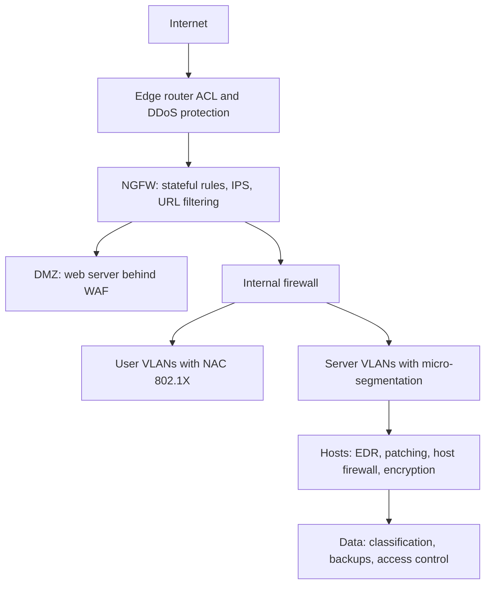
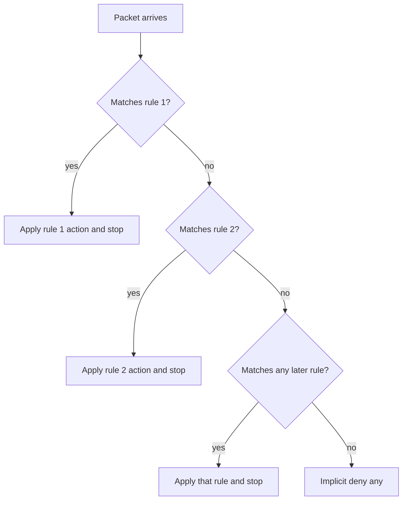
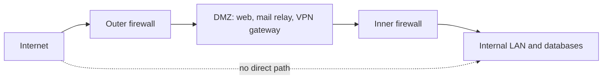
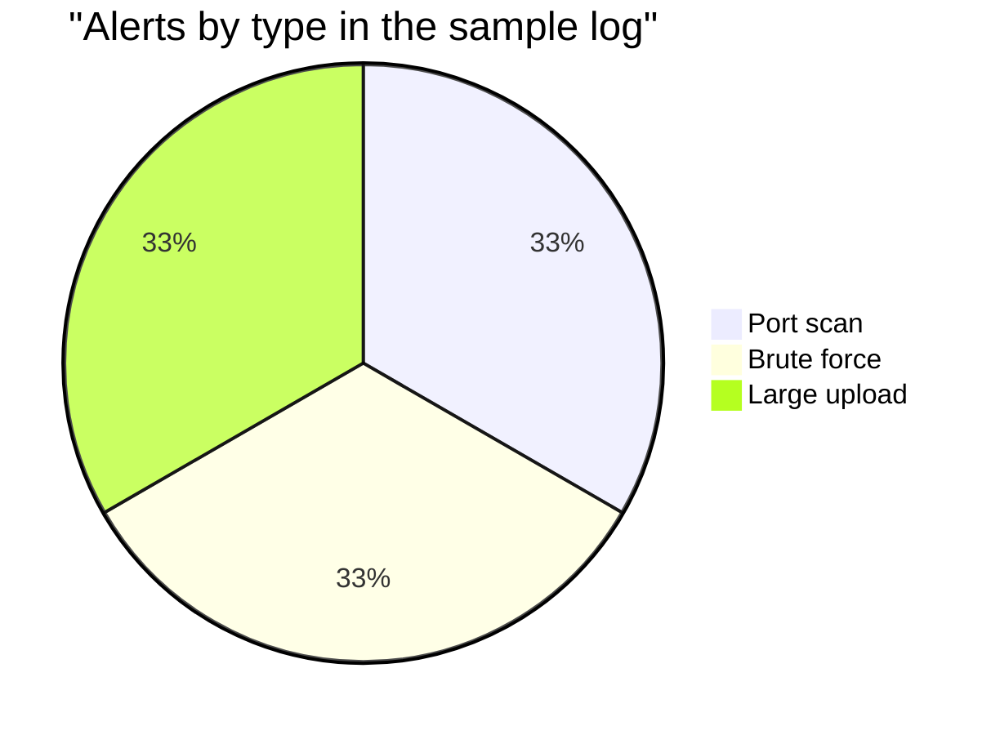

# Session 13: Network Security

> [Cybersecurity and Digital Forensics](../../README.md) › [Term 1](../README.md) › [Module 3: Technologies of Computer Networks](README.md) › **Session 13**

| ⏱ Estimated time | 📋 Prerequisites |
|---|---|
| 3.5 hours | Sessions 4, 8, 9, 10 and 11 |

| ⬅ [Previous: Session 12](session-12-high-availability-dr.md) | [Next: Session 14](session-14-network-troubleshooting.md) ➡ |
|:---|---:|

[](https://colab.research.google.com/github/Hamnakhan123/Cybersecurity-and-Digital-Forensics/blob/main/term-1/03-computer-networks/code/session-13-network-security.ipynb) &nbsp;Run every Python example of this session in the notebook [`code/session-13-network-security.ipynb`](code/session-13-network-security.ipynb).

---

## 🎯 Learning objectives

- List the elements that guide network security: the **CIA triad**, AAA, **least privilege**, **defence in depth**, **zero trust**, risk management and compliance.
- Explain common **cybersecurity threats** and attacks on networks: malware, phishing/social engineering, DoS/DDoS, on-path (MITM), spoofing, VLAN hopping, rogue devices, password attacks, insider threats.
- Describe **network protection and hardening** tools: firewalls (packet filter, stateful, NGFW, WAF), ACLs, IDS/IPS, VPNs, NAC/802.1X, segmentation and DMZ, honeypots, physical security.
- Write and evaluate first-match **ACL/firewall rules** and simple **IDS detection rules**.
- Apply the ethical rules for security testing: authorisation, scope, lab-only practice.

## 📖 Concepts

### 1. Elements that guide network security

**CIA triad**
- **Confidentiality** – only authorised people can read data (encryption, access control).
- **Integrity** – data is not altered without detection (hashes, digital signatures, change control).
- **Availability** – systems are usable when needed (redundancy, DDoS protection, backups).

**AAA**
- **Authentication** – prove who you are (password, token, certificate, biometrics; **MFA** combines factors: something you know / have / are).
- **Authorisation** – what you may do (roles, permissions).
- **Accounting** – record what you did (logs). Protocols: **RADIUS** (UDP 1812/1813, combines authN+authZ) and **TACACS+** (TCP 49, separates them, encrypts the whole payload, preferred for device administration).

**Guiding principles**
- **Least privilege** – the minimum access needed, for the minimum time.
- **Defence in depth** – multiple independent layers (physical, network, host, application, data, people).
- **Separation of duties** – no single person can complete a sensitive task alone.
- **Zero trust** – "never trust, always verify": no implicit trust from network location; authenticate and authorise every request, segment finely, assume breach.
- **Risk management** – risk = likelihood × impact; treat by mitigating, transferring (insurance), avoiding or accepting.
- **Compliance** – laws and standards (data protection laws, PCI DSS for card data, ISO/IEC 27001, NIST CSF) set minimum requirements (Module 5 goes deeper).

> **Analogy – a castle.** Moat (perimeter firewall), walls (segmentation), gate guards checking ID (authentication), keys for specific rooms (authorisation), a guest book (accounting), and guards inside too, because someone might already be in (zero trust).

### 2. Threats and attacks

| Category | Examples | Target (CIA) |
|---|---|---|
| **Malware** | Virus, worm (self-spreading over the network), trojan, **ransomware**, spyware, rootkit, botnet agent | C, I, A |
| **Social engineering** | Phishing, spear phishing, vishing (voice), smishing (SMS), pretexting, tailgating, shoulder surfing | C |
| **Denial of service** | SYN flood, UDP/ICMP flood, **DDoS** from botnets, **amplification** (DNS, NTP, memcached) | A |
| **On-path (MITM)** | ARP spoofing, rogue DHCP, evil-twin Wi-Fi, DNS spoofing, SSL stripping | C, I |
| **Spoofing** | IP spoofing, MAC spoofing, e-mail spoofing | I |
| **Layer 2 attacks** | MAC flooding, VLAN hopping (switch spoofing, double tagging), STP manipulation, DHCP starvation | C, A |
| **Password attacks** | Brute force, dictionary, **credential stuffing** (reused leaked passwords), password spraying | C |
| **Reconnaissance** | Port scanning, ping sweeps, banner grabbing, OSINT | (precursor) |
| **Rogue devices** | Rogue AP, unauthorised switch, rogue DHCP server | C, A |
| **Insider threat** | Malicious or careless employee | C, I, A |
| **Vulnerability exploitation** | Unpatched services, zero-days, misconfigurations, default credentials | C, I, A |

**Vocabulary:** a **vulnerability** is a weakness; a **threat** is something that could exploit it; an **exploit** is the method; **risk** is the likely damage. An **attack surface** is everything reachable by an attacker.

### 3. Network protection tools

**Firewalls**

| Type | Inspects | Notes |
|---|---|---|
| **Packet filter / ACL** | L3/L4 headers (IP, protocol, port) per packet | Stateless: return traffic needs its own rule |
| **Stateful firewall** | Tracks connections in a state table | Return traffic of allowed sessions is allowed automatically |
| **Next-generation firewall (NGFW)** | + application identification, user identity, IPS, TLS inspection, URL filtering | Typical enterprise edge |
| **Web application firewall (WAF)** | HTTP/HTTPS requests (L7) | Blocks SQL injection, XSS against web apps |
| **Host-based firewall** | Traffic to/from one host | Windows Defender Firewall, nftables/iptables |

**ACL rules:** processed **top-down, first match wins**, with an **implicit deny** at the end. Put specific rules before general ones. Cisco **standard ACLs** (1–99) match source IP only → place close to the **destination**; **extended ACLs** (100–199 or named) match source, destination, protocol and port → place close to the **source**.

**IDS vs IPS**

| | IDS | IPS |
|---|---|---|
| Position | Out-of-band (SPAN/TAP copy) | **Inline** |
| Action | Alerts | Blocks/drops + alerts |
| Risk | Misses nothing by failing | A false positive blocks real users |

Detection methods: **signature-based** (known patterns, low false positives, misses new attacks), **anomaly/behaviour-based** (deviation from baseline, catches new attacks, more false positives), **heuristic/reputation**. Host-based (**HIDS/EDR**) watches one machine.

**Other controls**
- **VPN** – encrypted tunnels: site-to-site (IPsec) and remote access (IPsec or TLS) with MFA.
- **NAC / 802.1X** – a device must authenticate (and pass health checks) before the switch port or SSID allows it; failures go to a quarantine VLAN.
- **Segmentation** – VLANs + ACLs; a **DMZ (screened subnet)** holds internet-facing servers between outer and inner firewalls; **micro-segmentation** in data centres.
- **Honeypots / honeynets** – decoy systems that alert when touched.
- **Content filtering / proxy, e-mail security gateway, DNS filtering**.
- **SIEM / SOAR** – central correlation (Session 10) and automated response.
- **Physical security** – locks, badges, CCTV, mantraps, cable and port protection.
- **Patch and vulnerability management** – scan your own assets regularly, fix by risk priority.

### 4. Ethics and the law

Security testing (scanning, exploitation, password testing) of systems you do not own or have **written permission** to test is illegal in most countries (in Pakistan, PECA 2016 criminalises unauthorised access). Every exercise in this course runs on **your own machine, Packet Tracer or an isolated lab**. Professional testers work under a signed **scope and rules of engagement**.

## 🧭 Diagrams

**Defence in depth**



**First-match ACL processing**



**DMZ / screened subnet**



## 🪜 Step-by-step: writing a firewall policy for a public web server

1. **Inventory** what must be reachable: HTTPS 443 from anywhere; HTTP 80 only to redirect; SSH 22 only from the admin subnet.
2. **Default deny** inbound; allow established/related return traffic (stateful).
3. Write **specific allow rules first**, then explicit denies you want logged (e.g. RDP), then the implicit deny.
4. Add **egress** rules: the web server may reach only the database (5432) and update servers; this limits damage if it is compromised.
5. **Log** denies and admin access; send to the SIEM.
6. **Test** each rule with expected-allow and expected-deny packets (the script below does this).
7. Review rules every quarter; remove unused ones.

## 💻 Worked examples

### Example 1 (intermediate) – A first-match ACL evaluator

📄 **`code/session-13_firewall_acl.py`**

```python
"""Session 13 - A first-match packet-filter (ACL / firewall rule) evaluator.

Rules are checked top-down; the first rule that matches decides. If nothing
matches, the implicit "deny any" at the end applies (as on Cisco ACLs).
Run:  python session-13_firewall_acl.py
"""
import ipaddress

RULES = [  # action, protocol, source, destination, destination port (None = any), note
    ("permit", "tcp", "any",          "10.1.5.20/32", 443,  "public web server HTTPS"),
    ("permit", "tcp", "any",          "10.1.5.20/32", 80,   "HTTP (redirects to HTTPS)"),
    ("permit", "tcp", "10.1.9.0/24",  "10.1.5.0/24",  22,   "admin subnet SSH"),
    ("deny",   "tcp", "any",          "any",          3389, "no RDP from anywhere"),
    ("permit", "udp", "10.1.0.0/16",  "10.1.0.53/32", 53,   "internal DNS"),
    ("permit", "icmp", "10.1.0.0/16", "any",          None, "internal ping"),
]


def match(net, ip):
    return net == "any" or ipaddress.ip_address(ip) in ipaddress.ip_network(net)


def evaluate(proto, src, dst, port):
    for i, (act, p, s, d, dp, note) in enumerate(RULES, 1):
        if p == proto and match(s, src) and match(d, dst) and (dp is None or dp == port):
            return act.upper(), f"rule {i}: {note}"
    return "DENY", "implicit deny (no rule matched)"


if __name__ == "__main__":
    packets = [
        ("tcp", "198.51.100.7", "10.1.5.20", 443),
        ("tcp", "198.51.100.7", "10.1.5.20", 22),
        ("tcp", "10.1.9.15",    "10.1.5.20", 22),
        ("tcp", "10.1.9.15",    "10.1.5.30", 3389),
        ("udp", "10.1.7.7",     "10.1.0.53", 53),
        ("udp", "198.51.100.7", "10.1.0.53", 53),
        ("icmp", "10.1.7.7",    "8.8.8.8",   None),
        ("tcp", "10.1.7.7",     "10.1.5.20", 8080),
    ]
    for proto, s, d, p in packets:
        verdict, why = evaluate(proto, s, d, p)
        print(f"{proto:<4} {s:>14} -> {d:<10}:{str(p or '-'):<5} {verdict:<7} {why}")
```

**Output**

```text
tcp    198.51.100.7 -> 10.1.5.20 :443   PERMIT  rule 1: public web server HTTPS
tcp    198.51.100.7 -> 10.1.5.20 :22    DENY    implicit deny (no rule matched)
tcp       10.1.9.15 -> 10.1.5.20 :22    PERMIT  rule 3: admin subnet SSH
tcp       10.1.9.15 -> 10.1.5.30 :3389  DENY    rule 4: no RDP from anywhere
udp        10.1.7.7 -> 10.1.0.53 :53    PERMIT  rule 5: internal DNS
udp    198.51.100.7 -> 10.1.0.53 :53    DENY    implicit deny (no rule matched)
icmp       10.1.7.7 -> 8.8.8.8   :-     PERMIT  rule 6: internal ping
tcp        10.1.7.7 -> 10.1.5.20 :8080  DENY    implicit deny (no rule matched)
```
**Notice:** SSH from the internet is denied by the **implicit** deny (no rule allows it); SSH from the admin subnet hits rule 3; port 8080 is denied because nobody opened it. Every "why" is traceable to one rule – exactly what you want during an audit.

### Example 2 (advanced) – Simple IDS rules over a connection log

📄 **`code/session-13_ids_detect.py`**

```python
"""Session 13 - Simple intrusion-detection rules over a connection log.

Detects three classic patterns in a recorded lab log:
  * port scan    : one source touches many different ports in a short time
  * brute force  : many failed logins for one account
  * data exfil   : unusually large outbound transfer
Run:  python session-13_ids_detect.py
"""
from collections import defaultdict

LOG = """\
09:00:01 10.1.7.7 10.1.5.20 443 ok 12000
09:00:02 10.1.7.8 10.1.5.20 443 ok 9000
09:01:10 10.1.66.6 10.1.5.30 21 refused 0
09:01:10 10.1.66.6 10.1.5.30 22 refused 0
09:01:11 10.1.66.6 10.1.5.30 23 refused 0
09:01:11 10.1.66.6 10.1.5.30 25 refused 0
09:01:11 10.1.66.6 10.1.5.30 80 ok 0
09:01:12 10.1.66.6 10.1.5.30 139 refused 0
09:01:12 10.1.66.6 10.1.5.30 445 refused 0
09:01:12 10.1.66.6 10.1.5.30 3389 refused 0
09:05:00 10.1.8.4 10.1.5.20 22 authfail 0
09:05:03 10.1.8.4 10.1.5.20 22 authfail 0
09:05:06 10.1.8.4 10.1.5.20 22 authfail 0
09:05:09 10.1.8.4 10.1.5.20 22 authfail 0
09:05:12 10.1.8.4 10.1.5.20 22 authfail 0
09:05:15 10.1.8.4 10.1.5.20 22 authfail 0
09:20:00 10.1.5.44 203.0.113.99 443 ok 2400000000
"""

SCAN_PORTS, SCAN_WINDOW = 5, 10        # >= 5 distinct ports within 10 s
BRUTE_FAILS = 5
EXFIL_BYTES = 500_000_000


def sec(t):
    h, m, s = map(int, t.split(":")); return h * 3600 + m * 60 + s


if __name__ == "__main__":
    ports = defaultdict(list); fails = defaultdict(int); alerts = []
    for line in LOG.strip().splitlines():
        t, src, dst, port, status, nbytes = line.split()
        ports[(src, dst)].append((sec(t), int(port)))
        recent = {p for ts, p in ports[(src, dst)] if sec(t) - ts <= SCAN_WINDOW}
        if len(recent) == SCAN_PORTS:
            alerts.append(f"{t} PORT SCAN   {src} -> {dst}: {sorted(recent)}")
        if status == "authfail":
            fails[(src, dst)] += 1
            if fails[(src, dst)] == BRUTE_FAILS:
                alerts.append(f"{t} BRUTE FORCE {src} -> {dst}:{port} {BRUTE_FAILS} failures")
        if int(nbytes) > EXFIL_BYTES:
            alerts.append(f"{t} LARGE UPLOAD {src} -> {dst}: {int(nbytes) / 1e9:.1f} GB")
    for a in alerts:
        print(a)
    print(f"\n{len(alerts)} alerts from {len(LOG.splitlines())} log lines")
```

**Output**

```text
09:01:11 PORT SCAN   10.1.66.6 -> 10.1.5.30: [21, 22, 23, 25, 80]
09:05:12 BRUTE FORCE 10.1.8.4 -> 10.1.5.20:22 5 failures
09:20:00 LARGE UPLOAD 10.1.5.44 -> 203.0.113.99: 2.4 GB

3 alerts from 17 log lines
```
**Interpretation:** three different attack patterns produce three alerts from 17 lines. Real IDS rules (e.g. Snort/Suricata signatures, SIEM correlation rules) follow the same logic: a pattern, a threshold, a time window.

## 📊 Chart



| Control | Prevents | Detects | Corrects |
|---|---|---|---|
| Firewall / ACL | ✓ | (logs) | |
| IPS | ✓ | ✓ | |
| IDS | | ✓ | |
| NAC / 802.1X | ✓ | ✓ | (quarantine) |
| Backups | | | ✓ |
| SIEM | | ✓ | (with SOAR) |
| Patching | ✓ | | ✓ |

## 🏢 Real-life problem with full solution

**Scenario.** A college's network is flat: students, staff, the exam server and CCTV share one subnet; the firewall allows "any → any" outbound and RDP inbound to an admin PC "for convenience". Last month an infected student laptop scanned the network and a ransomware outbreak hit two staff PCs.

**Solution (defence in depth):**

| Layer | Action |
|---|---|
| Perimeter | Remove inbound RDP; admins use **VPN + MFA**. Default-deny inbound; egress filtering (block outbound SMB 445, unknown ports) |
| Segmentation | VLANs: Students, Staff, Exams, CCTV, Servers, Management. Inter-VLAN ACLs: Students → Servers web only; nobody → Exams except exam staff; CCTV → NVR only |
| Access | **802.1X NAC** on staff ports; students on a separate SSID/VLAN; unknown devices → quarantine VLAN |
| Detection | **IDS** on a SPAN of the core switch with rules for scans, SMB worm traffic and brute force; logs to a SIEM |
| Hosts | EDR, automatic patching, local admin rights removed, host firewalls on |
| Data | 3-2-1-1-0 backups with an immutable copy (Session 12) |
| People | Phishing awareness training; AUP signed by students and staff |
| Process | IRP with an isolation procedure: disable switch port / NAC quarantine within minutes |

Result: the same infected laptop now sits in the Students VLAN, its scan is blocked by ACLs and flagged by the IDS within seconds, and NAC can quarantine it automatically.

## ⚠️ Common mistakes

- "Any → any" rules or rules added "temporarily" and never removed.
- Placing a broad permit **above** a specific deny (the deny never matches).
- Only filtering inbound; unrestricted outbound lets malware call home and data leave.
- IPS in blocking mode without tuning → legitimate traffic blocked; IDS alerts nobody reads.
- Believing NAT, hidden SSIDs or obscure ports are security controls.
- Running scanners or attack tools against networks you are not authorised to test.

## ✅ Best practices

- Default deny; least privilege; specific rules first; document the purpose of each rule.
- Segment by trust level; DMZ for public services; micro-segment critical servers.
- MFA everywhere remote; TACACS+ for device admin; 802.1X for access.
- IDS/IPS tuned to your environment; central logging; regular rule and access reviews.
- Patch by risk; scan your own assets; train users; test incident response.

## 🧪 Lab / practice tasks

1. **Easy –** Map each to C, I or A: ransomware encrypts files; an attacker reads e-mails via MITM; a DDoS; someone alters exam marks.
2. **Easy –** Standard or extended ACL, and where to place it: "block 10.1.20.0/24 from reaching server 10.1.5.30 on port 3306".
3. **Medium –** Add a rule to `session-13_firewall_acl.py` so the admin subnet can RDP to `10.1.5.30` while RDP stays blocked for everyone else. Where must it go?
4. **Medium –** Packet Tracer: create an extended named ACL on a router that permits HTTP/HTTPS from the LAN to a server and denies everything else to that server; test with the web browser and ping.
5. **Challenge –** Add a **password-spraying** detector to `session-13_ids_detect.py`: one source failing on ≥ 3 **different** accounts. Add sample lines (with a `user=` field) to test it.

<details>
<summary>💡 Hints</summary>

- Task 2: extended ACLs go close to the source.
- Task 3: the permit must come **before** rule 4 (deny RDP).
- Task 5: track a set of usernames per source IP.
</details>

<details>
<summary>✅ Solutions</summary>

**Task 1:** A (and I); C; A; I.

**Task 2:** extended ACL (needs destination + port), placed on the interface nearest to 10.1.20.0/24, inbound:

```text
ip access-list extended BLOCK-DB
 deny tcp 10.1.20.0 0.0.0.255 host 10.1.5.30 eq 3306
 permit ip any any
interface g0/2
 ip access-group BLOCK-DB in
```

**Task 3:** insert at index 3 (before the RDP deny):

```python
RULES.insert(3, ("permit", "tcp", "10.1.9.0/24", "10.1.5.30/32", 3389, "admin RDP to jump host"))
```

**Task 4:**

```text
ip access-list extended WEB-ONLY
 permit tcp 192.168.1.0 0.0.0.255 host 192.168.2.10 eq 80
 permit tcp 192.168.1.0 0.0.0.255 host 192.168.2.10 eq 443
 deny ip any host 192.168.2.10
 permit ip any any
interface g0/0
 ip access-group WEB-ONLY in
```

Browser to the server works; `ping 192.168.2.10` fails; pings to other hosts still work.

**Task 5:**

```python
spray = defaultdict(set)
# log line format: time src dst port status bytes user=name
if status == "authfail":
    user = line.split("user=")[1] if "user=" in line else "?"
    spray[src].add(user)
    if len(spray[src]) == 3:
        alerts.append(f"{t} PASSWORD SPRAY {src}: {sorted(spray[src])}")
```
</details>

## ✅ Quick quiz

1. Which principle says "never trust, always verify, even inside the network"? a) defence in depth b) zero trust c) least privilege d) separation of duties
2. A rule list ends with an unseen rule that blocks anything not matched. This is: a) default route b) implicit deny c) NAT d) stateful inspection
3. Which device sits inline and can block attacks? a) IDS b) IPS c) SPAN port d) syslog server
4. Credential stuffing uses: a) random passwords b) passwords leaked from other sites c) default router passwords d) rainbow tables only
5. Where do internet-facing servers usually live? a) user VLAN b) DMZ / screened subnet c) management VLAN d) the core switch

<details>
<summary>Show answers</summary>

1 – b · 2 – b · 3 – b · 4 – b · 5 – b
</details>

## 📝 Summary / cheat-sheet

- Guides: CIA, AAA (RADIUS/TACACS+), MFA, least privilege, defence in depth, separation of duties, zero trust, risk, compliance.
- Threats: malware/ransomware, phishing, DoS/DDoS/amplification, MITM (ARP, DHCP, evil twin, DNS), spoofing, L2 attacks, password attacks, rogue devices, insiders.
- Tools: packet filter, stateful FW, NGFW, WAF, host FW; ACLs first-match + implicit deny; IDS (detect) vs IPS (inline block); VPN; NAC/802.1X; VLANs/DMZ/micro-segmentation; honeypots; SIEM.
- Test only with written authorisation, in labs you own.

**Interview / viva questions**

1. Explain the CIA triad with one attack against each part.
2. Compare a stateful firewall and an NGFW.
3. Why does the order of ACL rules matter? Give an example where it breaks the policy.
4. Compare IDS and IPS, and signature vs anomaly detection.
5. What is zero trust and how does it differ from perimeter security?
6. Describe a DMZ and why it uses two firewalls (or a three-legged firewall).

---

| ⬅ [Previous: Session 12](session-12-high-availability-dr.md) | [Next: Session 14](session-14-network-troubleshooting.md) ➡ |
|:---|---:|

<sub>Prepared by **Hamna Zahid Khan**, Junior Lecturer · Cybersecurity and Digital Forensics</sub>
