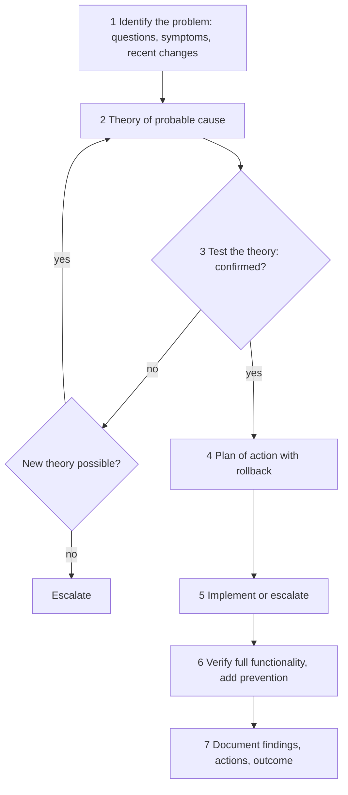
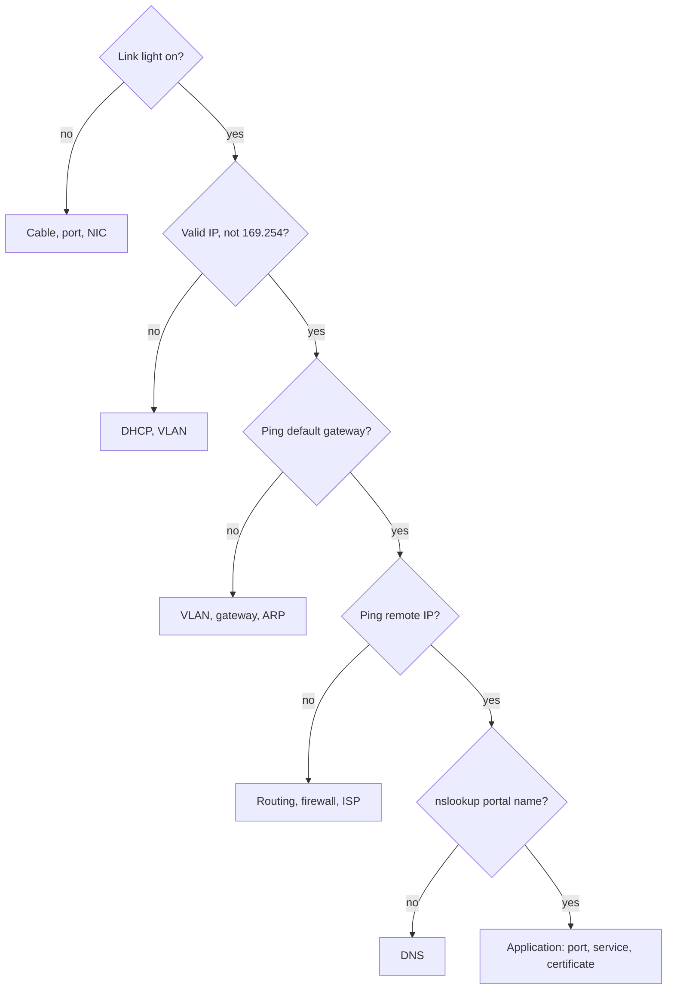
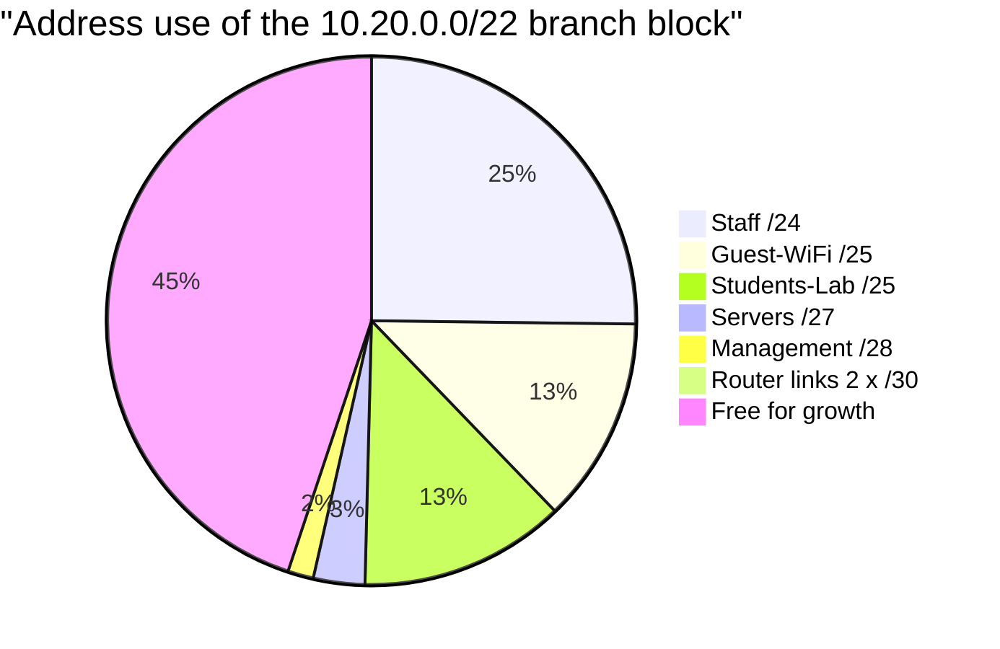

# Session 14: Network Troubleshooting

> [Cybersecurity and Digital Forensics](../../README.md) › [Term 1](../README.md) › [Module 3: Technologies of Computer Networks](README.md) › **Session 14**

| ⏱ Estimated time | 📋 Prerequisites |
|---|---|
| 3.5 hours | Sessions 1–13 (this session pulls the whole module together) |

| ⬅ [Previous: Session 13](session-13-network-security.md) | [Module practice test](practice-test.md) ➡ |
|:---|---:|

[](https://colab.research.google.com/github/Hamnakhan123/Cybersecurity-and-Digital-Forensics/blob/main/term-1/03-computer-networks/code/session-14-network-troubleshooting.ipynb) &nbsp;Run every Python example of this session in the notebook [`code/session-14-network-troubleshooting.ipynb`](code/session-14-network-troubleshooting.ipynb).

---

## 🎯 Learning objectives

- Describe the **general troubleshooting methodology** (identify, theorise, test, plan, implement, verify, document) and the **bottom-up / top-down / divide-and-conquer** approaches.
- Describe **cable troubleshooting**: symptoms, tools (cable tester, certifier, TDR/OTDR, toner and probe, light meter, loopback plug) and common faults (opens, shorts, split pairs, crosstalk, attenuation, EMI, wrong standard, duplex/speed mismatch).
- Identify **software tools and commands**: `ping`, `traceroute/tracert`, `ipconfig/ip`, `arp`, `nslookup/dig`, `netstat/ss`, `pathping/mtr`, `route`, Wireshark/tcpdump, Nmap (authorised use only), iperf, speed tests, and device `show` commands.
- Troubleshoot common **wired, wireless and service** problems (IP conflicts, APIPA, wrong gateway/DNS, VLAN/trunk errors, routing errors, firewall blocks, Wi-Fi interference).
- Deliver the module's **mini project**: a complete branch network plan.

## 📖 Concepts

### 1. The troubleshooting methodology (7 steps)

1. **Identify the problem** – gather information, question users, find symptoms, check what changed recently, duplicate the problem, approach multiple problems one at a time.
2. **Establish a theory of probable cause** – question the obvious; choose an approach (bottom-up, top-down, divide-and-conquer).
3. **Test the theory** – if confirmed, plan the fix; if not, form a new theory or **escalate**.
4. **Establish a plan of action** – consider impact, change window, rollback.
5. **Implement the solution or escalate.**
6. **Verify full system functionality** and implement preventive measures.
7. **Document** findings, actions and outcomes (and lessons learned).

> **Analogy – a doctor.** Listen to symptoms, ask "what changed?", form a diagnosis, run a test, prescribe treatment, check the patient recovers, write it in the file. Doctors don't operate before diagnosing – neither should network engineers.

### 2. OSI-based approaches

| Approach | Start at | Best when |
|---|---|---|
| **Bottom-up** | Layer 1 (cable, link light) and move up | Physical changes, new installs, "nothing works" |
| **Top-down** | Layer 7 (application) and move down | One application fails while others work |
| **Divide-and-conquer** | Middle (e.g. `ping` = Layer 3) then up or down | Experienced engineers; quick split of the problem |
| **Follow the path** | Trace the packet hop by hop | Multi-hop routing/firewall issues |
| **Compare / swap** | Compare with a working device or swap components | Hardware suspected |

### 3. Cable and physical-layer troubleshooting

| Symptom | Likely causes | Tool |
|---|---|---|
| No link light | Unplugged, broken cable, wrong port, port shut/err-disabled, NIC disabled | Visual check, cable tester, `show interfaces status` |
| Link up but slow, CRC/input errors | Damaged cable, EMI, bad termination, **split pair**, too long | Cable certifier, `show interfaces` counters |
| Late collisions / slow | **Duplex mismatch** (one side full, other half) | Check both ends' speed/duplex settings |
| Intermittent drops | Loose connector, cable flexing, EMI, failing transceiver | Certifier, swap cable, check SFP DOM readings |
| Fibre link down | Dirty connector, TX/RX swapped, wrong fibre type, bend, excessive loss | Light meter, **OTDR**, visual fault locator, cleaning kit |
| Can't find which port | – | **Toner and probe**, cable schedule, `show mac address-table` |

**Tool notes**
- **Cable tester** – wire map (opens, shorts, crossed, split pairs).
- **Certifier** – proves a run meets Cat6/6a performance (NEXT, return loss, insertion loss).
- **TDR / OTDR** – sends a pulse and times the reflection to find the **distance to a fault** in copper / fibre.
- **Loopback plug** – tests a NIC or port by looping TX back to RX.
- **Multimeter, PoE tester, spectrum analyser** (Wi-Fi interference), **Wi-Fi analyser** apps.

### 4. Software tools and commands

| Task | Windows | Linux / macOS | Cisco IOS |
|---|---|---|---|
| IP configuration | `ipconfig /all` | `ip a`, `ip r` | `show ip interface brief` |
| Reachability | `ping` | `ping` | `ping` |
| Path | `tracert` | `traceroute` / `mtr` | `traceroute` |
| Path + loss per hop | `pathping` | `mtr` | – |
| DNS | `nslookup` | `dig`, `nslookup` | – |
| ARP / neighbours | `arp -a` | `ip neigh` | `show arp` |
| Open connections/ports | `netstat -ano` | `ss -tulpn` | `show control-plane host open-ports` |
| Routing table | `route print` | `ip route` | `show ip route` |
| Renew DHCP / flush DNS | `ipconfig /release /renew`, `ipconfig /flushdns` | `dhclient`, `resolvectl flush-caches` | – |
| Packet capture | Wireshark | tcpdump, Wireshark | `monitor capture` / SPAN |
| Throughput | iperf3 | iperf3 | – |
| Scanning (authorised only) | Nmap | Nmap | – |

**Cisco helpers:** `show interfaces` (errors, duplex), `show vlan brief`, `show interfaces trunk`, `show cdp neighbors` / `show lldp neighbors`, `show running-config`, `show logging`, `debug` (carefully).

### 5. Common problems and their signatures

| Symptom | Probable cause | Fix |
|---|---|---|
| IP 169.254.x.x | DHCP unreachable (server down, scope full, wrong VLAN, missing `ip helper-address`) | Fix DHCP path / scope |
| "Duplicate IP address" warning | Static IP inside the DHCP scope | Reserve/exclude statics |
| Local works, internet does not | Wrong/missing default gateway, NAT or ISP issue | Check `ipconfig`, `tracert 8.8.8.8` |
| `ping 8.8.8.8` works, names fail | DNS server wrong/down | Check `nslookup`, DNS settings |
| One VLAN can't reach others | Missing SVI/sub-interface, VLAN not allowed on trunk, ACL | `show interfaces trunk`, routing table |
| Routing loop, TTL exceeded | Bad static routes / redistribution | `traceroute` shows repeating hops |
| Port works then goes err-disabled | Port security violation, BPDU Guard | Investigate, `shutdown`/`no shutdown` |
| Web site loads on HTTP but not HTTPS | Firewall blocks 443, certificate error, time wrong | Check rules, certificate, NTP |
| Slow Wi-Fi | Interference, channel overlap, weak signal, too many clients, 2.4 GHz only | Survey, channel/power plan, more APs |
| Asymmetric/“works sometimes” | Load-balanced paths, failing link in a bundle, MTU issues | Per-path testing, `ping -f -l` / DF bit |

## 🧭 Diagrams

**The methodology**



**Bottom-up checks for "I can't reach the portal"**



## 🪜 Step-by-step: a full troubleshooting case

**Ticket:** "Since this morning, nobody in Room 204 can open the student portal; Room 205 is fine."

1. **Identify:** affects all PCs in 204 only; started this morning; facilities replaced a switch in 204's closet last night (*what changed?*).
2. **Theory:** the new switch is misconfigured (VLAN or uplink).
3. **Test:** PC in 204 → `ipconfig` shows **169.254.12.7** → DHCP not reached. On the new switch: `show vlan brief` shows all ports in **VLAN 1**; `show interfaces trunk` shows the uplink is **not trunking**.
4. **Plan:** apply the standard access-switch template (VLAN 20 on access ports, trunk uplink with allowed VLANs and native 99) in a 10-minute window now (users are already down); rollback = previous config.
5. **Implement:** configure; `ipconfig /renew` on a PC.
6. **Verify:** PCs get 10.20.1.x addresses, ping gateway, `nslookup portal`, open portal ✓. Add the switch to config backups and the compliance audit.
7. **Document:** ticket notes, root cause = replacement switch deployed without the template; preventive action = pre-staging checklist for replacement hardware.

## 💻 Worked examples

### Example 1 (basic) – Safe local checks and a symptom map

The script runs only local, harmless checks (hostname, loopback, a TCP handshake to its own listener) and maps common symptoms to the OSI layer to start from.

📄 **`code/session-14_troubleshoot.py`**

```python
"""Session 14 - The troubleshooting methodology as code: a bottom-up checker
that runs only SAFE, LOCAL checks on your own machine, plus a symptom ->
likely-cause lookup that follows the OSI layers.

Run:  python session-14_troubleshoot.py
"""
import socket
import ipaddress

SYMPTOMS = {
    "no link light":              (1, "cable unplugged/damaged, wrong port, NIC disabled"),
    "link up but 169.254.x.x ip": (3, "DHCP server unreachable: check VLAN, DHCP scope, relay"),
    "can ping ip but not name":   (7, "DNS server wrong or down: check resolver settings"),
    "slow and many crc errors":   (1, "bad cable, EMI, duplex mismatch"),
    "one vlan cannot reach others": (3, "missing inter-VLAN route or trunk not allowing VLAN"),
    "intermittent drop on wi-fi": (1, "interference, channel overlap, weak signal"),
    "website loads but not https": (4, "firewall blocks 443 or certificate problem"),
}


def step(name, ok, detail):
    print(f"  [{'OK ' if ok else 'BAD'}] {name:<34} {detail}")
    return ok


def local_checks():
    print("Bottom-up checks on this machine:")
    host = socket.gethostname()
    step("Host name", bool(host), host)
    try:
        lo = socket.gethostbyname("localhost")
        step("Loopback resolves (TCP/IP stack)", ipaddress.ip_address(lo).is_loopback, lo)
    except OSError as e:
        step("Loopback resolves (TCP/IP stack)", False, str(e))
    srv = socket.socket(); srv.bind(("127.0.0.1", 0)); srv.listen(1)
    port = srv.getsockname()[1]
    try:
        socket.create_connection(("127.0.0.1", port), timeout=1).close()
        step("TCP connect to local service", True, "handshake completed on 127.0.0.1")
    except OSError as e:
        step("TCP connect to local service", False, str(e))
    srv.close()
    try:
        socket.create_connection(("127.0.0.1", port), timeout=1).close()
        step("Same port after service stopped", True, "unexpected")
    except OSError:
        step("Same port after service stopped", False, "connection refused = nothing listening (Layer 4/7)")


def diagnose(symptom):
    layer, cause = SYMPTOMS[symptom]
    return f"Layer {layer}: {cause}"


if __name__ == "__main__":
    local_checks()
    print("\nSymptom -> where to start:")
    for s in SYMPTOMS:
        print(f"  {s:<30} {diagnose(s)}")
```

**Output**

```text
Bottom-up checks on this machine:
  [OK ] Host name                          (none)
  [OK ] Loopback resolves (TCP/IP stack)   127.0.0.1
  [OK ] TCP connect to local service       handshake completed on 127.0.0.1
  [BAD] Same port after service stopped    connection refused = nothing listening (Layer 4/7)

Symptom -> where to start:
  no link light                  Layer 1: cable unplugged/damaged, wrong port, NIC disabled
  link up but 169.254.x.x ip     Layer 3: DHCP server unreachable: check VLAN, DHCP scope, relay
  can ping ip but not name       Layer 7: DNS server wrong or down: check resolver settings
  slow and many crc errors       Layer 1: bad cable, EMI, duplex mismatch
  one vlan cannot reach others   Layer 3: missing inter-VLAN route or trunk not allowing VLAN
  intermittent drop on wi-fi     Layer 1: interference, channel overlap, weak signal
  website loads but not https    Layer 4: firewall blocks 443 or certificate problem
```
**Reading the last check:** "connection refused" means the host answered but **no service is listening** – a Layer 4/7 problem, not a cabling problem. A **timeout**, by contrast, suggests something in the path (firewall, routing) silently dropped the packet.

### Example 2 (advanced) – Mini project: Campus Branch Network Planner

This program brings the module together: VLSM addressing (Session 3), VLANs and gateways (Session 8), hardware sizing (Sessions 2, 6, 9) and an inter-VLAN ACL policy (Session 13). It produces the documentation table an engineer would hand over (Session 11).

📄 **`code/mini_project_netplan.py`**

```python
"""Module 3 mini project - "Campus Branch Network Planner".

Given a branch office's departments and head-counts, the planner:
  1. allocates VLSM subnets from one private block (largest first, no overlap),
  2. assigns VLAN IDs and gateway addresses,
  3. estimates switch ports and PoE access points,
  4. writes an inter-VLAN ACL policy (guest isolated, servers protected),
  5. prints a documentation table (the deliverable a network admin hands over).
Run:  python mini_project_netplan.py
"""
import ipaddress
import math

BLOCK = ipaddress.ip_network("10.20.0.0/22")
DEPARTMENTS = [  # name, hosts needed today, growth %, wired?
    ("Staff",        110, 20, True),
    ("Students-Lab",  60, 10, True),
    ("Guest-WiFi",    90, 30, False),
    ("Servers",       12, 50, True),
    ("Management",     6, 50, True),
]
P2P_LINKS = 2          # router-to-firewall and router-to-ISP style links (/30)


def needed_prefix(hosts):
    """Smallest prefix with enough usable addresses (hosts + gateway)."""
    return 32 - math.ceil(math.log2(hosts + 1 + 2))


def allocate():
    plan, free = [], [BLOCK]
    reqs = []
    for name, h, growth, wired in DEPARTMENTS:
        future = math.ceil(h * (1 + growth / 100))
        reqs.append((name, h, future, wired))
    reqs.sort(key=lambda r: -r[2])                       # VLSM: biggest first
    reqs += [(f"P2P-{i + 1}", 2, 2, True) for i in range(P2P_LINKS)]
    for i, (name, h, future, wired) in enumerate(reqs):
        prefix = 30 if name.startswith("P2P") else needed_prefix(future)
        free.sort(key=lambda n: (n.network_address))
        for blk in free:
            if blk.prefixlen <= prefix:
                sub = next(blk.subnets(new_prefix=prefix))
                free.remove(blk)
                free += list(blk.address_exclude(sub))
                plan.append((name, h, future, wired, sub))
                break
        else:
            raise SystemExit(f"Block {BLOCK} is too small for {name}")
    return plan, free


if __name__ == "__main__":
    plan, free = allocate()
    print(f"Address block {BLOCK} ({BLOCK.num_addresses} addresses)\n")
    print(f"{'VLAN':<5}{'Segment':<14}{'need':>5}{'+grow':>6}  {'subnet':<17}{'gateway':<14}{'usable':>7}{'spare':>6}")
    vlan = 10
    for name, h, future, wired, sub in plan:
        usable = sub.num_addresses - 2
        gw = next(sub.hosts())
        vid = "-" if name.startswith("P2P") else str(vlan)
        print(f"{vid:<5}{name:<14}{h:>5}{future:>6}  {str(sub):<17}{str(gw):<14}{usable:>7}{usable - future - (0 if name.startswith('P2P') else 1):>6}")
        if not name.startswith("P2P"):
            vlan += 10
    used = sum(s.num_addresses for *_, s in plan)
    print(f"\nUsed {used}/{BLOCK.num_addresses} addresses ({used / BLOCK.num_addresses:.0%}); "
          f"free blocks: {', '.join(str(f) for f in sorted(free, key=lambda n: n.network_address))}")

    wired_hosts = sum(f for n, h, f, w, s in plan if w and not n.startswith("P2P"))
    ports = wired_hosts + 4                       # + uplinks/APs/printers margin
    switches = math.ceil(ports / 48)
    aps = math.ceil(sum(f for n, h, f, w, s in plan if not w) / 30)   # ~30 clients per AP
    print(f"\nHardware: {wired_hosts} wired devices -> {switches} x 48-port switches; "
          f"{aps} PoE access points for wireless clients")

    subnets = {n: s for n, *_, s in plan}
    print("\nInter-VLAN ACL policy (applied on the router, first match wins):")
    rules = [
        ("deny", "Guest-WiFi", "any internal", "guests reach the internet only"),
        ("permit", "Management", "any", "admins manage everything"),
        ("permit", "Staff", "Servers tcp 443,445", "staff use file and web apps"),
        ("permit", "Students-Lab", "Servers tcp 443", "lab uses the web portal only"),
        ("deny", "any", "Management", "nobody else touches device management"),
        ("permit", "any", "internet", "everything else may browse"),
    ]
    for i, (act, src, dst, why) in enumerate(rules, 1):
        s = subnets.get(src, src)
        print(f"  {i}. {act:<6} {src:<12} ({str(s):<15}) -> {dst:<22} # {why}")
```

**Output**

```text
Address block 10.20.0.0/22 (1024 addresses)

VLAN Segment        need +grow  subnet           gateway        usable spare
10   Staff           110   132  10.20.0.0/24     10.20.0.1         254   121
20   Guest-WiFi       90   117  10.20.1.0/25     10.20.1.1         126     8
30   Students-Lab     60    66  10.20.1.128/25   10.20.1.129       126    59
40   Servers          12    18  10.20.2.0/27     10.20.2.1          30    11
50   Management        6     9  10.20.2.32/28    10.20.2.33         14     4
-    P2P-1             2     2  10.20.2.48/30    10.20.2.49          2     0
-    P2P-2             2     2  10.20.2.52/30    10.20.2.53          2     0

Used 568/1024 addresses (55%); free blocks: 10.20.2.56/29, 10.20.2.64/26, 10.20.2.128/25, 10.20.3.0/24

Hardware: 225 wired devices -> 5 x 48-port switches; 4 PoE access points for wireless clients

Inter-VLAN ACL policy (applied on the router, first match wins):
  1. deny   Guest-WiFi   (10.20.1.0/25   ) -> any internal           # guests reach the internet only
  2. permit Management   (10.20.2.32/28  ) -> any                    # admins manage everything
  3. permit Staff        (10.20.0.0/24   ) -> Servers tcp 443,445    # staff use file and web apps
  4. permit Students-Lab (10.20.1.128/25 ) -> Servers tcp 443        # lab uses the web portal only
  5. deny   any          (any            ) -> Management             # nobody else touches device management
  6. permit any          (any            ) -> internet               # everything else may browse
```
**How to read it:** segments are allocated largest-first with 10–50 % growth; spare addresses remain in each subnet; 44 % of the /22 is still free for future VLANs; the ACL isolates guests and protects management.

## 📊 Chart



| Tool | Layer | Answers the question |
|---|---|---|
| Cable tester / certifier | 1 | Is the cable wired and performing correctly? |
| `show interfaces` | 1–2 | Errors, duplex, speed, up/down? |
| `arp -a`, `show mac address-table` | 2 | Who is on which port / MAC? |
| `ipconfig` / `ip a` | 3 | Do I have a valid IP, mask, gateway, DNS? |
| `ping`, `traceroute` | 3 | Can I reach it, and where does the path stop? |
| `netstat` / `ss`, Nmap (authorised) | 4 | Is the port open and listening? |
| `nslookup` / `dig` | 7 | Does the name resolve correctly? |
| Wireshark | 2–7 | What is actually on the wire? |

## 🏢 Real-life problem with full solution

**Scenario.** After a weekend power cut, a branch office reports: (a) the finance PCs get 169.254 addresses, (b) everyone else can browse but the internal HR site "times out", (c) the conference-room Wi-Fi is very slow.

**Solution – one problem at a time:**

| Problem | Investigation | Root cause | Fix | Verify |
|---|---|---|---|---|
| (a) Finance APIPA | `show vlan brief` OK; `show run` on the router: no `ip helper-address` on the finance sub-interface | Router booted an **old startup-config** (the last change was never saved) | Re-add `ip helper-address 10.1.0.10`, `copy run start` | Finance PCs get leases; document "always save" |
| (b) HR site timeout | `ping hr.local` resolves and replies; `Test-NetConnection hr.local -Port 443` (or `nc -zv`) times out; firewall log shows **deny** for 443 to the HR server | Same old config on the firewall lacked the HR rule | Restore the firewall config from backup | Users load HR site; compare running config to backup daily |
| (c) Slow Wi-Fi | Wi-Fi analyser: AP rebooted with defaults on **channel 3, 40 MHz** on 2.4 GHz overlapping neighbours | AP lost settings (no controller) | Set 2.4 GHz to channel 11, 20 MHz; enable 5 GHz with band steering; back up AP config | Throughput test with iperf3: 20 → 180 Mbps |

**Preventive action:** configuration backups and nightly compliance audit (Session 11), UPS on network gear (Session 12), monitoring alerts on config changes and APIPA DHCP failures (Session 10).

## ⚠️ Common mistakes

- Changing several things at once – you no longer know what fixed (or broke) it.
- Skipping "what changed recently?" – most outages follow a change.
- Assuming `ping` failure means "down": ICMP may be blocked while the service works.
- Running `debug all` on a production router.
- Scanning networks with Nmap without authorisation.
- Not documenting – the same problem costs the same time next month.

## ✅ Best practices

- Follow the 7-step method; one change at a time; always have a rollback.
- Start bottom-up for physical/new issues, top-down for single-application issues.
- Keep baselines, diagrams, IP plans and config backups up to date – they shorten every investigation.
- Use non-intrusive tools first; capture evidence (screenshots, outputs, timestamps).
- Close the loop: root cause + preventive action + documentation.

## 🧪 Lab / practice tasks

1. **Easy –** Put the 7 troubleshooting steps in order and write one sentence for each.
2. **Easy –** Which command would you use for: your IP and gateway; the path to 8.8.8.8; resolving a name; listening ports; the switch's MAC table?
3. **Medium –** Packet Tracer "broken network" exercise: your instructor (or a classmate) introduces three faults (wrong gateway, port in wrong VLAN, shut interface). Find and fix them using only `show` commands and `ping`.
4. **Medium –** Change the mini project's `DEPARTMENTS` to add "IoT-Cameras" (40 devices, 25 % growth, wired). Does everything still fit in the /22? What subnet does it get?
5. **Challenge –** Extend the mini project to print a ready-to-paste **Cisco configuration** for the router: one sub-interface per VLAN (`interface g0/0.<vlan>`, `encapsulation dot1Q <vlan>`, `ip address <gateway> <mask>`).

<details>
<summary>💡 Hints</summary>

- Task 2: `ipconfig`, `tracert`, `nslookup`, `netstat -ano`, `show mac address-table`.
- Task 4: 40 × 1.25 = 50 → needs a /26 (62 usable).
- Task 5: `sub.netmask` gives the dotted mask; loop over `plan` and skip `P2P` entries.
</details>

<details>
<summary>✅ Solutions</summary>

**Task 1:** Identify → theorise → test → plan → implement/escalate → verify (+ prevent) → document.

**Task 2:** `ipconfig /all` (or `ip a` + `ip r`); `tracert 8.8.8.8` / `traceroute`; `nslookup name` / `dig`; `netstat -ano` / `ss -tulpn`; `show mac address-table`.

**Task 3 (typical findings):** `ipconfig` on the PC shows a gateway in another subnet → correct it; `show vlan brief` shows the PC's port in VLAN 1 → `switchport access vlan 20`; `show ip interface brief` shows `administratively down` → `no shutdown`.

**Task 4:** add `("IoT-Cameras", 40, 25, True)`. Largest-first ordering places it after Students-Lab: it receives **10.20.2.0/26** (62 usable, 50 needed), Servers moves to 10.20.2.64/27, Management to 10.20.2.96/28, the links to .112/30 and .116/30 – everything still fits, with ~38 % of the block free.

**Task 5:**

```python
vlan = 10
for name, h, future, wired, sub in plan:
    if name.startswith("P2P"):
        continue
    gw = next(sub.hosts())
    print(f"interface GigabitEthernet0/0.{vlan}")
    print(f" description {name}")
    print(f" encapsulation dot1Q {vlan}")
    print(f" ip address {gw} {sub.netmask}")
    vlan += 10
```
</details>

## ✅ Quick quiz

1. What is the **first** step of the troubleshooting methodology? a) implement a fix b) identify the problem c) document d) escalate
2. A PC can ping 8.8.8.8 but cannot open `www.example.com`. Most likely: a) cable b) DNS c) default gateway d) duplex
3. Which tool finds the distance to a break in a fibre cable? a) toner and probe b) OTDR c) loopback plug d) multimeter
4. Late collisions and a slow link usually indicate: a) DNS failure b) duplex mismatch c) wrong VLAN d) expired certificate
5. "Connection refused" when connecting to a port means: a) the cable is cut b) the host replied but nothing listens on that port c) DNS failed d) the firewall silently dropped it

<details>
<summary>Show answers</summary>

1 – b · 2 – b · 3 – b · 4 – b · 5 – b
</details>

## 📝 Summary / cheat-sheet

- Method: identify → theory → test → plan → implement/escalate → verify + prevent → document.
- Approaches: bottom-up, top-down, divide-and-conquer, follow the path, swap/compare.
- Cable faults: open, short, split pair, crossed, attenuation, EMI, duplex mismatch, dirty fibre; tools: tester, certifier, TDR/OTDR, toner, light meter, loopback.
- Commands: `ipconfig/ip`, `ping`, `tracert/traceroute`, `pathping/mtr`, `nslookup/dig`, `arp`, `netstat/ss`, `route`; Wireshark; Nmap with authorisation; IOS `show` commands.
- Signatures: 169.254 = DHCP; names fail but IPs work = DNS; local only = gateway; err-disabled = security feature tripped.

**Interview / viva questions**

1. Walk through the troubleshooting methodology with a real example.
2. When would you choose top-down over bottom-up?
3. What is the difference between "connection refused" and "request timed out"?
4. How would you find which switch port a wall jack connects to?
5. Which commands would you run, in order, for a user who "has no internet"?
6. Why is documentation the last – and an essential – step?

---

| ⬅ [Previous: Session 13](session-13-network-security.md) | [Module practice test](practice-test.md) ➡ |
|:---|---:|

<sub>Prepared by **Hamna Zahid Khan**, Junior Lecturer · Cybersecurity and Digital Forensics</sub>
