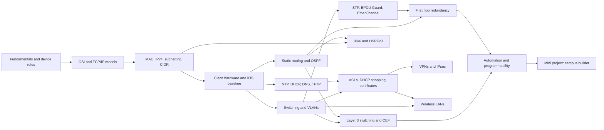

# Module 4: Configuring Network Infrastructure

> [Cybersecurity and Digital Forensics](../../README.md) › [Term 1](../README.md) › **Module 4**

| ⬅ [Previous module](../03-computer-networks/README.md) | [Term 1 overview](../README.md) ➡ |
|:---|---:|

---

## 🎯 Module objectives

By the end of this module you will be able to:

- Explain what makes a good network, choose the right devices, and calculate delay, throughput and availability.
- Use the OSI and TCP/IP models to describe encapsulation and to troubleshoot layer by layer.
- Work with MAC and IPv4 addresses, subnet with VLSM and summarise routes with CIDR.
- Identify Cisco router and switch hardware, navigate IOS, and apply a secure baseline configuration with SSH.
- Configure VLANs, access ports and 802.1Q trunks, and secure DTP and VTP.
- Prevent switching loops with Rapid PVST+, PortFast and BPDU Guard, and bundle links with LACP EtherChannel.
- Configure static, default and floating static routes (IPv4 and IPv6) and single- and multi-area OSPF.
- Provide gateway redundancy with HSRP, VRRP and GLBP.
- Deploy and verify NTP, DHCP (with relay), DNS and TFTP.
- Filter traffic with standard and extended ACLs, stop rogue DHCP servers with DHCP snooping, and explain digital certificates.
- Plan and configure IPv6: SLAAC, DHCPv6, NDP, static routes and OSPFv3.
- Route between VLANs with router-on-a-stick and Layer 3 switch SVIs, and explain CEF.
- Explain VPN types and IPsec, and size tunnels correctly.
- Design and secure controller-based WLANs with WPA2/WPA3.
- Automate network configuration with JSON data, templates, REST APIs and drift detection.

## 🗂 Sessions

| # | Session | Topic file |
|---|---|---|
| 1 | Fundamentals of Networking | [session-01-fundamentals-of-networking.md](session-01-fundamentals-of-networking.md) |
| 2 | Models in Computer Networking: OSI and TCP/IP | [session-02-osi-and-tcpip-models.md](session-02-osi-and-tcpip-models.md) |
| 3 | Types of Addresses: MAC, IP, Subnetting and CIDR | [session-03-mac-ip-subnetting-cidr.md](session-03-mac-ip-subnetting-cidr.md) |
| 4 | Hardware and Software of Cisco Devices | [session-04-cisco-hardware-and-ios.md](session-04-cisco-hardware-and-ios.md) |
| 5 | Introduction to Switching and VLANs | [session-05-switching-and-vlans.md](session-05-switching-and-vlans.md) |
| 6 | Loop Avoidance: STP, BPDU Guard and EtherChannel | [session-06-stp-and-etherchannel.md](session-06-stp-and-etherchannel.md) |
| 7 | Routing Technologies: Static Routes and OSPF | [session-07-routing-static-and-ospf.md](session-07-routing-static-and-ospf.md) |
| 8 | First Hop Redundancy: HSRP, VRRP and GLBP | [session-08-first-hop-redundancy.md](session-08-first-hop-redundancy.md) |
| 9 | Protocols for Network Management: NTP, DHCP, DNS, TFTP | [session-09-network-management-protocols.md](session-09-network-management-protocols.md) |
| 10 | Network Security Fundamentals: ACLs and DHCP Snooping | [session-10-network-security-fundamentals.md](session-10-network-security-fundamentals.md) |
| 11 | IPv6 | [session-11-ipv6.md](session-11-ipv6.md) |
| 12 | Layer 3 Switches and Inter-VLAN Routing | [session-12-layer-3-switching.md](session-12-layer-3-switching.md) |
| 13 | Virtual Private Networks | [session-13-virtual-private-networks.md](session-13-virtual-private-networks.md) |
| 14 | Wireless Technologies and WLAN Configuration | [session-14-wireless-lan-configuration.md](session-14-wireless-lan-configuration.md) |
| 15 | Automation and Network Programmability | [session-15-automation-and-programmability.md](session-15-automation-and-programmability.md) |
| 📝 | Module practice test (20 MCQs + 3 scenarios) | [practice-test.md](practice-test.md) |

## ▶️ Running the examples

- All runnable files live in [`code/`](code/README.md). Python examples use only the standard library: run them with Python 3.10 or newer from inside the `code/` folder, e.g. `python session-07_route_lookup.py`.
- Each session with Python code has an executed Jupyter notebook in `code/` with an **Open in Colab** badge, so you can run everything in the browser.
- `.ios` files are Cisco IOS configurations to type into **Cisco Packet Tracer** (free with a Cisco Networking Academy account) or a lab device. All addresses are private or documentation ranges.
- `session-10_certificate_lab.sh` needs `bash` and `openssl` (Linux, macOS, WSL or Colab with `!bash`). It works in a temporary folder and deletes everything afterwards.
- The REST API example starts a mock controller on `127.0.0.1` only. Nothing leaves your computer.
- **Ethics:** configure, scan and test only equipment you own or are authorised to administer.

## 🧭 Concept map

## 🧩 Mini project

**Campus Network Builder** – [`code/mini_project_campus_builder.py`](code/mini_project_campus_builder.py), walked through in [Session 15](session-15-automation-and-programmability.md). From a short list of departments and head-counts it produces a VLSM address plan with growth room, VLAN IDs, dual distribution-switch configurations with SVIs and HSRP aligned to the STP roots, DHCP pools, a guest-isolation ACL and DHCP snooping settings, then audits the result for overlaps and sizing before anything is deployed. Extend it as described in the Session 15 lab (voice VLAN, IPv6 SVIs, one file per device).

## 📌 One-page cheat-sheet

| Topic | Remember |
|---|---|
| Good network | Performance (bandwidth, throughput, latency, jitter, loss) · reliability (A = MTBF ÷ (MTBF + MTTR)) · scalability · security (CIA) · manageability · cost |
| Delay | Processing + queuing + transmission (bits ÷ bps) + propagation (distance ÷ 2 × 10⁸ m/s) |
| Devices | Hub L1 · switch L2 (MAC table) · router L3 (routing table) · L3 switch · firewall/IPS · AP + WLC |
| OSI / PDUs | 7 App · 6 Pres · 5 Sess · 4 Transport (segment) · 3 Network (packet) · 2 Data link (frame) · 1 Physical (bits) |
| TCP/IP | Application · Transport · Internet · Network access |
| MAC | 48-bit, OUI + NIC, I/G bit = multicast, U/L bit = locally administered, `ffff.ffff.ffff` broadcast |
| IPv4 | Hosts = 2^h − 2 · block = 256 − mask octet · private 10/8, 172.16/12, 192.168/16 · APIPA 169.254/16 |
| VLSM / CIDR | Largest first · summarise contiguous blocks (`10.20.8.0/24`–`15.0/24` → `/21`) |
| IOS memory | RAM running-config · NVRAM startup-config · flash IOS · ROM POST/bootstrap · `copy run start` |
| IOS baseline | hostname · `enable secret` · local user · SSH v2 + `transport input ssh` · banner · `exec-timeout` · `no ip http server` |
| Switching | Learn source · forward known · filter same port · flood unknown/broadcast (per VLAN) · aging 300 s |
| VLANs / trunks | Access = 1 VLAN untagged · 802.1Q 4-byte tag, 12-bit ID · native VLAN untagged (not 1) · `nonegotiate` |
| DTP / VTP | desirable + auto = trunk, auto + auto = access · VTP revision risk → transparent or v3 |
| STP | Root = lowest BID (priority 32768 + VLAN, MAC) · costs 100/19/4/2 · Rapid PVST+ · `root primary` |
| Edge protection | PortFast + BPDU Guard (err-disabled) · Root Guard · storm control |
| EtherChannel | LACP active/passive (802.3ad) · PAgP desirable/auto · `on` static · per-flow hash · members must match |
| Route choice | Longest prefix → AD (C 0, S 1, eBGP 20, EIGRP 90, OSPF 110, RIP 120) → metric |
| Static | `ip route net mask next-hop [AD]` · default `0.0.0.0 0.0.0.0` · floating = higher AD · `ipv6 route` |
| OSPF | Link state, Dijkstra · cost = ref BW ÷ BW · RID · hello 10 / dead 40 · DR/BDR · area 0 backbone · ABR `area X range` · `O IA` |
| FHRP | Virtual IP + MAC · HSRP (Cisco, preempt off, `0000.0c07.acXX`) · VRRP (open, preempt on, `0000.5e00.01XX`) · GLBP (load sharing) · track + preempt delay |
| NTP | UDP 123 · strata 0–15, 16 = unsynced · offset = ((t2 − t1) + (t3 − t4)) ÷ 2 |
| DHCP | UDP 67/68 · DORA · T1 50%, T2 87.5% · `excluded-address` · `ip helper-address` |
| DNS / TFTP | DNS 53: A, AAAA, CNAME, MX, PTR, NS, TXT · TFTP UDP 69, no auth, 512-byte blocks → prefer SCP |
| ACLs | Top-down, first match, implicit deny · standard near destination, extended near source · wildcard 0 = match |
| DHCP snooping | Untrusted by default · trust uplinks · rate-limit · binding table → DAI, IP Source Guard |
| Certificates | X.509: subject, issuer, validity, public key, CA signature · trust = valid chain + dates + name + not revoked |
| IPv6 | 128-bit · one `::` · /64 LANs · fe80::/10 · fc00::/7 · 2000::/3 · ff00::/8 · NDP RS/RA/NS/NA · SLAAC, M/O flags · OSPFv3 per interface |
| L3 switching | `ip routing` · SVI = gateway · `no switchport` = routed port · CEF = FIB + adjacency |
| VPN | IKE UDP 500/4500 · ESP 50 (encrypts) · AH 51 · tunnel vs transport · GRE 47 (no encryption) · `ip mtu 1400` + `ip tcp adjust-mss 1360` |
| Wireless | 2.4 GHz ch 1/6/11 · CAPWAP 5246/5247 · WEP ✗ · WPA-TKIP ✗ · WPA2-AES · WPA3-SAE + PMF · Enterprise = 802.1X + RADIUS · design −67 dBm |
| Automation | Planes: management, control, data · REST GET/POST/PUT/PATCH/DELETE · 200/201/400/401/404/409 · JSON · source of truth + templates + Git + drift checks · SDA: VXLAN, LISP, SGT |

## 📝 Assessment

Finish with the [module practice test](practice-test.md): 20 multiple-choice questions and 3 scenario questions, answers hidden.

---

Prepared by **Hamna Zahid Khan**, Junior Lecturer · Cybersecurity and Digital Forensics
