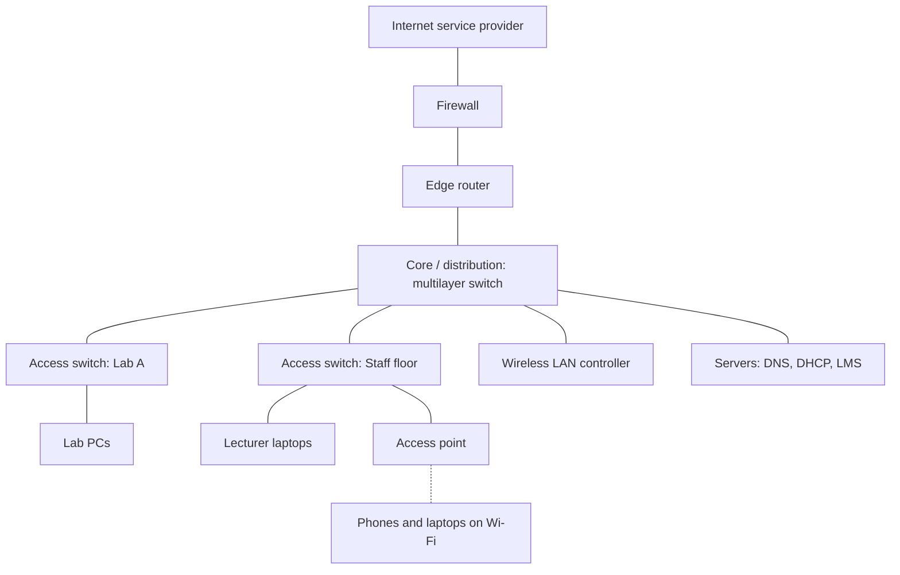
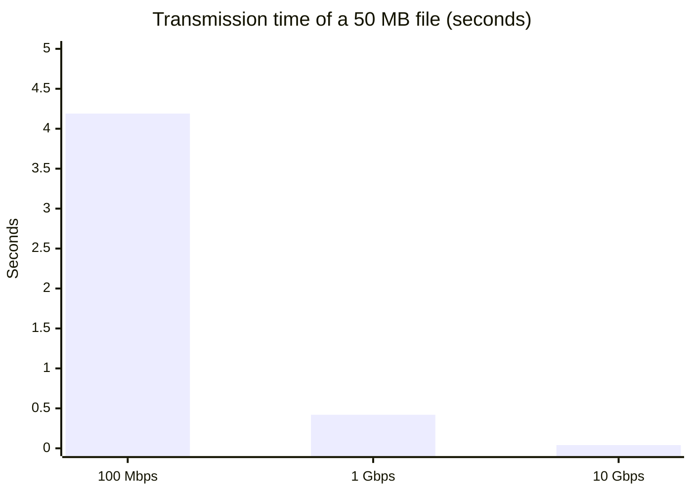

# Session 1: Fundamentals of Networking

> [Cybersecurity and Digital Forensics](../../README.md) › [Term 1](../README.md) › [Module 4: Configuring Network Infrastructure](README.md) › **Session 1**

| ⏱ Estimated time | 📋 Prerequisites |
|---|---|
| 2 hours | Module 3 (Technologies of Computer Networks) or basic familiarity with IP addresses and cables |

| ⬅ [Module overview](README.md) | [Next: Session 2](session-02-osi-and-tcpip-models.md) ➡ |
|:---|---:|

[](https://colab.research.google.com/github/Hamnakhan123/Cybersecurity-and-Digital-Forensics/blob/main/term-1/04-configuring-network-infrastructure/code/session-01-fundamentals-of-networking.ipynb) &nbsp;Run every Python example of this session in the notebook [`code/session-01-fundamentals-of-networking.ipynb`](code/session-01-fundamentals-of-networking.ipynb).

---

## 🎯 Learning objectives

- Explain what a **computer network** is and give everyday and business **uses** of networking.
- Describe the **criteria of a good network**: performance, reliability, scalability, security, manageability and cost, and how each is **measured**.
- Calculate **transmission** and **propagation delay**, **throughput** and **availability** for real links.
- Identify the **devices** used to build networks (NIC, hub, switch, router, multilayer switch, firewall, AP, WLC, modem, IDS/IPS) and the layer each works at.
- Choose the right device for a requirement and justify the choice.

## 📖 Concepts

### 1. What is a network, and why build one?

A **network** is two or more devices connected so they can **share resources and exchange data** by following agreed rules (**protocols**). Each device on a network is a **node**; a device that sends or receives user data (laptop, phone, server, printer, camera) is a **host** or **end device**; the boxes in between (switches, routers, access points) are **intermediary devices**; and the cables or radio waves are the **media**.

> **Analogy – a city's road system.** Houses are hosts, roads are media, roundabouts and traffic signals are intermediary devices, and the highway code is the protocol. Without shared rules, traffic jams and crashes follow. Without roads, nobody visits anyone.

**Uses of networking**

| Area | Example | What the network provides |
|---|---|---|
| Resource sharing | One printer for a whole department | Fewer devices, lower cost |
| Communication | Email, Teams/Zoom lectures, VoIP phones | Real-time voice, video and messages |
| Data sharing | Students upload assignments to the LMS | Central storage, backups, version control |
| Business applications | Point-of-sale terminals, banking core systems | Transactions between branches and the head office |
| Remote access | Lecturer works from home over a VPN | Secure access from anywhere |
| Internet of Things | Smart meters, CCTV, lab sensors | Monitoring and automation |
| Cloud services | Google Workspace, Microsoft 365 | Applications delivered over the network |

### 2. Criteria of a good network

When engineers review a design they test it against the same handful of criteria.

| Criterion | Question it answers | How it is measured |
|---|---|---|
| **Performance** | Is it fast enough? | **Bandwidth** (capacity, bps), **throughput** (actual rate), **latency/delay** (ms), **jitter** (variation of delay), **packet loss** (%) |
| **Reliability** | Does it keep working? | **Availability** % = MTBF ÷ (MTBF + MTTR), number of single points of failure, recovery time |
| **Scalability** | Can it grow without a redesign? | Free ports, spare address space, modular hierarchy (access, distribution, core) |
| **Security** | Is data protected? | **CIA**: confidentiality, integrity, availability; access control, segmentation, logging |
| **Manageability** | Can a small team run it? | Central monitoring, naming standards, documentation, automation |
| **Cost** | Is it worth the money? | Purchase (CapEx) + running and support (OpEx) over 3–5 years |

**Four delays add up to the latency you feel:**

- **Transmission delay** = message size (bits) ÷ bandwidth (bps) – time to *push* bits onto the link.
- **Propagation delay** = distance ÷ signal speed (about 2 × 10⁸ m/s in fibre and copper) – time for a bit to *travel*.
- **Processing delay** – time a device needs to read headers and decide (microseconds in hardware).
- **Queuing delay** – waiting in a buffer when a link is busy (the cause of most "slow at peak hour" complaints).

> **Analogy – a motorway toll plaza.** Transmission delay is how long it takes for a convoy of 100 lorries to pass through the gate; propagation delay is the drive from Karachi to Hyderabad; queuing delay is the traffic jam at the gate during Eid.

**Bandwidth vs throughput.** A link sold as 100 Mbps is the **bandwidth**. If a file actually transfers at 72 Mbps because of protocol overhead, retransmissions and other users, 72 Mbps is the **throughput**.

### 3. Network devices and the layer they work at

| Device | Layer | Decides with | Job | Notes |
|---|---|---|---|---|
| **NIC** (network interface card) | 1–2 | Its own MAC address | Connects a host to the media | Wired (RJ45, SFP) or wireless |
| **Hub / repeater** | 1 | Nothing | Repeats bits out of every port | One collision domain; obsolete |
| **Bridge** | 2 | MAC addresses | Joins two segments, filters frames | The idea behind switches |
| **Switch** | 2 | MAC address table | Forwards frames only to the right port | Each port is its own collision domain; supports VLANs |
| **Router** | 3 | Routing table (IP) | Connects different networks, chooses paths | Breaks up broadcast domains; NAT, ACLs, VPN |
| **Multilayer (L3) switch** | 2–3 | MAC + IP in hardware | Routes between VLANs at wire speed | Common at the distribution/core layer |
| **Firewall** | 3–7 | Rules, ports, state, applications | Allows or blocks traffic between zones | Next-generation firewalls inspect applications |
| **IDS / IPS** | 3–7 | Signatures and behaviour | Detects (IDS) or blocks (IPS) attacks | Placed inline (IPS) or on a mirror port (IDS) |
| **Access point (AP)** | 1–2 | MAC addresses | Connects Wi-Fi clients to the wired LAN | Autonomous or controller-based |
| **Wireless LAN controller (WLC)** | 2–7 | Policies | Manages many APs centrally | Pushes SSIDs, security, RF settings |
| **Modem / ONT** | 1 | – | Converts digital data to the provider's signal (DSL, cable, fibre) | Often combined with a home router |

**Collision domain vs broadcast domain.** A switch gives every port its own *collision* domain, but all ports in the same VLAN still share one *broadcast* domain. A router (or a Layer 3 switch) separates broadcast domains.

## 🧭 Diagrams

**How a campus network is built from devices**



**What makes up the delay of one packet**


## 🪜 Step-by-step: evaluate a network against the criteria

1. **List the users and applications** (how many people, which apps, peak hours).
2. **Measure performance**: run `ping` for latency and loss, `iperf3` or a speed test for throughput, and check interface utilisation on the switch.
3. **Find single points of failure (SPOFs)**: one uplink, one router, one power feed.
4. **Check scalability**: free switch ports, spare IP addresses, rack space.
5. **Check security**: is guest traffic separated, is Telnet disabled, are logs collected?
6. **Check manageability**: is there a diagram, an IP plan, a naming standard?
7. **Score each criterion** pass/fail and write the fix next to every fail.

## 💻 Worked examples

### Example 1 – Delay, throughput and availability with real numbers

📄 **`code/session-01_delay_calc.py`**

```python
"""Session 1 - Measure what makes a network "good": delay, throughput and availability.

A file transfer is slowed by four delays: transmission (pushing bits onto the
wire), propagation (the signal travelling), processing and queuing.
This script calculates them for real link types so you can compare designs.
Run:  python session-01_delay_calc.py
"""

SPEED_OF_LIGHT_FIBRE = 2e8      # metres per second (about 2/3 of c in glass or copper)


def transmission_delay(size_bytes, bandwidth_bps):
    """Seconds needed to put every bit of the message onto the link."""
    return size_bytes * 8 / bandwidth_bps


def propagation_delay(distance_m, speed=SPEED_OF_LIGHT_FIBRE):
    """Seconds the first bit needs to travel the distance."""
    return distance_m / speed


def total_delay(size_bytes, bandwidth_bps, distance_m, processing_s=0.0001, queuing_s=0.0):
    t = transmission_delay(size_bytes, bandwidth_bps)
    p = propagation_delay(distance_m)
    return t, p, t + p + processing_s + queuing_s


def availability(mtbf_h, mttr_h):
    """Fraction of time a component works: MTBF / (MTBF + MTTR)."""
    return mtbf_h / (mtbf_h + mttr_h)


def downtime_per_year(avail):
    return (1 - avail) * 365 * 24 * 60   # minutes


if __name__ == "__main__":
    FILE = 50 * 1024 * 1024   # a 50 MB lecture video
    links = [
        ("Office LAN, Fast Ethernet, 50 m", 100e6, 50),
        ("Office LAN, Gigabit, 50 m", 1e9, 50),
        ("Campus fibre, 10 Gbps, 2 km", 10e9, 2_000),
        ("Karachi -> Lahore WAN, 100 Mbps, 1 200 km", 100e6, 1_200_000),
        ("Karachi -> London WAN, 100 Mbps, 6 300 km", 100e6, 6_300_000),
    ]
    print("Sending a 50 MB file over different links")
    print(f"{'Link':45} {'Transmit':>10} {'Propagate':>11} {'Total':>9}")
    for name, bw, dist in links:
        t, p, tot = total_delay(FILE, bw, dist)
        print(f"{name:45} {t:9.3f}s {p*1000:9.3f}ms {tot:8.3f}s")

    print("\nA small 1 500-byte packet (one Ethernet frame) on the same links")
    for name, bw, dist in links:
        t, p, tot = total_delay(1500, bw, dist)
        print(f"{name:45} transmit {t*1e6:8.1f} us   propagate {p*1000:7.3f} ms")

    print("\nReliability: availability and yearly downtime")
    for name, mtbf, mttr in [("Single access switch", 50_000, 8),
                             ("Consumer router", 10_000, 24),
                             ("Core switch with 4 h support", 200_000, 4)]:
        a = availability(mtbf, mttr)
        print(f"{name:32} A = {a*100:.4f}%   downtime = {downtime_per_year(a):7.1f} min/year")
    # two switches in parallel: down only if both are down
    a = availability(50_000, 8)
    pair = 1 - (1 - a) ** 2
    print(f"{'Two access switches in parallel':32} A = {pair*100:.6f}%   downtime = {downtime_per_year(pair)*60:7.3f} s/year")
```

**Output**

```text
Sending a 50 MB file over different links
Link                                            Transmit   Propagate     Total
Office LAN, Fast Ethernet, 50 m                   4.194s     0.000ms    4.194s
Office LAN, Gigabit, 50 m                         0.419s     0.000ms    0.420s
Campus fibre, 10 Gbps, 2 km                       0.042s     0.010ms    0.042s
Karachi -> Lahore WAN, 100 Mbps, 1 200 km         4.194s     6.000ms    4.200s
Karachi -> London WAN, 100 Mbps, 6 300 km         4.194s    31.500ms    4.226s

A small 1 500-byte packet (one Ethernet frame) on the same links
Office LAN, Fast Ethernet, 50 m               transmit    120.0 us   propagate   0.000 ms
Office LAN, Gigabit, 50 m                     transmit     12.0 us   propagate   0.000 ms
Campus fibre, 10 Gbps, 2 km                   transmit      1.2 us   propagate   0.010 ms
Karachi -> Lahore WAN, 100 Mbps, 1 200 km     transmit    120.0 us   propagate   6.000 ms
Karachi -> London WAN, 100 Mbps, 6 300 km     transmit    120.0 us   propagate  31.500 ms

Reliability: availability and yearly downtime
Single access switch             A = 99.9840%   downtime =    84.1 min/year
Consumer router                  A = 99.7606%   downtime =  1258.4 min/year
Core switch with 4 h support     A = 99.9980%   downtime =    10.5 min/year
Two access switches in parallel  A = 99.999997%   downtime =   0.807 s/year
```
**Observe:**
- For a **large file**, bandwidth dominates: Gigabit is 10× faster than Fast Ethernet, and distance barely matters.
- For a **small packet**, distance dominates: one frame to London needs 31.5 ms just to travel, no matter how much bandwidth you buy. That is why video calls to far-away cities feel laggy.
- One switch with an 8-hour repair time loses about **84 minutes a year**; two in parallel lose **under one second**. Redundancy, not expensive hardware, is what raises availability.

### Example 2 – Choosing devices and scoring a design

📄 **`code/session-01_device_roles.py`**

```python
"""Session 1 - Pick the right device for each networking job.

Each device works at a different layer and makes decisions with a different
address. Given a list of requirements, this script recommends a device and
explains why, then checks a small office design against the criteria of a
good network (performance, reliability, scalability, security, manageability).
Run:  python session-01_device_roles.py
"""

DEVICES = {
    "hub":          {"layer": 1, "uses": "nothing (repeats bits to every port)"},
    "switch":       {"layer": 2, "uses": "MAC addresses (MAC address table)"},
    "router":       {"layer": 3, "uses": "IP addresses (routing table)"},
    "multilayer switch": {"layer": 3, "uses": "MAC and IP addresses in hardware"},
    "firewall":     {"layer": 4, "uses": "IPs, ports and connection state (rules)"},
    "access point": {"layer": 2, "uses": "MAC addresses (bridges Wi-Fi to Ethernet)"},
    "wireless LAN controller": {"layer": 2, "uses": "AP inventory and policies (manages many APs centrally)"},
}

NEEDS = [
    ("Connect 24 PCs in one lab so they can share files", "switch"),
    ("Join the lab network to the internet", "router"),
    ("Route between 10 VLANs at wire speed in the server room", "multilayer switch"),
    ("Allow only HTTPS from the internet to the web server", "firewall"),
    ("Give laptops Wi-Fi in the library", "access point"),
    ("Manage 60 access points from one dashboard", "wireless LAN controller"),
]


def score_design(design):
    """Return (criterion, ok, reason) tuples for a simple design dictionary."""
    checks = [
        ("Performance", design["uplink_gbps"] >= 1, f"uplink {design['uplink_gbps']} Gbps"),
        ("Reliability", design["redundant_uplinks"] >= 2, f"{design['redundant_uplinks']} uplink(s)"),
        ("Scalability", design["free_ports_pct"] >= 20, f"{design['free_ports_pct']}% ports free"),
        ("Security", design["guest_isolated"] and not design["telnet_enabled"],
         f"guest isolated={design['guest_isolated']}, telnet={design['telnet_enabled']}"),
        ("Manageability", design["central_logging"], f"central logging={design['central_logging']}"),
    ]
    return checks


if __name__ == "__main__":
    print("Requirement -> recommended device")
    for need, dev in NEEDS:
        d = DEVICES[dev]
        print(f" - {need}\n     => {dev} (layer {d['layer']}, decides using {d['uses']})")

    for name, design in [
        ("Version 1 (first draft)", dict(uplink_gbps=0.1, redundant_uplinks=1, free_ports_pct=5,
                                         guest_isolated=False, telnet_enabled=True, central_logging=False)),
        ("Version 2 (improved)", dict(uplink_gbps=10, redundant_uplinks=2, free_ports_pct=30,
                                      guest_isolated=True, telnet_enabled=False, central_logging=True)),
    ]:
        checks = score_design(design)
        passed = sum(ok for _, ok, _ in checks)
        print(f"\n{name}: {passed}/{len(checks)} criteria met")
        for crit, ok, why in checks:
            print(f"   [{'PASS' if ok else 'FAIL'}] {crit:13} {why}")
```

**Output**

```text
Requirement -> recommended device
 - Connect 24 PCs in one lab so they can share files
     => switch (layer 2, decides using MAC addresses (MAC address table))
 - Join the lab network to the internet
     => router (layer 3, decides using IP addresses (routing table))
 - Route between 10 VLANs at wire speed in the server room
     => multilayer switch (layer 3, decides using MAC and IP addresses in hardware)
 - Allow only HTTPS from the internet to the web server
     => firewall (layer 4, decides using IPs, ports and connection state (rules))
 - Give laptops Wi-Fi in the library
     => access point (layer 2, decides using MAC addresses (bridges Wi-Fi to Ethernet))
 - Manage 60 access points from one dashboard
     => wireless LAN controller (layer 2, decides using AP inventory and policies (manages many APs centrally))

Version 1 (first draft): 0/5 criteria met
   [FAIL] Performance   uplink 0.1 Gbps
   [FAIL] Reliability   1 uplink(s)
   [FAIL] Scalability   5% ports free
   [FAIL] Security      guest isolated=False, telnet=True
   [FAIL] Manageability central logging=False

Version 2 (improved): 5/5 criteria met
   [PASS] Performance   uplink 10 Gbps
   [PASS] Reliability   2 uplink(s)
   [PASS] Scalability   30% ports free
   [PASS] Security      guest isolated=True, telnet=False
   [PASS] Manageability central logging=True
```
**Observe:** the first draft fails every criterion even though it "works" – users can reach the internet. The improved version adds a 10 Gbps uplink, a second uplink, spare ports, guest isolation, SSH instead of Telnet, and central logging.

### Example 3 – Hand calculation: transmission vs propagation

A 1 MB (8 000 000-bit) assignment upload over a 10 Mbps link to a server 3 000 km away:

| Delay | Formula | Result |
|---|---|---|
| Transmission | 8 000 000 ÷ 10 000 000 | **0.8 s** |
| Propagation | 3 000 000 m ÷ 2 × 10⁸ m/s | **0.015 s (15 ms)** |
| Total (ignoring processing and queuing) | 0.8 + 0.015 | **≈ 0.815 s** |

Upgrading to 100 Mbps cuts transmission to 0.08 s; propagation stays 15 ms because light does not get faster.

## 📊 Chart



| Availability | Downtime per year | Typical example |
|---|---|---|
| 99% ("two nines") | 3.65 days | Single consumer router |
| 99.9% | 8.76 hours | Single business switch |
| 99.99% | 52.6 minutes | Redundant pair, good support |
| 99.999% ("five nines") | 5.26 minutes | Carrier-grade, fully redundant |

## 🏢 Real-life problem with full solution

**Scenario.** A private college in Karachi has 3 computer labs (40 PCs each), 25 lecturers and an admin office. Today every lab is connected by a cheap unmanaged 48-port switch daisy-chained to the next lab, one consumer Wi-Fi router serves the whole building, and all devices share one network. Problems: the network is slow during practical exams, the whole building loses internet when the router overheats, and students have accessed the admin office's shared folder.

**Solution.**

1. **Performance:** replace daisy-chaining with a **star (hierarchical) design**: every lab switch uplinks directly to a core multilayer switch at 1 Gbps (10 Gbps if fibre is available). Daisy-chains force all traffic through intermediate switches and multiply queuing delay.
2. **Reliability:** two uplinks from each lab switch (later bundled with EtherChannel, Session 6), a UPS for the core and the router, a business-grade edge router, and a backup 4G/fibre internet link.
3. **Scalability:** 48-port managed switches with at least 20% free ports; an address plan with room to grow (Session 3).
4. **Security:** separate **VLANs** for Labs, Lecturers, Admin and Guest Wi-Fi (Session 5) with ACLs between them (Session 10) so students cannot reach the admin share.
5. **Manageability:** managed switches with SSH, NTP and syslog; a labelled diagram and a port map.
6. **Wi-Fi:** replace the single consumer router with ceiling access points managed by a controller (Session 14).

**Verification:** run `iperf3` between a lab PC and the server during a practical (target ≥ 800 Mbps); unplug one uplink and confirm the lab stays online; from a student PC, test that the admin share is unreachable.

## ⚠️ Common mistakes

- Confusing **bandwidth** (capacity) with **throughput** (what you actually get).
- Thinking more bandwidth fixes **latency** to distant servers – propagation delay is physics.
- Daisy-chaining switches instead of building a star/hierarchy.
- Treating a **hub** and a **switch** as the same: hubs flood every frame to every port.
- Forgetting that a switch does **not** split broadcast domains – only routers and VLANs do.
- Buying the most expensive device instead of removing single points of failure.

## ✅ Best practices

- Design hierarchically: **access** (users), **distribution** (policy, inter-VLAN routing), **core** (fast transport). Small sites can collapse distribution and core.
- Remove single points of failure for anything that serves many users.
- Measure before and after every change (baseline latency, throughput, utilisation).
- Separate traffic types with VLANs from day one.
- Document every device, link and address; keep the diagram current.

## 🧪 Lab / practice tasks

1. **Easy –** List five devices in your home or campus network and state the OSI layer each works at.
2. **Easy –** Calculate the transmission delay of a 20 MB file over 8 Mbps and over 1 Gbps.
3. **Medium –** Run `ping -n 20 8.8.8.8` (Windows) or `ping -c 20 8.8.8.8` (Linux/macOS). Record minimum, average and maximum latency and the loss percentage. Calculate jitter as max − min.
4. **Medium –** In `session-01_delay_calc.py`, add a satellite link (100 Mbps, 35 786 km each way to a geostationary satellite). What is the one-way propagation delay to the satellite and back down?
5. **Challenge –** A switch has MTBF 60 000 h and MTTR 6 h. Calculate its availability, its downtime per year, and the availability of two in parallel. Then add `score_design` checks for "has UPS" and "has documentation".

<details>
<summary>💡 Hints</summary>

- Task 2: multiply MB by 8 to get megabits (use 1 MB = 8 Mb for a quick estimate).
- Task 4: the signal goes up **and** down, so the distance is 2 × 35 786 km.
- Task 5: A = MTBF ÷ (MTBF + MTTR); parallel = 1 − (1 − A)².
</details>

<details>
<summary>✅ Solutions</summary>

**Task 1 (example):** laptop NIC (L1–2), Wi-Fi AP (L2), home router (L3), modem/ONT (L1), smart TV (host, all layers).

**Task 2:** 20 MB = 160 Mb. 160 ÷ 8 = **20 s**; 160 ÷ 1000 = **0.16 s**.

**Task 3:** example result: min 38 ms, avg 41 ms, max 55 ms, 0% loss → jitter ≈ 17 ms. Values depend on your connection.

**Task 4:**

```python
("Satellite, 100 Mbps, up and down", 100e6, 2 * 35_786_000),
```

Propagation = 71 572 000 ÷ 2 × 10⁸ ≈ **0.358 s (358 ms)** one way, so a request and reply take over 0.7 s – why satellite internet feels sluggish for calls.

**Task 5:** A = 60 000 ÷ 60 006 = **99.990%**; downtime ≈ 0.0001 × 525 600 ≈ **52.6 min/year**; parallel = 1 − (0.0001)² = **99.999999%**.

```python
("UPS", design["has_ups"], f"UPS={design['has_ups']}"),
("Documentation", design["documented"], f"documented={design['documented']}"),
```
</details>

## ✅ Quick quiz

1. Which device separates broadcast domains? a) hub b) switch c) router d) repeater
2. Throughput is: a) the advertised link speed b) the actual data rate achieved c) the delay of a packet d) the number of hops
3. Which delay depends on the **distance** between devices? a) transmission b) propagation c) processing d) queuing
4. Availability is calculated as: a) MTTR ÷ MTBF b) MTBF ÷ (MTBF + MTTR) c) MTBF × MTTR d) 1 − MTBF
5. Which device centrally manages many access points? a) modem b) hub c) wireless LAN controller d) bridge

<details>
<summary>Show answers</summary>

1 – c · 2 – b · 3 – b · 4 – b · 5 – c
</details>

## 📝 Summary / cheat-sheet

- Network = nodes + media + protocols; hosts send/receive, intermediary devices forward.
- Good network = performance, reliability, scalability, security, manageability, sensible cost.
- Delay = processing + queuing + transmission (size ÷ bandwidth) + propagation (distance ÷ speed).
- Availability = MTBF ÷ (MTBF + MTTR); redundancy multiplies the nines.
- Hub L1 (floods), switch L2 (MAC table), router L3 (routing table), multilayer switch L2–3, firewall/IPS L3–7, AP + WLC for Wi-Fi.
- Switch = one collision domain per port; router/VLAN = separate broadcast domains.

**Interview / viva questions**

1. What is the difference between bandwidth, throughput and latency?
2. Why does buying a faster internet plan not reduce ping time to a server in another continent?
3. Compare a hub, a switch and a router.
4. What is a single point of failure? Give two examples in a small office network.
5. Name the criteria you would use to judge whether a network design is good.
6. Why is a multilayer switch often placed at the distribution layer?

---

| ⬅ [Module overview](README.md) | [Next: Session 2](session-02-osi-and-tcpip-models.md) ➡ |
|:---|---:|

<sub>Prepared by **Hamna Zahid Khan**, Junior Lecturer · Cybersecurity and Digital Forensics</sub>
