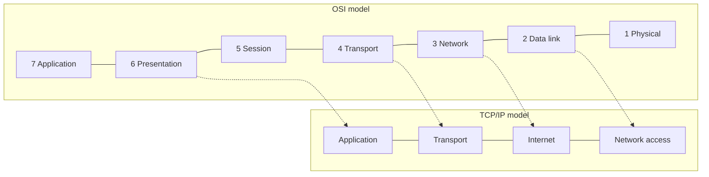
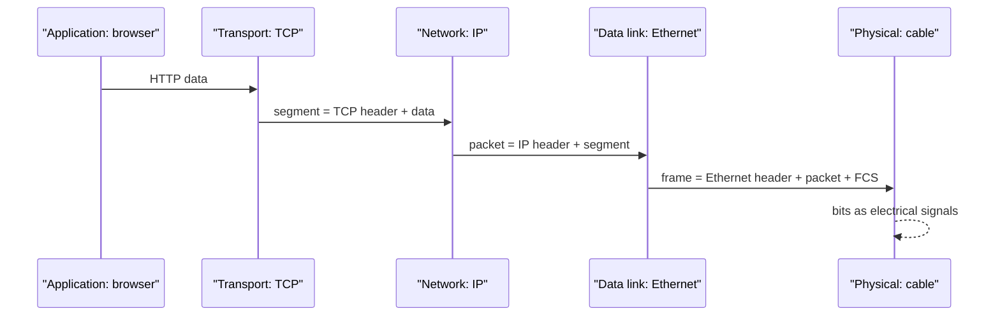
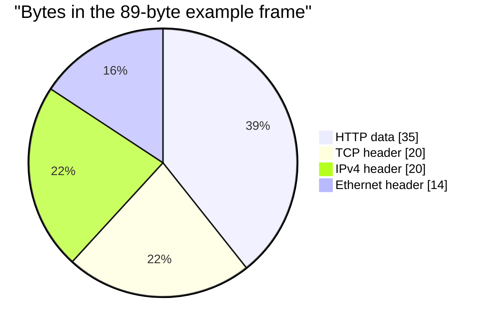

# Session 2: Models in Computer Networking: OSI and TCP/IP

> [Cybersecurity and Digital Forensics](../../README.md) › [Term 1](../README.md) › [Module 4: Configuring Network Infrastructure](README.md) › **Session 2**

| ⏱ Estimated time | 📋 Prerequisites |
|---|---|
| 2 hours | Session 1 (network devices and their layers) |

| ⬅ [Previous: Session 1](session-01-fundamentals-of-networking.md) | [Next: Session 3](session-03-mac-ip-subnetting-cidr.md) ➡ |
|:---|---:|

[](https://colab.research.google.com/github/Hamnakhan123/Cybersecurity-and-Digital-Forensics/blob/main/term-1/04-configuring-network-infrastructure/code/session-02-osi-and-tcpip-models.ipynb) &nbsp;Run every Python example of this session in the notebook [`code/session-02-osi-and-tcpip-models.ipynb`](code/session-02-osi-and-tcpip-models.ipynb).

---

## 🎯 Learning objectives

- Explain **why networking uses layered models** and what a protocol stack is.
- Describe each of the **seven OSI layers**: its job, its PDU, example protocols and devices.
- Describe the **TCP/IP model** and map it to the OSI model; state the key **differences**.
- Trace **encapsulation and de-encapsulation** of real header bytes.
- Classify **area networks**: PAN, LAN, WLAN, CAN, MAN, WAN, SAN and VPN-based networks.

## 📖 Concepts

### 1. Why use a networking model?

A model splits the huge job "move data between two applications" into **layers**. Each layer:

- does **one job** and offers a **service** to the layer above,
- talks to the **same layer** on the other device using a **protocol** (peer-to-peer communication),
- can be changed without breaking the others (Wi-Fi replaced Ethernet cables without changing HTTP).

> **Analogy – sending a parcel by courier.** You write a letter (application), put it in an envelope with an address (network), the courier puts it in a sack for the right van (data link), and the van drives the road (physical). At the other end each step is undone in reverse. The letter writer does not need to know how the van works.

Benefits: **standardisation** (vendors interoperate), **modular design**, **easier troubleshooting** ("is it a Layer 1 or Layer 3 problem?"), and **teaching** a common vocabulary.

### 2. The OSI reference model

| # | Layer | Job | PDU | Protocols / standards | Devices |
|---|---|---|---|---|---|
| 7 | **Application** | Network services for applications | Data | HTTP, HTTPS, DNS, SMTP, FTP, SSH, DHCP, SNMP | – (hosts) |
| 6 | **Presentation** | Format, encryption, compression | Data | TLS/SSL, JPEG, MP4, ASCII, UTF-8 | – |
| 5 | **Session** | Open, manage, close sessions; checkpoints | Data | NetBIOS, RPC, SQL sessions | – |
| 4 | **Transport** | End-to-end delivery, ports, reliability, flow control | Segment (TCP) / Datagram (UDP) | TCP, UDP | Firewalls (stateful) |
| 3 | **Network** | Logical addressing and routing between networks | Packet | IPv4, IPv6, ICMP, OSPF | Router, L3 switch |
| 2 | **Data link** | Framing, MAC addressing, error detection on one link | Frame | Ethernet 802.3, Wi-Fi 802.11, PPP, ARP | Switch, bridge, AP, NIC |
| 1 | **Physical** | Bits as signals: voltage, light, radio | Bits | Cat6, fibre, RJ45, 802.11 radio | Hub, repeater, cable, modem |

Memory aid (top-down): **"All People Seem To Need Data Processing."**

Layer 2 has two sub-layers: **LLC** (Logical Link Control, talks to Layer 3) and **MAC** (Media Access Control, addressing and access to the media).

**TCP vs UDP at Layer 4**

| | TCP | UDP |
|---|---|---|
| Connection | Three-way handshake (SYN, SYN-ACK, ACK) | None |
| Reliability | Sequence numbers, acknowledgements, retransmission | Best effort |
| Order | Delivered in order | May arrive out of order |
| Header | 20+ bytes | 8 bytes |
| Used by | HTTP/S, SSH, FTP, SMTP | DNS queries, DHCP, NTP, VoIP, video streaming, TFTP |

### 3. The TCP/IP model

The TCP/IP model is the one the internet **actually runs on**; OSI is the reference for teaching and troubleshooting.

| TCP/IP layer (4-layer view) | OSI layers covered | Examples |
|---|---|---|
| **Application** | 7, 6, 5 | HTTP, DNS, TLS, SSH |
| **Transport** | 4 | TCP, UDP |
| **Internet** | 3 | IP, ICMP |
| **Network access** (link) | 2, 1 | Ethernet, Wi-Fi |

Some books use a **5-layer** version that keeps Data Link and Physical separate.

**Key differences**

| OSI | TCP/IP |
|---|---|
| 7 layers | 4 layers (or 5) |
| Reference model, created before its protocols | Practical model, created from working protocols |
| Clear separation of service, interface and protocol | Less strict separation |
| Session and presentation are separate layers | Folded into the application layer |
| Used for teaching and troubleshooting | Used to build the internet |

### 4. Encapsulation and de-encapsulation

Going **down** the stack, each layer adds its **header** (Layer 2 also adds a **trailer**, the FCS):

`Data` → **TCP header** + data = *segment* → **IP header** + segment = *packet* → **Ethernet header** + packet + **FCS** = *frame* → **bits** on the wire.

The receiver goes **up** the stack, checking and removing one header per layer. Intermediate devices only open as many layers as they need: a switch reads up to Layer 2, a router up to Layer 3 (and rewrites the Layer 2 header for the next link).

### 5. Types of area networks

| Type | Span | Example | Typical technology |
|---|---|---|---|
| **PAN** – personal area network | A few metres | Phone to earbuds and smartwatch | Bluetooth, USB |
| **LAN** – local area network | A room, floor or building | Computer lab | Ethernet, switches |
| **WLAN** – wireless LAN | Same as LAN | Library Wi-Fi | 802.11 |
| **CAN** – campus area network | Several buildings | University campus | Fibre between buildings |
| **MAN** – metropolitan area network | A city | Bank branches across Karachi | Metro Ethernet, fibre rings |
| **WAN** – wide area network | Countries / world | Head office in Karachi, branches in Lahore and Dubai | MPLS, leased lines, internet + VPN, SD-WAN |
| **SAN** – storage area network | Data centre | Servers to disk arrays | Fibre Channel, iSCSI |
| **VPN** | Logical, over another network | Lecturer at home to campus | IPsec, SSL/TLS (Session 13) |

The **internet** is the largest WAN: a network of networks. An **intranet** is an organisation's private network; an **extranet** gives selected outsiders (suppliers, partners) controlled access.

## 🧭 Diagrams

**OSI vs TCP/IP side by side**



**Encapsulation of a web request**



## 🪜 Step-by-step: see the layers yourself with Wireshark

1. Install Wireshark (or use it in a lab VM) and start a capture on your active interface.
2. In a browser open `http://neverssl.com` (a site that deliberately uses plain HTTP).
3. Apply the display filter `http`.
4. Select a `GET` packet. The details pane lists **Frame** (physical), **Ethernet II** (L2), **Internet Protocol Version 4** (L3), **Transmission Control Protocol** (L4) and **Hypertext Transfer Protocol** (L7).
5. Expand each one and note the addresses: MACs at L2, IPs at L3, ports at L4.
6. Filter `tcp.flags.syn == 1` to see the three-way handshake that came before the GET.

Capture only on networks you own or are allowed to monitor.

## 💻 Worked examples

### Example 1 – Build a real frame byte by byte, then take it apart

📄 **`code/session-02_encapsulate.py`**

```python
"""Session 2 - Encapsulation with real header bytes: Ethernet / IPv4 / TCP.

Builds an HTTP request the way a host's protocol stack does, layer by layer,
computes the real IPv4 header checksum, prints a hex dump, then
de-encapsulates it the way the receiver does. All addresses are lab addresses.
Run:  python session-02_encapsulate.py
"""
import struct


def checksum(data: bytes) -> int:
    """Internet checksum (RFC 1071): one's complement of the one's-complement sum."""
    if len(data) % 2:
        data += b"\0"
    s = sum(struct.unpack(f"!{len(data)//2}H", data))
    while s >> 16:
        s = (s & 0xFFFF) + (s >> 16)
    return ~s & 0xFFFF


def mac(s): return bytes(int(x, 16) for x in s.split(":"))
def ip(s): return bytes(int(x) for x in s.split("."))


# Layer 7: application data
payload = b"GET / HTTP/1.1\r\nHost: lab.local\r\n\r\n"

# Layer 4: TCP header (20 bytes, no options). Flags 0x18 = PSH + ACK
tcp = struct.pack("!HHIIBBHHH", 50123, 80, 1000, 2000, 5 << 4, 0x18, 64240, 0, 0)
segment = tcp + payload

# Layer 3: IPv4 header (20 bytes). Checksum computed over the header only
ver_ihl, tos, total_len = 0x45, 0, 20 + len(segment)
ident, flags_frag, ttl, proto = 0x1C46, 0x4000, 64, 6
hdr = struct.pack("!BBHHHBBH4s4s", ver_ihl, tos, total_len, ident, flags_frag, ttl, proto, 0,
                  ip("192.168.10.25"), ip("192.168.20.80"))
hdr = hdr[:10] + struct.pack("!H", checksum(hdr)) + hdr[12:]
packet = hdr + segment

# Layer 2: Ethernet II header (dst MAC, src MAC, EtherType 0x0800 = IPv4)
frame = mac("00:1a:2b:3c:4d:5e") + mac("00:50:56:aa:bb:cc") + b"\x08\x00" + packet


def hexdump(b, width=16):
    for i in range(0, len(b), width):
        chunk = b[i:i + width]
        text = "".join(chr(c) if 32 <= c < 127 else "." for c in chunk)
        print(f"  {i:04x}  {chunk.hex(' '):<{width*3}} {text}")


if __name__ == "__main__":
    print(f"L7 data     {len(payload):3} bytes")
    print(f"L4 segment  {len(segment):3} bytes (+20 TCP header)")
    print(f"L3 packet   {len(packet):3} bytes (+20 IPv4 header)")
    print(f"L2 frame    {len(frame):3} bytes (+14 Ethernet header, FCS added by the NIC)\n")
    hexdump(frame)

    print("\nReceiver de-encapsulates:")
    dst, src, etype = frame[0:6], frame[6:12], struct.unpack("!H", frame[12:14])[0]
    print(f"  L2: dst {dst.hex(':')} src {src.hex(':')} type 0x{etype:04x} -> IPv4")
    ih = frame[14:34]
    v, _, tl, _, _, t, pr, cs, s, d = struct.unpack("!BBHHHBBH4s4s", ih)
    print(f"  L3: version {v >> 4}, length {tl}, TTL {t}, protocol {pr} (TCP), "
          f"{'.'.join(map(str, s))} -> {'.'.join(map(str, d))}")
    print(f"      header checksum 0x{cs:04x}; recomputed over header = 0x{checksum(ih):04x} (0 means valid)")
    sp, dp, seq, ack = struct.unpack("!HHII", frame[34:46])
    print(f"  L4: port {sp} -> {dp} (HTTP), seq {seq}, ack {ack}")
    first_line = frame[54:].split(b"\r\n")[0].decode()
    print(f"  L7: {first_line!r} (application data)")
```

**Output**

```text
L7 data      35 bytes
L4 segment   55 bytes (+20 TCP header)
L3 packet    75 bytes (+20 IPv4 header)
L2 frame     89 bytes (+14 Ethernet header, FCS added by the NIC)

  0000  00 1a 2b 3c 4d 5e 00 50 56 aa bb cc 08 00 45 00  ..+<M^.PV.....E.
  0010  00 4b 1c 46 40 00 40 06 7e ad c0 a8 0a 19 c0 a8  .K.F@.@.~.......
  0020  14 50 c3 cb 00 50 00 00 03 e8 00 00 07 d0 50 18  .P...P........P.
  0030  fa f0 00 00 00 00 47 45 54 20 2f 20 48 54 54 50  ......GET / HTTP
  0040  2f 31 2e 31 0d 0a 48 6f 73 74 3a 20 6c 61 62 2e  /1.1..Host: lab.
  0050  6c 6f 63 61 6c 0d 0a 0d 0a                       local....

Receiver de-encapsulates:
  L2: dst 00:1a:2b:3c:4d:5e src 00:50:56:aa:bb:cc type 0x0800 -> IPv4
  L3: version 4, length 75, TTL 64, protocol 6 (TCP), 192.168.10.25 -> 192.168.20.80
      header checksum 0x7ead; recomputed over header = 0x0000 (0 means valid)
  L4: port 50123 -> 80 (HTTP), seq 1000, ack 2000
  L7: 'GET / HTTP/1.1' (application data)
```
**Observe:**
- 35 bytes of HTTP become an 89-byte frame: the headers are 54 bytes (TCP 20 + IP 20 + Ethernet 14). The NIC also adds a 4-byte FCS, so small packets carry a lot of overhead.
- Byte `45` at offset 0x0e means **IPv4, header length 5 × 4 = 20 bytes**. `06` at offset 0x17 is the protocol number for **TCP**. `00 50` is port **80**.
- Re-computing the checksum over a valid header gives **0** – the same test every router performs before forwarding.

### Example 2 – Mapping protocols, devices and networks to layers

📄 **`code/session-02_osi_mapper.py`**

```python
"""Session 2 - Map protocols, devices and PDUs to OSI and TCP/IP layers.

Also classifies example networks into PAN / LAN / CAN / MAN / WAN by their
span, which is the "types of area networks" part of the session.
Run:  python session-02_osi_mapper.py
"""

OSI = {7: "Application", 6: "Presentation", 5: "Session", 4: "Transport",
       3: "Network", 2: "Data Link", 1: "Physical"}
TCPIP = {7: "Application", 6: "Application", 5: "Application", 4: "Transport",
         3: "Internet", 2: "Network Access", 1: "Network Access"}
PDU = {7: "Data", 6: "Data", 5: "Data", 4: "Segment / Datagram", 3: "Packet", 2: "Frame", 1: "Bits"}

ITEMS = {"HTTP": 7, "DNS": 7, "SSH": 7, "TLS encryption": 6, "JPEG / ASCII": 6,
         "NetBIOS / RPC sessions": 5, "TCP": 4, "UDP": 4, "IPv4 / IPv6": 3, "ICMP (ping)": 3,
         "OSPF": 3, "Router": 3, "Ethernet / 802.3": 2, "Wi-Fi / 802.11": 2, "ARP": 2,
         "Switch": 2, "Hub / repeater": 1, "Cat6 cable / fibre": 1}


def area_type(span_m):
    if span_m <= 10: return "PAN"
    if span_m <= 1_000: return "LAN"
    if span_m <= 5_000: return "CAN"
    if span_m <= 50_000: return "MAN"
    return "WAN"


if __name__ == "__main__":
    print(f"{'Item':24} {'OSI layer':18} {'TCP/IP layer':15} PDU")
    for item, layer in ITEMS.items():
        print(f"{item:24} {str(layer) + ' ' + OSI[layer]:18} {TCPIP[layer]:15} {PDU[layer]}")
    print("\nArea network types by span")
    for name, span in [("Bluetooth earbuds to phone", 3), ("Computer lab", 60),
                       ("University campus, 6 buildings", 2_500), ("City-wide bank branches", 30_000),
                       ("Offices in Karachi and Islamabad", 1_150_000)]:
        print(f"  {name:36} {span:>9,} m  -> {area_type(span)}")
```

**Output**

```text
Item                     OSI layer          TCP/IP layer    PDU
HTTP                     7 Application      Application     Data
DNS                      7 Application      Application     Data
SSH                      7 Application      Application     Data
TLS encryption           6 Presentation     Application     Data
JPEG / ASCII             6 Presentation     Application     Data
NetBIOS / RPC sessions   5 Session          Application     Data
TCP                      4 Transport        Transport       Segment / Datagram
UDP                      4 Transport        Transport       Segment / Datagram
IPv4 / IPv6              3 Network          Internet        Packet
ICMP (ping)              3 Network          Internet        Packet
OSPF                     3 Network          Internet        Packet
Router                   3 Network          Internet        Packet
Ethernet / 802.3         2 Data Link        Network Access  Frame
Wi-Fi / 802.11           2 Data Link        Network Access  Frame
ARP                      2 Data Link        Network Access  Frame
Switch                   2 Data Link        Network Access  Frame
Hub / repeater           1 Physical         Network Access  Bits
Cat6 cable / fibre       1 Physical         Network Access  Bits

Area network types by span
  Bluetooth earbuds to phone                   3 m  -> PAN
  Computer lab                                60 m  -> LAN
  University campus, 6 buildings           2,500 m  -> CAN
  City-wide bank branches                 30,000 m  -> MAN
  Offices in Karachi and Islamabad     1,150,000 m  -> WAN
```
### Example 3 – Hand trace: which layer fails?

| Symptom | Layer | Why |
|---|---|---|
| No link light on the NIC | 1 | No signal: cable, port or NIC |
| Link light on, but the switch shows CRC errors | 2 | Frames arrive corrupted (FCS check fails) |
| PC has IP 169.254.x.x | 3 (via 7) | DHCP failed, so no valid IP address |
| `ping 8.8.8.8` works, `ping google.com` fails | 7 | DNS problem |
| Website loads, but the browser shows a certificate warning | 6 | TLS/certificate issue |
| SSH times out, ping works | 4 | Port 22 blocked by a firewall or service not listening |

## 📊 Chart



| Layer | Address used | Example |
|---|---|---|
| 2 Data link | MAC (48-bit) | `00:1a:2b:3c:4d:5e` |
| 3 Network | IP (32-bit IPv4 / 128-bit IPv6) | `192.168.10.25`, `2001:db8::25` |
| 4 Transport | Port (16-bit) | 443 (HTTPS), 53 (DNS) |

## 🏢 Real-life problem with full solution

**Scenario.** After a weekend renovation, staff in one wing report: "The internet isn't working." The help-desk ticket has only that sentence. You are asked to find the cause methodically using the OSI model.

**Solution (bottom-up, because physical work just happened):**

1. **Layer 1:** link lights are on for all PCs in the wing; cable tester passes. ✅
2. **Layer 2:** the switch shows the PCs' MAC addresses learned on the right ports, but in **VLAN 1** instead of VLAN 10 – the replacement switch was installed with a default configuration. ❌ Found the fault.
3. **Layer 3 confirms it:** the PCs show `169.254.x.x` (APIPA) because the DHCP relay exists only on VLAN 10.
4. **Fix:** restore the access-port configuration (`switchport access vlan 10`, Session 5), then run `ipconfig /renew` on the PCs.
5. **Verify up the stack:** valid IP (L3), `ping` to the gateway and 8.8.8.8 (L3), `nslookup` a domain (L7), open the LMS (L7).
6. **Document:** cause = replacement switch not configured; prevention = keep saved configurations (TFTP backup, Session 9) and restore them to replacement hardware before connecting users.

## ⚠️ Common mistakes

- Saying a switch is "Layer 3" – a normal switch is Layer 2; a *multilayer* switch adds routing.
- Mixing up PDUs: **segment** (L4), **packet** (L3), **frame** (L2).
- Thinking TCP/IP "replaced" OSI – they describe the same reality at different detail.
- Forgetting that ARP sits between L2 and L3 (it maps IP to MAC; usually grouped with L2).
- Believing UDP is "bad" – it is the right choice for DNS, VoIP and live video, where speed matters more than retransmission.

## ✅ Best practices

- Troubleshoot with a layered approach and write down which layer you have proved working.
- Use **bottom-up** after physical changes, **top-down** when only one application fails, **divide-and-conquer** (start with `ping`) when unsure.
- Learn the PDU, address type and typical device for each layer – interview favourite.
- Use Wireshark in a lab to make the layers visible.

## 🧪 Lab / practice tasks

1. **Easy –** Write the OSI layer for: Ethernet, IP, TCP, HTTPS, Wi-Fi, fibre cable, router, switch.
2. **Easy –** Draw the TCP/IP model next to the OSI model and connect matching layers.
3. **Medium –** In `session-02_encapsulate.py` change the destination port to 443 and the TTL to 128. Which bytes in the hex dump change? Does the checksum change?
4. **Medium –** Capture a DNS lookup in Wireshark (`nslookup example.com`, filter `dns`). Which transport protocol and port are used? Which layer holds the domain name?
5. **Challenge –** Modify the script so the receiver **detects corruption**: flip one bit in the IPv4 header after building the frame and show that the recomputed checksum is no longer 0.

<details>
<summary>💡 Hints</summary>

- Task 3: the port is inside the TCP header (offset 0x24); TTL is one byte of the IPv4 header, which is covered by the checksum.
- Task 5: convert `frame` to a `bytearray`, then `frame[22] ^= 0x01` flips the lowest bit of the TTL byte.
</details>

<details>
<summary>✅ Solutions</summary>

**Task 1:** Ethernet L2, IP L3, TCP L4, HTTPS L7 (with TLS at L6), Wi-Fi L1–2, fibre L1, router L3, switch L2.

**Task 3:** port bytes `00 50` → `01 bb`; TTL byte `40` → `80`. The IPv4 checksum **changes** (TTL is part of the IP header), the port change does not affect it (ports are in the TCP header, which has its own checksum).

**Task 4:** UDP, port 53; the domain name is in the DNS message at the application layer (L7).

**Task 5:**

```python
bad = bytearray(frame)
bad[22] ^= 0x01                      # corrupt the TTL byte
print(hex(checksum(bytes(bad[14:34]))))   # non-zero -> router drops the packet
```
</details>

## ✅ Quick quiz

1. Which OSI layer is responsible for routing between networks? a) 2 b) 3 c) 4 d) 7
2. The PDU at the data link layer is a: a) segment b) packet c) frame d) bit
3. Which protocol uses a three-way handshake? a) UDP b) IP c) TCP d) ARP
4. The TCP/IP **Internet** layer corresponds to OSI layer: a) 2 b) 3 c) 4 d) 5
5. Offices of one company across a single city connected by fibre form a: a) PAN b) LAN c) MAN d) SAN

<details>
<summary>Show answers</summary>

1 – b · 2 – c · 3 – c · 4 – b · 5 – c
</details>

## 📝 Summary / cheat-sheet

- Layers = one job each, peer protocols, independent change, easier troubleshooting.
- OSI: 7 Application, 6 Presentation, 5 Session, 4 Transport (segment), 3 Network (packet), 2 Data link (frame), 1 Physical (bits).
- TCP/IP: Application (5–7), Transport (4), Internet (3), Network access (1–2).
- Encapsulation adds headers going down; de-encapsulation removes them going up.
- TCP = reliable, connection-oriented; UDP = fast, connectionless.
- PAN < LAN/WLAN < CAN < MAN < WAN; SAN for storage; VPN is a logical network over another.

**Interview / viva questions**

1. Why do we use layered models in networking?
2. List the OSI layers and give one protocol for each.
3. What are the differences between the OSI and TCP/IP models?
4. Explain encapsulation using a web request as the example.
5. When would you choose UDP over TCP?
6. Which layers does a router examine, and what does it change in each frame it forwards?

---

| ⬅ [Previous: Session 1](session-01-fundamentals-of-networking.md) | [Next: Session 3](session-03-mac-ip-subnetting-cidr.md) ➡ |
|:---|---:|

<sub>Prepared by **Hamna Zahid Khan**, Junior Lecturer · Cybersecurity and Digital Forensics</sub>
