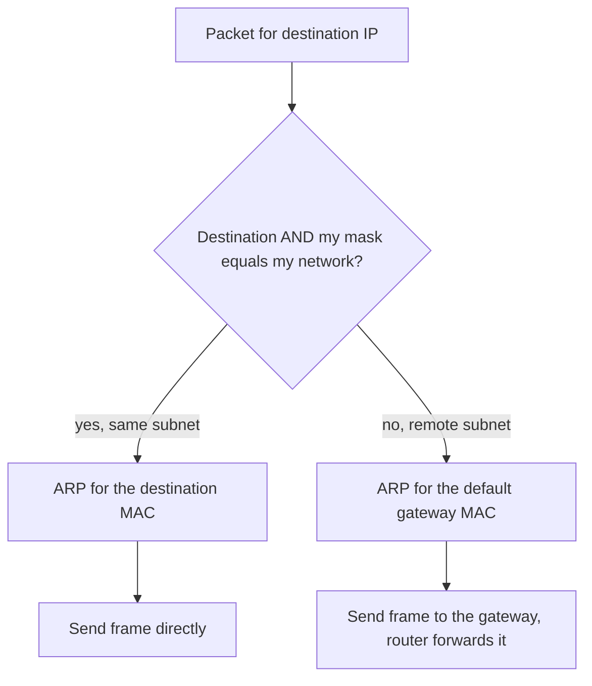
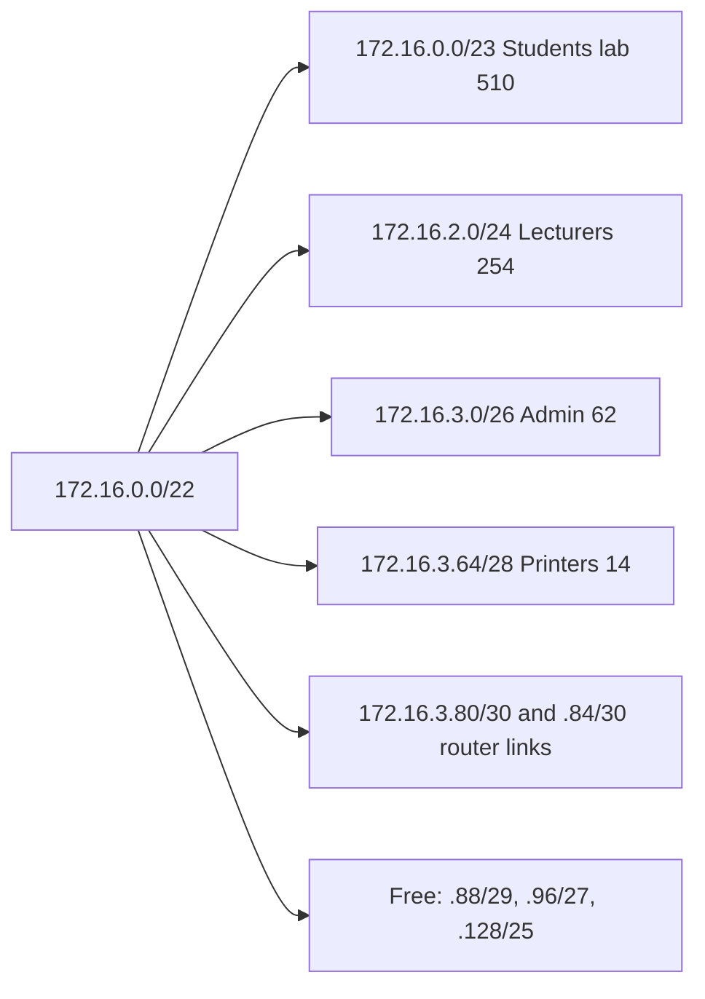
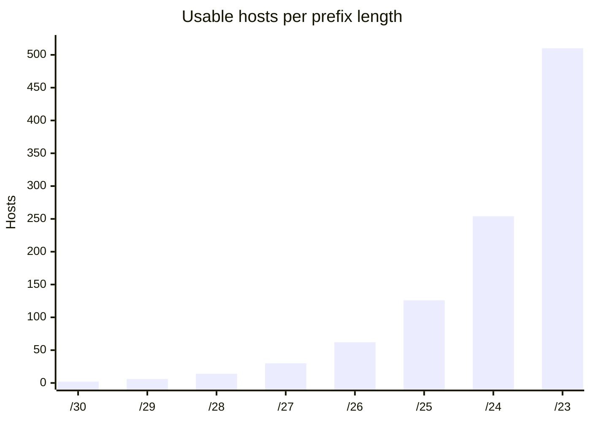

# Session 3: Types of Addresses: MAC, IP, Subnetting and CIDR

> [Cybersecurity and Digital Forensics](../../README.md) › [Term 1](../README.md) › [Module 4: Configuring Network Infrastructure](README.md) › **Session 3**

| ⏱ Estimated time | 📋 Prerequisites |
|---|---|
| 3 hours | Session 2 (layers: MAC at Layer 2, IP at Layer 3); binary-to-decimal conversion |

| ⬅ [Previous: Session 2](session-02-osi-and-tcpip-models.md) | [Next: Session 4](session-04-cisco-hardware-and-ios.md) ➡ |
|:---|---:|

[](https://colab.research.google.com/github/Hamnakhan123/Cybersecurity-and-Digital-Forensics/blob/main/term-1/04-configuring-network-infrastructure/code/session-03-mac-ip-subnetting-cidr.ipynb) &nbsp;Run every Python example of this session in the notebook [`code/session-03-mac-ip-subnetting-cidr.ipynb`](code/session-03-mac-ip-subnetting-cidr.ipynb).

---

## 🎯 Learning objectives

- Explain the **purpose and structure of MAC addresses**: OUI, NIC-specific part, unicast/multicast/broadcast, universal/local bits.
- Define an **IP address**, its network and host portions, and why it identifies a device *logically* across networks.
- Distinguish **public, private, loopback, APIPA and special** IPv4 addresses.
- **Subnet** an IPv4 block: mask, block size, network/broadcast addresses, usable host range.
- Design a **VLSM** plan and explain **CIDR** notation, **classless** addressing and **route summarisation**.

## 📖 Concepts

### 1. MAC addresses (Layer 2)

A **MAC address** is a 48-bit (6-byte) hardware address written in hexadecimal. It identifies a network interface **on the local link** only; routers replace the Layer 2 header at every hop.

| Notation | Example | Where you see it |
|---|---|---|
| Colon | `00:1A:2B:3C:4D:5E` | Linux, macOS |
| Hyphen | `00-1A-2B-3C-4D-5E` | Windows `ipconfig /all` |
| Dotted (Cisco) | `001a.2b3c.4d5e` | `show mac address-table` |

**Structure:** the first 3 bytes are the **OUI** (Organisationally Unique Identifier, assigned by the IEEE to a manufacturer); the last 3 bytes are assigned by the manufacturer to each NIC.

Two bits in the **first byte** carry meaning:

| Bit | 0 means | 1 means |
|---|---|---|
| Lowest bit (I/G) | **Unicast** – one interface | **Multicast** – a group (`01:00:5E…` for IPv4 multicast) |
| Second-lowest bit (U/L) | **Universally** administered (burned in) | **Locally** administered (set by software, VMs, privacy randomisation) |

`FF:FF:FF:FF:FF:FF` is the **broadcast** MAC: every device on the LAN processes the frame.

> **Analogy – MAC vs IP.** A MAC address is like your **CNIC number**: it stays with you but says nothing about where you live. An IP address is like your **postal address**: it changes when you move and it tells the postal network how to route mail to you.

Modern phones use **randomised (locally administered) MACs** per Wi-Fi network for privacy, so MAC-based tracking and some MAC filters no longer work reliably.

### 2. IP addresses (Layer 3)

An **IPv4 address** is 32 bits written as four decimal **octets** (`192.168.10.25`). Together with a **subnet mask** it splits into:

- **Network portion** – which network (like the street),
- **Host portion** – which device on that network (like the house number).

`192.168.10.25/24` → mask `255.255.255.0` → network `192.168.10.0`, host `.25`.

**Why IP addresses matter:** routers forward packets using only the network portion; hosts use the mask to decide "is the destination on my network (send directly via ARP) or elsewhere (send to my default gateway)?"

**Historic classes** (classful addressing, replaced by CIDR in 1993 but still used in conversation):

| Class | First octet | Default mask | Purpose |
|---|---|---|---|
| A | 1–126 | /8 | Very large networks |
| B | 128–191 | /16 | Medium |
| C | 192–223 | /24 | Small |
| D | 224–239 | – | Multicast |
| E | 240–255 | – | Experimental |

**Special ranges**

| Range | Meaning |
|---|---|
| `10.0.0.0/8`, `172.16.0.0/12`, `192.168.0.0/16` | **Private** (RFC 1918) – not routed on the internet; NAT translates them |
| `127.0.0.0/8` | **Loopback** – the device itself |
| `169.254.0.0/16` | **APIPA / link-local** – self-assigned when DHCP fails |
| `100.64.0.0/10` | Carrier-grade NAT (shared by ISPs) |
| `0.0.0.0/0` | Default route ("any network") |
| `192.0.2.0/24`, `198.51.100.0/24`, `203.0.113.0/24` | Documentation (safe for examples) |

### 3. Subnetting

**Subnetting** borrows host bits to make more, smaller networks. Benefits: smaller broadcast domains, better security boundaries (one subnet per VLAN), and less wasted address space.

Core formulas (h = host bits = 32 − prefix):

- **Usable hosts** = 2^h − 2 (network and broadcast addresses are reserved; /31 point-to-point and /32 host routes are exceptions)
- **Number of subnets** when borrowing n bits = 2^n
- **Block size** (magic number) = 256 − the mask value in the "interesting" octet

| Prefix | Mask | Block | Usable hosts |
|---|---|---|---|
| /24 | 255.255.255.0 | 256 | 254 |
| /25 | 255.255.255.128 | 128 | 126 |
| /26 | 255.255.255.192 | 64 | 62 |
| /27 | 255.255.255.224 | 32 | 30 |
| /28 | 255.255.255.240 | 16 | 14 |
| /29 | 255.255.255.248 | 8 | 6 |
| /30 | 255.255.255.252 | 4 | 2 |
| /23 | 255.255.254.0 | 2 (in 3rd octet) | 510 |
| /22 | 255.255.252.0 | 4 (in 3rd octet) | 1 022 |

**Four questions for any address** – e.g. `172.16.45.200/20`:
1. Interesting octet = 3rd (mask 240). Block = 256 − 240 = **16**.
2. Network: multiples of 16 in octet 3 → 32, **48** … 45 lies in 32–47 → network **172.16.32.0**.
3. Broadcast = next network − 1 = **172.16.47.255**.
4. Hosts **172.16.32.1 – 172.16.47.254** (4 094 usable).

### 4. VLSM and CIDR

**VLSM (Variable-Length Subnet Masking)** gives each segment a mask that fits *its* size: a /23 for a 400-PC lab, a /30 for a router link. Always allocate the **largest requirement first** so blocks stay aligned.

**CIDR (Classless Inter-Domain Routing)** removed the A/B/C boundaries:

- A prefix can be any length: `/22`, `/27`…, written in **slash notation**.
- ISPs hand out blocks that fit the customer (a /22 instead of a whole class B /16 with 65 534 hosts).
- Routers can **summarise** (aggregate, **supernet**) contiguous networks into one route: `10.20.8.0/24 … 10.20.15.0/24` → `10.20.8.0/21`. Smaller routing tables, faster lookups, and instability in one subnet is hidden from the rest of the network.

**Impact of CIDR:** it slowed IPv4 exhaustion dramatically and kept the internet's routing table manageable; together with NAT it bought time for IPv6 (Session 11).

## 🧭 Diagrams

**How a host decides where to send a packet**



**VLSM plan for 172.16.0.0/22 (from Example 2)**



## 🪜 Step-by-step: subnet 192.168.50.0/24 into 6 networks

1. Subnets needed = 6 → borrow **n = 3** bits (2³ = 8 ≥ 6).
2. New prefix = 24 + 3 = **/27**, mask **255.255.255.224**.
3. Block size = 256 − 224 = **32**.
4. Networks: .0, .32, .64, .96, .128, .160, .192, .224.
5. Each has 2⁵ − 2 = **30** usable hosts; broadcast = next network − 1.
6. First usable is usually the **gateway** (.1, .33, .65 …).

## 💻 Worked examples

### Example 1 – Anatomy of MAC addresses

📄 **`code/session-03_mac_tool.py`**

```python
"""Session 3 - MAC address anatomy: OUI, unicast/multicast and local/universal bits.

Reads a MAC in any common notation (colon, hyphen, Cisco dotted), normalises it,
splits the OUI from the device part, decodes the I/G and U/L bits, and builds
the modified EUI-64 interface ID that IPv6 SLAAC can derive from it.
The small OUI table is a sample for teaching, not a full vendor database.
Run:  python session-03_mac_tool.py
"""
import re

SAMPLE_OUI = {"00:50:56": "VMware", "00:1A:2B": "Example vendor (lab)",
              "3C:5A:B4": "Google", "00:00:0C": "Cisco"}


def normalise(mac: str) -> str:
    hexdigits = re.sub(r"[^0-9a-fA-F]", "", mac)
    if len(hexdigits) != 12:
        raise ValueError(f"{mac!r} is not a 48-bit MAC address")
    return ":".join(hexdigits[i:i + 2] for i in range(0, 12, 2)).upper()


def cisco_format(mac: str) -> str:
    h = normalise(mac).replace(":", "").lower()
    return f"{h[0:4]}.{h[4:8]}.{h[8:12]}"


def describe(mac: str) -> dict:
    m = normalise(mac)
    first = int(m[:2], 16)
    kind = "broadcast" if m == "FF:FF:FF:FF:FF:FF" else ("multicast" if first & 1 else "unicast")
    return {"mac": m, "cisco": cisco_format(m), "oui": m[:8], "nic": m[9:],
            "vendor": SAMPLE_OUI.get(m[:8], "not in sample table"), "type": kind,
            "admin": "locally administered" if first & 2 else "universally administered (burned-in)"}


def eui64(mac: str) -> str:
    """Modified EUI-64: insert FFFE in the middle and flip the U/L bit (bit 7 of byte 1)."""
    b = bytearray(int(x, 16) for x in normalise(mac).split(":"))
    b[0] ^= 0x02
    full = bytes(b[:3]) + b"\xff\xfe" + bytes(b[3:])
    return ":".join(full[i:i + 2].hex() for i in range(0, 8, 2))


if __name__ == "__main__":
    for raw in ["00-50-56-c0-00-08", "0000.0c9f.f00a", "01:00:5E:00:00:05",
                "ff:ff:ff:ff:ff:ff", "3c:5a:b4:12:34:56", "02:42:ac:11:00:02"]:
        d = describe(raw)
        print(f"{raw:20} -> {d['mac']}  ({d['cisco']})")
        print(f"   OUI {d['oui']} [{d['vendor']}], NIC part {d['nic']}, {d['type']}, {d['admin']}")
    print("\nModified EUI-64 interface ID for SLAAC")
    for raw in ["00:1A:2B:3C:4D:5E", "3c:5a:b4:12:34:56"]:
        print(f"  {normalise(raw)} -> {eui64(raw)}  -> fe80::{eui64(raw).lstrip('0')}")
```

**Output**

```text
00-50-56-c0-00-08    -> 00:50:56:C0:00:08  (0050.56c0.0008)
   OUI 00:50:56 [VMware], NIC part C0:00:08, unicast, universally administered (burned-in)
0000.0c9f.f00a       -> 00:00:0C:9F:F0:0A  (0000.0c9f.f00a)
   OUI 00:00:0C [Cisco], NIC part 9F:F0:0A, unicast, universally administered (burned-in)
01:00:5E:00:00:05    -> 01:00:5E:00:00:05  (0100.5e00.0005)
   OUI 01:00:5E [not in sample table], NIC part 00:00:05, multicast, universally administered (burned-in)
ff:ff:ff:ff:ff:ff    -> FF:FF:FF:FF:FF:FF  (ffff.ffff.ffff)
   OUI FF:FF:FF [not in sample table], NIC part FF:FF:FF, broadcast, locally administered
3c:5a:b4:12:34:56    -> 3C:5A:B4:12:34:56  (3c5a.b412.3456)
   OUI 3C:5A:B4 [Google], NIC part 12:34:56, unicast, universally administered (burned-in)
02:42:ac:11:00:02    -> 02:42:AC:11:00:02  (0242.ac11.0002)
   OUI 02:42:AC [not in sample table], NIC part 11:00:02, unicast, locally administered

Modified EUI-64 interface ID for SLAAC
  00:1A:2B:3C:4D:5E -> 021a:2bff:fe3c:4d5e  -> fe80::21a:2bff:fe3c:4d5e
  3C:5A:B4:12:34:56 -> 3e5a:b4ff:fe12:3456  -> fe80::3e5a:b4ff:fe12:3456
```
**Observe:** `01:00:5E…` has the lowest bit set (multicast); `02:42:AC…` (a Docker container) has the U/L bit set (locally administered). The EUI-64 output previews Session 11: IPv6 can build an interface ID from a MAC by inserting `FFFE` and flipping the U/L bit.

### Example 2 – Fixed subnets, VLSM and CIDR summarisation

📄 **`code/session-03_cidr_planner.py`**

```python
"""Session 3 - Subnetting, VLSM and CIDR summarisation with the ipaddress module.

1. Fixed-length subnetting: split a /24 into equal subnets.
2. VLSM: give each department the smallest subnet that fits, largest first.
3. CIDR: summarise contiguous routes into one supernet (route aggregation).
Run:  python session-03_cidr_planner.py
"""
import ipaddress
import math


def fixed_subnets(block, count):
    net = ipaddress.ip_network(block)
    extra_bits = math.ceil(math.log2(count))
    return list(net.subnets(prefixlen_diff=extra_bits))


def prefix_for(hosts):
    """Smallest prefix whose usable hosts (2^h - 2) fit the requirement."""
    h = math.ceil(math.log2(hosts + 2))
    return 32 - h


def vlsm(block, needs):
    """Allocate largest requirement first from the lowest free block that fits."""
    free = [ipaddress.ip_network(block)]
    plan = []
    for name, hosts in sorted(needs, key=lambda x: -x[1]):
        p = prefix_for(hosts)
        candidates = sorted((f for f in free if f.prefixlen <= p), key=lambda n: int(n.network_address))
        if not candidates:
            raise ValueError(f"no space left for {name}")
        block_ = candidates[0]
        chosen = next(block_.subnets(new_prefix=p))          # first subnet of that size
        free.remove(block_)
        free.extend(block_.address_exclude(chosen))          # give the rest back
        plan.append((name, hosts, chosen))
    return plan, sorted(free, key=lambda n: int(n.network_address))


if __name__ == "__main__":
    print("1) 192.168.50.0/24 split into 6 equal subnets (needs 3 borrowed bits -> 8 subnets)")
    for s in fixed_subnets("192.168.50.0/24", 6):
        h = list(s.hosts())
        print(f"   {str(s):18} hosts {h[0]} - {h[-1]}  broadcast {s.broadcast_address}  ({len(h)} usable)")

    print("\n2) VLSM plan for 172.16.0.0/22")
    needs = [("Lecturers", 200), ("Students lab", 400), ("Admin office", 50),
             ("Printers", 10), ("R1-R2 link", 2), ("R1-R3 link", 2)]
    plan, free = vlsm("172.16.0.0/22", needs)
    print(f"   {'Segment':14} {'Need':>5}  {'Subnet':18} {'Mask':16} {'Usable':>6}  Gateway")
    for name, hosts, net in plan:
        print(f"   {name:14} {hosts:>5}  {str(net):18} {str(net.netmask):16} {net.num_addresses - 2:>6}  {net.network_address + 1}")
    print("   Unused blocks:", ", ".join(map(str, free)))

    print("\n3) CIDR summarisation (what a router can advertise as one route)")
    routes = [ipaddress.ip_network(f"10.20.{i}.0/24") for i in range(8, 16)]
    print("   Branch routes:", ", ".join(str(r) for r in routes[:3]), "...", routes[-1])
    print("   Summary      :", ", ".join(str(n) for n in ipaddress.collapse_addresses(routes)))
    odd = [ipaddress.ip_network(n) for n in ("10.20.8.0/24", "10.20.9.0/24", "10.20.11.0/24")]
    print("   Non-contiguous", [str(n) for n in odd], "->", [str(n) for n in ipaddress.collapse_addresses(odd)])
    print("   Classful view of 172.16.0.0/22: a class B /16 would waste",
          65_534 - 1_022, "addresses compared with CIDR /22")
```

**Output**

```text
1) 192.168.50.0/24 split into 6 equal subnets (needs 3 borrowed bits -> 8 subnets)
   192.168.50.0/27    hosts 192.168.50.1 - 192.168.50.30  broadcast 192.168.50.31  (30 usable)
   192.168.50.32/27   hosts 192.168.50.33 - 192.168.50.62  broadcast 192.168.50.63  (30 usable)
   192.168.50.64/27   hosts 192.168.50.65 - 192.168.50.94  broadcast 192.168.50.95  (30 usable)
   192.168.50.96/27   hosts 192.168.50.97 - 192.168.50.126  broadcast 192.168.50.127  (30 usable)
   192.168.50.128/27  hosts 192.168.50.129 - 192.168.50.158  broadcast 192.168.50.159  (30 usable)
   192.168.50.160/27  hosts 192.168.50.161 - 192.168.50.190  broadcast 192.168.50.191  (30 usable)
   192.168.50.192/27  hosts 192.168.50.193 - 192.168.50.222  broadcast 192.168.50.223  (30 usable)
   192.168.50.224/27  hosts 192.168.50.225 - 192.168.50.254  broadcast 192.168.50.255  (30 usable)

2) VLSM plan for 172.16.0.0/22
   Segment         Need  Subnet             Mask             Usable  Gateway
   Students lab     400  172.16.0.0/23      255.255.254.0       510  172.16.0.1
   Lecturers        200  172.16.2.0/24      255.255.255.0       254  172.16.2.1
   Admin office      50  172.16.3.0/26      255.255.255.192      62  172.16.3.1
   Printers          10  172.16.3.64/28     255.255.255.240      14  172.16.3.65
   R1-R2 link         2  172.16.3.80/30     255.255.255.252       2  172.16.3.81
   R1-R3 link         2  172.16.3.84/30     255.255.255.252       2  172.16.3.85
   Unused blocks: 172.16.3.88/29, 172.16.3.96/27, 172.16.3.128/25

3) CIDR summarisation (what a router can advertise as one route)
   Branch routes: 10.20.8.0/24, 10.20.9.0/24, 10.20.10.0/24 ... 10.20.15.0/24
   Summary      : 10.20.8.0/21
   Non-contiguous ['10.20.8.0/24', '10.20.9.0/24', '10.20.11.0/24'] -> ['10.20.8.0/23', '10.20.11.0/24']
   Classful view of 172.16.0.0/22: a class B /16 would waste 64512 addresses compared with CIDR /22
```
**Observe:**
- Fixed-length subnetting gives 8 equal /27s – fine when every segment is similar in size.
- VLSM fits six very different segments into one /22 and still leaves 168 addresses free.
- Eight /24 branch routes collapse into a single `/21` advertisement; a gap (missing `10.20.10.0/24`) prevents full summarisation.

### Example 3 – Binary AND by hand

Find the network of `10.4.77.130/26`:

```text
IP      130 = 1000 0010
Mask    192 = 1100 0000
AND         = 1000 0000 = 128   -> network 10.4.77.128/26
Broadcast: host bits all 1 -> 1011 1111 = 191 -> 10.4.77.191
Usable: 10.4.77.129 - 10.4.77.190 (62 hosts)
```

## 📊 Chart



## 🏢 Real-life problem with full solution

**Scenario.** A university receives `10.80.0.0/22` for a new building. It needs: Labs 450 hosts, Lecturers 100, Library Wi-Fi 200, CCTV 25, two point-to-point router links. Management also wants to know which single route to advertise to the main campus.

**Solution (largest first):**

| Segment | Hosts | Prefix | Subnet | Gateway | Broadcast |
|---|---|---|---|---|---|
| Labs | 450 | /23 (510) | 10.80.0.0/23 | 10.80.0.1 | 10.80.1.255 |
| Library Wi-Fi | 200 | /24 (254) | 10.80.2.0/24 | 10.80.2.1 | 10.80.2.255 |
| Lecturers | 100 | /25 (126) | 10.80.3.0/25 | 10.80.3.1 | 10.80.3.127 |
| CCTV | 25 | /27 (30) | 10.80.3.128/27 | 10.80.3.129 | 10.80.3.159 |
| Link 1 | 2 | /30 | 10.80.3.160/30 | .161 / .162 | .163 |
| Link 2 | 2 | /30 | 10.80.3.164/30 | .165 / .166 | .167 |

- Free space: `10.80.3.168/29`, `10.80.3.176/28`, `10.80.3.192/26` (88 addresses for growth).
- The building advertises **one summary: `10.80.0.0/22`**.
- Verify with Python: `ipaddress.ip_network("10.80.3.128/27").overlaps(ipaddress.ip_network("10.80.3.0/25"))` → `False`.

## ⚠️ Common mistakes

- Using 2^h instead of 2^h − 2 for usable hosts.
- Allocating small subnets first in VLSM, leaving no aligned space for large ones.
- Assigning the network or broadcast address to a host.
- Thinking a MAC address can be used to route across the internet.
- Mixing up mask (`255.255.255.0`) and wildcard (`0.0.0.255`, used in ACLs and OSPF).
- Summarising non-contiguous networks into one route – this attracts traffic for networks you do not have.

## ✅ Best practices

- Keep an **IP address management (IPAM)** sheet: subnet, VLAN, gateway, DHCP range, owner.
- Use a consistent scheme: gateway = first usable, servers = low static range, DHCP = the rest.
- Plan each site as a contiguous block that summarises cleanly.
- Leave 20–30% growth room in each subnet.
- Use documentation ranges (`192.0.2.0/24`, `2001:db8::/32`) in examples and diagrams.

## 🧪 Lab / practice tasks

1. **Easy –** For `00:00:0C:12:34:56`, identify the OUI, the NIC part, and whether it is unicast or multicast.
2. **Easy –** How many usable hosts are in a /21? What is its mask?
3. **Medium –** Find network, broadcast and host range of `192.168.37.77/29` and `10.10.130.5/18`.
4. **Medium –** Summarise `172.20.16.0/24`, `172.20.17.0/24`, `172.20.18.0/24`, `172.20.19.0/24`.
5. **Challenge –** Extend `session-03_cidr_planner.py` so `vlsm()` also prints the **DHCP range** for each segment (first 10 addresses after the gateway reserved for static devices) and refuses a plan where any segment would be more than 90% full.

<details>
<summary>💡 Hints</summary>

- Task 3: block for /29 = 8; /18 has its interesting octet in the 3rd octet with block 64.
- Task 4: four contiguous /24s starting at a multiple of 4 → one /22.
- Task 5: `list(net.hosts())[11]` is the first DHCP address; compare `hosts / (2**(32-prefix) - 2)`.
</details>

<details>
<summary>✅ Solutions</summary>

**Task 1:** OUI `00:00:0C` (Cisco), NIC part `12:34:56`, first byte `00` → unicast, universally administered.

**Task 2:** 2¹¹ − 2 = **2 046** hosts, mask **255.255.248.0**.

**Task 3:** `192.168.37.77/29` → network .72, broadcast .79, hosts .73–.78. `10.10.130.5/18` → network 10.10.128.0, broadcast 10.10.191.255, hosts 10.10.128.1 – 10.10.191.254.

**Task 4:** `172.20.16.0/22`.

**Task 5 (core lines):**

```python
for name, hosts, net in plan:
    h = list(net.hosts())
    if hosts / len(h) > 0.9:
        raise ValueError(f"{name} would be {hosts / len(h):.0%} full")
    print(name, "DHCP", h[11], "-", h[-1])
```
</details>

## ✅ Quick quiz

1. How many bits are in a MAC address? a) 32 b) 48 c) 64 d) 128
2. Which address is private? a) 172.32.1.1 b) 172.20.1.1 c) 11.0.0.1 d) 193.168.1.1
3. Usable hosts in a /26: a) 64 b) 62 c) 30 d) 126
4. The broadcast address of 192.168.1.64/27 is: a) 192.168.1.95 b) 192.168.1.127 c) 192.168.1.63 d) 192.168.1.96
5. `10.20.8.0/24` to `10.20.15.0/24` summarise to: a) 10.20.0.0/16 b) 10.20.8.0/21 c) 10.20.8.0/22 d) 10.20.8.0/20

<details>
<summary>Show answers</summary>

1 – b · 2 – b · 3 – b · 4 – a · 5 – b
</details>

## 📝 Summary / cheat-sheet

- MAC: 48-bit, OUI + NIC, I/G bit (multicast), U/L bit (local), `ffff.ffff.ffff` broadcast, local link only.
- IPv4: 32-bit, network + host portions, mask decides the split.
- Private 10/8, 172.16/12, 192.168/16 · loopback 127/8 · APIPA 169.254/16.
- Hosts = 2^h − 2 · block = 256 − mask octet · network = IP AND mask · broadcast = next network − 1.
- VLSM: largest first. CIDR: any prefix length, summarise contiguous blocks.

**Interview / viva questions**

1. Why does a frame's MAC address change at every router hop but the IP address does not?
2. What is an OUI?
3. A PC shows 169.254.10.4. What does that tell you?
4. Explain subnetting and give two benefits.
5. What is the difference between VLSM and CIDR?
6. Why is route summarisation useful, and when is it dangerous?

---

| ⬅ [Previous: Session 2](session-02-osi-and-tcpip-models.md) | [Next: Session 4](session-04-cisco-hardware-and-ios.md) ➡ |
|:---|---:|

<sub>Prepared by **Hamna Zahid Khan**, Junior Lecturer · Cybersecurity and Digital Forensics</sub>
