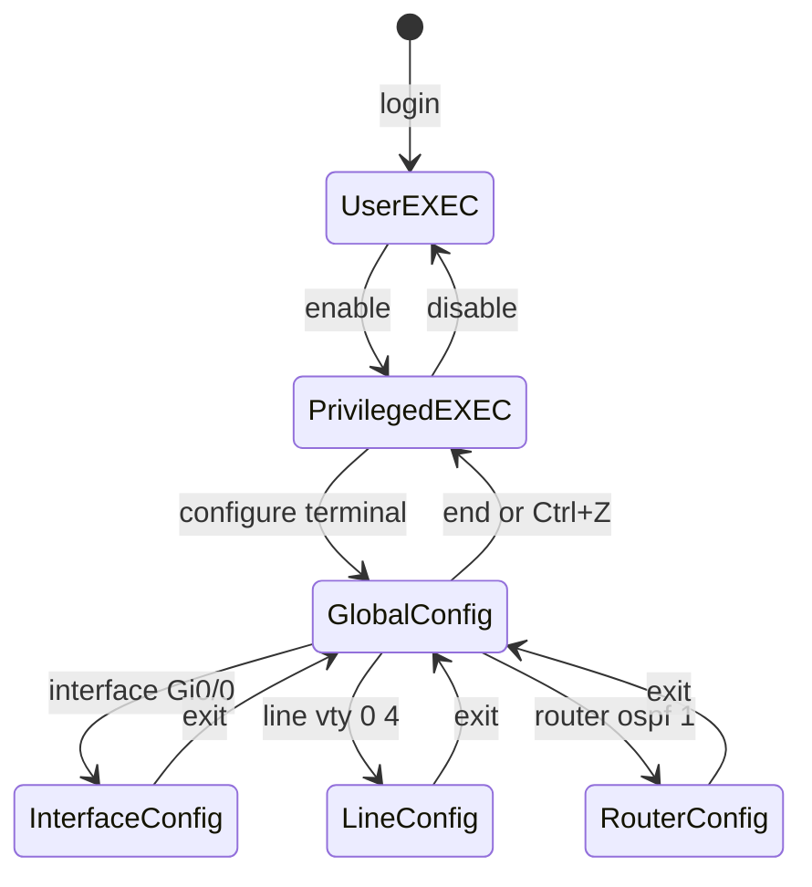
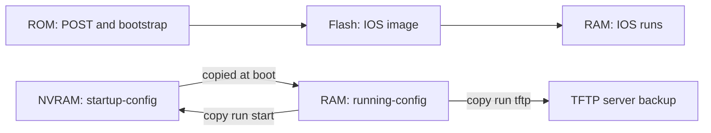
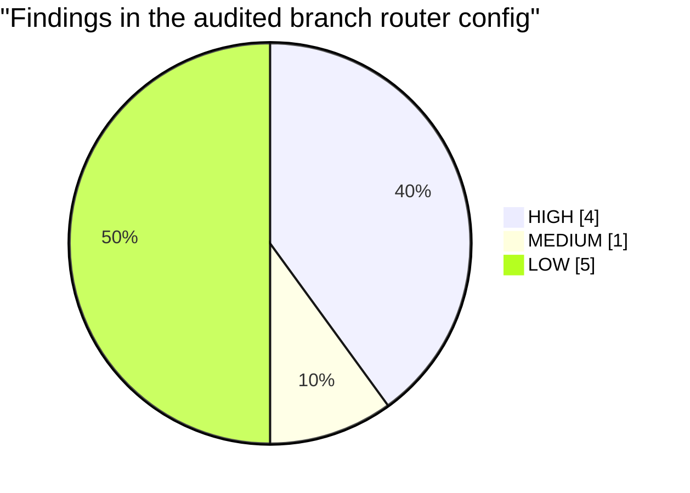

# Session 4: Hardware and Software of Cisco Devices

> [Cybersecurity and Digital Forensics](../../README.md) › [Term 1](../README.md) › [Module 4: Configuring Network Infrastructure](README.md) › **Session 4**

| ⏱ Estimated time | 📋 Prerequisites |
|---|---|
| 3 hours | Sessions 1–3; Cisco Packet Tracer installed (free with a Cisco Networking Academy account) |

| ⬅ [Previous: Session 3](session-03-mac-ip-subnetting-cidr.md) | [Next: Session 5](session-05-switching-and-vlans.md) ➡ |
|:---|---:|

[](https://colab.research.google.com/github/Hamnakhan123/Cybersecurity-and-Digital-Forensics/blob/main/term-1/04-configuring-network-infrastructure/code/session-04-cisco-hardware-and-ios.ipynb) &nbsp;Run every Python example of this session in the notebook [`code/session-04-cisco-hardware-and-ios.ipynb`](code/session-04-cisco-hardware-and-ios.ipynb).

---

## 🎯 Learning objectives

- Identify the **hardware components** of Cisco routers and switches: CPU, RAM, NVRAM, flash, ROM, interfaces, console and power.
- Explain the **boot sequence** and where the IOS image and configurations are stored.
- Describe **Cisco IOS**: its features, command modes, help system and shortcuts.
- Configure a device's **clock, hostname, passwords, banner and interfaces**, save the configuration, and enable **SSH**.
- Read a running configuration and **audit** it for common weaknesses.

## 📖 Concepts

### 1. Hardware inside a router or switch

A router or switch is a specialised computer.

| Component | What it stores / does | Survives a reboot? |
|---|---|---|
| **CPU** | Runs IOS, routing protocols, management | – |
| **RAM** (DRAM) | **running-config**, routing/ARP/MAC tables, packet buffers, running IOS | ❌ No |
| **NVRAM** | **startup-config** (loaded at boot) | ✅ Yes |
| **Flash** | **IOS image** files (and on switches `vlan.dat`) | ✅ Yes |
| **ROM** | Bootstrap program, **POST**, ROMMON (recovery mode) | ✅ Yes |
| **ASICs / TCAM** (switches) | Hardware forwarding at line rate (MAC/FIB/ACL lookups) | – |

**Interfaces and ports**

| Port | Purpose |
|---|---|
| **Console** (RJ45 or USB) | Out-of-band local management with a rollover/USB cable; 9600 baud, 8-N-1 |
| **AUX** (older routers) | Remote dial-in modem management |
| **Management Ethernet** | Dedicated out-of-band management network |
| **LAN/WAN interfaces** | FastEthernet (Fa, 100 Mbps), GigabitEthernet (Gi, 1 Gbps), TenGigabitEthernet (Te), **SFP/SFP+** slots for fibre or copper modules, serial (old WAN) |

Interface names follow `type slot/subslot/port`, e.g. `GigabitEthernet0/0/1` or `Gi1/0/24` (switch 1 in a stack, module 0, port 24).

**Router vs switch defaults:** router interfaces are **shut down** by default and need `no shutdown`; switch ports are **up** by default, all in **VLAN 1**.

### 2. The boot sequence

```text
1. POST (from ROM)  ->  hardware self-test
2. Bootstrap (ROM)  ->  find the IOS image (flash by default, else TFTP, else ROMMON)
3. Load IOS into RAM
4. Look for startup-config in NVRAM -> copy it into RAM as running-config
   (none found -> "System Configuration Dialog" / setup mode)
```

The **configuration register** (`0x2102` normal) controls this; `0x2142` tells the router to **ignore** NVRAM – used for password recovery with physical access, which is why console ports must be **physically secured**.

### 3. Cisco IOS – the Internetwork Operating System

IOS (and its modern versions **IOS-XE**, **IOS-XR**, **NX-OS**) is the software that runs Cisco routers and switches. Features: routing protocols, switching, security (ACLs, AAA, SSH), QoS, NAT, VPN, monitoring (SNMP, syslog, NetFlow) – all through one **command-line interface (CLI)**.

**Command modes**

| Mode | Prompt | Enter with | Typical use |
|---|---|---|---|
| User EXEC | `R1>` | log in | Basic `ping`, `show` (limited) |
| Privileged EXEC | `R1#` | `enable` | All `show`, `debug`, `copy`, `reload`, `clock set` |
| Global configuration | `R1(config)#` | `configure terminal` | Device-wide settings: hostname, passwords |
| Interface config | `R1(config-if)#` | `interface Gi0/0` | IP address, description, `shutdown` |
| Line config | `R1(config-line)#` | `line console 0` / `line vty 0 4` | Console and remote access settings |
| Router config | `R1(config-router)#` | `router ospf 1` | Routing protocol settings |

`exit` goes up one level; `end` or **Ctrl+Z** returns to privileged EXEC.

> **Analogy – a building's security levels.** User EXEC is the reception lobby (you can look around), privileged EXEC is the staff area (you can see everything), global configuration is the facilities office where you change the building itself, and interface/line modes are individual rooms.

**Help and shortcuts**

| Key / command | Effect |
|---|---|
| `?` | Lists commands or the next keyword (`show ?`, `sh?`) |
| **Tab** | Completes a command (`conf` + Tab → `configure`) |
| Abbreviations | `sh ip int br` = `show ip interface brief` |
| **↑ / Ctrl+P** | Previous command (history) |
| **Ctrl+Shift+6** | Break out of a running ping/traceroute |
| `do` | Run an EXEC command from config mode (`do show run`) |
| `| include`, `| section` | Filter output (`show run | section line`) |
| `no` | Removes/negates a command (`no shutdown`) |

### 4. Configurations and saving

- **running-config** (RAM) – active now, lost on reboot.
- **startup-config** (NVRAM) – loaded at boot.
- Save: `copy running-config startup-config` (or the older `write memory`).
- Erase: `erase startup-config` then `reload` → factory state.
- Back up to a server: `copy running-config tftp:` (Session 9).

### 5. Basic secure configuration

| Task | Command(s) |
|---|---|
| Hostname | `hostname R1` |
| Clock | `clock set 09:30:00 26 Oct 2026` (privileged EXEC), `clock timezone PKT 5` – later replaced by NTP |
| Privileged password | `enable secret <strong>` (hashed). Avoid `enable password` (weak) |
| Console | `line console 0` → `password`, `login`, `exec-timeout`, `logging synchronous` |
| Encrypt line passwords | `service password-encryption` (type 7, weak but hides shoulder-surfing) |
| Banner | `banner motd # Authorised access only #` (legal warning) |
| Interface | `interface Gi0/0` → `description`, `ip address`, `no shutdown` |
| Switch management IP | `interface vlan 1` (better: a management VLAN) + `ip default-gateway` |
| SSH | `ip domain-name`, `username … secret`, `crypto key generate rsa modulus 2048`, `ip ssh version 2`, `line vty 0 4` → `login local`, `transport input ssh` |

## 🧭 Diagrams

**IOS command modes**



**Boot sequence and memory**



## 🪜 Step-by-step: first configuration in Packet Tracer

1. Place a **2911 router**, a **2960 switch** and a **PC**. Cable PC → switch Fa0/1 (straight-through), switch Gi0/1 → router Gi0/0.
2. Connect a **console cable** from the PC's RS-232 to the router console; open **Desktop → Terminal**.
3. Answer `no` to the initial configuration dialog.
4. Type the configuration below (comments after `!` are ignored).
5. Set the PC's IP to `192.168.10.10/24`, gateway `192.168.10.1`.
6. Verify with `show ip interface brief`, `ping 192.168.10.10` from the router, then **SSH from the PC**: `ssh -l admin 192.168.10.1`.
7. Save: `copy running-config startup-config`; `reload` and confirm the configuration survives.

📄 **`code/session-04_first_config.ios`**

```text
! Session 4 - First configuration of a Cisco switch/router (Cisco Packet Tracer lab)
! Topology: PC1 -- Fa0/1 [SW1] Gi0/1 -- Gi0/0 [R1]
! Type line by line. Text after "!" is a comment and is ignored by IOS.

enable                                    ! user EXEC (R1>)  ->  privileged EXEC (R1#)
clock set 09:30:00 26 Oct 2026            ! set the software clock (privileged EXEC, not config mode)
configure terminal                        ! -> global configuration mode R1(config)#
 hostname R1                              ! prompt changes to R1(config)#
 no ip domain-lookup                      ! a mistyped command is not treated as a host name to resolve
 clock timezone PKT 5                     ! Pakistan Standard Time, UTC+5
 enable secret Lab@Secret2026             ! privileged-mode password, stored as a strong hash
 service password-encryption              ! hides type-7 line passwords in the config (weak, but better than clear text)
 banner motd # Authorised access only. Activity is logged. #
 !
 ! ----- interfaces -----
 interface GigabitEthernet0/0
  description LINK-TO-SW1
  ip address 192.168.10.1 255.255.255.0
  no shutdown                             ! router interfaces are shut down by default
 exit
 interface GigabitEthernet0/1
  description LINK-TO-ISP-LAB
  ip address 203.0.113.2 255.255.255.252
  no shutdown
 exit
 !
 ! ----- console and remote access -----
 line console 0
  password Console@2026
  login
  logging synchronous                     ! log messages do not break the line you are typing
  exec-timeout 10 0                       ! log out after 10 idle minutes
 exit
 ip domain-name lab.local
 username admin privilege 15 secret Admin@2026
 crypto key generate rsa modulus 2048     ! needed before SSH can start
 ip ssh version 2
 line vty 0 4
  login local
  transport input ssh                     ! SSH only, Telnet is refused
  exec-timeout 10 0
 exit
end
copy running-config startup-config        ! save: RAM (running) -> NVRAM (startup)

! ----- verify -----
! show clock                  show version            show running-config
! show ip interface brief     show interfaces Gi0/0   show startup-config
! show flash:                 show history            show ip ssh
```
**Expected verification output (excerpt):**

```text
R1#show ip interface brief
Interface              IP-Address      OK? Method Status                Protocol
GigabitEthernet0/0     192.168.10.1    YES manual up                    up
GigabitEthernet0/1     203.0.113.2     YES manual up                    down
GigabitEthernet0/2     unassigned      YES unset  administratively down down

R1#show clock
09:31:12.417 PKT Mon Oct 26 2026
```

`up/down` on Gi0/1 means the interface is enabled but nothing is connected (Layer 1/2 down). `administratively down` means someone typed (or never undid) `shutdown`.

## 💻 Worked examples

### Example 1 – Audit a saved running-config

A branch router's configuration was copied from a technician's laptop. The script parses it and lists every problem with its fix.

📄 **`code/session-04_running-config.txt`**

```text
hostname Branch-RTR
!
enable password cisco
!
interface GigabitEthernet0/0
 description LAN
 ip address 10.10.10.1 255.255.255.0
!
interface GigabitEthernet0/1
 ip address 198.51.100.6 255.255.255.252
 shutdown
!
ip http server
!
line con 0
 password cisco
 login
line vty 0 4
 password cisco
 login
 transport input telnet ssh
!
end
```
📄 **`code/session-04_config_audit.py`**

```python
"""Session 4 - Read a Cisco IOS running-config and audit it like an engineer.

Parses hostname, interfaces (address, status, description) and line settings
from a saved configuration file, then flags common security and hygiene
problems with the IOS command that fixes each one. Works on text only; it
never connects to a device.
Run:  python session-04_config_audit.py
"""
import re

def load_text(name):
    """Read a data file next to this script; on Colab, fetch it from the course repo."""
    try:
        return open(name).read()
    except FileNotFoundError:
        import urllib.request
        url = ("https://raw.githubusercontent.com/Hamnakhan123/Cybersecurity-and-Digital-Forensics/"
               "main/term-1/04-configuring-network-infrastructure/code/" + name)
        return urllib.request.urlopen(url).read().decode()


def parse(text):
    cfg = {"hostname": None, "interfaces": {}, "lines": {}, "globals": []}
    section = None
    for raw in text.splitlines():
        line = raw.rstrip()
        if not line or line.startswith("!"):
            section = None if line.startswith("!") else section
            continue
        if not line.startswith(" "):                  # a new top-level command
            section = None
            if line.startswith("hostname "):
                cfg["hostname"] = line.split()[1]
            elif line.startswith("interface "):
                section = ("if", line.split()[1])
                cfg["interfaces"][section[1]] = {"ip": None, "shutdown": False, "description": ""}
            elif line.startswith("line "):
                section = ("line", " ".join(line.split()[1:]))
                cfg["lines"][section[1]] = []
            else:
                cfg["globals"].append(line)
        elif section and section[0] == "if":
            sub = line.strip(); intf = cfg["interfaces"][section[1]]
            if sub.startswith("ip address "):
                intf["ip"] = " ".join(sub.split()[2:4])
            elif sub == "shutdown":
                intf["shutdown"] = True
            elif sub.startswith("description "):
                intf["description"] = sub[12:]
        elif section and section[0] == "line":
            cfg["lines"][section[1]].append(line.strip())
    return cfg


def audit(cfg):
    g = cfg["globals"]
    findings = []
    if any(x.startswith("enable password") for x in g) and not any(x.startswith("enable secret") for x in g):
        findings.append(("HIGH", "enable password stored weakly", "enable secret <strong-password>"))
    if "ip http server" in g:
        findings.append(("MEDIUM", "HTTP management server is on", "no ip http server"))
    if not any(x.startswith("banner") for x in g):
        findings.append(("LOW", "no login banner", "banner motd # Authorised access only #"))
    if "service password-encryption" not in g:
        findings.append(("LOW", "line passwords visible in clear text", "service password-encryption"))
    for name, cmds in cfg["lines"].items():
        if any("telnet" in c for c in cmds if c.startswith("transport input")):
            findings.append(("HIGH", f"line {name} accepts Telnet (clear text)", "transport input ssh"))
        if any(c.startswith("password cisco") for c in cmds):
            findings.append(("HIGH", f"line {name} uses a default password", "username admin secret ... + login local"))
        if not any(c.startswith("exec-timeout") for c in cmds):
            findings.append(("LOW", f"line {name} has no idle timeout", "exec-timeout 10 0"))
    for name, i in cfg["interfaces"].items():
        if not i["description"]:
            findings.append(("LOW", f"{name} has no description", "description <purpose>"))
    return findings


if __name__ == "__main__":
    cfg = parse(load_text("session-04_running-config.txt"))
    print(f"Device: {cfg['hostname']}")
    print(f"{'Interface':22} {'IP address / mask':32} {'Status':22} Description")
    for name, i in cfg["interfaces"].items():
        status = "administratively down" if i["shutdown"] else "enabled"
        print(f"{name:22} {i['ip'] or 'unassigned':32} {status:22} {i['description']}")
    findings = audit(cfg)
    order = {"HIGH": 0, "MEDIUM": 1, "LOW": 2}
    print(f"\n{len(findings)} findings")
    for sev, what, fix in sorted(findings, key=lambda f: order[f[0]]):
        print(f"  [{sev:6}] {what:42} fix: {fix}")
```

**Output**

```text
Device: Branch-RTR
Interface              IP address / mask                Status                 Description
GigabitEthernet0/0     10.10.10.1 255.255.255.0         enabled                LAN
GigabitEthernet0/1     198.51.100.6 255.255.255.252     administratively down  

10 findings
  [HIGH  ] enable password stored weakly              fix: enable secret <strong-password>
  [HIGH  ] line con 0 uses a default password         fix: username admin secret ... + login local
  [HIGH  ] line vty 0 4 accepts Telnet (clear text)   fix: transport input ssh
  [HIGH  ] line vty 0 4 uses a default password       fix: username admin secret ... + login local
  [MEDIUM] HTTP management server is on               fix: no ip http server
  [LOW   ] no login banner                            fix: banner motd # Authorised access only #
  [LOW   ] line passwords visible in clear text       fix: service password-encryption
  [LOW   ] line con 0 has no idle timeout             fix: exec-timeout 10 0
  [LOW   ] line vty 0 4 has no idle timeout           fix: exec-timeout 10 0
  [LOW   ] GigabitEthernet0/1 has no description      fix: description <purpose>
```
**Observe:** the device "works", yet it has a weak enable password, the default password `cisco` on console and VTY, Telnet allowed, the web server on and no timeouts. Each finding maps to one command from the table in Concept 5.

### Example 2 – Reading `show version` (hand interpretation)

```text
Cisco IOS Software, C2900 Software (C2900-UNIVERSALK9-M), Version 15.7(3)M8
ROM: System Bootstrap, Version 15.0(1r)M15
R1 uptime is 2 weeks, 3 days, 4 hours
System image file is "flash0:c2900-universalk9-mz.SPA.157-3.M8.bin"
Cisco CISCO2911/K9 ... with 491520K/32768K bytes of memory.
3 Gigabit Ethernet interfaces
255K bytes of non-volatile configuration memory.
250880K bytes of ATA System CompactFlash 0 (Read/Write)
Configuration register is 0x2102
```

| Line | Meaning |
|---|---|
| Version 15.7(3)M8 | IOS release – check it against vendor security advisories |
| uptime 2 weeks | No unplanned reboot recently |
| System image file | IOS loaded from **flash** |
| 491520K/32768K memory | RAM (main / I/O) |
| 255K non-volatile | **NVRAM** size (startup-config) |
| CompactFlash 250 MB | **Flash** size (IOS images) |
| 0x2102 | Normal boot; reads startup-config |

## 📊 Chart

| Command | Shows | When to use |
|---|---|---|
| `show running-config` | Active config | After every change |
| `show startup-config` | Saved config | Before a reboot |
| `show ip interface brief` | Interfaces, IPs, status | First check on any device |
| `show interfaces Gi0/0` | Counters, errors, duplex | Performance / cabling problems |
| `show version` | IOS, uptime, memory, register | Inventory, upgrades |
| `show flash:` | Files in flash | Before an upgrade |
| `show clock` | Time | Before reading logs |
| `show history` | Last commands | Retrace your steps |



## 🏢 Real-life problem with full solution

**Scenario.** A new switch is delivered to a computer lab. The junior technician plugged it in, users are working, and nobody configured anything. The IT manager asks you to bring it to the department's baseline before the next exam week.

**Solution – baseline checklist with commands:**

1. **Identity:** `hostname LAB2-SW1`, interface descriptions on uplinks.
2. **Time:** `clock timezone PKT 5`; NTP to the core switch (Session 9). Logs are useless without correct time.
3. **Access control:** `enable secret`, local user with `secret`, console `login local` + `exec-timeout 10 0`.
4. **Remote management:** management VLAN 99 SVI with an IP, `ip default-gateway`, RSA 2048 keys, `ip ssh version 2`, `transport input ssh` on VTY, VTY ACL (Session 10).
5. **Reduce attack surface:** `no ip http server`, `no ip http secure-server` (unless used), `no cdp run` on user-facing ports (`no cdp enable` per interface).
6. **Banner:** legal warning in `banner motd`.
7. **Unused ports:** `shutdown` and move to an unused VLAN.
8. **Save and back up:** `copy run start`, `copy run tftp:`.
9. **Verify:** SSH from the admin PC works, Telnet is refused, `show run` passes the audit script with no HIGH findings.

## ⚠️ Common mistakes

- Forgetting `no shutdown` on router interfaces.
- Not saving (`copy run start`) – the work disappears after a power cut.
- Using `enable password` instead of `enable secret`.
- Generating RSA keys without first setting `hostname` and `ip domain-name` (IOS refuses).
- Typing a mistyped command in EXEC mode and waiting for a DNS lookup – fix with `no ip domain-lookup`.
- Leaving VTY lines with `transport input all` (allows Telnet).

## ✅ Best practices

- Start every device from a **baseline template** (hostname, time, AAA, SSH, banner, logging).
- Use **descriptions** on every uplink and server port.
- Restrict management to a **management VLAN** and an ACL.
- Keep IOS on a supported, patched release; verify image hashes before upgrading.
- Back up configurations automatically after each change.
- Physically secure console ports and comms rooms.

## 🧪 Lab / practice tasks

1. **Easy –** Name the memory that holds: the IOS image, the startup-config, the running-config, the bootstrap.
2. **Easy –** Which prompt do you see after `enable`, after `configure terminal`, after `interface Gi0/0`?
3. **Medium –** Configure a 2960 switch with hostname, enable secret, console password, a management SVI in VLAN 99 (`192.168.99.11/24`) and SSH. Prove SSH works from a PC.
4. **Medium –** Fix every finding from Example 1 by writing the corrected configuration, save it as `session-04_fixed-config.txt`, point the script at it, and reach **0 HIGH** findings.
5. **Challenge –** Extend `session-04_config_audit.py` to flag interfaces that have an IP address but are `shutdown`, and VTY lines without an `access-class`.

<details>
<summary>💡 Hints</summary>

- Task 3: switch management is on an SVI: `interface vlan 99`, then `ip default-gateway`.
- Task 4: replace `enable password` with `enable secret`, add `banner motd`, `no ip http server`, `transport input ssh`, `exec-timeout`.
- Task 5: in `parse()` collect line sub-commands already; check `any(c.startswith("access-class") for c in cmds)`.
</details>

<details>
<summary>✅ Solutions</summary>

**Task 1:** IOS → flash; startup-config → NVRAM; running-config → RAM; bootstrap → ROM.

**Task 2:** `R1#`, `R1(config)#`, `R1(config-if)#`.

**Task 4 (corrected config core):**

```text
hostname Branch-RTR
enable secret Br@nch-Lab-2026
service password-encryption
banner motd # Authorised access only #
no ip http server
username admin privilege 15 secret Admin@2026
interface GigabitEthernet0/1
 description WAN-TO-ISP
line con 0
 login local
 exec-timeout 10 0
line vty 0 4
 login local
 transport input ssh
 exec-timeout 10 0
```

**Task 5:**

```python
for name, i in cfg["interfaces"].items():
    if i["ip"] and i["shutdown"]:
        findings.append(("LOW", f"{name} has an IP but is shut down", "no shutdown or remove the IP"))
for name, cmds in cfg["lines"].items():
    if name.startswith("vty") and not any(c.startswith("access-class") for c in cmds):
        findings.append(("MEDIUM", f"line {name} has no access-class", "access-class MGMT-ONLY in"))
```
</details>

## ✅ Quick quiz

1. Where is the startup-config stored? a) RAM b) flash c) NVRAM d) ROM
2. Which command saves the configuration? a) `save config` b) `copy running-config startup-config` c) `write erase` d) `reload`
3. Which prompt indicates global configuration mode? a) `R1>` b) `R1#` c) `R1(config)#` d) `R1(config-if)#`
4. What is needed before `crypto key generate rsa` works? a) a banner b) hostname and domain name c) an enable password d) a default route
5. A router interface shows `administratively down`. The fix is: a) replace the cable b) `no shutdown` c) `reload` d) `erase startup-config`

<details>
<summary>Show answers</summary>

1 – c · 2 – b · 3 – c · 4 – b · 5 – b
</details>

## 📝 Summary / cheat-sheet

- RAM = running-config (volatile) · NVRAM = startup-config · flash = IOS · ROM = POST/bootstrap/ROMMON.
- Boot: POST → bootstrap → IOS from flash → startup-config into RAM.
- Modes: `>` user, `#` privileged, `(config)#` global, `(config-if)#`, `(config-line)#`, `(config-router)#`.
- Baseline: hostname, clock/NTP, `enable secret`, local users, SSH v2 only, banner, timeouts, descriptions, `no ip http server`, save + backup.
- Verify with `show ip interface brief`, `show running-config`, `show version`.

**Interview / viva questions**

1. Explain the difference between running-config and startup-config.
2. Describe the router boot sequence.
3. Why is `enable secret` preferred over `enable password`?
4. Which steps are required to enable SSH on a Cisco device?
5. What does `administratively down` mean compared with `down/down`?
6. Why should console ports be physically protected?

---

| ⬅ [Previous: Session 3](session-03-mac-ip-subnetting-cidr.md) | [Next: Session 5](session-05-switching-and-vlans.md) ➡ |
|:---|---:|

<sub>Prepared by **Hamna Zahid Khan**, Junior Lecturer · Cybersecurity and Digital Forensics</sub>
