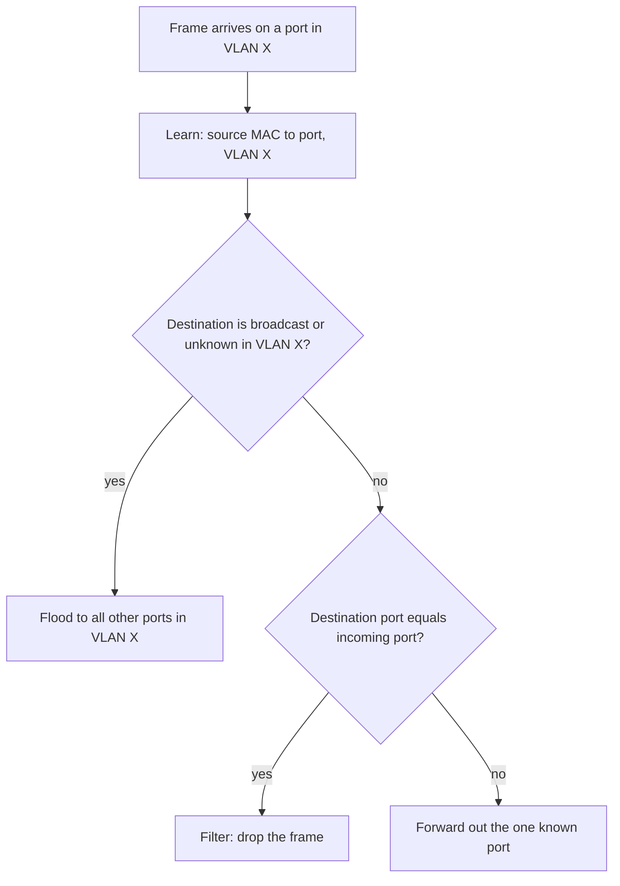
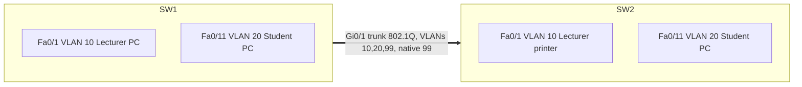
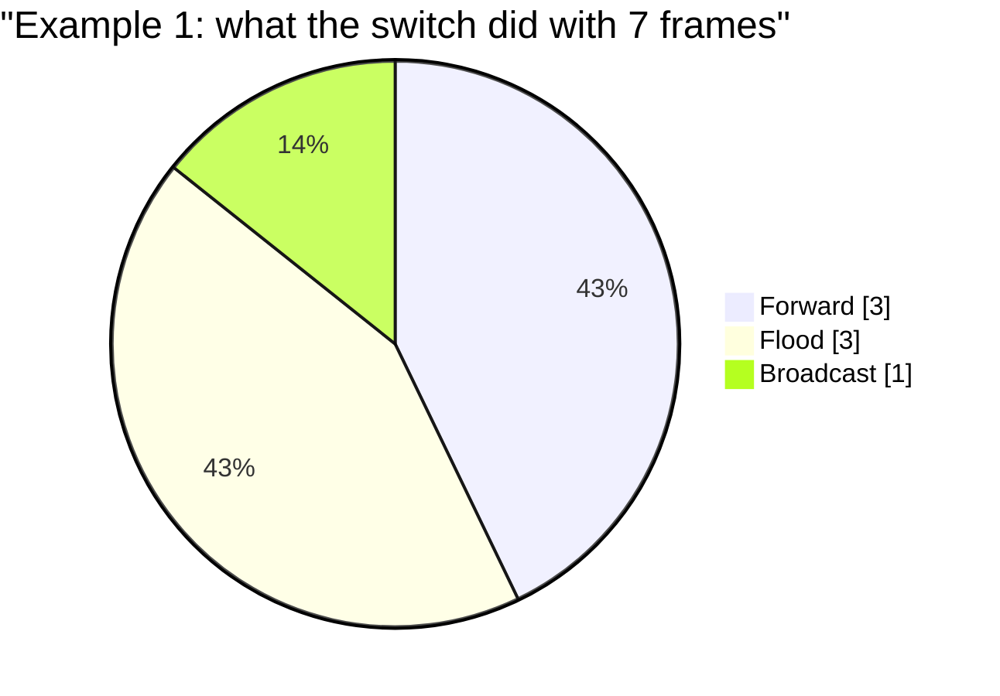

# Session 5: Introduction to Switching and VLANs

> [Cybersecurity and Digital Forensics](../../README.md) › [Term 1](../README.md) › [Module 4: Configuring Network Infrastructure](README.md) › **Session 5**

| ⏱ Estimated time | 📋 Prerequisites |
|---|---|
| 3 hours | Session 4 (IOS modes and basic configuration), Session 3 (MAC addresses) |

| ⬅ [Previous: Session 4](session-04-cisco-hardware-and-ios.md) | [Next: Session 6](session-06-stp-and-etherchannel.md) ➡ |
|:---|---:|

[](https://colab.research.google.com/github/Hamnakhan123/Cybersecurity-and-Digital-Forensics/blob/main/term-1/04-configuring-network-infrastructure/code/session-05-switching-and-vlans.ipynb) &nbsp;Run every Python example of this session in the notebook [`code/session-05-switching-and-vlans.ipynb`](code/session-05-switching-and-vlans.ipynb).

---

## 🎯 Learning objectives

- Explain the role of **Layer 2 switches** in network communication and how they differ from hubs.
- Describe how a switch **learns, floods, forwards and filters** frames using its **MAC address table**, and the forwarding methods (store-and-forward, cut-through).
- Define **VLANs**, their benefits, and the difference between **access** and **trunk** ports (802.1Q tagging, native VLAN).
- **Configure** VLANs, access ports and trunks on Cisco switches and verify them.
- Explain **DTP** and **VTP**, their risks, and the secure way to configure them.

## 📖 Concepts

### 1. What a Layer 2 switch does

A switch connects devices **inside one LAN**. Unlike a hub, which repeats every bit to every port, a switch reads the **destination MAC address** of each frame and sends it only where it needs to go.

| | Hub | Switch |
|---|---|---|
| Layer | 1 | 2 |
| Forwards to | All ports | Only the port of the destination MAC |
| Collision domains | 1 for all ports | 1 **per port** (full duplex → no collisions) |
| Bandwidth | Shared | Dedicated per port |
| Security | Everyone sees everything | Unicast frames reach only the destination |

**The four decisions** (for each frame that arrives):

1. **Learn** – record *source MAC → incoming port* (and VLAN) in the **MAC address table** (also called the **CAM table**). Entries age out after **300 seconds** of silence.
2. **Forward** – destination MAC known on another port → send it out that single port.
3. **Filter** – destination is on the *same* port it arrived on → drop it.
4. **Flood** – destination unknown, or broadcast `ffff.ffff.ffff`, or multicast → send out **every other port in the same VLAN**.

> **Analogy – a school receptionist.** On the first day she does not know which classroom anyone is in, so she announces a message on the PA system (flood). Every time a student walks past her desk she notes their classroom (learn). After a week she walks messages straight to the right room (forward).

**Forwarding methods**

| Method | How | Trade-off |
|---|---|---|
| **Store-and-forward** | Receives the whole frame, checks the **FCS**, then forwards | Drops corrupt frames; slightly more latency. Default on most Cisco switches |
| **Cut-through** | Forwards after reading the destination MAC (first 6 bytes) | Lowest latency (data centres); forwards corrupt frames |
| **Fragment-free** | Waits for the first 64 bytes (where collisions show up) | Compromise; rarely used today |

### 2. VLANs – virtual LANs

A **VLAN** is a logical group of switch ports that forms its **own broadcast domain**, regardless of physical location. Each VLAN normally maps to **one IP subnet**.

**Benefits:** smaller broadcast domains (performance), **security** (students cannot see the finance VLAN without passing a router/firewall), flexible moves (change a port's VLAN, not the cabling), and simpler management by role.

| VLAN type | Purpose |
|---|---|
| **Default VLAN 1** | Every port starts here; also carries CDP/VTP/DTP. Do not use it for users |
| **Data VLAN** | User traffic (e.g. 10 Lecturers, 20 Students) |
| **Voice VLAN** | IP phones, with QoS; a port can carry one data + one voice VLAN |
| **Management VLAN** | Switch SVIs for SSH/SNMP (e.g. 99) |
| **Native VLAN** | Untagged traffic on a trunk; change it from 1 to an unused VLAN |
| **Parking / black-hole VLAN** | Unused ports, never routed (e.g. 999) |

VLAN IDs: **1–1005** normal range (stored in `vlan.dat` in flash), **1006–4094** extended range.

### 3. Access ports, trunk ports and 802.1Q

- An **access port** belongs to **one VLAN** and sends **untagged** frames – for PCs, printers, APs in simple mode.
- A **trunk port** carries **many VLANs** between switches (or to a router/AP) by inserting a **4-byte 802.1Q tag** into each frame: TPID `0x8100`, 3-bit **priority** (CoS), 1-bit DEI, **12-bit VLAN ID** (hence 4 094 VLANs).
- The **native VLAN** is sent **untagged** on a trunk; both ends must agree, or traffic leaks between VLANs (and CDP logs a *native VLAN mismatch*).

### 4. DTP – Dynamic Trunking Protocol

Cisco's DTP lets two ports **negotiate** whether a link becomes a trunk. Modes: `access`, `trunk`, `dynamic desirable` (actively asks), `dynamic auto` (waits to be asked). Older switch ports default to dynamic auto/desirable.

**Risk – switch spoofing (VLAN hopping):** an attacker's device that speaks DTP can turn a dynamic port into a trunk and reach every VLAN. **Fix:** `switchport mode access` + `switchport nonegotiate` on every user port; hard-coded trunks with `nonegotiate` between switches.

### 5. VTP – VLAN Trunking Protocol

VTP (Cisco) copies the VLAN list from a **server** to **clients** in the same **domain** over trunks.

| VTP mode | Creates VLANs? | Syncs from others? | Forwards adverts? |
|---|---|---|---|
| **Server** (default) | Yes | Yes | Yes |
| **Client** | No | Yes | Yes |
| **Transparent** | Yes (locally) | No | Yes (v2) |
| **Off** (v3) | Yes (locally) | No | No |

**Danger:** VTP trusts the highest **configuration revision number**. A lab switch with a higher revision added to production can **overwrite or delete every VLAN** in the domain. Many organisations run **transparent** mode or **VTPv3** (with a single primary server and passwords).

## 🧭 Diagrams

**Switch decision process**



**Two switches, two VLANs, one trunk**



## 🪜 Step-by-step: configure VLANs, access ports and a trunk

1. Build two 2960 switches connected Gi0/1 ↔ Gi0/1, two PCs on each (Fa0/1 and Fa0/11).
2. On **both** switches create VLANs 10, 20, 99, 999 with names.
3. Assign access ports with `switchport mode access`, `switchport access vlan`, `switchport nonegotiate`.
4. Configure Gi0/1 as a **static trunk**: native VLAN 99, allowed VLANs 10, 20, 99, `nonegotiate`.
5. Shut unused ports and move them to VLAN 999.
6. Give PCs addresses: VLAN 10 → `192.168.10.0/24`, VLAN 20 → `192.168.20.0/24`.
7. Test: same-VLAN pings across the trunk **succeed**; VLAN 10 → VLAN 20 pings **fail** (no router yet – Session 12).

📄 **`code/session-05_vlans.ios`**

```text
! Session 5 - VLANs, access ports and an 802.1Q trunk (Cisco Packet Tracer lab)
! SW1 Fa0/1-10 = LECTURERS (VLAN 10), Fa0/11-20 = STUDENTS (VLAN 20), Gi0/1 = trunk to SW2

enable
configure terminal
 hostname SW1
 vtp mode transparent                   ! keep this switch's VLAN database local (no VTP surprises)
 !
 vlan 10
  name LECTURERS
 vlan 20
  name STUDENTS
 vlan 99
  name MANAGEMENT
 vlan 999
  name PARKING-UNUSED                   ! unused ports live here, never routed
 exit
 !
 interface range FastEthernet0/1 - 10
  switchport mode access                ! never negotiate a trunk on a user port
  switchport access vlan 10
  switchport nonegotiate                ! DTP off
  spanning-tree portfast                ! end devices: go to forwarding immediately
 exit
 interface range FastEthernet0/11 - 20
  switchport mode access
  switchport access vlan 20
  switchport nonegotiate
  spanning-tree portfast
 exit
 interface range FastEthernet0/21 - 24
  switchport mode access
  switchport access vlan 999
  shutdown                              ! unused ports are disabled
 exit
 !
 interface GigabitEthernet0/1
  description TRUNK-TO-SW2
  switchport trunk encapsulation dot1q  ! needed only on switches that also support ISL
  switchport mode trunk
  switchport trunk native vlan 99       ! not VLAN 1
  switchport trunk allowed vlan 10,20,99
  switchport nonegotiate
 exit
 !
 interface vlan 99                      ! switch management address (SVI)
  ip address 192.168.99.11 255.255.255.0
  no shutdown
 exit
 ip default-gateway 192.168.99.1
end
copy running-config startup-config

! verify:
! show vlan brief            show interfaces trunk         show interfaces Fa0/1 switchport
! show mac address-table     show vtp status               show dtp interface Gi0/1
```
**Expected verification output (excerpt):**

```text
SW1#show vlan brief
VLAN Name                             Status    Ports
---- -------------------------------- --------- -------------------------------
1    default                          active
10   LECTURERS                        active    Fa0/1, Fa0/2, Fa0/3, Fa0/4, Fa0/5 ...
20   STUDENTS                         active    Fa0/11, Fa0/12, Fa0/13 ...
99   MANAGEMENT                       active
999  PARKING-UNUSED                   active    Fa0/21, Fa0/22, Fa0/23, Fa0/24

SW1#show interfaces trunk
Port        Mode         Encapsulation  Status        Native vlan
Gi0/1       on           802.1q         trunking      99

Port        Vlans allowed on trunk
Gi0/1       10,20,99
```

Trunk ports do **not** appear in `show vlan brief` – use `show interfaces trunk`.

## 💻 Worked examples

### Example 1 – Learning, flooding, forwarding and filtering per VLAN

📄 **`code/session-05_switch_sim.py`**

```python
"""Session 5 - How a Layer 2 switch learns, floods, forwards and filters, per VLAN.

The switch keeps one MAC address table. Each entry is (VLAN, MAC) -> port.
- Learn: record the SOURCE MAC of every frame against the port it arrived on.
- Forward: if the DESTINATION is known in that VLAN, send it out that one port.
- Filter: if the destination is on the same port it came from, drop it.
- Flood: unknown unicast and broadcast go out every other port IN THE SAME VLAN.
Run:  python session-05_switch_sim.py
"""

PORTS = {"Fa0/1": 10, "Fa0/2": 10, "Fa0/3": 20, "Fa0/4": 20, "Fa0/5": 10}   # access ports
HOSTS = {"PC-A": ("aaaa.aaaa.0001", "Fa0/1"), "PC-B": ("bbbb.bbbb.0002", "Fa0/2"),
         "PC-C": ("cccc.cccc.0003", "Fa0/3"), "PC-D": ("dddd.dddd.0004", "Fa0/4"),
         "PRN-E": ("eeee.eeee.0005", "Fa0/5")}
BROADCAST = "ffff.ffff.ffff"


class Switch:
    def __init__(self, ports):
        self.ports = ports
        self.table = {}

    def receive(self, in_port, src, dst):
        vlan = self.ports[in_port]
        learned = (vlan, src) not in self.table
        self.table[(vlan, src)] = in_port
        if dst == BROADCAST or (vlan, dst) not in self.table:
            out = [p for p, v in self.ports.items() if v == vlan and p != in_port]
            action = "FLOOD" if dst != BROADCAST else "BROADCAST"
        elif self.table[(vlan, dst)] == in_port:
            out, action = [], "FILTER"
        else:
            out, action = [self.table[(vlan, dst)]], "FORWARD"
        return vlan, learned, action, out

    def show_mac_table(self):
        print("          Mac Address Table")
        print("Vlan    Mac Address       Type        Ports")
        print("----    -----------       --------    -----")
        for (vlan, mac), port in sorted(self.table.items()):
            print(f"{vlan:<7} {mac:17} DYNAMIC     {port}")


if __name__ == "__main__":
    sw = Switch(PORTS)
    events = [("PC-A", "PC-B"), ("PC-B", "PC-A"), ("PC-C", "BCAST"), ("PC-A", "PRN-E"),
              ("PRN-E", "PC-A"), ("PC-A", "PC-C"), ("PC-D", "PC-C")]
    for s, d in events:
        smac, sport = HOSTS[s]
        dmac = BROADCAST if d == "BCAST" else HOSTS[d][0]
        vlan, learned, action, out = sw.receive(sport, smac, dmac)
        note = " (learned new MAC)" if learned else ""
        print(f"{s:5} -> {d:5} in {sport} VLAN {vlan}: {action:9} out {', '.join(out) or '-'}{note}")
    print()
    sw.show_mac_table()
    print("\nPC-A -> PC-C never reaches VLAN 20: VLANs are separate broadcast domains.")
    print("They need a router or Layer 3 switch (Session 12) to talk.")
```

**Output**

```text
PC-A  -> PC-B  in Fa0/1 VLAN 10: FLOOD     out Fa0/2, Fa0/5 (learned new MAC)
PC-B  -> PC-A  in Fa0/2 VLAN 10: FORWARD   out Fa0/1 (learned new MAC)
PC-C  -> BCAST in Fa0/3 VLAN 20: BROADCAST out Fa0/4 (learned new MAC)
PC-A  -> PRN-E in Fa0/1 VLAN 10: FLOOD     out Fa0/2, Fa0/5
PRN-E -> PC-A  in Fa0/5 VLAN 10: FORWARD   out Fa0/1 (learned new MAC)
PC-A  -> PC-C  in Fa0/1 VLAN 10: FLOOD     out Fa0/2, Fa0/5
PC-D  -> PC-C  in Fa0/4 VLAN 20: FORWARD   out Fa0/3 (learned new MAC)

          Mac Address Table
Vlan    Mac Address       Type        Ports
----    -----------       --------    -----
10      aaaa.aaaa.0001    DYNAMIC     Fa0/1
10      bbbb.bbbb.0002    DYNAMIC     Fa0/2
10      eeee.eeee.0005    DYNAMIC     Fa0/5
20      cccc.cccc.0003    DYNAMIC     Fa0/3
20      dddd.dddd.0004    DYNAMIC     Fa0/4

PC-A -> PC-C never reaches VLAN 20: VLANs are separate broadcast domains.
They need a router or Layer 3 switch (Session 12) to talk.
```
**Observe:**
- The first frame from PC-A floods (the switch has never heard of PC-B), but only within **VLAN 10** – PC-C and PC-D on VLAN 20 never see it.
- After one reply, traffic is forwarded to a single port.
- PC-A → PC-C floods inside VLAN 10 and never arrives: different VLANs need a Layer 3 device.

### Example 2 – Which DTP combinations form a trunk?

📄 **`code/session-05_dtp_matrix.py`**

```python
"""Session 5 - Will this link become a trunk? The DTP negotiation matrix.

Dynamic Trunking Protocol (Cisco) lets two switch ports agree on trunk or
access. Security best practice is to switch it off: hard-code access ports
with "switchport mode access" + "switchport nonegotiate", and trunks with
"switchport mode trunk" + "switchport nonegotiate".
Run:  python session-05_dtp_matrix.py
"""

MODES = ["access", "dynamic auto", "dynamic desirable", "trunk"]


def result(a, b):
    if "access" in (a, b):
        if {a, b} == {"access", "trunk"}:
            return "mismatch!"         # one side tags, the other does not
        return "access"
    if a == "trunk" or b == "trunk":
        return "trunk"
    if "dynamic desirable" in (a, b):
        return "trunk"
    return "access"                      # auto + auto: nobody asks


if __name__ == "__main__":
    w = 18
    print(" " * w + "".join(f"{m:>{w}}" for m in MODES))
    for a in MODES:
        print(f"{a:<{w}}" + "".join(f"{result(a, b):>{w}}" for b in MODES))
    print("\nWhy it matters for security:")
    print(" - A port left in 'dynamic desirable' or 'dynamic auto' can be talked into trunking")
    print("   by a device that speaks DTP, giving it access to every VLAN (VLAN hopping).")
    print(" - Fix: switchport mode access + switchport nonegotiate on every user port.")
    print("\nVTP reminder: a switch in server mode with a HIGHER revision number")
    print("overwrites the VLAN database of every client in the domain. Use VTP transparent")
    print("or VTP v3 with a primary server, and reset the revision before adding a switch.")
```

**Output**

```text
                              access      dynamic auto dynamic desirable             trunk
access                        access            access            access         mismatch!
dynamic auto                  access            access             trunk             trunk
dynamic desirable             access             trunk             trunk             trunk
trunk                      mismatch!             trunk             trunk             trunk

Why it matters for security:
 - A port left in 'dynamic desirable' or 'dynamic auto' can be talked into trunking
   by a device that speaks DTP, giving it access to every VLAN (VLAN hopping).
 - Fix: switchport mode access + switchport nonegotiate on every user port.

VTP reminder: a switch in server mode with a HIGHER revision number
overwrites the VLAN database of every client in the domain. Use VTP transparent
or VTP v3 with a primary server, and reset the revision before adding a switch.
```
**Observe:** `dynamic auto` on both sides never trunks (both wait), and `access` against `trunk` creates a **mismatch** – one side tags frames, the other drops or misplaces them. Hard-coding modes removes the guesswork and the attack.

## 📊 Chart

| Command | What it tells you |
|---|---|
| `show vlan brief` | VLANs and their access ports |
| `show interfaces trunk` | Trunk ports, native VLAN, allowed and active VLANs |
| `show interfaces Fa0/1 switchport` | Administrative/operational mode, access VLAN, negotiation |
| `show mac address-table` | Learned MACs per VLAN and port |
| `show mac address-table aging-time` | Aging timer (300 s default) |
| `show vtp status` | VTP mode, domain, revision number |



## 🏢 Real-life problem with full solution

**Scenario.** A hospital's 3-floor building has one flat network: 180 devices including PCs, IP phones, medical devices and guest Wi-Fi. Broadcast storms slow the network, and a guest laptop was found scanning the medical devices. Management asks for segmentation **without recabling**.

**Solution.**

1. **Design VLANs by role:** 10 Doctors/Staff, 20 Reception, 30 Medical devices, 40 Voice, 50 Guest, 99 Management, 999 Parking.
2. **Addressing:** one subnet per VLAN (e.g. `10.30.<vlan>.0/24`).
3. **Access ports:** each wall port set to the VLAN of the device; IP-phone ports get `switchport voice vlan 40` plus the data VLAN for the PC behind the phone.
4. **Trunks:** floor switches to the core with static 802.1Q trunks, native VLAN 99, only needed VLANs allowed, `nonegotiate`.
5. **VTP:** transparent mode on all switches to avoid accidental VLAN deletion.
6. **Security:** guest VLAN 50 routed only to the internet (ACL, Session 10); medical devices VLAN 30 reachable only from the doctors' application servers.
7. **Verify:** `show vlan brief`, `show interfaces trunk`; a guest laptop can browse but cannot ping `10.30.30.x`; broadcast counters per VLAN fall sharply.

## ⚠️ Common mistakes

- Creating VLANs on one switch but not on the other end of the trunk (traffic for that VLAN is dropped).
- **Native VLAN mismatch** between trunk ends.
- Leaving user ports in **dynamic** mode (DTP) or in VLAN 1.
- Forgetting that an access port can carry only one data VLAN (plus a voice VLAN).
- Adding a switch with a higher VTP revision into a VTP domain.
- Expecting different VLANs to ping each other without a router.

## ✅ Best practices

- One VLAN = one subnet = one purpose; name every VLAN.
- Never use VLAN 1 for users or management; change the native VLAN to an unused ID.
- Static trunks with `switchport nonegotiate` and an explicit **allowed VLAN list**.
- Shut unused ports and put them in a parking VLAN.
- Use VTP transparent (or VTPv3 with a password and one primary server).
- Document VLAN IDs, names, subnets and gateways in the IPAM sheet.

## 🧪 Lab / practice tasks

1. **Easy –** What happens to a broadcast frame from a PC in VLAN 20 on a switch with VLANs 10 and 20?
2. **Easy –** How many bytes does an 802.1Q tag add, and how many VLAN IDs can it express?
3. **Medium –** Build the step-by-step lab. Then remove VLAN 20 from the allowed list on one side only and record what breaks.
4. **Medium –** In `session-05_switch_sim.py`, add an **aging** feature: entries older than 300 s are removed before each lookup. Show a frame being flooded again after aging.
5. **Challenge –** Add a **trunk port** `Gi0/1` to the simulator that carries VLANs 10 and 20. Flooded frames must also leave through the trunk (tagged with their VLAN), and frames arriving on the trunk must be learned in the VLAN carried in their tag.

<details>
<summary>💡 Hints</summary>

- Task 3: compare `show interfaces trunk` on both sides – "Vlans allowed and active in management domain".
- Task 4: store `(port, timestamp)` in the table and pass a `now` value to `receive()`.
- Task 5: represent trunk membership as a set: `{"Gi0/1": {10, 20}}`; when flooding include trunk ports whose set contains the VLAN.
</details>

<details>
<summary>✅ Solutions</summary>

**Task 1:** It is flooded to every other port in **VLAN 20** (and across trunks carrying VLAN 20) – never to VLAN 10.

**Task 2:** 4 bytes; 12-bit ID → 4 096 values, 4 094 usable (0 and 4095 reserved).

**Task 3:** PCs in VLAN 20 on different switches can no longer reach each other; VLAN 10 still works. Re-add with `switchport trunk allowed vlan add 20`.

**Task 4 (core lines):**

```python
def receive(self, in_port, src, dst, now):
    self.table = {k: v for k, v in self.table.items() if now - v[1] < 300}
    self.table[(vlan, src)] = (in_port, now)
```

**Task 5 (core lines):**

```python
TRUNKS = {"Gi0/1": {10, 20}}
out = [p for p, v in self.ports.items() if v == vlan and p != in_port]
out += [t for t, allowed in TRUNKS.items() if vlan in allowed and t != in_port]
```
</details>

## ✅ Quick quiz

1. A switch learns MAC addresses from the: a) destination MAC b) source MAC c) IP header d) FCS
2. A frame for an unknown unicast MAC is: a) dropped b) flooded within its VLAN c) sent to the router d) sent to all VLANs
3. The 802.1Q VLAN ID field is: a) 8 bits b) 10 bits c) 12 bits d) 16 bits
4. Which DTP pair forms a trunk? a) auto + auto b) desirable + auto c) access + desirable d) access + trunk
5. Which VTP mode keeps its VLANs local and ignores adverts? a) server b) client c) transparent d) primary

<details>
<summary>Show answers</summary>

1 – b · 2 – b · 3 – c · 4 – b · 5 – c
</details>

## 📝 Summary / cheat-sheet

- Switch: learn source, forward known, filter same-port, flood unknown/broadcast – per VLAN. Aging 300 s.
- Store-and-forward checks FCS; cut-through is faster but forwards errors.
- VLAN = broadcast domain = subnet. Access = 1 VLAN untagged; trunk = many VLANs, 802.1Q 4-byte tag, native VLAN untagged.
- DTP: disable with `switchport nonegotiate`; hard-code access/trunk.
- VTP: server/client/transparent/off; revision number risk; prefer transparent or v3.
- Verify: `show vlan brief`, `show interfaces trunk`, `show mac address-table`.

**Interview / viva questions**

1. Explain how a switch builds its MAC address table.
2. What is the difference between a collision domain and a broadcast domain?
3. Why should the native VLAN not be VLAN 1?
4. What is VLAN hopping by switch spoofing, and how do you prevent it?
5. Explain the VTP revision-number problem.
6. Why can two PCs in different VLANs on the same switch not ping each other?

---

| ⬅ [Previous: Session 4](session-04-cisco-hardware-and-ios.md) | [Next: Session 6](session-06-stp-and-etherchannel.md) ➡ |
|:---|---:|

<sub>Prepared by **Hamna Zahid Khan**, Junior Lecturer · Cybersecurity and Digital Forensics</sub>
