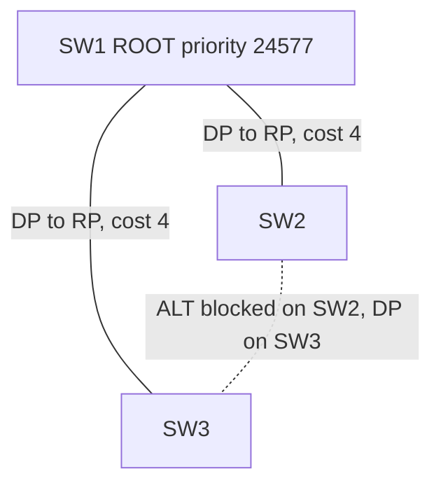
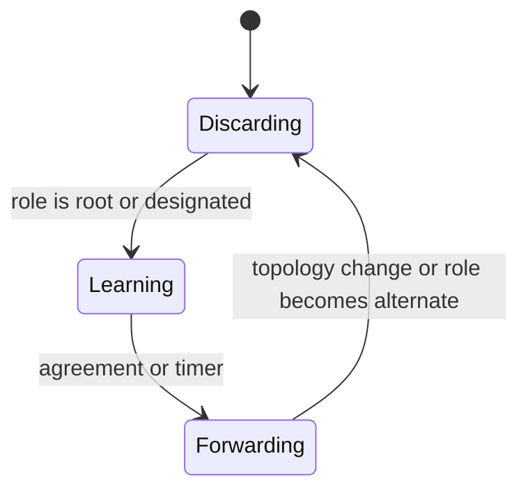
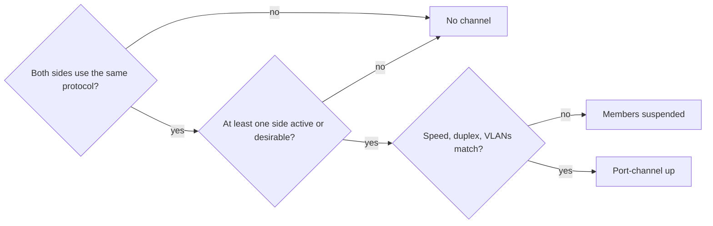
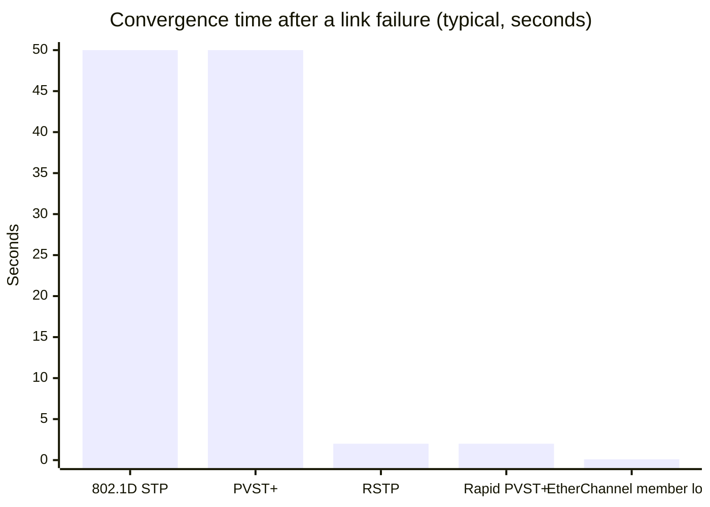

# Session 6: Loop Avoidance: STP, BPDU Guard and EtherChannel

> [Cybersecurity and Digital Forensics](../../README.md) › [Term 1](../README.md) › [Module 4: Configuring Network Infrastructure](README.md) › **Session 6**

| ⏱ Estimated time | 📋 Prerequisites |
|---|---|
| 3 hours | Session 5 (switching, VLANs and trunks) |

| ⬅ [Previous: Session 5](session-05-switching-and-vlans.md) | [Next: Session 7](session-07-routing-static-and-ospf.md) ➡ |
|:---|---:|

[](https://colab.research.google.com/github/Hamnakhan123/Cybersecurity-and-Digital-Forensics/blob/main/term-1/04-configuring-network-infrastructure/code/session-06-stp-and-etherchannel.ipynb) &nbsp;Run every Python example of this session in the notebook [`code/session-06-stp-and-etherchannel.ipynb`](code/session-06-stp-and-etherchannel.ipynb).

---

## 🎯 Learning objectives

- Explain why **redundant switch links create loops** and what a broadcast storm, MAC table instability and duplicate frames are.
- Describe how **Spanning Tree Protocol (STP)** elects a **root bridge**, **root ports**, **designated ports** and **blocked (alternate) ports**, and compare STP, RSTP and PVST+.
- Explain **PortFast** and **BPDU Guard** and why they protect edge ports.
- Explain **EtherChannel** and its advantages; compare **PAgP** and **LACP** and their modes.
- Configure and verify Rapid PVST+, BPDU Guard and an LACP EtherChannel.

## 📖 Concepts

### 1. Why loops happen and why they are so dangerous

Redundant links between switches are good for availability, but Ethernet frames have **no TTL** (unlike IP packets). In a loop:

- **Broadcast storm** – a single broadcast circles forever, multiplying at every switch, until links hit 100% and the network collapses (often within seconds).
- **MAC address table instability** – the same source MAC is learned on different ports again and again, so the switch keeps changing its mind.
- **Duplicate frames** – hosts receive several copies of the same unicast frame.

> **Analogy – a rumour in a ring of friends.** Each friend passes the message to everyone else they know, including the person who told them. Nobody ever stops. STP is like agreeing that one friendship is "on hold": the rumour reaches everybody exactly once, and if another friendship breaks, the held one is reactivated.

### 2. Spanning Tree Protocol (IEEE 802.1D)

STP builds a **loop-free tree** by logically blocking redundant ports while keeping them ready as backups. Switches exchange **BPDUs** (Bridge Protocol Data Units) every **2 s** (hello time).

**Bridge ID (BID)** = **priority** (default **32768**, configured in steps of 4096) + **extended system ID** (the VLAN number) + **MAC address**.

**The election, in order:**

1. **Root bridge** – lowest BID (lowest priority, then lowest MAC). All its ports are **designated** (forwarding).
2. **Root port** (one per non-root switch) – the port with the lowest **root path cost**; ties broken by lowest sender BID, then lowest sender port ID.
3. **Designated port** (one per segment) – the port on the switch with the lowest cost to the root for that segment.
4. Every other port is **blocked** (in RSTP: **alternate** or **backup**).

**Default port costs (short, 802.1D-1998)**

| Speed | Cost |
|---|---|
| 10 Mbps | 100 |
| 100 Mbps | 19 |
| 1 Gbps | 4 |
| 10 Gbps | 2 |

**Port states and timers**

| 802.1D state | Forwards data? | Learns MACs? | Duration |
|---|---|---|---|
| Blocking | No | No | Up to max age **20 s** |
| Listening | No | No | Forward delay **15 s** |
| Learning | No | Yes | Forward delay **15 s** |
| Forwarding | Yes | Yes | – |
| Disabled | No | No | Admin down |

Classic STP can take **30–50 s** to converge – far too slow today.

**STP family**

| Version | Standard | Trees | Convergence |
|---|---|---|---|
| STP | 802.1D | One for all VLANs (CST) | 30–50 s |
| **PVST+** | Cisco | **One per VLAN** (load sharing possible) | 30–50 s |
| **RSTP** | 802.1w | One | ~1–2 s (proposal/agreement) |
| **Rapid PVST+** | Cisco | One RSTP tree **per VLAN** | ~1–2 s (Cisco default on newer IOS) |
| **MST** | 802.1s | Groups of VLANs per instance | Fast, scales to many VLANs |

RSTP port roles: **root, designated, alternate** (backup path to root), **backup** (redundant port to the same segment). States: **discarding, learning, forwarding**.

### 3. PortFast and BPDU Guard

- **PortFast** makes an **edge port** (to a PC, printer, server) go **straight to forwarding**, skipping listening/learning. Without it, a PC may fail to get a DHCP address because the port is not forwarding yet.
- **BPDU Guard** puts a PortFast port into **err-disabled** state the moment it receives a BPDU – i.e. someone plugged a switch into a desk port. That stops accidental loops and **rogue switches trying to become root** (an attacker with priority 0 could otherwise pull all traffic through their device).
- **Root Guard** (on ports that must never lead to the root) and **Loop Guard** (protects against unidirectional links) complete the toolkit.
- Recover an err-disabled port: fix the cause, then `shutdown` / `no shutdown` (or `errdisable recovery cause bpduguard`).

### 4. EtherChannel – link aggregation

**EtherChannel** bundles 2–8 parallel physical links into **one logical link** (`Port-channel`).

**Advantages:**
- **More bandwidth**: 4 × 1 Gbps = 4 Gbps logical link.
- **STP sees one link**, so no port is blocked – all links are used.
- **Redundancy**: if a member fails, traffic shifts to the others in milliseconds without STP recalculation.
- **Simpler configuration**: settings applied on the port-channel interface.

**Rules:** members must match **speed, duplex, mode (access/trunk), allowed VLANs and native VLAN**.

**Load balancing** is per-flow, not per-packet: a hash of MAC/IP/port fields selects one member for each flow (`port-channel load-balance src-dst-ip`). A single large transfer is therefore limited to one member's speed.

**Negotiation protocols**

| Protocol | Standard | Modes | Forms channel when |
|---|---|---|---|
| **PAgP** | Cisco | `desirable` (asks), `auto` (waits) | desirable + desirable, desirable + auto |
| **LACP** | IEEE **802.3ad / 802.1AX** | `active` (asks), `passive` (waits) | active + active, active + passive |
| Static | – | `on` | on + on only (no negotiation, risky) |

Prefer **LACP** – it is an open standard (works with servers, firewalls and other vendors) and detects misconfigurations that `on` silently accepts.

## 🧭 Diagrams

**STP on a triangle of switches (SW1 configured as root)**



**RSTP port lifecycle**



**EtherChannel negotiation**



## 🪜 Step-by-step: tune STP and build an LACP EtherChannel

1. Build SW1 (core) and SW2 (access) with **two** cables between Gi0/1–Gi0/2 on both. Observe that STP blocks one link (amber light in Packet Tracer).
2. On both: `spanning-tree mode rapid-pvst`.
3. Make SW1 the root on purpose: `spanning-tree vlan 10,20,99 root primary`; SW2 `root secondary`.
4. Create the bundle: members `channel-group 1 mode active` on SW1 and `passive` on SW2; configure the trunk on `interface Port-channel1`.
5. Protect edge ports on SW2: `spanning-tree portfast` + `spanning-tree bpduguard enable`.
6. Verify: `show etherchannel summary` shows **Po1(SU)** with members **(P)**; `show spanning-tree vlan 10` shows Po1 as one forwarding port.
7. Test BPDU Guard: plug a third switch into SW2 Fa0/5 → port becomes **err-disabled**.

📄 **`code/session-06_stp_etherchannel.ios`**

```text
! Session 6 - Spanning tree tuning, edge protection and LACP EtherChannel (lab)
! SW1 = core (should be root), SW2 = access switch. Two links SW1 Gi0/1-2 <-> SW2 Gi0/1-2.

! ===== SW1 (core) =====
enable
configure terminal
 spanning-tree mode rapid-pvst                 ! Rapid PVST+: one fast (802.1w) tree per VLAN
 spanning-tree vlan 10,20,99 root primary      ! sets priority 24576 + VLAN so SW1 is root
 !
 interface range GigabitEthernet0/1 - 2
  switchport mode trunk
  switchport nonegotiate
  channel-group 1 mode active                  ! LACP: actively ask the neighbour to bundle
 exit
 interface Port-channel1
  switchport mode trunk
  switchport trunk allowed vlan 10,20,99
 exit
 port-channel load-balance src-dst-ip
end

! ===== SW2 (access) =====
enable
configure terminal
 spanning-tree mode rapid-pvst
 spanning-tree vlan 10,20,99 root secondary    ! backup root (priority 28672 + VLAN)
 interface range GigabitEthernet0/1 - 2
  switchport mode trunk
  switchport nonegotiate
  channel-group 1 mode passive                 ! LACP passive: waits, forms with an active peer
 exit
 interface range FastEthernet0/1 - 24
  switchport mode access
  spanning-tree portfast                       ! edge port: skip listening/learning
  spanning-tree bpduguard enable               ! a BPDU here = someone plugged in a switch -> err-disable
 exit
 errdisable recovery cause bpduguard           ! optional: auto-recover after the interval
 errdisable recovery interval 300
end

! verify:
! show spanning-tree vlan 10         show spanning-tree summary
! show etherchannel summary          (look for flags SU on Po1 and P on members)
! show interfaces status err-disabled
```
**Expected verification output (excerpt):**

```text
SW2#show etherchannel summary
Flags:  D - down        P - bundled in port-channel
        S - Layer2      U - in use
Group  Port-channel  Protocol    Ports
------+-------------+-----------+-----------------------------------
1      Po1(SU)         LACP      Gi0/1(P)    Gi0/2(P)

SW2#show spanning-tree vlan 10
VLAN0010
  Root ID    Priority    24586
             Address     0011.1111.1111
Interface           Role Sts Cost      Prio.Nbr Type
------------------- ---- --- --------- -------- ----------------
Po1                 Root FWD 3         128.27   P2p
Fa0/1               Desg FWD 19        128.1    P2p Edge

%SPANTREE-2-BLOCK_BPDUGUARD: Received BPDU on port Fa0/5 with BPDU Guard enabled. Disabling port.
%PM-4-ERR_DISABLE: bpduguard error detected on Fa0/5, putting Fa0/5 in err-disable state
```

## 💻 Worked examples

### Example 1 – Simulate the STP election

📄 **`code/session-06_stp_election.py`**

```python
"""Session 6 - Spanning Tree Protocol: root bridge, root ports and blocked ports.

Bridge ID = priority (default 32768 + VLAN number) followed by the MAC address.
1. Lowest Bridge ID becomes ROOT; all its ports are designated (forwarding).
2. Every other switch picks one ROOT PORT: lowest cost to the root, then
   lowest sender Bridge ID, then lowest sender port ID.
3. On each segment, the switch with the lowest cost to root owns the
   DESIGNATED port. Every port that is neither root nor designated BLOCKS.
Port costs (short method): 10 Mbps 100, 100 Mbps 19, 1 Gbps 4, 10 Gbps 2.
Run:  python session-06_stp_election.py
"""
import heapq

COST = {10: 100, 100: 19, 1000: 4, 10000: 2}


def bid(sw):
    return (sw["priority"], sw["mac"])


def run_stp(switches, links):
    root = min(switches, key=lambda s: bid(switches[s]))
    # Dijkstra on path cost, ties broken by sender bridge ID then port name
    best = {root: (0, (), "")}          # switch -> (cost, sender_bid, local_port)
    pq = [(0, bid(switches[root]), root)]
    adj = {}
    for a, pa, b, pb, speed in links:
        adj.setdefault(a, []).append((b, pa, pb, COST[speed]))
        adj.setdefault(b, []).append((a, pb, pa, COST[speed]))
    done = set()
    while pq:
        c, _, u = heapq.heappop(pq)
        if u in done:
            continue
        done.add(u)
        for v, port_u, port_v, w in adj[u]:
            cand = (c + w, bid(switches[u]), port_v)
            if v not in best or cand < best[v]:
                best[v] = cand
                heapq.heappush(pq, (c + w, bid(switches[u]), v))
    roles = {}
    for a, pa, b, pb, speed in links:
        for sw, port in ((a, pa), (b, pb)):
            if sw != root and best[sw][2] == port:
                roles[(sw, port)] = "ROOT port       FWD"
        # designated port: side with lower root cost, then lower bridge ID
        side_a = (best[a][0], bid(switches[a])); side_b = (best[b][0], bid(switches[b]))
        des, dport, other, oport = (a, pa, b, pb) if side_a < side_b else (b, pb, a, pa)
        roles[(des, dport)] = "DESIGNATED port FWD"
        roles.setdefault((other, oport), "ALTERNATE port  BLOCKED")
    return root, best, roles


if __name__ == "__main__":
    switches = {"SW1": {"priority": 32769, "mac": "0011.1111.1111"},
                "SW2": {"priority": 32769, "mac": "0011.2222.2222"},
                "SW3": {"priority": 32769, "mac": "0011.0000.3333"}}
    links = [("SW1", "Gi0/1", "SW2", "Gi0/1", 1000),
             ("SW1", "Gi0/2", "SW3", "Gi0/1", 1000),
             ("SW2", "Gi0/2", "SW3", "Gi0/2", 1000)]
    for label in ("Default priorities (the oldest MAC wins - often a poor choice)",
                  "After 'spanning-tree vlan 1 root primary' on SW1 (priority 24577)"):
        root, best, roles = run_stp(switches, links)
        print(label)
        print(f"  Root bridge: {root}  (priority {switches[root]['priority']}, MAC {switches[root]['mac']})")
        for sw in sorted(switches):
            print(f"  {sw}: cost to root {best[sw][0]}")
            for (s, p), r in sorted(roles.items()):
                if s == sw:
                    print(f"     {p:6} {r}")
        print()
        switches["SW1"]["priority"] = 24577
```

**Output**

```text
Default priorities (the oldest MAC wins - often a poor choice)
  Root bridge: SW3  (priority 32769, MAC 0011.0000.3333)
  SW1: cost to root 4
     Gi0/1  DESIGNATED port FWD
     Gi0/2  ROOT port       FWD
  SW2: cost to root 4
     Gi0/1  ALTERNATE port  BLOCKED
     Gi0/2  ROOT port       FWD
  SW3: cost to root 0
     Gi0/1  DESIGNATED port FWD
     Gi0/2  DESIGNATED port FWD

After 'spanning-tree vlan 1 root primary' on SW1 (priority 24577)
  Root bridge: SW1  (priority 24577, MAC 0011.1111.1111)
  SW1: cost to root 0
     Gi0/1  DESIGNATED port FWD
     Gi0/2  DESIGNATED port FWD
  SW2: cost to root 4
     Gi0/1  ROOT port       FWD
     Gi0/2  ALTERNATE port  BLOCKED
  SW3: cost to root 4
     Gi0/1  ROOT port       FWD
     Gi0/2  DESIGNATED port FWD
```
**Observe:** with default priorities, **SW3 wins only because its MAC is lowest** – often an old access switch in a cupboard. After `root primary` on the core switch SW1, the tree is rebuilt around SW1, and the blocked port moves to the SW2–SW3 link (SW3 has the lower BID, so it keeps the designated port).

### Example 2 – EtherChannel modes and per-flow load sharing

📄 **`code/session-06_etherchannel.py`**

```python
"""Session 6 - EtherChannel: which modes form a bundle, and how traffic is shared.

PAgP (Cisco):  desirable + desirable/auto form a channel; auto + auto does not.
LACP (802.3ad): active + active/passive form a channel; passive + passive does not.
'on' forms only with 'on' (no negotiation at all).
Traffic is NOT split packet by packet: a hash of addresses chooses one member
link per flow, so a single flow never goes faster than one link.
Run:  python session-06_etherchannel.py
"""
import hashlib
from collections import Counter

FORMS = {
    ("desirable", "desirable"): "PAgP channel", ("desirable", "auto"): "PAgP channel",
    ("auto", "auto"): "no channel (both wait)",
    ("active", "active"): "LACP channel", ("active", "passive"): "LACP channel",
    ("passive", "passive"): "no channel (both wait)",
    ("on", "on"): "static channel",
}


def negotiate(a, b):
    return FORMS.get((a, b)) or FORMS.get((b, a)) or "no channel (modes do not match)"


def member_for(src_ip, dst_ip, links=4):
    """Simplified src-dst-ip hash: same pair of addresses -> same physical link."""
    h = hashlib.sha256(f"{src_ip}-{dst_ip}".encode()).digest()[0]
    return h % links


if __name__ == "__main__":
    print("Mode compatibility")
    for a, b in [("desirable", "auto"), ("auto", "auto"), ("active", "passive"),
                 ("passive", "passive"), ("on", "active"), ("on", "on")]:
        print(f"  {a:9} + {b:9} -> {negotiate(a, b)}")

    print("\nLoad sharing over a 4 x 1 Gbps Port-channel (src-dst-ip hash)")
    flows = [(f"10.1.10.{h}", "10.1.99.10") for h in range(1, 41)]
    use = Counter(member_for(s, d) for s, d in flows)
    for link in range(4):
        print(f"  Gi1/0/{link+1}: {use[link]:2} flows  " + "#" * use[link])
    print("  One backup flow 10.1.10.7 -> 10.1.99.10 always uses Gi1/0/"
          f"{member_for('10.1.10.7', '10.1.99.10') + 1} (max 1 Gbps for that flow)")
    print("\nBundled bandwidth seen by STP: 4 Gbps as ONE logical port, so no port blocks.")
```

**Output**

```text
Mode compatibility
  desirable + auto      -> PAgP channel
  auto      + auto      -> no channel (both wait)
  active    + passive   -> LACP channel
  passive   + passive   -> no channel (both wait)
  on        + active    -> no channel (modes do not match)
  on        + on        -> static channel

Load sharing over a 4 x 1 Gbps Port-channel (src-dst-ip hash)
  Gi1/0/1:  9 flows  #########
  Gi1/0/2: 11 flows  ###########
  Gi1/0/3:  7 flows  #######
  Gi1/0/4: 13 flows  #############
  One backup flow 10.1.10.7 -> 10.1.99.10 always uses Gi1/0/3 (max 1 Gbps for that flow)

Bundled bandwidth seen by STP: 4 Gbps as ONE logical port, so no port blocks.
```
**Observe:** `on` + `active` does not form a bundle (one side negotiates, the other refuses to). With 40 flows the four links carry 7–13 flows each – not perfectly even, because hashing is per flow.

## 📊 Chart



| Feature | Protects against | Where |
|---|---|---|
| PortFast | Slow DHCP at boot | Edge ports only |
| BPDU Guard | Rogue/accidental switches | Edge ports |
| Root Guard | Unwanted root takeover | Distribution ports facing access switches |
| Loop Guard | Unidirectional link loops | Non-designated ports |
| Storm control | Broadcast floods | Access ports |

## 🏢 Real-life problem with full solution

**Scenario.** Every morning at 9:00 the whole floor of an engineering faculty "freezes" for about 45 seconds. Investigation shows that a lecturer plugs a small unmanaged desktop switch into **two** wall ports to "get more speed". The core switch logs `%SW_MATM-4-MACFLAP_NOTIF`.

**Solution.**

1. **Diagnose:** `MACFLAP` = the same MAC learned on two ports → loop. `show spanning-tree` reveals the root bridge is an old access switch (lowest MAC), so every topology change reconverges the whole floor with slow 802.1D timers.
2. **Pin the root:** `spanning-tree vlan 1-4094 root primary` on the core, `root secondary` on the backup core.
3. **Speed up convergence:** `spanning-tree mode rapid-pvst` on all switches.
4. **Protect edge ports:** `spanning-tree portfast default` and `spanning-tree portfast bpduguard default` (global) so every access port is protected.
5. **Add storm control:** `storm-control broadcast level 5` on access ports.
6. **Use the redundancy properly:** replace the two separate uplinks from each access switch with an **LACP EtherChannel**, doubling bandwidth with no blocked port.
7. **Verify:** plug the desktop switch in again → the port goes **err-disabled** immediately, the floor stays up, and the log names the port so IT can contact the user.

## ⚠️ Common mistakes

- Leaving root election to chance (lowest MAC = oldest switch).
- Enabling PortFast on ports that connect to switches.
- Disabling STP "because it blocks a port".
- EtherChannel members with mismatched VLANs, speed or trunk settings → members suspended.
- Using mode `on` on one side and LACP on the other.
- Expecting one file copy to use the full bandwidth of an EtherChannel.

## ✅ Best practices

- Choose the root and backup root deliberately (core/distribution switches).
- Run Rapid PVST+ or MST everywhere; never turn STP off.
- PortFast + BPDU Guard on all edge ports; Root Guard towards access switches.
- Prefer LACP active/active (or active/passive) over static `on`.
- Configure trunk settings on the **Port-channel** interface, not on individual members.
- Monitor `MACFLAP`, `BPDUGUARD` and topology-change messages in syslog.

## 🧪 Lab / practice tasks

1. **Easy –** Three switches have priority 32769 and MACs `000A.1111.1111`, `0001.2222.2222`, `000F.3333.3333`. Which is root?
2. **Easy –** What is the STP cost of a path that crosses two Gigabit links and one FastEthernet link?
3. **Medium –** Build the triangle topology in Packet Tracer, identify the blocked port, then make a different switch the root and record where the blocked port moves.
4. **Medium –** In `session-06_stp_election.py`, make the SW2–SW3 link 100 Mbps. Which ports change role? Explain.
5. **Challenge –** Add a function `bpdu_guard(port_is_edge, bpdu_received)` to the simulator that returns `err-disabled` or `forwarding`, and add a fourth switch connected to an edge port of SW2 to demonstrate it.

<details>
<summary>💡 Hints</summary>

- Task 1: equal priorities → compare MACs.
- Task 2: 4 + 4 + 19.
- Task 4: change the speed tuple in `links` to `100`; costs become 19 on that link.
</details>

<details>
<summary>✅ Solutions</summary>

**Task 1:** `0001.2222.2222` (lowest MAC).

**Task 2:** 4 + 4 + 19 = **27**.

**Task 3:** the blocked port is always on the link furthest from the root, on the switch with the higher BID of the two non-root switches.

**Task 4:** change the tuple to `("SW2", "Gi0/2", "SW3", "Gi0/2", 100)`. With **default priorities** (SW3 is root), SW2 now reaches the root at cost 19 directly or 4 + 4 = **8 via SW1**, so SW2's **root port moves to Gi0/1** (cost to root 8) and Gi0/2 becomes **alternate (blocked)**; SW1 Gi0/1 becomes designated for the SW1–SW2 segment. With **SW1 as root**, nothing changes: each non-root switch still reaches SW1 directly at cost 4, and the slow SW2–SW3 link stays blocked – which is exactly what you want.

**Task 5:**

```python
def bpdu_guard(port_is_edge, bpdu_received):
    return "err-disabled" if port_is_edge and bpdu_received else "forwarding"

print(bpdu_guard(True, True))   # err-disabled
```
</details>

## ✅ Quick quiz

1. Which switch becomes the STP root? a) highest MAC b) lowest Bridge ID c) most ports d) highest priority
2. What is the default STP priority? a) 0 b) 4096 c) 32768 d) 65535
3. BPDU Guard reacts to a BPDU on a PortFast port by: a) forwarding it b) err-disabling the port c) making the port root d) ignoring it
4. Which EtherChannel pair forms a channel? a) passive + passive b) auto + auto c) active + passive d) on + desirable
5. LACP is defined by: a) Cisco only b) IEEE 802.3ad/802.1AX c) IEEE 802.1Q d) RFC 2328

<details>
<summary>Show answers</summary>

1 – b · 2 – c · 3 – b · 4 – c · 5 – b
</details>

## 📝 Summary / cheat-sheet

- Loops → broadcast storms, MAC flapping, duplicates (Ethernet has no TTL).
- STP: root = lowest BID → root port per switch (lowest cost) → designated port per segment → rest blocked.
- Costs: 10M 100, 100M 19, 1G 4, 10G 2. Timers: hello 2, forward delay 15, max age 20.
- Rapid PVST+ (802.1w per VLAN) converges in ~1–2 s; set the root with `root primary`.
- PortFast + BPDU Guard on edge ports; err-disabled recovery after fixing the cause.
- EtherChannel: one logical link, no blocked ports, per-flow hashing; LACP active/passive, PAgP desirable/auto, `on` = static.

**Interview / viva questions**

1. Why does a Layer 2 loop bring down a network but a Layer 3 loop eventually stops?
2. Walk through the STP election process.
3. What is the difference between STP, RSTP and Rapid PVST+?
4. Why should PortFast never be used on a switch-to-switch link?
5. Compare PAgP and LACP. Which would you use with a Linux server?
6. Why does a single file transfer not get the full bandwidth of an EtherChannel?

---

| ⬅ [Previous: Session 5](session-05-switching-and-vlans.md) | [Next: Session 7](session-07-routing-static-and-ospf.md) ➡ |
|:---|---:|

<sub>Prepared by **Hamna Zahid Khan**, Junior Lecturer · Cybersecurity and Digital Forensics</sub>
