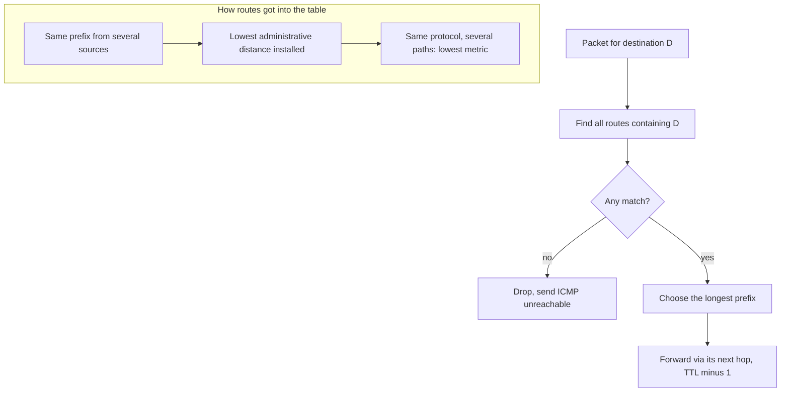
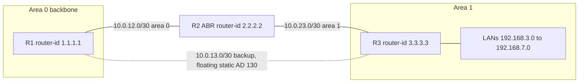
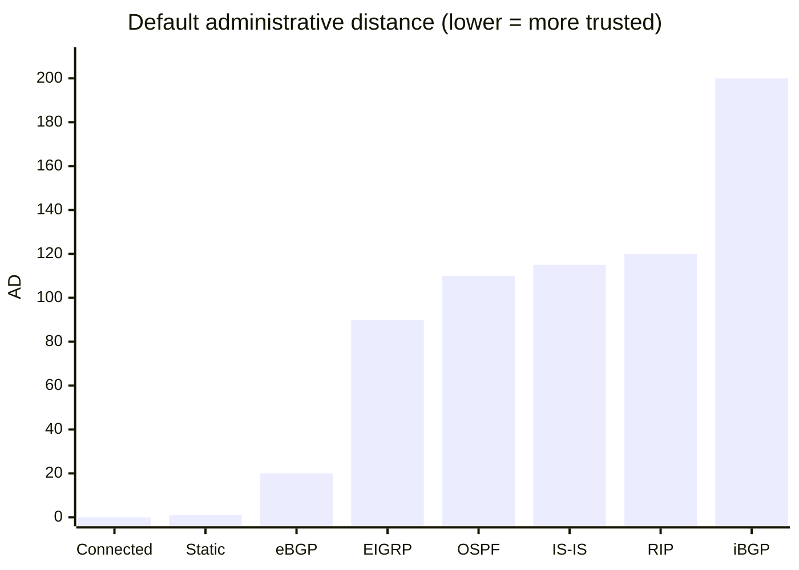

# Session 7: Routing Technologies: Static Routes and OSPF

> [Cybersecurity and Digital Forensics](../../README.md) › [Term 1](../README.md) › [Module 4: Configuring Network Infrastructure](README.md) › **Session 7**

| ⏱ Estimated time | 📋 Prerequisites |
|---|---|
| 3.5 hours | Session 3 (subnetting, CIDR), Session 4 (IOS configuration) |

| ⬅ [Previous: Session 6](session-06-stp-and-etherchannel.md) | [Next: Session 8](session-08-first-hop-redundancy.md) ➡ |
|:---|---:|

[](https://colab.research.google.com/github/Hamnakhan123/Cybersecurity-and-Digital-Forensics/blob/main/term-1/04-configuring-network-infrastructure/code/session-07-routing-static-and-ospf.ipynb) &nbsp;Run every Python example of this session in the notebook [`code/session-07-routing-static-and-ospf.ipynb`](code/session-07-routing-static-and-ospf.ipynb).

---

## 🎯 Learning objectives

- Define **routing** and explain how a router builds and uses its **routing table**.
- Describe **administrative distance**, **metrics**, **autonomous systems** and the **longest prefix match** rule.
- Configure **static**, **default** and **floating static** routes for **IPv4 and IPv6**.
- Explain **single-area** and **multi-area OSPF**: router ID, neighbours, DR/BDR, areas, ABRs, LSAs and cost.
- Configure and verify single-area and multi-area OSPF on Cisco routers.

## 📖 Concepts

### 1. Routing fundamentals

**Routing** is choosing the path a packet takes from one network to another. A router:

1. Receives a frame, removes the Layer 2 header, checks the IP header (checksum, TTL).
2. Looks up the **destination IP** in its **routing table**.
3. Decrements **TTL** (drops the packet and sends ICMP "time exceeded" at 0).
4. Re-encapsulates the packet in a **new Layer 2 header** for the outgoing link and sends it.

**Where routes come from**

| Source | Code | How |
|---|---|---|
| Directly connected | `C` (and `L` = the router's own address /32) | Interface with an IP that is **up/up** |
| Static | `S` | Typed by an administrator |
| Default (gateway of last resort) | `S*` / `O*E2` | Matches anything: `0.0.0.0/0`, `::/0` |
| Dynamic | `O` OSPF, `D` EIGRP, `R` RIP, `B` BGP | Learned from neighbours |

### 2. Longest prefix match, administrative distance and metric

When a packet arrives, the router chooses in this order:

1. **Longest prefix match** – among all routes that contain the destination, the **most specific** (longest mask) wins. `10.10.5.0/24` beats `10.10.0.0/16` beats `0.0.0.0/0`.
2. **Administrative distance (AD)** – when *different sources* offer the **same prefix**, only the most trusted one is installed in the routing table.
3. **Metric** – when the *same protocol* knows several paths to the same prefix, the lowest metric wins (equal metrics → **ECMP** load sharing).

| Route source | Default AD |
|---|---|
| Connected | 0 |
| Static | 1 |
| eBGP | 20 |
| EIGRP (internal) | 90 |
| OSPF | 110 |
| IS-IS | 115 |
| RIP | 120 |
| iBGP | 200 |
| Unusable | 255 |

> **Analogy – asking for directions.** Longest prefix match means you trust the sign that says "Clifton Block 5" over one that only says "Karachi". Administrative distance is how much you trust the source: your own map (connected) beats a friend's advice (static) beats a stranger (RIP). The metric is the number on the sign: 3 km beats 7 km.

**Autonomous system (AS):** a set of networks under **one administrative control** with one routing policy (a university, an ISP). Protocols that route **inside** an AS are **IGPs** (OSPF, EIGRP, IS-IS, RIP); between ASes the internet uses **BGP** (an EGP). Public AS numbers are assigned by regional registries (APNIC for Pakistan).

### 3. Static routing

```text
ip route <network> <mask> {next-hop-IP | exit-interface} [AD]
ipv6 route <prefix/len> {next-hop | exit-interface [link-local next-hop]} [AD]
```

| Type | Example | Use |
|---|---|---|
| Standard static | `ip route 192.168.3.0 255.255.255.0 10.0.12.2` | Small, stable networks |
| Default static | `ip route 0.0.0.0 0.0.0.0 203.0.113.1` | Stub site with one exit to the ISP |
| Summary static | `ip route 10.20.8.0 255.255.248.0 10.0.12.2` | One route for many subnets |
| **Floating static** | `ip route 192.168.3.0 255.255.255.0 10.0.13.2 130` | Backup: higher AD than the primary (e.g. OSPF 110), so it appears only when the primary disappears |
| IPv6 static | `ipv6 route 2001:db8:3::/64 2001:db8:12::2` | Needs `ipv6 unicast-routing` |
| IPv6 with link-local next hop | `ipv6 route 2001:db8:3::/64 Gi0/1 fe80::2` | Must include the exit interface |

**Static pros/cons:** no protocol overhead and nothing to attack, but no automatic adaptation and heavy manual work as the network grows.

### 4. OSPF – Open Shortest Path First

OSPF is an open-standard **link-state** IGP (OSPFv2 for IPv4, **OSPFv3** for IPv6 – Session 11).

- Every router floods **LSAs** describing its links; all routers in an area keep an identical **LSDB** (map) and each runs **Dijkstra's SPF** algorithm to build its own shortest-path tree.
- **Cost** = reference bandwidth ÷ interface bandwidth (default reference 100 Mbps → set `auto-cost reference-bandwidth 100000` so 1G, 10G and 100G links differ). Lower total cost wins.
- **Router ID**: `router-id` command → else highest loopback IP → else highest active interface IP.
- **Hello / dead timers**: 10 s / 40 s on Ethernet. Neighbours must match **area, subnet/mask, hello/dead, authentication, MTU** and stub flags.
- **Neighbour states**: Down → Init → 2-Way → ExStart → Exchange → Loading → **Full**.
- On multi-access segments a **DR** and **BDR** are elected (highest **priority**, default 1; then highest router ID) so routers form full adjacencies only with them. Priority 0 = never DR. Point-to-point links have no DR.
- Multicast: **224.0.0.5** (all OSPF routers), **224.0.0.6** (DR/BDR). IP protocol **89**.

**Single-area vs multi-area OSPF**

| | Single-area | Multi-area |
|---|---|---|
| Design | All routers in **area 0** | **Backbone area 0** + other areas attached to it |
| LSDB | Every router knows every link | Each router knows full detail only of its own area(s) |
| SPF runs | On every change anywhere | Only in the affected area |
| Summarisation | Not possible inside one area | At **ABRs** (`area 1 range …`) |
| Best for | Small/medium networks (≈ up to 50 routers) | Large networks, many sites |

Router roles: **internal router** (all interfaces in one area), **backbone router** (in area 0), **ABR** (Area Border Router – interfaces in area 0 and another area), **ASBR** (redistributes routes from outside OSPF). Routes from other areas appear as `O IA` (inter-area); external routes as `O E2`.

**Common LSA types:** Type 1 Router, Type 2 Network (from the DR), Type 3 Summary (ABR advertises other areas), Type 5 External (ASBR).

## 🧭 Diagrams

**How a router picks a route**



**Multi-area OSPF lab**



## 🪜 Step-by-step: static, floating static and OSPF in the lab

1. Build R1–R2–R3 in a line plus a backup link R1–R3; addresses as in the diagram; LANs on R1 (`192.168.1.0/24`) and R3 (`192.168.3.0/24`).
2. **Static first:** on R1 `ip route 192.168.3.0 255.255.255.0 10.0.12.2`; on R3 a matching route back. Ping LAN to LAN.
3. **Floating static:** on R1 add `ip route 192.168.3.0 255.255.255.0 10.0.13.2 130`. `show ip route static` shows only the AD 1 route (the floating one is hidden).
4. Remove the standard static routes and enable **OSPF** with router IDs and reference bandwidth.
5. Make R2 an **ABR**: its R1 link in area 0, its R3 link in area 1. Summarise area 1 with `area 1 range`.
6. Verify: `show ip ospf neighbor` → FULL; R1 `show ip route ospf` → `O IA 192.168.0.0/21`.
7. **Failover test:** shut R1 Gi0/1. OSPF routes vanish after the dead timer (or immediately on link down) and the **floating static** appears in the table (`S 192.168.3.0 [130/0]`).
8. Repeat the static part for **IPv6** with `ipv6 unicast-routing` and `ipv6 route`.

📄 **`code/session-07_static_and_ospf.ios`**

```text
! Session 7 - Static, default, floating static and OSPF (single and multi-area) - lab only
! R1 (area 0) --10.0.12.0/30-- R2 (ABR, areas 0 and 1) --10.0.23.0/30-- R3 (area 1)
! R1 also has a slow backup link to R3: 10.0.13.0/30

! ===== R1: static routing with IPv4 and IPv6 =====
ipv6 unicast-routing
ip route 192.168.3.0 255.255.255.0 10.0.12.2                 ! static route via next hop
ip route 192.168.3.0 255.255.255.0 10.0.13.2 130             ! floating static: AD 130 > OSPF 110
ip route 0.0.0.0 0.0.0.0 203.0.113.1                         ! default route to the ISP (lab address)
ipv6 route 2001:db8:3::/64 2001:db8:12::2                    ! IPv6 static route
ipv6 route 2001:db8:3::/64 2001:db8:13::2 130                ! IPv6 floating static
ipv6 route ::/0 2001:db8:ffff::1                             ! IPv6 default route

! ===== R1: OSPFv2 single area =====
router ospf 1
 router-id 1.1.1.1
 auto-cost reference-bandwidth 100000
 passive-interface GigabitEthernet0/0          ! user LAN: advertise it, but send no hellos
 network 192.168.1.0 0.0.0.255 area 0
 network 10.0.12.0 0.0.0.3 area 0
 default-information originate                 ! share the default route with OSPF neighbours
exit

! ===== R2: Area Border Router (multi-area) =====
router ospf 1
 router-id 2.2.2.2
 auto-cost reference-bandwidth 100000
 network 10.0.12.0 0.0.0.3 area 0              ! backbone side
 network 10.0.23.0 0.0.0.3 area 1              ! area 1 side
 area 1 range 192.168.0.0 255.255.248.0        ! summarise area 1 routes into area 0
exit

! ===== R3: area 1 only, configured on the interface instead of network statements =====
router ospf 1
 router-id 3.3.3.3
interface GigabitEthernet0/1
 ip ospf 1 area 1
interface GigabitEthernet0/0
 ip ospf 1 area 1

! verify:
! show ip route            show ip route static          show ipv6 route
! show ip ospf neighbor    show ip ospf interface brief  show ip ospf database
! show ip protocols        (O = intra-area route, O IA = inter-area route)
```
**Expected output excerpts:**

```text
R1#show ip route
Gateway of last resort is 203.0.113.1 to network 0.0.0.0
S*    0.0.0.0/0 [1/0] via 203.0.113.1
C     10.0.12.0/30 is directly connected, GigabitEthernet0/1
L     10.0.12.1/32 is directly connected, GigabitEthernet0/1
O IA  192.168.0.0/21 [110/200] via 10.0.12.2, 00:02:41, GigabitEthernet0/1

R1#show ip ospf neighbor
Neighbor ID     Pri   State           Dead Time   Address         Interface
2.2.2.2           0   FULL/  -        00:00:37    10.0.12.2       GigabitEthernet0/1

! after shutting Gi0/1:
S     192.168.3.0/24 [130/0] via 10.0.13.2
```

## 💻 Worked examples

### Example 1 – Longest prefix, AD and a floating static route in action

📄 **`code/session-07_route_lookup.py`**

```python
"""Session 7 - How a router chooses a route: longest prefix, then AD, then metric.

1. Among routes that CONTAIN the destination, the longest prefix (most specific) wins.
2. If two sources offer the same prefix, the lower administrative distance is installed.
3. A floating static route has a deliberately high AD, so it is used only when
   the preferred dynamic route disappears.
Run:  python session-07_route_lookup.py
"""
import ipaddress

AD = {"connected": 0, "static": 1, "eBGP": 20, "EIGRP": 90, "OSPF": 110, "RIP": 120, "floating static": 130}

# candidate routes learned from different sources: (prefix, source, metric, next hop, AD override)
CANDIDATES = [
    ("10.0.0.0/8", "static", 0, "203.0.113.1", None),
    ("10.10.0.0/16", "OSPF", 20, "10.0.12.2", None),
    ("10.10.0.0/16", "RIP", 3, "10.0.13.2", None),
    ("10.10.5.0/24", "OSPF", 30, "10.0.14.2", None),
    ("0.0.0.0/0", "static", 0, "203.0.113.1", None),
    ("192.168.50.0/24", "OSPF", 65, "10.0.12.2", None),
    ("192.168.50.0/24", "floating static", 0, "10.0.99.2", 130),
]


def build_rib(candidates):
    """Install only the best source for each prefix (lowest AD, then lowest metric)."""
    rib = {}
    for prefix, src, metric, nh, ad in candidates:
        ad = ad if ad is not None else AD[src]
        cur = rib.get(prefix)
        if cur is None or (ad, metric) < (cur[1], cur[2]):
            rib[prefix] = (src, ad, metric, nh)
    return rib


def lookup(rib, dst):
    d = ipaddress.ip_address(dst)
    matches = [(ipaddress.ip_network(p), r) for p, r in rib.items() if d in ipaddress.ip_network(p)]
    net, (src, ad, metric, nh) = max(matches, key=lambda m: m[0].prefixlen)
    return net, src, ad, metric, nh


def show(rib):
    code = {"static": "S", "floating static": "S", "OSPF": "O", "RIP": "R", "connected": "C"}
    for p in sorted(rib, key=lambda x: (ipaddress.ip_network(x).prefixlen, x)):
        src, ad, m, nh = rib[p]
        print(f"   {code[src]:2} {p:18} [{ad}/{m}] via {nh}")


if __name__ == "__main__":
    rib = build_rib(CANDIDATES)
    print("Routing table (RIB) after choosing the best source per prefix:")
    show(rib)
    print("\nLookups:")
    for dst in ["10.10.5.9", "10.10.7.1", "10.200.1.1", "8.8.8.8", "192.168.50.20"]:
        net, src, ad, m, nh = lookup(rib, dst)
        print(f"   {dst:15} -> {str(net):16} via {nh:12} ({src}, AD {ad})")

    print("\nOSPF neighbour to 10.0.12.2 goes down: OSPF routes via it are withdrawn")
    remaining = [c for c in CANDIDATES if not (c[1] == "OSPF" and c[3] == "10.0.12.2")]
    rib2 = build_rib(remaining)
    for dst in ["10.10.7.1", "192.168.50.20"]:
        net, src, ad, m, nh = lookup(rib2, dst)
        print(f"   {dst:15} -> {str(net):16} via {nh:12} ({src}, AD {ad})")
```

**Output**

```text
Routing table (RIB) after choosing the best source per prefix:
   S  0.0.0.0/0          [1/0] via 203.0.113.1
   S  10.0.0.0/8         [1/0] via 203.0.113.1
   O  10.10.0.0/16       [110/20] via 10.0.12.2
   O  10.10.5.0/24       [110/30] via 10.0.14.2
   O  192.168.50.0/24    [110/65] via 10.0.12.2

Lookups:
   10.10.5.9       -> 10.10.5.0/24     via 10.0.14.2    (OSPF, AD 110)
   10.10.7.1       -> 10.10.0.0/16     via 10.0.12.2    (OSPF, AD 110)
   10.200.1.1      -> 10.0.0.0/8       via 203.0.113.1  (static, AD 1)
   8.8.8.8         -> 0.0.0.0/0        via 203.0.113.1  (static, AD 1)
   192.168.50.20   -> 192.168.50.0/24  via 10.0.12.2    (OSPF, AD 110)

OSPF neighbour to 10.0.12.2 goes down: OSPF routes via it are withdrawn
   10.10.7.1       -> 10.10.0.0/16     via 10.0.13.2    (RIP, AD 120)
   192.168.50.20   -> 192.168.50.0/24  via 10.0.99.2    (floating static, AD 130)
```
**Observe:**
- `10.10.0.0/16` is offered by OSPF (AD 110) and RIP (AD 120): only OSPF is installed.
- `10.10.5.9` matches `/8`, `/16` and `/24` – the **/24** wins even though it has a worse OSPF metric than the /16. Prefix length is checked **before** metric or AD.
- When the OSPF neighbour fails, the RIP route (previously hidden) and the **floating static** (AD 130) take over automatically.

### Example 2 – Calculating OSPF cost by hand

Reference bandwidth set to 100 000 Mbps (100 Gbps):

| Link | Bandwidth | Cost = 100 000 ÷ BW |
|---|---|---|
| R1–R2 | 1 Gbps | 100 |
| R2–R3 | 1 Gbps | 100 |
| R1–R3 (backup) | 100 Mbps | 1 000 |
| R3 LAN | 1 Gbps | 100 |

R1 → R3 LAN via R2 = 100 + 100 + 100 = **300**; directly over the backup = 1 000 + 100 = **1 100** → OSPF prefers the path through R2 even though it has more hops. With the *default* 100 Mbps reference all three links would cost 1 and OSPF would choose the slow direct link.

### Example 3 – Wildcard masks for `network` statements

| Subnet | Mask | Wildcard (255 − each octet) |
|---|---|---|
| 192.168.1.0/24 | 255.255.255.0 | 0.0.0.255 |
| 10.0.12.0/30 | 255.255.255.252 | 0.0.0.3 |
| 172.16.0.0/22 | 255.255.252.0 | 0.0.3.255 |
| One interface only | 255.255.255.255 | 0.0.0.0 |

## 📊 Chart



| | Static | OSPF |
|---|---|---|
| Configuration | Per route, per router | Per interface/network, once |
| Adapts to failure | Only with floating static | Automatically |
| Overhead | None | Hellos, LSAs, SPF CPU |
| Security | Nothing to spoof | Needs authentication + passive interfaces |
| Scale | Tiny/stub networks | Large, hierarchical with areas |

## 🏢 Real-life problem with full solution

**Scenario.** A college has a main campus (R-MAIN) and two branch campuses (R-NORTH, R-SOUTH). Each branch has a fibre link to the main campus and a cheap broadband VPN as backup. Today all routes are static; when the North fibre was cut, North was offline for 6 hours. North and South each have eight /24 LANs. The main campus also connects to the ISP.

**Solution.**

1. **Protocol:** OSPF (multi-vendor friendly, fast convergence).
2. **Areas:** area 0 = main campus core and the fibre links; **area 1 = North LANs**, **area 2 = South LANs**; branch routers are **ABRs**.
3. **Addressing:** North LANs `10.1.0.0/24 – 10.1.7.0/24` → `area 1 range 10.1.0.0 255.255.248.0`; South similarly `10.2.0.0/21`. Main campus learns just two inter-area routes.
4. **Costs:** `auto-cost reference-bandwidth 100000` everywhere; the VPN tunnel gets `ip ospf cost 5000` so it is used only when fibre fails.
5. **Internet:** R-MAIN has a static default to the ISP and `default-information originate` so branches learn `O*E2 0.0.0.0/0`.
6. **Extra safety:** each branch keeps a **floating static default** via the VPN with AD 250, in case OSPF itself fails.
7. **Security:** `passive-interface default`, enable only WAN/VPN interfaces; OSPF authentication on every adjacency (Session 10 principles).
8. **Verify:** neighbours FULL; `show ip route` on R-MAIN shows `O IA 10.1.0.0/21` and `O IA 10.2.0.0/21`; shutting North's fibre moves traffic to the VPN within seconds; `traceroute` confirms the new path.

## ⚠️ Common mistakes

- Forgetting the **return route** – a ping needs routes in both directions.
- Using a next-hop address that is not on a directly connected subnet.
- Giving a floating static route a **lower** AD than the dynamic route (it then becomes primary).
- Writing a subnet mask where OSPF expects a **wildcard**.
- Mismatched area IDs, hello/dead timers or MTU → neighbours stuck in Init/ExStart.
- Leaving the default reference bandwidth (all fast links cost 1).
- Building non-backbone areas that do not touch area 0.

## ✅ Best practices

- Static + default route for stub sites; OSPF as soon as there is more than one path.
- Set **router IDs** explicitly (use loopbacks).
- Same reference bandwidth on all routers.
- Summarise at ABRs with contiguous address blocks per area.
- `passive-interface default` and authentication on OSPF.
- Document expected paths and test failover regularly.

## 🧪 Lab / practice tasks

1. **Easy –** A router has `10.0.0.0/8` (static), `10.1.0.0/16` (OSPF) and `10.1.1.0/24` (RIP). Which route is used for `10.1.1.50`? For `10.1.2.50`? For `10.2.0.1`?
2. **Easy –** Write the wildcard for `/27` and `/21`.
3. **Medium –** Configure the step-by-step lab and capture `show ip route` before and after shutting the primary link.
4. **Medium –** In `session-07_route_lookup.py`, add a connected route `10.10.5.0/24` (AD 0). Which route is installed for that prefix and why?
5. **Challenge –** Add **ECMP**: when two candidates have the same prefix, AD and metric, keep **both** next hops and show that lookups alternate between them.

<details>
<summary>💡 Hints</summary>

- Task 1: apply longest prefix match first – AD only matters for identical prefixes.
- Task 2: wildcard octet = 255 − mask octet; /27 mask is .224, /21 mask is 255.255.248.0.
- Task 5: store a list of next hops in the RIB and use a counter to pick one per lookup.
</details>

<details>
<summary>✅ Solutions</summary>

**Task 1:** `10.1.1.50` → `/24` RIP (longest prefix, even though RIP has the highest AD); `10.1.2.50` → `/16` OSPF; `10.2.0.1` → `/8` static.

**Task 2:** /27 → `0.0.0.31`; /21 → `0.0.7.255`.

**Task 4:** the connected route (AD 0) replaces the OSPF route for `10.10.5.0/24`: `C 10.10.5.0/24 [0/0]`.

```python
("10.10.5.0/24", "connected", 0, "Gi0/2", None),
```

**Task 5 (core lines):**

```python
if cur and (ad, metric) == (cur[1], cur[2]):
    rib[prefix] = (src, ad, metric, cur[3] + [nh])     # keep both next hops
...
nh = nhs[counter % len(nhs)]; counter += 1
```
</details>

## ✅ Quick quiz

1. Which rule is applied first when choosing a route for a packet? a) lowest AD b) lowest metric c) longest prefix match d) newest route
2. The default AD of OSPF is: a) 90 b) 100 c) 110 d) 120
3. A floating static route backing up OSPF should have an AD of: a) 1 b) 90 c) 110 d) 130
4. Which OSPF area must all other areas connect to? a) 1 b) 0 c) 255 d) any
5. A router with interfaces in area 0 and area 2 is an: a) ASBR b) ABR c) DR d) internal router

<details>
<summary>Show answers</summary>

1 – c · 2 – c · 3 – d · 4 – b · 5 – b
</details>

## 📝 Summary / cheat-sheet

- Route choice: **longest prefix** → **AD** (for identical prefixes) → **metric**.
- AD: connected 0, static 1, eBGP 20, EIGRP 90, OSPF 110, RIP 120, iBGP 200.
- Static: `ip route net mask next-hop [AD]`; default `0.0.0.0 0.0.0.0`; floating = higher AD; IPv6 `ipv6 route prefix next-hop`.
- OSPF: link state, Dijkstra, cost = ref BW ÷ BW, router ID, hello 10/dead 40, DR/BDR, FULL.
- Multi-area: area 0 backbone, ABRs summarise (`area X range`), `O IA` inter-area routes.
- Verify: `show ip route`, `show ip ospf neighbor`, `show ip protocols`, `traceroute`.

**Interview / viva questions**

1. Explain longest prefix match with an example.
2. What is administrative distance and how is it different from a metric?
3. How does a floating static route work?
4. Why are OSPF areas used, and what does an ABR do?
5. List reasons why two OSPF routers might not become neighbours.
6. Why should the OSPF reference bandwidth be changed on modern networks?

---

| ⬅ [Previous: Session 6](session-06-stp-and-etherchannel.md) | [Next: Session 8](session-08-first-hop-redundancy.md) ➡ |
|:---|---:|

<sub>Prepared by **Hamna Zahid Khan**, Junior Lecturer · Cybersecurity and Digital Forensics</sub>
