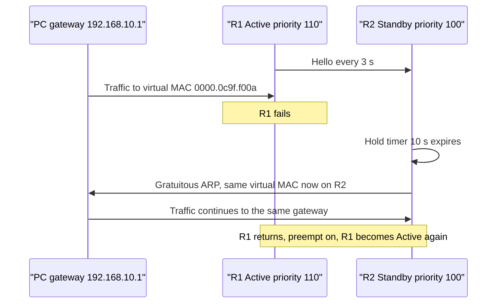
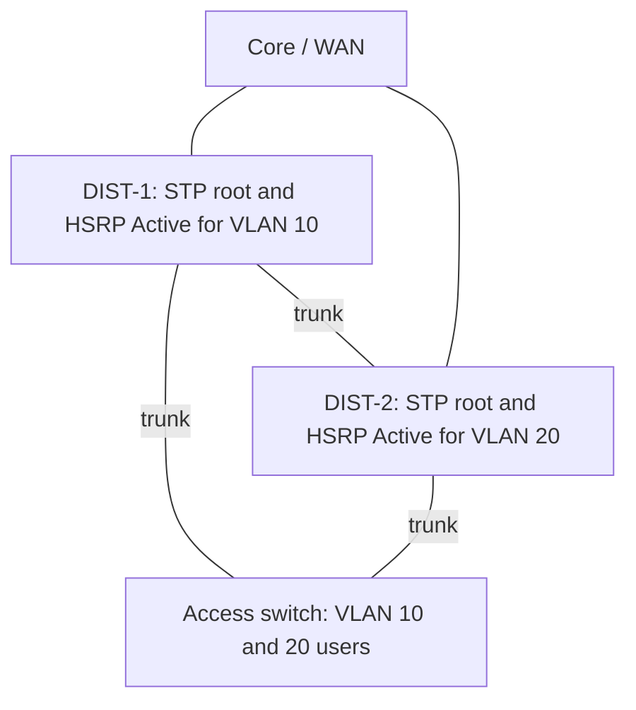
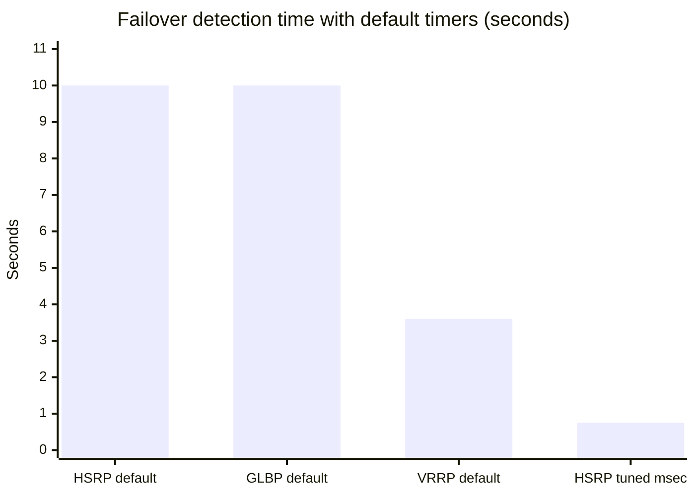

# Session 8: First Hop Redundancy: HSRP, VRRP and GLBP

> [Cybersecurity and Digital Forensics](../../README.md) › [Term 1](../README.md) › [Module 4: Configuring Network Infrastructure](README.md) › **Session 8**

| ⏱ Estimated time | 📋 Prerequisites |
|---|---|
| 2.5 hours | Session 7 (routing), Session 5 (VLANs) |

| ⬅ [Previous: Session 7](session-07-routing-static-and-ospf.md) | [Next: Session 9](session-09-network-management-protocols.md) ➡ |
|:---|---:|

[](https://colab.research.google.com/github/Hamnakhan123/Cybersecurity-and-Digital-Forensics/blob/main/term-1/04-configuring-network-infrastructure/code/session-08-first-hop-redundancy.ipynb) &nbsp;Run every Python example of this session in the notebook [`code/session-08-first-hop-redundancy.ipynb`](code/session-08-first-hop-redundancy.ipynb).

---

## 🎯 Learning objectives

- Summarise the **first-hop problem**: why one default gateway is a single point of failure.
- Explain the **importance and requirements** of First Hop Redundancy Protocols (FHRPs): virtual IP, virtual MAC, election, failover, preemption, tracking.
- Define and compare **HSRP**, **VRRP** and **GLBP**.
- Configure and verify HSRP (with preemption, authentication and interface tracking) and recognise the VRRP and GLBP equivalents.
- Align FHRP roles with STP roots for efficient forwarding.

## 📖 Concepts

### 1. The first-hop problem

Hosts (PCs, phones, printers) are configured – usually by DHCP – with **one default gateway IP**. If that router fails, every host in the subnet loses access to other networks, even if a second router is sitting right next to it. Hosts do not run routing protocols and will not "discover" the backup router.

> **Analogy – a reception desk with one phone number.** Visitors only know one number for "Reception". If the receptionist goes home sick, nobody gets through, although a colleague is in the next office. An FHRP is like a **call-forwarding number** shared by both: callers keep dialling the same number, and whichever receptionist is on duty answers.

### 2. How an FHRP works

Two or more routers (or Layer 3 switches) form a **group** and share:

- a **virtual IP address** – this is the default gateway given to hosts,
- a **virtual MAC address** – returned in ARP replies for the virtual IP.

One router is **active/master** and forwards traffic for the virtual IP; the others listen to its **hello** messages. If hellos stop for the **hold/dead time**, a standby router takes over the virtual IP **and** virtual MAC. Hosts notice nothing: their ARP cache still points to the same MAC, which now lives on a different router (the new active sends a **gratuitous ARP** so switches update their MAC tables).

**Requirements / building blocks**

| Element | Purpose |
|---|---|
| Virtual IP | One stable gateway address for hosts |
| Virtual MAC | ARP entry that does not change during failover |
| **Priority** | Decides who becomes active (higher wins; tie → higher interface IP) |
| **Preemption** | Lets a higher-priority router take back the active role when it recovers |
| **Timers** | Hello and hold intervals → failover speed |
| **Object tracking** | Lowers priority when an uplink fails, so a router with a dead uplink gives up the active role |
| **Authentication** | Stops a rogue device from joining the group and stealing traffic |

### 3. HSRP, VRRP and GLBP

| | **HSRP** | **VRRP** | **GLBP** |
|---|---|---|---|
| Standard | Cisco (RFC 2281 informational) | Open standard: RFC 5798 (v3) | Cisco |
| Roles | **Active**, **Standby**, listen | **Master**, **Backup** | **AVG** (gateway), up to 4 **AVFs** (forwarders) |
| Default priority | 100 | 100 (owner of the IP = 255) | 100 |
| Preemption default | **Off** | **On** | Off |
| Virtual IP | Must be a spare address | Can be a real interface IP | Spare address |
| Virtual MAC | v1 `0000.0c07.acXX`, v2 `0000.0c9f.fXXX` | `0000.5e00.01XX` | `0007.b400.XXYY` |
| Multicast | v1 224.0.0.2, v2 224.0.0.102 (UDP 1985) | 224.0.0.18 (IP protocol 112) | 224.0.0.102 (UDP 3222) |
| Default timers | Hello 3 s, hold 10 s | Advert 1 s, down ≈ 3 s | Hello 3 s, hold 10 s |
| Load sharing | Per VLAN/group (different active per group) | Per group | **Within one group** – each host gets a different virtual MAC |
| Groups | v1 0–255, v2 0–4095 | 1–255 | 0–1023 |

- **HSRP v2** adds IPv6 support, more groups and millisecond timers – prefer it.
- **VRRP** is the choice in **multi-vendor** networks (firewalls and routers from different vendors).
- **GLBP** gives true load balancing: the **AVG** answers ARP requests with the virtual MACs of different **AVFs** in turn (round-robin, weighted or host-dependent), so every router forwards traffic.

### 4. Designing it well

- **Align with STP:** in a dual-distribution design, make DIST-1 the STP root *and* HSRP active for VLAN 10, and DIST-2 for VLAN 20. Traffic then takes the shortest Layer 2 path to its gateway and both switches carry load.
- **Track uplinks:** `standby 10 track 1 decrement 20` so a router with no path upstream hands over.
- **Tune timers carefully:** `standby 10 timers msec 200 msec 750` gives sub-second failover but more CPU; BFD is an alternative.
- **Authenticate** (MD5) and use preemption **with a delay** (`standby 10 preempt delay minimum 60`) so a rebooting router has time to build its routing table before taking over.

## 🧭 Diagrams

**HSRP failover sequence**



**Dual distribution with load sharing per VLAN**



## 🪜 Step-by-step: HSRP v2 with tracking

1. Build R1 and R2 connected to one switch in `192.168.10.0/24`; both connect upstream to an "ISP" router. Give R1 `.2` and R2 `.3`.
2. Configure HSRP group 10 on both with virtual IP `192.168.10.1`; R1 priority 110, both `preempt`, MD5 authentication.
3. Set PCs' gateway to `192.168.10.1`.
4. Verify `show standby brief` → R1 **Active**, R2 **Standby**.
5. Run `ping -t 8.8.8.8` (or a far-end loopback) from a PC; shut R1's LAN interface. Count lost pings (~3–4 with default timers).
6. Restore R1 and watch it **preempt**.
7. Add `track 1 interface Gi0/1 line-protocol` and `standby 10 track 1 decrement 20` on R1; shut R1's **uplink** → R1 drops to 90 and R2 becomes active.

📄 **`code/session-08_hsrp.ios`**

```text
! Session 8 - HSRP v2 with preemption and tracking, plus VRRP and GLBP equivalents (lab)
! LAN 192.168.10.0/24, virtual gateway 192.168.10.1, R1 = .2 (Active), R2 = .3 (Standby)

! ===== R1 =====
track 1 interface GigabitEthernet0/1 line-protocol   ! watch the uplink to the core/ISP
interface GigabitEthernet0/0
 ip address 192.168.10.2 255.255.255.0
 standby version 2
 standby 10 ip 192.168.10.1                           ! the address hosts use as gateway
 standby 10 priority 110                              ! higher than default 100 -> Active
 standby 10 preempt                                   ! take the role back after recovery
 standby 10 authentication md5 key-string Hsrp@Lab26  ! stop rogue routers joining the group
 standby 10 track 1 decrement 20                      ! uplink down -> priority 90 -> R2 takes over
 no shutdown

! ===== R2 =====
interface GigabitEthernet0/0
 ip address 192.168.10.3 255.255.255.0
 standby version 2
 standby 10 ip 192.168.10.1
 standby 10 preempt
 standby 10 authentication md5 key-string Hsrp@Lab26
 no shutdown

! ===== Same idea with VRRP (open standard) on R1 =====
! interface GigabitEthernet0/0
!  vrrp 10 ip 192.168.10.1
!  vrrp 10 priority 110          ! VRRP preempts by default
!
! ===== GLBP (Cisco, load sharing) on R1 =====
! interface GigabitEthernet0/0
!  glbp 10 ip 192.168.10.1
!  glbp 10 priority 110
!  glbp 10 preempt
!  glbp 10 load-balancing round-robin

! verify:
! show standby brief       show standby           show vrrp brief       show glbp brief
! show track               debug standby events   (lab only, stop with undebug all)
```
**Expected output:**

```text
R1#show standby brief
                     P indicates configured to preempt.
                     |
Interface   Grp  Pri P State   Active          Standby         Virtual IP
Gi0/0       10   110 P Active  local           192.168.10.3    192.168.10.1

! after shutting R1's uplink Gi0/1:
%TRACK-6-STATE: 1 interface Gi0/1 line-protocol Up -> Down
%HSRP-5-STATECHANGE: GigabitEthernet0/0 Grp 10 state Active -> Speak
R2#show standby brief
Gi0/0       10   100 P Active  local           192.168.10.2    192.168.10.1
```

## 💻 Worked examples

### Example 1 – Election, failover, preemption and GLBP load sharing

📄 **`code/session-08_fhrp_sim.py`**

```python
"""Session 8 - First Hop Redundancy: HSRP election, failover and GLBP load sharing.

Hosts keep ONE default gateway address. HSRP/VRRP/GLBP make two or more
routers share a VIRTUAL IP and virtual MAC so the gateway survives a failure.
HSRP: highest priority (default 100) becomes Active, ties -> highest interface IP.
Preemption lets a higher-priority router take the role back when it returns.
Run:  python session-08_fhrp_sim.py
"""
import ipaddress


def hsrp_vmac(group, version=1):
    return f"0000.0c07.ac{group:02x}" if version == 1 else f"0000.0c9f.f{group:03x}"


def vrrp_vmac(group):
    return f"0000.5e00.01{group:02x}"


def elect(routers):
    alive = [r for r in routers if r["up"]]
    ranked = sorted(alive, key=lambda r: (r["priority"], ipaddress.ip_address(r["ip"])), reverse=True)
    return ranked[0]["name"] if ranked else None, ranked[1]["name"] if len(ranked) > 1 else None


def timeline(routers, preempt):
    active, standby = elect(routers)
    print(f"  t=0s   Active {active}, Standby {standby}")
    routers[0]["up"] = False
    active, standby = elect(routers)
    print(f"  t=5s   {routers[0]['name']} fails -> hello timer 3 s, hold timer 10 s")
    print(f"  t=15s  hold timer expires: Active {active}, Standby {standby}")
    routers[0]["up"] = True
    if preempt:
        a, s = elect(routers)
        print(f"  t=60s  {routers[0]['name']} returns with preempt -> Active {a}, Standby {s}")
    else:
        print(f"  t=60s  {routers[0]['name']} returns without preempt -> stays Standby; Active {active}")


def glbp_assign(hosts, forwarders):
    """The AVG answers each host's ARP with the next forwarder's virtual MAC (round robin)."""
    return {h: forwarders[i % len(forwarders)] for i, h in enumerate(hosts)}


if __name__ == "__main__":
    print("Virtual MAC addresses (group 10)")
    print(f"  HSRPv1 {hsrp_vmac(10)}   HSRPv2 {hsrp_vmac(10, 2)}   VRRP {vrrp_vmac(10)}")
    print("\nHSRP group 10, virtual IP 192.168.10.1")
    for preempt in (False, True):
        routers = [{"name": "R1", "ip": "192.168.10.2", "priority": 110, "up": True},
                   {"name": "R2", "ip": "192.168.10.3", "priority": 100, "up": True}]
        print(f" preempt {'ON' if preempt else 'OFF'}:")
        timeline(routers, preempt)
    print("\nInterface tracking: R1 priority 110, uplink fails, track decrement 20 -> 90 < R2 100")
    r = [{"name": "R1", "ip": "192.168.10.2", "priority": 90, "up": True},
         {"name": "R2", "ip": "192.168.10.3", "priority": 100, "up": True}]
    print(f"  with preempt on R2, Active becomes {elect(r)[0]} (traffic avoids the dead uplink)")

    print("\nGLBP: one virtual IP, several virtual MACs -> every router forwards")
    hosts = [f"PC{i}" for i in range(1, 9)]
    avf = {"R1": "0007.b400.0a01", "R2": "0007.b400.0a02", "R3": "0007.b400.0a03"}
    plan = glbp_assign(hosts, list(avf))
    for h, r in plan.items():
        print(f"  {h}: gateway 192.168.10.1 -> MAC {avf[r]} ({r})")
```

**Output**

```text
Virtual MAC addresses (group 10)
  HSRPv1 0000.0c07.ac0a   HSRPv2 0000.0c9f.f00a   VRRP 0000.5e00.010a

HSRP group 10, virtual IP 192.168.10.1
 preempt OFF:
  t=0s   Active R1, Standby R2
  t=5s   R1 fails -> hello timer 3 s, hold timer 10 s
  t=15s  hold timer expires: Active R2, Standby None
  t=60s  R1 returns without preempt -> stays Standby; Active R2
 preempt ON:
  t=0s   Active R1, Standby R2
  t=5s   R1 fails -> hello timer 3 s, hold timer 10 s
  t=15s  hold timer expires: Active R2, Standby None
  t=60s  R1 returns with preempt -> Active R1, Standby R2

Interface tracking: R1 priority 110, uplink fails, track decrement 20 -> 90 < R2 100
  with preempt on R2, Active becomes R2 (traffic avoids the dead uplink)

GLBP: one virtual IP, several virtual MACs -> every router forwards
  PC1: gateway 192.168.10.1 -> MAC 0007.b400.0a01 (R1)
  PC2: gateway 192.168.10.1 -> MAC 0007.b400.0a02 (R2)
  PC3: gateway 192.168.10.1 -> MAC 0007.b400.0a03 (R3)
  PC4: gateway 192.168.10.1 -> MAC 0007.b400.0a01 (R1)
  PC5: gateway 192.168.10.1 -> MAC 0007.b400.0a02 (R2)
  PC6: gateway 192.168.10.1 -> MAC 0007.b400.0a03 (R3)
  PC7: gateway 192.168.10.1 -> MAC 0007.b400.0a01 (R1)
  PC8: gateway 192.168.10.1 -> MAC 0007.b400.0a02 (R2)
```
**Observe:**
- Without preemption, R1 comes back as **Standby** and R2 stays Active – a surprise for many engineers who expected the "primary" to return.
- Tracking turns an uplink failure into a priority drop, so traffic avoids a router that cannot reach anywhere.
- GLBP hands hosts different virtual MACs for the **same** gateway IP, so all three routers forward traffic.

### Example 2 – Calculating downtime per failover

| Protocol / timers | Detection time | Lost packets with 1 ping per second |
|---|---|---|
| HSRP default (3 s / 10 s) | up to 10 s | ≈ 10 |
| HSRP tuned (200 ms / 750 ms) | < 1 s | ≈ 1 |
| VRRP default (1 s, down = 3 × 1 + skew) | ≈ 3 s | ≈ 3 |
| Interface down detected immediately | ≈ 0 s | 0–1 |

If a call centre has 120 VoIP calls and each failover drops audio for the detection time, cutting it from 10 s to under 1 s is the difference between dropped calls and a short glitch.

## 📊 Chart



## 🏢 Real-life problem with full solution

**Scenario.** A bank branch has two routers (R-A to fibre ISP 1, R-B to fibre ISP 2) and 60 staff PCs on `10.40.10.0/24`. PCs use R-A (`10.40.10.1`) as their gateway. Yesterday ISP 1's fibre was cut; R-A stayed up, so nobody failed over, and the branch was offline for 2 hours although ISP 2 was working.

**Solution.**

1. **Introduce a virtual gateway:** move R-A to `.2`, R-B to `.3`, and make `10.40.10.1` the **VRRP** virtual IP (open standard, because the bank plans to replace R-B with another vendor's firewall). DHCP still hands out `.1`, so **no PC changes**.
2. **Priorities:** R-A 120, R-B 100; preemption on (VRRP default) with a 60 s delay.
3. **Tracking:** track an **IP SLA** probe that pings ISP 1's gateway (better than tracking only the interface, because the fibre cut happened beyond the local port): `track 10 ip sla 1 reachability`, `vrrp 10 track 10 decrement 30`.
4. **Authentication:** VRRP authentication / restrict the group with ACLs on the LAN.
5. **Verify:** `show vrrp brief`; simulate the ISP failure by blocking the probe → R-A drops to 90, R-B becomes master within ~3 s; restore → R-A preempts after 60 s.
6. **Document:** a one-page runbook listing virtual IP, priorities, tracked objects and test results.

## ⚠️ Common mistakes

- Using a real interface IP as the HSRP virtual IP (must be unused for HSRP).
- Forgetting **preempt** and assuming the higher-priority router will return to active.
- Tracking only the local interface when the failure is further upstream (use IP SLA).
- Mismatched group numbers, versions or authentication between peers.
- HSRP active on one switch but STP root on the other → traffic crosses the inter-switch link unnecessarily.
- Very aggressive timers on busy devices causing flapping.

## ✅ Best practices

- HSRPv2 (Cisco) or VRRPv3 (multi-vendor); GLBP when you need load sharing in one subnet.
- Align HSRP active role and STP root per VLAN.
- Track upstream reachability; use preemption with a delay.
- Authenticate the group; document virtual IPs in the IPAM.
- Test failover during a maintenance window every quarter.

## 🧪 Lab / practice tasks

1. **Easy –** What virtual MAC does HSRPv1 use for group 25? VRRP group 25?
2. **Easy –** Which FHRP is an open standard?
3. **Medium –** Build the lab and measure lost pings during failover with default timers and with `standby 10 timers msec 200 msec 750`.
4. **Medium –** In `session-08_fhrp_sim.py`, add a third router R3 with priority 105. Who is Active and Standby? What happens when R1 fails?
5. **Challenge –** Add a **weighted** GLBP mode to the simulator where R1 gets weight 2 and R2, R3 weight 1, so R1 serves half of the hosts.

<details>
<summary>💡 Hints</summary>

- Task 1: convert 25 to hex (0x19).
- Task 4: `elect()` already sorts by priority; the first two are Active and Standby.
- Task 5: build the forwarder list `["R1", "R1", "R2", "R3"]` from the weights and reuse `glbp_assign`.
</details>

<details>
<summary>✅ Solutions</summary>

**Task 1:** HSRPv1 `0000.0c07.ac19`; VRRP `0000.5e00.0119`.

**Task 2:** VRRP (RFC 5798).

**Task 3:** typical result: about 8–10 lost pings with defaults, 1 with millisecond timers.

**Task 4:** Active R1 (110), Standby R3 (105). When R1 fails, R3 becomes Active and R2 Standby.

**Task 5:**

```python
weights = {"R1": 2, "R2": 1, "R3": 1}
forwarders = [r for r, w in weights.items() for _ in range(w)]
plan = glbp_assign(hosts, forwarders)   # R1 gets 4 of 8 hosts
```
</details>

## ✅ Quick quiz

1. What problem do FHRPs solve? a) routing loops b) a single default gateway failing c) VLAN hopping d) slow DNS
2. The default HSRP priority is: a) 0 b) 1 c) 100 d) 255
3. Which protocol is preemptive by default? a) HSRP b) VRRP c) GLBP d) none
4. Which FHRP lets several routers forward traffic for the same virtual IP at the same time? a) HSRP b) VRRP c) GLBP d) STP
5. What allows a router to lose the active role when its uplink fails? a) preemption b) object tracking c) authentication d) gratuitous ARP

<details>
<summary>Show answers</summary>

1 – b · 2 – c · 3 – b · 4 – c · 5 – b
</details>

## 📝 Summary / cheat-sheet

- Hosts know one gateway; FHRPs share a **virtual IP + virtual MAC** among routers.
- Priority (higher wins, default 100) → active; preemption to take back; tracking to hand over; authentication to protect.
- HSRP (Cisco, Active/Standby, preempt off, `0000.0c07.acXX` / `0000.0c9f.fXXX`).
- VRRP (open, Master/Backup, preempt on, `0000.5e00.01XX`, can use a real IP).
- GLBP (Cisco, AVG + up to 4 AVFs, load sharing within one subnet).
- Align FHRP active with STP root per VLAN. Verify with `show standby brief`, `show vrrp brief`, `show glbp brief`.

**Interview / viva questions**

1. Why can't hosts simply be given two default gateways?
2. Explain how HSRP failover works without changing the host's ARP cache.
3. Compare HSRP, VRRP and GLBP.
4. What is preemption, and why is a preempt delay useful?
5. Why should you track upstream reachability rather than only the local interface?
6. How do you align HSRP with spanning tree, and why?

---

| ⬅ [Previous: Session 7](session-07-routing-static-and-ospf.md) | [Next: Session 9](session-09-network-management-protocols.md) ➡ |
|:---|---:|

<sub>Prepared by **Hamna Zahid Khan**, Junior Lecturer · Cybersecurity and Digital Forensics</sub>
