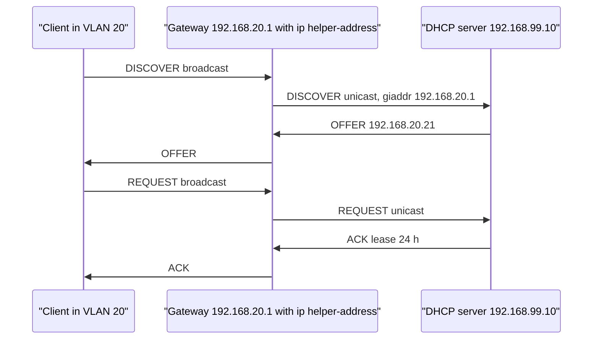
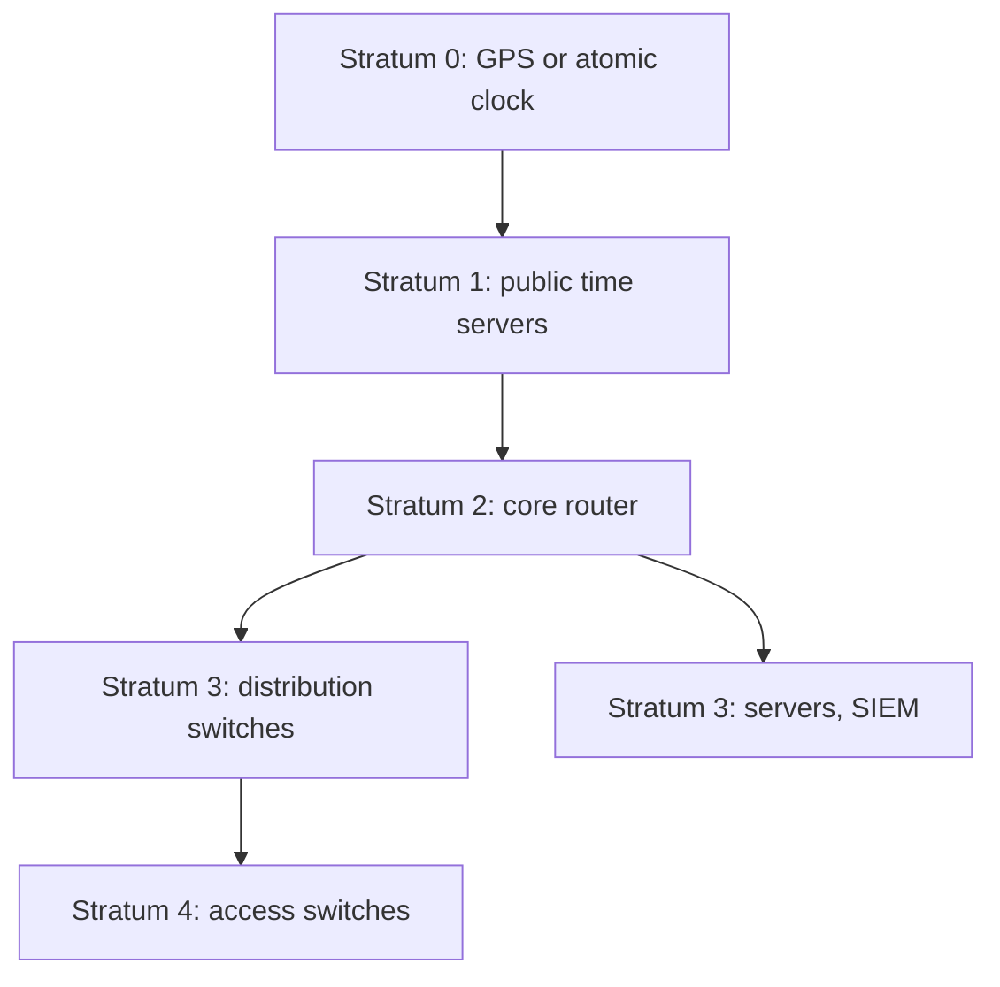
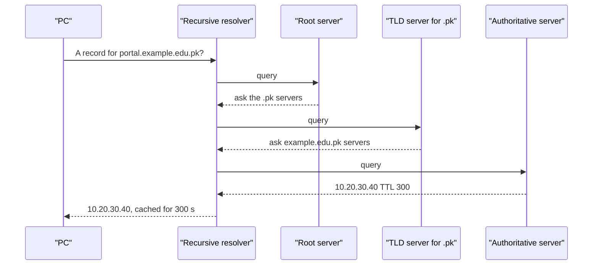
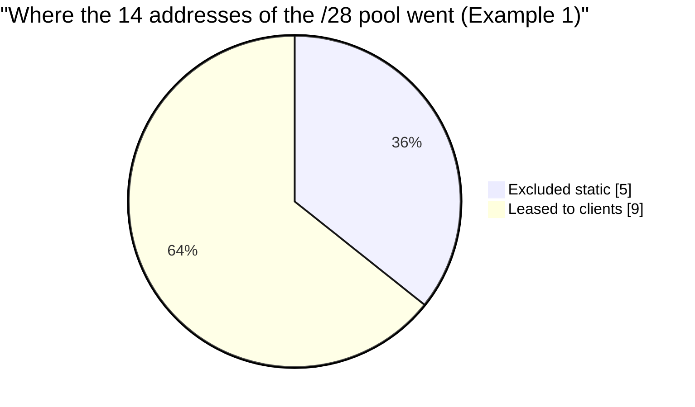

# Session 9: Protocols for Network Management: NTP, DHCP, DNS, TFTP

> [Cybersecurity and Digital Forensics](../../README.md) › [Term 1](../README.md) › [Module 4: Configuring Network Infrastructure](README.md) › **Session 9**

| ⏱ Estimated time | 📋 Prerequisites |
|---|---|
| 3 hours | Session 4 (IOS), Session 5 (VLANs), Session 7 (routing) |

| ⬅ [Previous: Session 8](session-08-first-hop-redundancy.md) | [Next: Session 10](session-10-network-security-fundamentals.md) ➡ |
|:---|---:|

[](https://colab.research.google.com/github/Hamnakhan123/Cybersecurity-and-Digital-Forensics/blob/main/term-1/04-configuring-network-infrastructure/code/session-09-network-management-protocols.ipynb) &nbsp;Run every Python example of this session in the notebook [`code/session-09-network-management-protocols.ipynb`](code/session-09-network-management-protocols.ipynb).

---

## 🎯 Learning objectives

- Define **network management** and its main functional areas (FCAPS).
- Explain the purpose and operation of **NTP**: strata, offset and delay, and why accurate time matters for security.
- **Configure DHCP** on Cisco routers: pools, exclusions, options, relay (`ip helper-address`) and verification.
- Summarise **DNS**: hierarchy, record types, resolution process, and its role in network management.
- Explain **TFTP** basics and its use for configuration and IOS backups, with its security limits.

## 📖 Concepts

### 1. What is network management?

**Network management** is everything done to keep a network **available, performing, secure and documented**: configuring devices, watching their health, fixing faults, tracking changes and planning capacity. A common framework is **FCAPS**:

| Area | Question | Tools/protocols |
|---|---|---|
| **F**ault | What is broken? | Syslog, SNMP traps, ping monitors |
| **C**onfiguration | What is configured and who changed it? | TFTP/SCP backups, config management, automation (Session 15) |
| **A**ccounting | Who used what? | NetFlow, RADIUS accounting |
| **P**erformance | Is it fast enough? | SNMP polling, interface counters, NetFlow |
| **S**ecurity | Is it protected? | AAA, logs, ACLs, certificates |

The **infrastructure services** in this session – time, addressing, naming and file transfer – are what every other management tool depends on.

### 2. NTP – Network Time Protocol (UDP 123)

**Why time matters:** log correlation across devices (incident investigation), certificate validity checks, Kerberos authentication (fails with > 5 min skew), scheduled jobs, and legal evidence. A forensic timeline built from devices with drifting clocks is unreliable.

**Hierarchy (strata):**

| Stratum | Source |
|---|---|
| 0 | Reference clock: atomic clock, GPS receiver (not on the network) |
| 1 | Server directly attached to stratum 0 |
| 2 | Synchronises from stratum 1 (e.g. `pool.ntp.org`, core routers) |
| 3+ | Each further hop adds 1; **16 = unsynchronised** |

**How NTP measures:** the client records four timestamps – t1 (client sends), t2 (server receives), t3 (server replies), t4 (client receives):

- **Offset** = ((t2 − t1) + (t3 − t4)) ÷ 2 – how far the client clock is wrong.
- **Round-trip delay** = (t4 − t1) − (t3 − t2).

NTP slowly **slews** small errors and **steps** large ones. Secure it with **authentication** (keys) and access control, and point devices at **two or three** sources so a single bad server can be outvoted.

> **Analogy – the school bell.** If every classroom clock is a few minutes different, students arrive at random times and nobody can agree when something happened. NTP is the master clock in the office that every classroom clock checks against.

### 3. DHCP – Dynamic Host Configuration Protocol (UDP 67 server, 68 client)

DHCP hands out IP address, mask, default gateway, DNS servers, domain name and lease time automatically. The four-message **DORA** exchange:

| Message | From → To | Broadcast? | Purpose |
|---|---|---|---|
| **D**ISCOVER | Client → all | Yes (src 0.0.0.0) | "Any DHCP server out there?" |
| **O**FFER | Server → client | Usually | "You can have 192.168.10.21" |
| **R**EQUEST | Client → all | Yes | "I accept 192.168.10.21" (tells other servers too) |
| **A**CK | Server → client | Usually | "Confirmed, lease 24 h" |

Also: **NAK** (refused), **DECLINE** (address already in use), **RELEASE**, **INFORM**. The client renews at **T1 = 50%** of the lease (unicast to its server) and rebinds at **T2 = 87.5%** (broadcast to any server).

**DHCP relay:** DISCOVER is a broadcast and routers do not forward broadcasts. On the gateway of each VLAN without a local server, `ip helper-address <server>` converts the broadcast into a unicast to the central server (adding the VLAN's gateway address in the **giaddr** field so the server picks the right pool).

**Cisco router as DHCP server**

```text
ip dhcp excluded-address 192.168.10.1 192.168.10.20   ! keep statics out of the pool
ip dhcp pool LECTURERS
 network 192.168.10.0 255.255.255.0
 default-router 192.168.10.1
 dns-server 192.168.99.53
 domain-name lab.local
 lease 1
```

Verify: `show ip dhcp binding`, `show ip dhcp pool`, `show ip dhcp conflict`, `debug ip dhcp server events`. On a router interface acting as a **client**: `ip address dhcp` (common towards an ISP).

### 4. DNS – Domain Name System (UDP/TCP 53)

DNS translates names to addresses. It is a **distributed hierarchy**: root (`.`) → top-level domains (`.com`, `.pk`, `.edu`) → second-level domains (`example.edu.pk`) → hosts.

**Resolution:** the PC asks its configured **recursive resolver**; if the answer is not cached, the resolver asks a **root** server, then the **TLD** server, then the domain's **authoritative** server, caches the answer for its **TTL**, and replies.

| Record | Maps | Example |
|---|---|---|
| **A** | Name → IPv4 | `portal.lab.local → 10.20.30.40` |
| **AAAA** | Name → IPv6 | `portal → 2001:db8::40` |
| **CNAME** | Alias → canonical name | `www → portal` |
| **MX** | Domain → mail servers | `lab.local → mail.lab.local` (priority 10) |
| **PTR** | IP → name (reverse) | `40.30.20.10.in-addr.arpa → portal` |
| **NS** | Zone → its name servers | |
| **TXT** | Text (SPF, DKIM, verification) | `v=spf1 …` |
| **SOA** | Zone authority, serial, timers | |

**Role in network management:** engineers use names instead of addresses (`ssh core-sw1`), syslog/SNMP tools resolve device names, PTR records make logs readable, and DNS failures look like "the internet is down" (ping by IP works, by name fails). On IOS: `ip name-server`, `ip domain-name`, `ip host`, and `no ip domain-lookup` on lab devices to stop typo lookups.

### 5. TFTP – Trivial File Transfer Protocol (UDP 69)

TFTP is a **minimal** file transfer protocol: no login, no directory listing, no encryption. Files move in **512-byte blocks**, each acknowledged (stop-and-wait); a block shorter than 512 bytes ends the transfer. Opcodes: 1 RRQ (read), 2 WRQ (write), 3 DATA, 4 ACK, 5 ERROR.

**Uses in network management:** back up and restore configurations (`copy running-config tftp:`), upgrade or recover IOS images (including from ROMMON), IP-phone and AP provisioning, PXE network boot.

**Security:** anyone who can reach the TFTP server can read or overwrite files. Restrict it to the **management VLAN**, run it only when needed, or use **SCP/SFTP** instead (`ip scp server enable`, `copy running-config scp:`).

## 🧭 Diagrams

**DHCP with a relay agent**



**NTP hierarchy in a campus**



**DNS resolution**



## 🪜 Step-by-step: build the management services lab

1. Topology: R1 with sub-interfaces for VLAN 10 and 20, SW1, a server (`192.168.99.10`) running DNS and TFTP services in Packet Tracer, PCs in both VLANs.
2. **NTP:** R1 `ntp master 3` (lab only); SW1 `ntp server 192.168.99.1`. Check `show ntp status` → synchronised, stratum 4.
3. **DHCP on R1** for VLAN 10 with exclusions; **relay** on VLAN 20's gateway to the server's pool.
4. Set PCs to DHCP; check that each gets an address from its own VLAN's range. `show ip dhcp binding`.
5. **DNS:** on the server add an A record `fileserver → 192.168.99.20`; on PCs `nslookup fileserver`.
6. **TFTP:** `copy running-config tftp:` to `192.168.99.30`, then change the hostname, then `copy tftp: running-config` and watch the hostname return.

📄 **`code/session-09_services.ios`**

```text
! Session 9 - NTP, DHCP, DNS and TFTP on Cisco IOS (lab only)

! ----- NTP: R1 is the lab time source, others sync from it -----
! R1
ntp master 3                                   ! lab only: act as stratum 3 when no real source exists
clock timezone PKT 5
! SW1 and R2
ntp server 192.168.99.1                        ! sync from R1
ntp authenticate
ntp authentication-key 1 md5 Ntp@Lab26
ntp trusted-key 1
service timestamps log datetime msec localtime ! log lines carry the correct time
! verify: show ntp status | show ntp associations | show clock detail

! ----- DHCP server on R1 for VLAN 10 -----
ip dhcp excluded-address 192.168.10.1 192.168.10.20   ! gateways, servers, printers stay static
ip dhcp pool LECTURERS
 network 192.168.10.0 255.255.255.0
 default-router 192.168.10.1
 dns-server 192.168.99.53
 domain-name lab.local
 lease 1                                       ! days
exit
! DHCP relay: VLAN 20 has no DHCP server, so its gateway forwards requests
interface GigabitEthernet0/0.20
 ip helper-address 192.168.99.10               ! central DHCP server
! verify: show ip dhcp binding | show ip dhcp pool | show ip dhcp conflict

! ----- DNS on the router -----
ip domain-name lab.local
ip name-server 192.168.99.53                   ! router resolves names through this server
ip domain-lookup
ip host fileserver 192.168.99.20               ! static host entry
! verify: show hosts | ping fileserver

! ----- TFTP backup and restore -----
! copy running-config tftp:                    (address 192.168.99.30, file R1-confg)
! copy tftp: running-config                    (merge a saved config back)
! copy flash: tftp:                            (back up the IOS image)
```
**Expected output excerpts:**

```text
SW1#show ntp status
Clock is synchronized, stratum 4, reference is 192.168.99.1

R1#show ip dhcp binding
Bindings from all pools not associated with VRF:
IP address          Client-ID/              Lease expiration        Type
                    Hardware address/
192.168.10.21       0100.50ab.12cd.01       Oct 27 2026 09:42 AM    Automatic

R1#copy running-config tftp:
Address or name of remote host []? 192.168.99.30
Destination filename [R1-confg]?
!!
1324 bytes copied in 0.08 secs
```

## 💻 Worked examples

### Example 1 – A DHCP server's view: DORA, exclusions, exhaustion and expiry

📄 **`code/session-09_dhcp_pool.py`**

```python
"""Session 9 - A DHCP server's view: pool, exclusions, DORA and leases.

Mirrors what "ip dhcp pool" on a Cisco router does: hand out the lowest free
address that is not excluded, remember the lease against the client MAC,
renew at T1 (50% of the lease), and release addresses that expire.
Run:  python session-09_dhcp_pool.py
"""
import ipaddress


class DhcpServer:
    def __init__(self, network, gateway, dns, lease_s, excluded):
        self.net = ipaddress.ip_network(network)
        self.gateway, self.dns, self.lease_s = gateway, dns, lease_s
        self.excluded = set()
        for lo, hi in excluded:
            a, b = int(ipaddress.ip_address(lo)), int(ipaddress.ip_address(hi))
            self.excluded |= {ipaddress.ip_address(x) for x in range(a, b + 1)}
        self.bindings = {}            # mac -> (ip, expiry time)

    def free(self):
        used = {ip for ip, _ in self.bindings.values()}
        return [h for h in self.net.hosts() if h not in self.excluded and h not in used]

    def dora(self, mac, now):
        print(f"  DISCOVER  from {mac} (broadcast, src 0.0.0.0 -> 255.255.255.255, UDP 68->67)")
        if mac in self.bindings:
            ip = self.bindings[mac][0]
        else:
            pool = self.free()
            if not pool:
                print("  (no OFFER: pool exhausted - client falls back to APIPA 169.254.x.x)")
                return None
            ip = pool[0]
        print(f"  OFFER     {ip}/{self.net.prefixlen} gw {self.gateway} dns {self.dns} lease {self.lease_s}s")
        print(f"  REQUEST   {mac} asks for {ip} (broadcast, so other servers withdraw their offers)")
        self.bindings[mac] = (ip, now + self.lease_s)
        print(f"  ACK       {ip} bound to {mac}, renew (T1) at t={now + self.lease_s // 2}s")
        return ip

    def assign(self, mac, now):
        """Same result as DORA, without printing each message."""
        pool = self.free()
        if mac not in self.bindings and not pool:
            return None
        ip = self.bindings[mac][0] if mac in self.bindings else pool[0]
        self.bindings[mac] = (ip, now + self.lease_s)
        return ip

    def expire(self, now):
        gone = [m for m, (_, exp) in self.bindings.items() if exp <= now]
        for m in gone:
            print(f"  lease of {self.bindings[m][0]} for {m} expired and returned to the pool")
            del self.bindings[m]

    def show_bindings(self):
        print("  IP address       Client-ID/Hardware address   Lease expiration (t)")
        for mac, (ip, exp) in sorted(self.bindings.items(), key=lambda x: x[1][0]):
            print(f"  {str(ip):16} {mac:28} {exp}s")


if __name__ == "__main__":
    srv = DhcpServer("192.168.10.0/28", "192.168.10.1", "192.168.10.5", lease_s=3600,
                     excluded=[("192.168.10.1", "192.168.10.5")])
    print(f"Pool 192.168.10.0/28: {len(list(srv.net.hosts()))} hosts, 5 excluded -> {len(srv.free())} leasable\n")
    clients = [f"aaaa.bbbb.{i:04x}" for i in range(1, 12)]
    for t, mac in enumerate(clients[:3]):
        print(f"t={t}s"); srv.dora(mac, t); print()
    print("Bindings (like 'show ip dhcp binding'):"); srv.show_bindings()
    print("\nEight more clients arrive at t=10s")
    for m in clients[3:]:
        ip = srv.assign(m, 10)
        print(f"  {m} -> {ip if ip else 'NO ADDRESS (pool exhausted, client uses APIPA 169.254.x.x)'}")
    print("\nAt t=3601s the first leases expire:")
    srv.expire(3601)
    print(f"  free addresses now: {', '.join(map(str, srv.free()))}")
```

**Output**

```text
Pool 192.168.10.0/28: 14 hosts, 5 excluded -> 9 leasable

t=0s
  DISCOVER  from aaaa.bbbb.0001 (broadcast, src 0.0.0.0 -> 255.255.255.255, UDP 68->67)
  OFFER     192.168.10.6/28 gw 192.168.10.1 dns 192.168.10.5 lease 3600s
  REQUEST   aaaa.bbbb.0001 asks for 192.168.10.6 (broadcast, so other servers withdraw their offers)
  ACK       192.168.10.6 bound to aaaa.bbbb.0001, renew (T1) at t=1800s

t=1s
  DISCOVER  from aaaa.bbbb.0002 (broadcast, src 0.0.0.0 -> 255.255.255.255, UDP 68->67)
  OFFER     192.168.10.7/28 gw 192.168.10.1 dns 192.168.10.5 lease 3600s
  REQUEST   aaaa.bbbb.0002 asks for 192.168.10.7 (broadcast, so other servers withdraw their offers)
  ACK       192.168.10.7 bound to aaaa.bbbb.0002, renew (T1) at t=1801s

t=2s
  DISCOVER  from aaaa.bbbb.0003 (broadcast, src 0.0.0.0 -> 255.255.255.255, UDP 68->67)
  OFFER     192.168.10.8/28 gw 192.168.10.1 dns 192.168.10.5 lease 3600s
  REQUEST   aaaa.bbbb.0003 asks for 192.168.10.8 (broadcast, so other servers withdraw their offers)
  ACK       192.168.10.8 bound to aaaa.bbbb.0003, renew (T1) at t=1802s

Bindings (like 'show ip dhcp binding'):
  IP address       Client-ID/Hardware address   Lease expiration (t)
  192.168.10.6     aaaa.bbbb.0001               3600s
  192.168.10.7     aaaa.bbbb.0002               3601s
  192.168.10.8     aaaa.bbbb.0003               3602s

Eight more clients arrive at t=10s
  aaaa.bbbb.0004 -> 192.168.10.9
  aaaa.bbbb.0005 -> 192.168.10.10
  aaaa.bbbb.0006 -> 192.168.10.11
  aaaa.bbbb.0007 -> 192.168.10.12
  aaaa.bbbb.0008 -> 192.168.10.13
  aaaa.bbbb.0009 -> 192.168.10.14
  aaaa.bbbb.000a -> NO ADDRESS (pool exhausted, client uses APIPA 169.254.x.x)
  aaaa.bbbb.000b -> NO ADDRESS (pool exhausted, client uses APIPA 169.254.x.x)

At t=3601s the first leases expire:
  lease of 192.168.10.6 for aaaa.bbbb.0001 expired and returned to the pool
  lease of 192.168.10.7 for aaaa.bbbb.0002 expired and returned to the pool
  free addresses now: 192.168.10.6, 192.168.10.7
```
**Observe:**
- Excluded addresses (`.1–.5`) are never offered; the first client gets `.6`.
- A /28 pool runs out after 9 clients – the 10th and 11th fall back to **APIPA** (`169.254.x.x`), the classic "some users can't get on the network" symptom of an undersized scope.
- When leases expire, addresses return to the pool.

### Example 2 – Inside DNS, NTP and TFTP messages

📄 **`code/session-09_dns_ntp.py`**

```python
"""Session 9 - Look inside DNS, NTP and TFTP messages (built and parsed offline).

1. Build a real DNS query for an A record and parse a sample answer.
2. Compute NTP clock offset and delay from the four timestamps.
3. Build TFTP read-request and data packets (how a router backs up its config).
Nothing is sent on the network.
Run:  python session-09_dns_ntp.py
"""
import struct


def dns_query(name, qtype=1, ident=0x1A2B):
    header = struct.pack("!HHHHHH", ident, 0x0100, 1, 0, 0, 0)   # RD flag set, 1 question
    qname = b"".join(len(p).to_bytes(1, "big") + p.encode() for p in name.split(".")) + b"\0"
    return header + qname + struct.pack("!HH", qtype, 1)          # type A, class IN


def dns_answer_for(query, ip, ttl=300):
    ident = struct.unpack("!H", query[:2])[0]
    header = struct.pack("!HHHHHH", ident, 0x8180, 1, 1, 0, 0)    # response, RD+RA, no error
    answer = b"\xc0\x0c" + struct.pack("!HHIH", 1, 1, ttl, 4) + bytes(map(int, ip.split(".")))
    return header + query[12:] + answer                             # c00c = pointer to the name


def parse_answer(msg):
    ident, flags, qd, an, _, _ = struct.unpack("!HHHHHH", msg[:12])
    i, labels = 12, []
    while msg[i]:
        labels.append(msg[i + 1:i + 1 + msg[i]].decode()); i += msg[i] + 1
    i += 5                                                          # zero byte + qtype + qclass
    _, rtype, _, ttl, rdlen = struct.unpack("!HHHIH", msg[i:i + 12])
    ip = ".".join(map(str, msg[i + 12:i + 12 + rdlen]))
    rcode = flags & 0xF
    return {"id": hex(ident), "name": ".".join(labels), "answers": an, "type": rtype, "ttl": ttl,
            "ip": ip, "rcode": rcode}


def ntp_offset(t1, t2, t3, t4):
    """t1 client send, t2 server receive, t3 server send, t4 client receive."""
    return ((t2 - t1) + (t3 - t4)) / 2, (t4 - t1) - (t3 - t2)


def tftp_request(opcode, filename, mode="octet"):
    """opcode 1 = RRQ (read/download), 2 = WRQ (write/upload)."""
    return struct.pack("!H", opcode) + filename.encode() + b"\0" + mode.encode() + b"\0"


def tftp_data(block, data):
    return struct.pack("!HH", 3, block) + data


if __name__ == "__main__":
    q = dns_query("portal.lab.local")
    print(f"DNS query ({len(q)} bytes, UDP 53): {q.hex(' ')}")
    a = dns_answer_for(q, "10.20.30.40")
    print(f"DNS answer ({len(a)} bytes) parsed: {parse_answer(a)}")

    print("\nNTP: client clock is behind the server")
    t1, t2, t3, t4 = 1000.000, 1002.530, 1002.531, 1000.061
    off, delay = ntp_offset(t1, t2, t3, t4)
    print(f"  t1={t1} t2={t2} t3={t3} t4={t4}")
    print(f"  offset = {off:+.4f} s (client must move forward), round-trip delay = {delay:.4f} s")
    for stratum, src in [(0, "atomic clock / GPS"), (1, "server attached to stratum 0"),
                         (2, "core router syncing from stratum 1"), (3, "access switches syncing from the core")]:
        print(f"  stratum {stratum}: {src}")

    print("\nTFTP (UDP 69): router backs up its config to a TFTP server")
    wrq = tftp_request(2, "R1-confg")
    print(f"  WRQ  opcode 2 (upload/backup): {wrq}")
    print(f"  RRQ  opcode 1 (download/restore) would be: {tftp_request(1, 'R1-confg')}")
    config = b"hostname R1\n!\ninterface g0/0\n ip address 192.168.10.1 255.255.255.0\n"
    blocks = [config[i:i + 512] for i in range(0, len(config), 512)]
    for n, b in enumerate(blocks, 1):
        print(f"  DATA opcode 3 block {n}: {len(b)} bytes (< 512 means last block) -> ACK {n}")
    print("  No login and no encryption: use TFTP only on a trusted management network.")
```

**Output**

```text
DNS query (34 bytes, UDP 53): 1a 2b 01 00 00 01 00 00 00 00 00 00 06 70 6f 72 74 61 6c 03 6c 61 62 05 6c 6f 63 61 6c 00 00 01 00 01
DNS answer (50 bytes) parsed: {'id': '0x1a2b', 'name': 'portal.lab.local', 'answers': 1, 'type': 1, 'ttl': 300, 'ip': '10.20.30.40', 'rcode': 0}

NTP: client clock is behind the server
  t1=1000.0 t2=1002.53 t3=1002.531 t4=1000.061
  offset = +2.5000 s (client must move forward), round-trip delay = 0.0600 s
  stratum 0: atomic clock / GPS
  stratum 1: server attached to stratum 0
  stratum 2: core router syncing from stratum 1
  stratum 3: access switches syncing from the core

TFTP (UDP 69): router backs up its config to a TFTP server
  WRQ  opcode 2 (upload/backup): b'\x00\x02R1-confg\x00octet\x00'
  RRQ  opcode 1 (download/restore) would be: b'\x00\x01R1-confg\x00octet\x00'
  DATA opcode 3 block 1: 68 bytes (< 512 means last block) -> ACK 1
  No login and no encryption: use TFTP only on a trusted management network.
```
**Observe:**
- The DNS name is encoded as length-prefixed labels: `06 portal 03 lab 05 local 00`.
- In the answer, `c0 0c` is a **pointer** to the name at offset 12 – DNS compresses repeated names.
- The NTP offset of +2.5 s means the client clock is 2.5 s **behind**; the 60 ms delay is the network round trip.
- A short configuration fits in a single 68-byte TFTP block.

## 📊 Chart

| Service | Port | Transport | Cisco verify command |
|---|---|---|---|
| NTP | 123 | UDP | `show ntp status`, `show ntp associations` |
| DHCP | 67 / 68 | UDP | `show ip dhcp binding`, `show ip dhcp pool` |
| DNS | 53 | UDP (TCP for large/zone transfers) | `show hosts`, `ping <name>` |
| TFTP | 69 | UDP | `copy … tftp:` results |
| Syslog | 514 | UDP | `show logging` |
| SNMP | 161 / 162 | UDP | `show snmp` |



## 🏢 Real-life problem with full solution

**Scenario.** After a security incident, the investigator cannot build a timeline: the firewall's logs are in UTC, the core switch is 7 minutes fast, the access switches show 2002 dates (they reset after a power cut), and the domain controller is correct. At the same time, students in the new lab VLAN 30 report "no internet" and their PCs show `169.254.x.x`.

**Solution.**

*Time:*
1. Choose two internal NTP servers (core routers) syncing from three external stratum-1/2 sources.
2. All devices: `ntp server` ×2, NTP **authentication**, `clock timezone PKT 5`, and `service timestamps log datetime msec localtime show-timezone` so every log line has an unambiguous time.
3. Configure the firewall and servers to use the same internal NTP servers.
4. Alert in the monitoring system when any device reports **stratum 16** (unsynchronised).

*DHCP:*
5. `show ip interface vlan 30` on the L3 switch reveals no `ip helper-address`, so DISCOVERs never reach the central server. Add `ip helper-address 192.168.99.10`.
6. Create the matching **scope** for `10.30.30.0/24` on the server with gateway `.1` and the DNS servers.
7. Verify with `ipconfig /renew` on a lab PC and `show ip dhcp binding` (or the server's lease list).

*Prevention:* back up all configurations to a protected server (SCP) after every change; document NTP, DHCP and DNS settings in the baseline template.

## ⚠️ Common mistakes

- Forgetting `ip dhcp excluded-address` → the router hands out its own gateway address or a server's static IP.
- Missing `ip helper-address` on new VLANs.
- Pointing devices to a single NTP server, or never checking that they actually synchronised.
- Using `ntp master` in production when a real time source exists.
- Leaving TFTP servers running and reachable from user VLANs.
- Blaming "the internet" when only DNS is failing.

## ✅ Best practices

- Two or more authenticated NTP sources; log timestamps with milliseconds and time zone.
- Centralised DHCP with relays, reservations for printers/APs, scopes sized with growth room, DHCP snooping (Session 10).
- Two internal DNS resolvers; PTR records for infrastructure; monitor DNS response time.
- Use SCP/SFTP instead of TFTP where possible; restrict TFTP to the management network.
- Keep FCAPS in mind: every service should be monitored and documented.

## 🧪 Lab / practice tasks

1. **Easy –** List the four DORA messages and which ones are broadcasts.
2. **Easy –** Which DNS record type would you create for a mail server? For reverse lookup?
3. **Medium –** Build the lab and capture DHCP in simulation mode: identify the giaddr field in the relayed DISCOVER.
4. **Medium –** In `session-09_dhcp_pool.py`, change the pool to `/27` and exclusions to `.1–.10`. How many clients get addresses now?
5. **Challenge –** Add a **reservation** feature: a dictionary `{mac: ip}` that always gives a printer the same address, and make sure reserved addresses are never offered to other clients.

<details>
<summary>💡 Hints</summary>

- Task 4: a /27 has 30 usable hosts.
- Task 5: in `free()`, remove reserved IPs; in `dora()` and `assign()`, check the reservation dictionary first.
</details>

<details>
<summary>✅ Solutions</summary>

**Task 1:** DISCOVER (broadcast), OFFER, REQUEST (broadcast), ACK. OFFER/ACK may be broadcast if the client asks (broadcast flag) – common before the client has an address.

**Task 2:** MX (plus an A record for the mail host); PTR for reverse lookup.

**Task 4:** 30 − 10 = **20** leasable addresses, so all 11 clients get one.

**Task 5 (core lines):**

```python
self.reserved = {"aaaa.bbbb.00ff": ipaddress.ip_address("192.168.10.14")}

def free(self):
    used = {ip for ip, _ in self.bindings.values()} | set(self.reserved.values())
    return [h for h in self.net.hosts() if h not in self.excluded and h not in used]

def assign(self, mac, now):
    if mac in self.reserved:
        ip = self.reserved[mac]
        self.bindings[mac] = (ip, now + self.lease_s)
        return ip
    ...
```
</details>

## ✅ Quick quiz

1. NTP uses: a) TCP 123 b) UDP 123 c) UDP 69 d) TCP 53
2. Which command forwards DHCP broadcasts from a VLAN to a central server? a) `ip dhcp relay` b) `ip helper-address` c) `ip forward-protocol dns` d) `dhcp-server`
3. A client renews its lease at: a) 25% b) 50% c) 87.5% d) 100%
4. Which DNS record maps a name to an IPv6 address? a) A b) AAAA c) PTR d) MX
5. Which is true about TFTP? a) it encrypts files b) it requires a username c) it uses UDP 69 and 512-byte blocks d) it lists directories

<details>
<summary>Show answers</summary>

1 – b · 2 – b · 3 – b · 4 – b · 5 – c
</details>

## 📝 Summary / cheat-sheet

- Network management = FCAPS; time, addressing, naming and file transfer underpin it.
- NTP UDP 123, strata 0–15 (16 = unsynced), offset = ((t2 − t1) + (t3 − t4)) ÷ 2; authenticate, use multiple sources.
- DHCP UDP 67/68, DORA, T1 50%, T2 87.5%, exclusions, pools, `ip helper-address` relay, APIPA when it fails.
- DNS 53: root → TLD → authoritative; A, AAAA, CNAME, MX, PTR, NS, TXT, SOA; caching by TTL.
- TFTP UDP 69: no auth, 512-byte blocks; config/IOS backups; prefer SCP.

**Interview / viva questions**

1. Why is accurate time critical for security investigations?
2. Explain the DORA process and the role of a DHCP relay agent.
3. A PC can ping 8.8.8.8 but cannot open websites. What do you check?
4. What are the risks of TFTP, and what would you use instead?
5. What does stratum 16 mean in NTP?
6. Why should static addresses be excluded from a DHCP pool?

---

| ⬅ [Previous: Session 8](session-08-first-hop-redundancy.md) | [Next: Session 10](session-10-network-security-fundamentals.md) ➡ |
|:---|---:|

<sub>Prepared by **Hamna Zahid Khan**, Junior Lecturer · Cybersecurity and Digital Forensics</sub>
