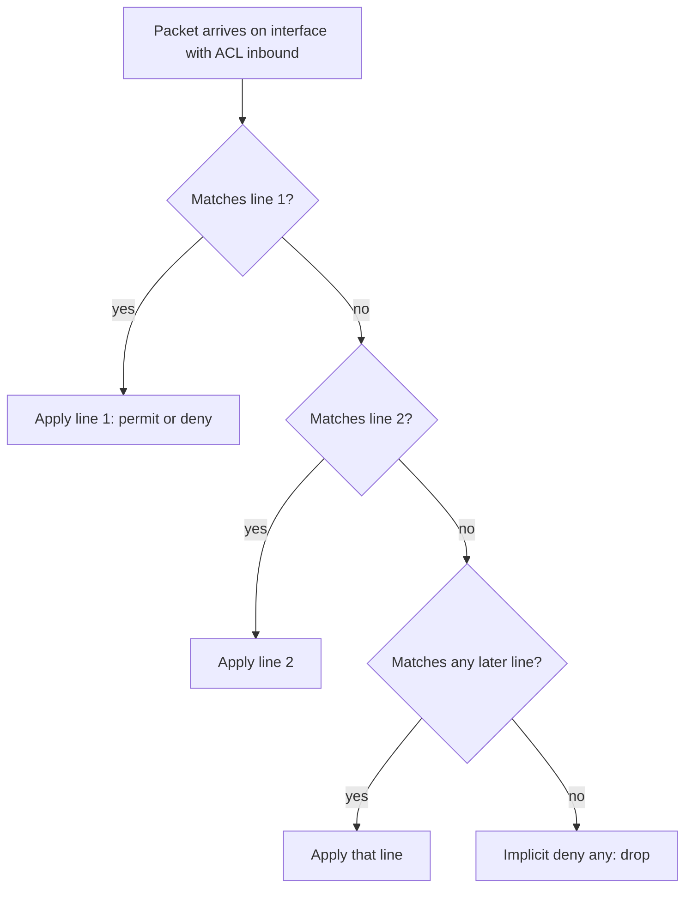
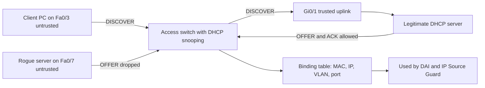
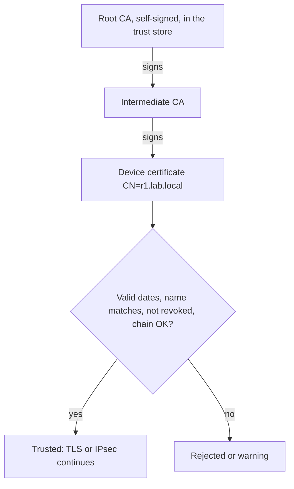
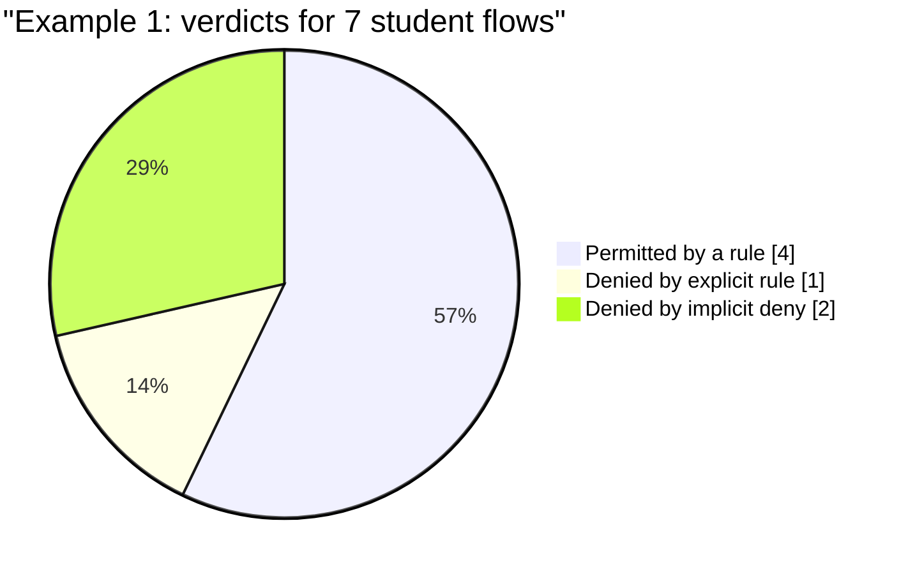

# Session 10: Network Security Fundamentals: ACLs and DHCP Snooping

> [Cybersecurity and Digital Forensics](../../README.md) › [Term 1](../README.md) › [Module 4: Configuring Network Infrastructure](README.md) › **Session 10**

| ⏱ Estimated time | 📋 Prerequisites |
|---|---|
| 3.5 hours | Sessions 5, 7 and 9 (VLANs, routing, DHCP) |

| ⬅ [Previous: Session 9](session-09-network-management-protocols.md) | [Next: Session 11](session-11-ipv6.md) ➡ |
|:---|---:|

[](https://colab.research.google.com/github/Hamnakhan123/Cybersecurity-and-Digital-Forensics/blob/main/term-1/04-configuring-network-infrastructure/code/session-10-network-security-fundamentals.ipynb) &nbsp;Run every Python example of this session in the notebook [`code/session-10-network-security-fundamentals.ipynb`](code/session-10-network-security-fundamentals.ipynb).

---

## 🎯 Learning objectives

- Define key **network security terms**: asset, threat, vulnerability, exploit, risk, attack surface, CIA, AAA, defence in depth.
- Explain the importance of **access control** for network resources: device access, network access and traffic filtering.
- Define **digital certificates**, PKI and their purpose in network security.
- Explain the **syntax and structure of ACLs** (standard, extended, named), wildcard masks, placement, and the implicit deny.
- Explain **DHCP snooping** and how it prevents **rogue DHCP servers** and supports Dynamic ARP Inspection.

All examples are for your own lab or networks you are authorised to administer.

## 📖 Concepts

### 1. Key terminology

| Term | Meaning | Network example |
|---|---|---|
| **Asset** | Something of value | Student records server, core switch |
| **Vulnerability** | A weakness | Telnet enabled, default password, unpatched IOS |
| **Threat** | Something that could exploit a weakness | Malicious insider, malware, careless user |
| **Exploit** | The method/tool that uses a vulnerability | Capturing a Telnet password in clear text |
| **Risk** | Likelihood × impact | High: guest Wi-Fi can reach the exam server |
| **Attack surface** | All the points an attacker could try | Open ports, services, user ports |
| **Mitigation / control** | Measure that reduces risk | ACL, SSH, DHCP snooping |

**CIA triad:** **Confidentiality** (only authorised people see data – encryption, ACLs), **Integrity** (data is not altered – hashes, signatures), **Availability** (services stay up – redundancy, DoS protection).

**AAA:** **Authentication** (who are you? – passwords, certificates, MFA), **Authorisation** (what may you do? – privilege levels, command authorisation), **Accounting** (what did you do? – logs). Centralised with **RADIUS** (UDP 1812/1813, common for network access and Wi-Fi) or **TACACS+** (TCP 49, separates the three As, popular for device administration).

**Common Layer 2/3 attacks and the matching defence**

| Attack | What happens | Defence (where covered) |
|---|---|---|
| MAC flooding | CAM table filled, switch floods everything | Port security |
| VLAN hopping | Attacker gains a trunk or double-tags frames | `nonegotiate`, unused native VLAN (Session 5) |
| Rogue DHCP server | Clients get attacker's gateway/DNS (man-in-the-middle) | **DHCP snooping** |
| DHCP starvation | Pool exhausted with fake MACs | Snooping rate limit, port security |
| ARP spoofing | Attacker claims the gateway's IP | **Dynamic ARP Inspection** |
| IP spoofing | Fake source addresses | IP Source Guard, ACLs (uRPF) |
| STP manipulation | Rogue switch becomes root | BPDU Guard, Root Guard (Session 6) |
| Password sniffing | Telnet/HTTP management in clear text | SSH, HTTPS, SNMPv3 |

### 2. Access control

**Access control** decides **who** or **what** can reach **which** resources and **how**. Principles: **least privilege**, **need to know**, **separation of duties**, **default deny**.

Three layers of access control in a network:

1. **Device access** – who can manage routers/switches: local users or AAA, SSH only, VTY ACLs, privilege levels, timeouts, console security.
2. **Network access** – which devices may plug in or join Wi-Fi: **802.1X** with RADIUS, MAB, port security, NAC posture checks.
3. **Traffic filtering** – which flows are allowed between networks: **ACLs**, firewalls, segmentation with VLANs.

### 3. Digital certificates and PKI

A **digital certificate** (X.509) binds a **public key** to an **identity** (a hostname, person or device) and is **signed by a Certificate Authority (CA)** that others trust.

| Field | Example |
|---|---|
| Subject | `CN=r1.lab.local` |
| Issuer | `CN=Lab Root CA` |
| Validity | Not before / not after dates |
| Public key | RSA 2048 / ECDSA P-256 |
| Extensions | Subject Alternative Names, key usage |
| Signature | CA's signature over all of the above |

**Purpose in network security:**
- **Authentication** of servers and devices (HTTPS management pages, VPN gateways in Session 13, RADIUS servers in WPA2/3-Enterprise).
- **Key exchange** for encryption (TLS, IPsec) – confidentiality.
- **Integrity and non-repudiation** via signatures.

**PKI** (public key infrastructure) = CAs, registration, certificate stores, revocation (**CRL**, **OCSP**) and policies. Trust works by **chain**: a device trusts a certificate if it chains up to a **root CA** in its trust store and is valid, unexpired and not revoked.

> **Analogy – a passport.** The passport (certificate) contains your photo (public key) and name (subject), and is stamped by the government (CA). A border officer trusts it because they trust the government's stamp, not because they know you.

### 4. Access control lists (ACLs)

An ACL is an **ordered list** of permit/deny statements (**ACEs**) that a router or L3 switch applies to packets on an interface, in a direction (**in** or **out**), or to VTY lines.

**Processing rules**
1. Top-down, **first match wins** – later lines are not checked.
2. Every ACL ends with an invisible **`deny any`** (implicit deny).
3. One ACL per **interface, per direction, per protocol** (IPv4/IPv6).
4. An empty ACL applied to an interface permits everything; an ACL with only `deny` lines blocks everything.

**Types**

| Type | Numbers | Matches | Place it |
|---|---|---|---|
| **Standard** | 1–99, 1300–1999 | **Source** IP only | **Close to the destination** (otherwise it blocks too much) |
| **Extended** | 100–199, 2000–2699 | Protocol, source, destination, ports, flags | **Close to the source** (drop unwanted traffic early) |
| **Named** | Any name | Standard or extended, easy to edit by sequence number | Same rules |

**Syntax**

```text
access-list 10 permit 192.168.99.0 0.0.0.255
access-list 110 permit tcp 192.168.20.0 0.0.0.255 host 192.168.30.10 eq 443
ip access-list extended STUDENTS-IN
 10 permit tcp 192.168.20.0 0.0.0.255 host 192.168.30.10 eq 443
 20 deny ip any any log
interface Gi0/0.20
 ip access-group STUDENTS-IN in
line vty 0 4
 access-class MGMT-ONLY in
```

**Wildcard masks:** `0` = must match, `1` = ignore. `host 10.1.1.5` = `10.1.1.5 0.0.0.0`; `any` = `0.0.0.0 255.255.255.255`. Port operators: `eq`, `neq`, `lt`, `gt`, `range`. `established` matches TCP replies (ACK/RST set).

### 5. DHCP snooping

**Problem:** any device that answers DHCP requests faster than the real server can give clients its own gateway and DNS – a **rogue DHCP server**. It might be a home router plugged in by mistake or an attacker performing a man-in-the-middle.

**How DHCP snooping works (on the access switch):**
- Every port is **untrusted** by default. Server messages (**OFFER, ACK, NAK**) arriving on an untrusted port are **dropped**.
- Only ports towards the legitimate server (uplinks) are configured **trusted**.
- Client messages on untrusted ports are checked (source MAC must match the client hardware address) and can be **rate-limited** against starvation.
- Every successful lease is recorded in the **binding table** (MAC, IP, VLAN, port, lease).
- **Dynamic ARP Inspection (DAI)** and **IP Source Guard** use that table to drop spoofed ARP replies and spoofed source IPs.

## 🧭 Diagrams

**How an ACL is processed**



**DHCP snooping stopping a rogue server**



**Certificate trust chain**



## 🪜 Step-by-step: secure the lab network

1. **Device access:** create `ip access-list standard MGMT-ONLY` permitting VLAN 99; apply with `access-class MGMT-ONLY in` on VTY lines. Test SSH from VLAN 99 (works) and VLAN 20 (refused).
2. **Traffic filtering:** write extended ACL `STUDENTS-IN` (students → LMS 443, DNS 53, ping, web 443; deny to lecturers) and apply **inbound** on the students' gateway interface.
3. **DHCP snooping:** enable globally and per VLAN, trust the uplink, rate-limit access ports.
4. **DAI:** `ip arp inspection vlan 10,20`, trust the uplink.
5. **Port security:** maximum 2 MACs, sticky, violation restrict.
6. **Test:** connect a second DHCP server (a Packet Tracer server with DHCP on) to an access port → clients still receive the correct address; `show ip dhcp snooping binding` lists the real leases.
7. Check counters: `show access-lists` shows hit counts per line.

📄 **`code/session-10_security.ios`**

```text
! Session 10 - ACLs, DHCP snooping, DAI and port security (Cisco Packet Tracer lab)

! ----- Standard ACL: only the management VLAN may open SSH sessions -----
ip access-list standard MGMT-ONLY
 permit 192.168.99.0 0.0.0.255
 deny any log                                  ! the implicit deny, made visible and logged
line vty 0 4
 access-class MGMT-ONLY in
 transport input ssh

! ----- Extended ACL: what the STUDENTS VLAN may reach (place close to the SOURCE) -----
ip access-list extended STUDENTS-IN
 permit tcp 192.168.20.0 0.0.0.255 host 192.168.30.10 eq 443
 permit udp 192.168.20.0 0.0.0.255 host 192.168.30.53 eq 53
 deny   ip  192.168.20.0 0.0.0.255 192.168.10.0 0.0.0.255
 permit icmp 192.168.20.0 0.0.0.255 any
 permit tcp 192.168.20.0 0.0.0.255 any eq 443
 deny   ip any any log
interface GigabitEthernet0/0.20
 ip access-group STUDENTS-IN in
! verify: show access-lists (hit counters) | show ip interface Gi0/0.20

! ----- DHCP snooping + Dynamic ARP Inspection on the access switch -----
ip dhcp snooping
ip dhcp snooping vlan 10,20
no ip dhcp snooping information option        ! needed when the server does not expect option 82
interface GigabitEthernet0/1
 description UPLINK-TO-DHCP-SERVER
 ip dhcp snooping trust                        ! only here may OFFER/ACK enter
 ip arp inspection trust
interface range FastEthernet0/1 - 24
 ip dhcp snooping limit rate 10                ! starvation protection (packets per second)
ip arp inspection vlan 10,20                  ! check ARP against the snooping bindings
! verify: show ip dhcp snooping | show ip dhcp snooping binding | show ip arp inspection

! ----- Port security: at most 2 MAC addresses per desk port -----
interface range FastEthernet0/1 - 24
 switchport mode access
 switchport port-security
 switchport port-security maximum 2
 switchport port-security mac-address sticky
 switchport port-security violation restrict   ! drop and log, keep the port up
! verify: show port-security | show port-security interface Fa0/1
```
## 💻 Worked examples

### Example 1 – An ACL engine that behaves like IOS

📄 **`code/session-10_acl_engine.py`**

```python
"""Session 10 - Evaluate Cisco-style ACLs exactly as a router does.

- Lines are checked top-down; the FIRST match decides (permit or deny).
- Every ACL ends with an invisible "deny any" (implicit deny).
- Wildcard masks: 0 bit = must match, 1 bit = ignore. "host x" = x 0.0.0.0, "any" = 0.0.0.0 255.255.255.255.
- Standard ACLs (1-99) check only the source; extended ACLs (100-199) check
  protocol, source, destination and port.
Run:  python session-10_acl_engine.py
"""
import ipaddress


def ip(x): return int(ipaddress.ip_address(x))


def match_addr(addr, base, wildcard):
    return (ip(addr) & ~ip(wildcard) & 0xFFFFFFFF) == (ip(base) & ~ip(wildcard) & 0xFFFFFFFF)


def parse_addr(tokens):
    """Consume 'any' | 'host A' | 'A W' and return ((base, wildcard), remaining tokens)."""
    if tokens[0] == "any":
        return ("0.0.0.0", "255.255.255.255"), tokens[1:]
    if tokens[0] == "host":
        return (tokens[1], "0.0.0.0"), tokens[2:]
    return (tokens[0], tokens[1]), tokens[2:]


def parse_line(line):
    t = line.split()
    action, rest = t[0], t[1:]
    proto = None
    if rest[0] in ("ip", "tcp", "udp", "icmp"):
        proto, rest = rest[0], rest[1:]
    src, rest = parse_addr(rest)
    dst, port = None, None
    if proto:
        dst, rest = parse_addr(rest)
        if rest[:1] == ["eq"]:
            port = int(rest[1])
    return {"text": line, "action": action, "proto": proto, "src": src, "dst": dst, "port": port}


def evaluate(acl, pkt):
    for n, rule in enumerate(acl, 1):
        if rule["proto"] not in (None, "ip") and rule["proto"] != pkt["proto"]:
            continue
        if not match_addr(pkt["src"], *rule["src"]):
            continue
        if rule["dst"] and not match_addr(pkt["dst"], *rule["dst"]):
            continue
        if rule["port"] is not None and rule["port"] != pkt.get("port"):
            continue
        return rule["action"].upper(), f"line {n}: {rule['text']}"
    return "DENY", "implicit deny any (end of list)"


STANDARD_10 = ["permit 192.168.99.0 0.0.0.255", "deny any"]            # VTY: only the management VLAN
EXTENDED_110 = [
    "permit tcp 192.168.20.0 0.0.0.255 host 192.168.30.10 eq 443",     # students -> LMS over HTTPS
    "permit udp 192.168.20.0 0.0.0.255 host 192.168.30.53 eq 53",      # students -> DNS
    "deny ip 192.168.20.0 0.0.0.255 192.168.10.0 0.0.0.255",            # students -/-> lecturers VLAN
    "permit icmp 192.168.20.0 0.0.0.255 any",                           # ping for troubleshooting
    "permit tcp 192.168.20.0 0.0.0.255 any eq 443",                     # web browsing
]

if __name__ == "__main__":
    std = [parse_line(x) for x in STANDARD_10]
    print("Standard ACL 10 applied to 'line vty 0 4' (who may SSH to the switch):")
    for src in ["192.168.99.25", "192.168.20.14"]:
        print(f"  SSH from {src:15} -> {evaluate(std, {'src': src})}")

    ext = [parse_line(x) for x in EXTENDED_110]
    print("\nExtended ACL 110 inbound on the STUDENTS VLAN interface:")
    tests = [
        {"proto": "tcp", "src": "192.168.20.14", "dst": "192.168.30.10", "port": 443},
        {"proto": "tcp", "src": "192.168.20.14", "dst": "192.168.30.10", "port": 22},
        {"proto": "udp", "src": "192.168.20.14", "dst": "192.168.30.53", "port": 53},
        {"proto": "tcp", "src": "192.168.20.14", "dst": "192.168.10.50", "port": 445},
        {"proto": "icmp", "src": "192.168.20.14", "dst": "8.8.8.8"},
        {"proto": "tcp", "src": "192.168.20.14", "dst": "142.250.1.1", "port": 443},
        {"proto": "tcp", "src": "192.168.20.14", "dst": "142.250.1.1", "port": 80},
    ]
    for p in tests:
        verdict, why = evaluate(ext, p)
        desc = f"{p['proto']} {p['src']} -> {p['dst']}" + (f":{p['port']}" if 'port' in p else "")
        print(f"  {desc:42} {verdict:6} ({why})")
    print("\nWildcard check: 10.1.0.0 0.0.255.255 matches 10.1.200.7?",
          match_addr("10.1.200.7", "10.1.0.0", "0.0.255.255"))
```

**Output**

```text
Standard ACL 10 applied to 'line vty 0 4' (who may SSH to the switch):
  SSH from 192.168.99.25   -> ('PERMIT', 'line 1: permit 192.168.99.0 0.0.0.255')
  SSH from 192.168.20.14   -> ('DENY', 'line 2: deny any')

Extended ACL 110 inbound on the STUDENTS VLAN interface:
  tcp 192.168.20.14 -> 192.168.30.10:443     PERMIT (line 1: permit tcp 192.168.20.0 0.0.0.255 host 192.168.30.10 eq 443)
  tcp 192.168.20.14 -> 192.168.30.10:22      DENY   (implicit deny any (end of list))
  udp 192.168.20.14 -> 192.168.30.53:53      PERMIT (line 2: permit udp 192.168.20.0 0.0.0.255 host 192.168.30.53 eq 53)
  tcp 192.168.20.14 -> 192.168.10.50:445     DENY   (line 3: deny ip 192.168.20.0 0.0.0.255 192.168.10.0 0.0.0.255)
  icmp 192.168.20.14 -> 8.8.8.8              PERMIT (line 4: permit icmp 192.168.20.0 0.0.0.255 any)
  tcp 192.168.20.14 -> 142.250.1.1:443       PERMIT (line 5: permit tcp 192.168.20.0 0.0.0.255 any eq 443)
  tcp 192.168.20.14 -> 142.250.1.1:80        DENY   (implicit deny any (end of list))

Wildcard check: 10.1.0.0 0.0.255.255 matches 10.1.200.7? True
```
**Observe:**
- SSH to the LMS server (port 22) is denied by the **implicit deny**, although no line mentions SSH.
- Student → lecturer file share (445) hits the explicit `deny` on line 3 **before** the general web rule could match.
- Plain HTTP (port 80) to the internet is denied because only 443 is permitted – exactly the "default deny" principle.

### Example 2 – DHCP snooping and DAI in action

📄 **`code/session-10_dhcp_snooping.py`**

```python
"""Session 10 - DHCP snooping: stop rogue DHCP servers and build the binding table.

Ports are UNTRUSTED by default. Server messages (OFFER, ACK) are allowed only
from TRUSTED ports (the uplink towards the real DHCP server). Every ACK that
passes creates a binding (MAC, IP, VLAN, port) that Dynamic ARP Inspection
and IP Source Guard later use to drop spoofed traffic. A rate limit on
untrusted ports slows DHCP starvation floods.
Run:  python session-10_dhcp_snooping.py
"""

TRUSTED = {"Gi0/1"}                 # uplink to the legitimate server
RATE_LIMIT = 10                     # packets per second allowed on untrusted ports


def snoop(events):
    bindings, log, counters = [], [], {}
    for t, port, msg, mac, ip in events:
        counters[(t, port)] = counters.get((t, port), 0) + 1
        if port not in TRUSTED and counters[(t, port)] > RATE_LIMIT:
            log.append(f"t={t} {port}: rate limit exceeded -> port err-disabled")
            continue
        if msg in ("OFFER", "ACK") and port not in TRUSTED:
            log.append(f"t={t} {port}: DROPPED {msg} from {mac} (server message on untrusted port)")
            continue
        log.append(f"t={t} {port}: forwarded {msg} {mac} {ip or ''}".rstrip())
        if msg == "ACK":
            bindings.append((mac, ip, 10, "Fa0/3"))      # client port learned from the DISCOVER
    return bindings, log


def dai_check(bindings, port, mac, ip):
    ok = any(b[0] == mac and b[1] == ip and b[3] == port for b in bindings)
    return "permit" if ok else "DROP (no matching binding)"


if __name__ == "__main__":
    events = [
        (0, "Fa0/3", "DISCOVER", "aaaa.0000.0003", None),
        (0, "Fa0/7", "OFFER", "dead.beef.0007", "10.99.99.50"),     # rogue server on a user port
        (0, "Gi0/1", "OFFER", "0011.2233.4455", "192.168.10.21"),
        (0, "Fa0/3", "REQUEST", "aaaa.0000.0003", "192.168.10.21"),
        (0, "Gi0/1", "ACK", "aaaa.0000.0003", "192.168.10.21"),
    ] + [(1, "Fa0/9", "DISCOVER", f"0bad.0000.{i:04x}", None) for i in range(15)]   # starvation flood
    bindings, log = snoop(events)
    seen = set()
    for line in log:
        if "0bad" in line and "forwarded" in line:
            if "flood" in seen: continue
            seen.add("flood"); line += "   (... more DISCOVERs with random MACs)"
        if "rate limit" in line and "rl" in seen: continue
        if "rate limit" in line: seen.add("rl")
        print(line)
    print("\nshow ip dhcp snooping binding")
    print("MacAddress       IpAddress        Lease  Type           VLAN  Interface")
    for mac, ip_, vlan, port in bindings:
        print(f"{mac:16} {ip_:16} 86400  dhcp-snooping  {vlan:<5} {port}")
    print("\nDynamic ARP Inspection uses the table:")
    print("  ARP from Fa0/3 aaaa.0000.0003 claims 192.168.10.21 ->", dai_check(bindings, "Fa0/3", "aaaa.0000.0003", "192.168.10.21"))
    print("  ARP from Fa0/7 dead.beef.0007 claims 192.168.10.1  ->", dai_check(bindings, "Fa0/7", "dead.beef.0007", "192.168.10.1"))
```

**Output**

```text
t=0 Fa0/3: forwarded DISCOVER aaaa.0000.0003
t=0 Fa0/7: DROPPED OFFER from dead.beef.0007 (server message on untrusted port)
t=0 Gi0/1: forwarded OFFER 0011.2233.4455 192.168.10.21
t=0 Fa0/3: forwarded REQUEST aaaa.0000.0003 192.168.10.21
t=0 Gi0/1: forwarded ACK aaaa.0000.0003 192.168.10.21
t=1 Fa0/9: forwarded DISCOVER 0bad.0000.0000   (... more DISCOVERs with random MACs)
t=1 Fa0/9: rate limit exceeded -> port err-disabled

show ip dhcp snooping binding
MacAddress       IpAddress        Lease  Type           VLAN  Interface
aaaa.0000.0003   192.168.10.21    86400  dhcp-snooping  10    Fa0/3

Dynamic ARP Inspection uses the table:
  ARP from Fa0/3 aaaa.0000.0003 claims 192.168.10.21 -> permit
  ARP from Fa0/7 dead.beef.0007 claims 192.168.10.1  -> DROP (no matching binding)
```
**Observe:** the rogue OFFER on Fa0/7 never reaches the client, the starvation flood on Fa0/9 trips the rate limit, and DAI later drops an ARP reply in which the rogue device claims the gateway's address.

### Example 3 – Create and verify certificates with a lab CA

📄 **`code/session-10_certificate_lab.sh`**

```bash
#!/usr/bin/env bash
# Session 10 - Digital certificates in a lab: a private CA signs a device certificate.
# Uses only openssl, creates files in a temporary folder, and deletes them at the end.
# Run:  bash session-10_certificate_lab.sh
set -euo pipefail
D=$(mktemp -d); cd "$D"

# 1. Lab Certificate Authority: private key + self-signed root certificate
openssl req -x509 -newkey rsa:2048 -nodes -keyout ca.key -out ca.crt -days 365 \
  -subj "/CN=Lab Root CA/O=Network Lab" 2>/dev/null
# 2. Device (e.g. a router's HTTPS/SSH identity): key + certificate signing request
openssl req -newkey rsa:2048 -nodes -keyout r1.key -out r1.csr \
  -subj "/CN=r1.lab.local/O=Network Lab" 2>/dev/null
# 3. The CA signs the request -> device certificate
openssl x509 -req -in r1.csr -CA ca.crt -CAkey ca.key -CAcreateserial -out r1.crt -days 90 2>/dev/null

echo "Device certificate fields:"
openssl x509 -in r1.crt -noout -subject -issuer | sed 's/^/  /'
openssl x509 -in r1.crt -noout -dates | sed 's/^/  /'      # 90-day validity window
echo "  key: $(openssl x509 -in r1.crt -noout -text | grep -o 'Public-Key: ([0-9]* bit)')"
echo
echo "Verify the chain (does a trusted CA vouch for this certificate?):"
openssl verify -CAfile ca.crt r1.crt | sed 's/^/  /'
echo
echo "Impostor test: a look-alike certificate for the same name, NOT issued by our CA"
openssl req -x509 -newkey rsa:2048 -nodes -keyout evil.key -out evil.crt -days 30 \
  -subj "/CN=r1.lab.local/O=Unknown" 2>/dev/null
openssl verify -CAfile ca.crt evil.crt 2>&1 | head -2 | sed 's/^/  /' || true
cd / && rm -rf "$D"
```

**Output**

```text
Device certificate fields:
  subject=CN=r1.lab.local, O=Network Lab
  issuer=CN=Lab Root CA, O=Network Lab
  notBefore=Oct 26 12:56:14 2026 GMT
  notAfter=Jan 24 12:56:14 2027 GMT
  key: Public-Key: (2048 bit)

Verify the chain (does a trusted CA vouch for this certificate?):
  r1.crt: OK

Impostor test: a look-alike certificate for the same name, NOT issued by our CA
  CN=r1.lab.local, O=Unknown
  error 18 at 0 depth lookup: self-signed certificate
```
**Observe:** the device certificate verifies because it chains to the lab root CA. The impostor certificate has the **same name** but is not signed by a trusted CA, so verification fails – which is exactly how browsers and VPN clients detect impersonation.

## 📊 Chart

| ACL placement mistake | Effect |
|---|---|
| Standard ACL near the source | Blocks the host from **everything**, not just the target |
| Extended ACL near the destination | Unwanted traffic crosses the whole network before being dropped |
| Specific deny **after** a broad permit | Deny never matches |
| Forgetting a permit at the end | Implicit deny blocks all other traffic |
| ACL applied in the wrong direction | No effect or blocks replies |



## 🏢 Real-life problem with full solution

**Scenario.** On exam day several students in a lab report that the exam portal shows a strange login page. Investigation finds that a student brought a travel router, plugged it into a desk port, and its DHCP server handed out itself as the gateway and DNS, redirecting the portal name to a fake page. In addition, the lab VLAN can reach the lecturers' VLAN and all switch management addresses.

**Solution.**

1. **Contain:** shut the desk port (`show ip dhcp snooping` is not enabled yet, so find the rogue via `show mac address-table` and the rogue gateway MAC seen on clients' `arp -a`). Have affected students `ipconfig /release` and `/renew`; reset their sessions on the portal.
2. **DHCP snooping** on every access switch: trust only uplinks, rate-limit access ports at 10–15 pps, enable on all user VLANs.
3. **DAI** on the same VLANs so a rogue cannot pretend to be the gateway with ARP.
4. **Port security** (max 2 MACs) and **BPDU Guard** on desk ports to stop unmanaged switches and routers.
5. **Extended ACL** inbound on the lab VLAN gateway: allow DNS and HTTPS to the exam portal and required servers; deny lab → lecturers and lab → management VLAN; permit internet HTTPS if allowed; log the final deny.
6. **Device access:** VTY `access-class` permitting only the management VLAN; SSH only.
7. **Certificates:** ensure the portal uses a certificate from a trusted CA and teach students to check the browser warning – the fake page would have produced one.
8. **Verify:** reconnect a test router in the lab → its OFFERs are dropped (log entry); students still get valid addresses; `show access-lists` shows the deny counters increasing for blocked attempts.

## ⚠️ Common mistakes

- Placing a broad `permit` above a specific `deny`.
- Forgetting the implicit deny and blocking routing protocol or DHCP traffic.
- Applying a standard ACL close to the source.
- Enabling DHCP snooping but forgetting to **trust the uplink** → nobody gets an address.
- Leaving option 82 insertion on when the server rejects it (`no ip dhcp snooping information option`).
- Ignoring certificate warnings or using self-signed certificates without a managed CA.

## ✅ Best practices

- Default deny; write ACLs from most specific to most general; add an explicit `deny ip any any log` at the end.
- Use **named** ACLs with sequence numbers and remarks; test in a lab first.
- Enable DHCP snooping + DAI + IP Source Guard on all access VLANs.
- Centralise device administration with AAA (TACACS+/RADIUS) and keep a local fallback account.
- Use an internal CA for device certificates, track expiry dates, and revoke compromised certificates.
- Review ACL hit counters and logs regularly.

## 🧪 Lab / practice tasks

1. **Easy –** Write the wildcard mask for `172.16.32.0/20`.
2. **Easy –** A standard ACL contains only `access-list 5 deny host 10.1.1.9`. What happens to traffic from 10.1.1.20?
3. **Medium –** Write a named extended ACL that allows `192.168.20.0/24` to reach web server `192.168.30.10` on TCP 80 and 443 only, allows ping from anywhere, and denies everything else with logging.
4. **Medium –** Add a rule to `EXTENDED_110` in `session-10_acl_engine.py` that allows students to reach the printer `192.168.10.200` on TCP 9100, and place it so it actually matches.
5. **Challenge –** Add **`established`** support to the ACL engine: a rule like `permit tcp any 192.168.20.0 0.0.0.255 established` should match only packets whose flags include ACK or RST.

<details>
<summary>💡 Hints</summary>

- Task 2: think about the implicit deny.
- Task 4: the rule must come **before** line 3 (`deny ip … 192.168.10.0 0.0.0.255`).
- Task 5: add an optional `flags` key to packets and an `established` flag to the parsed rule.
</details>

<details>
<summary>✅ Solutions</summary>

**Task 1:** `0.0.15.255`.

**Task 2:** it is **denied** too – the implicit `deny any` blocks everything not permitted. Add `access-list 5 permit any`.

**Task 3:**

```text
ip access-list extended WEB-ONLY
 permit tcp 192.168.20.0 0.0.0.255 host 192.168.30.10 eq 80
 permit tcp 192.168.20.0 0.0.0.255 host 192.168.30.10 eq 443
 permit icmp any any echo
 permit icmp any any echo-reply
 deny ip any any log
```

**Task 4:**

```python
EXTENDED_110.insert(2, "permit tcp 192.168.20.0 0.0.0.255 host 192.168.10.200 eq 9100")
```

**Task 5 (core lines):**

```python
# in parse_line
rule["established"] = "established" in t
# in evaluate
if rule.get("established") and not ({"ACK", "RST"} & set(pkt.get("flags", []))):
    continue
```
</details>

## ✅ Quick quiz

1. What happens to a packet that matches no line of an ACL? a) permitted b) denied c) logged and permitted d) sent to the CPU
2. Where should an extended ACL usually be placed? a) close to the destination b) close to the source c) on the core d) on VTY lines only
3. Which wildcard matches exactly one host? a) 255.255.255.255 b) 0.0.0.255 c) 0.0.0.0 d) 255.0.0.0
4. In DHCP snooping, OFFER messages are allowed only on: a) untrusted ports b) trusted ports c) trunk ports d) any port
5. A certificate is trusted when: a) it has a long key b) it chains to a trusted CA and is valid c) its name is correct d) it is self-signed

<details>
<summary>Show answers</summary>

1 – b · 2 – b · 3 – c · 4 – b · 5 – b
</details>

## 📝 Summary / cheat-sheet

- Risk = threat × vulnerability × impact; CIA; AAA (RADIUS UDP 1812/1813, TACACS+ TCP 49).
- Access control: device access, network access (802.1X), traffic filtering (ACLs).
- Certificates bind public keys to identities, signed by a CA; trust = valid chain + dates + name + not revoked.
- ACLs: top-down, first match, implicit deny, one per interface/direction/protocol; standard near destination, extended near source; wildcard 0 = match.
- DHCP snooping: untrusted by default, trust uplinks, rate-limit, binding table → DAI + IP Source Guard.

**Interview / viva questions**

1. Explain the difference between a threat, a vulnerability and a risk.
2. Why are standard ACLs placed near the destination?
3. Walk through how a router processes an ACL.
4. How does DHCP snooping stop a rogue DHCP server?
5. What information does a digital certificate contain, and how is it validated?
6. Compare RADIUS and TACACS+.

---

| ⬅ [Previous: Session 9](session-09-network-management-protocols.md) | [Next: Session 11](session-11-ipv6.md) ➡ |
|:---|---:|

<sub>Prepared by **Hamna Zahid Khan**, Junior Lecturer · Cybersecurity and Digital Forensics</sub>
