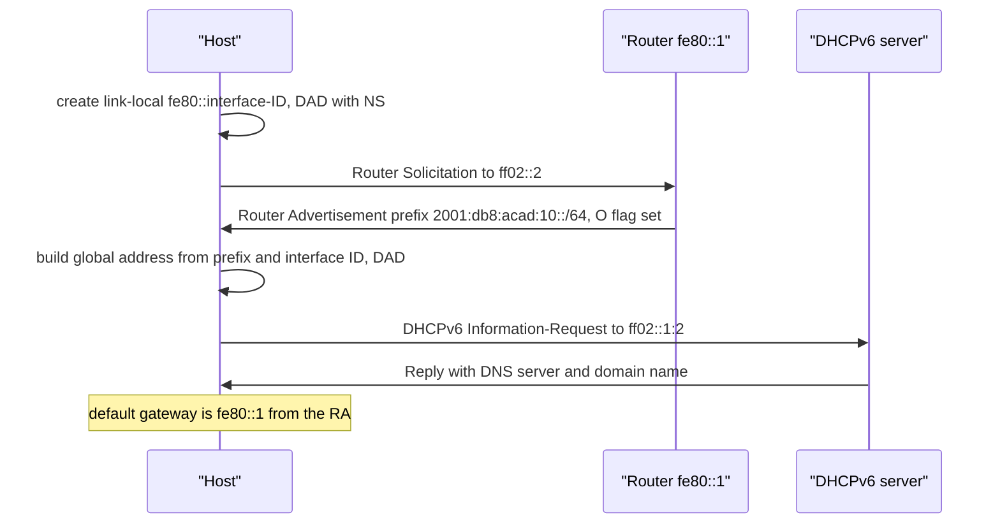
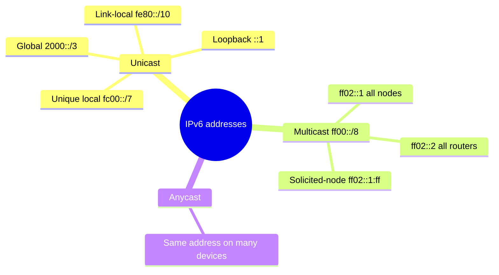
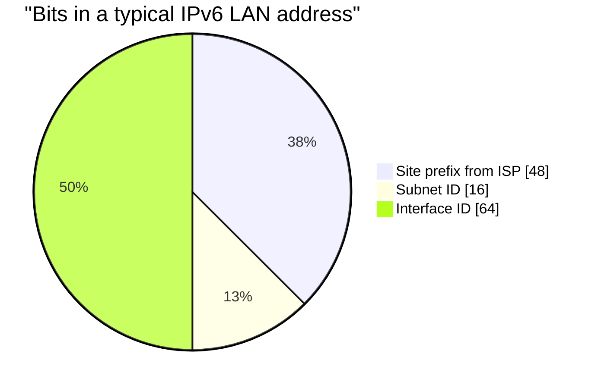

# Session 11: IPv6

> [Cybersecurity and Digital Forensics](../../README.md) › [Term 1](../README.md) › [Module 4: Configuring Network Infrastructure](README.md) › **Session 11**

| ⏱ Estimated time | 📋 Prerequisites |
|---|---|
| 3 hours | Session 3 (MAC, subnetting), Session 7 (static routing and OSPF), Session 9 (DHCP) |

| ⬅ [Previous: Session 10](session-10-network-security-fundamentals.md) | [Next: Session 12](session-12-layer-3-switching.md) ➡ |
|:---|---:|

[](https://colab.research.google.com/github/Hamnakhan123/Cybersecurity-and-Digital-Forensics/blob/main/term-1/04-configuring-network-infrastructure/code/session-11-ipv6.ipynb) &nbsp;Run every Python example of this session in the notebook [`code/session-11-ipv6.ipynb`](code/session-11-ipv6.ipynb).

---

## 🎯 Learning objectives

- Define **IPv6** and explain the **reasons** for implementing it.
- Explain the **differences between IPv4 and IPv6** addressing and headers.
- Write, compress and classify IPv6 addresses (global unicast, unique local, link-local, multicast, anycast).
- Explain the **Neighbor Discovery Protocol (NDP)** and **SLAAC**.
- Describe **DHCPv6** (stateless and stateful) and its role in IPv6 configuration.
- Configure **IPv6 static routes** and **OSPFv3**.

## 📖 Concepts

### 1. Why IPv6?

| Reason | Explanation |
|---|---|
| **Address exhaustion** | IPv4 has 2³² ≈ 4.3 billion addresses; the regional registries ran out of free blocks between 2011 and 2019 (APNIC, which serves Pakistan, in 2011). |
| **End-to-end connectivity** | IPv4 depends on NAT and carrier-grade NAT, which break some applications and complicate logging/forensics. IPv6 gives every device a globally unique address. |
| **Simpler header** | Fixed 40-byte header, no header checksum, fragmentation only at the source → faster processing. |
| **Auto-configuration** | SLAAC lets hosts configure themselves without a DHCP server. |
| **Built-in multicast** | No broadcast at all; efficient multicast groups instead. |
| **Growth of IoT and mobile** | Billions of phones, sensors and cars need addresses. Mobile networks are largely IPv6 today. |

> **Analogy – phone numbers.** When a city runs out of 7-digit numbers it adds digits. IPv6 did that on a massive scale: from 32 bits to 128 bits – enough to give every grain of sand on Earth many addresses.

### 2. IPv4 vs IPv6

| Feature | IPv4 | IPv6 |
|---|---|---|
| Length | 32 bits, dotted decimal | **128 bits**, 8 groups of 4 hex digits (**hextets**) |
| Example | `192.168.10.25` | `2001:db8:acad:10::25` |
| Header | 20–60 bytes, 12+ fields, checksum | **40 bytes fixed**, 8 fields, no checksum, extension headers |
| Address resolution | ARP (broadcast) | **NDP** (ICMPv6 multicast) |
| Auto-configuration | DHCP (or APIPA) | **SLAAC**, stateless/stateful **DHCPv6** |
| Broadcast | Yes | **No** (multicast `ff02::1` instead) |
| Private addresses | RFC 1918 + NAT | Unique local `fc00::/7` (NAT not needed) |
| Fragmentation | Routers and hosts | Source host only (Path MTU Discovery); minimum MTU 1 280 |
| Loopback | `127.0.0.1` | `::1` |
| Typical LAN prefix | /24 | **/64** |
| IPsec | Optional | Part of the design (still optional to use) |

**Writing addresses – two rules:**
1. Drop **leading zeros** in any hextet: `0db8` → `db8`, `0000` → `0`.
2. Replace **one** run of consecutive all-zero hextets with `::` (only once, or the address would be ambiguous).

`2001:0db8:0000:0000:0000:ff00:0042:8329` → `2001:db8::ff00:42:8329`.

**Address structure (global unicast, typical):** `/48` site prefix from the ISP + **16-bit subnet ID** (65 536 subnets) + **64-bit interface ID**.

### 3. IPv6 address types

| Type | Prefix | Scope / use |
|---|---|---|
| **Global unicast (GUA)** | `2000::/3` | Internet-routable (like public IPv4) |
| **Unique local (ULA)** | `fc00::/7` (in practice `fd00::/8`) | Private inside an organisation |
| **Link-local (LLA)** | `fe80::/10` | Every IPv6 interface has one; never routed; used by NDP and as routing next hops |
| **Multicast** | `ff00::/8` | `ff02::1` all nodes, `ff02::2` all routers, `ff02::5/6` OSPFv3, `ff02::1:2` DHCPv6, `ff02::1:ffXX:XXXX` solicited-node |
| **Anycast** | Any unicast address on several devices | Nearest one answers (DNS root servers) |
| Loopback / unspecified | `::1` / `::` | Self / "no address yet" |
| Documentation | `2001:db8::/32` | Examples (used in this course) |

**Interface ID:** configured manually, **EUI-64** (MAC split with `FFFE` inserted and the U/L bit flipped), or **random/privacy** addresses (default on Windows, macOS, Android, iOS).

### 4. Neighbor Discovery Protocol (NDP)

NDP uses five **ICMPv6** messages and replaces ARP, ICMP router discovery and redirects:

| Message | Type | Purpose |
|---|---|---|
| **Router Solicitation (RS)** | 133 | Host: "Any routers here?" → `ff02::2` |
| **Router Advertisement (RA)** | 134 | Router: prefix, prefix length, default gateway (its link-local), M/O flags |
| **Neighbor Solicitation (NS)** | 135 | "Who has this IPv6 address? Tell me your MAC" → **solicited-node multicast**; also **DAD** (duplicate address detection) |
| **Neighbor Advertisement (NA)** | 136 | Reply with the MAC address |
| **Redirect** | 137 | "Use a better first hop" |

Because NDP is as trusting as ARP, switches offer **RA Guard**, **DHCPv6 Guard** and **IPv6 Source Guard** – the IPv6 equivalents of DHCP snooping and DAI.

### 5. SLAAC and DHCPv6

The **RA flags** tell hosts how to configure themselves:

| Method | RA flags | Address from | DNS from |
|---|---|---|---|
| **SLAAC only** | M=0, O=0 | Prefix in RA + own interface ID | RA (RDNSS option) |
| **SLAAC + stateless DHCPv6** | M=0, **O=1** | SLAAC | DHCPv6 server (no address tracking) |
| **Stateful DHCPv6** | **M=1** | DHCPv6 server (tracks leases) | DHCPv6 server |

The default gateway **always** comes from the RA (the router's link-local address) – DHCPv6 has no gateway option. DHCPv6 uses UDP **546** (client) / **547** (server) and the multicast group `ff02::1:2`; relay with `ipv6 dhcp relay destination`.

### 6. IPv6 static routing and OSPFv3

- Enable forwarding with `ipv6 unicast-routing` (also makes the router send RAs).
- Static: `ipv6 route 2001:db8:acad:20::/64 2001:db8:acad:12::2`; with a link-local next hop the exit interface is required: `ipv6 route … Gi0/1 fe80::2`. Default: `ipv6 route ::/0 …`. Floating: add an AD.
- **OSPFv3** works like OSPFv2 (areas, DR/BDR, cost, SPF) but: enabled **per interface** (`ipv6 ospf 1 area 0`) instead of `network` statements, neighbours use **link-local** addresses, multicast `ff02::5`/`ff02::6`, and it still needs a 32-bit **router ID** (set it manually if the router has no IPv4 address).

## 🧭 Diagrams

**SLAAC with stateless DHCPv6**



**IPv6 address types**



## 🪜 Step-by-step: IPv6 lab with SLAAC, DHCPv6, static routes and OSPFv3

1. Two routers R1–R2, a LAN on each; prefixes `2001:db8:acad:10::/64` (R1 LAN), `:12::/64` (link), `:20::/64` (R2 LAN).
2. `ipv6 unicast-routing` on both routers.
3. Assign global addresses and easy link-local addresses (`fe80::1`, `fe80::2`).
4. On R1's LAN set the **O flag** and a stateless DHCPv6 pool with a DNS server.
5. Set PCs to **automatic (SLAAC)**; check they get a `2001:db8:acad:10:…` address and gateway `fe80::1`.
6. **Static routing first:** route R2's LAN via the link; ping across.
7. Replace static with **OSPFv3** (`ipv6 router ospf 1`, router-id, `ipv6 ospf 1 area 0` on interfaces). Verify `show ipv6 ospf neighbor` and `show ipv6 route ospf`.

📄 **`code/session-11_ipv6.ios`**

```text
! Session 11 - IPv6 addressing, SLAAC/DHCPv6, static routes and OSPFv3 (lab only)
! R1 Gi0/0 = LAN 2001:db8:acad:10::/64, Gi0/1 = link to R2 2001:db8:acad:12::/64

ipv6 unicast-routing                            ! makes the router forward IPv6 and send RAs

interface GigabitEthernet0/0
 ipv6 address 2001:db8:acad:10::1/64
 ipv6 address fe80::1 link-local               ! easy-to-read gateway link-local
 ipv6 nd other-config-flag                     ! O flag: SLAAC address + stateless DHCPv6 for DNS
 ipv6 dhcp server LAN-STATELESS
 ipv6 ospf 1 area 0
 no shutdown
interface GigabitEthernet0/1
 ipv6 address 2001:db8:acad:12::1/64
 ipv6 ospf 1 area 0
 no shutdown

ipv6 dhcp pool LAN-STATELESS
 dns-server 2001:db8:acad:99::53
 domain-name lab.local

! Static routing alternative (use static OR OSPFv3 in the lab, not both)
! ipv6 route 2001:db8:acad:20::/64 2001:db8:acad:12::2          ! next-hop global address
! ipv6 route 2001:db8:acad:20::/64 GigabitEthernet0/1 fe80::2   ! link-local needs the exit interface
! ipv6 route ::/0 2001:db8:acad:12::2                           ! default route

ipv6 router ospf 1
 router-id 1.1.1.1                             ! OSPFv3 still uses a 32-bit router ID

! Stateful DHCPv6 (M flag) would instead use:
!  ipv6 nd managed-config-flag
!  ipv6 dhcp pool LAN-STATEFUL / address prefix 2001:db8:acad:10::/64

! verify: show ipv6 interface brief | show ipv6 route | show ipv6 neighbors
!         show ipv6 ospf neighbor   | show ipv6 dhcp pool | ping 2001:db8:acad:20::1
```
**Expected output excerpts:**

```text
R1#show ipv6 interface brief
GigabitEthernet0/0     [up/up]
    FE80::1
    2001:DB8:ACAD:10::1
GigabitEthernet0/1     [up/up]
    FE80::2E0:8FFF:FE4A:1B02
    2001:DB8:ACAD:12::1

R1#show ipv6 route ospf
O   2001:DB8:ACAD:20::/64 [110/2]
     via FE80::2, GigabitEthernet0/1

PC> ipconfig /all
   IPv6 Address..........: 2001:db8:acad:10:21a:2bff:fe3c:4d5e
   Link-local IPv6 Address: fe80::21a:2bff:fe3c:4d5e
   Default Gateway........: fe80::1
```

Notice that OSPFv3 routes point to the neighbour's **link-local** address.

## 💻 Worked examples

### Example 1 – IPv6 toolkit: notation, types, SLAAC and NDP

📄 **`code/session-11_ipv6_toolkit.py`**

```python
"""Session 11 - IPv6 toolkit: notation, address types, SLAAC and NDP multicast.

- Expand and compress addresses (one "::" per address, leading zeros dropped).
- Classify global unicast, unique local, link-local, multicast and loopback.
- Build a SLAAC address from a /64 prefix + modified EUI-64 interface ID.
- Work out the solicited-node multicast address that NDP uses instead of ARP.
- Compare IPv4 and IPv6 address space.
Run:  python session-11_ipv6_toolkit.py
"""
import ipaddress


def kind(a):
    a = ipaddress.IPv6Address(a)
    if a.is_loopback: return "loopback ::1"
    if a.is_link_local: return "link-local fe80::/10 (never routed)"
    if a.is_multicast:
        names = {"ff02::1": "all nodes", "ff02::2": "all routers", "ff02::5": "all OSPFv3 routers",
                 "ff02::1:2": "all DHCPv6 agents"}
        return f"multicast ff00::/8 ({names.get(str(a), 'group')})"
    if a in ipaddress.IPv6Network("fc00::/7"): return "unique local fc00::/7 (private)"
    if a in ipaddress.IPv6Network("2001:db8::/32"): return "documentation 2001:db8::/32"
    if a in ipaddress.IPv6Network("2000::/3"): return "global unicast 2000::/3"
    return "other / reserved"


def eui64_id(mac):
    b = bytearray(int(x, 16) for x in mac.replace(".", ":").replace("-", ":").split(":"))
    b[0] ^= 0x02
    return bytes(b[:3]) + b"\xff\xfe" + bytes(b[3:])


def slaac(prefix, mac):
    net = ipaddress.IPv6Network(prefix)
    assert net.prefixlen == 64, "SLAAC needs a /64"
    return ipaddress.IPv6Address(int(net.network_address) | int.from_bytes(eui64_id(mac), "big"))


def solicited_node(addr):
    last24 = int(ipaddress.IPv6Address(addr)) & 0xFFFFFF
    return ipaddress.IPv6Address(int(ipaddress.IPv6Address("ff02::1:ff00:0")) | last24)


if __name__ == "__main__":
    print("Expand / compress")
    for a in ["2001:0db8:0000:0000:0000:ff00:0042:8329", "fe80::1", "2001:db8:0:0:1:0:0:1"]:
        x = ipaddress.IPv6Address(a)
        print(f"  {a:42} full {x.exploded}\n  {'':42} short {x.compressed}")
    print("\nAddress types")
    for a in ["2001:db8:acad:10::1", "2400:cb00::1", "fd12:3456:789a:1::10", "fe80::21a:2bff:fe3c:4d5e",
              "ff02::1", "ff02::2", "ff02::5", "::1"]:
        print(f"  {a:28} {kind(a)}")
    print("\nSLAAC: router advertises 2001:db8:acad:10::/64, host MAC 00:1a:2b:3c:4d:5e")
    g = slaac("2001:db8:acad:10::/64", "00:1a:2b:3c:4d:5e")
    ll = slaac("fe80::/64", "00:1a:2b:3c:4d:5e")
    print(f"  global address     {g}\n  link-local address {ll}")
    print(f"  solicited-node multicast for NDP: {solicited_node(g)}")
    print("  (NS goes to that group instead of a broadcast; only hosts with the same last 24 bits listen)")
    print("\nAddress space")
    print(f"  IPv4: 2^32  = {2**32:,}")
    print(f"  IPv6: 2^128 = {2**128:,}")
    print(f"  One /64 subnet holds 2^64 = {2**64:,} interface IDs")
    site = ipaddress.IPv6Network("2001:db8:acad::/48")
    subs = list(site.subnets(new_prefix=64))[:3]
    print(f"  A /48 site has {2**16:,} /64 subnets, e.g. {', '.join(map(str, subs))} ...")
```

**Output**

```text
Expand / compress
  2001:0db8:0000:0000:0000:ff00:0042:8329    full 2001:0db8:0000:0000:0000:ff00:0042:8329
                                             short 2001:db8::ff00:42:8329
  fe80::1                                    full fe80:0000:0000:0000:0000:0000:0000:0001
                                             short fe80::1
  2001:db8:0:0:1:0:0:1                       full 2001:0db8:0000:0000:0001:0000:0000:0001
                                             short 2001:db8::1:0:0:1

Address types
  2001:db8:acad:10::1          documentation 2001:db8::/32
  2400:cb00::1                 global unicast 2000::/3
  fd12:3456:789a:1::10         unique local fc00::/7 (private)
  fe80::21a:2bff:fe3c:4d5e     link-local fe80::/10 (never routed)
  ff02::1                      multicast ff00::/8 (all nodes)
  ff02::2                      multicast ff00::/8 (all routers)
  ff02::5                      multicast ff00::/8 (all OSPFv3 routers)
  ::1                          loopback ::1

SLAAC: router advertises 2001:db8:acad:10::/64, host MAC 00:1a:2b:3c:4d:5e
  global address     2001:db8:acad:10:21a:2bff:fe3c:4d5e
  link-local address fe80::21a:2bff:fe3c:4d5e
  solicited-node multicast for NDP: ff02::1:ff3c:4d5e
  (NS goes to that group instead of a broadcast; only hosts with the same last 24 bits listen)

Address space
  IPv4: 2^32  = 4,294,967,296
  IPv6: 2^128 = 340,282,366,920,938,463,463,374,607,431,768,211,456
  One /64 subnet holds 2^64 = 18,446,744,073,709,551,616 interface IDs
  A /48 site has 65,536 /64 subnets, e.g. 2001:db8:acad::/64, 2001:db8:acad:1::/64, 2001:db8:acad:2::/64 ...
```
**Observe:**
- `2001:db8:0:0:1:0:0:1` compresses to `2001:db8::1:0:0:1` – `::` replaces the **first** longest run of zeros; the second run stays as `0:0`.
- The SLAAC address combines the advertised /64 prefix with the EUI-64 interface ID; the same interface ID is reused for the link-local address.
- The solicited-node group `ff02::1:ff3c:4d5e` uses the **last 24 bits** of the address, so an NS reaches only a handful of hosts – far better than an ARP broadcast.

### Example 2 – Subnetting IPv6 by hand

The ISP assigns `2001:db8:acad::/48`. The 4th hextet is the **subnet ID**:

| Use | Subnet | Gateway |
|---|---|---|
| Lecturers VLAN 10 | `2001:db8:acad:10::/64` | `2001:db8:acad:10::1` |
| Students VLAN 20 | `2001:db8:acad:20::/64` | `2001:db8:acad:20::1` |
| Servers VLAN 30 | `2001:db8:acad:30::/64` | `2001:db8:acad:30::1` |
| R1–R2 link | `2001:db8:acad:12::/64` | `::1` and `::2` |

Using the **VLAN number as the subnet ID** makes addresses self-documenting. There is no need for VLSM-style squeezing: every LAN gets a /64.

## 📊 Chart

| Task | IPv4 command | IPv6 command |
|---|---|---|
| Enable routing | (on by default on routers) | `ipv6 unicast-routing` |
| Interface address | `ip address 10.0.0.1 255.255.255.0` | `ipv6 address 2001:db8::1/64` |
| Show interfaces | `show ip interface brief` | `show ipv6 interface brief` |
| Neighbour/ARP table | `show arp` | `show ipv6 neighbors` |
| Static route | `ip route …` | `ipv6 route …` |
| OSPF | `router ospf 1` + `network` | `ipv6 router ospf 1` + `ipv6 ospf 1 area 0` per interface |
| DHCP pool | `ip dhcp pool` | `ipv6 dhcp pool` |
| Ping / trace | `ping`, `traceroute` | `ping ipv6 …`, `traceroute ipv6 …` |



## 🏢 Real-life problem with full solution

**Scenario.** A software house's mobile app must support IPv6-only mobile networks, and the ISP now offers a `/48`. The office LAN is IPv4-only behind NAT, with VLANs 10 (Developers), 20 (Staff), 30 (Servers) and a guest Wi-Fi. Management wants IPv6 **without** breaking IPv4 or weakening security.

**Solution – dual stack, step by step:**

1. **Plan:** `/48` → subnet IDs equal to VLAN numbers: `:10::/64`, `:20::/64`, `:30::/64`, guest `:50::/64`, links `:f0::/64` onwards. Document in the IPAM.
2. **Routers/L3 switch:** `ipv6 unicast-routing`; SVIs get `::1` plus `fe80::1` link-local; default route `ipv6 route ::/0` to the ISP.
3. **Host configuration:** SLAAC + **stateless DHCPv6** (O flag) for DNS on user VLANs; **static** addresses on servers; publish AAAA records for public services.
4. **Security parity:** IPv6 ACLs mirroring the IPv4 ones (`ipv6 traffic-filter … in`); **RA Guard** and **DHCPv6 Guard** on access ports; firewall rules for IPv6 inbound (no NAT means the firewall is the only barrier – default deny inbound).
5. **Routing:** OSPFv3 between the core and the edge, authenticated, passive on user VLANs.
6. **Monitoring:** log IPv6 addresses (privacy addresses change daily, so keep NDP/DHCPv6 logs for investigations).
7. **Verify:** `test-ipv6`-style checks from a PC, `ping ipv6` across VLANs, the app works on an IPv6-only mobile hotspot, IPv4 still works.

## ⚠️ Common mistakes

- Using `::` twice in one address.
- Forgetting `ipv6 unicast-routing` – the router neither forwards IPv6 nor sends RAs, so hosts get no global address.
- Using a prefix other than /64 on LANs → SLAAC fails.
- Adding IPv6 without IPv6 ACLs/firewall rules (traffic bypasses IPv4-only policy).
- A link-local next hop without an exit interface in a static route.
- No router ID for OSPFv3 on an IPv6-only router.

## ✅ Best practices

- Deploy **dual stack** first; mirror IPv4 security policy in IPv6.
- /64 for every LAN, /127 (or /64) for point-to-point links, /128 for loopbacks.
- Readable link-local addresses on routers (`fe80::1`); VLAN number as subnet ID.
- RA Guard, DHCPv6 Guard and IPv6 Source Guard on access ports.
- Keep logs that map IPv6 addresses to MACs/users (privacy addresses rotate).

## 🧪 Lab / practice tasks

1. **Easy –** Compress `fe80:0000:0000:0000:0204:61ff:fe9d:f156` and `2001:0db8:0000:0001:0000:0000:0000:0100`.
2. **Easy –** Classify `fd00:1::5`, `ff02::2`, `2a00:1450::200e`, `fe80::7`.
3. **Medium –** Calculate the EUI-64 interface ID for MAC `00:50:56:C0:00:08` and the resulting SLAAC address in `2001:db8:acad:20::/64`.
4. **Medium –** Build the lab and capture an RS/RA exchange in simulation mode. Which addresses are used as source and destination?
5. **Challenge –** Extend `session-11_ipv6_toolkit.py` with a function that, given a `/48`, generates the subnet for each VLAN number (VLAN 10 → `…:10::/64`) and checks that no VLAN number above 65 535 is used.

<details>
<summary>💡 Hints</summary>

- Task 1: drop leading zeros first, then use `::` for the longest run.
- Task 3: flip bit 7 of the first byte: `00` → `02`; insert `fffe` in the middle.
- Task 5: interpret the VLAN number as **hex digits** for readability: `int(str(vlan), 16)` places "10" into the hextet.
</details>

<details>
<summary>✅ Solutions</summary>

**Task 1:** `fe80::204:61ff:fe9d:f156`; `2001:db8:0:1::100`.

**Task 2:** unique local; multicast (all routers); global unicast; link-local.

**Task 3:** interface ID `0250:56ff:fec0:0008` → `2001:db8:acad:20:250:56ff:fec0:8`.

**Task 4:** RS from the host's link-local (or `::`) to `ff02::2`; RA from the router's link-local (`fe80::1`) to `ff02::1` (or unicast to the host).

**Task 5:**

```python
def vlan_subnet(site48, vlan):
    if not 1 <= vlan <= 4094:
        raise ValueError("VLAN must be 1-4094")
    base = ipaddress.IPv6Network(site48)
    sub_id = int(str(vlan), 16)            # VLAN 10 -> hextet "10"
    return ipaddress.IPv6Network((int(base.network_address) | (sub_id << 64), 64))

print(vlan_subnet("2001:db8:acad::/48", 20))   # 2001:db8:acad:20::/64
```
</details>

## ✅ Quick quiz

1. How long is an IPv6 address? a) 32 bits b) 64 bits c) 128 bits d) 256 bits
2. Which prefix is link-local? a) 2000::/3 b) fc00::/7 c) fe80::/10 d) ff00::/8
3. Which NDP message carries the prefix and default gateway? a) NS b) NA c) RS d) RA
4. With M=0 and O=1 in the RA, hosts get their address from: a) stateful DHCPv6 b) SLAAC c) manual configuration d) APIPA
5. OSPFv3 is enabled with: a) `network` statements b) `ipv6 ospf 1 area 0` on interfaces c) `router ospf 1 ipv6` d) it is automatic

<details>
<summary>Show answers</summary>

1 – c · 2 – c · 3 – d · 4 – b · 5 – b
</details>

## 📝 Summary / cheat-sheet

- IPv6: 128-bit, hex hextets, one `::`, no broadcast, 40-byte header, /64 LANs.
- Types: GUA 2000::/3, ULA fc00::/7, link-local fe80::/10, multicast ff00::/8, loopback ::1, anycast.
- NDP (ICMPv6): RS 133, RA 134, NS 135, NA 136, Redirect 137; DAD; solicited-node multicast.
- SLAAC (M=0,O=0), SLAAC + stateless DHCPv6 (O=1), stateful DHCPv6 (M=1); gateway always from RA.
- `ipv6 unicast-routing`; `ipv6 route prefix next-hop`; OSPFv3 per interface, link-local next hops, needs router ID.

**Interview / viva questions**

1. Give three reasons organisations adopt IPv6.
2. How does NDP replace ARP, and why is it more efficient?
3. Explain SLAAC and the role of the M and O flags.
4. Why does every IPv6 interface have a link-local address?
5. How is OSPFv3 configured differently from OSPFv2?
6. What new security controls are needed when IPv6 is enabled?

---

| ⬅ [Previous: Session 10](session-10-network-security-fundamentals.md) | [Next: Session 12](session-12-layer-3-switching.md) ➡ |
|:---|---:|

<sub>Prepared by **Hamna Zahid Khan**, Junior Lecturer · Cybersecurity and Digital Forensics</sub>
