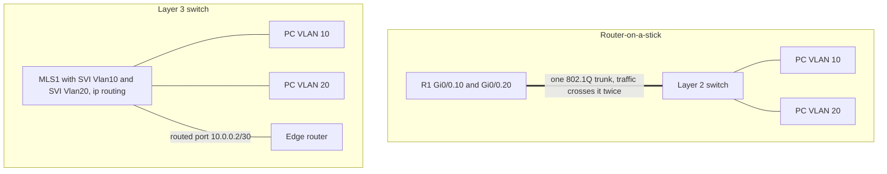
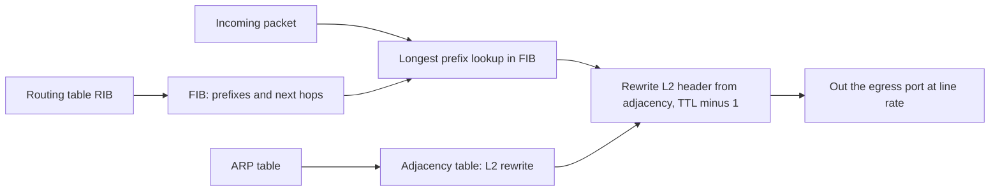
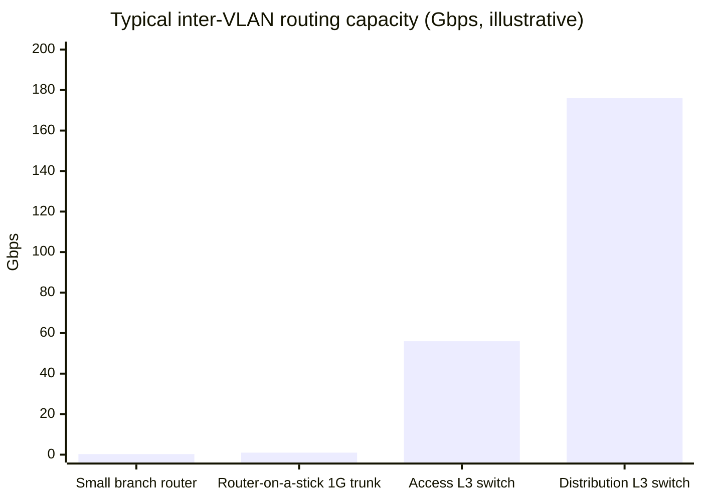

# Session 12: Layer 3 Switches and Inter-VLAN Routing

> [Cybersecurity and Digital Forensics](../../README.md) › [Term 1](../README.md) › [Module 4: Configuring Network Infrastructure](README.md) › **Session 12**

| ⏱ Estimated time | 📋 Prerequisites |
|---|---|
| 2.5 hours | Session 5 (VLANs and trunks), Session 7 (routing), Session 9 (DHCP relay) |

| ⬅ [Previous: Session 11](session-11-ipv6.md) | [Next: Session 13](session-13-virtual-private-networks.md) ➡ |
|:---|---:|

[](https://colab.research.google.com/github/Hamnakhan123/Cybersecurity-and-Digital-Forensics/blob/main/term-1/04-configuring-network-infrastructure/code/session-12-layer-3-switching.ipynb) &nbsp;Run every Python example of this session in the notebook [`code/session-12-layer-3-switching.ipynb`](code/session-12-layer-3-switching.ipynb).

---

## 🎯 Learning objectives

- Explain the concept and purpose of **Layer 3 (multilayer) switches** in a network.
- Explain **Cisco Express Forwarding (CEF)**: the FIB and adjacency table, and why it is fast.
- Explain **inter-VLAN routing** and compare legacy routing, **router-on-a-stick** and **Layer 3 switch** designs.
- Configure **Switch Virtual Interfaces (SVIs)** and **routed ports**, and verify inter-VLAN routing.
- Troubleshoot the common reasons inter-VLAN routing fails.

## 📖 Concepts

### 1. Why route between VLANs?

VLANs (Session 5) are separate broadcast domains and separate IP subnets. To move traffic **between** them, a Layer 3 device must route it. Without that, a lecturer in VLAN 10 cannot print on a printer in VLAN 30 or reach a server in VLAN 40.

**Three ways to do it:**

| Method | How | Pros | Cons |
|---|---|---|---|
| **Legacy** | One physical router interface per VLAN | Simple concept | Does not scale – 20 VLANs = 20 router ports and cables |
| **Router-on-a-stick** | One **trunk** to the router; one **sub-interface** per VLAN with `encapsulation dot1Q` | Cheap, one cable | All inter-VLAN traffic crosses one link **twice**; router CPU/link is the bottleneck |
| **Layer 3 switch** | One **SVI** per VLAN inside the switch; routing in hardware | Wire-speed, scales, no extra cable | Costs more than a Layer 2 switch |

> **Analogy – moving between departments in a building.** Router-on-a-stick is like everyone having to go down to the single lobby lift and back up to change departments – it works, but the lift queues at busy times. A Layer 3 switch is like having internal doors between departments on every floor.

### 2. Layer 3 (multilayer) switches

A **multilayer switch** combines Layer 2 switching and Layer 3 routing in the same box, with forwarding done in **ASICs and TCAM** so routing runs at line rate. It typically sits at the **distribution** or **core** layer.

Its Layer 3 interfaces:

| Interface | Created with | Use |
|---|---|---|
| **SVI** (switch virtual interface) | `interface vlan 10` + `ip address` | Default gateway for all hosts in VLAN 10 |
| **Routed port** | `no switchport` on a physical port + `ip address` | Point-to-point link to a router or another L3 switch (no VLANs, no STP) |
| **Routed EtherChannel** | `no switchport` on a Port-channel | Bundled Layer 3 uplink |
| **Loopback** | `interface loopback 0` | Stable router ID / management address |

Routing must be enabled: **`ip routing`** (off by default on many switches; without it, SVIs only act as management addresses).

**An SVI is up/up only when:** the VLAN exists in the VLAN database, at least one access port in that VLAN is up **or** a trunk carrying the VLAN is up, and the SVI is not `shutdown`. (Autostate keeps an SVI down when no port in its VLAN is active, so routing does not advertise an unreachable network.)

### 3. Cisco Express Forwarding (CEF)

Early routers did **process switching** (CPU looks up every packet) and then **fast switching** (route the first packet in software, cache the result for the rest). Both put load on the CPU and suffered when caches churned.

**CEF** pre-builds two tables from the control plane so every packet is forwarded in the data plane:

| Table | Built from | Contains |
|---|---|---|
| **FIB** – forwarding information base | The routing table (RIB) | Every prefix with its next hop and outgoing interface, already resolved |
| **Adjacency table** | ARP / IPv6 neighbour tables | The pre-built **Layer 2 rewrite** (destination MAC, source MAC, VLAN) for each next hop |

For each packet: longest-prefix lookup in the FIB → pointer to an adjacency → rewrite the Layer 2 header, decrement TTL, update checksum → send. Special adjacencies: **glean** (directly connected, ARP not yet resolved – punt to CPU to ARP), **punt** (needs CPU), **drop**, **null**.

CEF is **on by default** on modern Cisco routers and multilayer switches. Verify with `show ip cef`, `show ip cef <prefix> detail`, `show adjacency detail`.

### 4. Packet walk – VLAN 10 PC to VLAN 20 PC through an L3 switch

1. PC-A (`192.168.10.11/24`) sees the destination `192.168.20.22` is in another subnet → sends the frame to its **gateway's MAC** (the SVI `Vlan10`), after ARPing for `192.168.10.1` if needed.
2. The switch receives the frame on an access port in VLAN 10; the destination MAC is its own → hand to Layer 3.
3. **FIB** lookup for `192.168.20.22` → connected via `Vlan20`.
4. **Adjacency** for `192.168.20.22` → rewrite: dst MAC = PC-B, src MAC = SVI MAC, VLAN 20, port Gi1/0/5.
5. TTL 64 → 63; frame sent out the access port in VLAN 20.

## 🧭 Diagrams

**Router-on-a-stick vs Layer 3 switch**



**CEF forwarding**



## 🪜 Step-by-step: build both designs

**Part A – router-on-a-stick**
1. SW1 with VLANs 10, 20 (access ports) and Gi0/1 as a trunk to R1 Gi0/0.
2. On R1: `no shutdown` on Gi0/0, then sub-interfaces `Gi0/0.10` and `Gi0/0.20` with `encapsulation dot1Q <vlan>` and the gateway IPs.
3. PCs use `.1` of their VLAN as gateway. Ping across VLANs; `show ip route` shows both subnets as **connected**.

**Part B – Layer 3 switch**
1. Replace R1 with a 3560/3650 multilayer switch (MLS1).
2. `ip routing`; create VLANs; create SVIs with gateway IPs; `no shutdown`.
3. Add a **routed port** to the edge router and a default route.
4. Add `ip helper-address` on SVIs whose clients need a central DHCP server.
5. Verify with `show ip interface brief` (SVIs up/up), `show ip route`, `show ip cef`, and pings between VLANs.

📄 **`code/session-12_l3switch.ios`**

```text
! Session 12 - Inter-VLAN routing: router-on-a-stick vs Layer 3 switch SVIs (lab)

! ===== Option A: router-on-a-stick (R1 Gi0/0 is an 802.1Q trunk to SW1) =====
interface GigabitEthernet0/0
 no shutdown
interface GigabitEthernet0/0.10
 encapsulation dot1Q 10
 ip address 192.168.10.1 255.255.255.0
interface GigabitEthernet0/0.20
 encapsulation dot1Q 20
 ip address 192.168.20.1 255.255.255.0
interface GigabitEthernet0/0.99
 encapsulation dot1Q 99 native
 ip address 192.168.99.1 255.255.255.0

! ===== Option B: multilayer switch MLS1 with SVIs =====
ip routing                                   ! turn the switch into a router (off by default)
vlan 10
 name LECTURERS
vlan 20
 name STUDENTS
vlan 30
 name SERVERS
interface Vlan10
 ip address 192.168.10.1 255.255.255.0
 no shutdown
interface Vlan20
 ip address 192.168.20.1 255.255.255.0
 ip helper-address 192.168.30.67              ! DHCP relay to the server VLAN
 no shutdown
interface Vlan30
 ip address 192.168.30.1 255.255.255.0
 no shutdown
! routed (no switchport) uplink to the edge router
interface GigabitEthernet1/0/48
 no switchport
 ip address 10.0.0.2 255.255.255.252
ip route 0.0.0.0 0.0.0.0 10.0.0.1
! CEF is on by default on multilayer switches; confirm with: show ip cef

! An SVI is up/up only when the VLAN exists AND at least one port in that VLAN is up (or a trunk carries it).
! verify: show ip interface brief | show ip route | show ip cef | show adjacency detail
!         show interfaces trunk    | ping 192.168.20.22 source vlan 10
```
**Expected output excerpts:**

```text
MLS1#show ip interface brief | include Vlan|Gig1/0/48
Vlan10                 192.168.10.1    YES manual up                    up
Vlan20                 192.168.20.1    YES manual up                    up
Vlan30                 192.168.30.1    YES manual up                    up
GigabitEthernet1/0/48  10.0.0.2        YES manual up                    up

MLS1#show ip route
S*    0.0.0.0/0 [1/0] via 10.0.0.1
C     192.168.10.0/24 is directly connected, Vlan10
C     192.168.20.0/24 is directly connected, Vlan20
C     192.168.30.0/24 is directly connected, Vlan30

MLS1#show ip cef 192.168.20.22
192.168.20.22/32
  attached to Vlan20
```

## 💻 Worked examples

### Example 1 – Inter-VLAN routing with a FIB and adjacency table

📄 **`code/session-12_intervlan_cef.py`**

```python
"""Session 12 - Inter-VLAN routing on a Layer 3 switch, and how CEF forwards fast.

A host sends to another subnet by framing the packet to its GATEWAY's MAC
(the SVI of its VLAN). The multilayer switch looks the destination up in its
FIB (forwarding information base, built from the routing table) and takes the
new Layer 2 header from the ADJACENCY table (built from ARP), then rewrites
the frame: new source/destination MAC, TTL - 1, and sends it into the other VLAN.
Run:  python session-12_intervlan_cef.py
"""
import ipaddress

SVIS = {10: ("192.168.10.1", 24, "0011.5c00.0010"),
        20: ("192.168.20.1", 24, "0011.5c00.0010"),
        30: ("192.168.30.1", 24, "0011.5c00.0010")}
ARP = {"192.168.10.11": ("aaaa.0000.0011", 10, "Gi1/0/1"),
       "192.168.20.22": ("bbbb.0000.0022", 20, "Gi1/0/5"),
       "192.168.30.10": ("cccc.0000.0010", 30, "Gi1/0/24")}


def build_fib():
    fib = []
    for vlan, (ip, plen, _) in SVIS.items():
        fib.append((ipaddress.ip_network(f"{ip}/{plen}", strict=False), f"Vlan{vlan}", "attached"))
    fib.append((ipaddress.ip_network("0.0.0.0/0"), "Gi1/0/48", "10.0.0.1"))
    return fib


def adjacency():
    return {ip: {"vlan": v, "port": p, "rewrite": mac} for ip, (mac, v, p) in ARP.items()}


def forward(src_ip, src_mac, dst_ip, ttl=64):
    src_vlan = next(v for v, (gw, plen, _) in SVIS.items()
                    if ipaddress.ip_address(src_ip) in ipaddress.ip_network(f"{gw}/{plen}", strict=False))
    gw_ip, _, gw_mac = SVIS[src_vlan]
    same = ipaddress.ip_address(dst_ip) in ipaddress.ip_network(f"{gw_ip}/24", strict=False)
    print(f"{src_ip} -> {dst_ip}")
    if same:
        print("  same VLAN: switched at Layer 2, no routing needed")
        return
    print(f"  host frames packet to its gateway: dst MAC {gw_mac} (SVI Vlan{src_vlan} {gw_ip})")
    fib = build_fib()
    prefix, iface, nh = max((e for e in fib if ipaddress.ip_address(dst_ip) in e[0]),
                            key=lambda e: e[0].prefixlen)
    print(f"  FIB lookup: {prefix} via {iface} ({nh})")
    adj = adjacency().get(dst_ip)
    if adj:
        print(f"  adjacency : rewrite dst MAC {adj['rewrite']}, src MAC {gw_mac}, VLAN {adj['vlan']}, out {adj['port']}")
        print(f"  TTL {ttl} -> {ttl - 1}; forwarded in hardware, CPU not involved")
    else:
        print("  no adjacency yet -> packet punted to CPU, switch ARPs for the next hop (glean)")


if __name__ == "__main__":
    print("FIB (show ip cef):")
    for p, i, nh in build_fib():
        print(f"  {str(p):18} {nh:10} {i}")
    print("\nAdjacency table (show adjacency detail):")
    for ip, a in adjacency().items():
        print(f"  {ip:15} Vlan{a['vlan']:<3} {a['port']:9} rewrite to {a['rewrite']}")
    print()
    forward("192.168.10.11", "aaaa.0000.0011", "192.168.20.22")
    forward("192.168.10.11", "aaaa.0000.0011", "192.168.30.10")
    forward("192.168.10.11", "aaaa.0000.0011", "192.168.10.40")
    forward("192.168.20.22", "bbbb.0000.0022", "192.168.30.99")
    print("\nCompare: router-on-a-stick = every inter-VLAN packet crosses ONE trunk twice;")
    print("a Layer 3 switch routes between SVIs internally at line rate.")
```

**Output**

```text
FIB (show ip cef):
  192.168.10.0/24    attached   Vlan10
  192.168.20.0/24    attached   Vlan20
  192.168.30.0/24    attached   Vlan30
  0.0.0.0/0          10.0.0.1   Gi1/0/48

Adjacency table (show adjacency detail):
  192.168.10.11   Vlan10  Gi1/0/1   rewrite to aaaa.0000.0011
  192.168.20.22   Vlan20  Gi1/0/5   rewrite to bbbb.0000.0022
  192.168.30.10   Vlan30  Gi1/0/24  rewrite to cccc.0000.0010

192.168.10.11 -> 192.168.20.22
  host frames packet to its gateway: dst MAC 0011.5c00.0010 (SVI Vlan10 192.168.10.1)
  FIB lookup: 192.168.20.0/24 via Vlan20 (attached)
  adjacency : rewrite dst MAC bbbb.0000.0022, src MAC 0011.5c00.0010, VLAN 20, out Gi1/0/5
  TTL 64 -> 63; forwarded in hardware, CPU not involved
192.168.10.11 -> 192.168.30.10
  host frames packet to its gateway: dst MAC 0011.5c00.0010 (SVI Vlan10 192.168.10.1)
  FIB lookup: 192.168.30.0/24 via Vlan30 (attached)
  adjacency : rewrite dst MAC cccc.0000.0010, src MAC 0011.5c00.0010, VLAN 30, out Gi1/0/24
  TTL 64 -> 63; forwarded in hardware, CPU not involved
192.168.10.11 -> 192.168.10.40
  same VLAN: switched at Layer 2, no routing needed
192.168.20.22 -> 192.168.30.99
  host frames packet to its gateway: dst MAC 0011.5c00.0010 (SVI Vlan20 192.168.20.1)
  FIB lookup: 192.168.30.0/24 via Vlan30 (attached)
  no adjacency yet -> packet punted to CPU, switch ARPs for the next hop (glean)

Compare: router-on-a-stick = every inter-VLAN packet crosses ONE trunk twice;
a Layer 3 switch routes between SVIs internally at line rate.
```
**Observe:**
- Same-VLAN traffic never touches Layer 3.
- Every routed packet gets a **new source MAC** (the switch's) and a **new destination MAC**, while IP addresses stay the same and TTL drops by one.
- When there is no adjacency yet (`192.168.30.99`), the packet is **punted** to the CPU so the switch can ARP – the first packet of a new conversation is slightly slower, later ones are pure hardware.

### Example 2 – How much does router-on-a-stick cost?

A lab of 40 PCs in VLAN 20 copies files from a server in VLAN 30 at 50 Mbps each during a practical:

| Design | Inter-VLAN traffic on the bottleneck | Link | Utilisation |
|---|---|---|---|
| Router-on-a-stick (1 Gbps trunk) | 40 × 50 = 2 000 Mbps, crossing the trunk **in and out** | 1 Gbps full duplex (1 000 each way) | **200%** → congestion |
| Layer 3 switch | Routed inside the switch backplane (e.g. 176 Gbps) | – | ≈ 1% |

## 📊 Chart



| Symptom | Likely cause | Check |
|---|---|---|
| SVI is down/down | VLAN not created or no active port in it | `show vlan brief`, `show interfaces trunk` |
| SVIs up but no routing | `ip routing` missing | `show running-config | include ip routing` |
| One VLAN cannot reach others | Wrong gateway on hosts, or VLAN not allowed on a trunk | `ipconfig`, `show interfaces trunk` |
| Router-on-a-stick: one VLAN fails | Wrong `encapsulation dot1Q` VLAN number on a sub-interface | `show run interface Gi0/0.20` |
| Hosts in new VLAN get APIPA | No `ip helper-address` on the SVI | `show run interface vlan 40` |
| Internet works for router but not hosts | No default route on the L3 switch, or NAT missing on the edge | `show ip route`, edge router NAT config |

## 🏢 Real-life problem with full solution

**Scenario.** A school uses a small branch router as router-on-a-stick for 8 VLANs. Since the new computer lab opened, online exams freeze whenever two classes download exam material at the same time. Interface counters on the router's trunk show output drops and 98% utilisation.

**Solution.**

1. **Diagnose:** `show interfaces Gi0/0` → output drops and high load; the router's CPU is at 85% (`show processes cpu`). All inter-VLAN traffic (labs → servers) is crossing one 1 Gbps trunk twice.
2. **Design:** move inter-VLAN routing to a **Layer 3 switch** in the server room. Keep the router only for the internet edge (NAT, firewalling).
3. **Migration plan (maintenance window):**
   - Create SVIs on the new L3 switch with **temporary** addresses; add `ip routing`, `ip helper-address` per SVI.
   - VLAN by VLAN: remove the sub-interface from the router and move the gateway IP to the SVI (hosts keep the same gateway address, so no DHCP changes).
   - Connect the L3 switch to the router with a **routed port** (`10.0.0.2/30`), add a default route to the router, and a static route (or OSPF) on the router back to the campus subnets for NAT return traffic.
4. **Security:** apply the inter-VLAN ACLs (Session 10) on the SVIs.
5. **Verify:** `show ip cef` and pings between VLANs; repeat the double-class download test – trunk utilisation drops below 10% and exams no longer freeze.
6. **Next step:** add a second L3 switch with HSRP (Session 8) for gateway redundancy.

## ⚠️ Common mistakes

- Forgetting `ip routing` on the Layer 3 switch.
- Creating an SVI for a VLAN that does not exist or has no active ports (SVI stays down).
- Forgetting `no shutdown` on the router's physical interface in router-on-a-stick (sub-interfaces then stay down).
- Mismatched native VLAN between router sub-interface and switch trunk.
- Using `switchport` mode on a port meant to be a routed uplink (missing `no switchport`).
- Missing return routes on the edge router for the new subnets.

## ✅ Best practices

- Route between VLANs at the **distribution layer** on L3 switches; keep routers for WAN/internet edges.
- Use **routed ports** (or routed EtherChannels) between L3 switches and routers – no STP on those links.
- Pair two L3 switches with HSRP/VRRP and align STP roots (Session 8).
- Apply inter-VLAN security policy with ACLs on SVIs.
- Keep the gateway address the same during migrations to avoid touching hosts.

## 🧪 Lab / practice tasks

1. **Easy –** List three ways to route between VLANs and one disadvantage of each.
2. **Easy –** Which two tables does CEF use, and what is each built from?
3. **Medium –** Build Part A, then Part B. Compare `traceroute` output between VLANs in both designs.
4. **Medium –** In `session-12_intervlan_cef.py`, add VLAN 40 (`192.168.40.0/24`) with a host `192.168.40.5`. Forward a packet from VLAN 10 to it.
5. **Challenge –** Add an **ACL check** to `forward()`: packets from VLAN 20 to VLAN 10 are dropped (policy on SVI Vlan20 inbound), all others allowed.

<details>
<summary>💡 Hints</summary>

- Task 4: add entries to both `SVIS` and `ARP`.
- Task 5: compute the destination VLAN from the FIB result and check `(src_vlan, dst_vlan)` against a set of denied pairs before rewriting.
</details>

<details>
<summary>✅ Solutions</summary>

**Task 1:** legacy (one port per VLAN – does not scale), router-on-a-stick (one trunk is a bottleneck), Layer 3 switch (higher cost, but best performance).

**Task 2:** FIB from the routing table; adjacency table from ARP/neighbour tables.

**Task 3:** both show the gateway as the first hop (`192.168.10.1`); with router-on-a-stick it is the router's sub-interface, with the L3 switch it is the SVI – but the switch answers much faster under load.

**Task 4:**

```python
SVIS[40] = ("192.168.40.1", 24, "0011.5c00.0010")
ARP["192.168.40.5"] = ("dddd.0000.0005", 40, "Gi1/0/12")
forward("192.168.10.11", "aaaa.0000.0011", "192.168.40.5")
```

**Task 5 (core lines):**

```python
DENY = {(20, 10)}
dst_vlan = int(iface.replace("Vlan", "")) if iface.startswith("Vlan") else None
if (src_vlan, dst_vlan) in DENY:
    print("  ACL on SVI: denied")
    return
```
</details>

## ✅ Quick quiz

1. Which command enables routing on a multilayer switch? a) `router enable` b) `ip routing` c) `ip cef` d) `switchport routing`
2. In router-on-a-stick, each VLAN uses a: a) separate physical port b) sub-interface with `encapsulation dot1Q` c) SVI d) loopback
3. An SVI is down/down. A likely cause is: a) `ip routing` missing b) no active port in that VLAN c) wrong DNS d) CEF disabled
4. The CEF table that holds Layer 2 rewrite information is the: a) FIB b) RIB c) adjacency table d) MAC table
5. A switch port converted with `no switchport` becomes a: a) trunk b) routed port c) access port d) SVI

<details>
<summary>Show answers</summary>

1 – b · 2 – b · 3 – b · 4 – c · 5 – b
</details>

## 📝 Summary / cheat-sheet

- Inter-VLAN routing: legacy (port per VLAN), router-on-a-stick (trunk + `encapsulation dot1Q`), L3 switch (SVIs).
- L3 switch: `ip routing`, `interface vlan X` + IP = gateway, `no switchport` = routed port.
- SVI up/up needs VLAN + active port/trunk + `no shutdown`.
- CEF: FIB (from RIB) + adjacency (from ARP) → hardware forwarding; glean/punt for unresolved next hops.
- Routing rewrites MACs and TTL, keeps IPs.

**Interview / viva questions**

1. Why do VLANs need a Layer 3 device to communicate?
2. Compare router-on-a-stick with a Layer 3 switch design.
3. What conditions must be met for an SVI to be up/up?
4. Explain how CEF forwards a packet and why it is faster than process switching.
5. What is the difference between an SVI and a routed port?
6. A new VLAN's hosts get APIPA addresses after you create its SVI. What did you forget?

---

| ⬅ [Previous: Session 11](session-11-ipv6.md) | [Next: Session 13](session-13-virtual-private-networks.md) ➡ |
|:---|---:|

<sub>Prepared by **Hamna Zahid Khan**, Junior Lecturer · Cybersecurity and Digital Forensics</sub>
